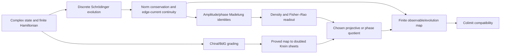
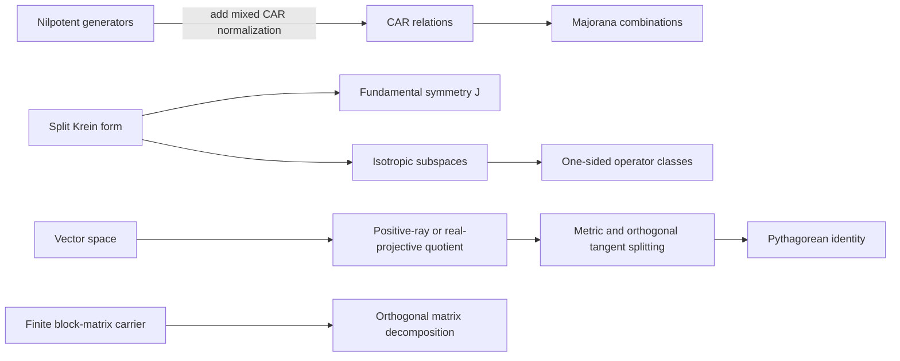

# Current mathematical scope: CAR, Krein symmetry, and projectivization

This note separates a finite algebraic model that can be stated precisely from
geometric connections that require additional definitions and proofs. The
repository contains useful pieces of this architecture, but it does not
currently establish one theorem deriving a three-mode projective metric from
fermionic nilpotency.

## 1. Nilpotent generators and the doubled space

Let `a₁, …, aₙ` be annihilation operators and `a₁†, …, aₙ†` their adjoints in
an algebra with unit. The canonical anticommutation relations (CAR) are

```text
aᵢ aⱼ + aⱼ aᵢ       = 0
aᵢ† aⱼ† + aⱼ† aᵢ†   = 0
aᵢ aⱼ† + aⱼ† aᵢ     = δᵢⱼ 1.
```

In particular, each generator is nilpotent. Nilpotency and mutual
anticommutation among the `aᵢ` alone do **not** imply the mixed CAR relation;
the adjoint generators and their normalization are additional structure.

On the real span of the `2n` CAR generators, set

```text
γᵢ⁺ = aᵢ + aᵢ†,       γᵢ⁻ = aᵢ − aᵢ†.
```

Then `(γᵢ⁺)² = 1`, `(γᵢ⁻)² = −1`, and distinct generators anticommute.
With this normalization they give a representation of the real Clifford
relations of signature `(n,n)`. Equivalently, a paired basis has the split
quadratic form `η = diag(Iₙ, −Iₙ)`. In the isotropic basis, the same form has
matrix

```text
η = [0  Iₙ]
    [Iₙ  0 ].
```

These matrices describe the same form in different bases.

## 2. Null subspaces, operators, and zero modes

For the off-diagonal form above, the two coordinate summands are totally
isotropic. If `I₊` is one such subspace, useful operator classes are

```text
Nₗ = {A : A|I₊ = 0}
Nᵣ = {B : im B ⊆ I₊}.
```

For `ψ ∈ I₊`, `A ∈ Nₗ`, and `B ∈ Nᵣ`, one has `Aψ = 0` and
`⟨ψ, Bψ⟩η = 0`, respectively. The second equality uses that `I₊` is totally
isotropic. These elementary facts do not, by themselves, identify either
class with a GNS kernel or establish an operator-algebraic quotient.

Fermion parity acts by a sign on odd CAR generators: if `P = (−1)^F`, then
`PγP = −γ` (equivalently, `Pγ = −γP`). Thus an odd Majorana generator
**anticommutes** with parity; it does not commute with it. Calling a Majorana a
zero mode also requires a specified Hamiltonian or Dirac operator and a
proved kernel or commutator statement on a specified representation. The
algebraic CAR relations alone do not establish topological protection.

## 3. Fundamental symmetry

A fundamental symmetry on a Hilbert space is represented here by a bounded
operator `J` satisfying `J² = 1` and `J* = J`. For the off-diagonal split
form, the sheet swap

```text
J = [0  Iₙ]
    [Iₙ  0 ]
```

satisfies `J² = 1`; moreover `ηJ = I`. It therefore converts the indefinite
form into the positive form `⟨x,y⟩J = η(x,Jy)` in this model. For a general
Krein space, positivity and compatibility with the chosen indefinite form
must be part of the hypotheses; the two operator equations alone are not a
complete definition in arbitrary coordinates.

## 4. Scale quotient and volume data

The quotient

```text
(V \\ {0}) / ℝ>0
```

identifies vectors that differ by a positive scalar. It is a space of
oriented rays: `x` and `−x` remain distinct. The usual real projective space
also identifies negative rescalings, using `ℝˣ` (or `ℝ \\ {0}`). These are
different quotients and should not be described interchangeably.

A positive homothety `x ↦ λx` rescales a quadratic form by `λ²`. Berezinians
and Pfaffians can encode volume information in their appropriate settings,
but they are not a universal extra quotient on an arbitrary real vector
space. A Berezinian requires an invertible map of a specified graded space;
a Pfaffian applies to a specified skew-symmetric form or matrix of even rank.
The identity `Pf(Ω)² = det(Ω)` belongs to that setting, with conventions
stated for the chosen basis and normalization.

## 5. Linear deformations and metrics

For `J = diag(Iₙ, −Iₙ)`, every real endomorphism has block form

```text
X = [A  B]
    [C  D].
```

Conjugation by `J` separates block-diagonal and off-diagonal parts:

```text
X₊ = (X + JXJ)/2 = [A  0]
                         [0  D]
X₋ = (X − JXJ)/2 = [0  B]
                         [C  0].
```

This is a genuine two-part decomposition of `gl(2n,ℝ)`. It does not give the
claimed three-mode decomposition into scale, chiral, and volume terms. In
particular, `gl(2n,ℝ)` has dimension `4n²`; a scalar, one constrained
off-diagonal block, and a diagonal block of the form
`diag(A,−Aᵀ)` with `tr A = 0` cannot span it. Any finer decomposition needs
its subspaces, dimensions, metric, and orthogonality proved explicitly.

The repository now also formalizes a finite 2×2 matrix analogue in
`lean/InfoGeometry/Projective/ProjectiveKreinDecomposition.lean`: every real
2×2 matrix is a sum of a scalar-diagonal part, an off-diagonal part, and a
traceless-diagonal part, and these parts are pairwise orthogonal for the
Frobenius inner product `Tr(AᵀB)`. This is a concrete low-dimensional linear
algebra result. It is not the proposed general `gl(2N,ℝ)` decomposition, and
its Frobenius squared norm is not the claimed projective distance.

Likewise, the expression

```text
arcosh(|⟨u,v⟩η| / sqrt(⟨u,u⟩η ⟨v,v⟩η))
```

is not a distance on the full positive-norm cone of signature `(n,n)` when
`n ≥ 2`: two orthogonal positive-norm vectors make the argument zero. A
Cayley–Klein or hyperbolic distance requires a more specific domain, such as a
same-time-orientation timelike cone in Lorentzian signature, and its metric
normalization must be stated. A scale/chiral/volume Pythagorean identity
further requires an actual metric and an orthogonal tangent-space splitting;
it does not follow from a quotient or block decomposition alone.

## 6. What the cited Lean modules establish

The repository contains kernel-checked pieces, with narrower scopes than the
full proposed synthesis:

| Area | Lean owner | Formalized scope |
|---|---|---|
| Nilpotency versus CAR | `lean/InfoGeometry/Canonical/LightConeCARFockBridge.lean` | Explicitly distinguishes a nilpotent light-cone pair from a CAR pair and requires a CAR realization. |
| Split `Cl(1,1)` example | `lean/InfoGeometry/Krein/DoubledKreinMobiusTwist.lean` | Proves nilpotency and a mixed CAR relation for concrete split-Clifford generators. |
| Fundamental symmetry | `lean/InfoGeometry/Krein/DoubledKreinMobiusTwist.lean` | Defines an involutive self-adjoint symmetry and the induced Krein adjoint. |
| Common and relative sheet scales | `lean/InfoGeometry/Canonical/RestrictedVolumeCharacter.lean` | Splits two scalar sheet parameters into common and relative parts. |
| Finite projective quotient | `proofs/ProjectiveSheetV4.lean` | Quotients a finite Pin extension by a central sign; it is not the positive-ray quotient of a real vector space. |
| Pfaffian layer | `lean/InfoGeometry/Volume/Pfaffian.lean` | Uses a square-root-of-absolute-determinant definition and states a 2D identity; it is not a general Pfaffian construction. |
| Horizontal/vertical split | `lean/InfoGeometry/Epistemology/RiemannianSubmersion.lean` and `lean/InfoGeometry/Canonical/NaturalGradientSubmersionFlow.lean` | Gives projector and metric-collapse lemmas; it does not establish the proposed projective three-mode metric. |
| 2×2 matrix analogue | `lean/InfoGeometry/Projective/ProjectiveKreinDecomposition.lean` | Proves scalar ratio homogeneity, a 2×2 matrix reconstruction, pairwise Frobenius orthogonality, and the resulting Pythagorean identity. It does not prove the general Krein/projective metric claim. |

## 7. Existing Madelung and chiral-fluid lanes

A repository-wide source pass finds more of this architecture than the
projective discussion alone suggests. These modules provide useful, separately
proved pieces; their names and shared vocabulary do not make them one derived
quantum-fluid theorem.

| Lane | Lean owner(s) | What the source proves, and its boundary |
|---|---|---|
| Differential Madelung calculus | `lean/InfoGeometry/Algebra/MadelungDerivation.lean`, `lean/InfoGeometry/Algebra/MadelungLogDensityCalculus.lean` | Derivation-algebra identities for amplitude curvature, logarithmic density score, Hamilton–Jacobi residual to Euler residual, quantum Euler, and amplitude transport to continuity. The continuity theorem assumes the transport equation; it does not derive it from Schrödinger evolution. |
| Fisher–Rao/amplitude relation | `lean/InfoGeometry/Information/FisherRaoMadelungIsometry.lean`, `lean/InfoGeometry/Canonical/MadelungFisherRaoSynthesisBridge.lean` | Square-root density identities and the scalar line-element identity under `dρ = 2u du`; the synthesis bridge assumes the amplitude/density and quantum-potential equations in its hypotheses. It does not construct a full infinite-dimensional Riemannian isometry. |
| Discrete Madelung state | `lean/InfoGeometry/Canonical/MadelungHydrodynamicPressureBridge.lean`, `lean/InfoGeometry/Canonical/MadelungHydrodynamic.lean` | A finite lattice state with positive density and phase gradient, velocity proportional to that gradient, and a quantum-potential expression using a supplied Laplacian of `√ρ`. The synthesis theorem reduces to the velocity identity and the zero-Laplacian special case; no discrete evolution or continuity law is defined there. |
| Spinor density and current | `lean/InfoGeometry/Canonical/SpinorHydrodynamicReadout.lean` and its consumers `SpinorReadoutRegularity.lean`, `SpinorReadoutOscillation.lean` | Defines density as norm square, current as the imaginary part of a complex inner product, and current/density readout away from zero density; proves bounds and derivative formulas. It explicitly does not posit wave evolution or derive a continuity equation. |
| Doubled amplitude and Krein sheets | `lean/InfoGeometry/Canonical/PolarizedMadelungBridge.lean`, `lean/InfoGeometry/Canonical/MadelungMoebiusChiralBridge.lean`, `lean/InfoGeometry/Krein/FiniteMadelungPhaseRotation.lean` | Uses the existing doubled real carrier, Hilbert normalization, positive/negative sheet projections, sheet densities, phase orbit, and finite real phase rotations. The Möbius/chiral bridge transports the sheet decomposition to existing idempotents; this is not a fluid-current evolution theorem. |
| Chiral BdG and Krein compatibility | `lean/InfoGeometry/Physics/BdGChiralBlockMatrix.lean`, `lean/InfoGeometry/EmergentVacuum/SplitChiralBdGCompatibility.lean` | Finite matrix identities for chiral grading, off-diagonal Dirac/BdG blocks, and a split-Krein/Peirce compatibility model. These modules do not identify their matrix state with the discrete Madelung state or the spinor current above. |
| Vorticity/chirality and Navier–Stokes-labelled results | `lean/InfoGeometry/Canonical/MadelungTopologicalSpin.lean`, `lean/InfoGeometry/Canonical/MadelungNavierStokesClosure.lean`, `lean/InfoGeometry/Physics/ArnoldHydrodynamicsBeltrami.lean`, `lean/InfoGeometry/Physics/SDiffCoadjointHelicityCasimir.lean` | The spin/vorticity equivalence assumes the operator identity `V = c • ChiralityOp`. The closure theorem assumes a skew-adjoint velocity field and applies the existing residual lemma; the Beltrami and helicity results are algebraic or conditional identities. These assumptions do not establish a PDE solution, fluid existence theorem, or derivation of vorticity from the Madelung current. |
| Finite-to-colimit observable lane | `lean/InfoGeometry/Canonical/MadelungMetriplecticTomitaFrame.lean`, `lean/InfoGeometry/Canonical/MadelungMetriplecticColimitBridge.lean`, consumed by `lean/InfoGeometry/TraceFormula/OperatorialISColimitFramework.lean` | Packages finite trace/action data and transports an observable action into the algebraic UHF colimit. It does not transport a continuity equation, chiral current, or Navier–Stokes evolution through that colimit. |

The practical gap is therefore not “no Madelung or chiral-fluid mathematics.”
Several local identities and conditional bridges already exist. The missing
work is a sequence of explicit carrier maps and evolution theorems joining
them. A defensible order is:

1. Choose one finite graph or lattice carrier and define a complex state,
   self-adjoint Hamiltonian, density, and edge current on that same carrier.
2. Prove norm conservation and a local continuity equation from the stated
   discrete Schrödinger evolution. Then express the state in amplitude/phase
   form and reuse the existing Fisher–Rao and Madelung identities where their
   hypotheses match.
3. Define the chiral/BdG grading on that carrier and prove how it acts on the
   Hamiltonian and current. Separately prove the compatibility map to the
   doubled Krein sheets; do not identify the grading with the fundamental
   symmetry without a theorem.
4. Specify the quotient actually used (positive rays, real projective classes,
   or phase orbits), construct the descended observables, and prove the
   quotient map respects the finite evolution. Do not infer a projective
   distance or three-mode tangent metric from scalar scale invariance.
5. Only after the finite evolution square commutes, prove its compatibility
   with the existing algebraic colimit maps. Keep Beltrami/helicity and
   Navier–Stokes PDE claims conditional until their analytic carrier and
   hypotheses are present.

This gives a dependency graph with parallel prerequisites rather than one
unjustified chain:



### Dependency map

The concepts form a dependency partial order, not one theorem chain. The
arrows below mean that a later construction needs the earlier structure; they
do not claim that the earlier data imply the later relations.



The projective quotient needs a vector space and a chosen equivalence
relation; it does not require `J`. Conversely, a quotient carrying a metric
needs additional metric data. The two off-diagonal CAR generators, a split
Krein carrier, and a projective state space remain separate models until a
specific map between them is defined and proved. The proposed dimensions for
a general four-way `gl(2N,ℝ)` split are only a numerical identity unless
actual subspaces, a direct-sum theorem, and the relevant projections are
provided.

Accordingly, links in the proposed chain should be presented as separate
models unless an explicit map and theorem connect their carriers. In
particular, the repository does not currently prove the parity-commutation,
Majorana-kernel, Berezinian/Pfaffian projectivization, or three-mode metric
claims stated in the broader synthesis. The new 2×2 result is limited to the
explicit matrix carrier and Frobenius product named above.
