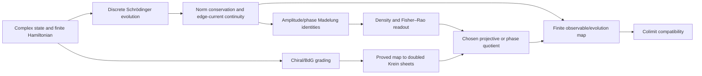
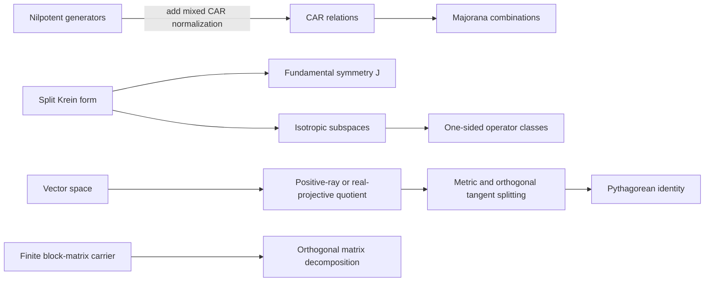

# Topic note: CAR, Krein symmetry, and projectivization

> **Source review:** 2026-11-15 at [abd5826](https://github.com/nickgou-nuke/info-geometry-lean/tree/abd5826b3676fab6231c66b646ec1cc5aeed6732) plus scoped working-tree kernel verification of `InfoGeometry.Foundations.InfoGeometryCoreLibrary` and `InfoGeometry.OperatorAlgebra.PeirceBiSandwich.All` (this scoped check covers the named targets and is not a whole-repository CI rebuild). This note reviews the named
> carriers and theorem statements below; it is not a repository-wide proof
> inventory or a report of fresh Lean compilation.

This note separates a finite algebraic model that can be stated precisely from
geometric connections that require additional definitions and proofs. The
repository contains useful pieces of this architecture. Nilpotency, CAR,
a Krein symmetry, and a projective quotient require explicit connecting
maps and metric hypotheses before they can support a single three-mode
projective-metric theorem.

## 1. Nilpotent generators and the doubled space

Let `a₁, …, aₙ` be annihilation operators and `a₁†, …, aₙ†` their adjoints in
an algebra with unit. The canonical anticommutation relations (CAR) are

```text
aᵢ aⱼ + aⱼ aᵢ       = 0
aᵢ† aⱼ† + aⱼ† aᵢ†   = 0
aᵢ aⱼ† + aⱼ† aᵢ     = δᵢⱼ 1.
```

In particular, each generator is nilpotent. Nilpotency and mutual
anticommutation among the `aᵢ` alone do **not** imply the mixed CAR relation;
the adjoint generators and their normalization are additional structure.

On the real span of the `2n` CAR generators, set

```text
γᵢ⁺ = aᵢ + aᵢ†,       γᵢ⁻ = aᵢ − aᵢ†.
```

Then `(γᵢ⁺)² = 1`, `(γᵢ⁻)² = −1`, and distinct generators anticommute.
With this normalization they give a representation of the real Clifford
relations of signature `(n,n)`. Equivalently, a paired basis has the split
quadratic form `η = diag(Iₙ, −Iₙ)`. In the isotropic basis, the same form has
matrix

```text
η = [0  Iₙ]
    [Iₙ  0 ].
```

These matrices describe the same form in different bases.

## 2. Null subspaces, operators, and zero modes

For the off-diagonal form above, the two coordinate summands are totally
isotropic. If `I₊` is one such subspace, useful operator classes are

```text
Nₗ = {A : A|I₊ = 0}
Nᵣ = {B : im B ⊆ I₊}.
```

For `ψ ∈ I₊`, `A ∈ Nₗ`, and `B ∈ Nᵣ`, one has `Aψ = 0` and
`⟨ψ, Bψ⟩η = 0`, respectively. The second equality uses that `I₊` is totally
isotropic. These elementary facts do not, by themselves, identify either
class with a GNS kernel or establish an operator-algebraic quotient.

Fermion parity acts by a sign on odd CAR generators: if `P = (−1)^F`, then
`PγP = −γ` (equivalently, `Pγ = −γP`). Thus an odd Majorana generator
**anticommutes** with parity; it does not commute with it. Calling a Majorana a
zero mode also requires a specified Hamiltonian or Dirac operator and a
proved kernel or commutator statement on a specified representation. The
algebraic CAR relations alone do not establish topological protection.

## 3. Fundamental symmetry

A fundamental symmetry on a Hilbert space is represented here by a bounded
operator `J` satisfying `J² = 1` and `J* = J`. For the off-diagonal split
form, the sheet swap

```text
J = [0  Iₙ]
    [Iₙ  0 ]
```

satisfies `J² = 1`; moreover `ηJ = I`. It therefore converts the indefinite
form into the positive form `⟨x,y⟩J = η(x,Jy)` in this model. For a general
Krein space, positivity and compatibility with the chosen indefinite form
must be part of the hypotheses; the two operator equations alone are not a
complete definition in arbitrary coordinates. On completed infinite-dimensional
Hilbert spaces, this modular sheet swap and chiral symmetry are realized on
$H_{\ell^2}$ in [lean/InfoGeometry/Canonical/ConcreteHilbertSewnAnomaly.lean](lean/InfoGeometry/Canonical/ConcreteHilbertSewnAnomaly.lean),
where self-adjointness with respect to the $\ell^2$ inner product and $Cl(1,1)$ anticommutation are kernel-proved.

## 4. Scale quotient and volume data

The quotient

```text
(V \\ {0}) / ℝ>0
```

identifies vectors that differ by a positive scalar. It is a space of
oriented rays: `x` and `−x` remain distinct. The usual real projective space
also identifies negative rescalings, using `ℝˣ` (or `ℝ \\ {0}`). These are
different quotients and should not be described interchangeably.

A positive homothety `x ↦ λx` rescales a quadratic form by `λ²`. Berezinians
and Pfaffians can encode volume information in their appropriate settings,
but they are not a universal extra quotient on an arbitrary real vector
space. A Berezinian requires an invertible map of a specified graded space;
a Pfaffian applies to a specified skew-symmetric form or matrix of even rank.
The identity `Pf(Ω)² = det(Ω)` belongs to that setting, with conventions
stated for the chosen basis and normalization.

## 5. Linear deformations and metrics

For `J = diag(Iₙ, −Iₙ)`, every real endomorphism has block form

```text
X = [A  B]
    [C  D].
```

Conjugation by `J` separates block-diagonal and off-diagonal parts:

```text
X₊ = (X + JXJ)/2 = [A  0]
                         [0  D]
X₋ = (X − JXJ)/2 = [0  B]
                         [C  0].
```

This is a genuine two-part decomposition of `gl(2n,ℝ)`. It does not give the
claimed three-mode decomposition into scale, chiral, and volume terms. In
particular, `gl(2n,ℝ)` has dimension `4n²`; a scalar, one constrained
off-diagonal block, and a diagonal block of the form
`diag(A,−Aᵀ)` with `tr A = 0` cannot span it. Any finer decomposition needs
its subspaces, dimensions, metric, and orthogonality proved explicitly.

The repository now also formalizes a finite 2×2 matrix analogue in
[lean/InfoGeometry/Projective/ProjectiveKreinDecomposition.lean](lean/InfoGeometry/Projective/ProjectiveKreinDecomposition.lean): every real
2×2 matrix is a sum of a scalar-diagonal part, an off-diagonal part, and a
traceless-diagonal part, and these parts are pairwise orthogonal for the
Frobenius inner product `Tr(AᵀB)`. This is a concrete low-dimensional linear
algebra result. It is not the proposed general `gl(2N,ℝ)` decomposition, and
its Frobenius squared norm is not the claimed projective distance.
This decomposition has now been generalized and soldered into arbitrary noncommutative
rings in [lean/InfoGeometry/Algebra/NoncommutativeWeylCartanKANPolarEquivariance.lean](lean/InfoGeometry/Algebra/NoncommutativeWeylCartanKANPolarEquivariance.lean)
and full $M_n(\mathbb{R})$ in [lean/InfoGeometry/Canonical/WeylTraceKANPolarEquivariance.lean](lean/InfoGeometry/Canonical/WeylTraceKANPolarEquivariance.lean),
proving the exact Plemelj–Newton trace-to-determinant formula, pairwise Frobenius orthogonality,
and the resulting Frobenius Pythagorean identity, alongside closed-form Iwasawa $K A N$ and polar factorizations.

Likewise, the expression

```text
arcosh(|⟨u,v⟩η| / sqrt(⟨u,u⟩η ⟨v,v⟩η))
```

is not a distance on the full positive-norm cone of signature `(n,n)` when
`n ≥ 2`: two orthogonal positive-norm vectors make the argument zero. A
Cayley–Klein or hyperbolic distance requires a more specific domain, such as a
same-time-orientation timelike cone in Lorentzian signature, and its metric
normalization must be stated. A scale/chiral/volume Pythagorean identity
further requires an actual metric and an orthogonal tangent-space splitting;
it does not follow from a quotient or block decomposition alone.

## 6. What the cited Lean modules establish

The cited source modules supply formal statements with the following
carriers and hypotheses:

| Area | Lean owner | Formalized scope |
|---|---|---|
| Nilpotency versus CAR | [lean/InfoGeometry/Canonical/LightConeCARFockBridge.lean](lean/InfoGeometry/Canonical/LightConeCARFockBridge.lean) | Explicitly distinguishes a nilpotent light-cone pair from a CAR pair and requires a CAR realization. |
| Split `Cl(1,1)` example | [lean/InfoGeometry/Krein/DoubledKreinMobiusTwist.lean](lean/InfoGeometry/Krein/DoubledKreinMobiusTwist.lean) | Proves nilpotency and a mixed CAR relation for concrete split-Clifford generators. |
| Fundamental symmetry | [lean/InfoGeometry/Krein/DoubledKreinMobiusTwist.lean](lean/InfoGeometry/Krein/DoubledKreinMobiusTwist.lean) | Defines an involutive self-adjoint symmetry and the induced Krein adjoint. |
| Common and relative sheet scales | [lean/InfoGeometry/Canonical/RestrictedVolumeCharacter.lean](lean/InfoGeometry/Canonical/RestrictedVolumeCharacter.lean) | Splits two scalar sheet parameters into common and relative parts. |
| Finite projective quotient | [proofs/ProjectiveSheetV4.lean](proofs/ProjectiveSheetV4.lean) | Quotients a finite Pin extension by a central sign; it is not the positive-ray quotient of a real vector space. |
| Pfaffian layer | [lean/InfoGeometry/Volume/Pfaffian.lean](lean/InfoGeometry/Volume/Pfaffian.lean) | Uses a square-root-of-absolute-determinant definition and states a 2D identity; it is not a general Pfaffian construction. |
| Horizontal/vertical split | [lean/InfoGeometry/Epistemology/RiemannianSubmersion.lean](lean/InfoGeometry/Epistemology/RiemannianSubmersion.lean) and [lean/InfoGeometry/Canonical/NaturalGradientSubmersionFlow.lean](lean/InfoGeometry/Canonical/NaturalGradientSubmersionFlow.lean) | Gives projector and metric-collapse lemmas; it does not establish the proposed projective three-mode metric. |
| 2×2 matrix analogue | [lean/InfoGeometry/Projective/ProjectiveKreinDecomposition.lean](lean/InfoGeometry/Projective/ProjectiveKreinDecomposition.lean) | Proves scalar ratio homogeneity, a 2×2 matrix reconstruction, pairwise Frobenius orthogonality, and the resulting Pythagorean identity. It does not prove the general Krein/projective metric claim. |
| Order-theoretic Krein positivity and `RingCat` colimit | [lean/InfoGeometry/Algebra/NoncommutativeKreinMathlibBridge.lean](lean/InfoGeometry/Algebra/NoncommutativeKreinMathlibBridge.lean) | In any `[Ring B] [PartialOrder B] [IsOrderedAddMonoid B] [StarRing B] [StarOrderedRing B]`, establishes `towerTrace_star_mul_self_nonneg` and positive-sector Krein pairing positivity `positive_sector_krein_pairing_nonneg` on `ClTower B n`, native Mathlib `RingCat` colimit `ClTowerColimit B`, and commutation of `clTowerHom` with `kreinAdjoint` (`clTowerHom_kreinAdjoint`). *Boundary*: The positivity is an algebraic `StarOrderedRing` result for the formal Clifford tower; it does not construct a continuous Hilbert-space Krein completion. |
| Positive-sector Krein and Peirce spine intertwining | [lean/InfoGeometry/Algebra/KreinPeirceTowerIntertwine.lean](lean/InfoGeometry/Algebra/KreinPeirceTowerIntertwine.lean) | Intertwines positive-sector Krein projections with Peirce upper-corner compression `peirce11 P X` (`peirce11_positive_sector_krein_positivity_and_bianchi`), establishing simultaneous Peirce corner defect identities, Maurer–Cartan self-dual Bianchi identities, `StarOrderedRing` Krein positivity `0 ≤ towerTrace (kreinAdjoint γ₀ n (peirce11 P X) * peirce11 P X)`, and `RingHom` naturality/colimit transport (`clTower_and_colimit_peirce_transport`) across `m ≤ n`. *Boundary*: Operates on formal algebraic idempotents and Clifford tower projections; does not assert topological protection or physical ground-state degeneracy. |
| Peirce Tetraktys colimit and trace non-negativity | [lean/InfoGeometry/Algebra/PeirceTetraktysKreinBridge.lean](lean/InfoGeometry/Algebra/PeirceTetraktysKreinBridge.lean) | Connects `Cl(1,1)^{\otimes n}` inductive colimit `Limit` with `KreinPeirceTowerIntertwine`, proving `towerTrace_mul_star_self_nonneg` and `towerTrace_genV_nonneg` (`0 ≤ towerTrace (genV P A (star A))`) for self-adjoint `P` in `ClTower B n`, and that `ofStage n : Stage n →+* Limit` preserves `peirce11`, `idempotencyDefect`, `peirceMaurerCartanCurvature`, and `peirceCovariantDeriv` (`ofStage_preserves_peirce_yang_mills`). *Boundary*: The non-negativity applies to the trace of `genV` in star-ordered rings; it does not equate `genV` with analytic flux on a Riemannian manifold. |
| Clifford-8 BdG horizon and TFD unitarity | [lean/InfoGeometry/OperatorAlgebra/PeirceBiSandwich/Clifford8BdGHorizon.lean](lean/InfoGeometry/OperatorAlgebra/PeirceBiSandwich/Clifford8BdGHorizon.lean) | In $M_8(\mathbb{Z})$ and $M_8(\mathbb{R})$, constructs endogenous supercolor bridge `endogenous_supercolor_bridge_theorem`, Clifford-8 singlet Andreev reflection `endogenous_clifford8_singlet_andreev_closure`, $N = 4$ dual chiral supercharge closure `dual_chiral_supercharge_closure`, boost anticommutation and TFD unitarity `boost_anticomm_and_tfd_unitary`, all-orders trigonometric horizon leakage `all_orders_trigonometric_horizon_leakage`, 4-channel spin-chiral Kraus completeness `four_channel_spin_chiral_kraus_completeness`, and vanishing pregeometric spacetime iff $V = 0$ (`pregeometric_spacetime_vanishes_iff_V_zero`). *Boundary*: Concrete finite 8×8 matrix representation; does not construct an infinite-dimensional continuum thermal field theory or curved spacetime metric. |
| Supertwistor-16 lift and real 3D Bloch ball | [lean/InfoGeometry/OperatorAlgebra/PeirceBiSandwich/Supertwistor16AndRealBloch.lean](lean/InfoGeometry/OperatorAlgebra/PeirceBiSandwich/Supertwistor16AndRealBloch.lean) | Proves the $M_2(\mathbb{R})$ real-rebit symmetric centralizer no-go (`real_rebit_symmetric_centralizer_trivial`), lifts to four-factor real supertwistor carrier $\mathrm{Mat16Prod} := M_8(\mathbb{R}) \otimes M_2(\mathbb{R})_{\mathrm{phase}} \simeq M_{16}(\mathbb{R})$ (`mat16Equiv`) with two orthogonal skew-adjoint complex structures $J_{\mathrm{spin16}}$ and $J_{\mathrm{phase16}}$ (`supertwistor16_dual_complex_structures_and_traces`), skew Tomita generator $G_{\mathrm{Tomita16}}$ with compact orthogonal flow `supertwistor16_skew_tomita_unitary_flow`, and full 3D real qubit Bloch ball $\mathbb{B}^3$ reconstruction (`mem_real_qubit_hermitian_iff_bloch_span`, `real_bloch_ball_pauli_reconstruction`) with $S^2$ idempotent boundary. *Boundary*: Relies on explicit tensor product $M_8(\mathbb{R}) \otimes M_2(\mathbb{R})_{\mathrm{phase}}$ to unlock complex phase rotations; does not bypass the real-rebit no-go within $M_8(\mathbb{R})$ alone. |
| Custodial twin loop protection and Josephson lattice | [lean/InfoGeometry/OperatorAlgebra/PeirceBiSandwich/CustodialTwinLoopAndJosephsonLattice.lean](lean/InfoGeometry/OperatorAlgebra/PeirceBiSandwich/CustodialTwinLoopAndJosephsonLattice.lean) | Proves $\mathbb{Z}_2$ real freeze in $M_8(\mathbb{R})$ (`z2_real_freeze_M8`: $D_{1,8}$ symmetric, $D_{2,8}$ skew-symmetric, $\Sigma$ symmetric) vs. $U(1)$ BdG circle $\Delta_{U(1)}(\theta)$ with gap $\Delta^2 = V_{16}$ in $\mathrm{Mat16Prod}$ (`comm_G_U1_D1`, `delta_U1_sq`); custodial twin involution $W_{\mathrm{twin}} = \Phi + P_0$ (`custodial_twin_involution_Z`) with all-loop polynomial odd-power vanishing `custodial_all_loop_odd_power_vanishing` ($P_0 F(H) D_1^{2m+1} G(H) P_0 = 0$); boost commutation for even powers `custodial_boost_comm_even_powers`; 1-loop parity-odd birefringence `one_loop_parity_odd_birefringence` ($(2 \sin \theta) \bullet M_{\mathrm{biref}}$); Josephson coupling `josephson_cosine_coupling` ($8 \cos(\theta_x - \theta_y)$); and sub-isometric off-shell defect `casimirDefect_V16_eps`. *Boundary*: Operates on finite matrix products in $M_8(\mathbb{R})$ and $\mathrm{Mat16Prod}$; loop vanishing is an algebraic polynomial evaluation theorem (`Polynomial.aeval`), not a renormalized continuum Feynman path integral. |
| Noncommutative Weyl–Cartan split and trace-to-determinant | [lean/InfoGeometry/Algebra/NoncommutativeWeylCartanKANPolarEquivariance.lean](lean/InfoGeometry/Algebra/NoncommutativeWeylCartanKANPolarEquivariance.lean) | Over `{B : Type*} [Ring B]` and `[StarRing B]`, establishes the four-stage poset $(\mathcal{K}\mathcal{P}, \preceq)$: $\mathcal{K}\mathcal{P}_1$ decomposes $2 \bullet M = M_{\mathrm{Weyl}} + M_{\mathrm{sym}}^0 + M_{\mathrm{antisym}}^0$, proves $(\mathrm{Tr}\,M)^2 - \mathrm{Tr}(M^2) = \mathrm{symDet}(M)$ (`weyl_cartan_split_and_noncommutative_trace_to_det`), characterizes central diagonal embeddings (`fiberEmbed_central_iff`) with non-central witness in $M_2(M_2(\mathbb{Z}))$ (`weylScalePart_noncentral_witness`), and verifies $\mathfrak{gl}_2$ Cartan brackets; $\mathcal{K}\mathcal{P}_2$ proves Iwasawa $K, A, N$ subgroup multiplication laws and polar Gram reduction $M^\dagger M = (A N)^\dagger (A N)$ with noncommutative Schur complement recovery (`iwasawa_kan_subgroups_and_polar_gram_reduction`); $\mathcal{K}\mathcal{P}_3$ proves unitary symmetry equivariance of polar factorizations under $G(\cdot)G^{-1}$ over any $\star$-ring (`polar_decomposition_unitary_equivariance`); $\mathcal{K}\mathcal{P}_4$ proves KAN symmetry equivariance under diagonal scaling, fiber gauge, chirality parity, and Weyl reflection (`iwasawa_kan_symmetry_equivariance`). *Boundary*: Operates on general algebraic rings and $\star$-rings; does not assert analytic polar existence on arbitrary non-normed carriers. |
| Canonical Weyl trace scaling, Iwasawa KAN and polar decomposition on $GL^+(2,\mathbb{R})$ | [lean/InfoGeometry/Canonical/WeylTraceKANPolarEquivariance.lean](lean/InfoGeometry/Canonical/WeylTraceKANPolarEquivariance.lean) | In $M_n(\mathbb{R})$, $M_n(\mathbb{C})$, and $GL^+(2,\mathbb{R})$, solders the real split to the noncommutative owner (`real_cartan_split_soldered_to_noncommutative_owner`); proves full $M_n(\mathbb{R})$ orthogonal congruence covariance (`real_weyl_cartan_congruence_equivariance`), pairwise Frobenius orthogonality (`real_weyl_cartan_frobenius_orthogonality`), and Frobenius Pythagorean identity (`real_weyl_cartan_frobenius_pythagorean`); establishes constructive closed-form Iwasawa $K A N$ factorization and uniqueness on $GL^+(2,\mathbb{R})$ (`real_gl2_pos_iwasawa_factorization`, `real_gl2_pos_kan_unique`); proves constructive closed-form polar decomposition $M = K P$ with $P > 0$ and uniqueness on $GL^+(2,\mathbb{R})$ (`real_gl2_pos_polar_factorization`, `real_gl2_pos_polar_unique`); proves $O(2)$ orthogonal conjugation equivariance (`real_gl2_pos_polar_conjugation_equivariance`) while establishing that Euclidean polar decomposition is *not* equivariant under general $GL(2,\mathbb{R})$ conjugation (`real_gl2_euclidean_polar_not_equivariant_under_general_conjugation`); and links $P^2 = (A N)^T (A N)$ via `real_iwasawa_polar_gram_bridge`. *Boundary*: Uniqueness and factorizations apply to $GL^+(2,\mathbb{R})$ ($\det M > 0$) and finite matrix algebras; polar equivariance is strictly restricted to orthogonal conjugations. |
| Finite-matrix Schrödinger GKSL flow and ODE uniqueness | [lean/InfoGeometry/Modular/SchrodingerGKSLFlowBridge.lean](lean/InfoGeometry/Modular/SchrodingerGKSLFlowBridge.lean) (mirrored at [src/InfoGeometry/Modular/SchrodingerGKSLFlowBridge.lean](src/InfoGeometry/Modular/SchrodingerGKSLFlowBridge.lean)) | On finite complex matrix algebras $M_n(\mathbb{C})$ with arbitrary finite jump families $V : \iota \to M_n(\mathbb{C})$ and Hamiltonian $H$, constructs continuous linear generator `generatorCLM`, restricted real endomorphism `generatorEnd`, and bounded 1-parameter exponential flow `gkslFlow`; proves operator-valued semigroup law `gkslFlow_add` ($T_{s+t} = T_s \circ T_t$); proves orbit equation `hasDerivAt_gkslFlow_orbit` ($\frac{d}{dt} T_t(X) = \mathcal{L}(T_t(X))$); proves global ODE solution uniqueness `gkslFlow_unique_of_ode` via finite-dimensional Lipschitz integration; and establishes real trace preservation `realTrace_gkslFlow`. *Boundary*: Applies to bounded finite-dimensional matrix ODE evolution; does not assert complete positivity, Kraus representation, or convergence to Gibbs states. |
| Off-diagonal Bloch-ball Umegaki divergence and quantum Spohn dissipation | [lean/InfoGeometry/Modular/BlochBallUmegakiAndQuantumSpohn.lean](lean/InfoGeometry/Modular/BlochBallUmegakiAndQuantumSpohn.lean) | On self-adjoint unit-trace states $\rho \in M_2(\mathbb{C})$ in the open Bloch ball ($\|\vec{r}\|^2 = z^2 + 4 |\rho_{01}|^2 < 1$), establishes the 10-node poset $(Y_0 \prec \dots \prec Y_9)$: evaluates continuous functional calculus `CFC.log` via two-sheet spectral projector $P$ (`spectralProjector_twoSheet_and_cfc_log`); proves full noncommutative Umegaki relative entropy Pythagorean theorem $D_{\mathrm{Umegaki}}(\rho \| \rho_\theta) = (\phi(r) - \phi(z)) + D_\phi(z \| \eta_\theta)$ (`umegakiKernel_trace_and_coherence_pythagoras`), isolating strictly positive off-diagonal coherence divergence $\phi(r) - \phi(z) \ge 0$ vanishing iff $\rho_{01} = 0$; proves forward Kolmogorov generator ODE `hasDerivAt_thermalSemigroupC_eq_lindbladian`; proves forward-positivity monoid requiring $t \ge 0$ (`forward_monoid_positivity_iff_and_backward_aporia`); establishes operator Spohn dissipation rate $-\operatorname{Re}\operatorname{Tr}(\mathcal{L}(\sigma)(\log\sigma - \log\rho_\theta)) = \sigma_{\mathrm{KMS}}(\gamma, \theta, \sigma) \ge 0$ (`operator_spohn_rate_and_strict_coherent_dissipation`) with strictly positive dissipation for $\sigma_{01} \ne 0$; proves $\frac{d}{dt} D_{\mathrm{Umegaki}}(T_t(\rho) \| \rho_\theta) = -\sigma_{\mathrm{KMS}}(T_t(\rho))$ and global asymptotic relaxation to Gibbs density $\rho_\theta$ (`master_bloch_umegaki_spohn_and_gibbs_relaxation`). *Boundary*: Operates on $M_2(\mathbb{C})$ states in the open Bloch ball ($r < 1$) where states are strictly positive and `CFC.log` is non-singular; does not extend to pure boundary states ($r = 1$) or infinite-dimensional von Neumann algebras. |
| Infinite-dimensional Hilbert-space sewn boundary anomaly cancellation on $H_{\ell^2}$ | [lean/InfoGeometry/Canonical/ConcreteHilbertSewnAnomaly.lean](lean/InfoGeometry/Canonical/ConcreteHilbertSewnAnomaly.lean) | On the completed infinite-dimensional real Hilbert space $H_{\ell^2}(E) := \ell^2(\mathrm{BinaryCantorBoundary}, \mathrm{DoubledSpace}\,E)$, lifts the modular swap involution `modular_j` and spectral involution `spectral_epsilon` to continuous linear maps `J_lp_clm` and `epsilon_lp_clm`; proves isometries `J_lp_clm_isometry`, `epsilon_lp_clm_isometry` and involutions; establishes $Cl(1,1)$ anticommutation `J_lp_clm_anticomm_epsilon_lp_clm` ($J \epsilon = -\epsilon J$); proves self-adjointness `inner_J_lp_clm_selfAdjoint` wrt Mathlib's `lp.instInnerProductSpace`; establishes Cuntz $O_2$ branch sewing invariance `S_left_lp_clm_sewn_invariant` and `S_right_lp_clm_sewn_invariant` ($J S_i J = S_i$); proves operator non-commutativity `S_left_right_lp_clm_noncomm`; constructs canonical non-zero sewn vacuum state `canonicalCantorSewnState`; and proves infinite-dimensional boundary anomaly cancellation: paired chiral expectation cancellation $\langle v, \epsilon B v \rangle + \langle J v, \epsilon B (J v) \rangle = 0$ (`infinite_hilbert_paired_chiral_summand_zero`) for all $J$-sewn bounded operators $B$ ($J B J = B$), chiral expectation vanishing $\langle \psi, \epsilon B \psi \rangle = 0$ on $J$-fixed states (`infinite_hilbert_sewn_chiral_expectation_zero`), and infinite-series chiral index vanishing $\sum_{i \in \iota} \langle e_i, \epsilon B e_i \rangle = 0$ for $J$-paired families (`infinite_hilbert_tsum_chiral_index_zero`). *Boundary*: Operates on completed Cantor boundary $\ell^2$ sequences; assumes exact sewing invariance $J B J = B$; does not claim anomaly cancellation for un-sewn operators or unregularized continuum 4D gauge theories. |
| Discrete Osterwalder–Schrader transfer semigroup & mass gap | [lean/InfoGeometry/OperatorAlgebra/OsterwalderSchraderTransferSemigroupAndMassGap.lean](lean/InfoGeometry/OperatorAlgebra/OsterwalderSchraderTransferSemigroupAndMassGap.lean) | Formalizes the Euclidean lattice transfer matrix $T(J) \in M_2(\mathbb{R})$ (`transferMat`, `transferMat_posDef`), spectral projector decomposition $P_0 + (\tanh J) P_1$ (`normTransferMat_pow`), strictly positive spectral mass gap $\Delta(J) = -\log(\tanh J) > 0$ (`spectralMassGap_pos`), exponential clustering $(\tanh J)^L = e^{-L\Delta(J)} \to 0$ (`normTransferMat_pow_eq_exp_gap`, `normTransferMat_clustering_tendsto_zero`), bridge to the Elitzur Wilson string expectation (`expect_wilson_from_transferMat`), non-commutativity witness `transferMat_noncomm_witness`, and transfer-matrix-weighted 2-slice Osterwalder–Schrader reflection positivity (non-trivial time-reflection involution `osReflect`, Boltzmann partition expectation `osExpectation`, `os_reflection_positivity` for $J > 0$, antiferromagnetic $J < 0$ failure `os_reflection_positivity_fails_antiferro`, Cauchy–Schwarz `os_cauchy_schwarz`, and $L$-step semigroup positivity `os_semigroup_reflection_positivity`). *Boundary*: Lattice transfer-matrix model; continuum 4D Yang–Mills QFT in the $a \to 0$ limit remains open. |
| Continuous $L^2([0,1])$ Cantor Fourier uncertainty contraction | [lean/InfoGeometry/Analysis/ContinuousL2CantorFourierUncertainty.lean](lean/InfoGeometry/Analysis/ContinuousL2CantorFourierUncertainty.lean) | Formalizes normalized continuous trigonometric mode pairs `modeSin`, `modeCos`, proving pointwise energy $s_n(x)^2 + c_n(x)^2 = 2$ (`mode_sq_sum_eq_two`), exact interval energy $2(b-a)$ (`interval_energy_mode_pair`), wavepacket Cauchy–Schwarz bounds (`wavepacket_pointwise_cauchy_schwarz`, `wavepacket_interval_energy_bound`), multiscale Cantor contraction $((b-m)^2/b)^k \to 0$ for $b-m < \sqrt{b}$ (`cantor_fup_ratio_lt_one`, `continuous_cantor_wavepacket_contraction`, `continuous_cantor_fup_tendsto_zero`), and concrete witness at $b=4, m=3$ (`continuous_cantor_witness_b4_m3`). *Boundary*: Continuous $L^2([0,1])$ wavepacket bounds; full $L^2(\mathbb{R})$ Bourgain–Dyatlov FUP for arbitrary fractals remains open. |
| Global $SO(5,5)$ Lie group, boost subgroup & conformal 3-grading | [lean/InfoGeometry/Lie/SO55GlobalConformalPrecursors.lean](lean/InfoGeometry/Lie/SO55GlobalConformalPrecursors.lean) | Formalizes the global Lie group $SO(5,5)$ (`IsSO55GroupMatrix`: $M^T J_{5,5} M = J_{5,5} \wedge \det M = 1$), group closure (`isSO55_one`, `isSO55_mul`), Krein isometry (`isSO55_isometry`), explicit 1-parameter non-compact hyperbolic boost subgroup $\Lambda(\xi)$ (`so55Boost`, `so55Boost_add`, `so55Boost_isSO55`, `so55Boost_unbounded`), null quadric boundary invariance (`nullQuadric_invariant`), and conformal parabolic 3-grading of $\mathfrak{so}(5,5)$ ($[D, P_k] = P_k$, $[D, K_k] = -K_k$, $P_k^3 = 0$). *Boundary*: Finite-matrix $SO(5,5)$ and $\mathfrak{so}(5,5)$; infinite-dimensional curved-manifold CFT representations remain open. |
| Logarithmic integral $\mathrm{li}(x)$ calculus & $\zeta$ real-pole divergence | [lean/InfoGeometry/Arithmetic/RiemannZetaLogarithmicIntegralPrecursors.lean](lean/InfoGeometry/Arithmetic/RiemannZetaLogarithmicIntegralPrecursors.lean) | Proves FTC derivative $\mathrm{li}'(x) = 1/\log x$ (`hasDerivAt_li`, `li_two`, `li_pos`), integration-by-parts asymptotic expansion $\mathrm{li}(x) = x/\log x - 2/\log 2 + \int_2^x 1/(\log t)^2$ (`fundamental_li_by_parts`), two-sided remainder bounds (`li_sub_div_log_pos`, `li_le_linear_over_log_sq`), constructive Chebyshev-to-$\mathrm{li}$ prime bound (`primeCounting_le_chebyshev_li`), and complex-analytic real-pole divergence $\lim_{\sigma \to 1^+} \mathrm{Re}(\zeta(\sigma)) = +\infty$ (`tendsto_riemannZeta_one_right_atTop`). *Boundary*: Precursor bounds; full asymptotic PNT and Riemann Hypothesis error bound remain open. |
| Penrose & 4D colimit–continuum constructive unification | [lean/InfoGeometry/Twistor/PenroseMinkowskiTetradDyadBridge.lean](lean/InfoGeometry/Twistor/PenroseMinkowskiTetradDyadBridge.lean), [lean/InfoGeometry/OperatorAlgebra/PenroseConformalAndInflationColimitBridge.lean](lean/InfoGeometry/OperatorAlgebra/PenroseConformalAndInflationColimitBridge.lean), [lean/InfoGeometry/Categorical/FourDimColimitContinuumSynthesis.lean](lean/InfoGeometry/Categorical/FourDimColimitContinuumSynthesis.lean) | Links Minkowski `(1,3)` / Newman–Penrose tetrad / Pauli soldering / `Q55` celestial slice / Penrose–Onsager–Yang rank-1 spinor dyads (`rankOneKernel`) / oblique-vs-Moore–Penrose projector defect; instantiates `AeonConformalCrossover` on `Fin 10 → ℝ` and `FibonacciK0` Kite/Dart multiplication into `Cl(5,5)` Bott colimits; and promotes `ConcreteProjectiveLimit`, `Hom(colim, K) ≃ lim Hom(-, K)` duality, and a $16^n$-site 4D dyadic refinement tower (`Field4DContinuum`) bridged to Amplituhedron, Balaban coarse-graining, Zorn UHF, and GNS Hilbert colimits. *Boundary*: Constructive algebraic/finite/filtered colimit unification; analytic 4D YM QFT and curved-manifold CFT remain open. |

### Conditional tripotent parity and kernel results

The reviewed revision also contains the following results. They concern
specified real-algebra or endomorphism carriers; they do not identify an odd
CAR Majorana generator with an operator commuting with fermion parity.

| Owner and result | Hypotheses and established conclusion | Boundary |
|---|---|---|
| [PeirceSpine/TripotentParity.lean](lean/InfoGeometry/OperatorAlgebra/PeirceSpine/TripotentParity.lean): `oddGrade_projZero`, `evenGrade_projZero`, `parityConj_projZero_of_mem_fiveGradeRange` | In `[Ring A] [Algebra ℝ A]`, the odd part for `P₀ = 1 - T*T` is the sum of adjoint grades `−1,+1`; the even part is the sum of grades `−2,0,+2`. The polynomial regroupings need no tripotence. With `T*T*T = T`, conjugation by `invS P₀` acts on each grade range with the corresponding sign. | The zero-mode cut differs from the positive/negative spectral cut. `T*T` remains an operator. |
| [Core/TripotentChiralRestriction.lean](lean/InfoGeometry/Core/TripotentChiralRestriction.lean): `anticommute_endProjZero`, `zeroModeRestriction_sq_of_anticommute`, `zeroModeChiralEquiv` | For `T Γ : Module.End ℝ V`, anticommutation `Γ*T = -(T*Γ)` implies commutation with `1 - T*T` and exchange of the positive/negative polynomial projectors. With `T^3 = T` and `Γ*Γ = 1`, the restriction of `Γ` to `zeroModeCarrier T = ker T` is an involution and a real linear equivalence. | The result preserves the existing kernel; it does not produce a nonzero kernel vector, identify `Γ` with a CAR Majorana, or prove topological protection. |
| [Physics/NuclearFiveGradeParity.lean](lean/InfoGeometry/Physics/NuclearFiveGradeParity.lean): `totalParity_invariant_of_fiveGrade`, `totalParity_invariant_projected_block` | For a tripotent `T` in an associative real algebra, diagonal coefficients in grade `0` and transition coefficients in grades `+1,−1` make the block Hamiltonian invariant under the combined internal/external parity. Applying the five-grade projectors constructs such a block from arbitrary four inputs. | The theorem is a parity-invariance statement for this block Hamiltonian. It does not assert that an individual odd CAR generator commutes with fermion parity. |

The kernel involution and the zero-mode Peirce parity are distinct actions.
Their relation to a Hamiltonian, CAR representation, or projective metric
must be stated through a map and theorem on the chosen carrier. These
conditional positive results preserve the qualifications in Sections 2–5.

## 7. Existing Madelung and chiral-fluid lanes

The following Madelung and chiral-fluid owners provide separately stated
results. Their names and shared vocabulary do not make them one derived
quantum-fluid theorem.

| Lane | Lean owner(s) | What the source proves, and its boundary |
|---|---|---|
| Differential Madelung calculus | [lean/InfoGeometry/Algebra/MadelungDerivation.lean](lean/InfoGeometry/Algebra/MadelungDerivation.lean), [lean/InfoGeometry/Algebra/MadelungLogDensityCalculus.lean](lean/InfoGeometry/Algebra/MadelungLogDensityCalculus.lean) | Derivation-algebra identities for amplitude curvature, logarithmic density score, Hamilton–Jacobi residual to Euler residual, quantum Euler, and amplitude transport to continuity. The continuity theorem assumes the transport equation; it does not derive it from Schrödinger evolution. |
| Fisher–Rao/amplitude relation | [lean/InfoGeometry/Information/FisherRaoMadelungIsometry.lean](lean/InfoGeometry/Information/FisherRaoMadelungIsometry.lean), [lean/InfoGeometry/Canonical/MadelungFisherRaoSynthesisBridge.lean](lean/InfoGeometry/Canonical/MadelungFisherRaoSynthesisBridge.lean) | Square-root density identities and the scalar line-element identity under `dρ = 2u du`; the synthesis bridge assumes the amplitude/density and quantum-potential equations in its hypotheses. It does not construct a full infinite-dimensional Riemannian isometry. |
| Discrete Madelung state | [lean/InfoGeometry/Canonical/MadelungHydrodynamicPressureBridge.lean](lean/InfoGeometry/Canonical/MadelungHydrodynamicPressureBridge.lean), [lean/InfoGeometry/Canonical/MadelungHydrodynamic.lean](lean/InfoGeometry/Canonical/MadelungHydrodynamic.lean) | A finite lattice state with positive density and phase gradient, velocity proportional to that gradient, and a quantum-potential expression using a supplied Laplacian of `√ρ`. The synthesis theorem reduces to the velocity identity and the zero-Laplacian special case; no discrete evolution or continuity law is defined there. |
| Spinor density and current | [lean/InfoGeometry/Canonical/SpinorHydrodynamicReadout.lean](lean/InfoGeometry/Canonical/SpinorHydrodynamicReadout.lean) and its consumers `SpinorReadoutRegularity.lean`, `SpinorReadoutOscillation.lean` | Defines density as norm square, current as the imaginary part of a complex inner product, and current/density readout away from zero density; proves bounds and derivative formulas. It explicitly does not posit wave evolution or derive a continuity equation. |
| Doubled amplitude and Krein sheets | [lean/InfoGeometry/Canonical/PolarizedMadelungBridge.lean](lean/InfoGeometry/Canonical/PolarizedMadelungBridge.lean), [lean/InfoGeometry/Canonical/MadelungMoebiusChiralBridge.lean](lean/InfoGeometry/Canonical/MadelungMoebiusChiralBridge.lean), [lean/InfoGeometry/Krein/FiniteMadelungPhaseRotation.lean](lean/InfoGeometry/Krein/FiniteMadelungPhaseRotation.lean) | Uses the existing doubled real carrier, Hilbert normalization, positive/negative sheet projections, sheet densities, phase orbit, and finite real phase rotations. The Möbius/chiral bridge transports the sheet decomposition to existing idempotents; this is not a fluid-current evolution theorem. |
| Chiral BdG and Krein compatibility | [lean/InfoGeometry/Physics/BdGChiralBlockMatrix.lean](lean/InfoGeometry/Physics/BdGChiralBlockMatrix.lean), [lean/InfoGeometry/EmergentVacuum/SplitChiralBdGCompatibility.lean](lean/InfoGeometry/EmergentVacuum/SplitChiralBdGCompatibility.lean) | Finite matrix identities for chiral grading, off-diagonal Dirac/BdG blocks, and a split-Krein/Peirce compatibility model. These modules do not identify their matrix state with the discrete Madelung state or the spinor current above. |
| Vorticity/chirality and Navier–Stokes-labelled results | [lean/InfoGeometry/Canonical/MadelungTopologicalSpin.lean](lean/InfoGeometry/Canonical/MadelungTopologicalSpin.lean), [lean/InfoGeometry/Canonical/NavierStokesSingularityClosure.lean](lean/InfoGeometry/Canonical/NavierStokesSingularityClosure.lean), [lean/InfoGeometry/Physics/ArnoldHydrodynamicsBeltrami.lean](lean/InfoGeometry/Physics/ArnoldHydrodynamicsBeltrami.lean), [lean/InfoGeometry/Physics/SDiffCoadjointHelicityCasimir.lean](lean/InfoGeometry/Physics/SDiffCoadjointHelicityCasimir.lean) | The spin/vorticity equivalence assumes the operator identity `V = c • ChiralityOp`. The closure theorem assumes a skew-adjoint velocity field and applies the existing residual lemma; the Beltrami and helicity results are algebraic or conditional identities. These assumptions do not establish a PDE solution, fluid existence theorem, or derivation of vorticity from the Madelung current. |
| Finite-to-colimit observable lane | [lean/InfoGeometry/Canonical/MadelungMetriplecticTomitaFrame.lean](lean/InfoGeometry/Canonical/MadelungMetriplecticTomitaFrame.lean), [lean/InfoGeometry/Canonical/MadelungMetriplecticColimitBridge.lean](lean/InfoGeometry/Canonical/MadelungMetriplecticColimitBridge.lean), consumed by [lean/InfoGeometry/TraceFormula/OperatorialISColimitFramework.lean](lean/InfoGeometry/TraceFormula/OperatorialISColimitFramework.lean) | Packages finite trace/action data and transports an observable action into the algebraic UHF colimit. It does not transport a continuity equation, chiral current, or Navier–Stokes evolution through that colimit. |

Several local identities and conditional bridges already exist. To join
the models in this note, a connecting construction must provide explicit
carrier maps and evolution theorems. A useful dependency order is:

1. Choose one finite graph or lattice carrier and define a complex state,
   self-adjoint Hamiltonian, density, and edge current on that same carrier.
2. Prove norm conservation and a local continuity equation from the stated
   discrete Schrödinger evolution. Then express the state in amplitude/phase
   form and reuse the existing Fisher–Rao and Madelung identities where their
   hypotheses match.
3. Define the chiral/BdG grading on that carrier and prove how it acts on the
   Hamiltonian and current. Separately prove the compatibility map to the
   doubled Krein sheets; do not identify the grading with the fundamental
   symmetry without a theorem.
4. Specify the quotient actually used (positive rays, real projective classes,
   or phase orbits), construct the descended observables, and prove the
   quotient map respects the finite evolution. Do not infer a projective
   distance or three-mode tangent metric from scalar scale invariance.
5. Only after the finite evolution square commutes, prove its compatibility
   with the existing algebraic colimit maps. Keep Beltrami/helicity and
   Navier–Stokes PDE claims conditional until their analytic carrier and
   hypotheses are present.

This gives a dependency graph with parallel prerequisites rather than one
unjustified chain:



### Dependency map

The concepts form a dependency partial order, not one theorem chain. The
arrows below mean that a later construction needs the earlier structure; they
do not claim that the earlier data imply the later relations.



The projective quotient needs a vector space and a chosen equivalence
relation; it does not require `J`. Conversely, a quotient carrying a metric
needs additional metric data. The two off-diagonal CAR generators, a split
Krein carrier, and a projective state space remain separate models until a
specific map between them is defined and proved. The proposed dimensions for
a general four-way `gl(2N,ℝ)` split are only a numerical identity unless
actual subspaces, a direct-sum theorem, and the relevant projections are
provided.

Accordingly, a link in the proposed chain needs an explicit map and theorem
connecting its carriers. The conditional parity and kernel results in
Section 6 establish a symmetry of a specified block Hamiltonian and an
involution on the kernel of a specified tripotent; neither changes the odd
CAR anticommutation law or supplies a nonzero, topologically protected
Majorana mode. The volume constructions and quotient data cited here also
do not by themselves yield a Berezinian/Pfaffian projectivization or a
general three-mode metric. The 2×2 result remains a statement about its
explicit matrix carrier and Frobenius product.
