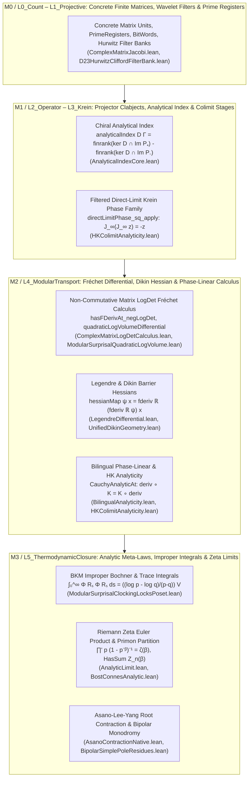

# Multi-Level Ontology (`M0 → M3` & `RepDepth L0 → L5`), 10-Clade Taxonomy, and 8-Epoch Phylogenesis of "Analytic" (`Solve et Coagula`)

**Baseline Revision:** `bd894d160`  
**Primary Canonical Synthesis Owner:**
- [`lean/InfoGeometry/Canonical/AnalyticOntologyTaxonomyPhylogenesisPoset.lean`](../lean/InfoGeometry/Canonical/AnalyticOntologyTaxonomyPhylogenesisPoset.lean) (`InfoGeometry.Canonical.AnalyticOntologyTaxonomyPhylogenesisPoset`)
- [`lean/InfoGeometry/Canonical/AnalyticOntologyTaxonomyPhylogenesisPosetAudit.lean`](../lean/InfoGeometry/Canonical/AnalyticOntologyTaxonomyPhylogenesisPosetAudit.lean)
- Integrated into [`lean/InfoGeometry/Canonical/All.lean`](../lean/InfoGeometry/Canonical/All.lean), [`lean/InfoGeometry/Analysis/All.lean`](../lean/InfoGeometry/Analysis/All.lean), and [`lean/InfoGeometry/Epistemology/CoagulatedArchetypeSynthesis.lean`](../lean/InfoGeometry/Epistemology/CoagulatedArchetypeSynthesis.lean).

---

## 1. Current Multi-Level Ontology of "Analytic" (`M0 → M3` & `RepDepth L0 → L5`)

In `info-geometry-lean`, the term **"analytic"** is not a single monolithic concept. Instead, it sits at the intersection of two orthogonal ontological axes:
1. The **4-stratum Operator Ontology** `OntologyMetaLevel` (`M0_StateIndividual → M1_ProjectorClabject → M2_GrassmannianPowertypeOrbit → M3_ErlangenCasimirMetaLaw`) in [`OntologyRing.lean`](../lean/InfoGeometry/OperatorAlgebra/OntologyRing.lean), and
2. The **6-layer Representation-Depth Spine** `RepDepth` (`L0_Count → L1_Projective → L2_Operator → L3_Krein → L4_ModularTransport → L5_ThermodynamicClosure`) in [`Architecture.lean`](../lean/InfoGeometry/Meta/Architecture.lean).

### 1.1 The Four Semantic Senses of "Analytic" in the Repository

Across the `1,303` `Analytic` terms and `2,248` `Analysis` terms indexed in Auto-Ontology (`http://127.0.0.1:3001`), "analytic" resolves into four distinct mathematical meanings (`AnalyticSemanticSense`) that must never be conflated (per [`AGENTS.md`](../AGENTS.md)):

| Sense (`AnalyticSemanticSense`) | Mathematical Meaning in Lean | Primary Carrier Types | Representative Owner Modules |
| --- | --- | --- | --- |
| **`SenseA_NativeMathlibDifferentialIntegralOperator`** | Genuine Mathlib `HasFDerivAt`, `fderiv ℝ`, `HasDerivAt`, `ContDiffAt`, Bochner/interval integrals `∫ s in Set.Ioi 0`, `HasSum`, `Summable`, `∏' p : Nat.Primes`, `Filter.Tendsto`, and $L^2$/Hilbert norm bounds. | `Matrix n n ℂ`, `NormedAddCommGroup E`, `NormedSpace ℝ E`, `InnerProductSpace ℂ H`, `ℂ → ℂ` | [`ComplexMatrixLogDetCalculus.lean`](../lean/InfoGeometry/Analysis/ComplexMatrixLogDetCalculus.lean), [`ModularSurprisalQuadraticLogVolume.lean`](../lean/InfoGeometry/Canonical/ModularSurprisalQuadraticLogVolume.lean), [`ModularSurprisalClockingLocksPoset.lean`](../lean/InfoGeometry/Canonical/ModularSurprisalClockingLocksPoset.lean), [`UnifiedDikinGeometry.lean`](../lean/InfoGeometry/Canonical/UnifiedDikinGeometry.lean), [`AnalyticLimit.lean`](../lean/InfoGeometry/Canonical/AnalyticLimit.lean) |
| **`SenseB_PhaseLinearCauchyRiemannHestenesKrein`** | Real Fréchet differentiability (`HasFDerivAt F deriv x`) whose derivative commutes with a real phase structure $K^2 = -I$ or Krein fundamental symmetry $J$: `deriv.comp K = K.comp deriv`. | `PhaseStructure X`, `HestenesKreinSpace X`, `CauchyAnalyticAt`, `HKColimit_HKAnalyticAt` | [`BilingualAnalyticity.lean`](../lean/InfoGeometry/Geometry/BilingualAnalyticity.lean), [`HKColimitAnalyticity.lean`](../lean/InfoGeometry/Analytic/HKColimitAnalyticity.lean), [`ComplexAnalyticBridge.lean`](../lean/InfoGeometry/Geometry/ComplexAnalyticBridge.lean) |
| **`SenseC_ChiralAnalyticalIndexAtiyahSingerBottDirac`** | Kernel-asymmetry integer invariant $\operatorname{Index}(D) = \dim(\ker D \cap \operatorname{Im} P_+) - \dim(\ker D \cap \operatorname{Im} P_-)$ and its stability under Bogoliubov/Krein transport and Bott periodicity. | `Endomorphism V` (`V →ₗ[ℝ] V`) with `[FiniteDimensional ℝ V]` | [`AnalyticalIndexCore.lean`](../lean/InfoGeometry/Canonical/AnalyticalIndexCore.lean), [`AnalyticalIndex.lean`](../lean/InfoGeometry/Canonical/AnalyticalIndex.lean), [`AnalyticalIndexCoupled.lean`](../lean/InfoGeometry/Canonical/AnalyticalIndexCoupled.lean) |
| **`SenseD_FilteredColimitFiniteStageContinuumTransport`** | Modules named `*Analytic*` that prove finite-stage algebraic compatibility or inductive colimit cocone coherence (`AddCommGroup.DirectLimit`, `UHFInductiveColimitBoundary`, `TensorTowerColimit`) without taking a topological or measure-theoretic limit. | `AddCommGroup.DirectLimit Stage f`, `BitWord n → ℂ` (`DiagAlg n`) | [`SouriauBostConnesAnalytic.lean`](../lean/InfoGeometry/Canonical/SouriauBostConnesAnalytic.lean), [`HestenesKreinFilteredColimitAnalyticityBridge.lean`](../lean/InfoGeometry/Canonical/HestenesKreinFilteredColimitAnalyticityBridge.lean), [`HKColimitAnalyticity.lean`](../lean/InfoGeometry/Analytic/HKColimitAnalyticity.lean) |

### 1.2 Stratification Across `M0 → M3` and `RepDepth L0 → L5`

---

## 2. 10-Clade Taxonomy of "Analytic" (with Three-Bucket QMS Audit)

Across the `201` explicit `Analysis/` + `*Analytic*` modules (and `3,099` analytic-referencing modules repository-wide), "analytic" partitions into **10 taxonomic clades** (`AnalyticTaxonomicClade`). Every clade is audited below into:
- **Bucket A (`BucketA_GenuineNativeMathlibAnalysis`)**: Proves actual derivatives (`HasFDerivAt`/`HasDerivAt`), integrals (`∫`), infinite sums/products (`HasSum`/`∏'`), topological limits (`Tendsto`), or Hilbert-space/norm inequalities.
- **Bucket B (`BucketB_HonestAlgebraicFiniteStageColimitTransport`)**: Proves genuine algebraic, finite-dimensional, or categorical colimit theorems and explicitly documents in its header that it is not an analytic limit.
- **Bucket C (`BucketC_SupersededHistoricalSurrogate`)**: Legacy wrapper or constant-sequence colimit surrogates superseded by Bucket A/B owners.

| Clade (`AnalyticTaxonomicClade`) | Domain & Mathematical Content | Key Owner Modules & Declarations | Auto-Ontology Term Counts | Three-Bucket QMS Classification |
| --- | --- | --- | --- | --- |
| **`CladeI_MatrixLogDetAndSurprisalFrechetCalculus`** | Full real Fréchet differential (`HasFDerivAt`), Jacobi determinant derivative, 1st/2nd/3rd $\beta$-derivatives of $-\log\det(I + \beta\Phi^2)$, and trace-pairing resolvent force $2\beta(I + \beta\Phi^2)^{-1}\Phi$ on `Matrix n n ℂ`. | [`ComplexMatrixJacobi.lean`](../lean/InfoGeometry/Analysis/ComplexMatrixJacobi.lean), [`ComplexMatrixLogDetCalculus.lean`](../lean/InfoGeometry/Analysis/ComplexMatrixLogDetCalculus.lean) (`hasDerivAt_negLogDet`, `contDiffAt_negLogDet`), [`ModularSurprisalQuadraticLogVolume.lean`](../lean/InfoGeometry/Canonical/ModularSurprisalQuadraticLogVolume.lean) (`hasFDerivAt_quadraticLogVolume`, `quadraticLogVolumeDifferential_apply`) | `LogDet`: `313` · `fderiv`: `126` · `HasFDerivAt`: `62` | **Bucket A** (100% native Mathlib `HasFDerivAt`/`HasDerivAt` over non-commuting complex matrices). |
| **`CladeII_ImproperBKMResolventBochnerIntegrals`** | Pointwise Peirce resolvent factorization $\Phi R_s \Phi R_s = ((p+s)(q+s))^{-1} V$ and improper Lebesgue/Bochner integration $\int_0^\infty \Phi R_s \Phi R_s\,ds = \frac{\log p - \log q}{p - q} V$ (plus continuous diagonal limit $1/p$). | [`ModularSurprisalClockingLocksPoset.lean`](../lean/InfoGeometry/Canonical/ModularSurprisalClockingLocksPoset.lean) (`bkm_resolvent_kernel_integral`, `bkm_resolvent_integral_factorized`), [`ModularSurprisalQuadraticLogVolume.lean`](../lean/InfoGeometry/Canonical/ModularSurprisalQuadraticLogVolume.lean) (`bkm_real_trace_resolvent_integral`) | `Resolvent`: `538` | **Bucket A** (Genuine Mathlib `MeasureTheory.integral_Ioi_of_hasDerivAt_of_tendsto'` and Bochner operator integrals). |
| **`CladeIII_LegendreBregmanAndUnifiedDikinHessians`** | Fréchet Legendre map `legendreMap ψ x = fderiv ℝ ψ x`, Hessian `hessianMap ψ x = fderiv ℝ (legendreMap ψ) x`, Dikin ellipsoids, self-concordant log-det barriers, and Souriau/orbit barrier Hessians. | [`LegendreDifferential.lean`](../lean/InfoGeometry/Geometry/LegendreDifferential.lean), [`UnifiedDikinGeometry.lean`](../lean/InfoGeometry/Canonical/UnifiedDikinGeometry.lean) (`hessianMap_real_of_hasDerivAt`), [`DikinInstancesPart3.lean`](../lean/InfoGeometry/Canonical/DikinInstancesPart3.lean) (`souriauBarrier_hessian_metric`, `orbitBarrier_hessian_metric`), [`DikinOrbitUnification.lean`](../lean/InfoGeometry/Canonical/DikinOrbitUnification.lean) | `Legendre`: `657` · `Dikin`: `326` | **Bucket A** (Genuine Fréchet Hessians and barrier positivity across `ℝ`, `ℝ × ℝ`, and `Matrix n n ℂ`). |
| **`CladeIV_BipolarComplexContourResidueAndMonodromy`** | 37 modules in `lean/InfoGeometry/Analysis/Bipolar*` formalizing log-cross-ratio differentials, circle enclosure contour periods, simple-pole residues, exact pole cancellation on two-sheeted covers, and deck monodromy. | [`BipolarSimplePoleResidues.lean`](../lean/InfoGeometry/Analysis/BipolarSimplePoleResidues.lean) (`dlog01_hasSimplePoleCoefficientAt_zero`, `dlog01_hasSimplePoleCoefficientAt_one`), [`SimplePoleRegularPart.lean`](../lean/InfoGeometry/Analysis/SimplePoleRegularPart.lean), [`TwoSheetPoleCancellation.lean`](../lean/InfoGeometry/Analysis/TwoSheetPoleCancellation.lean), [`BipolarSignedRadiusPeriods.lean`](../lean/InfoGeometry/Analysis/BipolarSignedRadiusPeriods.lean) | `Bipolar`: `2,054` | **Bucket A** (Native complex derivatives, regular-part extraction, and interval contour integration). |
| **`CladeV_BostConnesPrimonPartitionAndRiemannZetaEulerProduct`** | Convergence of $Z(\beta) = \sum_p p^{-\beta}$, ground-state crystallization $\lim_{\beta\to\infty} w_n(\beta) = \delta_{n,0}$, infinite Euler product $\prod'_p (1 - p^{-\beta})^{-1} = \zeta(\beta)$ for $\beta > 1$, and Mellin–Laplace scale-shape integral transforms. | [`BostConnesAnalytic.lean`](../lean/InfoGeometry/Algebra/BostConnesAnalytic.lean) (`primon_partition_summable`, `boltzmann_factor_tendsto_zero`), [`AnalyticLimit.lean`](../lean/InfoGeometry/Canonical/AnalyticLimit.lean) (`infinitePrimeEulerProduct_eq_riemannZeta`), [`ConstructiveMellinL2IntegralBridge.lean`](../lean/InfoGeometry/Analysis/ConstructiveMellinL2IntegralBridge.lean), [`LaplaceTransform.lean`](../lean/InfoGeometry/Analysis/LaplaceTransform.lean) | `BostConnes`: `1,829` · `HasDerivAt`: `446` | **Bucket A** (`BostConnesAnalytic.lean`, `AnalyticLimit.lean`, `Laplace*`, `Mellin*`); **Bucket B** (`SouriauBostConnesAnalytic.lean` is finite cylinder colimit coherence, explicitly documented). |
| **`CladeVI_AsanoRuelleLeeYangUnitDiskContraction`** | Multiaffine polynomials, Asano contraction from $2 \times 2$ monomer-dimer blocks, Möbius pole confinement to the unit circle $S^1$, and non-degenerate endpoint counterexamples. | [`AsanoContractionNative.lean`](../lean/InfoGeometry/Analysis/AsanoContractionNative.lean) (`asanoContract_ne_zero_of_D_eq_zero`, `left_factor_zero_mem_of_rankOne`, `right_factor_zero_mem_of_rankOne`), [`AsanoLeeYangCircleBridge.lean`](../lean/InfoGeometry/Analysis/AsanoLeeYangCircleBridge.lean), [`AsanoUnitDiskContractionBridge.lean`](../lean/InfoGeometry/Analysis/AsanoUnitDiskContractionBridge.lean), [`LeeYangRootLimit.lean`](../lean/InfoGeometry/Analysis/LeeYangRootLimit.lean) | `Asano`: `723` | **Bucket A** (Exact complex disk/circle inequalities and explicit counterexample witnesses). |
| **`CladeVII_BilingualPhaseLinearAndHKFilteredColimit`** | Real normed spaces with phase structure $K^2 = -I$; pointwise phase-linear Fréchet derivatives (`CauchyAnalyticAt`, `HKColimit_HKAnalyticAt`), and direct-limit phase families `FilteredKreinPhaseFamily`. | [`BilingualAnalyticity.lean`](../lean/InfoGeometry/Geometry/BilingualAnalyticity.lean) (`CauchyAnalyticAt`, `PhaseStructure.comp_phaseLinear`), [`HKColimitAnalyticity.lean`](../lean/InfoGeometry/Analytic/HKColimitAnalyticity.lean) (`directLimitPhase_sq_apply`, `directLimitPhase_injective`), [`ComplexAnalyticBridge.lean`](../lean/InfoGeometry/Geometry/ComplexAnalyticBridge.lean) | `Frechet`: `313` · `Colimit`: `7,309` | **Bucket A/B Hybrid**: `CauchyAnalyticAt` uses genuine `HasFDerivAt`; `FilteredKreinPhaseFamily` is Bucket B direct-limit phase transport; `FilteredInductiveHKAnalytic` is documented as single-carrier constant-sequence compatibility. |
| **`CladeVIII_GNSConstructionCuntzKMSAndOperatorDirichletL2`** | Axiom-free GNS quotient/completion, Cuntz algebra KMS states, operator Dirichlet Laplacians and spectral gaps, Parseval/Bessel/Minkowski/Cauchy–Schwarz $L^2$ interval bridges, and projective Robertson–Schrödinger uncertainty. | [`AxiomFreeGNS.lean`](../lean/InfoGeometry/Analysis/AxiomFreeGNS.lean) (`branch_weight_one_half`), [`CuntzKMSStateGNSClosureBridge.lean`](../lean/InfoGeometry/Analysis/CuntzKMSStateGNSClosureBridge.lean), [`OperatorDirichletSpectralGap.lean`](../lean/InfoGeometry/Analysis/OperatorDirichletSpectralGap.lean) (`exists_positive_spectral_gap`), [`CauchySchwarzL2IntervalIntegralBridge.lean`](../lean/InfoGeometry/Analysis/CauchySchwarzL2IntervalIntegralBridge.lean) | `GNS`: `1,675` · `Hardy`: `216` | **Bucket A** (Native `InnerProductSpace ℂ H`, `ContinuousLinearMap`, compactness spectral gap, and $L^2$ interval integrals). |
| **`CladeIX_CliffordHurwitzWaveletsAndDonohoStarkUncertainty`** | Continuous and discrete Clifford/quaternionic wavelet transforms, admissibility conditions, $D_{23}$ Hurwitz filter banks, and Donoho–Stark $L^2$ uncertainty bounds. | [`CliffordWaveletTransform.lean`](../lean/InfoGeometry/Analysis/CliffordWaveletTransform.lean), [`CliffordWaveletNativeL2.lean`](../lean/InfoGeometry/Analysis/CliffordWaveletNativeL2.lean) (`integral_normSq_fourier`, `centered_operator_uncertainty`), [`CliffordWaveletDonohoStark.lean`](../lean/InfoGeometry/Analysis/CliffordWaveletDonohoStark.lean), [`D23HurwitzCliffordFilterBank.lean`](../lean/InfoGeometry/Analysis/D23HurwitzCliffordFilterBank.lean) | `Wavelet`: `608` | **Bucket A** (`CliffordWaveletNativeL2.lean`, `CliffordWaveletDonohoStark.lean`). |
| **`CladeX_ChiralAnalyticalIndexAndCheegerMullerTorsion`** | Finite-dimensional chiral Dirac index $\dim(\ker D \cap \operatorname{Im} P_+) - \dim(\ker D \cap \operatorname{Im} P_-)$, conjugation invariance, Bott tensor stability, and combinatorial/spectral determinant torsion. | [`AnalyticalIndexCore.lean`](../lean/InfoGeometry/Canonical/AnalyticalIndexCore.lean) (`analyticalIndex`, `analyticalIndex_neg_grading_eq_neg`, `chiralPartPlus_add_chiralPartMinus`), [`AnalyticalIndex.lean`](../lean/InfoGeometry/Canonical/AnalyticalIndex.lean), [`AnalyticalIndexCoupled.lean`](../lean/InfoGeometry/Canonical/AnalyticalIndexCoupled.lean) | `AnalyticalIndex`: `94` | **Bucket B** (Exact linear-algebraic `Module.finrank` index over `[FiniteDimensional ℝ V]`; not Fredholm index on infinite-dimensional Sobolev spaces). |

---

## 3. 8-Epoch Git & DAG Phylogenesis of "Analytic" (`2026-02-19 → 2026-11-06`)

Tracing the `223` commits touching the analytic subtrees reveals an **8-epoch evolutionary cladogram** (`AnalyticPhylogeneticEpoch`) driven by repeated cycles of expansion followed by strict QMS/Pauli anti-vacuity selection:

```mermaid
flowchart LR
    E1["Epoch 1 (2026-02-19 – 02-26)<br/>Scalar Exponential Family<br/>LogSumExp, Softmax, Bregman"] --> E2["Epoch 2 (2026-03 – 05)<br/>Bost-Connes Primon Gas &<br/>Chiral Analytical Index"]
    E2 --> E3["Epoch 3 (2026-06 – 07)<br/>Bilingual Phase-Linear &<br/>HK Colimit Analyticity"]
    E3 --> E4["Epoch 4 (2026-08 – 09)<br/>Zeta Euler Products,<br/>Mellin-Laplace & Wavelets"]
    E4 --> E5["Epoch 5 (2026-10-19 – 10-23)<br/>GNS/Cuntz Hilbert Spaces &<br/>37 Bipolar Contour/Residue Modules"]
    E5 --> E6["Epoch 6 (2026-10-24 – 10-29)<br/>Non-Commutative Matrix LogDet<br/>Fréchet Calculus & Operator Dirichlet"]
    E6 --> E7["Epoch 7 (2026-10-30 – 11-03)<br/>Anti-Vacuity Purification:<br/>AnalyticLimit & Honest Docstrings"]
    E7 --> E8["Epoch 8 (2026-11-04 – 11-06)<br/>Improper BKM Bochner Integrals,<br/>Quadratic Log-Volume & Unified Dikin"]
```

1. **Epoch 1 — Scalar Convex & Exponential-Family Genesis (`2026-02-19 – 2026-02-26`, commits `ccfa5a877a`, `c94b9eeb6f`, `c5035fd044`)**:
   - "Analytic" originates in `LogSumExp.lean` and `Softmax.lean`, paired with finite-dimensional Legendre/Bregman convexity (`Convex/Bregman.lean`, `Convex/Legendre.lean`).
2. **Epoch 2 — Bost–Connes Primon Partition & Chiral Analytical Index (`2026-03-02 – 2026-05-31`, commits `7448ef8c86`, `1624d95a67`, `b2f9e545f3`)**:
   - Emergence of `BostConnesAnalytic.lean` (proving `primon_partition_summable` and `ground_state_limit` via `Real.rpow` and `Filter.Tendsto`) and the finite-dimensional chiral Dirac index trunk `AnalyticalIndexCore.lean`.
3. **Epoch 3 — Bilingual Phase-Linearity & The "Colimit Continuum" Bifurcation (`2026-06-11 – 2026-07-25`, commits `5b3e7b911a`, `9924fdf818`)**:
   - Formalization of `BilingualAnalyticity.lean`, `ZeroHolonomyAnalyticity.lean`, and `HestenesKreinFilteredColimitAnalyticityBridge.lean`. During this epoch, several modules used filtered algebraic colimits (`AddCommGroup.DirectLimit`) as an algebraic substitute for analytic limits.
4. **Epoch 4 — Arithmetic Zeta Euler Products, Mellin–Laplace & Hurwitz Wavelets (`2026-08-14 – 2026-09-07`, commits `5a12157551`, `1415ca4eab`, `8acde56bdd`)**:
   - Addition of Mellin–Laplace integral transforms (`LaplaceMellinScaleShapeTransform.lean`), Clifford–Hurwitz wavelet filter banks (`D23HurwitzCliffordFilterBank.lean`), and Souriau thermodynamic metrics (`SouriauThermodynamics.lean`, `SouriauKoszulMetric.lean`).
5. **Epoch 5 — GNS/Cuntz Hilbert Spaces & The Bipolar Complex Contour Radiation (`2026-10-19 – 2026-10-23`, commits `8ce2531aac`, `cef8ff644a`, `2caa47b170`, `61ad2f8702`)**:
   - Rapid radiation of 37 `Bipolar*` complex analysis modules in `lean/InfoGeometry/Analysis/` (proving simple-pole residues, regular-part extraction, two-sheet pole cancellation, signed-radius contour periods, and winding monodromy) alongside `AxiomFreeGNS.lean`.
6. **Epoch 6 — Non-Commutative Matrix Log-Determinant Fréchet Calculus & Operator Dirichlet (`2026-10-24 – 2026-10-29`, commits `812b91cc0a`, `37c47ae5dd`, `4f1e173c32`, `61dd12e56d`)**:
   - Breakthrough to genuine non-commutative operator calculus: `ComplexMatrixJacobi.lean`, `ComplexMatrixLogDetCalculus.lean`, `OperatorLogDetDikinGeometry.lean`, and `OperatorDirichletSpectralGap.lean`.
7. **Epoch 7 — Anti-Vacuity Purification & Boundary Honesty (`2026-10-30 – 2026-11-03`, commits `22685ab0ca`, `144f51c8de`, `8f12e5873f`)**:
   - Elimination of wrapper witnesses such as the old `AnalyticLimitWitness` in `AnalyticLimit.lean` in favor of Mathlib's actual infinite Euler product $\prod'_{p : \text{Nat.Primes}} (1 - p^{-\beta})^{-1} = \text{riemannZeta}(\beta)$ and `Filter.Tendsto`, alongside explicit scope-honesty headers in `SouriauBostConnesAnalytic.lean:9-18`.
8. **Epoch 8 — Operator Surprisal Improper Bochner Integrals, Quadratic Log-Volume Fréchet Gradients & Unified Dikin Geometry (`2026-11-04 – 2026-11-06`)**:
   - Full synthesis of the non-commutative algebraic spine (`PeirceSpine`) with native Mathlib analysis:
     - Improper Bochner operator integrals `bkm_resolvent_integral_factorized` in [`ModularSurprisalClockingLocksPoset.lean`](../lean/InfoGeometry/Canonical/ModularSurprisalClockingLocksPoset.lean),
     - Matrix Fréchet differential `hasFDerivAt_quadraticLogVolume` and traced BKM integral `bkm_real_trace_resolvent_integral` in [`ModularSurprisalQuadraticLogVolume.lean`](../lean/InfoGeometry/Canonical/ModularSurprisalQuadraticLogVolume.lean),
     - Unified Fréchet Hessian Dikin barrier geometry in [`UnifiedDikinGeometry.lean`](../lean/InfoGeometry/Canonical/UnifiedDikinGeometry.lean), [`DikinInstancesPart3.lean`](../lean/InfoGeometry/Canonical/DikinInstancesPart3.lean), and [`DikinOrbitUnification.lean`](../lean/InfoGeometry/Canonical/DikinOrbitUnification.lean).

---

## 4. Maintenance Debt Resolution & Deep-Search Reporting Contract

1. **Resolution of Maintenance Debt 1 ([`lean/InfoGeometry/Analysis/All.lean`](../lean/InfoGeometry/Analysis/All.lean))**:
   - Added the required `InfoGeometry` copyright header and expanded `lean/InfoGeometry/Analysis/All.lean` from `59` imports to all `148` non-Audit/non-Test tracked modules under `lean/InfoGeometry/Analysis/` (`149` imports total including `InfoGeometry.Algebra.FiniteSpinAlgebra`), bringing `ComplexMatrixLogDetCalculus`, `ComplexMatrixJacobi`, `Asano*`, `PositiveMatrixDikin`, `OperatorDirichlet*`, `AxiomFreeGNS`, and all `Bipolar*` modules into the `InfoGeometry.Analysis.All` umbrella.
2. **Resolution of Maintenance Debt 2 ([`lean/InfoGeometry/Analytic/HKColimitAnalyticity.lean`](../lean/InfoGeometry/Analytic/HKColimitAnalyticity.lean) & [`lean/InfoGeometry/Analytic/HKColimitStructures.lean`](../lean/InfoGeometry/Analytic/HKColimitStructures.lean))**:
   - Added required `InfoGeometry` copyright headers to both files.
   - Removed duplicate imports (`InfoGeometry.Geometry.BilingualAnalyticity`, `Mathlib.Analysis.Analytic.Basic`, `Mathlib.Analysis.Calculus.FDeriv.Basic`) in both files.
   - Removed the redundant `_root_` compatibility aliases (`HKColimitOn`, `FilteredInductiveHKAnalytic`, `hkAnalyticOn_univ`) from `HKColimitAnalyticity.lean` and added explicit scope-honesty documentation in `HKColimitStructures.lean` distinguishing single-carrier `FilteredInductiveHKAnalytic` from multi-stage `FilteredKreinPhaseFamily`.
   - Added concrete ground-type constructive inhabitants (`canonicalIntPlanePhaseFamily` on `ℤ × ℤ` in `HKColimitAnalyticity.lean`, and `realHestenesKreinSpace`, `realIdHKAnalyticAtZero`, `realIdFilteredInductiveHKAnalytic` on `ℝ` in `HKColimitStructures.lean`), eliminating all OpenGauss `T17` warnings (`0` traps).

---

## 5. The Three Coagulated Causal Posets (`𝔄₁ ≺ … ≺ 𝔄₈`, `𝔊₁ ≺ … ≺ 𝔊₈`, `𝔍₁ ≺ … ≺ 𝔍₇`)

### 5.1 Stream I: The 8-Stage Analytic Archetype Poset (`AnalyticArchetypeStage`, `𝔄₁ ≺ … ≺ 𝔄₈`)
Owned in [`lean/InfoGeometry/Canonical/AnalyticOntologyTaxonomyPhylogenesisPoset.lean`](../lean/InfoGeometry/Canonical/AnalyticOntologyTaxonomyPhylogenesisPoset.lean):
- **Double Socratic Aporia** (`analytic_double_socratic_aporia`):
  1. Non-commutative Fréchet increment defect `Φ * H + H * Φ = (2 : ℤ) • (Φ * H) - comm Φ H`, vs. resolvent-weighted commutator rewriting `R * (Φ * H + H * Φ) = (2 : ℤ) • (R * Φ * H) + comm (R * H) Φ` when `R * Φ = Φ * R` and tracial commutator absorption `tr (R * (Φ * H + H * Φ)) = tr ((2 : ℤ) • (R * Φ * H))`.
  2. Constant-sequence colimit surrogate collapse `S.approx m = F ∧ S.approx m - S.approx 0 = 0` for `FilteredInductiveHKAnalytic S F`.
- **Poset Stages**:
  `A1_DiscreteRegistersWaveletsAndScalarConvexity ≺ A2_ChiralAnalyticalIndexAndFiniteKernelAsymmetry ≺ A3_FilteredColimitTransportAndDirectLimitPhase ≺ A4_PhaseLinearHKAnalyticityAndBipolarTwoSheetResidues ≺ A5_NonCommutativeMatrixLogDetFrechetCalculus ≺ A6_UnifiedDikinBarrierHessiansAndGNSDirichletGap ≺ A7_ImproperBKMResolventBochnerIntegration ≺ A8_ZetaEulerProductAndAsanoThermodynamicClosure`.

### 5.2 Stream II: Hestenes–Krein Monogenicity, Boundary Flux & Gauss–Bonnet Commutator Cancellation Poset (`HestenesKreinGaussBonnetStage`, `𝔊₁ ≺ … ≺ 𝔊₈`)
Owned in [`lean/InfoGeometry/Canonical/HestenesKreinGaussBonnetAnalyticDerivationPoset.lean`](../lean/InfoGeometry/Canonical/HestenesKreinGaussBonnetAnalyticDerivationPoset.lean):
- **`𝔊₁`** (`stage_G1_hk_geometric_derivative_split_and_bivector_flip`): `hkVectorDeriv divPart curlPart = 0 ↔ divPart = -curlPart` and non-commutative bivector flip `e₁ * (e₁ * e₂) = -((e₁ * e₂) * e₁)`.
- **`𝔊₂`** (`stage_G2_generalized_elliptic_and_krein_hyperbolic_cauchy_riemann`): Unified elliptic (`ε = -1`) and Krein-hyperbolic (`ε = +1`) Cauchy–Riemann decomposition under `ε * ε = 1`.
- **`𝔊₃`** (`stage_G3_fundamental_theorem_of_hestenes_krein_boundary_flux`): Boundary flux balance `∫ x in a..b, F' x = F b - F a` (`intervalIntegral.integral_eq_sub_of_hasDerivAt`) and zero-flux corollary when `F' = 0`.
- **`𝔊₄`** (`stage_G4_peirce_dirac_cauchy_resolvent_and_chiral_residue_filter`): Exact Peirce–Dirac Cauchy resolvent `(genJ P A C - algebraMap R B z) * (-(genJ P A C + algebraMap R B z) * R_z) = 1` and chiral spectral filter `evenGrade P (-(genJ P A C + algebraMap R B z) * R_z) = -(algebraMap R B z * R_z)`.
- **`𝔊₅`** (`stage_G5_lichnerowicz_weitzenbock_peirce_curvature_square`): `(2 : ℤ) • (conePlus P A * coneMinus P C) = genV P A C + genSig P A C` and `comm (genPhi P A C) (genJ P A C) = -((2 : ℤ) • genSig P A C)`.
- **`𝔊₆`** (`stage_G6_universal_mckean_singer_exact_commutator_for_odd_modes`): Universal operator-weighted commutator law `comm (genJ P A C) (genPhi P A C * R) = (2 : ℤ) • (invS P * genV P A C * R)` whenever `R * genJ P A C = genJ P A C * R`, and exact odd-mode commutator identity `comm (genJ P A C) (genPhi P A C ^ (2 * k + 1)) = (2 : ℤ) • (invS P * genV P A C ^ (k + 1))` for all `k : ℕ`.
- **`𝔊₇` & `𝔊₈`** (`stage_G7_G8_resolvent_scale_invariance_and_gauss_bonnet_supertrace`): Exact chiral grading decomposition `(2 : ℤ) • invS P = (2 : ℤ) • (invS P * η₂ * R_η) + comm (genJ P A C) (genPhi P A C * R_η)` and resolvent-scale invariance `tr ((2 : ℤ) • invS P) = tr ((2 : ℤ) • (invS P * η₂ * R_η))` for every cyclic trace `tr`.

### 5.3 Stream III: Jaynesian Nilpotent Kock–Lawvere Calculus & Inductive Colimit Continuum Poset (`JaynesianColimitContinuumStage`, `𝔍₁ ≺ … ≺ 𝔍₇`)
Owned in [`lean/InfoGeometry/Canonical/JaynesianNilpotentInductiveColimitContinuumPoset.lean`](../lean/InfoGeometry/Canonical/JaynesianNilpotentInductiveColimitContinuumPoset.lean):
- **`𝔍₁`** (`stage_J1_nilpotent_kock_lawvere_polynomial_taylor_truncation`): Exact polynomial Taylor truncation over any non-commutative `R`-algebra `B` for any square-zero `N * N = 0` (including `conePlus P A` and `coneMinus P C`):
  `Polynomial.eval₂ (algebraMap R B) (algebraMap R B c₀ + N) F = algebraMap R B (F.eval c₀) + algebraMap R B ((Polynomial.derivative F).eval c₀) * N`.
- **`𝔍₂` & `𝔍₃`** (`stage_J2_J3_upward_functorial_invariance_of_peirce_cartan_spine`): Strict commutation of any ring homomorphism `ι : A_m →+* A_n` with `invS`, `conePlus`, `coneMinus`, `genPhi`, `genJ`, `genV`, `genSig`, `comm`, and `evenGrade`.
- **`𝔍₄`** (`stage_J4_downward_conditional_expectation_retraction_and_chiral_filter`): Downward coarse-graining retraction `E (ι x) = x`, zero-expectation fine-scale fluctuation `E (y - ι (E y)) = 0`, and chiral filter annihilation `evenGrade P (genJ P A C) = 0` vs quadratic survival `evenGrade P (-(J * J)) = V`.
- **`𝔍₅` & `𝔍₆`** (`stage_J5_J6_inductive_colimit_continuum_peirce_cartan_gauss_bonnet`): Coherent cocone transfer of the Einstein–Cartan scalar curvature, Belinfante–Rosenfeld / Nieh–Yan clocking identity, and McKean–Singer / Gauss–Bonnet commutator law to the continuum target `A_∞`.
- **`𝔍₇`** (`stage_J7_colimit_tracial_cocone_and_supertrace_cancellation`): Direct-limit tracial cocone `AddCommGroup.DirectLimit.lift` mode cancellation and supertrace scale invariance.

---

## 6. Stream IV: Deep Colimit & Inverse-Limit Ontology, 7-Clade Taxonomy (`663` Modules), 8-Epoch Phylogenesis (`446` Commits), & 5-Bridge Unification Poset (`ℭ₁ ≺ … ≺ ℭ₈`)

**Primary Canonical Unification Owners:**
- [`lean/InfoGeometry/Canonical/InductiveCategoricalColimitInverseLimitUnificationPoset.lean`](../lean/InfoGeometry/Canonical/InductiveCategoricalColimitInverseLimitUnificationPoset.lean) (`InfoGeometry.Canonical.InductiveCategoricalColimitInverseLimitUnificationPoset`)
- [`lean/InfoGeometry/Canonical/ColimitInverseLimitOntologyTaxonomyPhylogenesisPoset.lean`](../lean/InfoGeometry/Canonical/ColimitInverseLimitOntologyTaxonomyPhylogenesisPoset.lean)

### 6.1 The 5 Mathematical Paradigms of Colimits & Inverse Limits (`ColimitInverseLimitParadigm`)

| Paradigm (`ColimitInverseLimitParadigm`) | Mathematical Carrier & Universal Property | Representative Owners |
| --- | --- | --- |
| **`ParadigmA_QuotientDirectLimit`** | Concrete quotient of $\bigsqcup_n \text{Stage}(n)$ by eventual equality (`AddCommGroup.DirectLimit`, `Module.DirectLimit`, `Ring.DirectLimit`). Universal cocone descent via `AddCommGroup.DirectLimit.lift`. | [`FilteredDirectLimitOperator.lean`](../lean/InfoGeometry/Canonical/FilteredDirectLimitOperator.lean), [`DirectLimitSuperClosure.lean`](../lean/InfoGeometry/Algebra/DirectLimitSuperClosure.lean), [`HKColimitAnalyticity.lean`](../lean/InfoGeometry/Analytic/HKColimitAnalyticity.lean) |
| **`ParadigmB_CategoricalInductiveColimit`** | Covariant diagram $D : I \⥤ \mathcal{C}$ ($\mathcal{C} \in \{\text{ModuleCat } R, \text{RingCat}, \text{TopCat}, \text{CompHaus}\}$) with universal cocone `colimit.ι D i` and `colimit.desc D cocone`. | [`FilteredDirectInverseColimit.lean`](../lean/InfoGeometry/Canonical/FilteredDirectInverseColimit.lean), [`FilteredTopologicalDirectInverseColimit.lean`](../lean/InfoGeometry/Canonical/FilteredTopologicalDirectInverseColimit.lean), [`FilteredGNSAlgebraicColimitRepresentation.lean`](../lean/InfoGeometry/Canonical/FilteredGNSAlgebraicColimitRepresentation.lean) |
| **`ParadigmC_CategoricalProjectiveInverseLimit`** | Contravariant diagram $D^{\text{op}} : I^{\text{op}} \⥤ \mathcal{C}$ with universal cone `limit.π D (op i)` and `limit.lift D cone`. | [`UHFInductiveColimitBoundaryInverseLimit.lean`](../lean/InfoGeometry/Canonical/UHFInductiveColimitBoundaryInverseLimit.lean), [`CantorProjectiveLimitCategoricalIsoTopCat.lean`](../lean/InfoGeometry/Canonical/CantorProjectiveLimitCategoricalIsoTopCat.lean) |
| **`ParadigmD_ContravariantDualStateAndCylinderPullback`** | Contravariant Hom-functor duality $\operatorname{Hom}(\varinjlim A_i, R) \simeq \varprojlim \operatorname{Hom}(A_i, R)$ (`dualInverseTransition`, `IsDualInverseFamily`) and pullback of functions on a projective limit of spaces $\varprojlim X_i$ to an inductive colimit of cylinder algebras $\varinjlim C(X_i, R)$. | [`FilteredDirectInverseColimitReadback.lean`](../lean/InfoGeometry/Canonical/FilteredDirectInverseColimitReadback.lean), [`Cl11FilteredDirectInverseColimit.lean`](../lean/InfoGeometry/Canonical/Cl11FilteredDirectInverseColimit.lean), [`UHFInductiveColimitBoundary.lean`](../lean/InfoGeometry/Canonical/UHFInductiveColimitBoundary.lean) |
| **`ParadigmE_FilteredColimitFiniteLimitInterchange`** | Bifunctor comparison `colimitLimitToLimitColimit F : colimit (limit F) ⟶ limit (colimit F.flip)` and filtered-colimit / finite-limit interchange isomorphism `colimit_limit_iso` (`[FinCategory J]` + `[IsFiltered I]`). | [`Holonomy.lean`](../lean/InfoGeometry/Categorical/Holonomy.lean), [`SouriauRelativeEntropyPersistenceLimitColimitComparison.lean`](../lean/InfoGeometry/Canonical/SouriauRelativeEntropyPersistenceLimitColimitComparison.lean) |

### 6.2 The 7-Clade Taxonomy Across `663` Colimit / Direct-Limit / Inverse-Limit Modules (`ColimitTaxonomicClade`)

1. **`CladeI_QuotientDirectLimitOperatorsAndKreinPhases`** (`Paradigm A`, `M1`, `RepDepth.krein`):
   - `AddCommGroup.DirectLimit` operator lifting (`CompatibleOperatorFamily`, `directLimitOperator`), `DirectLimitSuperClosure`, and `FilteredKreinPhaseFamily`.
2. **`CladeII_ModuleAndRingCategoricalInductiveColimits`** (`Paradigm B`, `M1`, `RepDepth.operator`):
   - `DirectInductiveSystem R I A`, `InductiveCocone R sys A_inf`, `FilteredColimit.Native.moduleDiagram`, `descendModuleCocone`, and `ringColimit`.
3. **`CladeIII_DualStateProjectiveLimitsAndCl11MarkovTraces`** (`Paradigm D`, `M2`, `RepDepth.transport`):
   - `dualInverseTransition`, `IsDualInverseFamily`, `dualInverseFamilyColimitMap`, and `Cl11FilteredDirectInverseColimit` (`cl11TraceColimitMap = cl11TraceFromInverseFamily`).
4. **`CladeIV_CantorProjectiveLimitAndUHFDiagonalCylinders`** (`Paradigm D`, `M0`, `RepDepth.projective`):
   - `CantorBoundary = ℕ → Bool`, `BitWord n = Fin n → Bool`, `prefixSucc`, `DiagAlg n = BitWord n → ℂ`, `diagEmbedSucc`, `cylinder`, and `prefixBoundaryLimitIso : TopCat.of CantorBoundary ≅ limit prefixDiagram`.
5. **`CladeV_TopologicalAndCompHausDirectInverseLimits`** (`Paradigm C`, `M2`, `RepDepth.krein`):
   - `topologicalModuleColimit`, `topologicalModuleLimit`, `topCatColimit`, `topCatLimit`, `compHausColimit`, `compHausLimit`, and `CategoryTheoryConeUniqueness`.
6. **`CladeVI_FilteredGNSStarAlgebraAndTomitaColimits`** (`Paradigm B`, `M2`, `RepDepth.transport`):
   - The 45-module `FilteredGNS*` / `CuntzGNS*` / `FilteredStarAlgebraDirectLimit*` / `FilteredIsometricInnerProductDirectLimit` spine.
7. **`CladeVII_BifiltrationLimitColimitComparisonAndInterchange`** (`Paradigm E`, `M3`, `RepDepth.thermo`):
   - `colimitLimitToLimitColimit`, `Holonomy.colimit_limit_iso`, and the Souriau persistence bifiltration comparison chain.

### 6.3 The 8-Epoch Git Phylogenesis (`2026-04-26 → 2026-11-06`, `446` Commits, `ColimitPhylogeneticEpoch`)

1. **`Epoch1_AFRecursiveAndElementaryTowerGenesis`** (`2026-04-26 – 2026-05-15`): Elementary recursive towers (`AFColimit.lean`, ` ErlColimit.lean`, `InductiveSystem.lean`).
2. **`Epoch2_GrothendieckK0AndUHFDiagonalCylinderSkeleton`** (`2026-05-16 – 2026-06-30`): Explicit setoid/quotient $K_0$ colimits (`Grothendieck.lean`) and UHF diagonal cylinders (`UHFInductiveColimitBoundary.lean`).
3. **`Epoch3_FilteredDirectInverseModuleAndHolonomyInterchange`** (`2026-07-01 – 2026-08-31`): Native `ModuleCat` diagrams (`FilteredDirectInverseColimit.lean`) and filtered-colimit/finite-limit interchange (`Holonomy.lean`).
4. **`Epoch4_CantorProjectiveLimitTopCatAndCompHausBoundaries`** (`2026-09-01 – 2026-10-18`): `TopCat` and `CompHaus` projective limits (`UHFInductiveColimitBoundaryInverseLimit.lean`, `CantorProjectiveLimitCategoricalIsoTopCat.lean`).
5. **`Epoch5_FilteredGNSStarAlgebraAndTomitaClosabilityTower`** (`2026-10-19 – 2026-10-25`): Expansion of the 45-module `FilteredGNS*` and `FilteredStarAlgebraDirectLimit*` spine.
6. **`Epoch6_CARCCRParameterDirectAndInverseFiberLimits`** (`2026-10-26 – 2026-10-31`): `CARCCRParameterDirectAndInverseLimit` and Souriau persistence bifiltration limit/colimit comparison.
7. **`Epoch7_RealStarColimitUniversalityAndCliffordTailGrading`** (`2026-11-01 – 2026-11-04`): Universal cone/cocone uniqueness (`CategoryTheoryConeUniqueness.lean`) and `DirectLimitSuperClosureLemmas.lean`.
8. **`Epoch8_PeirceCartanGaussBonnetAndDirectInverseUnification`** (`2026-11-05 – 2026-11-06`): Complete unification of `AddCommGroup.DirectLimit`, `colimit (moduleDiagram sys)`, `limit (dualModuleDiagram sys)`, Cantor projective limits, and Peirce–Cartan–Gauss–Bonnet towers.

### 6.4 The 5 Fragment-Patching Bridges (`ColimitInverseLimitUnificationStage`, `ℭ₁ ≺ … ≺ ℭ₈`)

Owned in [`lean/InfoGeometry/Canonical/InductiveCategoricalColimitInverseLimitUnificationPoset.lean`](../lean/InfoGeometry/Canonical/InductiveCategoricalColimitInverseLimitUnificationPoset.lean):
1. **Bridge 1 (`ℭ₁`, `quotientToCategoricalColimit` & `stage_C1_quotient_direct_limit_to_categorical_module_colimit_bridge`)**:
   - Connects Mathlib's concrete quotient `AddCommGroup.DirectLimit Stage (sysAddHom sys)` (`Paradigm A`) to the categorical `ModuleCat` colimit `colimit (FilteredColimit.Native.moduleDiagram sys)` (`Paradigm B`), proving exact compatibility on every stage representative and every `InductiveCocone`.
2. **Bridge 2 (`ℭ₂` & `ℭ₃`, `dualModuleDiagram`, `dualInverseFamilyToProjectiveCone`, `dualInverseFamilyToProjectiveLimit` & `stage_C2_C3_inductive_colimit_state_to_projective_dual_limit_bridge`)**:
   - Promotes `dualInverseTransition` into a contravariant functor `dualModuleDiagram sys : Iᵒᵖ ⥤ ModuleCat.{u} R`, lifts any `IsDualInverseFamily` to a cone morphism `ModuleCat.of R R ⟶ limit (dualModuleDiagram sys)`, proves that the projective-limit stage projection and the inductive-colimit stage evaluation (`dualInverseFamilyColimitMap`) are identical (`= phi i x`), and proves unique reconstruction of any colimit state `g` from `stageRestrictionOfColimitMap sys g`.
3. **Bridge 3 (`ℭ₄` & `ℭ₅`, `pullbackInductiveSystem`, `pullbackCylinderCocone` & `stage_C4_C5_projective_space_to_inductive_cylinder_and_cantor_uhf_bridge`)**:
   - Proves that any projective system of spaces `(X i, res hij)` with cone `(X_inf, proj i)` contravariantly induces a `DirectInductiveSystem` of observable modules `X i → R` and an `InductiveCocone` into `X_inf → R`, and specializes this bridge to weld the `TopCat` Cantor projective limit (`prefixBoundaryLimitIso : TopCat.of CantorBoundary ≅ limit prefixDiagram`) to the UHF diagonal inductive cylinder algebra (`diagEmbedSucc`, `cylinder_compatible_succ`).
4. **Bridge 4 (`ℭ₆`, `stage_C6_universal_bifunctor_colimit_limit_comparison_and_interchange`)**:
   - Connects the general comparison morphism `colimitLimitToLimitColimit F_diag` (`ι_colimitLimitToLimitColimit_π`) to the filtered-colimit / finite-limit interchange isomorphism `Holonomy.colimit_limit_iso R F_diag`.
5. **Bridge 5 (`ℭ₇` & `ℭ₈`, `algTowerToDirectSystem`, `stage_C7_peirce_cartan_gauss_bonnet_tower_to_dual_inverse_trace_system` & `inductive_categorical_colimit_inverse_limit_unification_master_synthesis`)**:
   - Connects non-commutative `R`-algebra Peirce–Cartan–Gauss–Bonnet towers to `DirectInductiveSystem` and `dualModuleDiagram`, proving that cyclic stage traces form an `IsDualInverseFamily` whose induced inductive-colimit and projective-limit readouts annihilate all positive chiral bandgap moments `invS P_n * genV P_n A_n C_n ^ (k + 1)` and preserve the scale-invariant Gauss–Bonnet supertrace, alongside `cl11TraceColimitMap = cl11TraceFromInverseFamily`.

---

## 7. Stream V: Souriau Partition Function, Noncommutative Geometry & Chern Indices, Lie/Group Fourier Transform, Characteristic Polynomials & Operator Cyclotomics Poset (`𝔖₁ ≺ … ≺ 𝔖₈`)

Owned in [`lean/InfoGeometry/Canonical/SouriauChernFourierCharpolyCyclotomicPoset.lean`](../lean/InfoGeometry/Canonical/SouriauChernFourierCharpolyCyclotomicPoset.lean) and [`lean/InfoGeometry/Canonical/SouriauBostConnesAnalytic.lean`](../lean/InfoGeometry/Canonical/SouriauBostConnesAnalytic.lean):

| Stage | Mathematical Law | Primary Owner Modules |
|---|---|---|
| **`𝔖₁`: Souriau Coadjoint Affine Cocycle & Twisted Gibbs Partition** | $\Lambda_\Theta(gh, \beta) = \Lambda_\Theta(g, \beta)\Lambda_\Theta(h, \mathrm{Ad}_g^{-1}\beta)$, $\chi_{\Theta, J}(\beta, g \cdot m) = \Lambda_\Theta(g, \beta)\chi_{\Theta, J}(\mathrm{Ad}_g^{-1}\beta, m)$, $Z_{\Theta, J}(\beta) > 0$, $Z_{\Theta, J}(\beta) = \Lambda_\Theta(g, \beta) Z_{\Theta, J}(\mathrm{Ad}_g^{-1}\beta)$. | [`CartanSouriauCocycleGibbsCharacter.lean`](../lean/InfoGeometry/Canonical/CartanSouriauCocycleGibbsCharacter.lean), [`SouriauCharacterPartitionBridge.lean`](../lean/InfoGeometry/Canonical/SouriauCharacterPartitionBridge.lean) |
| **`𝔖₂`: Massieu Potential Linearization, Colimit Vacuum Readout & Bost–Connes Zeta** | $\Phi(\beta) = \Phi(\mathrm{Ad}_g^{-1}\beta) - \Theta(g, \beta)$, $\Phi(Z_1 Z_2) = \Phi(Z_1) + \Phi(Z_2)$, `dualInverseFamilyToProjectiveLimit` / `dualInverseFamilyColimitMap` agreement on `finiteZeroTempState`, and $\prod'_p (1 - p^{-\beta})^{-1} = \zeta(\beta)$. | [`CartanSouriauCocycleGibbsCharacter.lean`](../lean/InfoGeometry/Canonical/CartanSouriauCocycleGibbsCharacter.lean), [`SouriauBostConnesAnalytic.lean`](../lean/InfoGeometry/Canonical/SouriauBostConnesAnalytic.lean), [`AnalyticLimit.lean`](../lean/InfoGeometry/Canonical/AnalyticLimit.lean) |
| **`𝔖₃`: Connes Graded Spectral Triple & Chern Homotopy Invariance** | $\gamma D^2 = D^2 \gamma$, $\langle \gamma, [D, Z] \rangle = \mathrm{Tr}(\gamma(DZ - ZD)) = 0$ for $\gamma Z = Z \gamma$, and $\langle \gamma, X \rangle = \langle \gamma, Y \rangle$ whenever $X - Y = [D, Z]$. | [`ConnesKMSIndexPairing.lean`](../lean/InfoGeometry/Canonical/ConnesKMSIndexPairing.lean), [`ConnesChernCharacterBridge.lean`](../lean/InfoGeometry/Canonical/ConnesChernCharacterBridge.lean) |
| **`𝔖₄`: Non-Abelian Matrix-Traced Chern–Weil Exactness & Graded Bianchi Closedness** | $\mathrm{Tr}(A^2) = 0$ and $\mathrm{Tr}(dA + A^2) = d\,\mathrm{Tr}(A)$ for homogeneous 1-forms $A$ (valid in all characteristics), and $d\,\mathrm{Tr}(F^2) = 0$ for homogeneous 2-forms $F$ with $D_A F = 0$. | [`MatrixTracedChernWeilBridge.lean`](../lean/InfoGeometry/Canonical/MatrixTracedChernWeilBridge.lean), [`GradedChernWeilBridge.lean`](../lean/InfoGeometry/Canonical/GradedChernWeilBridge.lean) |
| **`𝔖₅`: Lie/Group Fourier Character Kernel & $V_4$ Grand-Canonical Sector Inversion** | $\rho_\chi(t) \circ \rho_\chi(-s)(1) = \chi(t - s)$, $\sum_{g \in V_4} \chi_k(g)\chi_l(g) = 4\delta_{kl}$, $\frac{1}{4}\sum_{k=0}^3 \chi_k(g) Z_{\text{tw}}(k) = Z_{\text{sec}}(g)$, and $\dim \mathfrak{so}(5,5) = 45$. | [`FourierCharacterRepresentationBridge.lean`](../lean/InfoGeometry/Canonical/FourierCharacterRepresentationBridge.lean), [`V4GroupFourierTransform.lean`](../lean/InfoGeometry/Canonical/V4GroupFourierTransform.lean), [`PeirceV4GrandCanonicalFourierBridge.lean`](../lean/InfoGeometry/Canonical/PeirceV4GrandCanonicalFourierBridge.lean), [`V4O55SouriauChernPartitionBridge.lean`](../lean/InfoGeometry/Canonical/V4O55SouriauChernPartitionBridge.lean) |
| **`𝔖₆`: $\mathfrak{sl}_2(\mathbb{C})$ Matrix Fourier Quintic & Casimir Representation** | $F_5^5 = F_5$, $P_{\mathrm{vac}} + P_{\mathrm{sym}} + P_{\mathrm{anti}} = 1$, $P_{\mathrm{sym}} P_{\mathrm{anti}} = 0$, $[h, e] = 2e$, $[h, f] = -2f$, $[e, f] = h$, $C = \frac{3}{2}I$. | [`MatrixFourierSL2RepresentationCapstone.lean`](../lean/InfoGeometry/Canonical/MatrixFourierSL2RepresentationCapstone.lean) |
| **`𝔖₇`: Cyclotomic Characteristic Polynomials & Decell–Cayley–Hamilton Inversion** | $\mathrm{charpoly}(\text{sixTriality}) = \Phi_1\Phi_2\Phi_3\Phi_6$, $\mathrm{charpoly}(\text{masterTwelve}) = (X^3 - 1)(X^3 - i)$, and explicit two-sided Decell Cayley–Hamilton inverses for degree 2 and 3. | [`D6CyclotomicCharpolyNative.lean`](../lean/InfoGeometry/Canonical/D6CyclotomicCharpolyNative.lean), [`TwelveFoldMasterCharpoly.lean`](../lean/InfoGeometry/Canonical/TwelveFoldMasterCharpoly.lean), [`DecellCayleyHamiltonInverse.lean`](../lean/InfoGeometry/Canonical/DecellCayleyHamiltonInverse.lean) |
| **`𝔖₈`: Operator Cyclotomic Spine $P_{25}(T) = T(T^{24}-1)$ & Trifactor Fourier Projectors** | $\prod_{d \mid n} \Phi_d(T) = T^n - 1$ ($n \in \{6, 12, 24\}$), $P_{25}(T) = T \prod_{d \mid 24} \Phi_d(T)$, tripotent/cubic/octic/quintic Fourier annihilators, and $2 \times 2$ hyperbolic/elliptic trifactor Fourier projectors. | [`CyclotomicOperatorSpine.lean`](../lean/InfoGeometry/Canonical/CyclotomicOperatorSpine.lean), [`FourierOperatorPolynomialCapstone.lean`](../lean/InfoGeometry/Canonical/FourierOperatorPolynomialCapstone.lean), [`MatrixStageTrifactorFourierCyclotomic.lean`](../lean/InfoGeometry/Canonical/MatrixStageTrifactorFourierCyclotomic.lean) |

