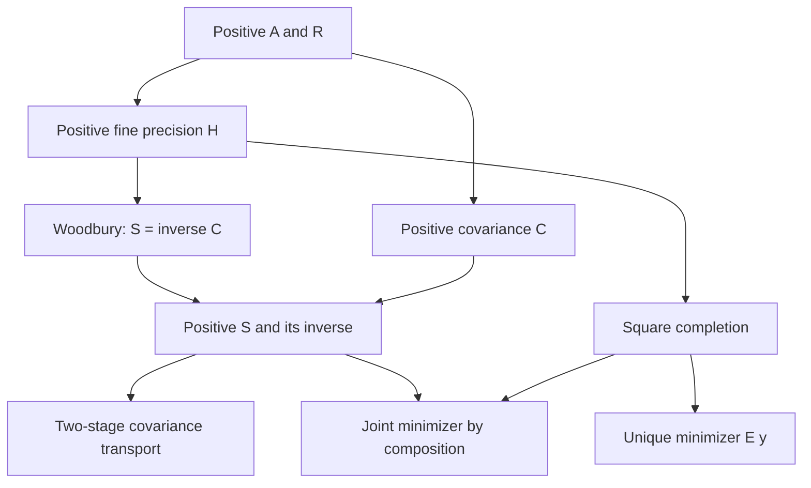

# Positive operator coarse-graining: theorem contract

## Source and scope

This development extracts the finite operator elimination used in J. Dimock,
*The Renormalization Group According to Balaban, I. Small Fields*, Reviews in
Mathematical Physics 25 (2013), 1330010,
[doi:10.1142/S0129055X13300100](https://doi.org/10.1142/S0129055X13300100).
The source locations are sections 2.1–2.4 (equations 15–17, 46–70 and 90–94)
and Appendix C (Lemma 28). The supplied PDF is the intake source, with SHA-256
`43ce3d3ed5a11e59ac73ec636be0d60bb0fb4f5accfe10f0a60a700ac77dc270`.

The proved theorem scope is arbitrary finite real or complex matrix spaces,
with rectangular coarse-graining maps and positive definite matrix-valued
weights. The operators are not assumed to commute. The auxiliary finite
parametrix identities apply in arbitrary associative rings.

The development does not assert the paper's polymer estimates, small-field
contraction theorem, convergence of an infinite random-walk expansion,
continuum limit, or ultraviolet stability bound. The paper's scalar weight
is a specialization of the operator-valued weight used here.

## Ground-truth carrier and conventions

For finite index types `n`, `m` and an `RCLike` field `K`, use native
`Matrix n n K`, `Matrix m m K`, `Matrix m n K`, `Matrix.PosDef`,
`Matrix.conjTranspose` and the native nonsingular inverse. Write

\[
H=A+Q^*RQ,\qquad E=H^{-1}Q^*R,\qquad
S=R-RQH^{-1}Q^*R,\qquad C=R^{-1}+QA^{-1}Q^*.
\]

The assumptions are `A.PosDef` and `R.PosDef`; `Q` is unrestricted.
Products keep the displayed order. Inverse existence follows from positive
definiteness, rather than being stored as an unproved field. Quadratic
energies take the real part of the Hermitian quadratic form, so inequalities
are inequalities in the real numbers even when `K` is complex.

Equation 46 of the paper puts a common factor `1/2` in front of its two
quadratic terms. With the paper's scalar weight and fine precision,
`quadraticEnergy` uses twice that action. This positive constant factor
preserves the minimizer; no Gaussian measure normalization is asserted.

The paper's raw block averages use different weighted inner products on
fine and coarse lattices. In orthonormal coordinates their nonzero entries
are inverse square roots of block sizes. Consequently a separate
coisometry result must explicitly assume `Q * Qᴴ = 1`; it is not inferred
for an arbitrary arithmetic-mean matrix.

## Existing owners and precise reuse

The source search at base commit
`b143075bbf27e75860a1011e04423a0f227b7c41` included the owner declarations,
their imports, and their consumers, supplemented by the repository context
preflight. No current declaration-graph or Arango snapshot is used as proof
evidence.

- `Physics/NuclearOperatorSchurComplement.lean` defines
  `effectiveOperator E0 V W Binv = E0 - V * Binv * W` in an arbitrary ring.
  Its reflection and nilpotent inverse results do not establish positivity
  or the covariance formula below.
- `Physics/NuclearFeshbachReduction.lean` proves eigen-equation and
  reconstruction identities for complementary operators and direct sums.
  The positive quadratic minimization theorem here has a different target.
- `NCG/BerezinianGaussianFactorization.lean` proves an LDU factorization
  with explicit inverse data. This development uses Mathlib's rectangular
  matrix API directly rather than creating another equal-block carrier.
- Mathlib's `Matrix.add_mul_mul_inv_eq_sub` supplies the Woodbury identity.
  Substitution of `R⁻¹, Q, A⁻¹, Qᴴ` gives `C⁻¹ = S`.
- `Matrix.PosDef.inv`, `Matrix.PosDef.add_posSemidef`, and the native
  conjugation lemmas prove positivity and discharge invertibility.
- `Matrix.schur_complement_eq₂₂` supplies exact square completion for a
  Hermitian block matrix with an invertible lower-right block.

The categorical infrastructure map was checked. This finite matrix result
introduces no replacement for an existing categorical or colimit carrier.

## Theorem dependency order



These edges describe actual mathematical dependencies. They do not identify
the operator spectrum with a causal order.

## Proved results

1. `H` and `C` are positive definite for arbitrary rectangular `Q`.
2. `S = C⁻¹`, `S` is positive definite, and `S⁻¹ = C`.
3. `H E = Qᴴ R` with no reordering of noncommuting factors.
4. For every fine vector `x` and coarse vector `y`,

   \[
   x^*Ax+(y-Qx)^*R(y-Qx)
   =y^*Sy+(x-Ey)^*H(x-Ey).
   \]

5. The real quadratic energy is minimized uniquely at `x = E y`.
6. Two successive eliminations yield

   \[
   S_2^{-1}=R_2^{-1}+Q_2R_1^{-1}Q_2^*
   +(Q_2Q_1)A^{-1}(Q_2Q_1)^*.
   \]

   The joint minimizer is `(E₁(E₂ y), E₂ y)`.
7. Coisometric coarse-graining maps determine genuine Hermitian
   projections and compose as coisometries. Their native linear-map
   subspaces satisfy `ker (Qᴴ Q) = ker Q`, `range (Qᴴ Q) = range Qᴴ`, and
   `range (1 - Qᴴ Q) = ker Q`.
8. If `H P = 1 - K`, finite parametrix sums have residual `K^N` in the
   stated multiplication order; no infinite convergence is inferred.

## Verification record

The implementation contains 33 library theorem declarations and seven
definitions across five owners:

| Owner under `lean/InfoGeometry/OperatorAlgebra/` | Theorems | Main result |
| --- | ---: | --- |
| `PositiveCoarseGraining.lean` | 9 | Positive precision/covariance and ordered inverse identities |
| `CoarseGrainingVariational.lean` | 8 | Exact square completion and the unique global minimizer |
| `CoarseGrainingComposition.lean` | 5 | Two-stage covariance transport and the unique joint minimizer |
| `CoisometricCoarseGraining.lean` | 7 | Hermitian projections and range/kernel geometry |
| `FiniteParametrix.lean` | 4 | Finite residual and inverse-remainder identities |

All five owners and `tests/BalabanOperatorTests.lean` were kernel checked
without warnings using Lean 4.34.1, compiler commit
`5045d0056413266e57c625dcd7c365b10e377c52`, and the pinned Mathlib commit
`d13f23b723b8a846827a245b89c10fc7d3f11612`. No dependency pins changed.

The regression contains 11 named theorems and two examples. It proves that
the concrete three-dimensional fine precision does not commute with its
retained projection, and that the two-dimensional coarse weight does not
commute with the transported fine precision. These witnesses are also
transported into complex matrix algebras using the injective
`Complex.ofRealHom`. Exact rational covariance and precision entries are
checked, together with the real minimizer and complex energy specializations.

The test traverses every named theorem in the new owner and regression
namespaces using `Lean.collectAxioms`. Its transitive allowlist contains only
`propext`, `Classical.choice`, and `Quot.sound`; any additional axiom fails
compilation. The audit passed for 62 declarations, including generated
declarations. The source has no authored axioms, `sorry`, `admit`, `unsafe`,
or `native_decide`. The staged proof-proxy gate and whitespace checks pass.

Verification used focused compilation of these sources and their import
closure against the pinned artifacts under the repository's shared build
lock. The full repository Lake build and umbrella-module compilation were
not run in the isolated checkout; the remaining root dependencies were not
installed. The entry modules are imported by `OperatorAlgebra/All.lean`, and
the regression is registered in the existing `InfoGeometryTestSuite`.

In a normally provisioned checkout, the targeted project build is:

```sh
python3 tools/infra/run_locked_lake_build.py --wait-for-build-lock --wfail \
  InfoGeometry.OperatorAlgebra.CoarseGrainingComposition \
  InfoGeometry.OperatorAlgebra.CoisometricCoarseGraining \
  InfoGeometry.OperatorAlgebra.FiniteParametrix \
  BalabanOperatorTests
```

This command is the project reproduction path, not a claim that the full
root Lake dependency graph was built during the focused check above.
