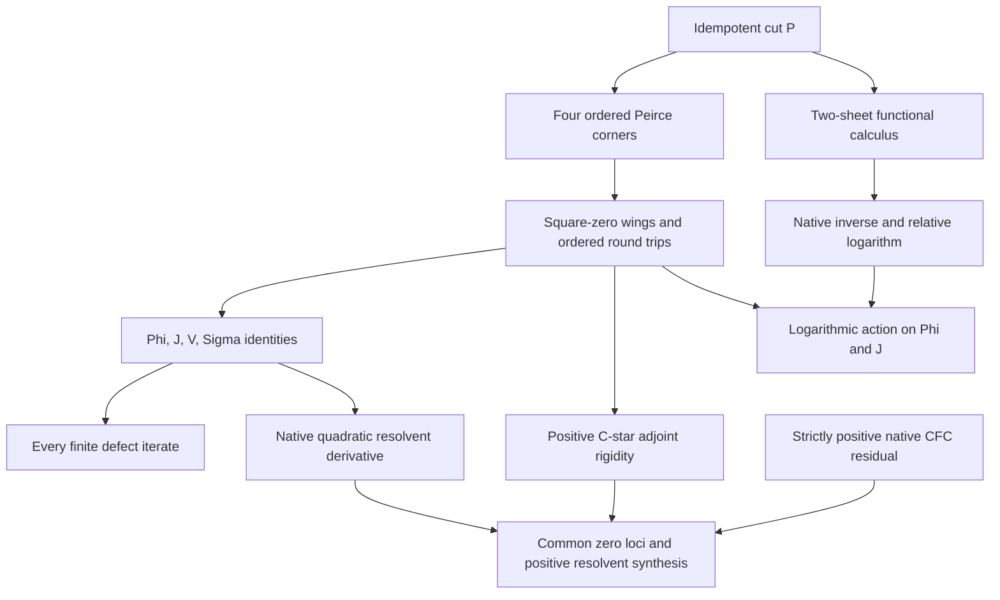

# Chiral Schwarz action, resolvent calculus, and logarithmic positivity

## Intake and baseline

- Base: `3d7eb6d9b0af5636ab12b3d0b91b82740507e49e` (`main`).
- Intake: user attachment `Pasted text(1).txt`, 6 November 2026.
- Intake SHA-256: `dae96793c7dcb8ae263702b6817ae6c6c4a2615769a276dbe6fc3ee5713011b9`.
- The original attachment is preserved separately. Its terminology and proposed
  implications are claims to inspect, not additional axioms.
- Lean: `v4.34.1`; Mathlib: `d13f23b723b8a846827a245b89c10fc7d3f11612`.

## Grounded mathematical atoms

The algebraic carrier is an arbitrary associative ring with an idempotent
`P`. Write `a = conePlus P A`, `b = coneMinus P C`, `Phi = a+b`,
`J = a-b`, `V = a*b+b*a`, and `Sigma = a*b-b*a`. Independent seeds `A` and
`C` are retained. No ambient commutativity or scalar normalization is assumed.

| Atom | Source owner | What is actually established |
|---|---|---|
| Binary cut and four corners | `PeirceSpine.Basic` | Complementary even/odd projections and ordered multiplication laws |
| Nilpotent wings and four generators | `PeirceSpine.Tetraktys.archetype_A3_nilpotent_cones_and_tetraktys_table` | `a*a=b*b=0`, `Phi*Phi=V`, `J*J=-V`, and grading identities |
| Interaction versus bracket | `PeirceSpine.Tetraktys.tetraktys_interaction_iff_chiral_obstruction` | `V=0` iff `Sigma=0`; this is not a statement about the kernel of `ad Sigma` |
| Mixed second actions | `PeirceSpine.ParaKahlerBregmanModularNoetherPoset.archetype_M1_parakahler_hessian_and_curvature_2form` | Mixed difference is `ad Sigma`; the symmetric part is the polarized adjoint square |
| Native endomorphism polarization | `SquareZeroModeActions.ad_sum_difference_polarization` | Equality of `Module.End` operators on the entire algebra |
| Mode actions | `SquareZeroModeActions.neg_ad_symmetric_sum`, `neg_ad_symmetric_difference`; `PeirceSuperoperators.weighted_lie_sum`, `weighted_lie_sub` | Symmetric action sends `Phi` to `2 V Phi`, `J` to `2 V J`; bracket action exchanges these modes |
| Ordered unipotent chart | `PeirceSpine.Unipotent.archetype_A12_nilpotent_conjugation_group` | `(1+a)P(1-a)=P-a`, with the reversed conjugation giving `P+a` |
| Defect iteration | `Core.IdempotentGraphGrassmannian` | Native idempotency-defect polynomial, polarization, and finite iteration laws |
| Native power derivative | `OperatorAlgebra.NoncommutativePowerDerivative` | Full insertion derivative of powers in normed noncommutative algebras |
| Algebraic resolvent | `OperatorAlgebra.OperatorDirichlet.SpineResolvent` | Two-sided inverses from explicit characteristic-unit hypotheses |
| Actual log-determinant differential | `Analysis.ComplexMatrixLogDetCalculus` | Native scalar differential and symmetric Hessian on full complex matrices |
| Operator surprisal | `OperatorAlgebra.NoncommutativeRenyi` | CFC log kernels; the relative log is `log rho - log sigma` |

`Tetraktys.derivSqPhi` includes a minus sign: it is `-ad_Phi^2`.
`Tetraktys.derivSqJ` is `+ad_J^2`. These conventions are not changed.

## New theorem contracts

1. **Positive adjoint-pair boundary.** In a normed C*-ring,
   `a * star a * a = 0` iff `a = 0`. With a real algebra structure and
   `a*a=0`, prove `[[a,star a],a]=0` iff `a=0`, and the corresponding
   equality of native inner-derivation operators. Apply it to an existing
   Peirce corner. Positivity of the C*-involution is essential.
2. **Noncommuting counterexamples.** In the full ring `Matrix (Fin 3) (Fin 3) Q`,
   use `P=diag(1,0,1)`, `a=E01`, `b=E12`. Prove both tested wing actions
   vanish while `V=Sigma=E02` is nonzero and square-zero. Exhibit an input
   outside the wings detecting `ad Sigma`, and the failure of the unordered
   square differential. This is not a claim that `Sigma` is central on the
   full matrix algebra. Then restrict through the native subalgebra inclusion
   to `Subalgebra.centralizer Q {E02}`. Both wings and the cut belong to this
   carrier. Prove that it is still noncommutative, that `V=E02` is still
   nonzero, and that the two native inner derivations now commute globally.
   This refutes the unrestricted global claim as well as the weaker wing test.
3. **Native resolvent calculus.** In a complete normed algebra, with
   `IsUnit (1+s*(Phi*Phi))`, define `R` by Mathlib's `Ring.inverse`. Prove
   native `HasFDerivAt` statements for `R_s(Phi)` and `eta_s(Phi)=R_s(Phi)*Phi`.
   The differential retains both insertions:
   `D eta[H] = R*H - s*R*(Phi*H+H*Phi)*R*Phi`.
4. **Operator logarithmic residual.** In a unital complex C*-algebra with its
   star order, prove `inverse T - 1 + CFC.log T >= 0` for strictly positive
   `T`. Specialize to `T=1+V` and `T=1-V`, obtaining the attachment's two
   valid residual expressions on their explicit domains. Use native CFC and
   operator order; do not replace the operator carrier by scalar matrices.
   Prove its exact zero condition: the residual vanishes iff `T=1`.
   Consequently the plus and minus residuals vanish iff `V=0` on their
   respective strictly positive domains.
5. **Common-carrier synthesis.** Connect the existing Peirce identities to
   the new analytic and positive-star results with actual maps and theorem
   applications. Record the theorem dependency graph, rather than assigning
   an arbitrary total order to independent claims. Under the positive
   adjoint-pair hypotheses, prove that the Schwarz action, the rational
   coordinate, and the logarithmic residuals have identical zero loci.
   Keep the coordinate's unit domain and the minus residual's positive
   domain explicit.
6. **Actual two-sheet relative logarithm.** For a self-adjoint projection
   in an arbitrary C*-algebra, define `twoSheet P p q = p P + q (1-P)`.
   Compute its native inverse from both multiplication orders and evaluate
   the actual CFC on its finite spectrum, including coincident weights.
   For positive `p,q,p0,q0`, prove strict positivity of the ordered ratio
   and compute its negative CFC logarithm. Prove the induced commutator
   actions on the original, arbitrary Peirce wings. These two operators
   share a spectral projection; they are not assumed to be normalized states.

The projection interpolation in `TwoSheetRelativeLog` was adapted from an
earlier, untracked `TwoSheetFunctionalCalculus.lean` candidate discovered during
source review. That candidate was not treated as part of main or as proof
evidence. The integrated source is checked against the pinned compiler and
Mathlib together with the new inverse, ratio, and commutator extensions.

## Dependency order

The order is proof dependency, with separate hypotheses for analytic and
positive branches. It makes no assertion about psychological causes or an
analytic limit of the finite defect tower.



The declaration audit extracts the full constants occurring in checked types
and proof values, checks their transitive axioms, and computes a topological
order of dependencies among all declarations in the new mathematical modules.
Generated declarations are included. The induced reachability relation is
acyclic; independent branches remain incomparable even when the output lists
one linear extension. External Mathlib and existing-owner dependencies remain
visible in each declaration's full dependency list.

## Exact synthesis and equality conditions

Let `P` be a self-adjoint idempotent in the stated ordered C*-algebra,
`a = P X (1-P)`, `b = star a`, `Phi = a+b`, and `V = a*b+b*a`.
The native inner-derivation bracket vanishes exactly when `a=0`, hence
exactly when `V=0`. For the same operators, the new bridges establish

```text
[ad a, ad b] = 0
    iff V = 0
    iff (1+s Phi^2)^(-1) Phi = 0          [IsUnit (1+s V)]
    iff log(1+V) - V (1+V)^(-1) = 0
    iff V (1-V)^(-1) + log(1-V) = 0     [IsStrictlyPositive (1-V)].
```

These are equalities of zero loci of different constructions. The plus
denominator is automatically strictly positive because `V` is a Gram sum.
The minus denominator has a separate spectral domain. The residuals are
positive operators; a nonzero residual need not be an invertible operator.

The arbitrary-direction native derivative, with `R=(1+s Phi^2)^(-1)`, is

```text
D R[H]   = -s R (Phi H + H Phi) R
D eta[H] = R H - s R (Phi H + H Phi) R Phi.
```

The finite defect statement is, with `d(Z)=Z^2-Z` and the existing ordered
round trips `Qplus=a*b`, `Qminus=b*a`,

```text
d^[n+1](P+Phi) = d^[n](Qplus) + d^[n](Qminus), for every n : Nat.
```

The relative logarithm is evaluated independently on positive sheet weights.
For `rho=p P+q(1-P)` and `rho0=p0 P+q0(1-P)`, put
`Delta=log(p/p0)-log(q/q0)` and `K=-CFC.log(rho * Ring.inverse rho0)`.
The proven formula and its native actions are

```text
K = -(log(p/p0)+log(q/q0))/2 * 1 - Delta/2 * invS P
[K, Phi] = -Delta * J
[K, J]   = -Delta * Phi.
```

The actions preserve arbitrary independent seeds in the two wings. They do
not require the wings to commute with either density.

## Corrected claims and boundaries

| Intake claim | Disposition |
|---|---|
| Mixed symmetric action on `Phi` is `-2 V Phi` | False for the stated convention; the sign is positive |
| `(1+a)P(1-a)=P+a` | False; the sign is negative |
| `a*a=0` makes `exp(ad a)` linear on all inputs | False; `ad_a^2(X)=-2aXa` and the quadratic term remains |
| Vanishing wing tests force `V=0` in a general ring | False; explicit noncommuting 3 by 3 counterexample |
| Globally commuting inner derivations force `V=0` in every associative algebra | False; explicit noncommutative matrix centralizer with nonzero central residue |
| A bare star or Krein involution supplies positivity | False; the positive C*-star hypothesis is stated explicitly |
| `D(Phi^2)[H]=2 Phi H` for arbitrary directions | False; the differential is `Phi H+H Phi` |
| Noncommuting inner derivations contradict Schwarz symmetry of scalar Hessians | False; these are different differential constructions |
| A rational operator coordinate is automatically an operator-log gradient | Not established; native log differentiation and a choice of pairing are separate obligations |
| `rho*rho0^-1` is the general relative modular operator | False; left and right actions on an operator carrier must be constructed |
| The residual is automatically the Umegaki divergence | Not established; the existing Umegaki kernel is a different defined expression |
| The Legendre expression in `Phi` equals the one in `V=Phi^2` | False without accounting for the factor two in the change of variables |
| Logarithms, convergence, positivity, BKM, and Kahler geometry follow from `[Ring B]` | False; the necessary analytic, ordered, and geometric structures are additional data |

The BKM divided-difference coefficient requires its own analytic theorem and
the equal-weight value `1/p`. No theorem here identifies a reference-dependent
Radon--Nikodym log-ratio with that coefficient. No manifold, Berry curvature,
para-Kahler structure, quantum field theory, or physical mass-gap claim is
promoted by the algebraic names.

## Validation

Validation date: 6 November 2026. These results certify the selected extension
and its complete project-source import closure, not a whole-repository build.

| Check | Result and exact scope |
|---|---|
| Pinned compiler and dependency sources | Lean 4.34.1, compiler commit `5045d0056413266e57c625dcd7c365b10e377c52`; Mathlib `d13f23b723b8a846827a245b89c10fc7d3f11612`; Mathlib dependency revisions and tracked-source cleanliness verified by the source-closure checker |
| Kernel elaboration | PASS: 21 project modules, comprising seven new mathematical owners, one audit module, and thirteen existing imported project owners |
| New-file compiler diagnostics | Zero warnings in the eight new Lean files |
| Existing imported diagnostics | Four existing unreachable/unused-tactic warnings in `PeirceSpine.Supercharge`; its source was unchanged |
| Declaration axiom and safety audit | PASS: 176 owned declarations, including 157 theorem declarations; counts include private/generated declarations. No unsafe or partial declarations, local axioms, or transitive axioms outside `propext`, `Classical.choice`, `Quot.sound` |
| Actual owned dependency graph | PASS: 176 vertices, 548 direct edges, dependency-first topological order, acyclic |
| Source freshness | All 21 source hashes matched the files used for elaboration after the run; no import substitution or stub generation |
| Staged proof gate | PASS: `python3 tools/quality/proof_proxy_staged_gate.py` |
| Source closure-debt scan | PASS: eight selected new Lean files, zero `sorry`/`admit`/custom-axiom gaps |
| Semantic content scan | PASS: eight selected new Lean files, zero blocking or review findings |
| Semantic vacuity scan | PASS at the maintained error threshold; one warning identifies `powerDerivative_two_apply` as a small specialization. Source review confirms that it computes the existing native power derivative at degree two and supplies the subsequent full Fréchet derivative proofs |
| Independent mathematical review | PASS at the stated hypotheses: noncommutative countermodels, positive-star rigidity, resolvent calculus, CFC residual positivity/equality, finite tower, common zero loci, actual sheet logarithm and its actions |
| Independent audit-tool review | PASS for owner selection, type/value dependency extraction, transitive whitelist checking, and topological sort; source freshness is supplied separately by the source-closure checker |
| Root-package Lake check | BLOCKED before target compilation by missing `HomotopyHypothesis` path package; maintained path preflight additionally reports unavailable Atlas and uninitialized GIFT sources |

### Exact kernel and declaration-audit command

Run from the repository root. The runtime activation path below is the
observed environment; another machine must supply the same pinned Lean and
clean, pinned Mathlib dependency checkout.

```bash
source /workspace/scratch/2e3cbf77ee2a/runtime/environment.sh
python3 tools/quality/check_operator_geometry.py \
  --mathlib /workspace/scratch/2e3cbf77ee2a/runtime/mathlib \
  --work-dir /workspace/scratch/2fb1853343a8/verification/chiral \
  --target InfoGeometry.OperatorAlgebra.PeirceSpine.ChiralSchwarzCounterexample \
  --target InfoGeometry.OperatorAlgebra.PeirceSpine.ChiralSchwarzResolvent \
  --target InfoGeometry.OperatorAlgebra.PeirceSpine.ChiralSchwarzCentralizer \
  --target InfoGeometry.OperatorAlgebra.PeirceSpine.ChiralSchwarzResolventAudit \
  --incremental
```

The checker serializes compilation under the shared repository build lock.
It snapshots actual source imports and writes `source-manifest.json`,
`checked-hashes.json`, per-module logs, and `result.json` to its work directory.
The audit module prints one JSON record per owned declaration and a final
summary including the computed dependency order. Its complete log is
`InfoGeometry.OperatorAlgebra.PeirceSpine.ChiralSchwarzResolventAudit.log`.
The checker was also run without incremental reuse when the initial closure
was assembled; later runs rebuilt every changed module and downstream module.

For the static scans, the file list was exactly the eight added Lean paths
shown below. The commands were:

```text
python3 tools/quality/proof_proxy_staged_gate.py
python3 tools/infra/axiom_audit.py --fail-on-gaps <eight added Lean paths>
python3 tools/quality/semantic_vacuity_gate.py --fail-on error --json-out <report.json> <eight added Lean paths>
python3 tools/quality/semantic_content_audit.py --gate --json-out <report.json> --md-out <report.md> <one --file-prefix argument for each added Lean path>
git diff --cached --check
```

### Root-package boundary

The maintained command was actually attempted:

```bash
python3 tools/infra/run_locked_lake_build.py --wait-for-build-lock \
  InfoGeometry.OperatorAlgebra.PeirceSpine.ChiralSchwarzResolventAudit
```

It exited 1 after resolving the pinned Mathlib and LeanCopilot revisions:

```text
error: HomotopyHypothesis: package directory not found:
  external_refs/homotopy-hypothesis-lean4
```

`python3 tools/infra/ci_bootstrap.py paths --root .` also exited 1. It reports
HomotopyHypothesis and Atlas as missing, untracked path dependencies, GIFT as
an uninitialized pinned gitlink, and InfoGeometryCore as available tracked
source. A bounded search of the recorded setup instructions and known
checkouts did not supply the missing HomotopyHypothesis/Atlas sources. No
upstream HEAD, stub package, source replacement, dependency-pin change, or
cache deletion was used to pass this gate. The root-package prerequisites
remain unresolved. The extension is prepared for upstream draft review with
these blockers recorded as integration prerequisites; the scoped verification
above does not certify a successful root-package build.

### Checked new-source fingerprints

The unchanged imported project sources are fixed by the baseline commit
recorded at intake. These SHA-256 hashes identify every new Lean source used
by the passing final check.

| New source under `lean/` | SHA-256 |
|---|---|
| `InfoGeometry/OperatorAlgebra/QuadraticResolventCalculus.lean` | `2a12b3e25f442dff1df0c5777b655adafa82aff2f5931e985545df735564eef9` |
| `InfoGeometry/OperatorAlgebra/SquareZeroCStarRigidity.lean` | `f7f99d5ed2839a5133fad325935d4b788ed9f98cd036d39edc7462e71fa487ff` |
| `InfoGeometry/OperatorAlgebra/LogarithmicResolventPositivity.lean` | `f66a4b19a9713457ccac65df59a10f1932c402a519baee7024f6f066a33c5119` |
| `InfoGeometry/OperatorAlgebra/PeirceSpine/ChiralSchwarzCounterexample.lean` | `acba2871df204fd9f6e9f90a597b6b4db2634a6bd6d2d9a1aa3f9488fbf24fe3` |
| `InfoGeometry/OperatorAlgebra/PeirceSpine/ChiralSchwarzCentralizer.lean` | `39abcdab7529c3ffc62fd9311e0dba2bf741f9ddc03a3f280ad397c22f7fbef3` |
| `InfoGeometry/OperatorAlgebra/PeirceSpine/ChiralSchwarzResolvent.lean` | `881d6b74c7681da72507109bca045243b1fc7025c6886ed842e5a4395b330cbf` |
| `InfoGeometry/OperatorAlgebra/PeirceSpine/TwoSheetRelativeLog.lean` | `e90c45189c65ef7e60aa78b626e105abc5bf3ac28dabfe93ed106f599ea83a6f` |
| `InfoGeometry/OperatorAlgebra/PeirceSpine/ChiralSchwarzResolventAudit.lean` | `3289995c26d99f72f3f57ae7beeaacc2614c1d8acbba954c0f4be92e677900fb` |
