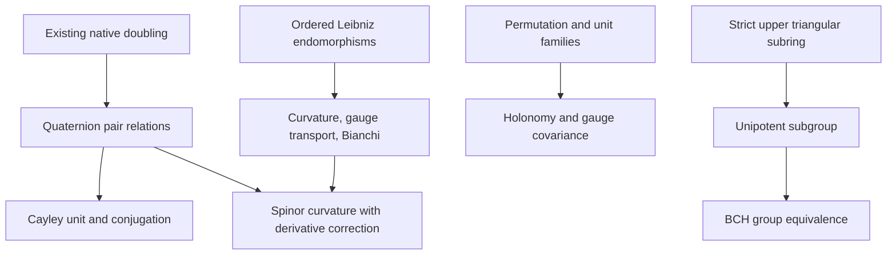

# Clifford, nilpotent BCH, weighted holonomy, and curvature contract

## Provenance and scope

Source: `CLIFFORD_HOLONOMY_CURVATURE_INTAKE.md`; base revision `a392af178af1fe2bcba2ba39eb405700c6ee103c`.
The intake is a mathematical proposal with truncated code. Claims are accepted only at their proved Lean types. All coefficient algebras retain arbitrary noncommutative `Ring` structure. Native matrix, endomorphism, unit, subgroup, and non-unital-subring carriers are used.

## Existing owners and smallest additions

| Branch | Existing owner and exact reused content | New target and hypotheses |
| --- | --- | --- |
| Clifford blocks | `Clifford/SplitAtomDoubling`: repeated ring hom, twisted product, head squares and anticommutators; `Core/OperatorCliffordDouble`: arbitrary-module endomorphism blocks and faithful lift | Thin four-generator nested matrix realization; generic anticommuting negative-square pair gives quaternion multiplication identities |
| Cayley factors | `OperatorAlgebra/QuadraticRotorUnit.sandwich`, specialized over central integers; `InnerConjugation.innerConjugationRingEquiv` | Actual unit `1+i`, inverse `(1-i)/2`, and quarter-turn conjugation under invertible two |
| Nilpotent algebra | Native `NonUnitalSubring`, `Subgroup`, matrix multiplication, units | Strict upper triangular 3 by 3 matrices over `Ring A`; prove all mixed triple products vanish; actual unipotent subgroup, inverse and commutator |
| BCH coordinates | Native `Equiv`, `MulEquiv`, transferred group structures | Under `[Invertible (2 : A)]`, explicit quadratic exponential/logarithm and group equivalence from the BCH group, with the BCH multiplication formula proved |
| Discrete holonomy | Native `Equiv.Perm.permMatrix`, diagonal and permutation multiplication | Derived noncentral unit-valued correction, weighted matrix braiding and vertex gauge covariance; exact row i, column sigma(i) convention |
| Connections | `Geometry/AssociativeGaugeConnection`: `IsLeibniz`, `innerDerivative`, fundamental connection, curvature, affine gauge potential, derived curvature covariance | Adjoint curvature action and cyclic Bianchi for three arbitrary possibly zero/dependent commuting derivations; ordered curvature square |
| Synthesis | Nested quaternion pair plus existing curvature | Spinor curvature with explicit annihilation hypotheses, including a zero-derivation realization |

## Required corrections and excluded implications

1. The diagonal-sign Clifford presentation does not give all of `M₂(ℤ)`: its diagonal and off-diagonal entries have parity restrictions. The existing real `Cl11Matrix.cl11EquivMat` and graded tensor `Tower.clsplit_succ_equiv` remain the universal Clifford owners. No unrestricted all-ring tensor classification is asserted.
2. Quaternion relations are ring identities. Over the real numbers, `Cl(0,2)` is the quaternion algebra and its even subalgebra is two dimensional; neither equals the three-dimensional imaginary-quaternion Lie algebra as stated in the intake. Noncommutative coefficient spans need not be Lie-closed: `[x E₁, y E₁] = -[x,y]` when lifted coefficients commute with the structural axis.
3. Unnormalized Cayley sandwiches hold integrally. Unit construction and normalized conjugation need invertibility of two. A formula `commutator = 2*k` alone does not imply noncommutation in characteristic two.
4. The half-exponential requires invertibility of two. Its source multiplication is BCH, not ordinary addition. Individual cube-zero hypotheses alone do not justify mixed BCH truncation; mixed triple-zero is proved for the common strict upper triangular subring.
5. Mathlib `Derivation` has a commutative domain in the pinned version. The existing ordered `IsLeibniz` predicate on native linear endomorphisms preserves the requested coefficient ring. The richer faithful CE direction owner does not directly cover arbitrary zero/dependent directions and independent potentials.
6. Element-valued Bianchi is derived by ordered Leibniz expansion or the faithful left regular representation. Adjoint Jacobi alone would establish only centrality.
7. Weighted permutation holonomy does not by itself construct categorical braiding, Yang–Baxter, a continuum limit, or a differential connection. The independent branches acquire no unsupported causal arrows.
8. The constant-axis specialization assumes the displayed derivatives vanish. The more general identity retains their difference, and the constant value holds exactly when the derivative terms cancel; no necessity of separate vanishing is asserted.

## Declaration dependencies

The Clifford blocks feed the nested quaternion realization and Cayley specialization. The strict upper triangular subring feeds the unipotent subgroup and, with invertible two, the BCH group equivalence. Unit families and a permutation feed the discrete holonomy. Ordered derivations feed connection curvature, gauge covariance, and Bianchi. The sole proposed synthesis edge is quaternion generators plus derivative-annihilation hypotheses into a curvature realization.

### Corrected dependency diagram

The Cayley unit and BCH equivalence require invertibility of two. There is no asserted edge from the independent BCH or discrete holonomy branch to the differential construction. The diagram records implemented dependence, not historical or physical causation.

### Public declaration map

| New owner | Principal declarations and exact scope |
| --- | --- |
| `Algebra/StrictUpper3` | `strictUpper`, `triple_mul_zero`, `onePlusUnit`, `unitriangular`, `shiftEquiv`, `onePlusUnit_mul`, `onePlusUnit_commutator`, `root_steps_not_commute` |
| `Algebra/StrictUpperBCH3` | `expIncrement`, `logIncrement`, `expLogEquiv`, `expUnit_mul`, `expUnit_commutator`, `expMulEquiv`, `toStrict_mul`, `toStrict_inv` |
| `Algebra/QuaternionCayleyPair` | `product_square`, cyclic commutators, `cayley_sandwich`, `cayleyFactorUnit`, its two conjugation theorems and conditional strict noncommutation |
| `Clifford/SplitAtomQuaternion` | `gamma_square`, `gamma_anticommutator`, three actual nested axes, their squares and cyclic commutators |
| `Geometry/AssociativeBianchi` | `adjoint_commutator_action`, `cyclicBianchi_defect`, `cyclicBianchi`, `curvature_square_expansion`; extends the existing connection namespace |
| `OperatorAlgebra/WeightedPermutationHolonomy` | actual invertible `weightedShift`, `ordered_braid`, `global_commutator`, `holonomy_gauge_covariant`, and matrix gauge covariance |
| `Canonical/CliffordHolonomyCurvature` | `spinor_curvature_formula`, exact `spinor_curvature_eq_iff`, constant-axis realization, regular-module action, and unit gauge transport |

## Acceptance plan

Use the exact repository Lean and Mathlib pins, shared build lock, isolated source-closure checker, native axiom audit for every new declaration, zero warnings in every new target, strict placeholder review, semantic review by an independent agent, and real staged/publication gates. Record exact source hashes and report coverage. The complete canonical aggregate depends on external packages and is not certified by scoped checks. No dependency changes, proof holes, custom axioms, or unsafe shortcuts are permitted.

## Overlap review

Open draft PR336 supplies normalized noncommutative Clifford/Walsh coordinates; it is unmerged and not a dependency. This change adds no replacement coordinate owner. Completed PR335 supplies separate graded anomaly/defect identities and is not a dependency. Reuse is based on main-branch owners listed above.

## Import-scope maintenance for existing owners

The new quaternion/Cayley consumer reuses `QuadraticRotorUnit` and `InnerConjugation`. A combined development check stopped before finalizing while rechecking a dependency with a blanket `import Mathlib`; it is not counted as verification. The four old owners on that path have been narrowed after direct source review: `ThermalBogoliubovCAR`, `ThreeZ2OperatorGradings`, and `QuadraticNoncommutativeIdentity` retain their existing `FiniteSpinAlgebra` import, and `InnerConjugation` imports `Mathlib.Algebra.Polynomial.AlgebraMap` for the exact integer-polynomial evaluation theorem it uses. All existing declaration statements are unchanged; the only proof-body adjustment removes a compiler-reported unused `add_comm` simplifier entry in `ThermalBogoliubovCAR`. The required copyright header is added to `ThreeZ2OperatorGradings`. All four owners are included in the fresh source-closure and declaration axiom audits, rather than relying on an old binary check.
