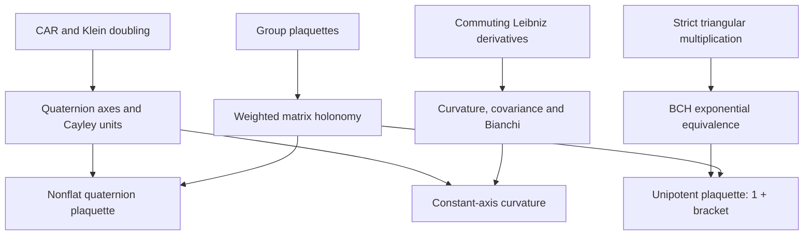

# Clifford operators, unipotent BCH, and gauge curvature

## Intake and source baseline

The 12 November 2026 user intake requests three operator constructions:
Clifford/Klein doubling and quaternion Cayley factors; the strict upper
triangular 3-by-3 exponential/BCH correspondence; and weighted permutation
holonomy with differential connections and Bianchi. The pasted Lean fragment
ends at `mul2_00`; its prose claim of a complete verified module is not build
evidence. This implementation reconstructs the stated mathematics on existing
owners, rather than treating that fragment as an accepted source file.

The baseline is upstream `main` at `a392af178af1fe2bcba2ba39eb405700c6ee103c`
plus the existing local Klein-twist commit
`eefb2be6793cbf41803dbcaff2c6fe1e6aff031a`. Dependency pins are unchanged.

## Precise contract and corrections

| Construction | Carrier and hypotheses | Required result |
| --- | --- | --- |
| Klein doubling | `Ring A`; existing `SplitAtomDoubling` and `Cl11BrauerWeylGenerators` | Reuse CAR, twist, and four-generator relations |
| Quaternion axes | `Matrix (Fin 2) (Fin 2) (Matrix (Fin 2) (Fin 2) B)`, `Ring B` | Three negative squares, cyclic products and commutators, ordered Cayley sandwiches |
| Unipotent group | Strict upper triangular coordinates over `Ring A` | Actual matrix-unit embedding, group structure, group commutator |
| Quadratic exp/BCH | Same noncommutative ring, with invertible `2` | Explicit inverse logarithm and multiplicative equivalence for the BCH product |
| Weighted shift holonomy | Finite index permutation; edge and vertex units of `A` | Matrix braiding identity, invertibility, and gauge conjugation covariance |
| Differential curvature | Existing `Module.End R A` derivations with Leibniz and pairwise commutation | Fundamental/adjoint curvature actions, affine gauge covariance, ordered square splitting, differential Bianchi |
| Quaternion-axis curvature | Above nested matrices and derivations annihilating the two relevant constant axes | Curvature is twice the third axis |

The coefficient rings remain noncommutative. Integer scalars suffice for the
differential module structure. An invertibility assumption on `2` is explicit
where division by two is used.

The phrase `sp(1) ≅ Cl^0(0,2)` in the intake is incorrect: over the reals,
`Cl(0,2)` is the quaternion algebra, its even part is two-dimensional, and
the three imaginary axes carry the quaternion commutator Lie algebra.
Ring identities alone do not identify a compact real Lie algebra.
The two negative Clifford generators are odd, while their product is even;
the resulting quaternion Lie triple has mixed parity. No Spin(2,2) embedding
is inferred from it. A separate native real quaternion algebra homomorphism
and injective imaginary-quaternion Lie homomorphism supply the real algebraic
interpretation under explicit nontrivial real-algebra hypotheses.

The factors
`1 + E` and `1 - E` multiply to `2`; the displayed sandwich is twice a
normalized conjugation. In characteristic two the signed generator model
degenerates, so the arbitrary-ring matrix identities do not assert a full
diagonal-form Clifford algebra classification or a faithful real spin group.

The fundamental operation `d(X) + A*X` is a connection on the regular right
module. Its adjoint operation `d(X) + A*X - X*A` is a derivation. The formula
`F(E1,E2) = 2*E3` needs `d1(E2)=0` and `d2(E1)=0`; arbitrary matrix
derivations need not annihilate these matrices.

## Actual dependencies

The existing CAR/Klein owners imply the nested generator relations; those
relations imply quaternion products and Cayley identities. Strict upper
triangular multiplication independently implies the unipotent group law and,
with invertible `2`, BCH. Group cancellation independently implies plaquette
covariance; its weighted permutation representation gives matrix braiding.
Leibniz plus commuting derivatives implies connection curvature and Bianchi.
The constant-axis specialization connects the quaternion and differential lanes.
The actual unipotent exponential supplies constant unit labels on the permutation
lattice: the resulting plaquette is exactly one plus the nilpotent bracket.
The weighted matrix representation then has group commutator equal to the
diagonal matrix with those operator-valued entries. Quaternion Cayley units
supply another explicitly nonflat plaquette; at any supplied vertex, its
weighted vertex and shift matrices consequently do not commute.



There is no proved limiting map from discrete plaquettes or BCH to the given
derivations, no Mellin inversion here, and no additional analytic or topological
periodicity theorem. Such analogies are not dependency edges.

## Existing owner reuse

- `Clifford/SplitAtomDoubling/Basic.lean`: noncommutative block embeddings.
- `Clifford/Cl11KleinTwist.lean`: CAR, parity, graded embedding, reconstruction.
- `Clifford/Cl11BrauerWeylGenerators.lean`: arbitrary-index generator extension.
- `Geometry/AssociativeGaugeConnection.lean`: fundamental connection, curvature,
  affine potential transform, exact gauge covariance; extended with its adjoint
  action, commuting-direction Bianchi, and ordered square identities.
- `LatticeGauge/FinitePlaquette.lean`: the existing group-valued holonomy and
  gauge-covariance theorem, instantiated by the explicit permutation lattice.
- `OperatorAlgebra/DerivationDifferentialForms.lean` and
  `OperatorAlgebra/DerivationGaugeTransport.lean`: the existing broader
  noncommuting-direction Chevalley–Eilenberg calculus, distinct from the
  coordinate specialization requested here.

## Validation

The independent fresh kernel check and complete owned-declaration audit passed
on source commit `97cf41d7303093b24e284b8c6f78b50bb42129b6`, using Lean
`v4.34.1` and pinned Mathlib
`d13f23b723b8a846827a245b89c10fc7d3f11612`.

- All 38 project modules in the selected import closure compiled from fresh
  copied source; no project compilation artifacts were reused.
- All 11 selected targets compiled with zero warnings. Two unchanged imported
  dependencies each retain one warning: `Clifford.SplitQ11` and
  `Algebra.MatrixNoncommutativity`.
- The audit checked all 428 declarations owned by the selected modules,
  including generated and private declarations. Its axiom set is exactly
  `propext`, `Classical.choice`, and `Quot.sound`; it contains neither
  `sorryAx` nor a custom axiom.
- Independent QA reconciled all 38 live, copied, committed, and indexed source
  hashes, compiled artifacts, verification helpers, and evidence hashes.
  The 45 direct native import artifacts were unchanged, and the pinned
  Mathlib tracked source tree remained clean.
- Strict placeholder and OpenGauss/refute scans passed for the nine changed
  or inherited extension owners. There were zero hard placeholder findings
  and zero screening traps. The placeholder scan retained 14 soft findings.
  The complete semantic scan reported zero errors and 34 short-proof
  warnings, independently accepted as coordinate projections, definitional
  evaluations, or corollaries of substantive previously proved laws.
  The existing graded-action workflow checks also passed.
- Independent mathematical/source review passed. The reviewer authored no
  implementation edits. Independent acceptance QA separately ran the native
  compiler and axiom audit. The installed staged proof hook actually ran on
  the nonempty implementation commits and passed.
- The workflow preserves all 11 targets. Its seven shell blocks and four
  embedded Python blocks passed syntax checks.

| Owned module | Audited declarations |
| --- | ---: |
| `Clifford.Cl11GradedOperatorAction` | 22 |
| `Clifford.Cl11ColimitDimension` | 4 |
| `Clifford.SplitAtomDoubling.Basic` | 22 |
| `Clifford.Cl11KleinTwist` | 47 |
| `Clifford.Cl11BrauerWeylGenerators` | 15 |
| `Clifford.SplitAtomDoubling` | 4 |
| `Algebra.UnitriangularBCH` | 142 |
| `Quantum.OperatorWeylHolonomy` | 70 |
| `Geometry.AssociativeGaugeConnection` | 40 |
| `Clifford.Cl22QuaternionCayley` | 58 |
| `Canonical.CliffordHolonomyCurvature` | 4 |
| **Total** | **428** |

This is a scoped source-closure result, not a successful root-package Lake
build. Independent QA also ran both maintained root wrappers: the direct file
check for `Canonical.CliffordHolonomyCurvature` and the explicit five-target
Lake build. Both exited with code 1 before theorem elaboration because the
declared `HomotopyHypothesis` package directory is absent at
`external_refs/homotopy-hypothesis-lean4`. No package configuration or
dependency pin was changed to suppress that failure. Repository publication
remains subject to the required pre-push gate; scoped acceptance does not
override that gate.

The full scoped verification command uses the existing shared-lock checker.
Use a fresh output directory and the pinned, initialized native Mathlib:

```sh
python3 tools/quality/check_clifford_dirac.py \
  --mathlib-root PATH_TO_PINNED_MATHLIB \
  --lean PATH_TO_PINNED_LEAN \
  --target InfoGeometry.Clifford.Cl11GradedOperatorAction \
  --target InfoGeometry.Clifford.Cl11ColimitDimension \
  --target InfoGeometry.Clifford.SplitAtomDoubling.Basic \
  --target InfoGeometry.Clifford.Cl11KleinTwist \
  --target InfoGeometry.Clifford.Cl11BrauerWeylGenerators \
  --target InfoGeometry.Clifford.SplitAtomDoubling \
  --target InfoGeometry.Algebra.UnitriangularBCH \
  --target InfoGeometry.Quantum.OperatorWeylHolonomy \
  --target InfoGeometry.Geometry.AssociativeGaugeConnection \
  --target InfoGeometry.Clifford.Cl22QuaternionCayley \
  --target InfoGeometry.Canonical.CliffordHolonomyCurvature \
  --output FRESH_OUTPUT_DIRECTORY
```
