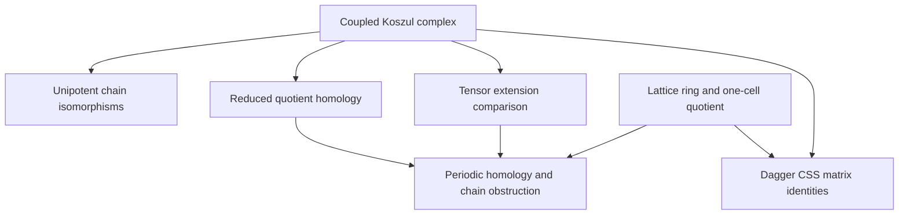

# Coupled Koszul CSS complexes: theorem contract

## Source and intended result

Source: Hao Song, *Superselection Rigidity of Topological Calderbank–Shor–Steane
Codes: From Koszul-Complex Models to Nonsplit Extensions*,
[arXiv:2608.09913v2](https://arxiv.org/html/2608.09913v2), 29 October 2026.
The source equations for this task are (45)–(46), (158)–(166), and the periodic
coefficient reduction (19)–(25). The target is the coupled degree-(1,2)
Koszul complex, its invariance under ideal-valued changes of coupling, and a
native homology calculation after one-cell periodic reduction.

The base revision is `a392af178af1fe2bcba2ba39eb405700c6ee103c` of
`nickgou-nuke/info-geometry-lean`. This is a separate development from the
Clifford/BCH/gauge-holonomy PR. The paper uses Clifford *circuits* acting on
Pauli operators; no identification with the earlier real Clifford-algebra
rotors is assumed.

## Exact carriers and conventions

Let `R` be a commutative unital ring and `V = Fin 3 → R`. In the cyclic
degree-two basis `(e₂∧e₃, e₃∧e₁, e₁∧e₂)`, put

\[
C(f)=\begin{pmatrix}0&f_3&-f_2\\-f_3&0&f_1\\f_2&-f_1&0\end{pmatrix}.
\]

The adjacent maps of the length-three Koszul complex are
`d₁(x) = fᵀx`, `d₂(x) = C(f)x`, and `d₃(t) = tf`. For an arbitrary coupling
`a : V`, the actual module maps are

\[
D_2(u,t)=(C(f)u+ta,tf),\qquad
D_1(x,y)=(f^{\mathsf T}x-a^{\mathsf T}y,C(f)y).
\]

They have carriers `V × R → V × V → R × V`. The delivered complex must use
Mathlib's `ShortComplex (ModuleCat R)` and its actual quotient homology.
The off-diagonal coupling remains in the differential.

The translation ring is the finite-support group algebra
`AddMonoidAlgebra k (Fin D → ℤ)`, specialized to `k = ZMod N` for qudits.
Its commutativity is a property of the translation coefficients, not an
assumption that quantum Pauli operators commute. Spatial inversion acts on
exponents by negation. A dagger on matrices must combine that inversion with
transpose.

## Claim inventory and dependency order

| Claim | Required hypotheses | Intended authority |
|---|---|---|
| Two coordinate Koszul matrices do not commute | `CommRing R`, `Nontrivial R` | Compare the actual matrix products at entry `(0,1)`; the witness also works in characteristic two |
| Both Koszul compositions vanish | `CommRing R` | Native linear-map and matrix proofs |
| `D₁ ∘ D₂ = 0` | Arbitrary `f, a` | Koszul identities and the off-diagonal dot-product identity |
| Both dagger CSS isotropy identities | The actual translation ring and its inversion | Matrices of the native complex maps in product bases |
| Coupled middle exactness | Exactness of both adjacent uncoupled Koszul maps | Explicit element chase; the input exactness remains a hypothesis |
| `a ↦ a + Bf` preserves the complex up to isomorphism | Arbitrary `B : Matrix (Fin 3) (Fin 3) R` | Explicit unipotent linear equivalences at the three objects |
| Ideal-valued changes preserve homology | Each coordinate of `a' − a` lies in `(f₁,f₂,f₃)` | Express as `Bf`, then apply the chain isomorphism and native homology functor |
| Periodic coefficient reduction | A ring homomorphism and the explicit free-module maps | An isomorphism from actual tensor extension to the evaluated short complex |
| One-cell Laurent quotient | `CommRing k` | Native ring quotient equivalence, with a proof of the kernel identification |
| Zero and unit coupling have distinct one-cell homology | Coefficient field; in particular `ZMod 2` | Native quotient homology dimensions `6` and `4` |
| The original zero- and unit-coupled lattice complexes are not isomorphic | Coefficient field | Scalar extension preserves a hypothetical isomorphism, contradicting the homology dimensions |

For the presentation change, let `a' = a + Bf` and
`v = (B₃₂ − B₂₃, B₁₃ − B₃₁, B₂₁ − B₁₂)`. The source map is identity, the
middle map is `(x,y) ↦ (x + By,y)`, and the endpoint map is
`(s,z) ↦ (s + vᵀz,z)`. Their inverses negate the off-diagonal terms.
These maps, including both chain squares and both inverse laws, must be
constructed rather than supplied as assumptions.

The implemented dependencies have the following shape. Edges indicate actual
constructions used in downstream proofs; shared physical terminology supplies
no additional edges.



## Declaration map

All files below are under `lean/InfoGeometry/Quantum/`.

| Owner | Main declarations |
|---|---|
| `CSSKoszulExtension.lean` | `outgoing_comp_incoming`, `complex`, `complex_exact_of_koszul_exact`, `couplingIso`, `nonempty_iso_of_coupling_sub_mem_span` |
| `LatticeTranslationRing.lean` | `augmentation_ker`, `oneCellEquiv`, `inversion_inversion`, `dagger_mul` |
| `CSSKoszulBaseChange.lean` | `baseChangeIso`, `specializeIso` |
| `CSSKoszulHomology.lean` | `zeroHomologyEquiv`, `unit_boundary_range_eq_ker`, `unitHomologyEquiv` |
| `CSSKoszulPauli.lean` | `zMatrix_eq_fromBlocks`, `boundaryMatrix_eq_fromBlocks`, `dagger_xMatrix_mul_zMatrix`, `dagger_zMatrix_mul_xMatrix` |
| `CSSKoszulPeriodic.lean` | `oneCellIso`, `finrank_zero_oneCell`, `finrank_unit_oneCell`, `not_nonempty_toric_zero_unit_iso` |

`baseChangeIso` compares complexes. It does not identify homology after
tensoring with the tensor product of the original homology. In particular,
the formalization does not assume flatness of the periodic quotient.

## Existing owners inspected

- `Clifford/Cl55ExteriorContractionGrading.lean` already constructs native
  exterior contraction and degreewise complexes over a fixed real five-mode
  carrier. Its exactness requires a vector pairing to one, which does not
  prove regular-sequence exactness in the translation ring.
- `Spectral/Algebra/ChainComplex.lean` forwards to native `ChainComplex.of`.
  The present finite window can use the narrower native short-complex API.
- Native `Mathlib.Algebra.Homology.ShortComplex.ModuleCat` owns the quotient
  of cycles by boundaries and its categorical homology isomorphism.
- Native monoid-algebra `domCongr`, `lift`, and ring quotient APIs supply the
  lattice coefficients and their maps.
- The repository's finite toric star/plaquette and binary Golay stabilizer
  owners do not supply this translation-invariant coupled complex.

## Scope boundaries

This task does not establish the paper's full single-degree rigidity theorem,
the common `Ext` layers in Fact 10, the derived superselection profile, the
minimal coarse-graining theorem, or the classification of all eight models.
Regular-sequence exactness is separate from square zero and from the
conditional exactness transport proved here.

An explicit chain isomorphism under ideal-valued coupling changes proves a
sufficient invariance statement, not a converse classification. The finite
homology calculation concerns the one-cell periodic specialization. It does
not prove inequivalence under arbitrary physical finite-depth local circuits
or a large-torus ground-state-degeneracy formula.

No coefficient pins will change. No proof holes, custom axioms, or opaque
computational acceptance mechanisms are permitted. Independent mathematical
review and independent kernel/axiom acceptance apply to the final source.

## Validation record

Validated on 12 November 2026 with Lean `v4.34.1` and Mathlib
`d13f23b723b8a846827a245b89c10fc7d3f11612`. The repository pins and gate
implementations are unchanged.

Independent mathematical review passed for the six owners, including the
augmentation kernel, actual tensor extension, quotient homology, both CSS
matrix identities, and the original-ring nonisomorphism argument. The final
core correction adds the actual coordinate-matrix noncommutativity witness
and makes the already scalar endpoint contraction explicit.

| Acceptance check | Observed result |
|---|---|
| Fresh source-closure compilation | Six modules compiled; zero warnings; no reused project artifacts |
| Full owned-declaration axiom audit | 206 declarations; only `propext`, `Classical.choice`, and `Quot.sound` |
| Strict OpenGauss/refute and staged proof gate | Passed; zero traps |
| Static GATE_4 | All six owners passed; kernel acceptance is supplied separately by the fresh compilation and audit |
| Strict placeholder audit | Zero hard findings; five reviewed soft findings |
| Semantic coverage | All six files read; zero errors; 22 reviewed lexical warnings |
| Workflow verification | Seven Bash blocks and five Python blocks parsed; the actual source-gate and evidence-reconciliation blocks passed |
| Root file and six-target Lake integration | Both attempted; blocked by the missing configured `HomotopyHypothesis` path dependency |

The placeholder and semantic warnings concern short definitional/automation
proofs and existing section assumptions. They are source heuristics, distinct
from Lean compiler diagnostics; they were reviewed against the actual
declarations and the theorem contract.

The focused acceptance command is below. Replace the two path arguments with
the pinned Mathlib checkout and a fresh output directory in the local
environment. No incremental reuse or audit-skipping option is used.

```bash
python3 tools/quality/check_clifford_dirac.py \
  --mathlib-root /path/to/pinned-mathlib \
  --output /path/to/fresh-css-koszul-report \
  --target InfoGeometry.Quantum.LatticeTranslationRing \
  --target InfoGeometry.Quantum.CSSKoszulExtension \
  --target InfoGeometry.Quantum.CSSKoszulBaseChange \
  --target InfoGeometry.Quantum.CSSKoszulHomology \
  --target InfoGeometry.Quantum.CSSKoszulPauli \
  --target InfoGeometry.Quantum.CSSKoszulPeriodic
```

The maintained root checks were also attempted with the pinned Lake binary:

```bash
python3 tools/infra/run_locked_lean.py --wait-for-build-lock \
  lean/InfoGeometry/Quantum/CSSKoszulPeriodic.lean
python3 tools/infra/run_locked_lake_build.py --wait-for-build-lock \
  InfoGeometry.Quantum.LatticeTranslationRing \
  InfoGeometry.Quantum.CSSKoszulExtension \
  InfoGeometry.Quantum.CSSKoszulBaseChange \
  InfoGeometry.Quantum.CSSKoszulHomology \
  InfoGeometry.Quantum.CSSKoszulPauli \
  InfoGeometry.Quantum.CSSKoszulPeriodic
```

Both root attempts exited with status 1 before owner elaboration because
`external_refs/homotopy-hypothesis-lean4` is absent. The dedicated workflow
checks the complete source closure of this contribution directly against the
pinned native dependencies. These results establish focused acceptance, not
repository-wide Lake acceptance.
