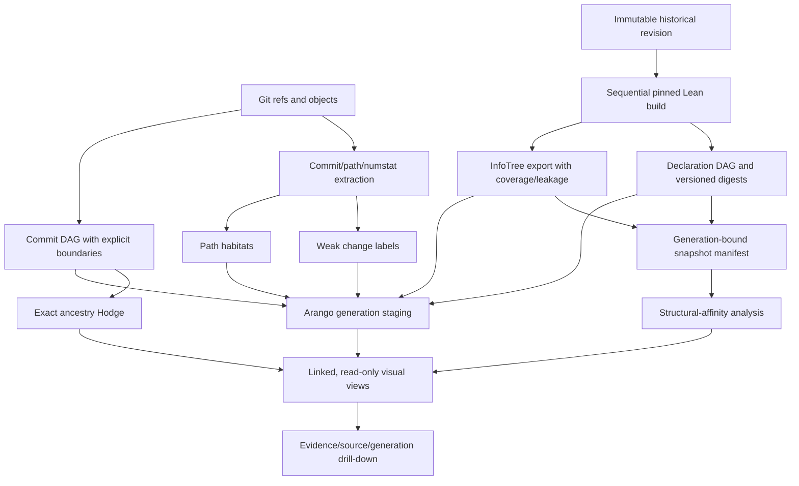

# Darwin Repository Evolution Pipeline Blueprint

**Status:** design proposal for adversarial audit
**Source revision:** `d8c8c65cf6d3d8ed56695803efd758740b65fc02`
**Prepared:** 2026-10-28

## Purpose and semantic boundaries

Build a reproducible explorer for how repository commits, Lean declarations,
compiler-produced fingerprints, elaboration/InfoTree structure, and typed
dependency graphs change over time. A city/network visualization may show
growth, branching, traffic, and candidate affinity, but every displayed edge
must preserve its origin, generation, and evidence class.

Keep these separate:

1. Git parent edges are repository ancestry.
2. Commit labels and path habitats are weak change classifications.
3. Declaration digests are compiler observations tied to a source/build
   generation.
4. InfoTree rows are elaboration observations from one compiler run.
5. Dependency DAG edges are compiler-reported references.
6. Similarity, Hodge summaries, SCCs, attention, and embeddings are derived
   navigation evidence.

None of these alone proves theorem meaning, equivalence, or biological
phylogeny. “Species” is a display metaphor, not a formal classification claim.

## Current code inventory

### Git history and change taxonomy

- `tools/infra/evolution_extract.py` streams commit metadata and optional path
  and numstat JSONL. Its SQLite checkpoints bind to a Git ref fingerprint,
  truncate an uncommitted tail on resume, and reject ref changes during a run.
- `tools/infra/evolution_taxonomy.py` applies multi-label `weak-rule-v2`
  subject/body and path rules. Its scores are rule weights, not calibrated
  probabilities; unmatched changes receive a weak default label.
- `tools/infra/evolution_path_habitat.py` counts path touches and commits by
  path-derived habitat, preserving undecodable path bytes through Base64; it
  can emit per-commit path context.
- `tools/infra/evolution_ingest.py` ingests streams into `evo_*` collections.
  Replacement is explicitly opt-in. `tools/infra/darwin_phylogeny_pipeline.py`
  orchestrates preparation, rendering, optional ingest/bridge, and optional
  tree export. The default workflow is offline/read-only with respect to
  ArangoDB.

### Offline phylogeny, fingerprints, and Hodge

- `tools/repository_evolution/phylogeny_export.py` reads local refs and
  reachable commit ancestry without network or database access. It collects
  ancestry before applying a UTC half-open date window, preserves boundaries,
  compresses display chains, and verifies that expansion recovers the exact
  parent-edge multiset.
- It optionally consumes `repo-dna-snapshots/v1`. Validation checks repository
  identity, commit membership, unique generations/names, digest formats,
  algorithm versions, and declared provenance fields. Its own contract says
  “manifest-attested only; no Lean compilation.”
- `tools/repository_evolution/dna_character_tree.py` aligns native type/value
  digest characters by exact qualified declaration name. It treats type and
  value as separate markers, excludes missing/open observations from pairwise
  comparison, and computes an unrooted neighbor-joining structural-affinity
  tree. It does not match renames, infer ancestry, or establish theorem
  equivalence or a molecular clock.
- `tools/repository_evolution/ancestry_hodge.py` builds exact sparse integer
  incidence/cycle certificates for the commit graph as an oriented graph
  1-complex; it does not fill triangles or claim floating-point spectral
  inference.
- `tools/repository_evolution/render_explorer.py` binds optional Hodge data to
  the exact input digest and checks its exact report conditions.
- `tools/infra/darwin_phylogeny_dashboard.py` is a separate recent-commit view.
  It treats module/path joins as cohabitation unless explicit exact evidence is
  present.

### Arango, DAG, and InfoTree

- `tools/infra/darwin_commit_graph.py` imports commit nodes, parent edges, and
  heuristic rank records. Its optional declaration attachment parses added
  declaration-looking lines, then resolves against the **current**
  `infogeometry.decls`; it is not historical declaration capture.
  `--drop-existing` is destructive.
- `tools/infra/darwin_evolution_algorithms.py` computes components, SCCs,
  rank summaries, shared-declaration cohorts, and data-level checks over those
  imported records. Cohorts inherit the current-declaration limitation.
- `tools/infra/darwin_dna_bridge.py` joins commits to current declarations by
  module path and labels results habitat cohabitation. JSONL output does not
  require persistence; persistence is opt-in and refuses implicit deletion or
  replacement of an existing edge collection.
- `tools/infra/darwin_tree_visualizer.py` has explicit join modes and
  allow-listed fingerprint fields.
- `lean/DAG/Indexer.lean` exports compiler-derived declaration dependency and
  fingerprint data. `lean/DAG/RawInfoTreeExport.lean` emits versioned roots,
  nodes, edges, payloads, contexts, declaration links, environment/local
  context references, goal states, tactic arguments, messages, and leakage
  records. Its metadata explicitly reports `fully_lossless=false` and
  `loss_audited=true`.
- `tools/infra/arango_raw_infotree_ingest.py` validates/ingests the raw export;
  `tools/infra/materialize_lossless_infotree.py` materializes the raw DAG plus
  additive overlays. “Lossless” there is relative to its raw DAG input; it
  does not make the compiler InfoTree export fully lossless.
- `docs/ASTAQLHASH-HOWTO.md` documents the AST/InfoTree Arango lane, commonly
  port 8530/database `infogeometry`; Darwin commit storage is logically
  separate. Endpoint and live data freshness require runtime checks.

### Scoped implementation gap

No historical producer for compiled, source-bound declaration-DNA packets was
found in the inspected tracked paths. The consumer accepts a structured
provenance manifest but does not independently prove that each revision was
built or that its fingerprints came from the claimed Lean environment. This
is a scoped search finding, not a repository-wide absence theorem.

## Target pipeline

This is the target design. Extraction, weak labels, offline ancestry/Hodge,
current-declaration bridge, declaration DAG, and raw InfoTree tools exist as
separate components. Historical build/capture and a fully provenance-bound
join remain proposed work.

## Stage 1 — Freeze repository history inputs

1. Record repository identity, exact ref names and object IDs, tags, selection
   rule, window, shallow status, and generation ID.
2. Collect ancestry before filtering by date. Preserve ordered merge parents,
   ref scope, unresolved parents, and shallow boundaries.
3. Hash the input manifest and extracted streams. Reject a run if refs change
   during extraction. Keep full SHAs as keys; abbreviated SHAs are display
   labels only.

## Stage 2 — Produce descriptive change evidence

1. Stream commit/path/numstat data to versioned JSONL.
2. Keep weak labels multi-valued with rule IDs, matched text/path evidence,
   taxonomy version, and heuristic score semantics.
3. Compute path habitats independently from labels. Preserve rename/delete,
   binary, and invalid-byte evidence where the extractor supplies it.
4. Do not promote path cohabitation into an exact declaration edit claim.

## Stage 3 — Build immutable historical Lean snapshots

1. Materialize a pinned checkout per selected commit with exact source tree,
   `lean-toolchain`, and `lake-manifest.json`. Do not use linked worktrees
   sharing or symlinking `.lake`.
2. Run historical Lake builds sequentially through the shared build lock. Never
   run `lake clean` or overlap builds.
3. Capture source-tree hash, toolchain, manifest hash, dependency identity,
   build targets/exit status, exporter versions, timing, and environment
   fingerprint.
4. Run declaration/DAG and InfoTree exporters only after the required targets
   build successfully. Record per-module coverage/failures. Failed builds may
   produce failure receipts, never verified DNA rows.
5. Bind observations to `(repository, full commit SHA, generation ID,
   source-tree hash, build/toolchain fingerprint)`. Treat InfoTree node IDs as
   run-scoped; never join them across runs by node key alone.

## Stage 4 — Versioned declaration DNA contract

For each successful generation, emit declaration key/name, module, source
span, declaration kind, native type/value digests, algorithm name/version,
open/closed state, node counts, and references to matching DAG/InfoTree roots.
Keep raw digest algorithms distinct from normalized structural hashes.

The producer and validator should distinguish `observed`, `manifest_attested`,
`build_verified`, `kernel_checked`, `partial`, and `failed`. A verification
receipt must bind output bytes to the exact source/build manifest and be
independently checkable. These statuses are provenance states, not one
confidence score, and none implies theorem equivalence.

## Stage 5 — Preserve typed graph layers and coverage

1. Keep Git ancestry, declaration dependencies, InfoTree topology, and derived
   edges in separate edge types and collections.
2. Validate exporter counts, root/edge closure, leakage rows, file/module
   identity, and expected-versus-observed coverage.
3. Join InfoTree observations only by repository, commit, generation, root,
   and node identity; declaration-span joins require actual span evidence.
4. Preserve raw rows and make overlays additive. Missing module exports remain
   missing coverage, not empty proof structures.

## Stage 6 — Analysis with explicit contracts

- Validate graph generation, source binding, topology, and schema before each
  analysis.
- Run Hodge on the commit ancestry graph only; expose incidence/cycle
  certificates and do not interpret cycle rank semantically.
- Run DNA affinity on exact-name markers with explicit missing/open-state
  policy. Call it unrooted structural affinity, not a recovered evolutionary
  history.
- Run causal cones/SCC/attention on typed, generation-bound edge sets. Record
  apex, direction, depth, filters, shared-node cross-sections, and coverage.
- Optional GPU embeddings/attention come only after provenance validation.
  Record model/version, features, seed, training/evaluation split, and scores.
  Prevent commit-message/path leakage; scores remain derived annotations.

## Stage 7 — Safe Arango generations

1. Keep the `infogeometry` AST/InfoTree lane and Darwin commit lane separate;
   cross-database joins are application-level and explicit.
2. Write to generation-specific staging collections with schemas, run manifest,
   hashes, row counts, and source/build identifiers.
3. Validate collection types, unique keys, reference closure, and count/hash
   equality before marking a generation queryable.
4. Promote with an append-only generation pointer and preserve rollback. Do
   not routinely truncate live `decls`, `edges`, or `raw_infotree_*`.
5. Upgrade the module bridge to exact edit evidence only after historical
   declaration spans and diff-hunk overlap are captured and validated.

## Stage 8 — Linked visual exploration

Expose independent layers for commit ancestry, weak labels/habitats, declaration
DAG, InfoTree/proof structure, and candidate affinity. A time control selects
the repository generation. Styling may show branch flow and derived attention,
but clicking any relation must reveal its source row, method/version, commit,
generation, and evidence class. Keep missing parents, failed builds, incomplete
coverage, leakage, and unverified DNA visible.

The current renderers are offline prototypes; they do not yet provide this
fully linked temporal view.

## Build order and acceptance criteria

| Milestone | Deliverable | Gate |
|---|---|---|
| 0 | Snapshot/run manifest and versioned DNA schema | IDs, status semantics, hashes, and missing coverage validate |
| 1 | Sequential historical compiler capture | Exact source/build binding; failed build cannot emit verified DNA |
| 2 | Generation-bound InfoTree join | Coverage/leakage retained; no cross-run identity assumption |
| 3 | Arango staging and promotion | Append-only generation, reference and hash/count checks, rollback |
| 4 | Typed graph/affinity analyses | Every result carries input lineage and method assumptions |
| 5 | Multi-layer visual explorer | Every edge drills down to source evidence |
| 6 | Optional GPU attention | Held-out evaluation and leakage controls documented |

Do not start GPU training before milestones 0–3. Models cannot repair absent
source identity or incomplete compiler coverage.

QMS acceptance requires: current-source grounding; reproducible source/toolchain
and output hashes; clear separation of observed/weak/derived/kernel evidence;
coverage accounting at every stage; read-only default and explicit append-only
generation promotion; independent review of exact contracts; Python schema and
fixture checks; and serialized locked Lean builds for Lean exporter changes.

## Audit questions

1. Are commit ancestry, compiler declaration fingerprints, InfoTree topology,
   and derived affinity sufficiently separated to prevent semantic joins?
2. Does the historical build plan preserve pinned dependencies without linked
   worktrees or shared `.lake` paths, and how should safe build caching work?
3. What receipts allow independent validation of `build_verified` instead of
   trusting a producer assertion?
4. How should fingerprint algorithm changes across Lean toolchains be
   compared without treating hash equality as semantic identity?
5. Is exact qualified-name alignment an appropriate initial affinity contract,
   with rename matching kept as a separately versioned candidate layer?
6. What evaluation set and leakage checks are necessary before interpreting
   GPU attention scores?
7. Which Arango generation pointer/rollback pattern balances append-only
   evidence with collection growth?
8. Which supplied browser-agent references are useful for audit transport, and
   which are unrelated to code truth or the repo-mandated Google lane?

## Audit provenance

Prepared from current repo-owned sources and
`docs/DARWIN_CODEBASE_TAXONOMY_AUDIT.md`, `docs/ASTAQLHASH-HOWTO.md`, and
`docs/RAW_INFOTREE_EXPORT_CONTRACT.md`. Context preflight found DAG declaration
and type indexes and a manifest, but no `artifacts/raw_infotree` at its
expected path; this is a local artifact-presence observation, not live Arango
state.

References supplied for external review:

- https://github.com/browser-use/browser-harness
- https://clawbot.ai/skills/agent-browser.html
- https://www.mindstudio.ai/blog/codex-browser-agent-computer-use
- https://openai.com/index/codex-for-almost-everything/
- https://chierhu.medium.com/openai-codexs-browser-use-feature-b7dffa761d45

The review has not yet been sent. Repo routing requires
`scripts/google-ai-search.sh` through browser-harness for Google AI Mode; the
aiClaw ChatGPT/Gemini queue is not the Google lane.
