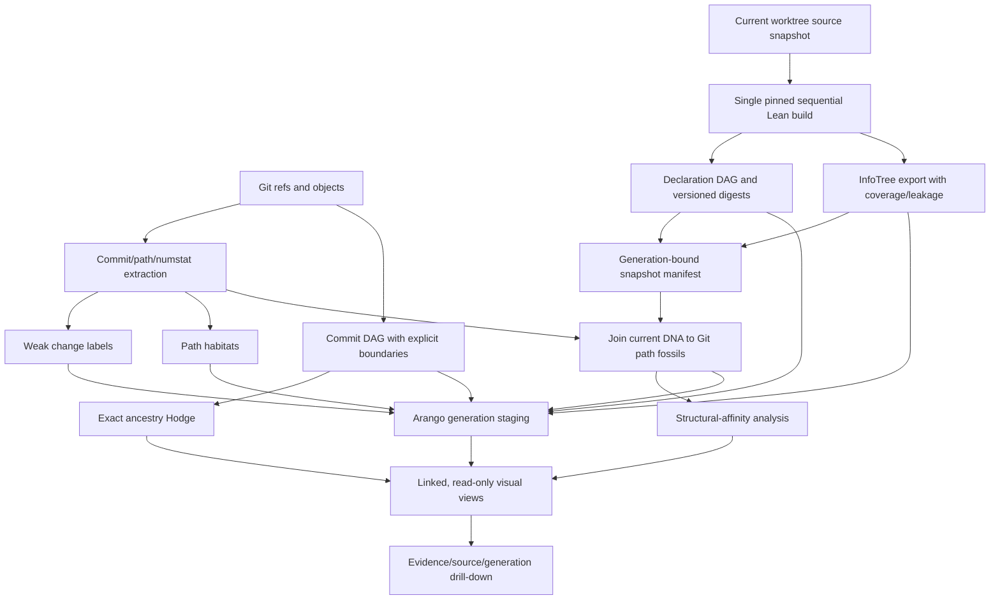

# Darwin Repository Evolution Pipeline Blueprint

**Status:** implementation blueprint with a validated one-module Arango pilot
**Source revision:** `d8c8c65cf6d3d8ed56695803efd758740b65fc02`
**Prepared:** 2026-10-28

**Implementation update:** source-first offline refactoring-map scanner added
2026-10-29; see `tools/repository_evolution/refactoring_map.py` and
`docs/DARWIN_CODEBASE_TAXONOMY_AUDIT.md` for its evidence and limits.
The latent-expert inference and current-DNA-to-Git-fossil overlay are also
implemented and tested; a bounded `lean/DAG/Basic.lean` end-to-end pilot
validated source, Lean-context, and raw-capture binding on 2026-10-29.

The scanner identifies Lean source by the `.lean` suffix, not merely by being
under `lean/`. Non-Lean files in that tree retain their own path/content-based
roles. A `.lean` source outside the Lake module index stays in the inventory
with `lake_module_index_unresolved` and
`uncertain_module_not_in_lake_target_index`; it is not silently assigned to a
build target. Overlapping Lake roots remain multiple owner memberships, while
unresolved sentinels are excluded from real-owner counts.

Lean import parsing accepts Unicode and quoted module identifiers, resolves
module paths found inside initialized `external_refs` submodules as explicitly
external-reference edges, and records a content hash for that imported source.
The scanner does not recursively index those submodules or treat them as
repo-owned proof evidence. Import-like lines containing unsupported path or
quoted-name syntax are preserved in `leanImportDiagnostics` rather than
expanded into guessed dependency edges. A focused 9-path scan on 2026-10-29
resolved the Möbius imports and `proofs.BraidProject.Basic`, found the GIFT
Octonions source in its external submodule, and reported zero unresolved
imports or parse diagnostics. A subsequent full 41,980-path scan bound the
current scanner hash and worktree snapshot, found zero unresolved imports,
and left 25 unindexed Lean modules as unreferenced build-ownership candidates
for review; lack of import reachability is not proof that they are dead.

## Purpose and semantic boundaries

Build a reproducible explorer for how repository commits, Lean declarations,
compiler-produced fingerprints, elaboration/InfoTree structure, and typed
dependency graphs change over time. A city/network visualization may show
growth, branching, traffic, and candidate affinity, but every displayed edge
must preserve its origin, generation, and evidence class.

Keep these separate:

1. Git parent edges are repository ancestry.
2. Commit labels and path habitats are weak change classifications.
3. Declaration digests are compiler observations tied to a source/build
   generation.
4. InfoTree rows are elaboration observations from one compiler run.
5. Dependency DAG edges are compiler-reported references.
6. Similarity, Hodge summaries, SCCs, attention, and embeddings are derived
   navigation evidence.

None of these alone proves theorem meaning, equivalence, or biological
phylogeny. “Species” is a display metaphor, not a formal classification claim.

## Literature-backed method choices

Google AI Mode was used to identify candidate literature; its summaries are
discovery aids, not evidence. The design below is grounded in the linked
publisher and author sources:

- Garrity and Cutting, [“A Common Language of Software Evolution in
  Repositories (CLOSER)”](https://doi.org/10.3390/software4010001), define a
  machine-readable VCS-neutral representation that retains common change
  events and VCS-specific data, then evaluate whether conversion preserves
  the source log. Transfer: version the event schema, preserve Git-specific
  object IDs and ordered parent metadata, and expose any lossy projection.
  Keep existing Git objects addressable by hash; do not copy every repository
  tree into analysis storage.
- Mori and Hashimoto, [“Phylogenetic Analysis of Reticulate Software
  Evolution”](https://doi.org/10.1109/MSR59073.2023.00074), apply AST tree
  differencing, derive distances, and use Neighbor-Net to expose reticulate
  dependencies among software versions. Transfer: structural-affinity
  networks can complement this repo’s known commit DAG, but must remain a
  separately labeled inferred layer. They do not replace Git parent edges or
  establish that similarity is historical descent.
- Kim, Sazawal, Notkin, and Murphy, [“An Empirical Study of Code Clone
  Genealogies”](https://web.cs.ucla.edu/~miryung/Publications/esecfse05-clonegenealogy.pdf),
  study clone fragments through program versions. Transfer: declaration or
  module lineage needs explicit continuity evidence and must represent
  splits, merges, disappearance, and uncertain alignment. A name match against
  the current declaration census alone is not historical identity.
- Fluri, Würsch, Pinzger, and Gall, [“Change Distilling: Tree Differencing for
  Fine-Grained Source Code Change Extraction”](https://doi.org/10.1109/TSE.2007.70731),
  match AST nodes across two program versions and derive a classified edit
  script. Transfer: AST-level change labels require both compared source
  versions and language-aware parsing; commit subjects or diff text alone do
  not justify claims about declaration-level semantic edits.
- Sechidis, Tsoumakas, and Vlahavas, [“On the Stratification of Multi-label
  Data”](https://link.springer.com/chapter/10.1007/978-3-642-23808-6_10),
  study stratification methods for multi-label datasets. Transfer: balance the
  reviewed facet-label distribution across evaluation splits. This pipeline
  adapts the iterative idea at the indivisible module/owner/content-group level;
  label balance never splits a leakage-control group, and rare-label support
  limitations remain visible to the readiness gate.
- Artstein and Poesio, [“Inter-Coder Agreement for Computational
  Linguistics”](https://aclanthology.org/J08-4004/), survey agreement measures
  and their assumptions for annotation. Transfer: preserve both raw
  independent decisions and agreement diagnostics; only unanimous complete
  label sets are promoted automatically, while disagreements remain review
  cases. Exact-set agreement and label-set Jaccard here are descriptive
  measures, not chance-corrected reliability estimates.
- Yang et al., [“LeanDojo: Theorem Proving with Retrieval-Augmented Language
  Models”](https://arxiv.org/abs/2306.15626), describe extraction of file
  dependency DAGs, ASTs, premise identities, and proof states for a pinned
  Mathlib revision. Its [official extraction guide](https://leandojo.readthedocs.io/en/latest/user-guide.html#traced-files)
  documents compiler-driven `.ast.json` and `.dep_paths` outputs and explicitly
  says its tracing is not concerned with `.olean` files. Transfer: use a
  compiler/toolchain-compatible extractor for typed declaration evidence;
  do not infer that `.olean` headers alone encode the complete declaration
  graph or that Git metadata reconstructs historical elaboration.
- [Software Heritage's SWHID documentation](https://docs.softwareheritage.org/devel/swh-model/persistent-identifiers.html)
  defines typed identifiers for archived contents, directories, revisions,
  releases, and snapshots, with intrinsic identifiers forming a Merkle DAG.
  Transfer: SWHIDs can name archived source objects and repository context;
  they neither supply semantic identity nor make an unarchived local object
  globally discoverable just by hashing it. Git object IDs and SWHIDs must be
  recorded as distinct identifier schemes.

Google AI Mode also suggested “Recovering Software Evolution Using
Phylogenetic Analysis” with authors Yu, Ramaswamy, and Sukumaran, but exact
title/author searches did not identify a publisher or bibliographic record.
That candidate is excluded pending a verifiable primary citation. AI Mode also
incorrectly described `.olean` headers as carrying the complete internal proof
dependency graph; the LeanDojo primary paper and extraction documentation do
not support that claim. These are examples of why AI search results are leads,
not evidence.

The methods impose a useful scope boundary: exact commit ancestry, commit/tree
IDs, timestamps, and path-level change statistics can be extracted from Git
objects and metadata without checking out every revision. Historical AST
edits, clone genealogies, and elaboration-level dependency changes cannot be
reconstructed exactly from one current source snapshot plus commit metadata.
The scalable design therefore keeps the present compiler-derived DNA as one
source/build-bound observation and attaches Git commits as fossils; it reports
historical semantic continuity only where the recorded evidence supports it.

Accordingly, `repo-phylogeny/v2` now records each commit's Git tree object ID,
author and committer timestamps, and repository object format, while preserving
the committer timestamp as the existing window key. The tree ID points into
Git's existing content-addressed object store; it adds no per-commit source
copy. The renderer accepts both v1 and v2 packets. This enriches the fossil
record without assigning heuristic Linnaean ranks to commits.

## Current code inventory

### Git history and change taxonomy

- `tools/infra/evolution_extract.py` streams commit metadata and optional path
  and numstat JSONL. Its SQLite checkpoints bind to a Git ref fingerprint,
  truncate an uncommitted tail on resume, and reject ref changes during a run.
- `tools/infra/evolution_taxonomy.py` applies multi-label `weak-rule-v3`
  subject/body and path rules. Its scores are rule weights, not calibrated
  probabilities; unmatched changes receive a weak default label.
- `tools/infra/evolution_path_habitat.py` counts path touches and commits by
  path-derived habitat, preserving undecodable path bytes through Base64; it
  can emit per-commit path context.
- `tools/infra/evolution_ingest.py` ingests streams into `evo_*` collections.
  Replacement is explicitly opt-in. `tools/infra/darwin_phylogeny_pipeline.py`
  orchestrates preparation, rendering, optional ingest/bridge, and optional
  tree export. The default workflow is offline/read-only with respect to
  ArangoDB.

### Offline phylogeny, fingerprints, and Hodge

- `tools/repository_evolution/phylogeny_export.py` reads local refs and
  reachable commit ancestry without network or database access. It collects
  ancestry before applying a UTC half-open date window, preserves boundaries,
  compresses display chains, and verifies that expansion recovers the exact
  parent-edge multiset.
- It optionally consumes `repo-dna-snapshots/v1`. Validation checks repository
  identity, commit membership, unique generations/names, digest formats,
  algorithm versions, and declared provenance fields. Its own contract says
  “manifest-attested only; no Lean compilation.”
- `tools/repository_evolution/dna_character_tree.py` aligns native type/value
  digest characters by exact qualified declaration name. It treats type and
  value as separate markers, excludes missing/open observations from pairwise
  comparison, and computes an unrooted neighbor-joining structural-affinity
  tree. It does not match renames, infer ancestry, or establish theorem
  equivalence or a molecular clock.
- `tools/repository_evolution/ancestry_hodge.py` builds exact sparse integer
  incidence/cycle certificates for the commit graph as an oriented graph
  1-complex; it does not fill triangles or claim floating-point spectral
  inference.
- `tools/repository_evolution/render_explorer.py` binds optional Hodge data to
  the exact input digest and checks its exact report conditions.
- `tools/infra/darwin_phylogeny_dashboard.py` is a separate recent-commit view.
  It treats module/path joins as cohabitation unless explicit exact evidence is
  present.

### Arango, DAG, and InfoTree

- `tools/infra/darwin_commit_graph.py` imports commit nodes, ordered
  parent-to-child Git edges in `commit_parent_edges_v2`, and multi-label
  `weak-rule-v3` change facets from the existing `evolution_taxonomy.py`.
  The prior Linnaean rank heuristic has been removed from the writer and
  analysis schema; the legacy `commit_edges` and `taxonomy_ranks` collections
  are left untouched. Normal commit import reads commit/path metadata only and
  streams parent metadata into bounded edge batches; it does not materialize
  every historical patch. Its optional declaration attachment parses added
  declaration-looking lines, then resolves against the **current**
  `infogeometry.decls`; it is not historical declaration capture.
  `--drop-existing` is destructive.
- `tools/infra/darwin_evolution_algorithms.py` computes components, SCCs,
  weak change-category coverage, shared-declaration cohorts, and observed
  path-sharing witnesses. Cohorts inherit the current-declaration limitation.
- `tools/infra/darwin_dna_bridge.py` joins commits to current declarations by
  module path and labels results habitat cohabitation. JSONL output does not
  require persistence; persistence is opt-in and refuses implicit deletion or
  replacement of an existing edge collection.
- `tools/infra/darwin_tree_visualizer.py` has explicit join modes and
  allow-listed fingerprint fields.
- `lean/DAG/Indexer.lean` exports compiler-derived declaration dependency and
  fingerprint data. `lean/DAG/RawInfoTreeExport.lean` emits versioned roots,
  nodes, edges, payloads, contexts, declaration links, environment/local
  context references, goal states, tactic arguments, messages, and leakage
  records. Its metadata explicitly reports `fully_lossless=false` and
  `loss_audited=true`.
- `tools/infra/arango_raw_infotree_ingest.py` validates/ingests the raw export;
  `tools/infra/materialize_lossless_infotree.py` materializes the raw DAG plus
  additive overlays. “Lossless” there is relative to its raw DAG input; it
  does not make the compiler InfoTree export fully lossless.
- `docs/ASTAQLHASH-HOWTO.md` documents the AST/InfoTree Arango lane, commonly
  port 8530/database `infogeometry`; Darwin commit storage is logically
  separate. Endpoint and live data freshness require runtime checks.

### Current-source topology and candidate archetypes

`tools/repository_evolution/refactoring_map.py` now builds an offline snapshot
from current source paths, Lean imports, Lake roots/globs, Python AST imports,
and lexical Lean declaration headers. It adds a deterministic subsystem
coarse-graining with typed internal/boundary edge counts. Matching declaration
kind counts, in-repository import out-degree, and Lake target membership form
structural cohorts. These are candidate archetypes whose source witnesses can
be opened and reviewed; the scanner does not assign mathematical meanings.
The existing compiler-backed SCC and archetype-signature pipeline remains the
owner for InfoTree/Expr graph overlays. Stale compiler metadata stays unjoined
until source provenance is reproducibly checked.

The maintained declaration refresh now stamps SHA-256 hashes for its JSONL and
graph outputs beside the source and `.olean` hashes. The source-first
refactoring map joins per-file `lean-expr-debruijn-v4` summaries only when the
current source inventory, current `.olean` inventory, exported byte hashes,
schema, and record counts all match. It uses those summaries to surface
cross-file type-digest cohorts as review candidates; they do not establish
declaration identity, semantic equivalence, or phylogenetic descent. Legacy
generations without output hashes remain unjoined.

When Git fossils are requested, each file record links its verified current
fingerprint summary to the per-path Git name-status lineage through an explicit
`evolutionaryLineage` relation. That relation identifies the current source
path as the join key and labels history as path continuity only; it never
asserts that historical file contents or declarations equal the current DNA.
Commit objects remain the historical source of truth and are not copied into
per-commit repository trees.

#### Arango history-generation compatibility audit (2026-10-29)

A read-only comparison of the current full path-event stream with the existing
`infogeometry` `evo_*` collections found 193,705 events over 11,489 distinct
commits. The database contained 13,682 commit vertices and 638,979
commit-to-file edges. Of the event commit IDs, 11,311 were present and 178
were absent; the current snapshot HEAD
(`033fbf0e6fc61a8c24c825ab39ad480460804a85`) was absent. Recomputing the
existing `evo_commit_files` edge-key function from each event's commit, change
type, and changed path found 163,142 exact edge matches out of 192,677
distinct expected keys; 29,535 keys did not match.

This establishes substantial overlap, not generation equivalence. The current
fossil stream carries a current-path projection across Git rename history,
whereas `evo_commit_files` stores the path recorded on each extracted commit
event. The database is also missing the current HEAD and some event edges.
Therefore an InfoTree-to-fossil generation retains its captured revision and
event-stream digest and does not report the `evo_*` history as a complete
backing source. The importer now reuses an event only when the exact
`evo_commit_files` key, commit endpoint, file endpoint, and change type match
in the live target. It writes a generation-scoped edge from the current path
fossil to that exact commit and stores the existing file-edge key as the
witness. This event-level link preserves the captured revision boundary when
the database contains commits from other branches. Events without that exact
witness remain in the overlay with a fallback reason; a missing Arango edge is
never interpreted as an unchanged path.

The v2 ingest receipt and collection suffix use a stage-generation ID derived
from both the source overlay ID and the ingest schema version. The receipt
keeps the original overlay ID separately. This lets the append-only v2 layout
coexist with the already staged v1 pilot for the same source snapshot.

A read-only preflight of the current stream resolved 163,648 of 193,705 events
to 163,142 existing commit-file edges. The remaining 30,057 events need
fallback records. The current snapshot HEAD is absent from the existing commit
collection, so the compatibility result is partial. This preflight made no
database writes. The importer tests exercise exact-edge reuse, fallback
preservation, and the no-history-collections case; the updated generation
layout has not yet been written as a new Arango generation.

The existing one-module pilot resolves all eight of its path events to exact
`evo_commit_files` witnesses. Its new v2 stage ID is
`1f1a504cef2e4a315009c9f986360da2a62a995e8e6bb14e30eca68bbdd14d24`, distinct
from the already-staged v1 receipt ID. This was a read-only plan/preflight;
the v1 Arango generation remains the only imported pilot.

The latent taxonomy feature extractor consumes only verified per-file digest
counts and reuse ratios under `repository_taxonomy_features.v3`; it does not
turn digest strings into labels. Exact cross-file digest groups remain
reviewable hyperedge candidates with declaration witnesses. An unverified
fingerprint field in a map is rejected by the feature extractor.

The scanner records regular files and symlink aliases separately. It hashes
symlink topology, watches in-repository targets for changes during extraction,
and emits `filesystem_symlink_alias` edges; this prevents one symlinked module
from being mistaken for a second source copy. For example,
`lean/PrimitiveSetsAboveX.lean` resolves to
`external/Erdos1196/PrimitiveSetsAboveX.lean` in the current checkout.
It also records explicit leading `AUTO-GENERATED` and `DO NOT EDIT` markers as
generated-source evidence, rather than inferring generated status from a path
or filename.

With `--git-history`, the scanner performs one streaming pass over `HEAD`
name-status metadata and adds bounded per-path fossil summaries, following
renames backward as path-continuity candidates. It stores no historical source
copies or full per-commit path dump. This yields a useful current-artifact to
history navigation edge while retaining the distinction between path
continuity and content or declaration identity.

A small local model is a later annotation layer over this map. It should have
separate heads for artifact-label scores and neighbor-edge attention logits.
For each source node, normalize logits with a Gibbs distribution
`pβ(v|u) ∝ exp(β s(u,v))`, and retain model/version, temperature, input
snapshot, and raw edge references. Define a sparse top-k or probability
threshold support before computing attention SCCs: all-positive softmax support
cannot change the raw SCC partition. Condense only after saving the selected
edge witnesses and weights; preserve the quotient DAG and descent to source.
Train/evaluate with held-out modules and commit windows, and exclude commit
text/path features from any task where those fields are the answer. Attention
weights express the trained model's routing and label evidence; they are not
causal explanations or theorem equivalence.

The postprocessor is now `tools/repository_evolution/attention_scc.py`. It
accepts an `info_geometry.edge_attention_logits.v1` packet containing the exact
`sourceSnapshotSha256`, model and feature versions, positive inverse
temperature, a declared `edgeKinds` scope, and one finite logit for every local
dependency-edge witness in that scope. If `edgeKinds` is absent, all supported
local dependency kinds are required. Edge references are SHA-256 hashes of the
complete typed source edge.
It refuses mixed worktree snapshots, stale snapshot hashes, unknown or missing
edge references, and invalid Gibbs/support parameters. For example:

```sh
python tools/repository_evolution/attention_scc.py \
  /tmp/refactoring-map.json.gz /tmp/edge-attention-logits.json \
  --support top-k --k 8 --out /tmp/attention-scc.json.gz
```

The resulting overlay includes every normalized edge factor with a selected
support marker, raw and attention SCC counts, component membership, and the
quotient DAG. Selected edges are not copied into a second full edge list. No
trained edge-attention model exists yet. The runnable deterministic baseline
`tools/repository_evolution/edge_attention_baseline.py` scores each observed
typed edge by cosine similarity between its source and target vectors from a
verified `repository_encoder_embeddings.v2` packet. It requires vectors for
every local edge endpoint, validates the packet digest and source hashes, and
rehashes live endpoint sources against the map before scoring; it emits the
consumer's exact edge-witness references. This is a reproducible
affinity baseline, not learned attention or a measure of causal importance.
Top-k support is ranked from the raw logits (equivalent for a positive shared
inverse temperature), not the exported float probabilities. This preserves
the correct ordering when several very small Gibbs masses underflow to zero;
the probability field remains a finite-precision navigation weight and is not
evidence of strict state faithfulness.
The same command supports an InfoTree DNA view over only `lean_source_import`
edges when supplied with the current DNA JSONL and its verified generation
manifest. It requires every scored endpoint to have lossless, leakage-free DNA.
The score packet names its exact `edgeKinds`, so the overlay analyzes one typed
dependency layer without silently mixing Python imports or test imports into
the Lean graph.
For example:

```sh
python tools/repository_evolution/edge_attention_baseline.py \
  /tmp/refactoring-map.json.gz /tmp/source-embeddings.json \
  --inverse-temperature 1.0 --out /tmp/edge-attention-logits.json
```

For the InfoTree-derived Lean layer:

```sh
python tools/repository_evolution/edge_attention_baseline.py \
  /tmp/refactoring-map.json.gz --infotree-dna /tmp/infotree-dna.jsonl \
  --generation-manifest /tmp/current-source-generation.json \
  --out /tmp/lean-infotree-edge-logits.json
```

For a factorized two-view Lean-import score, supply both the source embedding
packet and the verified InfoTree generation. The source cosine is mapped from
`[-1, 1]` to `[0, 1]`; it and the InfoTree feature cosine form a weighted
log-linear energy. The Gibbs factor is therefore the product of the two
weighted evidence factors. Both channel values, weights, source DNA fingerprints,
encoder packet digest, and InfoTree generation receipt survive into the SCC
overlay. Commit-lineage features remain in the taxonomy model's historical
view and are not treated as semantic import affinity.

```sh
python tools/repository_evolution/edge_attention_baseline.py \
  /tmp/refactoring-map.json.gz /tmp/source-embeddings.json \
  --fuse-infotree-dna --infotree-dna /tmp/infotree-dna.jsonl \
  --generation-manifest /tmp/current-source-generation.json \
  --source-affinity-weight 0.5 --infotree-dna-weight 0.5 \
  --out /tmp/factorized-lean-edge-logits.json
```

This remains a deterministic, untrained affinity baseline. Its Gibbs weights
rank observed edges for navigation; they do not establish KMS dynamics,
causality, semantic equivalence, or theorem identity. The Lean KMS/GNS owners
can formalize a graph-local state only after the edge carrier and observable
operators are explicitly defined.

The fusion design follows software-architecture recovery work that combines
structural dependencies with semantic similarity and other repository views
([SARIF information fusion](https://arxiv.org/abs/2311.04643),
[integrated structural, semantic, and directory dependencies](https://doi.org/10.4018/IJISMD.297060)).
The equal default weights are only a reproducible ablation baseline: adaptive
weighting has been studied using modularity and information entropy
([UM et al., 2016](https://doi.org/10.1587/transinf.2015EDL8160)). Recovery
quality also depends strongly on dependency accuracy, and published ground-truth
comparisons report that even the better methods can have low accuracy
([TSE dependency study](https://doi.org/10.1109/TSE.2017.2671865),
[ASE recovery comparison](https://doi.org/10.1109/ASE.2013.6693106)). Therefore
weights should be selected against adjudicated held-out edge/module evidence,
not tuned against SCC appearance or commit labels. The existing reviewed
taxonomy corpus evaluates artifact facets; it does not yet establish an
edge-ranking target for this scorer.

The resulting score packet can be passed to `attention_scc.py` with an explicit
sparse support rule. A future trained edge model must beat this baseline on a
held-out edge-ranking task before its scores are interpreted. The
postprocessor remains a provenance-checked consumer. The
iterative Tarjan implementation was moved to
`tools/infra/graph_components.py` and is shared with the Arango commit-graph
analysis.

### Live scan and compiler-index audit (2026-10-30)

Two full scanner runs completed over 42,004 paths and 25,889 Lean source
candidates. Both maps are in `/tmp` and are ineligible as model inputs because
the worktree changed during each run: the first detected three changed paths;
the second detected two. The second run reported 91,516 in-repository Lean
source-import edges, zero joined compiler-fingerprint summaries, and zero
current-DNA-to-Git-fossil path joins. Its compiler identity check also failed
because source files changed while the inventory was being hashed. Do not run
the scorer or taxonomy model against either map.

### Revalidation checkpoint (2026-10-30)

A third full scan with `--git-history` covered 42,005 paths and emitted the
current-path fossil event stream. This map is also ineligible for scoring or
joining: its source inventory changed during capture (four changed paths and
one path removed), so `worktreeConsistentDuringScan` is false. It reports
91,516 repo-local Lean source-import edges, zero verified compiler-fingerprint
joins, and zero current-DNA-to-fossil joins. Compiler metadata still points at
`InfoGeometry.Physics.All`, while the maintained refresh config targets
`InfoGeometry.All`; its source hash does not match the current inventory. The
new map is therefore a useful inventory diagnostic only, not a current DNA or
taxonomy input. The scan command was:

```sh
python3 tools/repository_evolution/refactoring_map.py --git-history \
  --out /tmp/darwin-refactoring-map-current.json.gz \
  --git-path-events-out /tmp/darwin-current-git-path-events.jsonl
```

The focused Sage suite for edge scoring, SCC overlays, latent taxonomy, and
source embeddings passed (`46 passed`). The finite matrix KMS/GNS attention
owner `InfoGeometry.QuantumContext.AttentionKMSPetzRecoveryBridge` also built
successfully through the locked Lake wrapper. This verifies the existing
finite-state formal layer; it does not supply the missing stable whole-repo
source/olean/InfoTree generation or turn row-wise dependency Gibbs weights
into a graph-level KMS state.

Using the available explicit config
`.venv-py312/src/infogeometry/dag-toolchain.json`, `dag_status.py` reported that
the config targets `InfoGeometry.All` while the 2026-10-10 declaration index
was produced from `InfoGeometry.Physics.All`. The artifacts are present but
stale, and the coverage report has 3,614 repo declaration files versus 3,550
indexed files, with 137 missing declaration files. `dag_doctor.py` confirmed
two failures (root mismatch and partial coverage) plus stale source/olean
warnings. A later doctor pass found the source tree changing during hashing;
no Lake/Lean process or shared build lock was active at the process checks.
Refresh only after a stable source inventory, using this explicit config and
the maintained locked DAG refresh path.

The repo also contains two older raw InfoTree smoke captures under
`artifacts/infotree/raw-infotree-batch-real-smoke/`. I inspected both metadata
receipts: neither has `sourceProvenance`; both report `fully_lossless: false`
and projection leakage (8,982 and 1,383 rows). They are useful exporter
fixtures, not current DNA rows. The separately documented Basic-module Arango
pilot is a bounded historical execution and does not supply whole-repository
current DNA coverage.

### Source-bound taxonomy review sample (2026-10-30)

A fresh full scan after the preceding checkpoint covered 42,016 tracked and
non-ignored paths, including 25,898 Lean sources and 91,581 repo-local Lean
import edges. It again detected concurrent source changes during capture:
`docs/COUNTEREXAMPLE_INVENTORY_STATUS.md`,
`lean/InfoGeometry/Core/IdempotentGraphReflectionOrder.lean`,
`lean/InfoGeometry/Exceptional/CFSGPort/CurtisTitsRankOneBruhat.lean`, and
`lean/InfoGeometry/OperatorAlgebra/SquareZeroPairSpectral/FourierCharacterDefect.lean`.
The map is diagnostic only. It reports zero compiler-fingerprint joins and
zero current-DNA-to-fossil joins; hashing current sources also failed because
the source tree changed during that check. The existing 312,789-declaration /
2,134,494-edge export has no source, `.olean`, or output hashes in its
`meta.json`, so it cannot be joined to this scan.

The scoped review path then excluded the four changed paths and independently
rehash-checked the selected sources before writing 500 artifacts / 1,000
pending tasks. The packet is at
`/tmp/darwin-taxonomy-review-20261030-rescan.jsonl`; its row digest is
`f9e07036ea1d4e01a835c35dc0a6f680879f7dfff3b8adfff1e117afcb4db8c5`, and its
manifest is at `/tmp/darwin-taxonomy-review-20261030-rescan-manifest.json`.
It assigns no labels and contains no InfoTree DNA. Its per-task source hashes
allow human review of those selected current files, but dependency context
inherited from the inconsistent full map remains navigation-only. Neither the
full map nor this review packet is a trained taxonomy or a complete current
generation. Preserve this distinction until a stable whole-tree scan and a
consensus-reviewed corpus are available.

### RawInfoTree root-record integrity correction (2026-10-30)

The lineage audit found that `raw_infotree_roots.jsonl` is required by the raw
export validator and consumed by the Git-fossil overlay, but was omitted from
`infotree_dna.ROW_FILES`. A root row could therefore change after DNA
extraction without changing the recorded raw-capture fingerprint. The
extractor now requires the roots file, includes its bytes in the capture hash,
and records only a non-identifying `root.count` structural feature. The feature
contract is `raw_infotree_structural_dna.v2`; generation manifests reject v2
records without a roots-file digest. This is provenance integrity, not a new
semantic label or declaration identity. The focused Sage pytest runs now pass
120 tests across DNA extraction, generation manifests, fossil overlays,
taxonomy/attention consumers, raw Arango ingestion, batch export, artifacts,
and phylogeny export.

The existing finite KMS/GNS owner in
`lean/InfoGeometry/QuantumContext/AttentionKMSState.lean` can support a
mathematically explicit graph-local state once edge logits are learned. For a
source module `u`, take its observed outgoing dependency witnesses as a finite
carrier and use the per-source Gibbs probabilities as a full-support diagonal
density on the matrix algebra over that carrier. The existing owner supplies
state positivity/faithfulness, GNS expectation and quadratic identities, and
the finite KMS trace boundary identity for noncommuting matrix observables.
The graph model still has to define its observables (for example, typed-neighbor
feature operators) and their action on source/target values. Sources with no
outgoing edge have no such carrier; sparse top-k support is singular and must
use the existing pruned-support results rather than claim a full-algebra
modular automorphism. This gives a precise adapter target without treating
KMS terminology as a learned-attention explanation.

### Latent projection and archetype expert routing

`tools/repository_evolution/infotree_dna.py` now supplies the bounded input
feature rows for this layer. It streams each per-file InfoTree export into
typed count features, checks the capture's source SHA against the current
worktree, omits declaration names and source/context values, and emits one
compact row with a versioned DNA fingerprint. It rejects duplicate captures of
the same current source. Captures marked lossy remain explicitly partial
structural candidates and must not be promoted to fully observed artifacts.
Its fingerprint now also binds the SHA-256 digest of every raw row file, so a
later join can verify the exact compiler capture without copying its contents.
With `--rejections-out`, extraction continues past per-file stale or malformed
captures and records their source identity and rejection reason separately;
rejected captures never contribute feature rows. Duplicate accepted captures
remain fatal. Pass that report to `generation_manifest.py` with
`--dna-rejections` so missing-source coverage distinguishes stale Lean/olean
context from an unattempted or failed export.
For the taxonomy input, keep the validated per-file captures and skip the
second merged copy:

```sh
python3 tools/infra/batch_raw_infotree_export.py \
  --root lean/DAG --output-dir /tmp/current-infotree-capture --no-merge
python3 tools/repository_evolution/infotree_dna.py \
  /tmp/current-infotree-capture/per_file \
  --out /tmp/current-infotree-dna.jsonl \
  --rejections-out /tmp/current-infotree-rejections.json
```

The export command is sequential and each Lean invocation uses the shared
build lock. Its current broad directory run still needs per-file timeout and
loss-coverage review; the command is an interface example, not evidence that
every selected module exports successfully.

For the fossil join, request both the compact map and the selected streamed
path-event ledger in the same scanner invocation, then create one pointer per
current InfoTree node:

```sh
python tools/repository_evolution/refactoring_map.py \
  --git-history --git-path-events-out /tmp/current-path-fossils.jsonl \
  --git-path-event-path lean/DAG/Basic.lean \
  --out /tmp/current-refactoring-map.json.gz
python tools/infra/batch_raw_infotree_export.py \
  --root lean/DAG/Basic.lean --output-dir /tmp/current-infotree-capture --no-merge
python tools/repository_evolution/infotree_dna.py \
  /tmp/current-infotree-capture/per_file --out /tmp/current-infotree-dna.jsonl
python tools/repository_evolution/git_fossil_overlay.py \
  /tmp/current-refactoring-map.json.gz /tmp/current-infotree-dna.jsonl \
  /tmp/current-infotree-capture/per_file /tmp/current-path-fossils.jsonl \
  --out-dir /tmp/current-infotree-fossil-links
```

`refactoring_map.py` resolves `HEAD` to a full commit SHA before extracting
path events, verifies that the ref did not move during extraction, and hashes
the selected event stream. Use `--git-path-event-path` once for each captured
source; omitting it includes all current paths and can generate an unnecessarily
large ledger. `git_fossil_overlay.py` checks that SHA/count/hash,
the worktree snapshot, each source digest, current Lean context, and raw capture
bundle digest agree. It emits one node-to-path-fossil pointer per current
InfoTree node; the complete commit trail remains stored once per current path
in `current-path-fossils.jsonl`, avoiding a repeated commit list on every node.
The join preserves the lexical repository path of each current source, including
an in-tree symlink path that Lake indexes as a module. Discovery, exporter
invocation, `.olean` selection, and context fingerprinting preserve that same
path. Resolving the symlink before joining would silently substitute the target
path's module identity and Git history; source bytes are still read through the
filesystem entry.
Every pointer is explicitly `module_path_cohabitation`. Current declaration
links and capture loss are included as evidence, but do not make the commit
trail declaration-specific. The overlay now also emits a shared
`source_line_fossils.jsonl` stream from `git blame --contents` at the exact
captured HEAD. Each current node carries its compiler-exported half-open byte
span, converted to a half-open line interval, and pointers to the shared blame
segments intersecting that interval. Changed, uncommitted lines retain Git's
zero SHA and are labeled `uncommitted_current_content`; symlink aliases and
unavailable blame are marked rather than attributed to target bytes. The line
stream is hashed and generation-bound, then the Arango staging plan validates
it and creates shared line-fossil documents plus node-to-line-fossil edges.
The exporter also emits a declaration-occurrence stream with `declKey`,
`declName`, `linkKey`, source span, and the shared line-fossil IDs. Its `declKey`
uses the existing `d_` plus truncated SHA-256 name key from `DAG.Schema`; the
Arango staging plan connects the existing RawInfoTree declaration-link record
to the shared line-fossil document. This supports a current-census join into
the declaration DAG while preserving the capture's occurrence provenance.
These edges mean only “this current syntax span overlaps lines Git attributes
to this commit.” They do not claim that the syntax node or declaration existed
with the same identity in that commit. No historical source tree is checked
out or stored.

The bounded Basic pilot completed with one current source, 3,172 unique
InfoTree node links, one shared path-fossil ID, and eight Git path events bound
to the same full HEAD. The capture reported 17 roots and 10,771 leakage rows,
so the overlay is demonstrative partial evidence, not a lossless compiler
record. The raw InfoTree generation was staged first; then
`tools/infra/arango_git_fossil_overlay_ingest.py` staged immutable,
generation-suffixed path-fossil, path-event, and node-edge collections. The
persistent receipt reports 1 path fossil, 8 events, 3,172 links, exact live
counts, and zero dangling endpoints. The relation remains
`module_path_cohabitation`, not declaration ancestry. The artifacts and
collections are a one-module pilot, not a repository-wide generation.
That persisted pilot predates the line-origin collections; run its new
generation-bound Arango staging plan before claiming line fossils are present
in the database.

The codebase also contains a distinct mathematical KMS/GNS/attention strand.
`InfoGeometry.LLM.KMSSoftmaxBridge` proves finite router softmax weights equal
Gibbs weights for the router Hamiltonian and proves normalization. The finite
attention state and algebraic GNS bridge are in
`InfoGeometry.QuantumContext.AttentionKMSState` and
`InfoGeometry.QuantumContext.AttentionGNSBridge`; the state module explicitly
limits its scope to finite diagonal states and does not assert a query-key
transition matrix or real-time modular group. These Lean declarations are
candidate typed features and evidence-owner links for taxonomy. The existing
`local_attention` ranker in `arango_causal_memory.py` is a lexical DAG
navigation score; it is neither the KMS state nor learned transformer
attention. Keep those graph-attention scores as navigation evidence unless a
separately specified, kernel-checked mathematical map relates the carriers.

The taxonomy model should be a sparse, multi-expert annotator over current
compiler and source artifacts. For artifact `v`, build a high-dimensional
feature state `x_v` from its typed InfoTree/Expr neighborhood, Lean source
structure, build ownership, and separately versioned Git-fossil features. A
learned projection `z_v = P x_v`, with `z_v ∈ ℝ^d` and small `d`, gives the
compressed map coordinates. Here “projector” means a learned
dimensionality-reduction map; it is not assumed to be an idempotent operator.

A router computes expert gates
`g(e|v) = softmax_e(a_eᵀ z_v + b_e)`. For each taxonomy facet `f`, expert `e`
produces an independent sigmoid score for each label
`q_e(f,y|v) = σ(w_e,f,yᵀ z_v + b_e,f,y)`. The routed score is
`p(f,y|v) = Σ_e g(e|v) q_e(f,y|v)`. Labels within one facet do not compete
or have to sum to one; reviewed annotations can assign multiple labels to an
artifact. Candidate experts should align with evidence
owners already in the repository: compiler-DAG/InfoTree structure,
source/import/build structure, proof/declaration shape, and Git path fossils.
The existing `tools/infra/detect_archetypes.py` is only a keyword-triggered
candidate finder; reuse its reviewed signature vocabulary as a seed, but do not
treat its keyword matches or pairwise “synthesis” output as expert labels.

Every expert response must include its evidence references, expert and feature
versions, score-calibration status, and abstention reason. Keep observed role labels,
weak-rule suggestions, expert proposals, and human-reviewed archetypes as
separate fields. Train only after a small adjudicated label set exists; then
compare a path-only baseline, a structure-only baseline, and the routed model
on module-held-out and time-held-out splits. Path and commit text are excluded
whenever they leak the target label. The existing Gibbs edge-attention head is
a distinct routing mechanism over graph neighbors, not the artifact-to-expert
gate and not an explanation. This combines code2vec-style learned aggregation
of syntax paths with GraphCodeBERT/GAT-style typed graph structure while
keeping repository evidence and model interpretation separate.

The current inference implementation requires each expert to declare the
evidence kinds it accepts; experts without matching evidence abstain and are
excluded from the mixture for that artifact. Softmax outputs are explicitly
uncalibrated until a held-out calibration procedure is supplied and evaluated.

`tools/repository_evolution/latent_taxonomy.py` now implements the versioned
inference contract for this layer: a versioned structural feature vocabulary, optional
source-bound encoder embeddings, a linear low-dimensional projection, softmax
expert gates, per-expert label heads within explicit facets, a probability
mixture, evidence references, and explicit abstention. Encoder vectors use the
`info_geometry.repository_encoder_embeddings.v2` packet. The packet builder
binds each supplied vector to its artifact source hash, source-map snapshot,
encoder version, dimension, and declared encoder-training scope. Inference
checks packet digest, source hashes, encoder version, and projection
dimensions. Coverage may be partial; missing artifacts abstain individually.
The command accepts the packet with `--encoder-embeddings`. InfoTree DNA inputs
are likewise checked against source hashes. When the model vocabulary contains
`git.lineage.*`, inference also requires `--git-fossil-overlay-manifest`; its
per-source count/fraction/status features are checked against current source
hashes and the source-map generation. Commit IDs, author timestamps, commit
messages, and path strings do not enter these model features. Every output
label remains an unreviewed proposal.

`tools/repository_evolution/train_taxonomy_baseline.py` fits a CPU-capable
standardized PCA plus balanced one-vs-rest logistic baseline. It uses only the
train groups for projection and label heads, then reports fixed-threshold
validation/test scores as uncalibrated metrics. It rejects encoders declared
as trained on all current repository source and checks train-only encoder
group hashes. As a lexical baseline,
`tools/repository_evolution/source_embeddings.py`
reuses `hash_embedding` from the existing OpenClaw Lean indexer instead of
implementing another tokenizer or hash function. It embeds only recognized
source-language suffixes, verifies each current file hash, and emits a partial
packet; non-source artifacts remain present and abstain when a model requires
an encoder vector. Compare this feature-hashing baseline against any trained
code encoder using the same reviewed labels and held-out modules. Do not treat
these hashed vectors or uncalibrated scores as semantic truth.

The first trainable source encoder is now implemented in
`tools/repository_evolution/train_code_transformer.py`. It is a small
PyTorch Transformer encoder with masked-token denoising and a tied token
decoder. It supports the established learned-absolute positional encoding and
an optional pairwise rotary positional encoding (RoPE). The rotary path rotates
query and key vectors inside each attention head; it does not add a position
vector to token embeddings or values. The vocabulary and model weights see source text only from corpus
train groups; validation/test source and all taxonomy labels are excluded from
the self-supervised objective. Training text must hash to both the reviewed
row and source-map fingerprints. It exports a versioned checkpoint, a
source-bound embedding packet, and a loss/provenance report; `.gz` output names
write compressed JSON. Embeddings for held-out/current artifacts are computed
after fitting with the train-only vocabulary, mapping unseen tokens to `<unk>`.
Feed the packet to `train_taxonomy_baseline.py` for supervised fitting on
reviewed labels and held-out evaluation. The taxonomy trainer now fits a
late-fusion PCA over the Transformer vector plus train-derived structural
features: allow-listed Lean/Python import edges, declaration kinds, and
source-hash-bound InfoTree shape counts. It excludes path, owner, artifact-role,
test-import, and raw Git features from this supervised representation to reduce
target leakage. When explicitly bound to the same current-source generation,
the trainer can add source-lineage summary features: attribution status, binned
attributed / committed / current-content fractions, line / commit / origin-path
counts, and the fraction of current declaration links intersecting attributed
lines. These summaries carry neither commit identity nor message semantics.
The trainer keeps them inside the allow-listed structural view, learns the
vocabulary on training groups only, and binds it to the overlay generation.
The training report includes a `sourceAndStructureWithoutGitLineage` ablation
with the same reviewed rows and group holdouts. Select on validation only;
test comparisons remain descriptive. The learned projection
writes independent source and typed
feature weights into the existing inference-v3 contract; projection centering
is retained as an explicit bias. InfoTree partial-capture and leakage counts
are carried into the training report so those observations remain qualified;
the exact train structural vectors and InfoTree capture rows also receive
separate SHA-256 provenance digests.
Each source, dependency/InfoTree, and fused view has its own projector and
label heads. The softmax artifact-to-expert router is fit from specialist loss
targets using deterministic, label-balanced folds over `splitGroup`: every
training artifact's routing target is derived from specialists that did not
fit that artifact's group. The router feature scaler and weights are then fit
on the train split only. If group-level positive/negative support cannot
produce valid folds, training records an explicit in-sample fallback and its
reason. The router report includes this provenance, fold membership, optimizer
status, and out-of-fold versus fallback target source. Validation/test labels
are not used to define the model's label vocabulary or fit the router. Labels
seen only in held-out data are counted as unmodeled in evaluation.

The trainer also reports source-only, structure-only, fused, and routed scores
on the same module/owner holdouts, with train-only scaling and projection for
each view. Validation is for method selection; test results are descriptive
and must not be repeatedly tuned against. A structural ablation is marked
unavailable when reviewed training artifacts have no graph/InfoTree features.
`tools/repository_evolution/train_graph_context_encoder.py` adds a separate
self-supervised, relation-aware message-passing ablation. It masks selected
train-artifact source vectors and reconstructs them from two typed channels:
dependency-to-dependent and dependent-to-dependency. The relation transforms
are distinct for Lean imports, Python imports, and test imports. Training edges
are induced only by train artifacts. At inference, deterministic disjoint
masked-node batches cover the complete current dependency graph, so each
connected artifact is predicted with its own source vector hidden. This is
transductive at inference and must be reported separately from source-only
generalization to unseen modules.
The masked-node objective uses the scaled-cosine feature reconstruction
approach of [GraphMAE](https://arxiv.org/abs/2205.10803), while its separate
relation transforms follow the multi-relational modeling motivation of
[R-GCN](https://arxiv.org/abs/1703.06103). [GraphCodeBERT](https://arxiv.org/abs/2009.08366)
is a related structure-aware code-pretraining precedent, but its graph encodes
intra-code data flow, unlike this repository's inter-artifact dependency graph.
The graph objective reads no taxonomy labels, commit messages, or historical
source copies. Its output packet concatenates the original source embedding
with the encoder's latent graph context by default, so the existing taxonomy trainer can
fit graph-context label heads under the same reviewed-label splits. Compare its
validation report with a separate run on the unmodified source packet. This is
a learned graph-context representation, not causal
importance, proof of semantic equivalence, or a literal plabic embedding.
The model exposes separate `encode` and `decode` operations: the decoder
reconstructs masked source features to train the encoder. Use
`--context-representation reconstruction` for the older decoded-feature
comparison; the representation is recorded in the encoder version, checkpoint,
training provenance, and report. Latent coordinates are learned features,
not already identified semantic archetypes. This graph denoiser is not yet
the structured Sinkhorn transformer or a source-token generation model.
Version 3 adds optional `--edge-loss-weight 0.2` for joint feature and directed,
typed edge reconstruction. Following the masked-edge pretext of
[MaskGAE](https://arxiv.org/abs/2205.10053), the edge decoder uses a separate
encoding with sampled target pairs removed in both directions across every
relation. Each relation has an asymmetric bilinear decoder. Positive and
sampled absent-edge examples come only from the train-induced graph, with a
256-positive limit per relation and bounded sampling rather than a dense
all-pairs matrix. Dense graphs with no sampled negatives are rejected when
this objective is enabled. An absent edge is an observation-level negative,
not a theorem that a dependency is impossible. The report records training
binary cross entropy and sample counts, not held-out link accuracy. This
objective is disabled by default until validated on real captured generations.
The training report includes reconstruction error separately for train,
validation, test, and unreviewed artifacts under the same masked-target
inference policy. It counts isolated artifacts and excludes zero-norm
standardized targets from cosine evaluation, reporting a null error when
no target is evaluable. These are transductive feature-reconstruction
measurements, not held-out taxonomy accuracy or unseen-graph generalization.

The message-passing stage still requires a provenance-bound source packet and
a ready reviewed corpus to define leakage-safe train groups. No current
repository taxonomy model or graph-encoder quality gain is claimed until the
reviewed corpus is ready and held-out comparisons have been run.
Run it after constructing a ready corpus. When selecting rotary positions, pass
`--position-encoding rotary` to the encoder command; the default remains
`learned_absolute`.

```sh
python tools/repository_evolution/train_code_transformer.py \
  /tmp/refactoring-map.json.gz /tmp/reviewed-corpus.json \
  --position-encoding rotary \
  --embeddings-out /tmp/repository-encoder-embeddings.json.gz \
  --checkpoint-out /tmp/repository-source-transformer.json.gz \
  --report-out /tmp/repository-source-transformer-report.json
python tools/repository_evolution/train_graph_context_encoder.py \
  /tmp/refactoring-map.json.gz /tmp/reviewed-corpus.json \
  /tmp/repository-encoder-embeddings.json.gz \
  --embeddings-out /tmp/repository-graph-context-embeddings.json.gz \
  --checkpoint-out /tmp/repository-graph-context-model.json.gz \
  --report-out /tmp/repository-graph-context-report.json
python tools/repository_evolution/generation_manifest.py \
  /tmp/refactoring-map.json.gz /tmp/current-infotree-dna.jsonl \
  --dna-rejections /tmp/current-infotree-rejections.json \
  --batch-report /tmp/infotree-capture-batch-1.json \
  --batch-report /tmp/infotree-capture-batch-2.json \
  --out /tmp/current-source-generation.json
python tools/repository_evolution/train_taxonomy_baseline.py \
  /tmp/refactoring-map.json.gz /tmp/reviewed-corpus.json \
  /tmp/repository-encoder-embeddings.json.gz \
  --model-out /tmp/reviewed-source-taxonomy-model.json \
  --report-out /tmp/reviewed-source-taxonomy-evaluation.json
python tools/repository_evolution/train_taxonomy_baseline.py \
  /tmp/refactoring-map.json.gz /tmp/reviewed-corpus.json \
  /tmp/repository-graph-context-embeddings.json.gz \
  --infotree-dna /tmp/current-infotree-dna.jsonl \
  --infotree-dna-rejections /tmp/current-infotree-rejections.json \
  --infotree-batch-report /tmp/infotree-capture-batch-1.json \
  --infotree-batch-report /tmp/infotree-capture-batch-2.json \
  --infotree-dna-manifest /tmp/current-source-generation.json \
  --model-out /tmp/reviewed-taxonomy-model.json \
  --report-out /tmp/reviewed-taxonomy-evaluation.json
```

Add `--edge-ablation` to graph-context training to measure fixed-model
sensitivity to removing all inference dependency edges. The report records
per-artifact mean squared changes in train-standardized embedding coordinates,
with identical weights, source features, and target masks. It does not alter
the embedding export, retrain a no-graph model, measure taxonomy accuracy,
or identify a causal effect. Downstream held-out label evaluation remains
necessary to determine whether the graph improves classification.

The optional bounded context transport export reuses the numerical owner
`tools/shape_sinkhorn_detector.py`. Select context artifacts explicitly;
the command checks their live source hashes before exporting. For example,
replace the example artifact IDs below with IDs in the embedding packet:

```bash
python -m tools.repository_evolution.context_transport \
  /tmp/refactoring-map.json.gz /tmp/repository-graph-context-embeddings.json.gz \
  --artifact lean/ExampleA.lean --artifact lean/ExampleB.lean \
  --max-context-size 256 --iterations 100 --tolerance 1e-10 \
  --out /tmp/repository-context-transport.json.gz
```

This stage computes cosine logits, alternates row/column Sinkhorn scaling,
and rejects results outside the requested balance tolerance. It records the
embedding packet digest, source snapshot, artifact order, source hashes, and
both marginal residuals. Its square coupling describes context affinity;
the joint probability matrix is the coupling divided by context size.
Neither is recorded as a dependency edge or a proven taxonomy assignment.
The export is currently diagnostic: the taxonomy classifier does not yet
consume these weights. Birkhoff permutation decomposition, Clifford expert
execution, and a planar/plabic realization are separate integration work,
not consequences of this numerical export. The bound avoids automatically
allocating a dense matrix over the entire repository.

TCR-Former intake (2026-10-30): the
[paper](https://arxiv.org/pdf/2610.34094) motivates keeping source facts
available alongside compressed structural representations. Our existing
concatenation of source and graph-context vectors serves that limited purpose;
it is not an implementation of the paper's decoder. Inspection of the
[published decoder](https://raw.githubusercontent.com/Translab-SCUT/TCR-Former/main/code/decoder.py)
found that `_create_mixed_attention_mask` opens logic **rows** to all keys and
allows prompt rows to read facts and logic. A proposed alternative containing
only fact/prompt diagonal blocks and a visible logic column has no path from
fact values to prompt outputs when logical inputs are held fixed. Composing
that support pattern cannot create the missing factual bypass. Conversely,
opening logic rows to future answer tokens requires an explicit multi-layer
leakage test before using teacher-forced answer sequences. Neither mask
interpretation is a kernel-verified theorem about this taxonomy pipeline.
Keep causal/dependency masking separate from square bistochastic routing:
a triangular doubly stochastic matrix is the identity, so imposing both on
one square matrix removes nontrivial routing.

`generation_manifest.py` binds the Lean source inventory and exact source
hashes to the captured InfoTree DNA row fingerprints, current Git HEAD, scanner
and Lake manifest provenance, and (when passed
`--fossil-overlay-manifest`) the validated path-fossil overlay. It reports
missing expected Lean captures as `partial_missing_captures` with explicit
paths and a coverage ratio; missing captures are never serialized as empty DNA.
The inventory digest also includes module identity, Lake target memberships,
and owner status. The receipt lists sources with unresolved Lake-module or
root-reachability evidence separately and gives those sources a specific
missing-capture reason.
Repeated `--batch-report` inputs attach per-source attempt statuses, source-digest
match state, and missing-capture reasons. A batch row with status `ok` does not
count as captured DNA: it remains a diagnostic until InfoTree extraction has
validated the current source and Lean/olean context and emitted an accepted DNA
row. Attempts from another checkout or outside the current Lean inventory are
counted as out-of-inventory evidence and cannot increase coverage.
The taxonomy trainer requires this receipt whenever InfoTree DNA is supplied
and carries its generation ID, digest, and coverage status into the model and
training report. This validates the receipt and its input rows; it does not
replace a locked Lean build or prove semantic classifications.

The Git-fossil overlay generation identity now binds the current Git revision,
path-content manifest, filesystem-topology hash, scanner source SHA-256, and
`lake-manifest.json` SHA-256.
The scanner records whether those analyzer/dependency inputs were both present
and stable during the scan; overlay creation rejects missing or inconsistent
provenance. Thus changing classification or dependency-resolution logic cannot
silently reuse the prior overlay generation ID for an otherwise identical
source snapshot.

`tools/repository_evolution/reviewed_taxonomy_corpus.py` is the label-to-training
boundary. Annotation v4 accepts only `human_adjudicated` rows with exact source
and snapshot hashes, source-span evidence from every reviewer, and
`labelSetComplete=true` for each facet. At least two distinct reviewer IDs must
agree on the exact complete label set and an identical normalized definition
for every label. The corpus carries this consensus receipt per facet and a
deterministic codebook catalog whose digest is checked by readiness and training.
A complete empty
label list means no known label applies and contributes a negative example;
without a complete set the corpus cannot train an independent multi-label head.
Weak commit rules
and model proposals cannot enter as targets. It materializes only annotated files from
the current worktree, supplies source text and typed dependency/declaration
counts as model inputs, and assigns connected module/owner plus exact-content
groups using deterministic iterative multi-label stratification to train,
validation, or test splits. The splitter keeps each group indivisible and uses
reviewed labels across annotations to balance facets; the readiness gate still
decides whether every label has adequate positive and negative evaluation
support. For a source with
no Lake-indexed module, a lexical `moduleCandidate` is grouped together with
its source-root identity; it is used only for split isolation and does not
promote that candidate to a confirmed module or owner. Uncertain pseudo-owner
values are excluded from grouping keys. This keeps identical files, symlink
aliases, and module peers in one holdout group. The manifest reports when the
corpus is too small to populate every split. A separate time-held-out
evaluation remains necessary for claims about future repository changes.

`tools/repository_evolution/taxonomy_adjudication_queue.py` creates a
deterministic, role/uncertainty-stratified review queue from a stable map. It
limits repeated samples per indexed or source-root-scoped candidate module/owner,
binds each task to the current source hash and snapshot, and includes short
candidate source spans plus typed neighborhood counts. Non-UTF8 and binary
artifacts are skipped because the current training corpus requires auditable
text spans. The manifest calls its per-limit buckets `selectedSamplingGroups`
because they include confirmed modules, module candidates, owners, and directory
fallbacks. Its archetype signature list is reference material only; task labels
remain empty and `reviewStatus` remains pending.
Example:

```sh
python tools/repository_evolution/taxonomy_adjudication_queue.py \
  /tmp/refactoring-map.json.gz --limit 80 --max-per-owner 3 \
  --out /tmp/taxonomy-review-tasks.jsonl \
  --manifest-out /tmp/taxonomy-review-manifest.json
```

Review decisions are a separate JSONL file; do not edit the source-bound task
queue. Submit one decision row per reviewer and task, using distinct reviewer
IDs. At least two reviewers must independently submit the same complete label
set before that task becomes a training annotation. A disagreement or a single
vote is retained in the materialization report and produces no training label.
The report includes pairwise exact-set agreement and Jaccard, which are
descriptive and do not correct for chance agreement. A completed row uses this
shape:

```json
{"schema":"info_geometry.taxonomy_review_decision.v2","taskId":"<taskId>","decision":"label","reviewerId":"<reviewer>","labels":["<reviewed-label>"],"labelDefinitions":{"<reviewed-label>":"A normalized shared definition of this label"},"labelSetComplete":true,"evidence":[{"kind":"source_span","startLine":1,"endLine":4}]}
```

Use `decision: "skip"` for a task the reviewer cannot classify and
`decision: "pending"` to leave it open. Only explicit `label` decisions become
consensus annotations. An empty `labels` list with `labelSetComplete=true` means the
reviewer found no applicable label in that facet; it is a valid all-negative
example, not an incomplete review. `materialize_taxonomy_adjudications.py`
verifies the task digest
against its queue manifest, checks task identity and current source hashes,
validates line bounds, reports reviewer agreement, and emits annotation-v4 rows
only for unanimous independent votes:

```sh
python tools/repository_evolution/materialize_taxonomy_adjudications.py \
  /tmp/taxonomy-review-tasks.jsonl /tmp/taxonomy-review-manifest.json \
  /tmp/taxonomy-review-decisions.jsonl \
  --out /tmp/taxonomy-reviewed-annotations.jsonl \
  --manifest-out /tmp/taxonomy-adjudication-manifest.json
python tools/repository_evolution/reviewed_taxonomy_corpus.py \
  /tmp/refactoring-map.json.gz /tmp/taxonomy-reviewed-annotations.jsonl \
  --out /tmp/reviewed-taxonomy-corpus.jsonl \
  --manifest-out /tmp/reviewed-taxonomy-corpus-manifest.json
```

This design borrows structure-aware code representations from
[GraphCodeBERT](https://arxiv.org/abs/2009.08366) and identifier-aware denoising
from [CodeT5](https://arxiv.org/abs/2109.00859), while keeping labels grounded
in adjudicated evidence. It also treats split leakage as a first-class threat:
code benchmarks can share files or near-identical historical snippets across
random splits ([Catalog of Data Smells for Coding Tasks](https://doi.org/10.1145/3707457));
repeated evaluation can also contaminate model selection
([Matton et al., 2024](https://aclanthology.org/2024.findings-emnlp.772/)).
No reviewed corpus is present yet, so the supervised baseline is implemented
but cannot produce a repository taxonomy model until adjudicated data exists.

Before any supervised fit, run
`tools/repository_evolution/taxonomy_training_readiness.py` on the corpus
manifest. It verifies the canonical rows digest, artifact/split counts,
split-group and exact-source-hash isolation, and per-facet label coverage in
train, validation, and test, and requires both positive and negative examples for
each label in every split. It exits nonzero and lists blockers when labels
are too sparse, incomplete, or lack evaluation coverage. This is only a
data-readiness gate; fitting is performed separately by
`train_taxonomy_baseline.py`, and neither gate establishes that the labels
themselves are correct.

If a small repository-specific Transformer is trained, make it an encoder that
produces artifact embeddings, then feed those embeddings and the typed static
features into this explicit projector/router. Pretrain on current Lean source
and compiler structure with masked/denoising objectives, identifier recovery,
and graph-edge or source-to-InfoTree alignment; use the encoder-decoder pattern
for reconstruction and a contrastive objective across independently extracted
views. This follows CodeT5's identifier-aware denoising, GraphCodeBERT's data
flow/structure objectives, and multi-view code representation work. A decoder
can reconstruct syntax or emit a proposed explanation, but reconstruction loss
alone does not establish semantic labels. Fine-tune expert heads only against
reviewed labels, keep Git fossils as a separately gated view to prevent time or
path leakage, and evaluate by held-out modules and commit windows. Compare
against the non-neural source/build and weak-rule baselines before enabling
model-derived taxonomy in the explorer.

#### Reuse of formalized transformer structure

The implementation search found several relevant Lean owners. These owners
provide mathematical contracts and exact algebraic laws; they do not by
themselves verify PyTorch execution or demonstrate a useful learned taxonomy.

| Pipeline role | Existing owner and proved scope | Concrete use and boundary |
|---|---|---|
| Expert-label symmetry | `lean/InfoGeometry/Canonical/KANModuliTopology.lean` defines the `Equiv.Perm (Fin K)` action on expert-indexed vectors and the quotient by its orbits. `AttentionExpertModuliTopological.lean` proves the softmax-weighted expert readout is invariant and descends. `AttentionExpertSimplexModuliTopological.lean` proves responsibility-vector equivariance and invariant concentration/entropy readouts. | Expert slot names are a gauge choice when an observable is symmetric in experts. Taxonomy labels themselves remain adjudicated and are not quotiented away. |
| Relative positional encoding | `lean/InfoGeometry/LLM/PositionalEncodingRepresentation.lean` proves continuous and integer RoPE attention scores depend on relative position; `lean/InfoGeometry/Clifford/Cl55RoPEAttentionPairing.lean` proves query/key intertwining under an invariant pairing. `lean/InfoGeometry/Canonical/PositionalDynamicsRegimeBridge.lean` gives additive and reversible representation laws. | The encoder now has a PyTorch RoPE option, with a numerical common-shift score-invariance test. The formal result concerns its Lean carrier and hypotheses; the test checks the numerical implementation separately. |
| Mellin scale coordinate | `lean/InfoGeometry/MassSpectrometry/MellinMassEncoding.lean` proves common positive rescaling cancels in relative log mass; `MellinTransformerBridge.lean` adapts that phase to `RotaryPositionalLayer` and proves scale invariance and pair-norm preservation. | This suggests a future scale-normalized feature for module/declaration hierarchy, such as relative log subtree size. It must be defined from measured code metadata and ablated; it is not currently a code-encoder input. |
| Fourier position characters | `lean/InfoGeometry/LLM/FourierCharacterEncoding.lean` proves character-kernel additive and translation laws. | Fourier features can encode cyclic/additive position coordinates. They should not silently replace the directed dependency partial order or be called graph positional encodings without an explicit graph-to-coordinate map. |
| Gibbs attention and MoE routing | `lean/InfoGeometry/LLM/KMSSoftmaxBridge.lean` proves token-local router softmax equals finite Gibbs/KMS weights and sums to one; `ScalarThermoBridge.lean` connects normalized routing to log-sum-exp and Gibbs weights. `tools/repository_evolution/train_taxonomy_baseline.py` already fits train-only source/structure/fused experts and a group-cross-fitted loss router. | This supports precise normalization terminology. The learned router remains empirical and reviewed-label dependent; a Gibbs identity is not evidence that the router learned a valid taxonomy. |
| Structured Sinkhorn attention implementation | `tools/causal_bipartite_sinkhorn.py` already implements bidirectional latent-channel attention, a Sinkhorn core decomposition, a Poisson branch, and block/strict-token causal modes; `tests/test_causal_bipartite_sinkhorn.py` covers that component. | This is a distinct attention architecture, explicitly not a drop-in numerical replacement for PyTorch SDPA. Treat it as a separate benchmark/ablation. The new source RoPE backend is the standard scaled dot-product encoder path; do not silently conflate their score, normalization, or causality contracts. |
| Attention state and GNS | `lean/InfoGeometry/QuantumContext/AttentionKMSState.lean`, `AttentionGNSBridge.lean`, and `AttentionKMSPetzRecoveryBridge.lean` connect finite attention density matrices and state functionals to GNS pairings/actions; `ColimitAttentionTomitaFlow.lean` has a separate colimit state construction. | Keep this as a separate formal state/representation layer. Taxonomy softmax vectors and edge probabilities do not automatically instantiate a GNS construction. |
| Laplacian/Hodge graph geometry | `tools/repository_evolution/ancestry_hodge.py` implements finite ancestry-graph Laplacian/Hodge computations; the InfoTree and dependency extractors preserve typed directed edges. | Use graph operators as derived structural views with source/generation provenance. For causal dependencies preserve direction (for example forward/backward walk features); an undirected Laplacian alone loses that information. |

#### Small-model design sequence

1. Keep the source-only denoising encoder as the lexical baseline. Compare
   learned absolute positions with optional RoPE under identical module-group
   splits and seeds.
2. The structural feature view now includes log-damped, direction- and
   edge-kind-aware length-two dependency walk counts alongside typed in/out
   degree features. These are derived from the observed edge witnesses; the
   raw edges remain authoritative and are not replaced by a dense score
   matrix. Random-walk positional profiles and typed message passing remain
   later, separately versioned experiments.
3. Evaluate Hodge/Laplacian and Fourier features as ablations. Record which
   symmetries they preserve and which directed/causal information they discard.
   Use Mellin log-ratio features only where code metadata supplies a meaningful
   positive scale, and test common-scale invariance numerically.
4. Reuse the existing source/structure/fused specialists and grouped
   cross-fitted router. Add an expert only when validation improves over both
   lexical and structural baselines; keep label vocabulary, scaling, and
   routing targets train-only.
5. Keep learned edge attention as an explicit source-bound score packet
   consumed by `attention_scc.py`; it remains a navigation overlay. SCCs,
   attention, Gibbs normalization, and GNS/KMS analogies do not assign
   mathematical meaning to a Lean declaration or certify a theorem.

The source RoPE mode is bidirectional, matching masked-token denoising: each
token can use context on either side. The formal `MaskedTransformerBlock`
interface is parameterized by a caller-supplied mask and does not make the
Python encoder causal. A causal source-model experiment would be a distinct
objective and checkpoint version.

### Scope correction: current DNA and Git fossils

The intended pipeline does not materialize or build one source checkout per
commit. The checked-out source and its compiler/InfoTree observations are the
current DNA sample. Git contributes commit ancestry, tree/object IDs, timestamps,
and changed-path/numstat events as a compact fossil stream; those records are
attached to current artifacts through explicitly typed path-continuity or
habitat-cohabitation links. No historical source tree is copied or recreated.

This choice means historical declaration fingerprints and historical InfoTree
topology are not claimed. A commit touching a module path can be shown on the
current module and its contained declaration/InfoTree view as module-path
cohabitation. Declaration-specific history requires a recorded exact edit
witness (for example, a parser-derived declaration span intersecting a changed
hunk); absent that witness, the edge stays a path-level candidate. Git metadata
alone cannot establish that a current theorem is identical to a past theorem.

## Target pipeline



This is the target design. Extraction, weak labels, offline ancestry/Hodge,
current-declaration bridge, declaration DAG, raw InfoTree export, and a
validated current-DNA-to-fossil Arango staging path now exist as separate
components. The new deterministic generation-manifest contract is exercised
synthetically with complete and missing-capture fixtures. The validated
current-DNA-to-fossil Arango path has only been exercised on
`lean/DAG/Basic.lean`; full repository source-snapshot consistency, complete
InfoTree coverage, broader typed dependency joins, and end-to-end explorer
views remain open work. Historical source builds are outside the design.

## Stage 1 — Freeze repository history inputs

1. Record repository identity, exact ref names and object IDs, tags, selection
   rule, window, shallow status, and generation ID.
2. Collect ancestry before filtering by date. Preserve ordered merge parents,
   ref scope, unresolved parents, and shallow boundaries.
3. Hash the input manifest and extracted streams. Reject a run if refs change
   during extraction. Keep full SHAs as keys; abbreviated SHAs are display
   labels only.

## Stage 2 — Produce descriptive change evidence

1. Stream commit/path/numstat data to versioned JSONL.
2. Keep weak labels multi-valued with rule IDs, matched text/path evidence,
   taxonomy version, and heuristic score semantics.
3. Compute path habitats independently from labels. Preserve rename/delete,
   binary, and invalid-byte evidence where the extractor supplies it.
4. Do not promote path cohabitation into an exact declaration edit claim.

## Stage 3 — Capture the current Lean source generation

1. Freeze one worktree source manifest, exact `HEAD`, dirty-worktree status,
   `lean-toolchain`, `lake-manifest.json`, dependency identities, exporter
   versions, and selected build targets. Do not check out commits or copy
   historical source trees for this analysis.
2. Run the current pinned Lake build and exporters sequentially through the
   shared build lock. Never run `lake clean` or overlap builds.
3. Record build receipts, source/toolchain/manifest hashes, output hashes,
   per-module coverage and failures, leakage, and environment fingerprint.
4. A failed or source-mixed run may emit a failure/partial receipt, never
   verified DNA rows. Bind every observation to the immutable generation ID,
   source-tree hash, and build/toolchain fingerprint. InfoTree node IDs remain
   run-scoped and must not be joined across generations by node key alone.

## Stage 4 — Versioned declaration DNA contract

For each successful current-source generation, emit declaration key/name, module, source
span, declaration kind, native type/value digests, algorithm name/version,
open/closed state, node counts, and references to matching DAG/InfoTree roots.
Keep raw digest algorithms distinct from normalized structural hashes.

The producer and validator should distinguish `observed`, `manifest_attested`,
`build_verified`, `kernel_checked`, `partial`, and `failed`. A verification
receipt must bind output bytes to the exact source/build manifest and be
independently checkable. These statuses are provenance states, not one
confidence score, and none implies theorem equivalence.

## Stage 5 — Join current DNA to Git fossil metadata

1. Preserve every commit's full SHA/tree ID, ordered parents, timestamps, path
   event, rename evidence, and weak change-label evidence from Git's existing
   object database and streamed metadata.
2. Attach path events to current files/modules using path continuity status;
   attach them to declarations or InfoTree roots only as module-path
   cohabitation unless an exact declaration edit witness is available.
3. Keep current compiler DNA and Git fossils in separate typed records. Never
   synthesize a historical theorem digest or InfoTree node from commit metadata.
4. Expose every join's method, evidence reference, and uncertainty in the
   visualization.

## Stage 6 — Preserve typed graph layers and coverage

1. Keep Git ancestry, declaration dependencies, InfoTree topology, and derived
   edges in separate edge types and collections.
2. Validate exporter counts, root/edge closure, leakage rows, file/module
   identity, and expected-versus-observed coverage.
3. Join InfoTree observations only by repository, commit, generation, root,
   and node identity; declaration-span joins require actual span evidence.
4. Preserve raw rows and make overlays additive. Missing module exports remain
   missing coverage, not empty proof structures.

## Stage 6 — Analysis with explicit contracts

- Validate graph generation, source binding, topology, and schema before each
  analysis.
- Run Hodge on the commit ancestry graph only; expose incidence/cycle
  certificates and do not interpret cycle rank semantically.
- Run DNA affinity on exact-name markers with explicit missing/open-state
  policy. Call it unrooted structural affinity, not a recovered evolutionary
  history.
- Run causal cones/SCC/attention on typed, generation-bound edge sets. Record
  apex, direction, depth, filters, shared-node cross-sections, and coverage.
- Optional GPU embeddings/attention come only after provenance validation.
  Record model/version, features, seed, training/evaluation split, and scores.
  Attention-driven SCCs require an explicit sparsification rule; otherwise a
  positive Gibbs factor on every existing edge leaves SCC membership unchanged.
  Prevent commit-message/path leakage; scores remain derived annotations.

## Stage 7 — Safe Arango generations

1. Keep the `infogeometry` AST/InfoTree lane and Darwin commit lane separate;
   cross-database joins are application-level and explicit.
2. Write to generation-specific staging collections with schemas, run manifest,
   hashes, row counts, and source/build identifiers.
3. Validate collection types, unique keys, reference closure, and count/hash
   equality before marking a generation queryable.
4. Promote with an append-only generation pointer and preserve rollback. Do
   not routinely truncate live `decls`, `edges`, or `raw_infotree_*`.
5. Upgrade the module bridge to exact edit evidence only after historical
   declaration spans and diff-hunk overlap are captured and validated.

## Stage 8 — Linked visual exploration

Expose independent layers for commit ancestry, weak labels/habitats, declaration
DAG, InfoTree/proof structure, and candidate affinity. A time control selects
the repository generation. Styling may show branch flow and derived attention,
but clicking any relation must reveal its source row, method/version, commit,
generation, and evidence class. Keep missing parents, failed builds, incomplete
coverage, leakage, and unverified DNA visible.

The current renderers are offline prototypes; they do not yet provide this
fully linked temporal view.

## Build order and acceptance criteria

| Milestone | Deliverable | Gate |
|---|---|---|
| 0 | Snapshot/run manifest and versioned DNA schema | IDs, status semantics, hashes, and missing coverage validate |
| 1 | Current-source build and compiler capture | Exact source/build binding; failed build cannot emit verified DNA |
| 2 | Current-generation InfoTree join | Coverage/leakage retained; no cross-run identity assumption |
| 3 | Git fossil to current DNA join | Path cohabitation and exact edit evidence remain distinct |
| 4 | Arango staging and promotion | Append-only generation, reference and hash/count checks, rollback |
| 5 | Typed graph/affinity analyses | Every result carries input lineage and method assumptions |
| 6 | Multi-layer visual explorer | Every edge drills down to source evidence |
| 7 | Optional GPU attention/training | Earlier gates plus held-out evaluation and leakage controls |

Do not start GPU training before milestones 1–4. Models cannot repair absent
source identity, incomplete compiler coverage, ambiguous fossil joins, or an
unvalidated storage generation.

QMS acceptance requires: current-source grounding; reproducible source/toolchain
and output hashes; clear separation of observed/weak/derived/kernel evidence;
coverage accounting at every stage; read-only default and explicit append-only
generation promotion; independent review of exact contracts; Python schema and
fixture checks; and serialized locked Lean builds for Lean exporter changes.

## Audit questions

1. Are commit ancestry, compiler declaration fingerprints, InfoTree topology,
   and derived affinity sufficiently separated to prevent semantic joins?
2. Does the current-source generation manifest bind source, build, exporter,
   and output hashes strongly enough for repeatable current DNA?
3. What receipts allow independent validation of `build_verified` instead of
   trusting a producer assertion?
4. How should fingerprint algorithm changes across Lean toolchains be
   compared without treating hash equality as semantic identity?
5. Is exact qualified-name alignment an appropriate initial affinity contract,
   with rename matching kept as a separately versioned candidate layer?
6. What evaluation set and leakage checks are necessary before interpreting
   GPU attention scores?
7. Which Arango generation pointer/rollback pattern balances append-only
   evidence with collection growth?
8. Which supplied browser-agent references are useful for audit transport, and
   which are unrelated to code truth or the repo-mandated Google lane?

## Audit provenance

Prepared from current repo-owned sources and
`docs/DARWIN_CODEBASE_TAXONOMY_AUDIT.md`, `docs/ASTAQLHASH-HOWTO.md`, and
`docs/RAW_INFOTREE_EXPORT_CONTRACT.md`. Context preflight found DAG declaration
and type indexes and a manifest, but no `artifacts/raw_infotree` at its
expected path; this is a local artifact-presence observation, not live Arango
state.

References supplied for external review:

- https://github.com/browser-use/browser-harness
- https://clawbot.ai/skills/agent-browser.html
- https://www.mindstudio.ai/blog/codex-browser-agent-computer-use
- https://openai.com/index/codex-for-almost-everything/
- https://chierhu.medium.com/openai-codexs-browser-use-feature-b7dffa761d45

The review has not yet been sent. Repo routing requires
`scripts/google-ai-search.sh` through browser-harness for Google AI Mode; the
aiClaw ChatGPT/Gemini queue is not the Google lane.

## Executed current-source fossil overlay — 2026-10-29

The single-module path has now run against the configured ArangoDB at
`127.0.0.1:8530/infogeometry` using a refreshed `lean/DAG/Basic.lean`
RawInfoTree capture and the current `lakefile.lean` context. The capture binds
source SHA-256
`e7b758aa982f6f2b876b836ce7dc09d7557e237f5f09a8d96585cfbd7b34e7ff` and Lean
context fingerprint
`2ff332cb3cbf9bb1de6c38ef7c64443d481fb952a9415ba6a57a1ca967e456fc`.

The immutable RawInfoTree generation is `74b4a13686b2c9f623a21d9b`; its
validated pilot contains 3,172 nodes and 4,975 declaration links. The
append-only fossil overlay generation is
`2a065015a49fb431515d0ba841d92e3ed15bb816a527f3a1616b44f889c8cb30`, bound to
Git `HEAD` `033fbf0e6fc61a8c24c825ab39ad480460804a85`. Arango accepted one path
fossil, eight path events, 27 line-origin spans, 3,172 InfoTree-to-fossil
edges, 2,476 node-to-line-span edges, and 12,781 declaration-to-line-span
edges. The live count check had zero failures and the endpoint check found zero
dangling references. These are navigation and source-lineage links; they do
not claim declaration ancestry or theorem identity.

The full 42,001-path scanner inventory observed concurrent changes to two
CFSG files, so it remains marked `worktreeConsistentDuringScan: false` and is
not evidence of one coherent full-repository snapshot. The new
`--allow-unrelated-worktree-changes` option permits a **selected-path** overlay
only when the scanner reports the complete changed-path set and that set is
disjoint from both the selected InfoTree source and its Git-event scope. The
overlay manifest retains the global inconsistency and the exact changed paths;
it does not bless the rest of the map as a stable snapshot. The Basic pilot
passes this narrower check because its source digest matches across the
scanner record, refreshed capture, and current file.

The capture is still partial: the exporter reports `fully_lossless: false`
and 10,771 projection-leakage rows. The pilot proves the bounded path through
capture, compact DNA, line fossils, and append-only Arango validation. It does
not complete full-repository InfoTree coverage, taxonomy labeling, or
held-out model evaluation. Raw generation report:
`/tmp/darwin-basic-current-raw-ingest-live-v1.json`; overlay artifacts:
`/tmp/darwin-live-basic-overlay-20261029-v6`.

## Scoped taxonomy review packet — 2026-10-29

The latest full inventory was not globally consistent, so the adjudication
queue was generated in explicit scoped-review mode. Its source snapshot
`77ea05ac60b4b3aa3dca667758ad73a235f0cc788540b82dcd17abd32045d1aa` reports
two changed CFSG paths. The queue excludes both, then hashes each selected
current file and admits it only when its bytes match the map record. Any
dependency context touching a scan-changed path is marked
`map_edges_from_scoped_scan_require_caution`; this keeps current source text
and potentially interleaved graph context distinguishable.

The deterministic `taxonomy-review-20261029-v1` sample selected 80 artifacts
from 41,852 source-bearing candidates, with no more than three artifacts from
one module/owner group. It emits 160 pending human tasks: one `artifact_role`
and one `semantic_archetype` task per artifact. All 80 selected source hashes
matched the map when the packet was created. The selector also skipped and
recorded `tools/repository_evolution/git_fossil_overlay.py`, whose source
changed after the scan. The task stream digest is
`cbdc1bb008b49da82d38e72bfffcc04a66ba295fd1894f0df0159a0447f9f362`; the
packet and manifest are in `/tmp/darwin-taxonomy-review-tasks-v4-80-v2.jsonl`
and `/tmp/darwin-taxonomy-review-manifest-v4-80-v2.json` for review. The queue
assigns no labels and is not a training corpus. It remains tied to this
observed map generation; rerun it against a coherent current inventory before
making whole-repository prevalence claims.

## Expanded scoped taxonomy batch — 2026-10-29

A fresh full inventory was captured at `/tmp/darwin-live-current-map-20261029-v6.json.gz`
with the matching all-path Git event stream at
`/tmp/darwin-live-all-path-events-20261029-v6.jsonl`. It covers 42,004 paths,
including 25,889 Lean sources and 246,078 lexical Lean declaration candidates.
The scanner found 4,584 owner groups, 4,519 artifacts with ambiguous owner
membership, 17 uncertain role classifications, and 20 unresolved owner
artifacts. Compiler fingerprints remain unjoined: the available declaration
graph is from a stale source generation. These counts are inventory evidence,
not reviewed semantic labels.

The scan detected four files changing during capture:
`docs/CFSG_EXCEPTIONAL_PORT_STATUS.md`,
`docs/SYMMETRY_GROUP_INVENTORY.md`,
`lean/InfoGeometry/Canonical/ThreeColorZornScalingObstruction.lean`, and
`lean/InfoGeometry/PureNonCommutativeOperatorSpine.lean`. It is marked
`worktreeConsistentDuringScan: false`. Scoped review excluded those paths and
then re-hashed selected source bytes. The resulting deterministic batch chose
500 artifacts from 41,851 remaining candidates, with at most three artifacts
from a module/owner group (407 groups represented). It contains 1,000 pending
tasks, evenly split between `artifact_role` and `semantic_archetype`; all 500
selected sources matched the map, with zero stale or missing sources. The
batch includes all 17 scanner-reported uncertain role classifications, all 20
artifacts with unresolved owner membership, and all three Lean files whose
Lake module ownership was unresolved. The
2,800,986-byte JSONL task stream has SHA-256
`fab6e9d8a0885713ddbd982469ad76a9cc883cfd26dd13806b8b8519de69875b` and is
stored with its manifest in `/tmp/darwin-taxonomy-review-tasks-v6-500.jsonl`
and `/tmp/darwin-taxonomy-review-manifest-v6-500.json`.

No labels were assigned, no training corpus was materialized, and no model was
trained. The 500-artifact batch is a review step toward a held-out taxonomy
model; it does not certify full-codebase classification or a coherent
whole-worktree snapshot.

## Current all-ref census and ancestry scope correction — 2026-10-30

A new offline source/dependency/history census is at
`/tmp/darwin-refactoring-map-20261030-current.gz`. It observed 42,012 paths,
25,894 Lean source files, 246,325 lexical Lean declaration candidates, 91,573
repo-local Lean import edges, 35,194 pinned-package imports, 69 external-ref
imports, 1,201 non-source assets, 4,496 sandbox/historical candidates, and
4,587 source-derived owner groups. It reports 17 uncertain file roles, 20
unresolved owner memberships, three unindexed Lean sources, and 47 imports
without a located repo source. The scan changed four paths during extraction
and is therefore not a coherent whole-worktree generation. Its compiler
fingerprint join count is zero: source hashing observed concurrent edits and
the available declaration metadata has no matching stable source receipt.

For bounded human review, the queue excluded all four scan-changed paths and
rehash-checked every selected source. The 500-artifact packet at
`/tmp/darwin-taxonomy-review-20261030-current.jsonl` contains 1,000 pending
tasks across `artifact_role` and `semantic_archetype`; its row digest is
`480b91fd67666570ee3f095d51106ce960898a2c8202f663257a6027b814706d`. The
manifest is `/tmp/darwin-taxonomy-review-20261030-current-manifest.json`. It
assigns no labels and is not a training corpus.

The ancestry exporter was corrected to enumerate local branches,
remote-tracking branches from all remotes, and commit-valued tags. This
checkout has local and `upstream`/review refs in addition to `origin`; the
prior origin-only export could omit commits reachable only from those tips.
The output retains each contributing ref and declares the ref scope. The
existing DNA-provenance, shallow-history, clock-skew, merge and acyclicity
tests remain intact, with a new local/upstream-only reachability regression.
The focused Python evolution suite passed 192 tests and seven mutation
subtests under the Sage environment.
