# Epistemic Compilation Ledger: Daviau (2013) *Invariant Quantum Wave Equations and Double Space-Time* & Split-Octonion / Zorn / Witt Synthesis (`SOLVE ET COAGULA`)

> **QMS Status (`docs/ALCHEMICAL_QMS_SOP.md` v4.1):** `[qms_document_draft]` / `[intent_captured]` — Risk Class `R4` Epistemic Compilation, Ground-Truth Theorem Contracts, and Source-to-Lean Alignment Map for Claude Daviau (2013) (Requirements R1 & R2) reconciled against `/home/goutev/repos/info-geometry-lean`.
> **Formal Intent Envelope:** [`artifacts/qms/DAVIAU-2013-20261122-intent_envelope.json`](../artifacts/qms/DAVIAU-2013-20261122-intent_envelope.json) (`schema: info_geometry.qms.intent_envelope.v1`, `risk_level: "R4"`).
> **Ground-Truth Theorem Contracts & Discovery:** [`docs/contracts/DAVIAU_2013_THEOREM_CONTRACTS.md`](contracts/DAVIAU_2013_THEOREM_CONTRACTS.md), [`docs/contracts/daviau-2013-contracts.json`](contracts/daviau-2013-contracts.json) (`schema: info_geometry.opengauss.ground_truth_theorem_contract.v1`), [`docs/contracts/daviau-2013-discovery.json`](contracts/daviau-2013-discovery.json) (`authority: navigation_only`, `graph_is_proof_authority: false`).
> **Governing Policies:** [`skills/epistemic-compilation/SKILL.md`](../skills/epistemic-compilation/SKILL.md), [`docs/EPISTEMIC_COMPILER_FIELD_PROTOCOL.md`](EPISTEMIC_COMPILER_FIELD_PROTOCOL.md), [`docs/ALCHEMICAL_QMS_SOP.md`](ALCHEMICAL_QMS_SOP.md), [`docs/REPO_DEEP_SEARCH_PROTOCOL.md`](REPO_DEEP_SEARCH_PROTOCOL.md), [`docs/CATEGORICAL_INFRASTRUCTURE_MAP.md`](CATEGORICAL_INFRASTRUCTURE_MAP.md).

---

## 0. Provenance, Checkout Baseline, & Scope Discipline

### 0.1 Primary Monograph Provenance (R1)
- **Citation:** Claude Daviau, *"Invariant Quantum Wave Equations and Double Space-Time"*, *Advances in Imaging and Electron Physics*, Vol. 179 (2013), pp. 1–136.
- **File on Disk:** `/home/goutev/Downloads/collection_for_formalization/b978-0-12-407700-3.00001-6.pdf` (`912,522` bytes, `136` pages, SHA-256 `06e0a2576170a7c1493a0fad2a8e16d4deddce0bac375580832fbf42985fa604`; PDF page index matches monograph page `1`–`136` 1-to-1).
- **Extraction Verification:** Cross-checked `pdftotext -layout` against visual 150-dpi `pdftoppm` page renders to eliminate Symbol/math-font glyph mis-mappings and verify every bar ($\overline{\cdot}$), hat ($\widehat{\cdot}$), tilde ($\widetilde{\cdot}$), dagger ($^\dagger$), and matrix subscript/superscript.

### 0.2 Checkout Reconciliation & Concurrent Worktree Isolation
- **Checkout `HEAD`:** `6402239396391466c401a0c16fd72f5a3d56eaf3` (`main`, Lean `v4.34.1`, Mathlib `d13f23b723b8a846827a25b89c10fc7d3f11612`).
- **Concurrent Coordinator Isolation:** Teamwork coordinator `77677490-7c23-4506-890c-5b6c27b71ba` maintains dirty/untracked entries in this checkout. Every worktree-uncommitted file mentioned for completeness is explicitly tagged `[worktree_uncommitted]` (`SplitOctonionCircularWittForm.lean [worktree_uncommitted M]` at lines `393–460` closing `R2-Gap2`, `SplitOctonionGlobalEllStabilizerSL3.lean [worktree_uncommitted A]` at lines `663–665` closing global `realZornEllStabilizer ≃* SL_3(ℝ)`, `SplitOctonionLeftMultiplicationCAR.lean [worktree_uncommitted A]`, `KreinCl44TrialityBottCayleyClosure.lean [worktree_uncommitted A]`, `SouriauKillingLipschitzBridge.lean [worktree_uncommitted M]`). `36` `HEAD`-committed `CLEAN` Lean owners (including `SplitCliffordMatrixEquiv.lean`), `SplitOctonionCircularWittForm.lean [worktree_uncommitted M]`, and `SplitOctonionGlobalEllStabilizerSL3.lean [worktree_uncommitted A]` (`38` files total) were verified under `/tmp/info-geometry-build.lock` via `run_locked_lean.py --wait-for-build-lock`.

### 0.3 Result Label Legend & Noncommutativity/Non-Associativity Discipline
- **`[kernel_verified]`** (`BUCKET 1`): Exact Lean proposition compiles in Lean `v4.34.1` kernel using only `{propext, Classical.choice, Quot.sound}`.
- **`[accepted_limited_scope]`** (`BUCKET 1`): Proved in Lean on a strictly bounded/finite carrier with an explicit scope barrier recorded.
- **`[bucket_2_conditional]`** (`BUCKET 2`): Valid mathematically given explicit named hypotheses, physical postulates, or external references.
- **`[bucket_3_open_debt]`** (`BUCKET 3`): Exceeds current Lean owners or remains open algebraically/analytically/physically.
- **`[countermodel_found]`**: Statement (e.g., printed Appendix B typo, or naive associativity/homomorphism of Zorn multiplication) is false and explicitly refuted.
- **`[documentation_only]`**: Narrative physics interpretation, naming heuristic, or inventory summary; zero Lean proof authority.

---

## 1. Stage 1 (`SOLVE`) — Atomic Claim Ledger (R1 Pillars 1–5 + R2 Parts 1–3)

### 1.1 R1 Pillar 1: Lipschitz–Clifford Dilator Group $\mathrm{Cl}_3^* = \mathrm{GL}_2(\mathbb{C})$, $V_4$ Conjugations, & Scaling Weights

| Claim ID | Monograph Provenance | Candidate Mathematical Statement | Carrier & Hypotheses | Classification & Bucket | Lean Owner Grounding (`HEAD`) & Gap Notes |
|---|---|---|---|---|---|
| `DV-P1.1` | Sec 7.3, pp. 100–102, Eqs. (584)–(597) | $\mathrm{Cl}_3 \cong M_2(\mathbb{C})$ (8D real associative algebra via $\vec{e}_j \mapsto \sigma_j$, $\sigma_1\sigma_2\sigma_3 = i I_2$) and invertible dilator group $\mathrm{Cl}_3^* = \mathrm{GL}_2(\mathbb{C})$. | `CliffordAlgebra q30`, `Matrix (Fin 2) (Fin 2) ℂ` (`ℝ`-algebra), `GL_2(ℂ)` | `[bucket_3_open_debt]` (`BUCKET 3`; algebraic inside PDF) | **Absent in Lean.** Nearest analogs: `LipschitzVectorAction.spinThreeEvenQuaternionEquiv` (`:119`, compact `Cl(0,3)_even ≃ₐ ℍ`) and `PauliParavectorBridge.pauliMatrix` (`:140`). Noncommutative matrix algebra MUST NOT be replaced by commuting surrogates. |
| `DV-P1.2` | Sec 7.3.1–7.3.3, pp. 101–103, Eqs. (597)–(602) | Three Clifford involutions form $V_4 \cong \mathbb{Z}_2 \times \mathbb{Z}_2$: reversion/Hermitian adjoint $\widetilde{A} = A^\dagger$ (anti-automorphism), grade involution $\widehat{A} = A_1 - A_2$ (automorphism), and bar conjugation $\overline{A} = \widehat{A}^\dagger$ (anti-automorphism); $A\overline{A} = \det(A) = ad - bc$. | `Cl_3 ≅ M_2(ℂ)` | `[bucket_3_open_debt]` for $M_2(\mathbb{C})$ identity; generic Clifford $V_4$ `[kernel_verified]` (`BUCKET 1`) | Generic Clifford $V_4$ proved in `LipschitzWittRieszPrimary.riesz_involutions_klein_four_and_equivariance` (`:2230`); abstract `V4` in `D4Cl11Tripotent.V4` (`:42`) and `SplitOctonionKleinFourAutomorphism.axisAction` (`:64`). Missing: explicit $M_2(\mathbb{C})$ matrix-entry formula for $\widehat{A}, \overline{A}$ and $A\overline{A} = \det(A)$. |
| `DV-P1.3` | Sec 7.3.5–7.3.7, pp. 104–107, Eqs. (608)–(626); Sec 8.2.4, pp. 125–126, Eqs. (767)–(778) | For $M \in \mathrm{GL}_2(\mathbb{C})$ with $\det M = r e^{i\theta}$ ($r > 0$), $R(x) = M x M^\dagger$ satisfies $\det(x') = r^2 \det(x)$, automatic arrow of time $2 R^0_0 = |a|^2+|b|^2+|c|^2+|d|^2 > 0$, automatic orientation $\det(R^\mu_\nu) = r^4 > 0$, and Lie-group homomorphism $f: \mathrm{Cl}_3^* \to D^*$ with $\ker f = \{e^{i\theta/2} I_2\} \cong U(1)$. | `M ∈ GL_2(ℂ)`, Hermitian `x = x^μ σ_μ`, `D^*` | `[bucket_3_open_debt]` (`BUCKET 3`; proved inside PDF) | Generic `lipschitzGroupToIsometryHom` (`LipschitzWittRieszPrimary.lean:506`) and `lipschitzSpinorNormHom` (`:819`) preserve `Q` without dilation; `PauliParavectorBridge.det_pauliMatrix` (`:150`) gives `det(x) = t²-x²-y²-z²`. Missing: dilated Lorentz group $D^*$, $2R^0_0 > 0$, $\det R = r^4$, and $U(1)$ kernel. |
| `DV-P1.4` | Sec 7.3.7 Remark 4, p. 107, Eq. (629) | Second inequivalent homomorphism $\widehat{f}(M)(x) = \widehat{M} x \overline{M}$ (parity/charge-conjugate dilation). | `M ∈ GL_2(ℂ)`, `x` Hermitian | `[bucket_3_open_debt]` (`BUCKET 3`) | Absent in Lean. |
| `DV-P1.5` | Sec 2.2.1, pp. 15–16, Eqs. (47)–(50); Sec 8.2.1, pp. 121–122, Eqs. (737)–(745) | Covariant spacetime gradient transformation $\nabla = \overline{M} \nabla' \widehat{M}$, $\widehat{\nabla} = M^\dagger \widehat{\nabla}' M$ under $x' = M x M^\dagger$, $\phi' = M\phi$, giving $\rho' = r\rho$, $\beta' = \beta + \theta$. | Spinor field $\phi(x)$, differential operator $\nabla = \sigma^\mu \partial_\mu$ | `[bucket_3_open_debt]` (`BUCKET 3`) | Absent in Lean. |
| `DV-P1.6` | Sec 3.3, pp. 31–33, Eqs. (167)–(171) | Form invariance of nonlinear Eq. (126) under $\mathrm{Cl}_3^*$ iff $m\rho = m'\rho'$ ($m = m' r$, $m\rho$ dilation-invariant) and $qA = \overline{M} q' A' \widehat{M}$. | $\phi' = M\phi$, $\rho' = r\rho$ | `[bucket_2_conditional]` / `[bucket_3_open_debt]` (`BUCKET 3` in Lean) | Algebraic equivalence inside PDF; conditional on invariance of the wave equation. Absent in Lean. |
| `DV-P1.7` | Sec 4.1.1, pp. 40–43, Eqs. (196)–(214) | Assuming Maxwell–de Broglie covariance $F' = M F M^{-1}$ and $\mathrm{Cl}_3^*$-invariance of $c$ and $\alpha = e^2/(\hbar c)$, potential transforms contravariantly $A' = M A M^\dagger$, forcing scaling weights $q = q'r^2$, $e' = r^2 e$, $\hbar' = r^4 \hbar$, $m'_0 = r^3 m_0$. | Physical constants $(c, e, \hbar, m_0)$, $F = \nabla\widehat{A}$ | `[bucket_2_conditional]` (PDF) / `[bucket_3_open_debt]` (Lean) | Explicitly conditional on assuming $F' = M F M^{-1}$ (Eq. 196) and constant $(c, \alpha)$. Note Daviau fn. 19 warns against naive index raising/lowering under dilations. Absent in Lean. |

### 1.2 R1 Pillar 2: Double Space-Time Cartan Soldering & Affine Torsion

| Claim ID | Monograph Provenance | Candidate Mathematical Statement | Carrier & Hypotheses | Classification & Bucket | Lean Owner Grounding (`HEAD`) & Gap Notes |
|---|---|---|---|---|---|
| `DV-P2.1` | Sec 2.2.2, p. 17, Eqs. (55)–(59); Sec 3.3.1, pp. 33–34, Eqs. (172)–(176); Sec 6.2, pp. 85–86, Eqs. (486)–(495) | Spinor wave $\phi(x) \in \mathrm{Cl}_3^*$ defines Cartan soldering $x = D(y) = \phi(x) y \phi(x)^\dagger$ ($x^\mu = D^\mu_\nu y^\nu$, $\boldsymbol{\partial}_\nu = D^\mu_\nu \partial_\mu$) and comoving tetrad $D_\mu = \phi \sigma_\mu \phi^\dagger$ satisfying $D_\mu \cdot D_\nu = \delta_{\mu\nu}\rho^2$ (Eq. 59: Minkowski $\eta_{\mu\nu}$, $\delta_{00}=1$, $\delta_{jj}=-1$) and $D^{-1} = \rho^{-2}\overline{D}$ ($\rho \neq 0$). | `φ : ℝ⁴ → GL_2(ℂ)`, Hermitian `y = y^μ σ_μ`, `ρ = |det φ| ≠ 0` | `[bucket_3_open_debt]` (algebraic tetrad law) / `[documentation_only]` (2nd intrinsic manifold `y` interpretation) | Partial analogs: `PenroseMinkowskiTetradDyadBridge.paravectorToSolderingMatrix_spinorToMinkowski13` (`:195`, rank-1 `χ ⊗ χ†` null dyad, not invertible `GL_2(ℂ)`); `DiracTraceCovariance.solder_trace_change_basis` (`:38`); `SmoothCartanGeometry` (`:196`). |
| `DV-P2.2` | Sec 6.2, p. 86, Eqs. (491)–(501) | Pullback affine connection $dD_\mu = \Gamma^\beta_{\mu\nu} dy^\nu D_\beta$, $\Gamma^\beta_{\mu\nu} = \rho^{-2}\boldsymbol{\partial}_\nu(D_\mu^\xi)\overline{D}_\xi^\beta$, satisfying $\Gamma^\alpha_{\alpha\nu} = \boldsymbol{\partial}_\nu(\ln\rho)$ and skew/symmetric Lorentz-dilation symmetries. | Moving frame `D_μ(x)`, `ρ ≠ 0` | `[bucket_3_open_debt]` | Abstract `ExteriorAlgebra` connection/torsion/curvature owners exist in `EinsteinCartanBianchiBridge.lean` (`TetradVector :17`, `SpinConnectionMatrix :21`, `torsionForm :31`, `riemannCurvatureForm :42`). |
| `DV-P2.3` | Sec 6.2.1, pp. 88–90, Eqs. (521)–(536) | For $A=0$ plane wave $\phi = \phi_0 e^{-m(v\cdot x)\sigma_{12}}$, 62 of 64 components vanish and $\Gamma^2_{10} = -\Gamma^1_{20} = 2m\rho$, yielding constant $(1,2)$-plane torsion $T^2_{10} = m\rho$, $T^1_{20} = -m\rho$. | Plane-wave solution of Eq. (126), $A = 0$, $\rho > 0$ | `[bucket_2_conditional]` (PDF: plane-wave + $A=0$) / `[bucket_3_open_debt]` (Lean) | Absent in Lean. Non-plane-wave Eqs. (507)–(513) cite external Daviau 2012b Appendix D. |
| `DV-P2.4` | Sec 6.2.1, p. 90 | Riemann curvature tensor of $\Gamma^\beta_{\mu\nu}$ vanishes identically ($R = 0$): Weitzenböck / teleparallel pullback connection $\omega = D^{-1} dD$ satisfies Maurer–Cartan $d\omega + \omega\wedge\omega = 0$. | Pullback frame connection on flat Minkowski space | `[bucket_2_conditional]` (PDF) / `[bucket_3_open_debt]` (Lean) | Universal Lie-group Maurer–Cartan flatness $d\theta + [\theta, \theta] = 0$ is proved in `SmoothCartanGeometry.maurerCartan_cartanCurvature_eq_zero` (`:555`), not yet wired to Daviau's $D_\mu = \phi\sigma_\mu\phi^\dagger$. |
| `DV-P2.5` | Sec 6.2.1, p. 90 | Physical identification: rest mass $m\rho$ *is* the constant $(1,2)$-plane affine torsion of the intrinsic double space-time manifold. | Physical ontology | `[documentation_only]` / `[bucket_3_open_debt]` | Narrative physical interpretation; MUST be separated from Lean theorem types. |

### 1.3 R1 Pillar 3: Scalar-Grade Dirac Lagrangian, Positive Energy, & Complex 5th Coordinate $\zeta$

| Claim ID | Monograph Provenance | Candidate Mathematical Statement | Carrier & Hypotheses | Classification & Bucket | Lean Owner Grounding (`HEAD`) & Gap Notes |
|---|---|---|---|---|---|
| `DV-P3.1` | Sec 2.3, pp. 20–22, Eqs. (77)–(96); Sec 3, pp. 28–29, Eqs. (138)–(147); Sec 8.2.6, pp. 128–133 | Left-multiplying Dirac/nonlinear wave equation by $\overline{\phi}$ (requires $\rho \neq 0$) yields 8 real equations whose grade-0 scalar part Eq. (88)/(138) is $\mathcal{L}_{\text{NL}} = w^3 + V^0 + m\rho = 0$ (matching the Dirac Lagrangian density). Modifying mass by $m\rho(1+\varepsilon\sigma_3)$ (Sec 6.4, pp. 93–95) leaves scalar $\mathcal{L}=0$ invariant. | $\phi : \mathbb{R}^4 \to \mathrm{Cl}_3$, $\rho \neq 0$ | `[bucket_2_conditional]` (PDF: $\rho \neq 0$) / `[bucket_3_open_debt]` (Lean) | Absent in Lean (`D4Cl11Tripotent` only has discrete `J_e`/`J_p` tags). |
| `DV-P3.2` | Sec 3–3.1, pp. 26–30, Eqs. (118)–(150) | Homogeneous nonlinear wave equation $\overline{\phi}(\nabla\widehat{\phi})\sigma_{21} + \overline{\phi}qA\widehat{\phi} + m\rho = 0$ ($\rho = |\det\phi|$) admits local $U(1)$ electric gauge ($\nabla\cdot D_0 = 0$) and global chiral gauge ($\nabla\cdot D_3 = 0$). | $\mathrm{Cl}_3$ spinor field $\phi$ | `[bucket_3_open_debt]` (Lean) / `[bucket_2_conditional]` (physical postulate) | Absent in Lean; H-atom bound states cite external Daviau 2012b (Sec 3.5). |
| `DV-P3.3` | Sec 3.2, pp. 30–31, Eqs. (151)–(162) | For $A=0$ plane waves ($\rho > 0$), $D_0 = \rho v \implies D_0^0 = \rho v^0$; since $D_0^0 = \frac{1}{2}\operatorname{Tr}(\phi\phi^\dagger) > 0$, both electron and positron ($\phi \mapsto \widehat{\phi}, q \mapsto -q$) satisfy $v^0 = +\sqrt{1+\vec{v}^2} > 0$. | $A=0$ plane wave, $\rho > 0$ | `[bucket_2_conditional]` (PDF) / `[bucket_3_open_debt]` (Lean) | Absent in Lean. |
| `DV-P3.4` | Sec 7.5, pp. 110–111, Eqs. (647)–(656); Sec 5.3, p. 69, Eqs. (396)–(402) | $\mathrm{Cl}_{2,3} \cong M_4(\mathbb{C})$ (32D real algebra) adjoins $\gamma_4$ ($\gamma_4^2 = 1$) with 5-vector $\underline{x} = \mathbf{x} + z\gamma_4$; under $N = \mathrm{diag}(M, \widehat{M})$, $z' = r e^{i\theta} z$. Setting $\zeta = -\ln m + i\beta$ ($m > 0$) gives $m e^{-i\beta} = e^{-\zeta}$ and $\zeta' = \zeta + \ln r + i\theta$. | `CliffordAlgebra q23`, `M_4(ℂ)`, $m > 0$ | `[bucket_3_open_debt]` (`Cl23` absent in Lean) / `[documentation_only]` (physical meaning of $\zeta$) | `Cl23` returns `0` hits across `lean/`. Note printed minor slip in Eq. (655) p. 111. |

### 1.4 R1 Pillar 4: Standard Model $U(1)\times SU(2)\times SU(3)$ from Peirce $2\times 2$ Corners in $\mathrm{Cl}_{2,3}\subset \mathrm{Cl}_{3,4}$

| Claim ID | Monograph Provenance | Candidate Mathematical Statement | Carrier & Hypotheses | Classification & Bucket | Lean Owner Grounding (`HEAD`) & Gap Notes |
|---|---|---|---|---|---|
| `DV-P4.1` | Sec 5.4–5.5, pp. 70–77; Appendix A Sec 7.5–7.6, pp. 110–113, Eqs. (647)–(664) | **Disambiguated target:** **Option A (Ch. 5 / Eq. 657 block algebra):** $\mathrm{Cl}_{2,3}\otimes_{\mathbb{R}}\mathrm{Cl}_{1,1} \cong M_8(\mathbb{C})$ (128D real) with $\Gamma_\mu = \mathrm{diag}(\gamma_\mu, \gamma_\mu)$ ($\mu=0..4$), $\Gamma_5 = \mathrm{diag}(I_4, -I_4)$, $\Gamma_6 = \begin{pmatrix} 0 & -I_4 \\ I_4 & 0 \end{pmatrix}$ and block-diagonal Peirce projectors $\underline{P}_\pm = \frac{1}{2}(I_8 \pm \Gamma_5)$ isolating the four $4\times 4$ blocks $\Psi_l, \Psi_r, \Psi_g, \Psi_b$ used in `DV-P4.2`–`DV-P4.4`. **Option B (Genuine $\mathrm{Cl}_{3,4} \cong M_8(\mathbb{C})$):** Requires a genuinely anticommuting basis (e.g., $\tilde{\Gamma}_\mu = \mathrm{diag}(\gamma_\mu, -\gamma_\mu)$ for $\mu=0..4$, $\tilde{\Gamma}_5 = \begin{pmatrix} 0 & I_4 \\ I_4 & 0 \end{pmatrix}$, $\tilde{\Gamma}_6 = \begin{pmatrix} 0 & -I_4 \\ I_4 & 0 \end{pmatrix}$), where $\mathrm{diag}(I_4, -I_4)$ is the bivector $\tilde{\Gamma}_5\tilde{\Gamma}_6$ so the block-diagonal Peirce corners are $\frac{1}{2}(I_8 \pm \tilde{\Gamma}_5\tilde{\Gamma}_6)$ (whereas $\frac{1}{2}(I_8 \pm \tilde{\Gamma}_5)$ is off-diagonal). *(See `DV-P5.4` for the Eq. 657–658 `[countermodel_found]`.)* | `CliffordAlgebra q23 ⊗ Cl(1,1)` (Option A) or `CliffordAlgebra q34` (Option B), `M_8(ℂ)` | `[bucket_3_open_debt]` (Lean) / `[countermodel_found]` (Eqs. 657–658 identification with $\mathrm{Cl}_{3,4}$) | Neither `Cl(2,3)` nor `Cl(3,4)` exists in `lean/InfoGeometry/` (`Cl34` hit is Chlorine-34 isotope). |
| `DV-P4.2` | Sec 5.1–5.2, pp. 55–68, Eqs. (278)–(395) | Electroweak operators $P_0, P_1, P_2, P_3$ on lepton $\Psi \in \mathrm{Cl}_{2,3}$ satisfy $P_j^2 = -P_+$, $P_1 P_2 = P_3 = -P_2 P_1$, $[P_0, P_j] = 0$ ($P_0 P_j = -\mathbf{i} P_j$), generating $U(1)\times SU(2)$ with $\mathrm{Cl}_3^*$-covariant derivative $\mathbf{D}$ and SM hypercharges $Y_L=-1, Y_R=-2$, sterile $\nu_R$. | `Cl_{2,3} ≅ M_4(ℂ)`, ansatz Eq. (283) & (297) | `[bucket_2_conditional]` (PDF: wave & covariant-derivative ansatz) / `[bucket_3_open_debt]` (Lean) | Absent in Lean. |
| `DV-P4.3` | Sec 5.4, pp. 69–75, Eqs. (403)–(443) | $1+3$ lepton–quark Peirce split $\Psi = \begin{pmatrix} \Psi_l & \Psi_r \\ \Psi_g & \Psi_b \end{pmatrix} \in \mathrm{Cl}_{3,4}$ with $\gamma_{21}$ factor $1 \mapsto -1/3$ in $P'_0$ gives fractional quark charges $\pm\frac{2}{3}|e|, \mp\frac{1}{3}|e|$ and doublets. | `M_8(ℂ)`, $-\frac{1}{3}$ postulate Eq. (413) | `[bucket_2_conditional]` (PDF) / `[bucket_3_open_debt]` (Lean) | Real 8D split-octonion analog exists in `TodorovSplitOctonionStandardModelBerezinianBridge.lean` (`zorn_todorov_idempotent_socle_decomposition :99`, `zorn_peirce_quark_triplet_absorption :159`, real `sl(3,ℝ)`), NOT complex `M_8(ℂ)`. |
| `DV-P4.4` | Sec 5.5, pp. 75–78, Eqs. (444)–(454) | 8 bimodule Gell-Mann operators $\Lambda_1\dots\Lambda_8$ on $\mathrm{Cl}_{3,4}$ annihilate $\Psi_l$ ($\underline{P}_+ \exp(b^k \underline{\mathbf{i}}\Lambda_k)(\Psi)\underline{P}_+ = \underline{P}_+\Psi\underline{P}_+$) and commute as $\underline{\mathbf{i}}\Lambda_k$ with $\underline{P}_0..\underline{P}_3$; $\underline{\mathbf{i}} = \Gamma_{0123}$ is **noncommutative** (anticommuting with $\Gamma^\mu$). | `M_8(ℂ)` bimodule, noncommutative $\underline{\mathbf{i}} = \Gamma_{0123}$ | `[bucket_3_open_debt]` (Lean & full QCD dynamics) | Standard `3×3` `su(3)` Gell-Mann matrices exist in `GellMannBasis.lean` (`:37–91`) and `GellMannSU3.lean` (`:6–69`). Full QCD Lagrangian/Yang–Mills dynamics with noncommutative $\underline{\mathbf{i}}$ are open in Daviau (2013). |
| `DV-P4.5` | Sec 6.1–6.1.1, pp. 78–85, Eqs. (455)–(485) | 3+1 generations via $\sigma_{12}, \sigma_{23}, \sigma_{31}$ ($e, \mu, \tau$) + 4th sterile neutrino via pseudoscalar $i = \sigma_{123}$ (with positive-energy plane waves). | $\mathrm{Cl}_3$ square roots of $-1$ | `[bucket_3_open_debt]` (origin of generation masses, 4th sterile $\nu$, Higgs mechanism explicitly open in monograph pp. 78, 83) | Unformalized in Lean. |

### 1.5 R1 Pillar 5: Appendix B Typo & Kernel Audit (Separate Detailed Table in Appendix B Below)

| Claim ID | Monograph Provenance | Candidate Statement | Classification | Audit Summary |
|---|---|---|---|---|
| `DV-P5.1` | Appendix B, Sec 8.1.2, p. 116, Eq. (691) Line 3 | Printed `2i` prefactor and `-\xi_1\xi_1^*` in $(1,1)$ entry of $D_3 = \phi\sigma_3\phi^\dagger$. | `[countermodel_found]` (printed line refuted) / `[documentation_only]` | Refuted by multiplying Line 2: exact prefactor is `2` and $(1,1)$ entry is `+\xi_1\xi_1^* - \eta_2\eta_2^*`. Core operator $D_3 = \phi\sigma_3\phi^\dagger$ and Eqs. (692)–(696), (701)–(704) are exact. |
| `DV-P5.2` | Appendix B, Sec 8.1.3, p. 120, Eq. (729) Line 1 | Printed `i S_2^{10}\sigma_2 + i S_1^{20}\sigma_2` in $S_2 = \phi\sigma_2\overline{\phi}$. | `[countermodel_found]` (printed line refuted) / `[documentation_only]` | Two subscript typos in Line 1 (`\sigma_2` $\to$ `\sigma_1` in 4th term; `S_1^{20}` $\to$ `S_2^{20}` in 5th term). Lines 2–4 and Eqs. (730)–(736) are exact. |
| `DV-P5.3` | p. 111 Eq. (655), p. 125 Eq. (766), p. 128 Eq. (796) | Three additional minor typographical slips (missing `-` on $\widehat{z}$, $\rho^2$ for $r^2$, stray period `.`). | `[countermodel_found]` / `[documentation_only]` | Localized typesetting slips; core operator derivations unaffected. |
| `DV-P5.4` | Appendix A, Sec 7.6, pp. 111–112, Eqs. (657)–(658) | Asserted $\mathrm{Cl}_{3,4}$ anticommutation $2\Gamma_\mu \cdot \Gamma_\nu = \Gamma_\mu\Gamma_\nu + \Gamma_\nu\Gamma_\mu = 0$ ($\mu\neq\nu$) for Eq. (657) $\Gamma_\mu = \mathrm{diag}(\gamma_\mu, \gamma_\mu)$ ($\mu=0..4$), $\Gamma_5 = \mathrm{diag}(I_4,-I_4)$, $\Gamma_6 = \begin{pmatrix} 0 & -I_4 \\ I_4 & 0 \end{pmatrix}$. | `[countermodel_found]` (Eq. 658 refuted on 20 pairs) | Fails Eq. (658) on all 20 ordered pairs mixing $\{0..4\}$ with $\{5,6\}$ because $[\Gamma_\mu, \Gamma_5] = [\Gamma_\mu, \Gamma_6] = 0$. Eq. (657) generates $\mathrm{Cl}_{2,3}\otimes_{\mathbb{R}}\mathrm{Cl}_{1,1} \cong M_8(\mathbb{C})$, not $\mathrm{Cl}_{3,4}$. In genuine $\mathrm{Cl}_{3,4}$ ($\tilde{\Gamma}_\mu = \mathrm{diag}(\gamma_\mu, -\gamma_\mu)$), $\mathrm{diag}(I_4, -I_4) = \tilde{\Gamma}_5\tilde{\Gamma}_6$, so the block-diagonal Peirce projectors are $\frac{1}{2}(I_8 \pm \tilde{\Gamma}_5\tilde{\Gamma}_6)$. |

---

### 1.6 R2 Part 1: $\widetilde{\mathbb{O}} = \mathbb{H}\oplus\ell\mathbb{H}$, Left-Multiplication CAR, & $(4,4)$ vs $(8,8)$ Krein Signature

| Claim ID | Synthesis / Source Provenance | Candidate Mathematical Statement | Carrier & Hypotheses | Classification & Bucket | Exact Lean Owner Grounding (`HEAD`) & Scope Notes |
|---|---|---|---|---|---|
| `SO-1.1` | R2 Part 1: $\widetilde{\mathbb{O}} = \mathbb{H} \oplus \ell\mathbb{H}$ ($1+3+1+3=8$) | Split-octonion carrier decomposes into associative quaternion slice $\mathbb{H}$ (`sq = (1,-1,-1,-1)`) and $\ell\mathbb{H}$ (`sq = +1`, $\ell^2 = 1$), with $1 \oplus 3 \oplus 3 \oplus 1$ Peirce sector completeness; full product is **non-associative**. | `CanonicalZorn`, `ZornSplitOctonion R`, `ZornVectorMatrix ℝ` | `[kernel_verified]` (`BUCKET 1`) | `SplitOctonionCayleyDicksonMatrixBridge.lean`: `split_octonion_basis_square_packet` (`:59–65`), `split_quaternion_slice_associative` (`:72–77`), `full_carrier_has_nonzero_associator` (`:79–81`); `SplitOctonionEllPolarization.lean`: `ellLeftMul_sq` (`:45`); `SplitOctonionClifford33Soldering.lean`: `peirce_ketbra_completeness` (`:659`). |
| `SO-1.2` | R2 Part 1: $L_x L_y + L_y L_x = L_{xy+yx}$ & non-homomorphism | Left multiplication `L_x : End ℝ Z` satisfies `L_x * L_y + L_y * L_x = L_{xy+yx}` for all $x,y$, and `L_x * L_y ≠ L_{xy}` (non-homomorphism). | `Module.End ℝ Z`, `Matrix (Fin 8) (Fin 8) ℝ`, `CanonicalZorn` | `[kernel_verified]` (`BUCKET 1`) | `ZornLeftCAR.lean`: `leftMultiplication_anticommutator` (`:75–78`), `leftMultiplication_not_multiplicative` (`:101–103`), `leftMultiplication_injective` (`:56`); `SplitOctonionCliffordAction.lean`: `imaginaryLeftMul_anticommutator` (`:180`); `SplitOctonionClifford33Soldering.lean`: `zorn_leftActMatrix_clifford33` (`:510`), `zorn_leftAct_comp_ne_leftAct_mul` (`:550`). *(Concurrent `[worktree_uncommitted A]`: `SplitOctonionLeftMultiplicationCAR.lean:63` adds `zornLeftActMatrix_anticommutator`.)* |
| `SO-1.3` | R2 Part 1: $(4,4)$ Krein signature on 8D $\widetilde{\mathbb{O}}$ vs 16D $(8,8)$ in `KreinCl44` | 8D split-octonions carry exact $(4,4)$ Krein signature (`ellFundamental` with 4 `+1` and 4 `-1` eigenvectors); by contrast, `KreinCl44SplitG2DerivationPosetSynthesis` builds `Cl(4,4)` on **16D** `(8,8)` Krein spinors `Krein16Idx` (`kreinMetric88`) with an 8D `(4,4)` vector readout `eta44`. | `Coordinate = Fin 8 → ℝ`, `Matrix Krein16Idx Krein16Idx ℝ`, `FormHodgeCliffordData` | `[kernel_verified]` (`BUCKET 1`) + explicit dimension/carrier boundary | 8D `(4,4)`: `SplitOctonionEllCircularKreinOperatorBridge.lean` (`ellFundamental :58`, `ellFundamentalKreinMatrix_apply :1393`). 16D `(8,8)` + 8D `eta44`: `KreinCl44SplitG2DerivationPosetSynthesis.lean` (`cl44Gen :741`, `kreinMetric88 :756`, `eta44 :3632`, `rhoVec8_so44_skew :3695`, `krein16_kreinInner_indefinite :7870`). `ZornDifferentialFormsCliffordBridge.lean` (`FormHodgeCliffordData :71`, `chevalleyAction_injective :373`) explicitly disclaims identifying Zorn product with associative Clifford target (`:24–25`). |

### 1.7 R2 Part 2: Chiral Zorn Basis $\{u_\pm, e_k^\pm\}$, 4D Totally Isotropic Nullspaces, & Zorn Norm

| Claim ID | Synthesis / Source Provenance | Candidate Mathematical Statement | Carrier & Hypotheses | Classification & Bucket | Exact Lean Owner Grounding (`HEAD`) & Gap Notes |
|---|---|---|---|---|---|
| `SO-2.1` | R2 Part 2: $\{u_\pm, e_k^\pm\}$ | Split-circular chiral Zorn basis `frame : Fin 8 → CanonicalZorn` (`uPlus, rootPlus 0..2, uMinus, rootMinus 0..2`) forms a real `Module.Basis (Fin 8) ℝ CanonicalZorn`. | `CanonicalZorn` | `[kernel_verified]` (`BUCKET 1`) | `SplitOctonionEllCircularPeirceBasis.lean`: `frame` (`:43–52`), `circularPeirceBasis` (`:159–164`), `uPlus_mul_frame` (`:229–240`). |
| `SO-2.2` | R2 Part 2: 4D maximal totally isotropic $\mathcal{N}_\pm = u_\pm \widetilde{\mathbb{O}}$ | `leftPeircePlus` / `leftPeirceMinus` equal the 4D positive/negative circular sectors (`P ⊔ N = ⊤`, `P ⊓ N = ⊥`), are totally isotropic under `circularPeircePolar`, and any totally isotropic submodule `W` satisfies `Module.finrank ℝ W ≤ 4` (`W = positiveCircularSubmodule` when containing `P`). | `Submodule ℝ CZ`, `Coord = Fin 8 → ℝ` | `[kernel_verified]` (`BUCKET 1`; maximality additions `[worktree_uncommitted M]`) | `SplitOctonionCircularPeirceWittIdentification.lean`: `leftPeircePlus_eq_positivePeirceSector` (`:105`), `leftPeirceMinus_eq_negativePeirceSector` (`:131`), `leftPeircePlus_isTotallyIsotropic` (`:157`), `leftPeirceMinus_isTotallyIsotropic` (`:163`). `SplitOctonionCircularWittForm.lean`: `circularWittDecomposition` (`:246`, `HEAD`), `circularPairing_nondegenerate` (`:305`, `HEAD`), plus `[worktree_uncommitted M]` maximality closure `circularPeirceBilin_nondegenerate` (`:411`), `positiveCircularSubmodule_finrank` (`:423`), `isTotallyIsotropic_finrank_le_four` (`:431`), and `totallyIsotropic_containing_positive_eq` (`:454`). |
| `SO-2.3` | R2 Part 2: Zorn norm $N(X) = \alpha_+\alpha_- + \vec{a}\cdot\vec{b}$ | Zorn composition norm is multiplicative (`N(xy) = N(x)N(y)`) and equals `circularWittQuadratic`. | `ZornSplitOctonion R`, `Coord` | `[kernel_verified]` (`BUCKET 1`; sign convention note) | `ZornSplitOctonionFin8Bridge.lean`: `zornNorm` (`:332`: `a*b - u·v`), `zornNorm_mul` (`:337–338`); `SplitOctonionCircularWittForm.lean`: `circularWittQuadratic_coordinateEquiv_eq_detZ` (`:355`), `circularWittQuadratic_coordinateEquiv_zMul` (`:383`). Negating one vector slot (`v ↦ -v`) maps `a*b - u·v` to `α₊α₋ + a·b`. |

### 1.8 R2 Part 3: $\delta_{jk}$ Witt/CAR, $\varepsilon_{jkm}$ Cross Tensor, & $\mathrm{Stab}_{G_{2(2)}}(\ell) = \mathrm{SL}_3(\mathbb{R})$

| Claim ID | Synthesis / Source Provenance | Candidate Mathematical Statement | Carrier & Hypotheses | Classification & Bucket | Exact Lean Owner Grounding (`HEAD`) & Gap Notes |
|---|---|---|---|---|---|
| `SO-3.1` | R2 Part 3: $\delta_{jk}$ CAR & $\mathrm{Cl}(3,3) \cong M_8(\mathbb{R})$ | Chiral roots satisfy $\{e_a^+, e_b^-\} = \delta_{ab}\cdot 1$, $\{e_a^\pm, e_b^\pm\} = 0$; Zorn left-action matrices satisfy `Cl(3,3)` anticommutators and conjugate via `zornJWConjugator` ($\det = -1$) to 3-qubit JW matrices. The abstract split Clifford isomorphism $\mathrm{Cl}(3,3) \cong M_8(\mathbb{R})$ is established by `splitSpinorAlgEquiv 3`. | `CanonicalZorn`, `Matrix (Fin 8) (Fin 8) ℝ`, `(Cl(1,1))^{\otimes_g 3}`, `Cl_split 3` | CAR, JW conjugacy, and canonical split $\mathrm{Cl}(3,3) \cong M_8(\mathbb{R})$ `[kernel_verified]` (`BUCKET 1`); **Specific Zorn soldering `CliffordAlgebra splitQ33 ≃ₐ M_8(ℝ)` `[bucket_3_open_debt]` (`R2-Gap1`)** | `SplitOctonionEllCircularCAR.lean`: `rootPlus_mul_rootMinus_anticommutator` (`:46`), `rootPlus_mul_rootPlus_anticommutator` (`:64`), `rootMinus_mul_rootMinus_anticommutator` (`:89`). `SplitOctonionJordanWignerIntertwiner.lean`: `zornLeftActMatrix_majorana_clifford33` (`:219`), `zornJWPerm_isZornJWIntertwiner` (`:602`). `RealSolderingWeylKreinBridge.lean`: `realThreeMatrixTensorToFin8` (`:878`, `(Cl(1,1))^{\otimes_g 3} ≃ₐ M_8(ℝ)`). `InfoGeometry.Clifford.SplitCliffordMatrixEquiv`: `splitSpinorAlgEquiv 3` (`:75`, `Cl_split 3 ≃ₐ[ℝ] SpinorMatrix 3 = Matrix (Fin 8) (Fin 8) ℝ`, `[kernel_verified]`). **R2-Gap1 Reconciled:** The canonical split Clifford algebra equivalence `Cl_split 3 ≃ₐ[ℝ] SpinorMatrix 3` is already kernel-verified; the remaining gap is purely the quadratic-form isometric transport from the concrete Zorn carrier `splitQ33` into standard `SplitQuad 3`. |
| `SO-3.2` | R2 Part 3: $\varepsilon_{jkm}$ cross tensor | Native Zorn cross product and scalar triple product equal Levi–Civita contraction `leviCivita3` and scale by `det A`. | `Vec3R = Fin 3 → ℝ` | `[kernel_verified]` (`BUCKET 1`) | `SplitOctonionCrossTensor.lean`: `nativeCross_eq_leviCivita3` (`:125–128`), `nativeScalarTriple_eq_leviCivita3` (`:140`), `nativeScalarTriple_map` (`:166–169`). |
| `SO-3.3` | R2 Part 3: $\mathrm{Stab}_{G_{2(2)}}(\ell) = \mathrm{SL}_3(\mathbb{R})$ & $\mathbf{1}\oplus\mathbf{1}\oplus\mathbf{3}\oplus\bar{\mathbf{3}}$ | Lie-algebra stabilizer of Peirce idempotents / $\omega = e_+ - e_-$ in 14D $\mathfrak{g}_{2(2)}$ is 8D $\mathfrak{sl}_3(\mathbb{R})$, acting as standard $\mathbf{3}$ on upper slot and contragredient $-\mathbf{M}^T$ ($\bar{\mathbf{3}}$) on lower slot while annihilating $\mathbf{1}\oplus\mathbf{1}$; 1-parameter exponentials lift to `SplitG2MatrixGroup` / `RealSplitOctonionAut`, and global `realZornEllStabilizer ≃* SL(3, ℝ)` is proved on `realZornCompositionAut`. | `peirceStabilizer`, `SL3`, `g2Submodule`, `SplitG2MatrixGroup`, `realZornEllStabilizer` | Lie-algebra, 1-param exponential (`HEAD`), & global `realZornEllStabilizer ≃* SL_3(ℝ)` (`[worktree_uncommitted A]`) `[kernel_verified]` (`BUCKET 1`); **Global `Aut(O_s) ≃* G_{2(2)}` classification `[bucket_3_open_debt]` (`R2-Gap3`)** | `CanonicalZornPeirceSL3Bridge.lean`: `peirceStabilizerEquivSL3` (`:292`), `stabilizerMatrixSL3_lie` (`:318`), `sl3Parameters_parameterAction` (`:168`). `SplitOctonionCARPeirceSL3Bridge.lean`: `sl3Stabilizer_commutator_on_CAR_generator` (`:87`). `TodorovSplitOctonionStandardModelBerezinianBridge.lean`: `zornG2Derivation_zornHyperbolicOmega_eq_zero_iff` (`:229`). `KreinCl44SplitG2DerivationPosetSynthesis.lean`: `finrank_g2Submodule_and_owner_bridge` (`:2986`), `splitG2_matrix_lie_group_exponential_and_tangent` (`:5101`). `SplitOctonionGlobalEllStabilizerSL3.lean` `[worktree_uncommitted A]`: `realZornPeirceStabilizerMulEquivSL3` (`:415`) and `realZornEllStabilizerMulEquivSL3` (`:663`, closing `realZornEllStabilizer ≃* SL(3, ℝ)` via explicit Hadamard conjugation). Remaining `R2-Gap3` (`[bucket_3_open_debt]`): global Lie-group `Aut(O_s) = G_{2(2)}` classification (`SplitOctonionEllStabilizer.lean:281–283`, `SplitOctonionG2TwoClassificationBoundary.lean:7–21`). |

---

## Appendix A Sec. 7.6 & Appendix B: Daviau (2013) Countermodel, Typo, & Kernel Audit Table

All core operator identities in Appendix A Sec. 7.3–7.5, Appendix B, and Chapter 5 of Daviau (2013) are intact, **except Appendix A Sec. 7.6 Eqs. (657)–(658) (pp. 111–112)**, which is quarantined as `[countermodel_found]` below because its block generators commute between `{0..4}` and `{5,6}`. Visual inspection of rendered monograph PNGs and symbolic SymPy re-expansion of the $2\times 2$ and $8\times 8$ matrices confirm the following **countermodel and localized typographical errors**, quarantined as `[countermodel_found]` while certifying downstream intact equations:

| Ref | Monograph Location | Verbatim Printed Text (Faulty) | Exact Defect(s) | Corrected Equation | Kernel Audit / Propagation Impact |
|---|---|---|---|---|---|
| **Sec 7.6 Countermodel** (`DV-P5.4`) | **Appendix A, Sec 7.6, pp. 111–112, Eqs. (657)–(658)** | $\Gamma_\mu = \mathrm{diag}(\gamma_\mu, \gamma_\mu)$ ($\mu=0..4$), $\Gamma_5 = \mathrm{diag}(I_4, -I_4)$, $\Gamma_6 = \begin{pmatrix} 0 & -I_4 \\ I_4 & 0 \end{pmatrix}$ paired with Eq. (658) $2\Gamma_\mu \cdot \Gamma_\nu = \Gamma_\mu\Gamma_\nu + \Gamma_\nu\Gamma_\mu = 0$ ($\mu \neq \nu$). | **Fails Eq. (658) on all 20 ordered pairs** mixing $\{0..4\}$ with $\{5,6\}$ because $[\Gamma_\mu, \Gamma_5] = [\Gamma_\mu, \Gamma_6] = 0$. Eq. (657) generates $\mathrm{Cl}_{2,3}\otimes_{\mathbb{R}}\mathrm{Cl}_{1,1} \cong M_8(\mathbb{C})$, **not** $\mathrm{Cl}_{3,4}$. | **Option A (Ch. 5 block algebra):** $\mathrm{Cl}_{2,3}\otimes_{\mathbb{R}}\mathrm{Cl}_{1,1} \cong M_8(\mathbb{C})$ with $\underline{P}_\pm = \frac{1}{2}(I_8 \pm \Gamma_5)$. **Option B (Genuine $\mathrm{Cl}_{3,4}$):** $\tilde{\Gamma}_\mu = \mathrm{diag}(\gamma_\mu, -\gamma_\mu)$ ($\mu=0..4$), $\tilde{\Gamma}_5 = \begin{pmatrix} 0 & I_4 \\ I_4 & 0 \end{pmatrix}$, $\tilde{\Gamma}_6 = \begin{pmatrix} 0 & -I_4 \\ I_4 & 0 \end{pmatrix}$, where $\mathrm{diag}(I_4,-I_4) = \tilde{\Gamma}_5\tilde{\Gamma}_6$ gives block-diagonal Peirce projectors $\frac{1}{2}(I_8 \pm \tilde{\Gamma}_5\tilde{\Gamma}_6)$. | **Quarantined at generator level.** Chapter 5 SM operators $\underline{P}_0..\underline{P}_3$, $\underline{P}'_0$, and $\Lambda_1..\Lambda_8$ remain algebraically valid inside $\mathrm{Cl}_{2,3}\otimes_{\mathbb{R}}\mathrm{Cl}_{1,1} \cong M_8(\mathbb{C})$ (Option A), while true $\mathrm{Cl}_{3,4}$ requires Option B. |
| **Typo 1** | **p. 116, Eq. (691), Line 3** (Sec 8.1.2, *Calculation of $D_\mu$*) | `= 2i \begin{pmatrix} -\xi_1\xi_1^* - \eta_2\eta_2^* & \xi_1\xi_2^* + \eta_1\eta_2^* \\ \xi_2\xi_1^* + \eta_2\eta_1^* & \xi_2\xi_2^* - \eta_1\eta_1^* \end{pmatrix}` | **1.** Stray `i` in scalar prefactor (`2i` instead of `2`, copy-paste from Eq. 685 line 3 on p. 115). **2.** Sign error in `(1,1)` entry (`-\xi_1\xi_1^*` instead of `+\xi_1\xi_1^*`). | `= 2 \begin{pmatrix} \xi_1\xi_1^* - \eta_2\eta_2^* & \xi_1\xi_2^* + \eta_1\eta_2^* \\ \xi_2\xi_1^* + \eta_2\eta_1^* & \xi_2\xi_2^* - \eta_1\eta_1^* \end{pmatrix}` | **Zero propagation.** Line 1 ($D_3 = \phi\sigma_3\phi^\dagger$), Line 2, Eq. (692) (`D_3^0, D_3^1, D_3^2, D_3^3`), Eqs. (693)–(696), and Dirac-matrix $K^\mu$ Eqs. (701)–(704) all match the **corrected** Line 3. |
| **Typo 2** | **p. 120, Eq. (729), Line 1** (Sec 8.1.3, *Calculation of $S_k$*) | `S_2 = \phi\sigma_2\overline{\phi} = S_2^{23}\sigma_1 + S_2^{31}\sigma_2 + S_2^{12}\sigma_3 + i S_2^{10}\sigma_2 + i S_1^{20}\sigma_2 + i S_2^{30}\sigma_3` | **Two subscript typos in Line 1:** **1.** 4th term prints `\sigma_2` instead of `\sigma_1` (`i S_2^{10}\sigma_2`). **2.** 5th term prints `S_1^{20}` instead of `S_2^{20}` (`i S_1^{20}\sigma_2`). | `S_2 = \phi\sigma_2\overline{\phi} = S_2^{23}\sigma_1 + S_2^{31}\sigma_2 + S_2^{12}\sigma_3 + i S_2^{10}\sigma_1 + i S_2^{20}\sigma_2 + i S_2^{30}\sigma_3` | **Zero propagation.** Core equation $S_2 = \phi\sigma_2\overline{\phi}$, matrix expansion in Lines 2–4 of Eq. (729), Eqs. (720)–(721), and downstream Eqs. (730)–(736) are **exact**. |
| **Slip 3** | **p. 111, Eq. (655)** (Sec 7.5) | `(2,2)` block of $\underline{x}' = N\underline{x}\widetilde{N}$ prints `\widehat{M}\widehat{z}M^\dagger` | Omits minus sign on `\widehat{z}` from Eq. (654) $\underline{x} = \begin{pmatrix} z & x \\ \widehat{x} & -\widehat{z} \end{pmatrix}$. | `-\widehat{M}\widehat{z}M^\dagger` | **Zero propagation** into $x' = M x M^\dagger$, $z' = r e^{i\theta} z$ (Eq. 656). |
| **Slip 4** | **p. 125, Eq. (766)** (Sec 8.2.4) | `R_\mu \cdot R_\nu = \overline{R}_\mu \cdot \overline{R}_\nu = \delta_{\mu\nu}\rho^2` | Prints `\rho^2` instead of `r^2` ($r = |\det M|$). | `\delta_{\mu\nu} r^2` | **Zero propagation** into $\det(R^\mu_\nu) = r^4$ proof Eqs. (767)–(778). |
| **Slip 5** | **p. 128, Eq. (796)** (Sec 8.2.5) | `= (-\Omega_2 + i\Omega_1)D_2 . = -S_2 D_1` | Extraneous period `.` before second `=`. | `= (-\Omega_2 + i\Omega_1)D_2 = -S_2 D_1` | Formatting slip only. |

---

## 2. Stage 2 (`CONIUNCTIO`) — Carrier & Owner Alignment Summary

1. **Primary Target Separation (R2):**
   - `KreinCl44SplitG2DerivationPosetSynthesis.lean` (`8,093` L, `CLEAN`) lives in **16D double-real Krein spinor space** `M_16(ℝ)` (`Krein16Idx`, `kreinMetric88` signature `(8,8)`, `Cl(4,4)` generators `cl44Gen`), bridging `finrank ℝ g2Submodule = 14` (`:2986`) and `SplitG2MatrixGroup ≤ GL_16(ℝ)` exponentials (`:5101`) to `canonicalZornDerivations` / `RealSplitOctonionAut`, with an 8D `(4,4)` vector readout `rhoVec8 : M_16(ℝ) →ₗ[ℝ] M_8(ℝ)` into `so(4,4)` (`eta44 :3632`). It does **not** directly define 8D $\widetilde{\mathbb{O}} = \mathbb{H}\oplus\ell\mathbb{H}$ or `Cl(3,3) ≃ M_8(ℝ)`.
   - `ZornDifferentialFormsCliffordBridge.lean` (`1,065` L, `CLEAN`) provides a generic `[CommRing R]` `FormHodgeCliffordData` bridge (`cliffordMorphism`, `chevalleyAction_injective`) and explicitly disclaims identifying Zorn multiplication with an associative Clifford target (`:24–25`).
   - All 3 parts of R2 are proved across sibling owners (`ZornLeftCAR`, `SplitOctonionCayleyDicksonMatrixBridge`, `SplitOctonionCliffordAction`, `SplitOctonionClifford33Soldering`, `SplitOctonionEllCircularKreinOperatorBridge`, `SplitOctonionCircularWittForm` `[worktree_uncommitted M]`, `SplitOctonionEllCircularPeirceBasis`, `SplitOctonionCircularPeirceWittIdentification`, `ZornSplitOctonionFin8Bridge`, `SplitOctonionEllCircularCAR`, `SplitOctonionJordanWignerIntertwiner`, `RealSolderingWeylKreinBridge`, `SplitCliffordMatrixEquiv`, `SplitOctonionCrossTensor`, `CanonicalZornPeirceSL3Bridge`, `SplitOctonionCARPeirceSL3Bridge`, `TodorovSplitOctonionStandardModelBerezinianBridge`, `SplitOctonionEllStabilizer`, `SplitOctonionGlobalEllStabilizerSL3` `[worktree_uncommitted A]`, `SplitOctonionG2TwoClassificationBoundary`). Following reconciliation, `Cl_split 3 ≃ₐ[ℝ] SpinorMatrix 3 = Matrix (Fin 8) (Fin 8) ℝ` is already kernel-verified in `InfoGeometry.Clifford.SplitCliffordMatrixEquiv.splitSpinorAlgEquiv 3` (`:75`), reducing `R2-Gap1` solely to quadratic-form isometric transport between Zorn `splitQ33` and `SplitQuad 3`; `R2-Gap2` is closed by `SplitOctonionCircularWittForm.isTotallyIsotropic_finrank_le_four` (`:431`) and `totallyIsotropic_containing_positive_eq` (`:454`) `[worktree_uncommitted M]`; and global `realZornEllStabilizer ≃* SL(3, ℝ)` is closed in `SplitOctonionGlobalEllStabilizerSL3.realZornEllStabilizerMulEquivSL3` (`:663`) `[worktree_uncommitted A]`, leaving only full 14D `Aut(O_s) ≃* G_{2(2)}` classification under `R2-Gap3` (`[bucket_3_open_debt]`).
2. **Daviau R1 Alignment:**
   - Zero Daviau-specific declarations exist in `lean/InfoGeometry/` (`Cl23`, `Cl34`, `dilator` all absent). Nearest `HEAD` partial analogs (`LipschitzWittRieszPrimary`, `LipschitzVectorAction`, `D4Cl11Tripotent`, `PenroseMinkowskiTetradDyadBridge`, `PauliParavectorBridge`, `EinsteinCartanBianchiBridge`, `SmoothCartanGeometry`, `GellMannBasis`, `GellMannSU3`, `TodorovSplitOctonionStandardModelBerezinianBridge`) are mapped in [`docs/contracts/DAVIAU_2013_THEOREM_CONTRACTS.md`](contracts/DAVIAU_2013_THEOREM_CONTRACTS.md).

---

## 3. Stage 3 (`CAUSAL POSET`) — Proved Dependency DAG & Quarantined Non-DAG Nodes

Edges `A --> B` below denote **genuine Lean proof/definition dependencies** verified directly in the imports and proof bodies of the `HEAD`-committed Lean files (never conceptual analogies or Daviau narrative links).

```mermaid
flowchart TD
  %% Verified HEAD Foundation Owners
  ZVM["ZornVectorMatrix / ZornPinorReconstruction"]
  CZ["CanonicalZorn / SplitQuaternionCore / ZornMatrix"]
  SG2C["SplitG2RealFormCapstone & CanonicalZornDerivation"]
  KR["KreinSpace & Krein.Clifford"]

  %% R2 Part 1: H + lH, Left-Mul CAR, (4,4) vs (8,8) Krein
  CD["SplitOctonionCayleyDicksonMatrixBridge: H + l*H & nonzero associator"]
  EP["SplitOctonionEllPolarization: ellLeftMul^2 = 1"]
  ZLC["ZornLeftCAR: leftMultiplication_anticommutator & not_multiplicative"]
  SCA["SplitOctonionCliffordAction: Cl(leftCliffordQ) -> End(CZ)"]
  ZSB["ZornSplitOctonionFin8Bridge: ZornSplitOctonion & zornNorm_mul"]
  S33["SplitOctonionClifford33Soldering: zorn_leftActMatrix_clifford33 & non-assoc"]
  K16["KreinCl44SplitG2DerivationPosetSynthesis: 16D (8,8) Krein, 8D eta44, 14D g2, Exp"]

  %% R2 Part 2 & 3: Chiral Peirce, Witt Nullspaces, CAR, JW, Cross, SL3
  CPB["SplitOctonionEllCircularPeirceBasis: {u_+/-, e_k^+/-} basis"]
  CKO["SplitOctonionEllCircularKreinOperatorBridge: (4,4) ellFundamental"]
  CWF["SplitOctonionCircularWittForm: P + N = top & detZ = circularWittQuadratic"]
  CPW["SplitOctonionCircularPeirceWittIdentification: 4D totally isotropic N_+/-"]
  ECAR["SplitOctonionEllCircularCAR: delta_{jk} CAR on rootPlus/rootMinus"]
  JW["SplitOctonionJordanWignerIntertwiner: zornJWConjugator (det = -1)"]
  XTS["SplitOctonionCrossTensor: nativeCross_eq_leviCivita3"]
  SL3["CanonicalZornPeirceSL3Bridge: peirceStabilizer <-> sl_3(R) Lie bracket"]
  CSL3["SplitOctonionCARPeirceSL3Bridge: sl3Stabilizer_commutator_on_CAR"]
  TOD["TodorovSplitOctonionStandardModelBerezinianBridge: omega-stabilizer (14-6=8)"]

  %% R1 Partial Analogs & Canonical Split Clifford Equivalence (Independent Proved Branches)
  SCME["SplitCliffordMatrixEquiv: splitSpinorAlgEquiv 3 (Cl_split 3 ≃ₐ M_8(ℝ))"]
  LWR["LipschitzWittRieszPrimary: lipschitzGroupToIsometryHom & Riesz V4"]
  ZDF["ZornDifferentialFormsCliffordBridge: FormHodgeCliffordData & chevalleyAction"]
  PPB["PauliParavectorBridge & PenroseMinkowskiTetradDyadBridge"]
  ECG["EinsteinCartanBianchiBridge & SmoothCartanGeometry (d omega + [omega,omega] = 0)"]

  %% Genuine Lean Proof-Dependency Edges ONLY
  ZVM --> CD
  ZVM --> ZLC
  CZ --> CD
  CZ --> EP
  CZ --> SCA
  EP --> CPB
  CPB --> CKO
  CPB --> CWF
  CWF --> CPW
  EP --> ECAR
  ZSB --> S33
  S33 --> JW
  ZVM --> SL3
  SG2C --> SL3
  SL3 --> CSL3
  ZLC --> CSL3
  ZSB --> TOD
  S33 --> TOD
  SG2C --> K16
  KR --> K16
  CZ --> XTS
```

### 3.1 Quarantined Non-DAG Nodes (Strictly Outside Proved Causal DAG)

| Category | Quarantined Claims / Items | Reason Excluded from Proved DAG |
|---|---|---|
| **`[countermodel_found]`** | • **Daviau Appendix A Sec. 7.6 Eqs. (657)–(658) (pp. 111–112):** Eq. (657) generators commute between `{0..4}` and `{5,6}` (20 anticommutation failures against Eq. 658), generating $\mathrm{Cl}_{2,3}\otimes_{\mathbb{R}}\mathrm{Cl}_{1,1} \cong M_8(\mathbb{C})$ rather than $\mathrm{Cl}_{3,4}$ (`DV-P5.4`) • Daviau Appendix B Typo 1 (p. 116 Eq. 691 Line 3: `2i` & `-\xi_1\xi_1^*`) • Daviau Appendix B Typo 2 (p. 120 Eq. 729 Line 1: `i S_2^{10}\sigma_2` & `i S_1^{20}\sigma_2`) • Minor slips (p. 111 Eq. 655, p. 125 Eq. 766, p. 128 Eq. 796) • False associativity / homomorphism of full Zorn multiplication (`full_carrier_has_nonzero_associator`, `leftMultiplication_not_multiplicative`) | Mathematically false statements refuted by matrix calculation or Lean counterexamples (`ZornLeftCAR.lean:101`, `SplitOctonionCayleyDicksonMatrixBridge.lean:79`). |
| **`[documentation_only]`** | • Daviau narrative interpretations (2nd intrinsic manifold `y`, rest mass = torsion ontology, physical meaning of $\zeta = -\ln m + i\beta$) • `g2_dimension_decomposition : (8 : ℕ) + 3 + 3 = 14 := rfl` (`ℕ`-arithmetic proxy in `lean/InfoGeometry/Lie/SplitG2SL3ModuleDecomposition.lean:42`) • Concurrent worktree notes (`SplitOctonionLeftMultiplicationCAR.lean [worktree_uncommitted A]`, `KreinCl44TrialityBottCayleyClosure.lean [worktree_uncommitted A]`) | Narrative commentary, arithmetic proxy, or uncommitted concurrent work not relied upon as `HEAD` proof authority. |
| **`[bucket_3_open_debt]`** | • **All R1 Daviau (2013) target modules:** `Cl(3,0) ≃ M_2(ℂ)` dilators, $2R^0_0 > 0$, $\det R = r^4$, $\nabla = \overline{M}\nabla'\widehat{M}$, $(r^2,r^3,r^4)$ weights, $D_\mu = \phi\sigma_\mu\phi^\dagger$ with $\Gamma^2_{10} = -\Gamma^1_{20} = 2m\rho$, `Cl(2,3) ≃ M_4(ℂ)`, scalar-grade Lagrangian, plane-wave $v^0 > 0$, `Cl(3,4) ≃ M_8(ℂ)` $U(1)\times SU(2)\times SU(3)$ Peirce corners, 3+1 generations & QCD dynamics (all physical interpretation debts require physical representation data, not just algebra) • **R2-Gap1 (reconciled):** Specific Zorn quadratic carrier soldering `CliffordAlgebra splitQ33 ≃ₐ[ℝ] Matrix (Fin 8) (Fin 8) ℝ` (while canonical split $\mathrm{Cl}(3,3) \cong M_8(\mathbb{R})$ is verified via `splitSpinorAlgEquiv 3`) • **R2-Gap3 (remaining global `G_{2(2)}` classification):** Full 14D `Aut(O_s) ≃* G_{2(2)}` classification (while global `realZornEllStabilizer ≃* SL_3(ℝ)` is closed in `SplitOctonionGlobalEllStabilizerSL3.realZornEllStabilizerMulEquivSL3 [worktree_uncommitted A]`) | Exceeds current Lean owners or remains open algebraically/physically. (`R2-Gap2` closed in `SplitOctonionCircularWittForm.lean [worktree_uncommitted M]`; global `realZornEllStabilizer ≃* SL_3(ℝ)` closed in `SplitOctonionGlobalEllStabilizerSL3.lean [worktree_uncommitted A]`.) |

---

## 4. Stage 4 (`COAGULA`) — Verification Scope & Itemized `BUCKET 3` Open-Debt Register

### 4.1 Verified Lean Scope (Current Checkout)
No existing Lean files were edited by us. Every cited Lean owner (`37` files total: `36` `HEAD`-committed `CLEAN` files including `SplitCliffordMatrixEquiv.lean`, plus `SplitOctonionCircularWittForm.lean [worktree_uncommitted M]`) was verified under `/tmp/info-geometry-build.lock` using `python3 tools/infra/run_locked_lean.py --wait-for-build-lock --check-files ...` across serialized batches (exit code `0` on all batches) and scanned with `rg -n 'sorry|admit|axiom |native_decide'` (`0` actual bypass hits; only 3 docstring prose mentions of `sorry`). `KreinCl44SplitG2DerivationPosetSynthesis.lean` passes all 5 QMS `#audit_archetype` checks and `SmoothCartanGeometry.lean` passes `smoothCartanGeometryArchetype`, all with `[propext, Classical.choice, Quot.sound]`. **This scoped check does not constitute a whole-repository `lake build` certificate.**

### 4.2 Itemized `BUCKET 3` Open-Debt Register
1. **Daviau R1 Pillar 1 (`Contract-R1-P1`):** `Cl(3,0) ≃ₐ[ℝ] M_2(ℂ)`, $\mathrm{GL}_2(\mathbb{C})$ dilator homomorphism $f(M)(x)=M x M^\dagger$, $2R^0_0 > 0$, $\det R = r^4 > 0$, $\ker f \cong U(1)$, $\nabla = \overline{M}\nabla'\widehat{M}$, and conditional $(r^2, r^3, r^4)$ scaling laws.
2. **Daviau R1 Pillar 2 (`Contract-R1-P2`):** Comoving tetrad $D_\mu = \phi\sigma_\mu\phi^\dagger$ orthogonality $D_\mu \cdot D_\nu = \delta_{\mu\nu}\rho^2$ (Eq. 59: Minkowski $\eta_{\mu\nu}$, $\delta_{00}=1$, $\delta_{jj}=-1$), explicit $A=0$ plane-wave connection $\Gamma^2_{10} = -\Gamma^1_{20} = 2m\rho$ with vanishing pullback curvature, and non-plane-wave generalization.
3. **Daviau R1 Pillar 3 (`Contract-R1-P3`):** `Cl(2,3) ≃ₐ[ℝ] M_4(ℂ)`, scalar-grade Dirac Lagrangian $\mathcal{L}_{\text{NL}} = w^3 + V^0 + m\rho = 0$, plane-wave positive energy $v^0 > 0$ for $e^-/e^+$, and $\zeta = -\ln m + i\beta$ covariance.
4. **Daviau R1 Pillar 4 (`Contract-R1-P4`, Disambiguated):** **Option A:** $\mathrm{Cl}_{2,3}\otimes_{\mathbb{R}}\mathrm{Cl}_{1,1} \simeq_{\mathbb{R}} M_8(\mathbb{C})$ with $\underline{P}_\pm = \frac{1}{2}(1\pm\Gamma_5)$ matching Chapter 5 SM blocks ($P_0..P_3$ $U(1)\times SU(2)$, $-1/3$ fractional quark charges, bimodule $\Lambda_1..\Lambda_8$ commuting with $\underline{P}_j$ via noncommutative $\underline{\mathbf{i}} = \Gamma_{0123}$); or **Option B:** genuine anticommuting $\mathrm{Cl}_{3,4} \simeq_{\mathbb{R}} M_8(\mathbb{C})$ with bivector Peirce projector $\frac{1}{2}(1\pm\tilde{\Gamma}_5\tilde{\Gamma}_6)$ (quarantining Appendix A Sec. 7.6 Eqs. 657–658 as `[countermodel_found]`); plus open physics debt (3-generation mass origin, 4th sterile neutrino, Higgs symmetry breaking, full noncommutative QCD Yang–Mills dynamics).
5. **R2-Gap1 (Reconciled Contract):** `Cl_split 3 ≃ₐ[ℝ] SpinorMatrix 3 = Matrix (Fin 8) (Fin 8) ℝ` is already proved and kernel-checked in `InfoGeometry.Clifford.SplitCliffordMatrixEquiv.splitSpinorAlgEquiv 3`. The remaining gap is solely the quadratic-space isometric transport between the Zorn-basis quadratic form `splitQ33` and canonical `SplitQuad 3`.
6. **R2-Gap3 (Global Lie-Group `Stab_{Aut(O_s)}(\ell) = SL_3(\mathbb{R})` Closed; Full `Aut(O_s) = G_{2(2)}` Remaining):** Global group isomorphism `realZornEllStabilizer ≃* Matrix.SpecialLinearGroup (Fin 3) ℝ` is proved in `InfoGeometry.Lie.SplitOctonionGlobalEllStabilizerSL3.realZornEllStabilizerMulEquivSL3` (`:663–665`, `[worktree_uncommitted A]`, verified `-DwarningAsError=true`). Proving full 14D global classification `Aut(O_s) ≃* G_{2(2)}` remains open under `R2-Gap3`. *(Note: `R2-Gap2` 4D isotropic maximality is closed in `SplitOctonionCircularWittForm.lean [worktree_uncommitted M]`.)*
7. **Physical Daviau Interpretation Debts:** The physical interpretation claims in Daviau (2013)—including double space-time $(x,y)$, rest mass as geometric torsion ($\Gamma^2_{10} = -\Gamma^1_{20} = 2m\rho$), magnetic monopoles, electron/neutrino wavefunctions, and 3+1 generations—remain strictly open physical interpretation debts (`[bucket_3_open_debt]` / `[documentation_only]`) because they require physical representation data (Hilbert space representations, state vectors, action principles, gauge couplings), not merely the underlying Clifford/octonion algebra identities.
