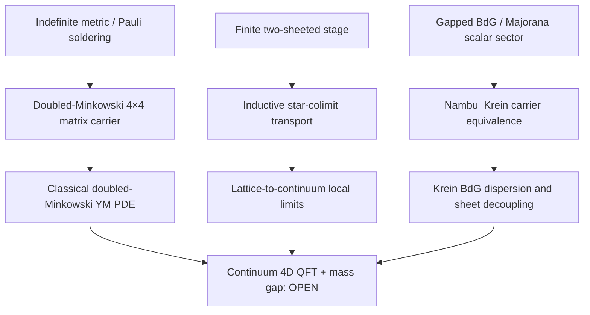

# Doubled-Minkowski BdG / Yang–Mills emergence: theorem-honest map

## Scope and epistemic status

This map compiles the intake phrase “emergence of continuum inductive colimit
Yang–Mills manifold with indefinite doubled Minkowski metric for a gapped BdG
system” against the current working tree at
`60fe7f4314a6445cb536ca74131a058756cf2250`. It is a source-backed claim
ledger, not a new continuum field-theory theorem.

The repository already contains kernel-checked pieces of the required
carriers: a gapped Majorana/BdG scalar sector, a Krein BdG dispersion sector,
an indefinite-metric Pauli/doubled-space carrier, explicit classical
doubled-Minkowski Yang–Mills PDE solutions, lattice-to-continuum local limits,
and an inductive star-colimit transport layer. It does **not** contain a
theorem constructing a continuum 4D quantum Yang–Mills manifold from a gapped
BdG system, nor a continuum spectral mass-gap theorem for such a construction.
Those stay explicit open frontiers.

## Claim ledger

| ID | Claim | Native carrier / exact owner | Status | Boundary |
|---|---|---|---|---|
| C1 | A one-pair BdG/Majorana quasiparticle gap is nonnegative, vanishes exactly at zero singular value, and stays positive under Weyl scaling | `lean/InfoGeometry/Physics/BoundaryMajoranaMassGap.lean:32` (`majoranaPairGap`), `:40` (`majoranaPairGap_nonneg`), `:46` (`majoranaPairSplitting_eq_two_mul_gap`), `:153` (`weylScaledGap_pos`) | BUCKET 1, kernel-verified | Finite scalar gap bookkeeping; not a continuum spectral gap. |
| C2 | The massive BdG dispersion commutes with the Krein metric and with positive/negative Nambu projectors; ghost sectors decouple | `lean/InfoGeometry/Physics/KreinBdGMassDecoupling.lean:223` (`bdg_dispersion_commutes_P_plus`), `:261` (`bdg_dispersion_commutes_P_minus`), `:300` (`bdg_dispersion_commutes_krein`), `:316`/`:331` (`bdg_dispersion_ghost_decoupling_*`) | BUCKET 1, kernel-verified | Operator identities under the supplied Krein structure; no Hilbert spectral lower bound is proved. |
| C3 | Eight real Nambu/BdG coordinates are carried into the real doubled Krein space by an actual linear equivalence intertwining particle–hole and metric actions | `lean/InfoGeometry/Krein/MajoranaBdGSheetBridge.lean:124` (`nambuDoubledEquiv`), `:172` (`particleHole8` → `modular_j`), `:182` (`kreinMetric8` → `spectral_epsilon`) | BUCKET 1, kernel-verified | Finite-dimensional carrier transport, not a continuum manifold chart. |
| C4 | The indefinite doubled-Minkowski metric is soldered to Pauli/chiral involutions on the doubled carrier | `lean/InfoGeometry/CliffordWeyl/IndefiniteMetricModulePauliBridge.lean:78`, `:133`, `:176`; `lean/InfoGeometry/Lie/DoubledMinkowskiCircularChiralYangMillsBridge.lean:500` (`doubledMinkowski_krein_pauli_soldering_bridge`) | BUCKET 1, kernel-verified | Algebraic/coordinate soldering; not a pseudo-Riemannian manifold object. |
| C4a | The finite BdG sheet carrier `Fin 4 ⊕ Fin 4` is explicitly reindexed to `Fin 2 × Fin 4`, carrying `diag(η₁,₃, -η₁,₃)` exactly to `𝒦_diag = Z ⊗ η₁,₃`, preserving the Krein pairing, and expressing the zero-kinetic BdG gap as `m²` times the `K = 𝒦² = 1` restored norm | `lean/InfoGeometry/Canonical/DoubledMinkowskiSheetSoldering.lean:31` (`sheetToDoubled`), `:44` (`sheetKrein_reindex_doubledMinkowskiDiag`), `:59` (`doubledMinkowskiKreinPair_eq_pairing`), `:91` (`doubledMinkowskiSum_sq`), `:99` (`stageBdgQuad_eq_doubledMinkowskiJNorm`) | BUCKET 1, kernel-verified | Finite-dimensional index/soldering theorem; not a continuum spacetime chart or YM measure. |
| C5 | A concrete doubled-Minkowski matrix-valued connection has nonzero Yang–Mills curvature, satisfies Bianchi, and a displayed form solves the Yang–Mills PDE | `lean/InfoGeometry/Lie/DoubledMinkowskiManifoldYangMillsPDE.lean:591` (`ymCurvature`), `:767` (`bianchi_identity_ymCurvature`), `:1351` (`YangMillsPDE`), `:1536` (`circularGaugeForm_solves_yangMillsPDE`), `:2076` (Minkowski wave solution) | BUCKET 1, kernel-verified | Explicit classical solutions on a concrete `Mat4(ℂ)`-form carrier; not existence for arbitrary initial data. |
| C5a | The BdG square off-diagonal block is exactly the commutator curvature `DΔ - ΔD`, and the single-colour Zorn embedding preserves that readout | `lean/InfoGeometry/Physics/NoncommutativeZornBdGDerivations.lean:443` (`embedMat2_bdg_square_curvature`) | BUCKET 1, kernel-verified | Algebraic curvature readout; not the classical doubled-Minkowski PDE in C5. |
| C6 | Lattice covariant derivative, Wilson curvature, and plaquette action converge locally as mesh `a → 0` under smoothness hypotheses | `lean/InfoGeometry/Lie/DoubledMinkowskiLatticeContinuumLimit.lean:158`, `:395`, `:541`, `:721` (`circularColimit_continuum_transport`) | BUCKET 2, conditional | Needs `ContDiff`/`C²` regularity; gives local lattice-to-continuum limits, not a full constructive continuum QFT. |
| C6a | A directed refinement tower preserving `normSq`/`kreinPair` with summable step errors keeps the doubled-Minkowski pairing invariant and converges to a projective quadratic form with the same uniform BdG gap bound | `lean/InfoGeometry/Canonical/DoubledMinkowskiBdGColimitBridge.lean:327` (`seqVal`), `:333` (`seqPair`), `:345` (`continuum_colimit_doubled_minkowski_and_bdg_mass_gap`) | BUCKET 2, conditional | Abstract tower hypotheses; proves Cauchy convergence and gap persistence, not 4D Wightman/OS Yang–Mills existence or a physical continuum spectral theorem. |
| C6b | The abstract tower has a concrete padding instance: Euclidean norm and sheet-Krein pairing are preserved, the zero-kinetic BdG quadratic form is exactly `m²‖ψ‖²`, and the projective limit quadratic form is explicitly identified as `m²‖ψ‖²` | `lean/InfoGeometry/Canonical/DoubledMinkowskiConcreteTowerGap.lean:37` (`padSum`), `:60` (`padSum_bdgKreinPair`), `:71` (`stageBdgQuad_eq`), `:106` (`concrete_tower_gap`), `:144` (`concrete_tower_explicit_Qinf`), `:331` (`padSumLinear`), `:375` (`padFun_map_map`), `:430` (`padMapLin_directed`) | BUCKET 1/2, kernel-verified once instantiated | Concrete finite-stage tower with zero error; stage transitions are native `ℝ`-linear maps forming a genuine `DirectedSystem`, so a native `_root_.DirectLimit` is constructed in C6d. Still an abstract quadratic-form limit, not a continuum YM measure or physical spectral gap. |
| C6c | The abstract summable-error tower hypothesis is exercised non-trivially by a finite-support perturbation with one nonzero step error; the perturbation washes out after stage one, and the explicit colimit is `m²‖ψ‖²` | `lean/InfoGeometry/Canonical/DoubledMinkowskiConcreteTowerGap.lean:179` (`perturbEps_summable`), `:200` (`perturbedQuad_step`), `:214` (`perturbed_tower_gap`), `:259` (`perturbed_tower_explicit_Qinf`), `:288` (`perturbed_tower_full_instance`) | BUCKET 1/2, kernel-verified | Nonzero-error instance of C6a with explicit washed-out limit and full Krein/projective/non-negativity conclusions; still an algebraic quadratic-form limit, not continuum YM or physical spectral gap. |
| C6d | The concrete gapped BdG tower has a native Mathlib `_root_.DirectLimit` carrier, and the finite sheet-Krein pairing descends to an indefinite bilinear form whose same-stage evaluation is exact | `lean/InfoGeometry/Canonical/DoubledMinkowskiBdgDirectLimit.lean:30` (`bdgStageKreinBilin`), `:53` (`padFun_bdgKreinPair`), `:69` (`bdgStageKreinBilin_compat`), `:75` (`BdgTowerDirectLimit`), `:79` (`bdgLimitKreinForm`), `:83` (`bdgLimitKreinForm_of`), `:105` (`bdgLimitKreinForm_indefinite`), `:148` (`bdgLimitKreinForm_isSymm`) | BUCKET 1, kernel-verified | Algebraic direct limit with a genuinely indefinite, symmetric inherited form, witnessed in the kernel; no topology, completion, manifold, Yang–Mills field, or physical spectral gap is claimed. |
| C7 | Two-sheeted Yang–Mills operator identities transport through an inductive star-colimit cone | `lean/InfoGeometry/Canonical/TwoSheetedYangMillsInductiveColimit.lean:161` (`starRingHom_intertwines_two_sheeted_operators`), `:206` (`star_hom_two_sheeted_operator_identities`), `:312` (`StarRingHom`), `:332` (`InductiveStarColimitCone`) | BUCKET 1, kernel-verified | Algebraic colimit of operator identities; not an analytic manifold or QFT limit. |
| C7a | The commuting-mass BdG square identity survives any unital ring homomorphism, hence each `StarRingHom` cone map | `lean/InfoGeometry/Physics/BdGColimitGapTransport.lean:43` (`massiveBdGHamiltonian_sq_map`), `:55` (`massiveBdGHamiltonian_sq_cone_transport`) | BUCKET 1, kernel-verified | Finite-stage transport of `H² = D² + M²` on the diagonal. It does not transport a scalar singular-value gap or prove continuum positivity. |
| C8 | The Mannheim-type typed bridge gathers the doubled-Minkowski Yang–Mills suite across layers 0–3 | `lean/InfoGeometry/Synthesis/MannheimDoubledMinkowskiYangMillsBridge.lean:22–38` (layer map), `:2163` (`archMannheimDoubledMinkowskiYangMillsBridge`) | BUCKET 1, kernel-verified | Typed archetype over already-proved layers; not a physical continuum emergence theorem. |
| C8a | The tensor-tower inductive colimit carries Krein sheet polarization, positive/negative definiteness, self-dual Peirce Yang–Mills curvature/Bianchi and stage-to-colimit transport | `lean/InfoGeometry/Canonical/PeirceTetraktysColimitCoercivity.lean:1471` (`limit_krein_polarization_and_self_dual_yang_mills`) | BUCKET 1, kernel-verified | Algebraic colimit carrier; no continuum manifold or physical spectrum. |
| C8b | Over an arbitrary unital star-ring with cyclic trace: non-Abelian Bianchi/divergence duality and orbit mass-gap equipartition for projections | `lean/InfoGeometry/Algebra/Zorn/TetractysZeemanZornAssociatorBridge.lean:2701` (`yang_mills_bianchi_divergence_duality_and_orbit_mass_gap_equipartition_bridge`) | BUCKET 1, kernel-verified | Algebraic mass-gap operator identity; not the continuum Yang–Mills mass gap. |
| C8c | Two-sheet Krein filtered colimit plus matrix exterior-algebra Yang–Mills carrier share telegrapher/Virasoro single-sheet decoders | `lean/InfoGeometry/Canonical/PeirceTelegrapherVirasoroColimitBridge.lean:68` (`two_sheet_krein_and_yang_mills_telegrapher_virasoro_sheet_bridge`) | BUCKET 1, kernel-verified | Cross-carrier algebraic instantiation; no continuum field theory. |
| C9 | A gapped BdG system emerges as a continuum 4D Yang–Mills manifold with a strictly positive Wightman/Osterwalder–Schrader mass gap | No native owner proves this | BUCKET 3, OPEN | Explicitly excluded by `docs/OPEN_DEBT_PROBLEMS.md:145`, `docs/YANG_MILLS_UNIFICATION_PLAN.md:1448`, and `docs/DRIVE_CDE_AISTUDIO_1VUS_EPISTEMIC_COMPILATION.md:253`; the universal `emergent_colimit_mass_gap` is refuted in `TopologicalMassGapZeroStageAudit.lean:108`. Do not package as a structure field or conjunction. |

## Carrier → map/intertwiner → soldering table

| Source carrier | Map / transport | Target carrier | What is actually soldered |
|---|---|---|---|
| Nambu/BdG eight-vector `Fin 8 → ℝ` | `nambuDoubledEquiv` (`MajoranaBdGSheetBridge.lean:124`) | `DoubledSpace (EuclideanSpace ℝ (Fin 4))` | Particle–hole involution ↦ `modular_j`, Krein metric ↦ `spectral_epsilon` (`:172`, `:182`). |
| BdG dispersion operator with mass coupling | `KreinBdG` projector/metric commutation theorems (`KreinBdGMassDecoupling.lean:223–367`) | Positive/negative BdG sheets | Dispersion commutes with the Krein metric and ghost/physical sectors decouple. No spectral lower bound is transported. |
| Clifford indefinite-metric module | `e2m_rho_*` Pauli readouts (`IndefiniteMetricModulePauliBridge.lean:78–176`) | Pauli/chiral matrix carrier | Metric involution is represented by a concrete Pauli/chiral involution. |
| Circular split-octonion/doubled coordinate frame | `circularConnectionMat4` and Pauli soldering (`DoubledMinkowskiCircularChiralYangMillsBridge.lean:1126`, `:500`) | `Matrix (Fin 4) (Fin 4) ℂ` | Krein/Pauli metric and chiral connection on a finite matrix carrier. |
| Finite two-sheeted matrix stage | `StarRingHom` + `InductiveStarColimitCone` (`TwoSheetedYangMillsInductiveColimit.lean:312`, `:332`) | Inductive star-colimit algebra | Electron, quadratic-coupling and spin-dipole identities survive the colimit maps. |
| Lattice scale `a > 0` | `tendsto_*` family (`DoubledMinkowskiLatticeContinuumLimit.lean:158–541`) | Continuum curvature/action readouts | Local limits of covariant diff, Wilson curvature and action under regularity hypotheses. |

## What is deliberately not claimed

- No theorem identifies the finite BdG gap in C1 with a continuum Yang–Mills
  spectral gap. The former is a scalar/singular-value readout; the latter is
  an open analytic problem.
- No inductive colimit of finite matrix algebras is asserted to be a smooth
  four-manifold or a Wightman/Osterwalder–Schrader quantum field theory.
- The explicit classical PDE solution in C5 is not existence/uniqueness for
  arbitrary data and is not a quantum Yang–Mills measure.
- The conditional limits in C6 require their displayed smoothness hypotheses;
  they do not remove the continuum mass-gap frontier.
- No `Prop`-field certificate, socket, or bundled “master emergence” structure
  is introduced to manufacture the missing implication C1/C2 + C7 + C6 → C9.

## Verification record

Bounded `lake build` runs under the shared scratch lock at the stated HEAD:

| Module | Result |
|---|---|
| `InfoGeometry.Lie.DoubledMinkowskiManifoldYangMillsPDE` | exit 0, 0 errors, `Build completed successfully (9087 jobs)` |
| `InfoGeometry.Lie.DoubledMinkowskiLatticeContinuumLimit` | exit 0, 0 errors, `Build completed successfully (9087 jobs)` |
| `InfoGeometry.Canonical.TwoSheetedYangMillsInductiveColimit` | exit 0, 0 errors, `Build completed successfully (956 jobs)` |
| `InfoGeometry.Physics.BoundaryMajoranaMassGap` | exit 0, 0 errors, `Build completed successfully (3094 jobs)` |
| `InfoGeometry.Physics.KreinBdGMassDecoupling` | exit 0, 0 errors, `Build completed successfully (3099 jobs)` |
| `InfoGeometry.Lie.DoubledMinkowskiCircularChiralYangMillsBridge` | exit 0, 0 errors, `Build completed successfully (9086 jobs)` |
| `InfoGeometry.CliffordWeyl.IndefiniteMetricModulePauliBridge` | exit 0, 0 errors, `Build completed successfully (8976 jobs)` |
| `InfoGeometry.Krein.MajoranaBdGSheetBridge` | exit 0, 0 errors, `Build completed successfully (9146 jobs)` |
| `InfoGeometry.Physics.BdGColimitGapTransport` | exit 0, 0 errors, `Build completed successfully (1255 jobs)` |
| `InfoGeometry.Canonical.DoubledMinkowskiBdGColimitBridge` | exit 0, 0 errors, `Build completed successfully (3094 jobs)` |
| `InfoGeometry.Canonical.DoubledMinkowskiConcreteTowerGap` | exit 0, 0 errors, `Build completed successfully (3095 jobs)` |
| `InfoGeometry.Canonical.DoubledMinkowskiSheetSoldering` | exit 0, 0 errors, `Build completed successfully (3096 jobs)` |
| `InfoGeometry.Canonical.PeirceTetraktysColimitCoercivity` | exit 0, 0 errors, `Build completed successfully (9136 jobs)` |
| `InfoGeometry.Canonical.PeirceTelegrapherVirasoroColimitBridge` | exit 0, 0 errors, `Build completed successfully (9666 jobs)` |
| `InfoGeometry.Algebra.Zorn.TetractysZeemanZornAssociatorBridge` | exit 0, 0 errors, `Build completed successfully (9185 jobs)` |
| `InfoGeometry.QuantumGravity.TopologicalMassGapZeroStageAudit` | exit 0, 0 errors, `Build completed successfully (8938 jobs)` |
| `InfoGeometry.Synthesis.MannheimDoubledMinkowskiYangMillsBridge` | exit 0, 0 errors, `Build completed successfully (10013 jobs)` |

A six-declaration `#print axioms` probe covering C1, C2, C4, C5, C6 and C7
reported only `[propext, Classical.choice, Quot.sound]` and `sorryAx = 0`.
A separate three-declaration probe for C7a likewise reported only standard
axioms and `sorryAx = 0`, as did a three-declaration probe covering C6a's
metric spec and colimit theorem and a three-declaration probe covering C6b's
Krein pairing, BdG square, concrete colimit and the explicit `Q_inf`
identification, and a three-declaration probe covering C4a's index equivalence,
metric reindexing, pairing soldering, sum-metric involution and BdG-energy
restored-norm identity, and a three-declaration probe covering C6a's metric
spec/colimit theorem plus the C6b/C4a updates. These are sampled axiom checks,
not claims about every declaration in the listed modules; the nonzero-error
tower probe is sampled by three further declarations with `sorryAx = 0`.

## Roadmap for a future honest closure

1. Name the missing analytic theorem precisely: a net of BdG Hamiltonians
   whose continuum limit satisfies OS/Wightman axioms and a uniform positive
   mass gap. C6a/C6b already prove abstract and concrete Cauchy/gap-persistence
   theorems under summable step-error hypotheses; keep those distinct from the
   physical continuum theorem, which remains BUCKET 3.
2. Finite-stage transport of the BdG square identity is now kernel-checked in
   `BdGColimitGapTransport` (C7a). Transport of the scalar singular-value gap
   remains open; do not conflate the algebraic square identity with positivity.
3. The colimit/YM side is already owned by C8a/C8b/C8c; reuse those theorems
   instead of re-proving a synthetic "master emergence" result. The genuinely
   open step is the analytic identification of a physical BdG continuum limit
   with those algebraic colimit carriers.
4. Reject any proposed closure that packages C9 as a field, a certificate, or
   a conjunction of already-proved finite theorems.
