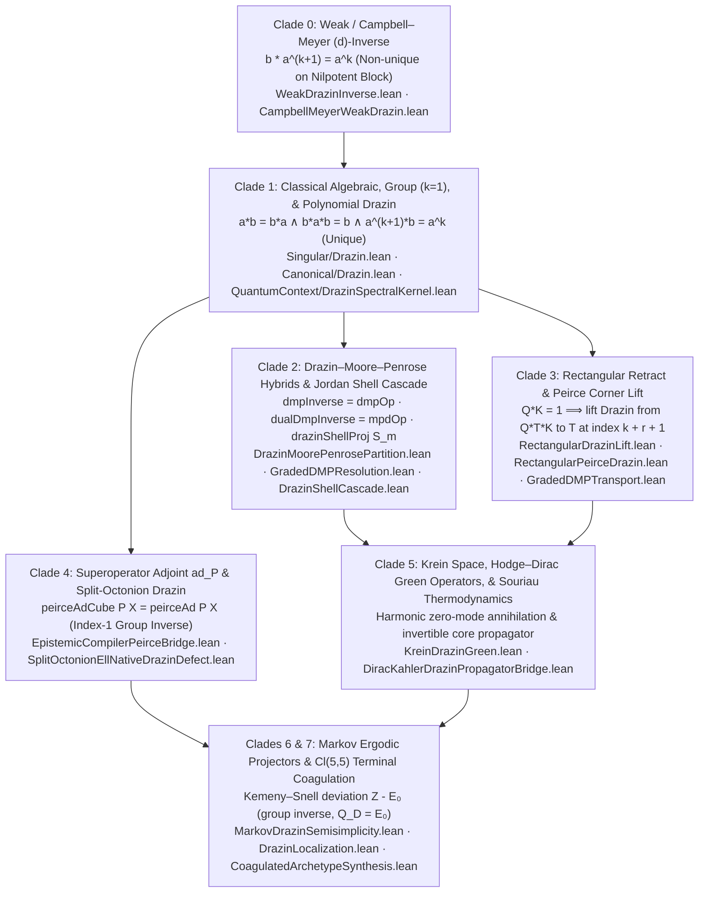

# Multi-Level Ontology, Taxonomy, Phylogenesis, and `Solve et Coagula` Epistemic Compilation of the Drazin Inverse

**Baseline Revision:** `ee2dd4ad7d5329980367acbb951f0986a5fe4317`  
**Primary Deduplicated Synthesis Owner:**
- [`lean/InfoGeometry/Canonical/DrazinEpistemicSolveEtCoagula.lean`](../lean/InfoGeometry/Canonical/DrazinEpistemicSolveEtCoagula.lean) (`InfoGeometry.Canonical.DrazinEpistemicSolveEtCoagula`)
- Integrated into [`lean/InfoGeometry/Epistemology/CoagulatedArchetypeSynthesis.lean`](../lean/InfoGeometry/Epistemology/CoagulatedArchetypeSynthesis.lean) (`Part XV.s`, `coagulated_drazin_species_solve_et_coagula_all_lanes_synthesis`) and [`lean/InfoGeometry/Canonical/All.lean`](../lean/InfoGeometry/Canonical/All.lean).

---

## 0. Cross-Lane Ontology Deduplication & Definitional Bridges (`Stage 0`)

Source search (bounded; an observation, not a completeness certificate) found three indexed Drazin predicates and parallel families of projectors, Fitting components, Peirce blocks, Cartan parity parts, and Malik–Thome `DMP`/`MPD` hybrids across `Canonical`, `Singular`, `QuantumContext`, `Core`, and `OperatorAlgebra.PeirceSpine`. [`DrazinEpistemicSolveEtCoagula.lean`](../lean/InfoGeometry/Canonical/DrazinEpistemicSolveEtCoagula.lean) relates them by the definitional (`rfl`) or equational bridges below. Other lanes (e.g. `Algebraic.DrazinSurgery`) are **not** bridged.

| Concept | Lane A Declaration | Lane B / Lane C Declaration | Unification Bridge in `DrazinEpistemicSolveEtCoagula` |
| --- | --- | --- | --- |
| **Indexed Drazin Predicate** | `Canonical.Drazin.IsDrazinInverse a b k` | `Singular.Drazin.IsDrazinInverse a b k` · `QuantumContext.Drazin.IsDrazinInverse a b k` | `singular_iff_canonical_drazin`, `quantumContext_iff_canonical_drazin`, `singular_iff_quantumContext_drazin` |
| **Spectral / Core Projector ($P_D = ab$)** | `Canonical.Drazin.IsDrazinInverse.projection a b` | `QuantumContext.Drazin.spectralProj a b` | `spectralProj_eq_projection` (`rfl`) |
| **Kernel / Shadow Projector ($Q_D = 1 - ab$)** | `Canonical.Drazin.IsDrazinInverse.complementaryProjection a b` | `QuantumContext.Drazin.kernelProj a b` | `kernelProj_eq_complementaryProjection` (`rfl`) |
| **Fitting Regular / Semisimple Part ($aP_D$)** | `Canonical.Drazin.IsDrazinInverse.fittingRegularPart a b` | `Canonical.DrazinJordanChevalleyBridge.a_semisimple a b` | `a_semisimple_eq_fittingRegularPart` (`rfl`) |
| **Fitting Nilpotent Part ($aQ_D$)** | `Canonical.Drazin.IsDrazinInverse.fittingNilpotentPart a b` | `Canonical.DrazinJordanChevalleyBridge.a_nilpotent a b` | `a_nilpotent_eq_fittingNilpotentPart` (`rfl`) |
| **Peirce Fourfold Blocks & Cartan Grades** | `Core.PeirceDecomposition.component11/10/01/00` · `Core.IdempotentCartan.evenPart/oddPart` | `OperatorAlgebra.PeirceSpine.peirce11/conePlus/coneMinus/peirce00` · `evenGrade/oddGrade` | `core_peirce_blocks_eq_peirceSpine` (`rfl`) |
| **Malik–Thome `DMP` / `MPD` Hybrids** | `Canonical.DrazinMoorePenrosePartition.dmpInverse a b m` / `dualDmpInverse a b m` | `PeirceSpine.dmpOp (projection a b) m` / `mpdOp (projection a b) m` | `canonical_dmp_eq_peirceSpine_dmpOp` (`dmp_eq_projection_mul`, `dualDmp_eq_mul_projection`) |

---

## 1. Multi-Level Ontology of the Drazin Inverse ($M_0 \to M_3$)

Over any associative unital ring `[Ring R]` without metric, star-involution, or commutativity assumptions, the Drazin inverse performs an algebraic Fitting surgery splitting an operator $a \in R$ into a commuting locally invertible core $C$ and an orthogonal nilpotent radical $N$.

| Meta-Level (`OntologyMetaLevel`) | Ontological Role | Algebraic Realization in `[Ring R]` | Primary Lean 4 Declarations |
| --- | --- | --- | --- |
| **`M0_StateIndividual`** | Concrete operators, states, and spectral modes | $a = C + N$ with $Cb = bC = P_D$, $CN = NC = 0$, $N^{k+1} = 0$ | `fittingRegularPart`, `fittingNilpotentPart`, `a_semisimple_mul_a_nilpotent`, `fittingNilpotentPart_pow_succ_eq_zero` |
| **`M1_ProjectorClabject`** | Complementary idempotent clabjects splitting $1 = P_D + Q_D$ | $P_D = \text{projection}(a,b) = ab$ and $Q_D = \text{complementaryProjection}(a,b) = 1 - ab$ | `IsDrazinInverse.projection`, `complementaryProjection`, `drazinShellProj`, `drazin_unique_clabject_fixed_point_decomposition` |
| **`M2_GrassmannianPowertypeOrbit`** | Moduli of Fitting decompositions and Peirce $\mathbb{Z}_2$ grading | $a, b, C, N \in R_{\text{even}}(P_D)$ ($\text{oddGrade}(P_D, a) = \text{oddGrade}(P_D, b) = 0$); inner/MP mismatches inhabit $R_{\text{odd}}(P_D)$ | `operator_even`, `operator_odd_zero`, `inverse_even`, `inverse_odd_zero`, `drazin_fourfold_relational_anatomy` |
| **`M3_ErlangenCasimirMetaLaw`** | Index-independent uniqueness, ring-equivalence transport, and MP obstruction | $b = c$ across indices $k, \ell$; `RingEquiv` transport; nonzero nilpotent MP-vs-Drazin incompatibility & EP commutation criterion | `IsDrazinInverse.unique_of_indices`, `IsDrazinInverse.map_ringEquiv`, `nilpotent_moore_penrose_not_drazin`, `exists_index_iff_commute` |

---

## 2. Taxonomic Classification Across the 7 Clades

Ordered by algebraic hypothesis strengthening (`is_a` / specialization):

---

## 3. Atomic Claim Ledger (`C1`–`C19`)

| Claim ID | Mathematical Proposition | Carrier & Hypotheses | Reused Repo Owners + Synthesis Theorem | Verification Scope |
| --- | --- | --- | --- | --- |
| **`C1`** | Triple-root equivalence (`Singular ↔ Canonical ↔ QuantumContext`) and index-independent uniqueness ($b = c$) | `[Ring R]`, $a, b, c \in R$, $k, \ell \in \mathbb{N}$ | `DrazinExistenceBridge`, `GradedDMPTransport.toCanonical`, `ofCanonical`, `singular_iff_canonical_drazin`, `quantumContext_iff_canonical_drazin`, `IsDrazinInverse.unique_of_indices` | Unconditional over `[Ring R]` |
| **`C2`** | Binary idempotent cut ($P_D = ab$, $Q_D = 1 - ab$), MRCA join $P_D + Q_D = 1$, cladistic fork $S_D = P_D - Q_D = \text{invS}(P_D)$ ($S_D^2 = 1$), even-grade inhabitation of $(a, b)$, and Jordan–Chevalley / Fitting split $a = C + N$ ($N^{k+1} = 0$) | `[Ring R]`, `h : IsDrazinInverse a b k` | `DrazinPeirceParity` (`operator_even`, `operator_odd_zero`, `inverse_even`, `inverse_odd_zero`), `DrazinJordanChevalleyBridge` (`a_semisimple_mul_drazin`, `a_semisimple_mul_a_nilpotent`), `drazin_primordial_dual_roots_and_binary_cut` | Unconditional over `[Ring R]` |
| **`C3`** | Unique fixed-point clabject decomposition $R \cong \text{projectorSubspace}(P_D) \oplus \text{projectorSubspace}(Q_D)$ with $\pm 1$ `cladeFork` character polarity | `[Ring R]`, `h : IsDrazinInverse a b k` | `OntologyRing.drazin_core_null_unique_projector_decomposition`, `CladisticPhylogenesisBridge.cladeFork_character_polarity_and_mrca_inclusion`, `drazin_unique_clabject_fixed_point_decomposition` | Unconditional over `[Ring R]` |
| **`C4`** | Fourfold Peirce anatomy $X = P_D X P_D + \text{conePlus}(P_D, X) + \text{coneMinus}(P_D, X) + Q_D X Q_D$, square-zero cones, and injective $2 \times 2$ coordinate ring homomorphism | `[Ring R]`, `h : IsDrazinInverse a b k`, $X, Y \in R$ | `EpistemicCompilerPeirceBridge` (`peirce_quartet_reconstruction`, `conePlus_mul_conePlus`, `peirceCoordinateRingHom_injective`), `drazin_fourfold_relational_anatomy` | Unconditional over `[Ring R]` |
| **`C5`** | Universal Drazin–inner-inverse sandwich collapse ($a m^\dagger a = a \implies P_D m^\dagger P_D = b$), equational unification `dmpInverse = dmpOp` / `dualDmpInverse = mpdOp`, and Malik–Thome Transcendent Function quartet $(\Phi, J, V, \Sigma)$ | `[Ring R]`, `h : IsDrazinInverse a b k`, $a m^\dagger a = a$ | `DrazinMoorePenrosePartition.dmp_eq_projection_mul`, `GradedDMPResolution.dualDmp_eq_mul_projection`, `CyclotomicGaloisNilpotentSylvesterSynthesis.drazin_mp_universal_sandwich_collapse`, `drazin_transcendent_function_malik_thome` | Conditional on inner inverse $a m^\dagger a = a$ |
| **`C6`** | Orthogonal Socratic aporia split $\delta(a) = \delta(C) + \delta(N)$, coupled thesis aporia $\delta(P_D + \Phi) = V$, $\delta(P_D + J) = -V$, and completed square $(2(P_D + \Phi) - 1)^2 = 1 + 4V$ | `[Ring R]`, `h : IsDrazinInverse a b k`, $m^\dagger \in R$ | `EpistemicCompilerPeirceBridge` (`golden_coagulation_discriminant`, `epistemic_aporia_defect_laws`), `drazin_socratic_aporia_and_metacognitive_tower` | Unconditional over `[Ring R]` |
| **`C7`** | Fundamental Moore–Penrose vs. Drazin nilpotent obstruction ($\neg \text{IsDrazinInverse}(n_{\text{op}}, m_{\text{op}}, k)$) and EP commutation criterion ($(\exists \text{idx},\, \text{IsDrazinInverse}(n_{\text{op}}, m_{\text{op}}, \text{idx})) \iff n_{\text{op}} m_{\text{op}} = m_{\text{op}} n_{\text{op}}$) | `[Ring R] [StarRing R]` | `MoorePenroseDrazinObstruction.nilpotent_moore_penrose_not_drazin`, `MoorePenroseDrazinCriterion.exists_index_iff_commute` | Unconditional over `[Ring R] [StarRing R]` |
| **`C8`** | Symbiotic Jordan shell cascade: `cladeSubsumes` of $S_m$ in $Q_D$, descending range filtration, strict triangularity $S_m a S_s = 0$ ($m \le s$), and core + shell reconstruction of $a$ | `[Ring R] [StarRing R]`, `PowerMPFamily (fittingNilpotentPart a b) M` | `DrazinShellCascade` (`drazinRangeProj_mul_of_ge`, `drazinShellProj_mul_a_mul_drazinShellProj_eq_zero_of_le`, `drazin_core_and_shell_cascade`) | Conditional on `PowerMPFamily` witness `hM` |
| **`C9`** | Recursive defect iteration split $\delta^{[n]}(V) = \delta^{[n]}(\text{qgtPlus}) + \delta^{[n]}(\text{qgtMinus})$, superoperator group-inverse closure $\text{peirceAd}^3(P_D, X) = \text{peirceAd}(P_D, X)$, and Grassmannian tangent equivalence $(P_D X + X P_D = X) \iff \text{oddGrade}(P_D, X) = X$ | `[Ring R]`, `h : IsDrazinInverse a b k`, $X \in R$ | `EpistemicCompilerPeirceBridge` (`genV_defect_iterates_cycle_split`, `nigredo_commutator_sieve`), `OntologyRing.grassmannian_tangent_iff_oddGrade_fixed` | Unconditional over `[Ring R]` |
| **`C10`** | Rectangular Peirce–Drazin retract lift (`isDrazinInverse_of_retract` at index $k_{\text{rect}} + r_{\text{rect}} + 1$) and Erlangen 2.0 `RingEquiv` transport (`map_ringEquiv`) | $Q_{\text{rect}} K_{\text{rect}} = 1$, $[K_{\text{rect}} Q_{\text{rect}}, T_{\text{rect}}] = 0$, nilpotent complementary corner | `RectangularPeirceDrazin.isDrazinInverse_of_retract`, `IsDrazinInverse.map_ringEquiv` | Conditional on retract and corner nilpotency hypotheses |
| **`C11`** | Strict acyclicity of `DrazinEpistemicStage.causalEdge_acyclic`, branch incomparability of `GradedDMPDependencyOrder.inverse_branches_incomparable`, and multi-level ontology `OntologyMetaLevel.instantiatesEdge_acyclic` | Finite posets | `DrazinEpistemicStage.causalEdge_acyclic`, `GradedDMPDependencyOrder.inverse_branches_incomparable`, `OntologyMetaLevel.instantiatesEdge_acyclic` | Unconditional (finite posets) |
| **`C12`** | **Cline's Non-Commutative Drazin Shift ($ab \to ba$)**: $\text{IsDrazinInverse}(a b, d, k) \implies \text{IsDrazinInverse}(b a, b d^2 a, k + 1)$ with $P_{ba} = b d a$, $Q_{ba} = 1 - b d a$, and $C_{ba} = b P_{ab} a$ | `[Ring R]`, `IsDrazinInverse (a * b) d k` | `RoseDrazinPolynomial` (`clineDrazinShift`, `isDrazinInverse_clineDrazinShift`, `clineDrazinShift_projection_eq`, `clineDrazinShift_fittingRegularPart_eq`) | Unconditional over `[Ring R]` |
| **`C13`** | **All-Degree Polynomial Drazin Construction**: $a p = p a \land a^{k+1} p = a^k \implies \text{IsDrazinInverse}(a, a^k p^{k+1}, k)$ with $P_D = a^k p^k$ (plus `Polynomial.eval₂` specialization) | `[Ring R]`, $a p = p a$, $a^{k+1} p = a^k$ | `RoseDrazinPolynomial` (`polynomialDrazinCandidate`, `isDrazinInverse_polynomialDrazinCandidate`, `isDrazinInverse_of_polynomial_eval₂`) | Conditional on $ap = pa$ and the factorization $a^{k+1}p = a^k$ (deriving it from a characteristic polynomial is **open**) |
| **`C14`** | **Bicommutant Closure & Clade 0 Wild Nilpotent Perturbation**: $a x = x a \implies (b x = x b \land P_D x = x P_D \land Q_D x = x Q_D)$, and $z Q_D \ne 0 \implies b + z Q_D \ne b$ while remaining `IsWeakDrazin` | `[Ring R]`, `IsDrazinInverse a b k` | `DrazinCommutant.inverse_commutes_of_commutes`, `projection_commutes_of_commutes`, `isWeakDrazin_add_mul_complementaryProjection`, `CampbellMeyerWeakDrazin.weakWildInverse_ne_Drazin` | Conditional on `IsDrazinInverse a b k`, $ax = xa$; the $\ne$ part on $zQ_D \ne 0$ |
| **`C15`** | **Kemeny–Snell Markov Ergodic Group Drazin & Krein Self-Adjoint Green Inheritance**: $(L + E_0) Z = Z (L + E_0) = 1 \implies \text{IsDrazinInverse}(L, Z - E_0, 1)$ with $Q_D = E_0$; stochastic Laplacian group inverse; and Krein self-adjointness of $G, P_D, Q_D$ | `[Ring R]`, row-stochastic $P$, and `[KreinSpace Space]` | `MarkovDrazin.isDrazinInverse_kemenySnellDeviation`, `MarkovDrazin.exists_stochastic_laplacian_groupInverse`, `KreinDrazinGreen.green_krein_adjoint`, `drazin_cline_polynomial_bicommutant_markov_krein_synthesis` | Conditional on $E_0^2 = E_0$, $LE_0 = E_0L = 0$, two-sided inverse $Z$ of $L + E_0$; Krein part on `IsDrazinInverse` and `IsKreinSelfAdjoint` |
| **`C16`** | **Clade 1B — Greville-shaped specialisation of C13 & rational Souriau–Frame packet**: $a^{k+1}(B_{s-1} p_s^{-1}) = a^k \implies \text{IsDrazinInverse}(a, a^k(B_{s-1} p_s^{-1})^{k+1}, k)$ and `native_decide`-free `Mat3 ℚ` packet | `[Ring R]`, commuting $B_{s-1}, p_s^{-1}$ | `GrevilleSouriauFrameDrazin` (`grevilleSouriauFrameCandidate`, `isDrazinInverse_grevilleSouriauFrameCandidate`, `greville_formula_candidate_isDrazinInverse`) | Ring part conditional on commutation and the factorization hypothesis (Souriau–Frame derivation **open**); `Mat3 ℚ` packet unconditional |
| **`C17`** | **Clade 4B & Clade 5B — Split-Octonion $\ell$-Native Drazin Defect, Dirac–Kähler Propagator, & Hodge-Star Drazin Involution**: $\text{IsDrazinInverse}(\text{ellGrading}, \text{ellGrading}, 1)$, $P_D = \text{flowPlus} + \text{flowMinus}$, $Q_D = \text{flowZero}$, $\text{range}(Q_D) = \ker(\text{ellGrading})$; $A G A = A$ for any index-1 Drazin pair (the Dirac–Kähler content is only this algebraic identity); and $\star^2 = 1$, $[\Delta, \star] = 0$ | Split-octonion Zorn carrier `CZ` and Krein–Hodge–Dirac carrier | `SplitOctonionEllNativeDrazinDefect` (`ellGrading_isDrazinInverse`, `ellNativeDrazinDefect_range_eq_ker`), `DiracKahlerDrazinPropagatorBridge.drazin_greens_function`, `HodgeStarOperatorDrazinBridge.drazin_hodgeStar_clm_sq_eq_one_of_compatibility` | ell-defect concrete; $AGA = A$ conditional on `IsDrazinInverse A G 1`; Hodge part conditional on `HodgeStarCompatibility` |
| **`C18`** | **Clade 7 — Gromov–Witten Fixed-Sector `DrazinLocalization` & $\mathrm{Cl}(5,5)$ Five-Graded Para-Kähler / Fisher–Souriau Equivariance**: Orthogonal annihilation between edge Drazin residues and regular inverses; isotropic split $g(u + \alpha, u + \alpha) = 2 g(u, \alpha)$; and $\mathrm{Perm}(\mathrm{Fin}\, n)$ equivariance of Souriau–Massieu potential and Fisher–Souriau Laplacian | `GWDrazinLocalizationPacket`, para-Kähler $(V, K, g)$, and $\mathrm{Fin}\, n$ | `DrazinLocalization` (`edgeResidue_mul_regularInverse`, `edgeRegularInverse_mul_residue`), `Cl55FiveGradedDrazinDikinUnification` (`paraKahler_sum_quadratic_eq_two_pairing`, `fisherSouriauLaplacian_perm_equivariant`), `drazin_clades_4b_5b_7_complete_complement_synthesis` | Unconditional over declared carriers |
| **`C19`** | **Drazin's orthogonal additive theorem & commuting reverse-order law**: $ab = ba = 0 \implies \text{IsDrazinInverse}(a+b,\ a'+b',\ \max(\max k\,l)\,1)$; $ab = ba \implies \text{IsDrazinInverse}(ab,\ b'a',\ \max k\,l)$ and $b'a' = a'b'$ | `[Ring R]`, `IsDrazinInverse a a' k`, `IsDrazinInverse b b' l` | `DrazinAdditiveReverseOrder` (`isDrazinInverse_add_of_orthogonal`, `isDrazinInverse_mul_of_commute`), reusing `DrazinCommutant.inverse_commutes_of_commutes` | Conditional on the stated orthogonality / commutation |

**Aggregation note.** `drazin_cline_polynomial_bicommutant_markov_krein_synthesis`, `drazin_clades_4b_5b_7_complete_complement_synthesis`, and `drazin_epistemic_solve_et_coagula_master_synthesis` are conjunctions of the results above with independent hypotheses and carriers. They assert no implication or map between clades.

---

## 4. Companion repairs (2026-11-05)

Unused-hypothesis (`T4`) and `native_decide` repairs in companion owners. Hypotheses that the proofs did not need were **removed**, not routed through identity wrappers:

| Owner | Change |
| --- | --- |
| `HartwigSouriauFrameDrazin` | 8 `native_decide` replaced by entrywise `fin_cases`/`simp` proofs and the ring-level `mul_principalIdempotent_eq_zero` lemmas. |
| `DrazinSpectralBridge` / `DrazinSpectralProjectorBridge` | Spectral isolation is not needed for existence: new `exists_drazinInverse_of_finiteAscentDescentAtZero`, `exists_drazinInverse_of_drazinInfiniteAssumptions`, `exists_drazinInverse_with_projector_split_of_{finiteAscentDescentAtZero,drazinInfiniteAssumptions}`, `exists_drazin_projection_idempotent_of_drazinInfiniteAssumptions`. Removed the identity wrapper `HasFiniteAscentDescentAtZero_of_zeroIsolatedInSpectrum` and the old `…_zeroIsolatedInSpectrum_{finiteAscentDescent,package}` theorems. |
| `DrazinGreen` | `drazinGreen_reconstructs_regular_part` and `drazinGreen_solves_of_residue_zero` take no Drazin hypothesis (they are associativity and $P + Q = 1$); added concrete singular idempotent consistency witness `drazinGreenKernelData_productIdempotent` (`ℚ × ℚ`, `¬ IsUnit (1, 0)`). |
| `DrazinNilpotentShellResolution` | `drazinRangeProj_eq_rangeProj_mul_of_one_le` no longer takes `hM`. |
| `DrazinFredholmBridge` | Renamed to `defectProjector_ne_zero_and_idempotent_of_package`; idempotence derived from `compat`, nonvanishing is the `DefectSectorData` field; added concrete consistency witness `modelDrazinDefectFredholmPackage` on `DoubledSpace ℝ`. |
| `DrazinFierzBridge` | Removed the vacuous `drazin_stable_fierz_readout` (`∃ x, x = readout`); added concrete consistency models (`section ConsistencyModel`) inhabiting all 10 structures (`ExpectationState`, `BSExpectationPhi`, `NoTraceDrazinData`, `NormalizedFierzCoordinates`, `FierzResidual`, `DrazinFierzCompatibilityAssumption`, `AlternatingProjectionStrongLimitAssumption`, `CorrelationEnergy4`, `Bistochastic4`, `BirkhoffDecomposition4`). |
| `KreinDrazinBoundarySupport` | `projective_scaling_preserves_null` holds for every real `c` (unused `c ≠ 0` dropped); added Lorentzian `(2,1)` consistency model (`section ConsistencyModel`) on `ℝ × ℝ × ℝ` with singular operator `A = (1, 0)` (`model_operator_not_isUnit`) and null boundary vector `(0, 1, 1)` inhabiting all 24 structures. |
| `DrazinInfiniteCore` | Added concrete consistency models (`section ConsistencyModel`) on `ℝ →L[ℝ] ℝ` inhabiting all 7 structures (`HasFiniteAscentDescentAtZero`, `HasClassicalRieszDecompositionAtZero`, `HasGeneralizedRieszDecompositionAtZero`, `ConstructiveRieszDecompositionAtZero`, `ConstructiveDrazinData`, `DrazinInfiniteAssumptions`, `RieszDrazinData`). |
| `DiracKahlerDrazinPropagatorBridge` | `dirac_drazin_projection_decomposition` is the unconditional identity $DG + (1 - DG) = 1$. |

**Validation scope.** Locked `lake build` of the listed owners; `opengauss_cli.py certify --verify-kernel` per owner (axioms ⊆ {`propext`, `Classical.choice`, `Quot.sound`}); `opengauss_screener.py --strict` across all 17 Drazin modules (0 traps, including 0 `T17` unwitnessed structures). Independent semantic review: ACCEPT WITH NOTES, with notes addressed above. This is not a whole-repository build certificate.
