# Epistemic Compilation Ledger: Google Drive `13ED` & AI Studio `1v8J` (`SOLVE ET COAGULA`)

> **QMS Status (`docs/ALCHEMICAL_QMS_SOP.md`):** `[qms_document_draft]` / `[intent_captured]` — R2 Epistemic Compilation and Ground-Truth Theorem Contracts covering Source A (`13ED-2v91xEP9x9u84ihl07or3EchY1Pl`) and Source B (`1v8Jj30jF2ytMHunuZq_FXEBjWcNFyw0O`).  
> **Formal Intent Envelope:** [`artifacts/qms/DRIVE-AISTUDIO-20261118-intent_envelope.json`](../artifacts/qms/DRIVE-AISTUDIO-20261118-intent_envelope.json) (`schema: info_geometry.qms.intent_envelope.v1`, `status_tag: "intent_captured"`, `risk_level: "R4"`).  
> **Governing Policies:** [`skills/epistemic-compilation/SKILL.md`](../skills/epistemic-compilation/SKILL.md), [`docs/EPISTEMIC_COMPILER_FIELD_PROTOCOL.md`](EPISTEMIC_COMPILER_FIELD_PROTOCOL.md), [`docs/ALCHEMICAL_QMS_SOP.md`](ALCHEMICAL_QMS_SOP.md), [`docs/jung_alchemy_packet_doctrine.md`](jung_alchemy_packet_doctrine.md), [`docs/HIVE_AGENT_COMMANDMENTS.md`](HIVE_AGENT_COMMANDMENTS.md), [`docs/CATEGORICAL_INFRASTRUCTURE_MAP.md`](CATEGORICAL_INFRASTRUCTURE_MAP.md).

---

## 0. R1 Completeness, Provenance & Checkout Reconciliation

### 0.1 Source Integrity & Probe Parity

All R1 raw artifacts were independently verified via `sha256sum` and bytewise `cmp -s` against `/tmp/teamwork_source_probe.7QPRHN` (retained untouched for downstream M1 Challengers and Auditor):

| Artifact | Repo Path | Bytes / Lines | SHA-256 | Parse / Probe Parity |
|---|---|---|---|---|
| **Source A** (Drive document) | `cached/drive_docs/13ED-2v91xEP9x9u84ihl07or3EchY1Pl.md` | `36,955` bytes (`288` lines) | `3e0658a30059abebe68372006d39c1d83601cb002458bbcea476a466df909fa0` | Valid UTF-8 Markdown; `cmp -s` (`rc=0`) & exact SHA-256 match vs `/tmp/teamwork_source_probe.7QPRHN/13ED_raw` (`13ED_headers.txt`: HTTP 303 $\to$ 200, `filename="Paste November 18, 2026 - 11:33PM.txt"`, `Wed, 18 Nov 2026 22:52:56 GMT`) |
| **Source B** (AI Studio JSON) | `cached/aistudio_prompt_1v8Jj30jF2ytMHunuZq_FXEBjWcNFyw0O.json` | `1,393,195` bytes | `8ac03ba57fcd4cb65fd6df0b5d47a2c460ce967e40be20989b8efee78a90c555` | Valid UTF-8 & JSON; `cmp -s` (`rc=0`) & exact SHA-256 match vs `/tmp/teamwork_source_probe.7QPRHN/1v8Jj_raw` (`1v8Jj_headers.txt`: HTTP 200, `content-length: 1393195`, `Wed, 18 Nov 2026 22:47:58 GMT`) |
| **Extract Manifest** | `cached/aistudio_extracts/aistudio_prompt_1v8Jj30jF2ytMHunuZq_FXEBjWcNFyw0O/manifest.json` | `745` bytes | — | Valid JSON; exact match with `tools/infra/extract_aistudio_math.py` |
| **Rendered Transcript** | `cached/aistudio_extracts/aistudio_prompt_1v8Jj30jF2ytMHunuZq_FXEBjWcNFyw0O/transcript.md` | `381,560` bytes (`3,563` lines) | — | Lossless per-turn rendering of `chunkedPrompt.chunks` (`372,558` chunk text chars) |

### 0.2 Source B JSON Schema, Turn Link & `extract_aistudio_math.py` Verification

- **Top-level JSON keys:** `['runSettings', 'systemInstruction', 'chunkedPrompt']` (`systemInstruction: {}`, `runSettings.model = "models/gemini-4-carbon"`, `thinkingLevel = "THINKING_HIGH"`, `temperature = 1.0`, `maxOutputTokens = 32768`, `enableSearchAsATool = true`, `pendingInputs: [{"text": "", "role": "user"}]`).
- **Chunk breakdown (`45` ordered chunks):**
  - `15` `('user', isThought=False, finishReason=None)` turns (Turns 1, 4, 7, 10, 13, 16, 19, 22, 25, 28, 31, 34, 37, 40, 43).
  - `15` `('model', isThought=True, finishReason=None)` internal thought traces (Turns 2, 5, 8, 11, 14, 17, 20, 23, 26, 29, 32, 35, 38, 41, 44).
  - `15` `('model', isThought=False, finishReason='STOP')` visible replies (Turns 3, 6, 9, 12, 15, 18, 21, 24, 27, 30, 33, 36, 39, 42, 45).
- **Timestamps:** First chunk `2026-11-18T18:35:19.992Z` (Turn 1); last chunk `2026-11-18T22:47:27.873Z` (Turn 45, `6,809` characters, beginning *"Closing all **12 Lectures of Felix Klein’s 1893 \*Evanston Colloquium\***..."* and ending *"...matching the exact deduplication standard of R1’s LieActionLane and R2’s Erlangen20Unification."*).
- **Turn 10 `driveDocument` link:** `chunks[9]` (`2026-11-18T21:33:51.503Z`, `tokenCount: 9673`) contains `driveDocument: {'id': '13ED-2v91xEP9x9u84ihl07or3EchY1Pl'}` and no `text` key. Hence `transcript.md` renders Turn 10 blank, while **Source A (`13ED-2v91xEP9x9u84ihl07or3EchY1Pl.md`) is the exact Drive document referenced by Turn 10** (confirmed by Turn 11–12's analysis of Source A's Six-Pillar Spine II compilation).
- **`extract_aistudio_math.py` counts:** `transcript_characters = 372,558`, `math_expression_count = 1,887`, `fence_count = 1` (`{"text": 1}`, `tagged_lean_fences = 0`, `unterminated_fences = 0`, `unlabelled_lean_candidates = 0`; Turn 24's ```lean block at `transcript.md:2024` is indented by 2 spaces under a bullet, whereas Turn 15's ```text block at `transcript.md:1487` begins at column 0).

### 0.3 Repository Baseline & Spine II 9-Module Reconciliation

- **Checkout:** `/home/goutev/repos/info-geometry-lean` at `HEAD = abd5826b3676fab6231c66b646ec1cc5aeed6732`.
- **Toolchain (`lean-toolchain` / `lake-manifest.json`):** Lean `v4.34.1`, Mathlib `d13f23b723b8a846827a245b89c10fc7d3f11612`.
- **Pre-existing dirty worktree:** `729` entries in `git status --short` at R2 baseline (`733` live after concurrent background updates; all pre-existing files preserved untouched). Notably, concurrent background edits exist in `lean/InfoGeometry/OperatorAlgebra/PeirceSpine/ReciprocalTotalityAporiaPoset.lean` (`AM` at R1, staged `A ` at `01:31:56`, expanded with `MannheimKreinVMetric` + `ParabolicJordanMidpointAndCovariantQGT`) and `lean/InfoGeometry/OperatorAlgebra/ParabolicJordanTrichotomyAndMannheimVMetric.lean` (`??` at R1, staged `A ` at `01:05:29`, `857` lines).
- **Exact Spine II 9-Module Reconciliation (Source A §VI vs Turn 43 vs Current Checkout):**

| # | Module (`lean/InfoGeometry/...`) | Source A §VI (lines / decls) | Turn 43 (`transcript.md:3375-3395`) | Current Checkout (`wc -l` / SHA-256 prefix) | Reconciliation Note |
|---|---|---:|---:|---:|---|
| 1 | `Projective/GrassmannSubspaceShadowsResultantAndHadamard.lean` | 2,516 / 98 | 2,516 / `9a214f89...` | `2,516` / `9a214f89...` | Exact match |
| 2 | `Projective/KleinErlangenProgramGroupsAndProjectiveTransfer.lean` | 1,237 / 168 | 1,237 / `ac4488bd...` | `1,237` / `ac4488bd...` | Exact match |
| 3 | `Canonical/KleinErlangenSphereContactAndBinaryForms.lean` | 1,030 / 169 | 1,030 / `01b886a3...` | `1,030` / `01b886a3...` | Exact match |
| 4 | `Canonical/PluckerGrassmannKleinUnifiedSynthesis.lean` | 1,130 / 169 | 1,130 / `293d36c6...` | `1,130` / `293d36c6...` | Exact match |
| 5 | `Canonical/BirkhoffHilbertChordSectorClosure.lean` | 563 / 29 | 563 / `b98a7ebc...` | `563` / `b98a7ebc...` | Exact match |
| 6 | `Canonical/SmoothPrincipalCartanBundleClosure.lean` | 841 / 131 | 938 / `d9ca3e34...` | **`1,027`** / `4204fff4...` | Expanded post-Turn 43 (`+89` lines vs Turn 43; `+186` vs Source A; `56,262` bytes) |
| 7 | `Canonical/QuinticTschirnhausPluckerVietaSynthesis.lean` | 1,250 / 185 | 1,250 / `c87a84a7...` | `1,250` / `c87a84a7...` | Exact match |
| 8 | `Canonical/KleinIcosahedralHauptmodulAndGaloisResolvent.lean` | 2,000 / 186 | 2,000 / `8efe162a...` | `2,000` / `8efe162a...` | Exact match |
| 9 | `Canonical/KleinEvanston1893MoebiusAndSixPillarMasterSynthesis.lean` | 714 / 68 | 2,351 / `b4b71634...` | `2,351` / `b4b71634...` | Exact match (`403` decls / `113` pub + `8` priv top-level) |
| **Total** | **9 Spine II Phase Modules** | **11,281** (1,203 decls) | **13,015** (1,538 decls) | **`13,104`** | Modules 1–5, 7–9 byte-identical to Turn 43; Module 6 `+89` lines (`4204fff446a2...`) |

*(Note: Direct inspection of Source A §VI, `transcript.md:3375-3395`, and live `wc -l`/`sha256sum` confirms the exact 9-module list and `13,104`-line live total above.)*

- **Source A Declaration Relocation / Renaming in Current Checkout:**
  Because Source A documents the older `714`-line snapshot of `KleinEvanston1893MoebiusAndSixPillarMasterSynthesis.lean` and pre-refactor Spine II names, six declarations cited by Source A live elsewhere or were renamed in the current checkout:
  1. `biquatBivector_sq_plucker_kleinQ` → `lean/InfoGeometry/Clifford/CliffordExtensiveRotorsAndBiquaternions.lean:1725`.
  2. `biquatIdemp_peirce_decomposition` → `biquat_chiral_peirce_decomposition` at `lean/InfoGeometry/Clifford/CliffordQuaternionFactorizationAndMasterAtlas.lean:2088`.
  3. `klein_causal_poset_strict_order` → superseded by `klein_causal_poset_branching_witnesses` at `lean/InfoGeometry/Canonical/PluckerGrassmannKleinUnifiedSynthesis.lean:670`, while `KleinEvanston1893...` owns `solveEtCoagula_poset_strict_order_and_branching` (L2098).
  4. `plucker_grassmann_klein_clifford_six_pillar_bridge` → superseded by `evanston1893_all_twelve_lectures_and_kurka_moebius_complete_closure` (L2169) and `plucker_grassmann_klein_clifford_evanston_grand_closure` (L2264) in `KleinEvanston1893...`.
  5. `vietaMap5` (Source A line 18) → refactored into `vietaE1`..`vietaE5` at `lean/InfoGeometry/Canonical/QuinticTschirnhausPluckerVietaSynthesis.lean:90-106`, with `scalarCrossRatio` at `lean/InfoGeometry/Erlangen/BirkhoffHilbertConeMetric.lean:57`.
  6. `plucker6OfMatrix24_mul_left` (Source A line 39) → refactored into `rowExterior_left_mul` / `fullRankMatrix24QuotientEquivRealTwoPlane` / `pluckerGrassmannKlein_pentagon_commutes` at `lean/InfoGeometry/Canonical/PluckerGrassmannKleinUnifiedSynthesis.lean:787, 918, 1089`, `plucker6OfMatrix_left_mul` / `plucker6OfMatrix_left_mul_det_one` at `lean/InfoGeometry/Canonical/GrassmannianCartanInteroperability.lean:196, 224`, and `instMulActionGL4FullRankMatrix24Quotient` at `lean/InfoGeometry/Erlangen/GrassmannPluckerKleinCrossPillarBridges.lean:1137`.

---

## 1. Jungian Archetypal Extraction (`JungianEpistemicCompiler` & Packet Doctrine)

Per [`docs/jung_alchemy_packet_doctrine.md`](jung_alchemy_packet_doctrine.md), ***"symbolic generation may propose; logos alone may integrate."*** The five cognitive stages in [`lean/InfoGeometry/Epistemology/JungianEpistemicCompiler.lean`](../lean/InfoGeometry/Epistemology/JungianEpistemicCompiler.lean) (`UnconsciousArchetype` with `PartialOrder`, `archetypePrerequisites_injective`, `archetype_strict_chain`, `archetype_acyclic`, `TheoryToken`, `paired_stream_balanced`, and `jungianArchetype_operator_identities`) map directly to both the Epistemic Compiler workflow and the extracted Source A / Source B mathematical archetypes:

| `UnconsciousArchetype` (`Fin 5` / `Finset ℕ`) | Packet Doctrine Analogue | `PeirceSpine` Operator (`jungianArchetypeOperator`) | Target 16-Node `AporiaCoagulaNode` Anchor (`StrictMono` chain) & `CoagulaNode` / `SolveEtCoagulaNode` | Extracted Source A / Source B Mathematical Archetypes |
|---|---|---|---|---|
| `primaMateria` (`{0}`) | `BlackBookSource` (Nigredo — raw unsorted stream) | `X` (arbitrary element in `[Ring B]`) | **`N0_Omega`** (`CoagulaNode.N0_Omega`, `SolveEtCoagulaNode.omega`, `Ω² = Ω`) | Raw unsplit geometric/physical bundle: $\mathbb{R}^{3,1}$ line/circle space, Cartan connection $\omega$, spacetime Dirac spinors, Riemann $\xi(s)$ strip, Bost–Connes partition stream |
| `shadowProjection` (`{0, 1}`) | `TheoremCandidatePacket` (Albedo — obstacle/shadow separation) | `oddGrade P X` (`P X (1-P) + (1-P) X P`) | **`N1b_ShadowComplement_Q`** (`CoagulaNode.N1b_ShadowQ`, `SolveEtCoagulaNode.cutQ`, `Q := 1 - P`, `G - G²`; note `c1a_1b : N1a_ConsciousThesis_P ≺ N1b_ShadowComplement_Q`) | Repressed dual/obstruction pole: Klein quadric $\Omega \wedge \Omega = 2\,\mathrm{kleinQ}(p)\,\mathrm{vol}_4$, Vandermonde curvature $\mathfrak{V}(r)$, cusp pole $1/q + 744$, `X := QΩP` / `Y := PΩQ`, Klein-bottle orientation reversal $\sigma$, dilation adjoint anomaly `(x ∂_x)^* = -x ∂_x - 1`, loxodromic off-line ghosts |
| `animusLogos` (`{0, 1, 2}`) | `RetrievalPacket` / `ProofStatePacket` (Citrinitas — discriminating logos) | `evenGrade P X` (`P X P + (1-P) X (1-P)`) | **`N1c_PartitioningPolarity_Gamma`** (`c1b_1c : N1b_ShadowComplement_Q ≺ N1c_PartitioningPolarity_Gamma`, `Γ := P - Q = 2P - 1` driving `evenGrade`/`oddGrade`; `T := PΩP` at `N2a_SelfConsistency_T`, `P` at `N1a_ConsciousThesis_P`) | Conscious/structuring cut: `FullRankMatrix24`, Vieta symmetric maps, `SmoothPrincipalTrivialization`, `Gamma_Kato`, `DerivationLieLane`, `V4` character symmetry, centered $w = s - 1/2$ Apollonian Cayley map $\mathcal{A}(w)$ |
| `chiralSyzygy` (`{0, 1, 2, 3}`) | `ProposalPacket` / `ExecutionIntentPacket` (paired twin channel, `paired_stream_balanced`) | `comm (genPhi P A C) (genJ P A C)` (`= -2 • genSig`) | **`N5_ParitySolderedTower`** (`c1c_5 : N1c_PartitioningPolarity_Gamma ≺ N5_ParitySolderedTower`, bilateral Jordan–Wigner `parityPrefix * B_k`; with `F = X + Y`, `B = 2F` at `N3b_IntegrativeBridge_F`) | Bilateral dual-channel synthesis: Hodge–Klein dual, Lie $O(3,2)$ 2:1 sphere cover, Clifford biquaternion $e_\pm = (1\pm \omega_4)/2$, `walshConjugation` $45^\circ$ Keldysh swap, `R_Bog(η)` midpoint rotor, `derivationQGT` metric/Berry split, Jordan–Wigner `parityPrefix` |
| `selfIndividuation` (`{0, 1, 2, 3, 4}`) | `LeanVerificationPacket` $\to$ `PromotionDecisionPacket` (Rubedo — kernel-checked closure) | `genV P A C` (`= Φ² = M`) | **`N6_ReciprocalTotality_JOmega`** (`c5_6 : N5_ParitySolderedTower ≺ N6_ReciprocalTotality_JOmega`, `CoagulaNode.N6_ReciprocalJOmega`, `SolveEtCoagulaNode.reciprocalJ`, `J_Ω = Σ₀ + B = 2Ω - 1`) | Integrated kernel-checked closure: `plucker_grassmann_klein_clifford_evanston_grand_closure`, `thm_omega_indefinite_reciprocal_totality`, and M2/M3 ground-truth theorem suites (concurrent `SixPillarR1R2R3CrossSpineSynthesis` & Mannheim $V = \eta J_\Omega$ remain non-`HEAD` `BUCKET 3` drafts) |

---

## 2. Phase 0–V *Solve et Coagula* & Socratic Elenchus Reconciliation

### 2.1 Socratic Aporia Tower ($A_0 \to A_1 \to A_2 \to A_\omega$) vs Non-Commutative Ring Algebra (`Prop.1`–`Prop.6`, `Thm. Ω`)

1. **Source A §IV ($A_0 \to A_1 \to A_2 \to A_\omega$, `13ED...md:121-169`):** Traces concrete geometric/arithmetic failures of idempotence ($T^2 \neq T$) and the exact higher-carrier resolutions already kernel-verified in Spine II:
   - $A_0$: $\ker(\delta_0) = K\cdot(1,1,1,1,1)$ $\to$ $H_0 = \{\sum r_i = 0\}$; $\mathbb{Z}_{\ge 0}$ semigroup non-invertibility; Plücker cone not cut by 3 linear complexes.
   - $A_1$: Vieta weight shear $\to$ $\mathbb{P}(2,3,4,5)$; $\mathbb{Z}[\sqrt{-5}]$ non-unique factorization $\to$ ideal norm $N(\alpha\beta) = N(\alpha)N(\beta)$.
   - $A_2$: odd-permutation $\Delta \mapsto -\Delta$ $\to$ $\mathbb{P}(2,3,4,5;10)$; $z \mapsto 1/\bar{z}$ anti-holomorphic (`klein_fn26`); biquaternion zero-divisors $e_+ e_- = 0$.
   - $A_\omega$: no linear Vieta section; $A_5 \le \mathrm{Gal}(P/K)$ radical insolvability $\to$ principal Tschirnhaus ($\sum w_i = \sum w_i^2 = 0$) & icosahedral $j$-equation.
2. **Source B Group 1 (`Ax.1`–`Ax.4`, `Prop.1`–`Prop.6`, `Thm. Ω`, `1v8J` Turns 7–9 & 16–18):** Distills the universal algebraic engine over any associative unital ring `[Ring E]` (`P² = P`, `Ω² = Ω`, `[P, Ω] ≠ 0`):
   - `Prop.1`: `Q := 1 - P`, `Γ := P - Q = 2P - 1`, `Γ² = 1`, `PQ = QP = 0`.
   - `Prop.2`: `Ω = T + X + Y + G` (`T = PΩP`, `X = QΩP`, `Y = PΩQ`, `G = QΩQ`), `[P, Ω] = Y - X`, `X² = Y² = 0`.
   - `Prop.3`: `F := X + Y`, `M := XY + YX = F²`, `K := YX - XY = ΓM = MΓ`, `ΓF + FΓ = 0`.
   - `Prop.4`: Socratic aporia `A₀ := T - T² = YX`, `G - G² = XY`, `A₀ + (G - G²) = M`, `A₀ - (G - G²) = K`, `TY + YG = Y`, `XT + GX = X`.
   - `Prop.5`: Dogmatic truncation `Σ₀ := (2T - P) + (2G - Q)`, `B := 2F`, `Σ₀B + BΣ₀ = 0`, `1 - Σ₀² = B² = 4M`.
   - `Prop.6`: Stage-indexed `MetaCognitiveTower` (`Ax.4` inter-stage commutation), `parityPrefix k := Γ₀ * ... * Γ_{k-1}`, `solderedB k := parityPrefix k * B_k`, pairwise anticommutation `r ≠ s`, `D_N² = ∑_{k ≤ N} B_k² = 4 ∑_{k ≤ N} M_k`.
   - `Thm. Ω`: `J_Ω := Σ₀ + B = 2Ω - 1`, `J_Ω² = 1`, `[P, J_Ω] = 2[P, Ω]`, non-2-torsion irreducibility `J_Ω ≠ Γ`, Peirce corner recovery `P J_Ω P = 2T - P`, etc.
   - **Mannheim–Krein `V`-metric (Turn 18):** Over `[Ring E] [StarRing E]` (`η* = η`, `η Ω = Ω* η`), `V := η * J_Ω` satisfies `V* = V`, `V J_Ω = η = J_Ω* V`, `J_Ω* V J_Ω = V`, concretely realized in `M₂(ℤ)` by `P₀ = !![1,0;0,0]`, `Ω₀ = !![2,1;-2,-1]`, `η₀ = !![2,0;0,-1]`, `V₀ = !![6,4;4,3] ≻ 0` (`(2x₁+x₂)² + 2(x₁+x₂)² > 0`).

### 2.2 Cross-Repository Owner Reconciliation & Name-Collision Warning

Direct `rg` and AST inspection across `lean/` and `src/` reveals **four distinct 16-node posets** with identical 36-edge directed graphs (`s1 == s2 == s3 == s4 == True` verified in Python), **one 5-node name collision**, and **zero** existing cross-poset `OrderIso`/`RelIso`:

| Module (`lean/InfoGeometry/...`) | Git Status | Operator Prefix / Arg Order | 16-Node Type & Order Instance | Notes / M2 Action |
|---|---|---|---|---|
| `Canonical/KleinEvanston1893MoebiusAndSixPillarMasterSynthesis.lean` (§9, L1445–2132) | `A` | `epistemic* (Ω, P)` | `SolveEtCoagulaNode` (`solveEtCoagulaEdge`, 36 edges, **no `PartialOrder`**) | M2 aligns to `IndefiniteReciprocalTotalityPoset` & `AporiaCoagulaNode` |
| `OperatorAlgebra/IndefiniteReciprocalTotalityPoset.lean` (L1–1529; `src/` mirror identical) | `A` | `shadowQ`, `consciousThesis (P, Ω)`, … | `CoagulaNode` (`CoagulaCovers`, 36 edges, `IsStrictOrder`, **no `PartialOrder`**) | M2 proves `RelIso` (`≃r`) + `epistemic_eq_indefiniteReciprocalTotality_suite` |
| `OperatorAlgebra/IndefiniteReciprocalTotalityAporiaPoset.lean` (L1–1273) | `A` | `shadowComp`, `consciousThesis (P, Ω)`, … | `AporiaCoagulaNode` (`AporiaCover`, 36 edges, **`PartialOrder` at L1193**) | M2 proves `OrderIso` (`≃o`) via `ReflTransGen` wrapper |
| `OperatorAlgebra/KreinReciprocalTotalityMannheimVMetric.lean` (L1–351) | **`??` at R1** (concurrently staged `A ` at `01:31:56`; **not in `HEAD`**) | `mannheimVMetric` | — | Concurrent non-`HEAD` draft (`28` dirty transitive imports incl. `5  M`); **not `[kernel_verified]` in `HEAD`/M1**, excluded from M2/M3 |
| `OperatorAlgebra/PeirceSpine/ReciprocalTotalityAporiaPoset.lean` (L1–1546) | **`AM` at R1** (concurrently staged `A ` at `01:31:56`; **not in `HEAD`**) | `ArchetypePosetNode` (`coverRel`, 36 edges) | `ArchetypePosetNode` | Concurrent worktree (`ParabolicJordanMidpointAndCovariantQGT`); **DO NOT edit or import in M2/M3** |
| `OperatorAlgebra/SolveEtCoagulaPeirceAporiaPoset.lean` (L1035–1164) | `A` | **Collision warning:** `SolveEtCoagulaNode` (`EC1_BinaryCut`..`EC5_MasterCoagulation`) | **5-node linear `PartialOrder`** (`PartialOrder.lift ecRank`) | **NOT** isomorphic to the 16-node posets; keep namespace-qualified |

`rg -n "OrderIso|≃o|≃r|RelIso|epistemic_eq_indefiniteReciprocalTotality" lean/ src/` confirms **0** existing cross-poset `OrderIso`/`RelIso` and **0** declarations named `epistemic_eq_indefiniteReciprocalTotality`.

---

## 3. Stage 1 (`SOLVE`) — Complete Atomic Claim Ledger

Every mathematical archetype and atomic claim across **Source A (`13ED...md`, §§I–VI, 9 modules)** and **Source B (`1v8J`, Turns 1–45, Groups 1–5)** is itemized below using the disjoint classification labels (`[kernel_verified]`, `[accepted_limited_scope]`, `[bucket_2_conditional]`, `[bucket_3_open_debt]`, `[countermodel_found]`, `[documentation_only]`) and QMS buckets (`BUCKET 1`, `BUCKET 2`, `BUCKET 3`). Per `ALCHEMICAL_QMS_SOP.md §3.5`, all unbounded infinite-horizon, continuum-limit, completion, RH/Weil/Li equivalence, Pavlov–Faddeev scattering, and curved-spacetime PDE claims are strictly downgraded to `[bucket_3_open_debt]` (`BUCKET 3`).

### 3.1 Source A (`cached/drive_docs/13ED-2v91xEP9x9u84ihl07or3EchY1Pl.md`, Lines 1–288)

| Claim ID | Source Provenance | Candidate Mathematical Statement | Carrier & Hypotheses | Kind | Classification Label & Bucket | Repo Owner / Countermodel & Scope Notes |
|---|---|---|---|---|---|---|
| `SA-01` | `13ED:11-12, 275-288` | Ledger summary: 9 Spine II modules total `11,281` lines / `1,203` declarations (`0` sorry/admit/unsafe/partial, `{propext, Quot.sound, Classical.choice}`) | Historical repo metrics snapshot | narrative / metric | `[documentation_only]` (`BUCKET 3`) | Superseded by Turn 43 (`13,015` lines / `1,538` decls) and current staged checkout (`13,104` lines across the 9 modules in §0.3). |
| `SA-02` | `13ED:14-35` | Binary cut $\Delta_0$ & $e_{11}$ primitives (`FullRankMatrix24`, `vietaE1`..`vietaE5` [Source A: `vietaMap5`], `monicRootPoly5_vieta_expansion`, `scalarCrossRatio`, `SmoothPrincipalTrivialization`, $\mathbb{Z}$ arithmetic) | Commutative ring/field `K`, `ℝ`, `ℂ`, `ℤ` | def / theorem | `[kernel_verified]` (`BUCKET 1`) | Proved in `PluckerGrassmannKleinUnifiedSynthesis.lean`, `QuinticTschirnhausPluckerVietaSynthesis.lean:90-114`, `Erlangen/BirkhoffHilbertConeMetric.lean:57` (`A `, `scalarCrossRatio`), `KleinErlangenProgramGroupsAndProjectiveTransfer.lean`, `SmoothPrincipalCartanBundleClosure.lean`. |
| `SA-03` | `13ED:30-35` | $e_{22}$ shadow primitives: Grassmann regressive meet & Hodge complement, Plücker dual axis-plane & Kummer quartic, Clifford $e_\pm = (1\pm \omega_4)/2$, cone boundary rays, cusp $q\to 0$, $\mathbb{Z}[\sqrt{-5}]$ | Exterior algebra, `Plucker6`, `Cl(0,4)` biquaternions, real cones, `ℤ[√(-5)]` | def / theorem | `[kernel_verified]` (`BUCKET 1`) | Proved across `GrassmannAusdehnungslehreRegressiveShadow.lean`, `PluckerKummerQuarticAndMasterAtlas.lean`, `CliffordQuaternionFactorizationAndMasterAtlas.lean:2088` (`biquat_chiral_peirce_decomposition`), `BirkhoffHilbertChordSectorClosure.lean`, `KleinEvanston1893...`. |
| `SA-04` | `13ED:39-47` | $e_{11}$ consistency: left-$\mathrm{GL}_2(K)$ quotient invariance (`rowExterior_left_mul`, `fullRankMatrix24QuotientEquivRealTwoPlane`, `plucker6OfMatrix_left_mul`, `instMulActionGL4FullRankMatrix24Quotient` [Source A: `plucker6OfMatrix24_mul_left`]), finite permutation closure (`klein_fn8_finite_mul_closed_has_one_and_inv`), Cayley $\mathbb{H} \to \mathbb{D}$ & Kůrka unit-disk contraction (`cayleyUpperToDisk_and_kurkaDiskMap_unitDisk`) | `Matrix (Fin 2) (Fin 4) K`, `Fintype`, `ℂ` | theorem | `[kernel_verified]` (`BUCKET 1`) | Proved in `PluckerGrassmannKleinUnifiedSynthesis.lean:787-918`, `GrassmannianCartanInteroperability.lean:196,224` (`M `), `Erlangen/GrassmannPluckerKleinCrossPillarBridges.lean:1137` (`A `), `KleinErlangenProgramGroupsAndProjectiveTransfer.lean`, `KleinEvanston1893...:540-605`. |
| `SA-05` | `13ED:48-58` | $e_{12}$ outward projection: `pluckerToExterior2`, root-difference coboundary $\delta_0 : K^5 \to \Psi_1(\mathrm{Gr}(2,5))$, `stereoQuadricVec`, `lieSphereVec`, local Cartan gauge pullback $A_\alpha$ | Linear maps, `ExteriorAlgebra`, smooth trivializations | def / theorem | `[kernel_verified]` (`BUCKET 1`) | Proved in `PluckerGrassmannKleinUnifiedSynthesis.lean`, `QuinticTschirnhausPluckerVietaSynthesis.lean`, `KleinErlangenSphereContactAndBinaryForms.lean`, `SmoothPrincipalCartanBundleClosure.lean`. |
| `SA-06` | `13ED:59-75` | $e_{21}$ inward intrusion: $\Omega \wedge \Omega = 2\,\mathrm{kleinQ}(p)\,\mathrm{vol}_4$, Vandermonde defect $\mathfrak{V}(r) \notin \ker(\delta_1)$, $j(q)$ simple cusp pole $1/q + 744$, Čech gauge twist $A_\beta = g_{\alpha\beta}^{-1}A_\alpha g_{\alpha\beta} + g_{\alpha\beta}^{-1}dg_{\alpha\beta}$ | `ExteriorAlgebra K (Fin 4 → K)`, `ℂ` Laurent series, Čech cocycle | theorem | `[kernel_verified]` (`BUCKET 1`) | Proved in `PluckerGrassmannKleinUnifiedSynthesis.lean`, `QuinticTschirnhausPluckerVietaSynthesis.lean`, `KleinIcosahedralHauptmodulAndGaloisResolvent.lean`, `SmoothPrincipalCartanBundleClosure.lean`. |
| `SA-07` | `13ED:76-88` | $e_{22}$ ground: non-commutativity in $\mathrm{Mat}_2(\mathbb{R}), \mathbb{H}, \mathrm{GL}_2(\mathbb{R})$, binary icosahedral $2I \subset \mathrm{SU}(2)$ (`card(2I) = 120`, quotient $A_5$), Clifford flat torus in $S^3$ ($g_{uu}=g_{vv}=1/2, g_{uv}=0$) | `Matrix (Fin 2) (Fin 2) ℝ`, `Quaternion ℝ`, `SU2`, `ℝ² → ℝ⁴` | theorem | `[kernel_verified]` (`BUCKET 1`) | Proved in `GrassmannSubspaceShadows...`, `KleinErlangenProgram...`, `SmoothPrincipalCartan...`, `KleinIcosahedralHauptmodul...`, `KleinEvanston1893...:105-135,340-390`. |
| `SA-08` | `13ED:89-97` | Polar/Pfaffian kernel $\mathrm{polar}(p,q)$ and $\mathrm{kleinQ}(p) = \frac{1}{2}\mathrm{polar}(p,p)$ | `Plucker6 K` (`[CommRing K]`, `2` invertible for `1/2`) | def / theorem | `[kernel_verified]` (`BUCKET 1`) | Proved in `PluckerGrassmannKleinUnifiedSynthesis.lean:245-370`. |
| `SA-09` | `13ED:98-105` | Directional tension: $T_{\ge 0}$ on $\mathbb{Z}$ lacks inverses (`klein_fn8_infinite_perm_countermodel`); Legendre contact involution; biquaternion square $B^2 = -(‖d‖^2+‖m‖^2) - 2\,\mathrm{kleinQ}(d,m)\omega_4$ | `ℤ`, `ℝ³`, `Cl(0,4)` biquaternions | theorem | `[kernel_verified]` (`BUCKET 1`) | Proved in `A ` owners: `klein_fn8_infinite_perm_countermodel` in `KleinErlangenProgramGroupsAndProjectiveTransfer.lean:153`, `biquatBivector_sq_plucker_kleinQ` in `CliffordExtensiveRotorsAndBiquaternions.lean:1725` (`A `, imports ` M` `DoubledSpace.lean`), NOT in `KleinEvanston1893...`. |
| `SA-10` | `13ED:106-114` | Integrative bridges: Hodge–Klein dual $\mathrm{hodgeDual}(\Omega(p)) = \Omega(\star_{\mathrm{Klein}}p)$, Grassmann–Lie 2:1 sphere double cover, Birkhoff–Hilbert ray piercing $u, v \in \partial C$ & log cross-ratio metric | `ExteriorAlgebra`, `Q_Lie ⊂ ℙ⁵`, finite-dim convex cone `C` | theorem | `[kernel_verified]` (`BUCKET 1`) | Proved in `PluckerGrassmannKleinUnifiedSynthesis.lean`, `KleinErlangenSphereContactAndBinaryForms.lean`, `BirkhoffHilbertChordSectorClosure.lean`. |
| `SA-11` | `13ED:115-120` | Moduli/quotients: 5-carrier $\mathrm{Gr}(2,4)$ pentagon (`pluckerGrassmannKlein_pentagon_commutes`), level-one Hauptmodul $g/\Delta^n = P(j)$ (`modularForm_weight_twelve_mul_eq_poly_jInvariant`) | `Gr(2,4)` carriers, `SL₂(ℤ)` modular forms | theorem | `[kernel_verified]` (`BUCKET 1`) | Proved in `PluckerGrassmannKleinUnifiedSynthesis.lean:920-1120` and `KleinIcosahedralHauptmodulAndGaloisResolvent.lean:1060-1200`. |
| `SA-12` | `13ED:121-137` | Aporia $A_0$: $\ker(\delta_0) = K\cdot(1,1,1,1,1) \to H_0$; $\mathbb{Z}$ semigroup non-invertibility; Plücker cone not cut by 3 linear complexes | `K⁵`, `ℤ`, `Plucker6 K` | theorem | `[kernel_verified]` (`BUCKET 1`) | Proved in `QuinticTschirnhausPluckerVietaSynthesis.lean:390-470`, `KleinErlangenProgram...`, `PluckerGrassmannKleinUnifiedSynthesis.lean:780-860`. |
| `SA-13` | `13ED:138-147` | Aporia $A_1$: Vieta weight shear $\to \mathbb{P}(2,3,4,5)$; $\mathbb{Z}[\sqrt{-5}]$ non-unique factorization reconciled by $N(\alpha\beta) = N(\alpha)N(\beta)$ | `WeightedProj2345`, `ℤ[√(-5)]` | theorem | `[kernel_verified]` (`BUCKET 1`) | Proved in `QuinticTschirnhausPluckerVietaSynthesis.lean:700-830` and `KleinEvanston1893...:265-335`. |
| `SA-14` | `13ED:148-159` | Aporia $A_2$: odd-permutation sign erasure $\to \mathbb{P}(2,3,4,5;10)$; anti-holomorphic inversion $z \mapsto 1/\bar{z}$ not complex Möbius; biquaternion zero-divisors $e_+ e_- = 0$ | `OrientedWeightedProj2345_10`, `ℂ`, biquaternions | theorem | `[kernel_verified]` (`BUCKET 1`) | Proved in `QuinticTschirnhaus...`, `KleinErlangenSphereContactAndBinaryForms.lean:301` (`klein_fn26...`), `CliffordQuaternionFactorizationAndMasterAtlas.lean:2088`. |
| `SA-15` | `13ED:160-169` | Aporia $A_\omega$: no linear Vieta section; $A_5 \le \mathrm{Gal}(P/K)$ radical insolvability $\to$ principal Tschirnhaus ($\sum w_i = \sum w_i^2 = 0$) & icosahedral $j$-equation | Field `K`, `K[X]`, `Gal(P/K)` | theorem | `[kernel_verified]` (`BUCKET 1`) | Proved in `QuinticTschirnhausPluckerVietaSynthesis.lean:965-1080` and `KleinIcosahedralHauptmodulAndGaloisResolvent.lean:1425-1995`. |
| `SA-16` | `13ED:171-204` | Strict acyclic causal poset ($\Delta_0 \prec \dots \prec \Xi_\top$) with branching incomparability (`Irrefl`, `Trans`, `Asymm`) | Finite poset type | theorem | `[kernel_verified]` (`BUCKET 1`) | Superseded/owned by `klein_causal_poset_branching_witnesses` (`PluckerGrassmannKleinUnifiedSynthesis.lean:670`) & `solveEtCoagula_poset_strict_order_and_branching` (`KleinEvanston1893...:2098`). |
| `SA-17` | `13ED:205-225` | `Ax.1`–`Ax.5`: Grassmann shadow/Sylvester/Hadamard, Plücker $\Omega\wedge\Omega$, Clifford $\omega_4^2=1$ Peirce split, Erlangen $H' = AHA^{-1}$, Vieta vs $\delta_0$/$\mathfrak{V}$ | Respective algebraic carriers | theorem | `[kernel_verified]` (`BUCKET 1`) | Proved across Modules 1, 2, 4, 7, 9. |
| `SA-18` | `13ED:229-230` | **BUG (`Ax.6(3)`):** Asserts $M_{(a,c)}(x) = x - \frac{(x-c)^2}{a + d(x-c)}$ satisfies $M'(x) = \frac{a(a - (2-d)(x-c))}{(a + d(x-c))^2}$ and attributes it to `kurka_moebius_hasDerivAt_and_contraction` | `ℝ → ℝ` rational map | theorem candidate (FALSE) | `[countermodel_found]` (`BUCKET 3`) | **SymPy & rational counterexample:** Exact derivative is $\frac{a^2 + 2a(d-1)(x-c) + d(d-1)(x-c)^2}{(a + d(x-c))^2}$; discrepancy $\frac{d(x-c)(a + (d-1)(x-c))}{(a+d(x-c))^2}$. At $d=1, a=2, c=0, x=1$: true $M'(1) = 4/9 \neq 2/9$ (Source A). Also mis-cites `kurkaMoebius a b c d x := (a*x+b)/(c*x+d)` (`KleinEvanston1893...:624-634`). Refuted/corrected in **M2** (`d=1` parabolic Möbius + `d ≠ 1` countermodel). |
| `SA-19` | `13ED:226-228` | `Ax.6(1)–(2)`: Cayley 4-nodal cubic singular nodes $e_0,e_1,e_2,e_3$; $\mathbb{Z}[\sqrt{-5}]$ factorization & norm multiplicativity | `ℙ³`, `ℤ[√(-5)]` | theorem | `[kernel_verified]` (`BUCKET 1`) | Proved in `KleinEvanston1893...:140-335`. |
| `SA-20` | `13ED:233-273` | `Ded.1`–`Ded.6` (Gap 1–4 closures) & `Thm. ⊤` (`plucker_grassmann_klein_clifford_evanston_grand_closure`, 13 conjuncts) | Combined Spine II carriers | theorem | `[kernel_verified]` (`BUCKET 1`) | Proved across Modules 3–9; `KleinEvanston1893...:2169,2264` holds the expanded closure in current checkout. |
| `SA-21` | `13ED` passim | Jungian/Socratic narrative labels ("Conscious Thesis", "Repressed Shadow Complement", "Transcendent Function", "Socratic Aporia") | Narrative prose framing | interpretation-only | `[documentation_only]` (`BUCKET 3`) | Motivational index labels only; excluded from Lean theorem types (`Truth-Boundary Invariant`, `13ED:11`). |

### 3.2 Source B (`cached/aistudio_prompt_1v8Jj30jF2ytMHunuZq_FXEBjWcNFyw0O.json`, Turns 1–45)

#### Group 1 (Turns 1–18): Spine I/II, Primary Literature, `SOLVE ET COAGULA` Algebra, Mannheim `V`-Metric

| Claim ID | Source Provenance | Candidate Mathematical Statement | Carrier & Hypotheses | Kind | Classification Label & Bucket | Repo Owner / Countermodel & Scope Notes |
|---|---|---|---|---|---|---|
| `SB-01a` | `1v8J` Turns 1–3 (`L1-520`) | R1/R2/R3 Spine I owners in `HEAD` or staged `A `: `DerivationLieLane` / `DerivationLieLaneRepresentation` (`HEAD`), `Cl(1,1) ≃ M₂(ℝ)` Walsh/`J₁` (`Cl11Matrix`, `Cl11GradedMorita` `HEAD`), `ClTower` (`MarkovCategoryAndColimitInformation.lean` `A `), `GrassmannPluckerKleinFunctorialBridges.lean` (`A `), `CliffordExtensiveRotors...` (`A `), `CliffordQuaternion...` (`A `) | `HEAD` & `A ` Spine I owners | theorem / def | `[accepted_limited_scope]` (`BUCKET 1`) | `DerivationLieLane.lean` & `DerivationLieLaneRepresentation.lean` (`HEAD`; `LieActionLane.lean` does not exist); `Cl11Matrix.lean` & `Cl11GradedMorita.lean` (`HEAD`); `CliffordExtensiveRotors...`/`CliffordQuaternion...` (`A `, pull ` M` `DoubledSpace.lean`). Scope matches individual module theorems only. |
| `SB-01b` | `1v8J` Turns 1–3 (`L1-520`) | Unstaged/untracked R1/R2/R3 concurrent drafts: `OperatorFrechetForms.lean` (` M`), `OnsagerDifferentialFormsBridge.lean` (` M`), `Cl11GradedDifferential.lean` (` M`: `splitCliffordInfinityEquivLimit`, `d_JW²=0`), `KreinCl44SplitG2DerivationPosetSynthesis.lean` (`AM`: `Cl(4,4)`/`G₂(2)`), `MaurerCartanTower.lean` (`??`), `Erlangen20Unification.lean` (`??`), `SplitCliffordTowerUnification.lean` (`??`) | Concurrent ` M`/`AM`/`??` drafts | theorem candidate | `[bucket_3_open_debt]` (`BUCKET 3`) | Components residing solely in `??`, `AM`, or unstaged ` M` diffs are unverified concurrent worktree drafts pending clean staging/build, NOT `HEAD`/M1-verified. |
| `SB-02` | `1v8J` Turns 1–3 (`L450-520`) | Assessment of 6 external application domains & historical physics/math commentary | Prose commentary | interpretation-only | `[documentation_only]` (`BUCKET 3`) | Non-theorem survey prose. |
| `SB-03` | `1v8J` Turns 4–6 (`L521-790`) | Primary-source mathematical genealogy (Grassmann 1844/1877, Plücker 1865, Lie/Klein 1872, Cartan, Zorn, Clifford, Peirce, Maurer–Cartan, Connes, Krein, Tomita–Takesaki) | Historical bibliography | interpretation-only | `[documentation_only]` (`BUCKET 3`) | Historical attribution only; not Lean proof authority (`ALCHEMICAL_QMS_SOP.md §1` level 7). |
| `SB-04a` | `1v8J` Turns 7–9 (`L791-1035`), Turn 16 (`L1540-1690`), Turn 43 (`L3434-3520`) | Non-commutative epistemic algebra `Prop.1`–`Prop.5` & `Thm. Ω`: `Q := 1 - P`, `Γ := P - Q`, `Ω = T + X + Y + G`, `X²=Y²=0`, `ΓF+FΓ=0`, `F²=M`, `T-T²=YX`, `1-Σ₀²=B²=4M`, `J_Ω = Σ₀ + B = 2Ω - 1`, `J_Ω²=1` | `[Ring E]`, `P Ω : E`, `hP : P*P=P`, `hΩ : Ω*Ω=Ω` | theorem | `[kernel_verified]` (`BUCKET 1`) | Proved in `KleinEvanston1893...` §9 (`solveEtCoagula_prop1_orthogonality_and_polarity` L1507, `solveEtCoagula_prop2_fourfold_and_nilpotency` L1556, `solveEtCoagula_prop3_transcendent_bridge_gravity_tension` L1587, `solveEtCoagula_prop4_socratic_aporia_and_intertwining` L1679, `solveEtCoagula_prop5_and_thm_omega_reciprocal_totality` L1745), `IndefiniteReciprocalTotalityPoset.lean` (`A `), and `IndefiniteReciprocalTotalityAporiaPoset.lean` (`A `). Note dirty transitive imports (`§4.1`). Operator alignment (`epistemic_eq_indefiniteReciprocalTotality_suite`) is `OPEN FOR M2`. |
| `SB-04b` | `1v8J` Turns 7–9, 16, 43 | Non-2-torsion irreducibility `J_Ω ≠ Γ` in `Thm. Ω` | `[Ring E]`, `hP`, `hΩ`, explicit `(∀ z : E, 2 • z = 0 → z = 0)` | theorem | `[bucket_2_conditional]` (`BUCKET 2`) | Proved conditionally on explicit 2-torsion-free ring hypothesis in `KleinEvanston1893...:1745` (`solveEtCoagula_prop5_and_thm_omega_reciprocal_totality`) and `IndefiniteReciprocalTotalityPoset.lean`. |
| `SB-05a` | `1v8J` Turns 9, 16, 17, 43 | `Ax.4` & `Prop.6` abstract tower: `MetaCognitiveTower` (`parityPrefix`, `solderedB`, pairwise anticommutation `r ≠ s`, `D_N² = 4 ∑_{k ≤ N} M_k`) | `[Ring E]`, `P_seq Ω_seq : ℕ → E` with structure fields `hΓΓ, hΓB, hBB` | structure / theorem | `[bucket_2_conditional]` (`BUCKET 2`) | Proved in `IndefiniteReciprocalTotalityPoset.lean:738` (`A `) and `IndefiniteReciprocalTotalityAporiaPoset.lean` (`A `); inter-stage commutation is supplied by structure fields rather than derived unconditionally. |
| `SB-05b` | `1v8J` Turns 9, 16, 17, 43 | Constructive `ℕ → M₂(ℤ)` tower inhabitants (`canonicalMetaCognitiveTower` and `intStageTower` non-vanishing witnesses) | `ℕ → Matrix (Fin 2) (Fin 2) ℤ` | def / theorem | `[kernel_verified]` (`BUCKET 1`) | Proved in `IndefiniteReciprocalTotalityPoset.lean:1395` (`canonicalMetaCognitiveTower`, `A `) and `IndefiniteReciprocalTotalityAporiaPoset.lean:937` (`intStageTower`, `A `). |
| `SB-06` | `1v8J` Turn 9 (`L980-1035`) | Infinite-horizon limit $\lim_{N \to \infty} D_N$ / normed completion in a Hilbert or C\*-algebra | Normed completion / topological limit | conjecture / open debt | `[bucket_3_open_debt]` (`BUCKET 3`) | Explicitly excluded under `ALCHEMICAL_QMS_SOP.md §3.5`; algebraic `[Ring E]` proves arbitrary finite `N : ℕ` horizon only. |
| `SB-07` | `1v8J` Turns 9, 16, 17, 43 | 16-node / 7-stratum acyclic causal poset `(𝒫, ≺)` with 36 cover edges, strict rank monotonicity, and parallel branching (`secX ‖ secY`, `aporia0 ‖ dogmaSigma0`) | Inductive 16-node type, `Relation.TransGen` / `PartialOrder` | inductive / theorem | `[kernel_verified]` (`BUCKET 1`) | Proved in `KleinEvanston1893...` (`SolveEtCoagulaNode`), `IndefiniteReciprocalTotalityPoset` (`CoagulaNode`), and `IndefiniteReciprocalTotalityAporiaPoset` (`AporiaCoagulaNode` with `PartialOrder`). Cross-poset `RelIso`/`OrderIso` + `JungianEpistemicCompiler.UnconsciousArchetype` injection are **OPEN FOR M2**. |
| `SB-08` | `1v8J` Turns 10–12 (`L1036-1290`) | Attachment of Source A (`13ED...md`) via Turn 10 `driveDocument`, Spine I $\leftrightarrow$ Spine II correspondence | Cross-spine architectural map | narrative / audit | `[documentation_only]` (`BUCKET 3`) | Provenance link verified; mathematical bridges decomposed into `SB-09`..`SB-12`. |
| `SB-09` | `1v8J` Turns 13–15 (`L1291-1539`) | Bridge 1: `SmoothPrincipalCartanGeometry` Čech cocycle $t_{13} = t_{12}t_{23}$ $\to$ contravariant `gaugeTransformL (g12 * g23) A = gaugeTransformL g23 (gaugeTransformL g12 A)` | Smooth principal bundle trivialization + `MaurerCartanTower` | theorem candidate | `[bucket_3_open_debt]` (`BUCKET 3`) | Cross-spine `gaugeTransformL_cocycle` bridge resides ONLY in concurrent non-`HEAD` `SixPillarR1R2R3CrossSpineSynthesis.lean` (`??` at R1, staged `A ` at `01:31:56`, `1,794`L, `94` dirty transitive imports incl. `??`/`AM`/` M`), `??` `BKMMetriplecticTrajectorySecondLaw`, and `PeirceSpine/ReciprocalTotalityCrossSpineSynthesis.lean` (`A ` importing `AM`/`??`, `NO_OLEAN`) — NOT in `HEAD` or M1-verified. Base `principalTransition_cocycle` lives in `SmoothPrincipalCartanBundleClosure.lean:493` (`A `). |
| `SB-10` | `1v8J` Turns 13–15 | Bridge 2: Clifford biquaternion Peirce polarization `biquatBivector_peirce_grace_krein_polarization` ($e_\pm(D + \omega_4 M)^2 e_\pm = -‖d ± m‖^2 e_\pm$, half-sum/quarter-diff recovering `kleinQ(d,m)`) | `Cl(0,4)` biquaternions (`CliffordExtensiveRotors...` & `CliffordQuaternion...`) | theorem candidate | `[bucket_3_open_debt]` (`BUCKET 3`) | `biquatBivector_peirce_grace_krein_polarization` resides ONLY in concurrent non-`HEAD` `SixPillarR1R2R3CrossSpineSynthesis.lean` (`??` at R1, `A ` at `01:31:56`, `94` dirty imports) & `PeirceSpine/ReciprocalTotalityCrossSpineSynthesis.lean` (`A ` importing `AM`/`??`) — NOT in `HEAD` or M1-verified. Base `biquatBivector_sq_plucker_kleinQ` & `biquat_chiral_peirce_decomposition` live in `CliffordExtensiveRotors...`/`CliffordQuaternion...` (`A `, importing ` M` `DoubledSpace`). |
| `SB-11a` | `1v8J` Turns 13–15 | Bridge 3 (PeirceSpine formulation): $T$-odd Casimir operators violate cone salience (`casimir_skew_violates_cone_salience`); restriction to $T$-even symmetric operators yields `symmetric_onsager_cone_salient` | Finite-dim symmetric cone | theorem candidate | `[bucket_3_open_debt]` (`BUCKET 3`) | Resides in staged `A ` `PeirceSpine/ReciprocalTotalityCrossSpineSynthesis.lean:181,231` (`825`L, unbuilt `.olean` absent, transitively importing `96` non-`HEAD` files incl. `7 ??` such as `MaurerCartanTower.lean`, `26  M`, `5 AM`, `1 MM`); NOT in `HEAD` or M1-verified. |
| `SB-11b` | `1v8J` Turns 13–15 | Bridge 3 (SixPillar formulation): `casimir_skewSymm_violates_cone_salience` (L648), `onsagerBKMProperCone_salient` (L800), and `gibbsBKM_onsager_birkhoffHilbert_chord_metric` (L979) | Finite-dim BKM/Onsager proper cone / `OperatorFrechetForms` | theorem candidate | `[bucket_3_open_debt]` (`BUCKET 3`) | Resides ONLY in concurrent non-`HEAD` `SixPillarR1R2R3CrossSpineSynthesis.lean:648,800,979` (`??` at R1, staged `A ` at `01:31:56`, `94` dirty transitive imports incl. `??`/`AM`/` M`) — NOT in `HEAD` or M1-verified. |
| `SB-12` | `1v8J` Turns 13–15 | Bridge 4: $\mathbb{H} \simeq \mathrm{Cl}^0(q_{3,0})$ requires minus signs $(\mathbf{i},\mathbf{j},\mathbf{k}) \mapsto (-e_2e_3, -e_3e_1, -e_1e_2)$ + `2I ⊂ SU(2) →* spinGroup` (`su2ToSpin30Hom`, `quatToCl30`) + `quatRotMatrix` (`[CommRing R]`) | `Quaternion ℝ`, `CliffordAlgebra`, `SU2` | theorem candidate | `[bucket_3_open_debt]` (`BUCKET 3`) | `clQuatI/J/K` (`L1074-1076`), `quatToCl30` (`L1188`), `su2ToSpin30Hom` (`L1439`), and `binaryIcosahedral_spinGroup_cliffordOneForms_erlangen20` (`L1694`) live ONLY in concurrent non-`HEAD` `SixPillarR1R2R3CrossSpineSynthesis.lean` (`??` at R1, `A ` at `01:31:56`, `94` dirty imports) & `PeirceSpine/ReciprocalTotalityCrossSpineSynthesis.lean` (`A ` importing `AM`/`??`). (`quatRotMatrix` lives in `A ` `Erlangen/ErlangenProgramCurvatureBinaryAndMasterAtlas.lean:378`; SymPy confirmed plus signs fail: $\mathbf{i}\mathbf{j} = -\mathbf{k}$.) |
| `SB-13a` | `1v8J` Turns 16–18 (`L1540-1820`) | Indefinite $M_2(\mathbb{Z})$ reciprocal totality witness ($P_0 = \text{diag}(1,0)$, $\Omega_0 = !![2,1;-2,-1]$, $J_\Omega = !![3,2;-4,-3]$, `concrete_mat2Z_indefinite_reciprocal_totality_witness`) | `Matrix (Fin 2) (Fin 2) ℤ` | theorem | `[kernel_verified]` (`BUCKET 1`) | Proved in `IndefiniteReciprocalTotalityPoset.lean:1303` (`A `). Note `IndefiniteReciprocalTotalityPoset` and `IndefiniteReciprocalTotalityAporiaPoset` contain `0` hits for `mannheim` / `kreinEta0`. |
| `SB-13b` | `1v8J` Turns 16–18 (`L1540-1820`) | Krein $\eta_0 = \text{diag}(2,-1)$, Mannheim $V := \eta J_\Omega$ (`V* = V`, `V J_Ω = η = J_Ω* V`, `J_Ω* V J_Ω = V`), positive-definite $V_0 = !![6,4;4,3]$ (`(2x₁+x₂)² + 2(x₁+x₂)² > 0`), and abstract `[Ring E][StarRing E]` lemma | `[Ring E] [StarRing E]` (`η* = η`, `η Ω = Ω* η`, `Ω² = Ω`) & `Matrix (Fin 2) (Fin 2) ℤ` | theorem candidate | `[bucket_3_open_debt]` (`BUCKET 3`) | Exists ONLY in concurrent non-`HEAD` worktree files: `KreinReciprocalTotalityMannheimVMetric.lean` (`??` at R1, `A ` at `01:31:56`, `28` dirty imports), `ParabolicJordanTrichotomyAndMannheimVMetric.lean:61-290` (`??` at R1, `A ` at `01:05:29`), and `PeirceSpine/ReciprocalTotalityAporiaPoset.lean:1015-1204` (`AM` at R1, `A ` at `01:31:56`) — NOT in `HEAD` or M1-verified. |

#### Group 2 (Turns 19–27): Unified Structuralism, Cartan Rolling Frames, GEM, Midpoint Rotor, Kato, Bogoliubov, QGT

| Claim ID | Source Provenance | Candidate Mathematical Statement | Carrier & Hypotheses | Kind | Classification Label & Bucket | Repo Owner / Countermodel & Scope Notes |
|---|---|---|---|---|---|---|
| `SB-14` | `1v8J` Turns 19–21 (`L1821-1940`) | Project thesis: reversing physics/Bourbaki divorce; 4 structuralist convictions (relations before points, indefinite $(+,-)$, aporias as compass needles, thermo/info/geo/quantum unity) | Meta-mathematical thesis | interpretation-only | `[documentation_only]` (`BUCKET 3`) | Motivational/architectural narrative; not a Lean proposition. |
| `SB-15a` | `1v8J` Turns 22–24 (`L1941-2040`) | Cartan rolling frames $\omega = e \oplus \varpi \in (\mathfrak{g}/\mathfrak{h}) \oplus \mathfrak{h}$ (`principalCartanBaseTangentEquiv`) & Darboux–Hestenes rotor $dR = \frac{1}{2}\Omega R$ | Smooth principal Cartan bundle, `Cl(1,3)` rotor | theorem | `[accepted_limited_scope]` (`BUCKET 1`) | Soldering (`principalCartanBaseTangentEquiv`, `L595`) lives in `SmoothPrincipalCartanBundleClosure.lean` (`A `, `1,027`L; `.olean` absent after `01:10:40` concurrent edit) & Darboux–Hestenes rotor lives in `CartanHestenesRotorSpinConnectionMaurerCartanSynthesis.lean` (`HEAD` `388`L; worktree has ` M` `+1,147/-1` diff pulling `3 ??` files). |
| `SB-15b` | `1v8J` Turns 22–24 (`L1941-2040`) | MacDowell–Mansouri $\mathfrak{so}(1,4)$ curvature block $F^{ab} = R^{ab} - \ell^{-2} e^a \wedge e^b$ & curved 4D Einstein–Cartan PDE action | Curved 4D spacetime PDE | conjecture / open debt | `[bucket_3_open_debt]` (`BUCKET 3`) | Curved 4D Einstein–Cartan PDE action is open debt outside current finite/bundle Lean owners. |
| `SB-16a` | `1v8J` Turns 25–27 (`L2041-2300`) | Algebraic `(1,3)` GEM split $\Omega = E + I B$ (`γ₀²=1, γ_i²=-1, I²=-1`, `[γ₀, I] = [I, E] = [I, B] = 0` when `[γ₀, B]=0` — contrasting Hestenes STA `{γ₀, I₅}=0, {γ₀, B}=0` — and `{γ₀, E}=0`), `Ω² = E² - B² + I{E, B}`, `γ₀(E+IB)γ₀ = -E+IB`, algebraic Lense–Thirring precession `-(1/2) B`, non-commutativity `[γ₀, γ₁] ≠ 0` | `[Ring A] [Algebra ℝ A]` + `Mat₄(ℂ)` Dirac witness | theorem candidate | `[bucket_3_open_debt]` (`BUCKET 3`) | Currently unimplemented in `lean/` (`Target: M3-A BUCKET 1`). Abstract sign squares exist in `LorentzianBivectorSignatureBridge.lean` & `HestenesDirac.lean` (`HEAD`), while `src/` only has `GravitoElectromagneticBridge.lean`. |
| `SB-16b` | `1v8J` Turns 25–27 (`L2041-2300`) | Curved-spacetime Kerr metric & Brill–Cohen rotating shell PDEs | Curved spacetime GR PDEs | conjecture / open debt | `[bucket_3_open_debt]` (`BUCKET 3`) | Explicitly excluded from M3-A under `ALCHEMICAL_QMS_SOP.md §3.5`. |
| `SB-17` | `1v8J` Turn 26 thought (`L2113`) | **BUG (Kato derivative factor):** Claims $\Omega_{\mathrm{sym}} = [dP, P] = +\frac{1}{2}[\Gamma, d\Gamma]$ | `[Ring E]`, `P²=P`, `Γ=2P-1`, Leibniz `dP` | theorem candidate (FALSE) | `[countermodel_found]` (`BUCKET 3`) | **SymPy countermodel:** `dΓ = 2 dP` gives `[Γ, dΓ] = [2P-1, 2 dP] = 4[P, dP] = -4[dP, P]`, so $+\frac{1}{2}[\Gamma, d\Gamma] = -2[dP, P]$, differing from $[dP, P]$ by $3[dP, P] \neq 0$. Corrected to $-\frac{1}{4}[\Gamma, d\Gamma]$ in Turn 27 line 2229 (`SB-18b`). |
| `SB-18a` | `1v8J` Turn 27 (`L2229`) | Base `Gamma_Kato` adiabatic connection over `[Ring E]` | `[Ring E]`, `P²=P` | def / theorem | `[kernel_verified]` (`BUCKET 1`) | Proved in `CLEAN(HEAD)` `VietaSusyKatoDissipationAndGaloisGolayPoset.lean:192,565-649`. |
| `SB-18b` | `1v8J` Turn 27 (`L2229`) | Kato Peirce corner `Gamma_Kato P dP = coneMinus P dP - conePlus P dP = -(invS P) * genPhi P dP dP`, `4 • Gamma_Kato P dP = -comm (invS P) (2 • dP)`, and covariant annihilation `dP - comm (Gamma_Kato P dP) P = 0`, `d(1-P) - comm (Gamma_Kato P dP) (1-P) = 0` | `[Ring E]`, `P²=P`, Leibniz `dP = dP*P + P*dP` | theorem candidate | `[bucket_3_open_debt]` (`BUCKET 3`) | Currently unimplemented in Lean (`Target: M3-A BUCKET 1`). |
| `SB-18c` | `1v8J` Turn 27 (`L2229`) | Analytic path-ordered exponential continuous adiabatic theorem | Infinite-dim / continuous path-ordered exp | conjecture / open debt | `[bucket_3_open_debt]` (`BUCKET 3`) | Explicitly excluded from M3-A under `ALCHEMICAL_QMS_SOP.md §3.5`. |
| `SB-19` | `1v8J` Turns 25–27 | Universal symmetrically split midpoint rotor: unnormalized `(1 + Γ₂Γ₁)Γ₁ = Γ₂(1 + Γ₂Γ₁)` and **normalized** sandwich `Γ₂ = R₂₁ Γ₁ R̃₂₁`, `R₂₁ R̃₂₁ = 1` | `[Ring E] [Algebra ℝ E]`, `Γ₁²=Γ₂²=1`, `(1+Γ₂Γ₁)(1+Γ₁Γ₂) = s² • 1` (`s ≠ 0`) | theorem candidate | `[bucket_3_open_debt]` (`BUCKET 3`) | Currently unimplemented cleanly (`Target: M3-A BUCKET 1`). Unnormalized `midpointRotor` exists only in concurrent worktree `ReciprocalTotalityAporiaPoset.lean:1409` (`AM` at R1 -> `A ` at `01:31:56`), and unnormalized `symSplitMidpointIntertwiner` (`symSplitMidpoint_intertwining_and_norm` at `L585`) exists in `ParabolicJordanTrichotomyAndMannheimVMetric.lean:578` (`??` at R1 -> `A ` at `01:05:29`); normalized sandwich `Γ₂ = R₂₁ Γ₁ R̃₂₁` is missing everywhere. |
| `SB-20` | `1v8J` Turns 25–27 | Hyperbolic Bogoliubov spin factor `R_Bog(η) = cosh(η/2)•1 + sinh(η/2)•B` (`B²=1, {γ₀,B}=0`) as normalized midpoint rotor between `γ₀` & `boostedFrame η γ₀ B = cosh η•γ₀ + sinh η•(B γ₀)`, plus Peirce aporia `P_out * P_in * P_out = (Real.cosh (η / 2))^2 • P_out ∧ P_out * Q_in * P_out = -((Real.sinh (η / 2))^2) • P_out` | `[Ring A] [Algebra ℝ A]`, `γ₀²=1, B²=1, γ₀B+Bγ₀=0` | theorem candidate | `[bucket_3_open_debt]` (`BUCKET 3`) | Currently unimplemented in `lean/` (`Target: M3-A BUCKET 1`). SymPy & `M₂(ℝ)` verified exact sign is **`-sinh²(η/2) • P_out`** (NOT `+sinh²`), since `P_out (P_in + Q_in) P_out = (cosh²(η/2) - sinh²(η/2)) P_out = P_out`. `HyperbolicBogoliubovSplitAlgebra.lean` / `ChiralGrandCanonicalHestenesRotor.lean` lack these theorems. |
| `SB-21` | `1v8J` Turns 25–27 | Covariant noncommutative operator QGT via `DerivationLieLane R A`: automatic Leibniz off-diagonality (`P * K.operatorAction v P * P = 0`), `derivationQGT K P v w = P * K.operatorAction v P * K.operatorAction w P * P`, skew Berry `Q_vw - Q_wv = P * comm (K.operatorAction v P) (K.operatorAction w P) * P`, symmetric/skew `-i` split | `K : DerivationLieLane R A`, `P² = P` (`Algebra ℂ A` for `-i` split) | theorem candidate | `[bucket_3_open_debt]` (`BUCKET 3`) | Currently unimplemented cleanly (`Target: M3-A BUCKET 1`). Concurrent worktree files have ring-level `covariantQGT` with manual `dP = dP*P + P*dP`, unwired from `DerivationLieLaneRepresentation.lean`. |

#### Group 3 (Turns 28–33): CERN `ALPHA-g`, Bisognano–Wichmann, BKM, Klein-Bottle KMS/Keldysh Topology

| Claim ID | Source Provenance | Candidate Mathematical Statement | Carrier & Hypotheses | Kind | Classification Label & Bucket | Repo Owner / Countermodel & Scope Notes |
|---|---|---|---|---|---|---|
| `SB-22a` | `1v8J` Turns 28–30 (`L2301-2550`) | CERN `ALPHA-g` (Sept 2023) empirical antimatter gravity & Feynman–Stückelberg twin-wave commentary | Empirical physics commentary | interpretation-only | `[documentation_only]` (`BUCKET 3`) | Empirical physics commentary; not a Lean proposition. |
| `SB-22b` | `1v8J` Turns 28–30 (`L2301-2550`) | Jacobson $\delta Q = T\,dS$ thermodynamic Einstein PDE & infinite-dim Haag–Kastler Bisognano–Wichmann / Type III Tomita–Takesaki theorem | Infinite-dim QFT / GR PDE | conjecture / open debt | `[bucket_3_open_debt]` (`BUCKET 3`) | Infinite-dim Type III Tomita–Takesaki & Einstein PDEs exceed current Lean owners (`ALCHEMICAL_QMS_SOP.md §3.5`). |
| `SB-23a` | `1v8J` Turns 28–30 | Finite Tomita sheet swap (`tomitaSheetSwapConj`) & chiral bands (`biquatIdempPlus/Minus`) | Finite matrix / `Cl(0,4)` biquaternions | theorem | `[kernel_verified]` (`BUCKET 1`) | Proved in `DiracKreinTSVFKeldyshTomitaUnificationSynthesis.lean:337-377` (`HEAD`, **disclosing `15` dirty transitive imports**: `9 M `, `5  M`, `1 MM`) and `CliffordQuaternionFactorizationAndMasterAtlas.lean:2078-2098` (`A `, **disclosing `22` dirty transitive imports**: `17 A `, `4 M `, `1  M`). |
| `SB-23b` | `1v8J` Turns 28–30 | Banach–Duhamel Fréchet second derivative & BKM Hessian alignment | Banach algebra (`OperatorFrechetForms.lean:1155-1362`) | theorem candidate | `[bucket_3_open_debt]` (`BUCKET 3`) | Resides ONLY in unstaged ` M` diff of `OperatorFrechetForms.lean:1155-1362` (`HEAD` ends at L211) with `12` dirty transitive imports including untracked **`??` `DerivationExteriorCalculus.lean`** — NOT in `HEAD` or M1-verified. |
| `SB-24` | `1v8J` Turns 31–33 (`L2551-2700`) | Parametric KMS/Keldysh glide $\sigma_\beta(t, \tau) = (-t, \tau + \beta/2)$ on $\mathbb{R} \times \mathbb{R}$: $\sigma_\beta^2(t,\tau) = (t, \tau+\beta)$, fixed-point-free $\iff \beta \neq 0$, Jacobian $\det = -1$, and `KleinGroup →* Equiv.Perm (ℝ × ℝ)` via `kleinRep` *(Note: Turn 33 L2641 omits `1/2` factor in $\langle \phi_q \phi_q \rangle$ Keldysh notation)* | `ℝ × ℝ`, `Equiv.Perm (ℝ × ℝ)`, `KleinPresentedGroup.KleinGroup` | theorem candidate | `[bucket_3_open_debt]` (`BUCKET 3`) | Currently unimplemented cleanly (`Target: M3-B BUCKET 1`). Clean `HolographicSouriauClosure.lean:40` only treats $\beta=1$; concurrent `ParabolicJordan...lean:724` (`keldyshKleinGlide`, `keldysh_klein_bottle_glide_law` at `L730`; `??` at R1 -> `A ` at `01:05:29`) only treats `ℚ × ℚ`. |
| `SB-25` | `1v8J` Turns 31–33 | $\pi_1(K^2)$ linearization `Γ² = 1 → (Γ F Γ = -F ↔ Γ F + F Γ = 0)` and $45^\circ$ Keldysh rotation `keldysh45Mat = (√2)⁻¹ • !![1,1;1,-1]` intertwining `(1,1)` Krein `J1` and Keldysh swap `Eplus` (`= walshConjugation`), linked to `klein_fn26` | `[Ring E]`, `Matrix (Fin 2) (Fin 2) ℝ`, `Cl(1,1)` (`Eplus, J1`) | theorem candidate | `[bucket_3_open_debt]` (`BUCKET 3`) | Currently unimplemented (`Target: M3-B BUCKET 1`). `Cl11GradedMorita.lean:42-70` (`HEAD`) defines `walshConjugation`, `KleinErlangenSphereContact...lean:301` (`A `) owns `klein_fn26`. |
| `SB-26` | `1v8J` Turns 31–33 | Smooth 4D Klein-bottle spacetime manifold embedding, QFT Keldysh path integral $S[\phi_+] - S[\phi_-]$, $\pm i\varepsilon$ Feynman contour lift, infinite-dim `SplitDoubledSpace` Hilbert bundle | 4D smooth non-orientable manifold / QFT path integral | conjecture / open debt | `[bucket_3_open_debt]` (`BUCKET 3`) | Path integrals and 4D manifold QFT quantization exceed current finite/permutation Lean owners. |

#### Group 4 (Turns 34–39): Dilation Anomaly, Bost–Connes $\beta_c=1$, $V_4$, Weil, Apollonian Cayley, Li, Pavlov–Faddeev

| Claim ID | Source Provenance | Candidate Mathematical Statement | Carrier & Hypotheses | Kind | Classification Label & Bucket | Repo Owner / Countermodel & Scope Notes |
|---|---|---|---|---|---|---|
| `SB-27` | `1v8J` Turns 34–35 (`L2701-2850`) | $\star$-algebra dilation adjoint anomaly: for `star x = x, star p = p, [x, p] = I•1`, `D := I•(x*p)` obeys `star D = -D - 1`, `star (D + 1/2) = -(D + 1/2)`, `-I•(D + 1/2) = berryKeatingH x p`, and `star (berryKeatingH x p) = berryKeatingH x p` | `[Ring A] [StarRing A] [Algebra ℂ A] [StarModule ℂ A]` | theorem candidate | `[bucket_3_open_debt]` (`BUCKET 3`) | Currently unimplemented (`Target: M3-C BUCKET 1`). Clean `BerryKeatingCCR.lean` & `BerryKeatingDilationBridge.lean` (`HEAD`) prove algebraic ordering & `+1/2` eigenmode shift, but NOT the `StarRing` adjoint anomaly. |
| `SB-28` | `1v8J` Turns 34–35 | Unbounded self-adjointness and deficiency indices of $-i(x\partial_x + \frac{1}{2})$ on $L^2(\mathbb{R}_+, dx)$ | Unbounded operators on $L^2(\mathbb{R}_+)$ | conjecture / open debt | `[bucket_3_open_debt]` (`BUCKET 3`) | Infinite-dimensional Hilbert deficiency theory is outside algebraic `[StarRing A]` scope. |
| `SB-29a` | `1v8J` Turns 34–36 | Centered Bost–Connes $\beta_c = 1$ KMS strip alignment `0 < s.re ∧ s.re ≤ 1 ↔ -1/2 < (s - 1/2).re ∧ (s - 1/2).re ≤ 1/2` | `ℂ`, `BostConnesKMSPhaseTransition` | theorem candidate | `[bucket_3_open_debt]` (`BUCKET 3`) | Currently unimplemented (`Target: M3-C BUCKET 1`). Coordinate alignment with `BostConnesKMSPhaseTransition.lean:52-68` (`HEAD`, `isHighTemperaturePhase`, `isLowTemperaturePhase`). |
| `SB-29b` | `1v8J` Turns 34–36 | Full Bost–Connes `KMS_β` C\*-algebraic state-simplex classification (`β > 1` and `β = 1`) | C\*-algebra KMS state simplex | conjecture / open debt | `[bucket_3_open_debt]` (`BUCKET 3`) | Explicitly excluded from M3-C under `ALCHEMICAL_QMS_SOP.md §3.5`. |
| `SB-30` | `1v8J` Turns 34–36 | Centered `V4 →* Equiv.Perm ℂ` (`id ↦ w`, `T ↦ star w`, `P ↦ -star w`, `PT ↦ -w`), critical-line 2-orbit vs off-line 4-point loxodromic quartet (`w.re ≠ 0 ∧ w.im ≠ 0`), and open-strip invariance `abs w.re < 1/2` | `KleinFourTagRootNormalization.V4`, `ℂ` | theorem candidate | `[bucket_3_open_debt]` (`BUCKET 3`) | Currently unimplemented in `ℂ` (`Target: M3-C BUCKET 1`). `RiemannXiV4CharacterBridge.lean` (`HEAD`) assumes `XiFunctionDatum`; concurrent `ParabolicJordan...lean:744-819` (`stripTimeRev` at `L744`, `centered_strip_V4_and_apollonian_radical_bisector` at `L767`; `??` at R1 -> `A ` at `01:05:29`) only covers `ℚ × ℚ`. |
| `SB-31` | `1v8J` Turns 34–36 | Weil (1952) / Connes (1999) positivity criterion $W \ge 0 \iff \text{RH}$ (explicitly separated from RH in Turn 36) | Zeta zeros / test functions | conjecture / open debt | `[bucket_3_open_debt]` (`BUCKET 3`) | `FiniteWeilMangoldtQuadraticFormBridge.lean` (`HEAD`) handles finite cutoffs only; global Weil positivity $\iff$ RH remains open debt. |
| `SB-32` | `1v8J` Turns 37–39 (`L2851-3039`) | Apollonian bipolar Cayley geometry (`P_± = ±1/2`): `apollonianCayleyW w := (w - 1/2)/(w + 1/2)` (`= zetaDiskCoordinate (centeredToS w)`), `‖w+1/2‖² - ‖w-1/2‖² = 2 w.re`, `k=1` locus `‖w-1/2‖=‖w+1/2‖ ↔ w.re = 0 ↔ OnLeeYangCircle (A w)`, disk `(hw : w + 1/2 ≠ 0) → (‖A w‖ < 1 ↔ 0 < w.re)`, exterior `(hw : w + 1/2 ≠ 0) → (1 < ‖A w‖ ↔ w.re < 0)`, `A(-w) = (A w)⁻¹`, antiholomorphic `A(-star w) = (star (A w))⁻¹` linked to `klein_fn26` | `ℂ` (pole guard `w + 1/2 ≠ 0` required for disk/exterior) | theorem candidate | `[bucket_3_open_debt]` (`BUCKET 3`) | Currently unimplemented (`Target: M3-C BUCKET 1`). At `w = -1/2`, Lean total division gives `apollonianCayleyW (-1/2) = 0`, falsifying unguarded disk/exterior (`0 < 1` while `-1/2 < 0`). Existing files use `s/(1-s)` (`CayleyCriticalLineCircleBridge`), `(s-1)/s` (`RiemannXiCayleyZeroBridge`), or `(3/2,-1/2)` (`MobiusApolloniusFoliation`). |
| `SB-33` | `1v8J` Turns 37–39 | Finite Xian-Jin Li summand positivity on `‖z‖² = 1`: `0 ≤ ((1 - z^n) + (1 - (z⁻¹)^n)).re` vs off-circle negative quartet witness at `z = 1/2, n = 2` | `ℂ`, `n : ℕ` | theorem candidate | `[bucket_3_open_debt]` (`BUCKET 3`) | Currently unimplemented (`Target: M3-C BUCKET 1`). `rg` confirms **0** hits for `XianJin`/`liCriterion` in `lean/` and `src/`. |
| `SB-34` | `1v8J` Turns 37–39 | Full Xian-Jin Li theorem (`λ_n ≥ 0 ∀n ↔ RH`), Pavlov–Faddeev / Lax–Phillips scattering matrix $\phi(s) = \xi(2s-1)/\xi(2s)$, Ford horocycle spectral theory, and 4D syncyclic $\mathbb{R}^{3,1}$ infinite-spectrum lift | Automorphic / analytic scattering theory | conjecture / open debt | `[bucket_3_open_debt]` (`BUCKET 3`) | `rg` confirms **0** hits for `Pavlov` in `lean/` and `src/`. Explicitly outside M3 finite/algebraic scope (`BirkhoffHilbertChordSectorClosure.lean:285` owns finite `extremalRays_twoRay_sector`). |

#### Group 5 (Turns 40–45): Parabolic Jordan Modes, Kůrka Map Audit, Krein Jordan Block, 12 Evanston Lectures, 3-Regime Trichotomy

| Claim ID | Source Provenance | Candidate Mathematical Statement | Carrier & Hypotheses | Kind | Classification Label & Bucket | Repo Owner / Countermodel & Scope Notes |
|---|---|---|---|---|---|---|
| `SB-35` | `1v8J` Turn 41 thought (`L3078`) | **BUG (General-$d$ Kůrka Matrix):** Claims $M_{(a,c)}(x) = x - \frac{(x-c)^2}{a + d(x-c)}$ has $2\times 2$ Möbius matrix $\begin{psmallmatrix}d-1 & a \\ d & a\end{psmallmatrix}$ for general $d$ | `ℝ → ℝ` rational map vs `PGL₂` | theorem candidate (FALSE) | `[countermodel_found]` (`BUCKET 3`) | **SymPy & `fractions` countermodel:** For $d \neq 1$, $M(c+y)-c = \frac{(d-1)y^2+ay}{dy+a}$ is degree-2 rational, NOT Möbius; $\begin{psmallmatrix}d-1&a\\d&a\end{psmallmatrix}$ sends $0 \mapsto 1 \neq 0$ and has $\mathrm{tr}^2 - 4\det = (a+d-1)^2 + 4a \neq 0$. At $a=2,c=0,d=3,x=2$: $M=3/2 \neq 3/4$; at $d=1,a=2,c=0,x=0$: $M=0 \neq 1$. Explicitly refuted in **M2**. |
| `SB-36` | `1v8J` Turn 42 (`L3191`) | Kůrka parabolic double-fixed-point specialization ($d=1$): $M_{(a,c)}(x) = x - \frac{(x-c)^2}{a + (x-c)} = \frac{(a+c)x - c^2}{x + (a-c)}$, represented by `kurkaParabolicMat a c = !![a + c, -c^2; 1, a - c]` with $\mathrm{tr}=2a, \det=a^2, (A - aI)^2 = 0, A - aI \neq 0$, $M(c)=c$, `HasDerivAt M 1 c`, second derivative `-2/a` | `[Field K]` (for `kurkaParabolicMat`), `ℝ` (`HasDerivAt` for `M`) | theorem candidate | `[bucket_3_open_debt]` (`BUCKET 3`) | Currently unimplemented (`Target: M2 BUCKET 1`). `rg` confirms NO parabolic Kůrka double-fixed-point theorem exists in `lean/` or `src/` (`KleinEvanston1893...` covers unit-disk contraction & circle deriv only). |
| `SB-37` | `1v8J` Turns 40–42 | Krein-self-adjoint Jordan block (`EP2`): $\eta = \begin{psmallmatrix}0&1\\1&0\end{psmallmatrix}$, $H = \begin{psmallmatrix}\mu&1\\0&\mu\end{psmallmatrix}$, $\eta H = H^\top \eta$, $\eta$-null eigenvector, full non-diagonalizability (`¬ ∃ P R d, P*R=1 ∧ P*H*R = Matrix.diagonal d`), and continuous `NormedSpace.exp ((-I*t) • !![ω₀,1;0,ω₀]) = exp(-I*ω₀*t) • !![1, -I*t; 0, 1]` | `[Field K]` (`Matrix.diagonal` non-diag) & `ℂ` (`NormedSpace.exp`) | theorem candidate | `[bucket_3_open_debt]` (`BUCKET 3`) | Currently unimplemented cleanly (`Target: M2 BUCKET 1`). Concurrent `ReciprocalTotalityAporiaPoset.lean:1324` (`krein_exceptional_point_jordan_non_diagonalizable`; `AM` at R1 -> `A ` at `01:31:56`) only proves `≠ c•1`; `ParabolicJordan...lean:532-541` (`kreinNullEta` at `L532`, `jordanBlock2Z` at `L535`, `krein_null_cone_jordan_exceptional_point_witness` at `L541`; `??` at R1 -> `A ` at `01:05:29`) only proves `ℤ`; `BenderMannheim...` only does `G²=1` `exp`. |
| `SB-38` | `1v8J` Turn 43 (`L3350-3520`) | 12 Evanston Lectures (`EvanstonLecturesCompleteComplement` Sec 7: Clebsch genus, Lie $M_2$ contact, Klein 1876 reality, Schwarzian, Kronecker lattices, Hilbert $e/\pi$, Gauss $D=-20$ composition, quintic root-bivectors, Burkhardt $51840$, Clifford $S^3$ parallels) & Sec 8 (`kurkaMoebiusNorm`, `kurkaCircleDeriv`, Fuchsian $F_0, F_1$) *(Note: Turn 43's `(3,6,9)` & `(3,4,3)` are `(n,k,w)` total flexes, not `(n,k,w')`)* | `KleinEvanston1893MoebiusAndSixPillarMasterSynthesis.lean` Sec 7–8 | theorem | `[kernel_verified]` (`BUCKET 1`) | Proved in `KleinEvanston1893...` (2,351 lines, `A `); SymPy verified Gauss $D=-20$, Clifford torus, Kůrka norm, circle derivative chain rule, and Schwarzian invariance. |
| `SB-39a` | `1v8J` Turn 40, 42, 45 (`L3520-3563`) | 3-regime `Mat₂(ℚ)` `SOLVE ET COAGULA` trichotomy (Elliptic $\Omega_0^{\mathrm{ell}}$, Parabolic stealth-zero $\Omega_0^{\mathrm{par}} = !![1,1;0,0]$ with $A_0=0, M_0=0, B^2=0, B\neq 0, [P_0, J_{\Omega_0}] \neq 0$, Hyperbolic Krein $\Omega_0^{\mathrm{hyp}}$) | `Matrix (Fin 2) (Fin 2) ℚ` | theorem candidate | `[bucket_3_open_debt]` (`BUCKET 3`) | Exists ONLY in concurrent non-`HEAD` worktree files `ReciprocalTotalityAporiaPoset.lean:1229-1310` (`AM` at R1 -> `A ` at `01:31:56`) and `ParabolicJordanTrichotomyAndMannheimVMetric.lean:1-510` (`??` at R1 -> `A ` at `01:05:29`, `857` lines) — NOT in `HEAD` or M1-verified; M2/M3 must NOT duplicate or edit them. |
| `SB-39b` | `1v8J` Turn 40, 42, 45 | Mannheim biharmonic PDE $\nabla^4 \Phi = 0$, Eisenstein $s=1/2$ scattering, and Riemann $\zeta$ multiple zeros | Analytic PDE / $\zeta$ zeros | conjecture / open debt | `[bucket_3_open_debt]` (`BUCKET 3`) | Analytic PDEs and $\zeta$ multiple zeros exceed algebraic Lean owners (`ALCHEMICAL_QMS_SOP.md §3.5`). |
| `SB-40` | `1v8J` Turn 45 (`L3550-3563`) | Recommendation to formalize `epistemic_eq_indefiniteReciprocalTotality` & `SolveEtCoagulaNode ≃o CoagulaNode` (cross-poset alignment) | `[Ring E]`, `SolveEtCoagulaNode`, `CoagulaNode`, `AporiaCoagulaNode` | theorem candidate | `[bucket_3_open_debt]` (`BUCKET 3`) | Currently unimplemented (`Target: M2 BUCKET 1`). Confirmed absent across `lean/` & `src/` via `rg`; assigned to M2 in new leaf `SolveEtCoagulaAlignmentAndKurkaParabolic.lean` (NOT in `SixPillarR1R2R3CrossSpineSynthesis.lean` so Spine II/R1-R2-R3 remains decoupled from `IndefiniteReciprocalTotalityPoset`). |

---

## 4. Stage 2 (`CONIUNCTIO`) — Ground-Truth Theorem Contracts for M2 & M3

> **Placement & Hygiene Rules:**
> 1. Per `docs/CATEGORICAL_INFRASTRUCTURE_MAP.md §8` (L338), **NEVER create `*Bridge.lean` files** — connect via direct `import`.
> 2. All 8 target paths below (`4` primary Lean modules + `4` `*Audit.lean` companions) are verified **non-existent** in the checkout, **strictly disjoint** between M2 and M3, and **strictly disjoint** from all dirty worktree entries (`729` at R2 baseline / `733` live).
> 3. Do **not** edit shared barrel files (`InfoGeometry.lean`, `AllExhaustive.lean`, `Canonical/All.lean`) or concurrent worktree files (`PeirceSpine/ReciprocalTotalityAporiaPoset.lean`, `ParabolicJordanTrichotomyAndMannheimVMetric.lean`) during M2 or M3.

### 4.1 Target M2 Contract — `SolveEtCoagulaAlignmentAndKurkaParabolic`

- **Target File Paths:**
  - `lean/InfoGeometry/Canonical/SolveEtCoagulaAlignmentAndKurkaParabolic.lean`
  - `lean/InfoGeometry/Canonical/SolveEtCoagulaAlignmentAndKurkaParabolicAudit.lean`
- **Namespace:** `InfoGeometry.Canonical.SolveEtCoagulaAlignmentAndKurkaParabolic`
- **Verified Imports & Dirty Transitive-Import Disclosure (`613` total repo imports: `612` `InfoGeometry.*` + `1` clean `InfoGeometryCore.Basic`; `61` dirty: `39 A `, `15 M `, `2 AM`, `5  M`):**
  - `InfoGeometry.Canonical.KleinEvanston1893MoebiusAndSixPillarMasterSynthesis` *(109 `InfoGeometry.*` / 110 total repo imports; 37 dirty: `29 A `, `5 M ` [`GrassmannianCartanInteroperability`, `KreinSpace`, `Architecture`, `CrossRatioPGL2`, `DahmPluckerKleinCollineation`], `2 AM` [`KleinBrioschiQuinticResolvent`, `KleinIcosahedralQuinticModularJ`], `1  M` [`DoubledSpace`])*
  - `InfoGeometry.OperatorAlgebra.IndefiniteReciprocalTotalityPoset` *(23 transitive repo imports; 1 dirty `[A ]` cleanly staged)*
  - `InfoGeometry.OperatorAlgebra.IndefiniteReciprocalTotalityAporiaPoset` *(532 transitive repo imports; 26 dirty: `9 A `, `12 M ` [`KreinSpace`, `Architecture`, `CrossRatioPGL2`, etc.], `5  M` [`RealSplitKreinKasparovCycle`, `RealSplitKreinUnboundedCycle`, `DoubledSpace`, `SpectralTriple`, `RealKCategory`])*
  - `InfoGeometry.Epistemology.JungianEpistemicCompiler` *(3 transitive repo imports; `0` dirty)*
  - `Mathlib.Analysis.Normed.Algebra.MatrixExponential`
  - `Mathlib.Analysis.Calculus.Deriv.Basic`
  *(Engineering note for M2: Because `KleinEvanston1893...` and `IndefiniteReciprocalTotalityAporiaPoset` transitively touch `AM`/` M` dirty files in the worktree, `proof_proxy_staged_gate.py` may flag `imported_source_index_mismatches` on those transitive files unless staged/isolated; M2 builds MUST be verified with `run_locked_lean.py` and `run_locked_lake_build.py --wait-for-build-lock` on the new M2 modules directly without altering unrelated dirty files.)*
- **Carrier, Typeclasses & Conventions:**
  - Alignment & poset isomorphisms: arbitrary `[Ring E]` (`P² = P, Ω² = Ω`), `SolveEtCoagulaNode` (16 constructors, `(Ω, P)` argument order in `epistemic*`), `CoagulaNode` (16 constructors, `(P, Ω)` argument order in `IndefiniteReciprocalTotalityPoset`), `AporiaCoagulaNode` (16 constructors, `PartialOrder` at L1193). Define explicit 16-constructor bijections `solveEtCoagulaToCoagulaEquiv : SolveEtCoagulaNode ≃ CoagulaNode` and `solveEtCoagulaToAporiaEquiv : SolveEtCoagulaNode ≃ AporiaCoagulaNode`. Use a local `PartialOrder` wrapper (`abbrev` or `structure` wrapper over `ReflTransGen`) rather than registering polluting global `PartialOrder` instances on `SolveEtCoagulaNode` / `CoagulaNode`.
  - Kůrka parabolic map: `[Field K]` for matrix algebra (`a ≠ 0`), defining `kurkaParabolicMat (a c : K) : Matrix (Fin 2) (Fin 2) K := !![a + c, -c^2; 1, a - c]` and `kurkaParabolicMap`; `ℝ` for `HasDerivAt` (`a ≠ 0`, `a + (x - c) ≠ 0`).
  - Jordan EP2: arbitrary `[Field K]` for `jordanBlock2 (μ : K) := !![μ, 1; 0, μ]` (must include `T16` non-commutativity witness `![![μ,1],![0,μ]] * !![0,1;1,0] ≠ ...` and `T17` nontriviality witness `K = ℚ` or `ℂ`); `ℂ` with `NormedSpace.exp` for continuous secular drift.
- **Exact Candidate Lean Propositions:**
  1. `solveEtCoagulaNode_relIso_coagulaNode : solveEtCoagulaEdge ≃r CoagulaCovers` (backed by `solveEtCoagulaToCoagulaEquiv`) and `solveEtCoagulaReach_relIso_coagulaTransGen : solveEtCoagulaReach ≃r Relation.TransGen CoagulaCovers`.
  2. `solveEtCoagulaNode_orderIso_aporiaCoagulaNode` (backed by `solveEtCoagulaToAporiaEquiv` via `ReflTransGen` wrapper `OrderIso` `≃o`).
  3. `epistemic_eq_indefiniteReciprocalTotality_suite`: exact equality for all 14 operators (`epistemicQ P = shadowQ P`, `epistemicGamma P = polarityGamma P`, `epistemicT Ω P = consciousThesis P Ω`, `epistemicX Ω P = outwardProj P Ω`, `epistemicY Ω P = inwardIntrusion P Ω`, `epistemicG Ω P = autonomousGround P Ω`, `epistemicF Ω P = integrativeBridge P Ω`, `epistemicM Ω P = substantiveGravity P Ω`, `epistemicK Ω P = directionalTension P Ω`, `epistemicAporia Ω P = socraticAporia P Ω`, `epistemicShadowAporia Ω P = shadowAporia P Ω`, `epistemicSigma0 Ω P = dogmaticTruncation P Ω`, `epistemicB Ω P = doubledBridge P Ω`, `epistemicJ Ω = reciprocalTotality Ω`) over `[Ring E]`.
  4. `kurkaParabolicMobius_d1_matrix_and_deriv`: for `d = 1`, `a ≠ 0`, `kurkaParabolicMap a c 1 x = ((a + c) * x - c^2) / (x + (a - c))` whenever `x + (a - c) ≠ 0`, represented by `kurkaParabolicMat a c = !![a + c, -c^2; 1, a - c]` satisfying `Matrix.trace (kurkaParabolicMat a c) = 2 * a`, `Matrix.det (kurkaParabolicMat a c) = a^2`, `(kurkaParabolicMat a c - a • 1)^2 = 0`, `kurkaParabolicMat a c - a • 1 ≠ 0`, `kurkaParabolicMap a c 1 c = c`, `HasDerivAt (kurkaParabolicMap a c 1) 1 c`, and `HasDerivAt (fun x => deriv (kurkaParabolicMap a c 1) x) (-2 / a) c` (or explicit rational derivative `a^2 / (a + x - c)^2` at `c`).
  5. `kurkaParabolic_d_ne_one_not_mobius_countermodel`: explicit rational refutation of Turn 41 (`!![d - 1, a; d, a]` at `a = 2, c = 0, d = 3, x = 2`: `3/2 ≠ 3/4` and `d = 1, a = 2, c = 0, x = 0`: `0 ≠ 1`) and Source A line 229 derivative (`a = 2, c = 0, d = 1, x = 1`: `4/9 ≠ 2/9`).
  6. `jordanBlock2_not_diagonalizable_general`: over any `[Field K]`, `∀ (μ : K) (P R : Matrix (Fin 2) (Fin 2) K) (d : Fin 2 → K), P * R = 1 → P * jordanBlock2 μ * R ≠ Matrix.diagonal d`.
  7. `normedSpaceExp_jordanBlock2_secular_drift`: `∀ ω₀ t : ℂ, NormedSpace.exp ((-Complex.I * t) • jordanBlock2 ω₀) = Complex.exp (-Complex.I * ω₀ * t) • !![1, -Complex.I * t; 0, 1]`.
  8. `jungianArchetype_to_aporiaCoagulaNode_strictMono`: `StrictMono jungianToAporiaNode` mapping `primaMateria ↦ N0_Omega`, `shadowProjection ↦ N1b_ShadowComplement_Q`, `animusLogos ↦ N1c_PartitioningPolarity_Gamma`, `chiralSyzygy ↦ N5_ParitySolderedTower`, `selfIndividuation ↦ N6_ReciprocalTotality_JOmega` (verified via `AporiaCover` chain `c0_1a + c1a_1b`, `c1b_1c`, `c1c_5`, `c5_6` and `aporiaCover_acyclic`).
- **Excluded Stronger Claims (`BUCKET 2`/`BUCKET 3`):** Do NOT duplicate `ParabolicJordanTrichotomyAndMannheimVMetric` or `PeirceSpine/ReciprocalTotalityAporiaPoset`'s 3-regime `M₂(ℚ)` trichotomy; do NOT claim infinite-horizon `N → ∞` convergence or smooth biharmonic PDE $\nabla^4 \Phi = 0$.

### 4.2 Target M3-A Contract — `GEMMidpointRotorBogoliubovQGT` (Turns 25–27)

- **Target File Paths:**
  - `lean/InfoGeometry/Clifford/GEMMidpointRotorBogoliubovQGT.lean`
  - `lean/InfoGeometry/Clifford/GEMMidpointRotorBogoliubovQGTAudit.lean`
- **Namespace:** `InfoGeometry.Clifford.GEMMidpointRotorBogoliubovQGT`
- **Verified Clean Imports (`19` transitive `InfoGeometry.*` imports, `dirty = []`):**
  - `InfoGeometry.Core.PeirceDecomposition`
  - `InfoGeometry.Core.IdempotentCartan`
  - `InfoGeometry.Algebra.FiniteSpinAlgebra`
  - `InfoGeometry.Algebra.DerivationLieLaneRepresentation`
  - `InfoGeometry.Algebra.HyperbolicBogoliubovSplitAlgebra`
  - `InfoGeometry.OperatorAlgebra.PeirceSpine.Basic`
  - `InfoGeometry.OperatorAlgebra.PeirceSpine.VietaSusyKatoDissipationAndGaloisGolayPoset`
  - `InfoGeometry.Clifford.LorentzianBivectorSignatureBridge`
  - `InfoGeometry.Clifford.HestenesDirac`
  - `Mathlib.Analysis.SpecialFunctions.Trigonometric.Deriv`
  - `Mathlib.Tactic.NoncommRing`
- **Carrier, Typeclasses & Obligations (`T16` & `T17`):**
  - Midpoint rotor & Bogoliubov: `[Ring E] [Algebra ℝ E]`, `Γ₁² = Γ₂² = 1` with explicit invertible scalar norm `(1 + Γ₂ * Γ₁) * (1 + Γ₁ * Γ₂) = (s ^ 2) • 1` (`s ≠ 0`); define `midpointRotor s Γ₁ Γ₂ := s⁻¹ • (1 + Γ₂ * Γ₁)`.
  - Kato Peirce: `[Ring E]`, `P * P = P`, Leibniz hypothesis `dP = dP * P + P * dP` (and derived automatically via `DerivationLieLane`).
  - GEM `(1,3)` & Bogoliubov: `[Ring A] [Algebra ℝ A]` with explicit `γ₀² = 1`, `I² = -1`, `I` central (or explicitly `[γ₀, I] = 0`, `[I, E] = 0`, `[I, B] = 0`) when `{γ₀, E} = 0` and `[γ₀, B] = 0` *(explicitly contrasting the Hestenes STA pseudoscalar `I₅ = γ₀γ₁γ₂γ₃` convention where `{γ₀, I₅} = 0` pairs with `{γ₀, B} = 0`, whereas `[γ₀, B] = 0` + `{γ₀, I₅} = 0` gives `γ₀ * (E + I₅ * B) * γ₀ = -E - I₅ * B` as witnessed by `4×4` Dirac matrices)*; define `gemConnection E I B := E + I * B` and `boostedFrame η γ₀ B := Real.cosh η • γ₀ + Real.sinh η • (B * γ₀)`; concrete `Matrix (Fin 4) (Fin 4) ℂ` Dirac gamma witness (`T16`: `γ₀ * γ₁ ≠ γ₁ * γ₀`, `T17`: nontrivial `Mat₄(ℂ)` instance).
  - QGT: `K : DerivationLieLane R A` (`[CommRing R] [Ring A] [Algebra R A]`), `P² = P` (`Algebra ℂ A` for `-i` Berry split); define `qgtInward K P v := conePlus P (K.operatorAction v P)` (`= P * K.operatorAction v P * (1 - P)`), `qgtOutward K P v := coneMinus P (K.operatorAction v P)` (`= (1 - P) * K.operatorAction v P * P`), and `derivationQGT K P v w := qgtInward K P v * qgtOutward K P w` (`= P * K.operatorAction v P * (1 - P) * K.operatorAction w P * P`).
- **Exact Candidate Lean Propositions:**
  1. `midpointRotor_normalized_sandwich`: for `R₂₁ := s⁻¹ • (1 + Γ₂ * Γ₁)`, `R̃₂₁ := s⁻¹ • (1 + Γ₁ * Γ₂)`, prove `R₂₁ * R̃₂₁ = 1`, `R̃₂₁ * R₂₁ = 1`, `R₂₁ * Γ₁ * R̃₂₁ = Γ₂`.
  2. `kato_peirce_corner_and_covariant_annihilation`: `Gamma_Kato P dP = coneMinus P dP - conePlus P dP = -(invS P) * genPhi P dP dP`, `4 • Gamma_Kato P dP = -comm (invS P) (2 • dP)`, `dP - comm (Gamma_Kato P dP) P = 0`, and `d(1 - P) - comm (Gamma_Kato P dP) (1 - P) = 0`.
  3. `gemConnection_sq_split_and_lenseThirring_rate` + `mat4C_dirac_gamma_noncommutative_witness`: under `I` central (or `[γ₀, I] = 0, [I, E] = 0, [I, B] = 0`) with `{γ₀, E} = 0, [γ₀, B] = 0`, `(E + I * B)^2 = (E^2 - B^2) + I * (E * B + B * E)`, exact parity separation `γ₀ * gemConnection E I B * γ₀ = -E + I * B`, Lense–Thirring precession `-(1/2 : ℝ) • B`, and explicit `Mat₄(ℂ)` `γ₀ * γ₁ ≠ γ₁ * γ₀` (together with `I` central vs `I₅` pseudoscalar sign contrast).
  4. `bogoliubovRotor_eq_midpointRotor_and_sandwich` & `bogoliubovRotor_peirce_aporia_neg_sinhSq`: `bogoliubovRotor η B := cosh(η/2)•1 + sinh(η/2)•B` equals `(2 * cosh(η/2))⁻¹ • (1 + boostedFrame η γ₀ B * γ₀)`, `bogoliubovRotor η B * γ₀ * bogoliubovRotor (-η) B = boostedFrame η γ₀ B`, and for `P_in := (1/2 : ℝ) • (1 + γ₀)`, `Q_in := 1 - P_in`, `P_out := (1/2 : ℝ) • (1 + boostedFrame η γ₀ B)`, prove `P_out * P_in * P_out = (Real.cosh (η / 2))^2 • P_out ∧ P_out * Q_in * P_out = -((Real.sinh (η / 2))^2) • P_out`.
  5. `derivationQGT_leibniz_offDiagonal_and_berry_split`: derives `P * K.operatorAction v P * P = 0` and `(1 - P) * K.operatorAction v P * (1 - P) = 0` from `K.operatorAction_leibniz v P P`, proves `derivationQGT K P v w = qgtInward K P v * qgtOutward K P w = P * K.operatorAction v P * K.operatorAction w P * P`, `derivationQGT K P v w - derivationQGT K P w v = P * comm (K.operatorAction v P) (K.operatorAction w P) * P`, and `(2 : ℂ) • derivationQGT K P v w = (derivationQGT K P v w + derivationQGT K P w v) + Complex.I • ((-Complex.I) • (derivationQGT K P v w - derivationQGT K P w v))`.
- **Excluded Claims (`BUCKET 3`):** Curved-spacetime Einstein/Kerr PDEs, Brill–Cohen rotating shell, path-ordered exponential adiabatic theorem, full `ActionOperatorForm` Bianchi theorem.

### 4.3 Target M3-B Contract — `KleinBottleKMSKeldyshWalsh` (Turns 31–33)

- **Target File Paths:**
  - `lean/InfoGeometry/Topology/KleinBottleKMSKeldyshWalsh.lean`
  - `lean/InfoGeometry/Topology/KleinBottleKMSKeldyshWalshAudit.lean`
- **Namespace:** `InfoGeometry.Topology.KleinBottleKMSKeldyshWalsh`
- **Verified Imports & Transitive Non-HEAD Disclosure (`34` transitive `InfoGeometry.*` imports; `3` staged non-HEAD, `0` unstaged/untracked):**
  - `InfoGeometry.Algebra.FiniteSpinAlgebra`
  - `InfoGeometry.Canonical.KleinPresentedGroup`
  - `InfoGeometry.Canonical.KleinErlangenSphereContactAndBinaryForms` *(pulls `3` staged non-HEAD transitive imports: `[A ] KleinErlangenSphereContactAndBinaryForms.lean`, `[A ] KleinErlangenProgramGroupsAndProjectiveTransfer.lean`, and `[M ] DahmPluckerKleinCollineation.lean`; all `index == worktree` with `0` unstaged/untracked diffs and `0` `imported_source_index_mismatches`)*
  - `InfoGeometry.Clifford.Cl11Matrix`
  - `InfoGeometry.Clifford.Cl11GradedMorita`
  - `InfoGeometry.OperatorAlgebra.PeirceSpine.Basic`
  - `Mathlib.Data.Real.Sqrt`
- **Carrier, Typeclasses & Obligations (`T16` & `T17`):**
  - Parametric KMS glide on `ℝ × ℝ`: `kmsGlide β : Equiv.Perm (ℝ × ℝ)` sending `(t, τ) ↦ (-t, τ + β/2)` and `timeShift Δt : Equiv.Perm (ℝ × ℝ)` sending `(t, τ) ↦ (t + Δt, τ)`; `KleinPresentedGroup.KleinGroup`.
  - Linearization over `[Ring E]`, `Cl(1,1)` matrices `Eplus, J1 : Matrix (Fin 2) (Fin 2) ℝ`, `keldysh45Mat := (Real.sqrt 2)⁻¹ • !![1, 1; 1, -1]`.
  - `T16`: `J1 * Eplus ≠ Eplus * J1`; `T17`: nontrivial `β = 1, Δt = 1` witness for `kmsKleinHom` and `keldysh45Mat`.
- **Exact Candidate Lean Propositions:**
  1. `kmsGlide_sq_and_fixedPointFree_iff`: `(kmsGlide β) ((kmsGlide β) (t, τ)) = (t, τ + β)` and `(∀ p : ℝ × ℝ, kmsGlide β p ≠ p) ↔ β ≠ 0`.
  2. `kmsGlide_jacobian_det_neg_one`: `Matrix.det !![(-1 : ℝ), 0; 0, 1] = -1`.
  3. `kmsKleinHom_wellDefined`: `kmsKleinHom (β Δt : ℝ) : KleinGroup →* Equiv.Perm (ℝ × ℝ)` via `KleinPresentedGroup.kleinRep (kmsGlide β) (timeShift Δt)` satisfying `a * b * a⁻¹ = b⁻¹`.
  4. `involution_conjugation_neg_iff_anticomm`: in `[Ring E]`, `Γ * Γ = 1 → (Γ * F * Γ = -F ↔ Γ * F + F * Γ = 0)`, specialized to `Eplus * J1 * Eplus = -J1` and `invS P * genPhi P A C * invS P = -genPhi P A C`.
  5. `keldysh45Mat_walsh_krein_intertwining` & `cl11_J1_Eplus_noncommutative_witness`: `keldysh45Mat * keldysh45Mat = 1`, `keldysh45Mat * J1 * keldysh45Mat = Eplus` (`= walshConjugation J1`), `keldysh45Mat * Eplus * keldysh45Mat = J1` (`= walshConjugation Eplus`), `J1 * Eplus ≠ Eplus * J1`, paired with `klein_fn26_unit_circle_inversion_not_holomorphic_moebius`.
- **Excluded Claims (`BUCKET 3`):** Smooth 4D Klein-bottle spacetime manifold embedding, QFT Keldysh path integral / $\pm i\varepsilon$ Green's functions, infinite-dim `SplitDoubledSpace` Hilbert bundles.

### 4.4 Target M3-C Contract — `ApollonianBipolarCayleyV4Dilation` (Turns 34–39)

- **Target File Paths:**
  - `lean/InfoGeometry/Arithmetic/ApollonianBipolarCayleyV4Dilation.lean`
  - `lean/InfoGeometry/Arithmetic/ApollonianBipolarCayleyV4DilationAudit.lean`
- **Namespace:** `InfoGeometry.Arithmetic.ApollonianBipolarCayleyV4Dilation`
- **Verified Imports & Transitive Non-HEAD Disclosure (`33` `InfoGeometry.*` / `34` total repo imports incl. clean `InfoGeometryCore.Basic`; `3` staged non-HEAD, `0` unstaged/untracked):**
  - `InfoGeometry.Algebra.FiniteSpinAlgebra`
  - `InfoGeometry.Canonical.KleinFourTagRootNormalization`
  - `InfoGeometry.Canonical.KleinErlangenSphereContactAndBinaryForms` *(pulls the same `3` staged non-HEAD transitive imports: `[A ] KleinErlangenSphereContactAndBinaryForms.lean`, `[A ] KleinErlangenProgramGroupsAndProjectiveTransfer.lean`, `[M ] DahmPluckerKleinCollineation.lean`; `index == worktree`, `0` unstaged/untracked diffs, `0` `imported_source_index_mismatches`)*
  - `InfoGeometry.Canonical.CayleyCriticalLineCircleBridge`
  - `InfoGeometry.Arithmetic.RiemannXiCayleyZeroBridge`
  - `InfoGeometry.Arithmetic.RiemannXiV4CharacterBridge`
  - `InfoGeometry.Algebra.BostConnesKMSPhaseTransition`
  - `InfoGeometry.Quantum.BerryKeatingCCR`
  - `InfoGeometry.QuantumGeometry.BerryKeatingDilationBridge`
- **Carrier, Typeclasses & Obligations (`T16` & `T17`):**
  - `[Ring A] [StarRing A] [Algebra ℂ A] [StarModule ℂ A]` (`star x = x, star p = p, commutator x p = Complex.I • 1`) + `Mat2C` `T16` witness `j_plus_j_minus_ne`.
  - `ℂ`, `V4` (`KleinFourTagRootNormalization`), `Equiv.Perm ℂ`, with coordinate shifts `sToCentered s := s - (1/2 : ℂ)` and `centeredToS w := w + (1/2 : ℂ)`.
- **Exact Candidate Lean Propositions:**
  1. `dilationGen_star_adjoint_anomaly` & `berryKeatingH_selfAdjoint_from_dilation`: for `dilationGen x p := Complex.I • (x * p)`, `star (dilationGen x p) = -dilationGen x p - 1`, `star (dilationGen x p + (1/2 : ℂ) • 1) = -(dilationGen x p + (1/2 : ℂ) • 1)`, `-Complex.I • (dilationGen x p + (1/2 : ℂ) • 1) = berryKeatingH x p`, and `star (berryKeatingH x p) = berryKeatingH x p`.
  2. `bostConnes_centered_strip_alignment`: `0 < s.re ∧ s.re ≤ 1 ↔ -1/2 < (sToCentered s).re ∧ (sToCentered s).re ≤ 1/2` (and inverse via `centeredToS w`) aligning `BostConnesKMSPhaseTransition` (`β_c = 1`).
  3. `v4CenteredPerm_orbit_dichotomy_and_strip_invariance`: `v4CenteredPerm : V4 →* Equiv.Perm ℂ`, critical-line pair (`w.re = 0 → P w = w`), off-line 4-element distinct quartet (`w.re ≠ 0 ∧ w.im ≠ 0`), `abs w.re < 1/2` invariance, boundary flip `PT (1/2 + I * t) = -1/2 - I * t`.
  4. `apollonianCayleyW_bipolar_circle_and_halfplane`: for `apollonianCayleyW w := (w - 1/2)/(w + 1/2)`: `apollonianCayleyW (sToCentered s) = zetaDiskCoordinate s` and `apollonianCayleyW w = zetaDiskCoordinate (centeredToS w)`, `Complex.normSq (w + 1/2) - Complex.normSq (w - 1/2) = 2 * w.re`, `‖w - 1/2‖ = ‖w + 1/2‖ ↔ w.re = 0`, `OnLeeYangCircle (apollonianCayleyW w) ↔ w.re = 0`, disk `(hw : w + 1/2 ≠ 0) → (‖apollonianCayleyW w‖ < 1 ↔ 0 < w.re)`, exterior `(hw : w + 1/2 ≠ 0) → (1 < ‖apollonianCayleyW w‖ ↔ w.re < 0)`, and unconditional `apollonianCayleyW (-w) = (apollonianCayleyW w)⁻¹` (preserving `0 = 0⁻¹` at `w = ±1/2`).
  5. `apollonianCayleyW_antiholomorphic_and_fn26_link`: unconditional `apollonianCayleyW (-star w) = (starRingEnd ℂ (apollonianCayleyW w))⁻¹` (preserving `0 = 0⁻¹` at `w = ±1/2`) paired with `klein_fn26_unit_circle_inversion_not_holomorphic_moebius`.
  6. `finite_li_kernel_circle_nonneg_and_offCircle_neg_witness`: for `Complex.normSq z = 1`, `0 ≤ ((1 - z^n) + (1 - (z⁻¹)^n)).re`, contrasted with `z = 1/2, n = 2` having strictly negative real part.
- **Excluded Claims (`BUCKET 3`):** Unbounded $L^2(\mathbb{R}_+)$ deficiency indices, Bost–Connes `KMS_β` C\*-state-simplex classification, Weil positivity $\iff$ RH, full Xian-Jin Li theorem $\lambda_n \ge 0 \iff$ RH, Pavlov–Faddeev scattering $\xi(2s-1)/\xi(2s)$, Ford horocycle spectral theory.

---

## 5. Stage 3 (`CAUSAL POSET`) — Acyclic Dependency DAG

The Mermaid DAG below includes **only genuine Lean proof-dependency edges** (upstream owners $\to$ downstream theorems). Conjectural (`[bucket_3_open_debt]`), refuted (`[countermodel_found]`), and narrative (`[documentation_only]`) nodes are explicitly quarantined **outside** the proved DAG in §5.1.

```mermaid
flowchart TD
    %% Existing Clean / Staged Core Owners & Mathlib Foundation
    O_PEIRCE["O1: Core.PeirceDecomposition & IdempotentCartan"]
    O_PSPINE["O2: PeirceSpine.Basic & VietaSusyKato"]
    O_KLEIN_EV["O3: Canonical.KleinEvanston1893 (Sec 6,8,9,10)"]
    O_IRT["O4: OperatorAlgebra.IndefiniteReciprocalTotalityPoset"]
    O_IRT_AP["O5: OperatorAlgebra.IndefiniteReciprocalTotalityAporiaPoset (PartialOrder)"]
    O_JUNG["O6: Epistemology.JungianEpistemicCompiler"]
    O_DERIV["O7: Algebra.DerivationLieLaneRepresentation"]
    O_LORENTZ["O8: Clifford.LorentzianBivectorSignatureBridge & HestenesDirac"]
    O_BOG_ALG["O9: Algebra.HyperbolicBogoliubovSplitAlgebra"]
    O_KGROUP["O10: Canonical.KleinPresentedGroup & KleinErlangenSphereContact (fn26)"]
    O_CL11["O11: Clifford.Cl11Matrix & Cl11GradedMorita (walshConjugation)"]
    O_CAYLEY["O12: Canonical.CayleyCriticalLineCircleBridge & RiemannXiCayleyZeroBridge"]
    O_V4_BC["O13: Canonical.KleinFourTagRootNormalization, RiemannXiV4 & BostConnesKMS"]
    O_BK["O14: Quantum.BerryKeatingCCR & BerryKeatingDilationBridge"]
    O_MATHLIB_EXP["O15: Mathlib NormedSpace.exp & Matrix.diagonal"]

    %% M2 Target Sub-DAG
    M2_ALIGN["M2-1: SolveEtCoagulaNode <-> CoagulaNode RelIso & epistemic_eq_suite"]
    M2_ORD["M2-2: SolveEtCoagulaNode <-> AporiaCoagulaNode OrderIso"]
    M2_JUNG["M2-3: UnconsciousArchetype -> AporiaCoagulaNode StrictMono"]
    M2_KURKA["M2-4: Kurka d=1 Parabolic Mobius + HasDerivAt + d!=1 Countermodel"]
    M2_EP2["M2-5: jordanBlock2 Matrix.diagonal Non-Diag & NormedSpace.exp Drift"]

    %% M3-A Target Sub-DAG
    M3A_MID["M3A-1: Normalized Midpoint Rotor Sandwich"]
    M3A_KATO["M3A-2: Kato Peirce Corner X-Y=-Gamma*F & Nabla^Kato P=0"]
    M3A_GEM["M3A-3: Cl(1,3) GEM E+IB Split, Lense-Thirring & Mat4C T16"]
    M3A_BOG["M3A-4: Bogoliubov Rotor = Midpoint Rotor & Peirce Aporia -sinh^2(eta/2)"]
    M3A_QGT["M3A-5: DerivationLieLane Covariant QGT & Berry Split"]

    %% M3-B Target Sub-DAG
    M3B_GLIDE["M3B-1: Parametric R^2 KMS Glide & KleinGroup Perm Hom"]
    M3B_LIN["M3B-2: pi1(K^2) Linearization Gamma*F*Gamma=-F <-> {Gamma,F}=0"]
    M3B_WALSH["M3B-3: 45-deg Keldysh Walsh Intertwining (J1 <-> Eplus) & fn26"]

    %% M3-C Target Sub-DAG
    M3C_BK["M3C-1: StarRing Dilation Adjoint Anomaly (i*x*p)^* = -i*x*p - 1"]
    M3C_V4["M3C-2: Bost-Connes w=s-1/2 Strip & V4 Orbit Dichotomy"]
    M3C_APOL["M3C-3: Apollonian Bipolar Cayley A(w), A(-w*)=1/A(w)* & fn26"]
    M3C_LI["M3C-4: Finite Li Kernel Positivity on |z|=1 vs Off-Circle Witness"]

    %% Genuine Proof-Dependency Edges ONLY
    O_KLEIN_EV --> M2_ALIGN
    O_IRT --> M2_ALIGN
    M2_ALIGN --> M2_ORD
    O_IRT_AP --> M2_ORD
    O_IRT_AP --> M2_JUNG
    O_JUNG --> M2_JUNG
    O_KLEIN_EV --> M2_KURKA
    O_MATHLIB_EXP --> M2_EP2

    O_PEIRCE --> M3A_MID
    O_PSPINE --> M3A_MID
    O_PSPINE --> M3A_KATO
    O_LORENTZ --> M3A_GEM
    O_LORENTZ --> M3A_BOG
    O_BOG_ALG --> M3A_BOG
    M3A_MID --> M3A_BOG
    O_PEIRCE --> M3A_QGT
    O_DERIV --> M3A_QGT

    O_KGROUP --> M3B_GLIDE
    O_PSPINE --> M3B_LIN
    O_CL11 --> M3B_LIN
    O_CL11 --> M3B_WALSH
    O_KGROUP --> M3B_WALSH
    M3B_LIN --> M3B_WALSH

    O_BK --> M3C_BK
    O_V4_BC --> M3C_V4
    O_CAYLEY --> M3C_APOL
    O_KGROUP --> M3C_APOL
    M3C_V4 --> M3C_APOL
    M3C_APOL --> M3C_LI
```



*(Acyclicity verified by Python topological sort: `0` cycles and `0` isolated nodes across all `32` nodes and `29` directed edges.)*

### 5.1 Quarantined Non-DAG Nodes (Outside Proved Causal Graph)

| Category | Quarantined Claims | Reason Excluded from Proved DAG |
|---|---|---|
| `[countermodel_found]` | `SA-18` (`13ED:229` Kůrka derivative), `SB-35` (Turn 41 `!![d-1,a;d,a]`), `SB-17` (Turn 26 `+(1/2)[Γ, dΓ]`) | Algebraically false formulas refuted by SymPy & rational counterexamples; only the *refutation* of `SA-18`/`SB-35` enters `M2-4` as a negative theorem. |
| `[bucket_3_open_debt]` (Worktree / Unimplemented M2–M3 Candidates) | `SB-01b`, `SB-09`, `SB-10`, `SB-11a`, `SB-11b`, `SB-12`, `SB-13b`, `SB-23b`, `SB-39a` (concurrent/unbuilt worktree drafts); `SB-16a`, `SB-18b`, `SB-19`, `SB-20`, `SB-21`, `SB-24`, `SB-25`, `SB-27`, `SB-29a`, `SB-30`, `SB-32`, `SB-33`, `SB-36`, `SB-37`, `SB-40` (unimplemented M2/M3 targets) | Concurrent non-`HEAD` drafts (`??`/`AM`/` M`/unbuilt `A `) or pending M2/M3 theorems not yet compiled and kernel-audited in clean M2/M3 leaves. |
| `[bucket_3_open_debt]` (Analytic / PDE / RH Debt) | `SB-06` ($N \to \infty$ `D_N` completion), `SB-15b`/`SB-16b`/`SB-22b` (curved Kerr/Einstein/MacDowell–Mansouri/Jacobson PDEs, Haag–Kastler), `SB-18c` (continuous adiabatic theorem), `SB-26` (4D Klein-bottle QFT path integrals), `SB-28` ($L^2(\mathbb{R}_+)$ deficiency indices), `SB-29b` (`KMS_β` C\*-simplex), `SB-31` (Weil $\iff$ RH), `SB-34` (full Li $\iff$ RH, Pavlov–Faddeev, Ford horocycle spectrum), `SB-39b` ($\nabla^4 \Phi = 0$, $\zeta$ multiple zeros) | Exceed current finite/algebraic Lean owners (`ALCHEMICAL_QMS_SOP.md §3.5`). |
| `[documentation_only]` | `SA-01`, `SA-21`, `SB-02`, `SB-03`, `SB-08`, `SB-14`, `SB-22a` (`ALPHA-g` empirical) | Motivational prose, historical attributions, or superseded snapshot metrics; no Lean proof authority. |

---

## 6. Stage 4 (`COAGULA`) — M2 & M3 Build, Gate & Audit Plan

All M2 and M3 Lean files MUST satisfy the following mandatory quality and compilation controls before QA-A acceptance:

1. **Byte-0 Staged Header (`docs/HIVE_AGENT_COMMANDMENTS.md` & `proof_proxy_staged_gate.py`):**
   Every new `.lean` file MUST begin at byte `0` with:
   ```lean
   /-
   Copyright (c) 2026 InfoGeometry Authors. All rights reserved.
   Released under Apache 2.0 license as described in the file LICENSE.
   Authors: InfoGeometry Engine Contributors
   -/
   ```
2. **Axiom & Placeholder Discipline:**
   - Zero `sorry`, `admit`, `axiom`, `native_decide`, `unsafe`, `partial`, `Prop := True`, or wrapper-field proof debt.
   - Permitted foundational axioms ONLY: `{propext, Classical.choice, Quot.sound}`.
   - Each primary module has a companion `*Audit.lean` file running `#print axioms` on every acceptance theorem.
3. **Serialized Kernel, Locked Build & Quality Gate Commands (executed sequentially from `/home/goutev/repos/info-geometry-lean` after inspecting running Lean/Lake processes):**
   ```bash
   # 1. File-level kernel check (run per M2 / M3-A / M3-B / M3-C owner + *Audit.lean)
   python3 tools/infra/run_locked_lean.py lean/InfoGeometry/<Subdir>/<Module>.lean
   python3 tools/infra/run_locked_lean.py lean/InfoGeometry/<Subdir>/<Module>Audit.lean

   # 2. Locked Lake module build
   python3 tools/infra/run_locked_lake_build.py --wait-for-build-lock \
     InfoGeometry.<Subdir>.<Module> InfoGeometry.<Subdir>.<Module>Audit

   # 3. OpenGauss 17-trap screener (strict)
   python3 tools/infra/opengauss_screener.py --strict \
     lean/InfoGeometry/<Subdir>/<Module>.lean lean/InfoGeometry/<Subdir>/<Module>Audit.lean

   # 4. Unified placeholder / vacuity / mathfulness gate + vacuity linter JSON
   python3 tools/quality/unified_gate.py \
     lean/InfoGeometry/<Subdir>/<Module>.lean lean/InfoGeometry/<Subdir>/<Module>Audit.lean
   python3 tools/scripts/vacuity-linter.py \
     lean/InfoGeometry/<Subdir>/<Module>.lean --json
   python3 tools/scripts/vacuity-linter.py \
     lean/InfoGeometry/<Subdir>/<Module>Audit.lean --json

   # 5. Scoped source closure-debt scan & compiled .olean axiom check
   python3 tools/infra/axiom_audit.py --fail-on-gaps \
     lean/InfoGeometry/<Subdir>/<Module>.lean \
     lean/InfoGeometry/<Subdir>/<Module>Audit.lean
   python3 tools/infra/axiom_check.py \
     InfoGeometry.<Subdir>.<Module> InfoGeometry.<Subdir>.<Module>Audit
   ```
4. **R2 Self-Validation Record:**
   - `artifacts/qms/DRIVE-AISTUDIO-20261118-intent_envelope.json`: validated via `python3 -m json.tool`, schema-key check, `100%` disk existence on `reused_owners` (`26/26`), `100%` module resolution on `allowed_imports`, and `22/22` `formal_objects` + `29/29` `acceptance_theorems` parity with §4.
   - `docs/DRIVE_13ED_AISTUDIO_1v8J_EPISTEMIC_COMPILATION.md`: validated via Python checks confirming all `74` atomic Claim IDs (`21 SA` + `53 SB`) carry **exactly one** classification label and **exactly one** `BUCKET 1/2/3`, zero unimplemented or concurrent non-`HEAD` worktree claims are marked `[kernel_verified]`/`BUCKET 1`, all 3 algebraic errors carry `[countermodel_found]`, the Stage 3 Mermaid DAG is strictly acyclic (`0` cycles and `0` isolated nodes across `32` nodes / `29` directed edges), M2 and M3 target paths are strictly disjoint with zero `*Bridge.lean` files, and zero pre-existing repository files were modified.
