# Epistemic Compilation Ledger: Google Drive `13ED` & Live AI Studio `1v8J` — Turns 46–84 Delta (`SOLVE ET COAGULA`)

> **QMS Status (`docs/ALCHEMICAL_QMS_SOP.md` v4.1):** `[qms_document_draft]` / `[intent_captured]` — R4 Epistemic Compilation and Ground-Truth Theorem Contracts for the live 2026-11-22 delta (`chunks[45..83]`, Turns 46–84) of Source B (`1v8Jj30jF2ytMHunuZq_FXEBjWcNFyw0O`) reconciled against Source A (`13ED-2v91xEP9x9u84ihl07or3EchY1Pl`) and the current repository checkout.
> **Companion Anchor (Source A + Turns 1–45):** [`docs/DRIVE_13ED_AISTUDIO_1v8J_EPISTEMIC_COMPILATION.md`](DRIVE_13ED_AISTUDIO_1v8J_EPISTEMIC_COMPILATION.md) remains intact and authoritative for `SA-01`..`SA-21` and `SB-01a`..`SB-40`.
> **Formal Intent Envelope:** [`artifacts/qms/AISTUDIO-1v8J-TURNS46-84-20261122-intent_envelope.json`](../artifacts/qms/AISTUDIO-1v8J-TURNS46-84-20261122-intent_envelope.json) (`schema: info_geometry.qms.intent_envelope.v1`, `status_tag: "intent_captured"`, `risk_level: "R4"`).
> **Machine-Readable Contracts:** [`docs/contracts/aistudio-1v8j-turns46-84-m2.json`](contracts/aistudio-1v8j-turns46-84-m2.json), [`docs/contracts/aistudio-1v8j-turns46-84-m2-discovery.json`](contracts/aistudio-1v8j-turns46-84-m2-discovery.json), [`docs/contracts/aistudio-1v8j-turns46-84-m3.json`](contracts/aistudio-1v8j-turns46-84-m3.json), [`docs/contracts/aistudio-1v8j-turns46-84-m3-discovery.json`](contracts/aistudio-1v8j-turns46-84-m3-discovery.json).
> **Governing Policies:** [`skills/epistemic-compilation/SKILL.md`](../skills/epistemic-compilation/SKILL.md), [`docs/EPISTEMIC_COMPILER_FIELD_PROTOCOL.md`](EPISTEMIC_COMPILER_FIELD_PROTOCOL.md), [`docs/ALCHEMICAL_QMS_SOP.md`](ALCHEMICAL_QMS_SOP.md), [`docs/REPO_DEEP_SEARCH_PROTOCOL.md`](REPO_DEEP_SEARCH_PROTOCOL.md), [`docs/HIVE_AGENT_COMMANDMENTS.md`](HIVE_AGENT_COMMANDMENTS.md), [`docs/CATEGORICAL_INFRASTRUCTURE_MAP.md`](CATEGORICAL_INFRASTRUCTURE_MAP.md).

---

## 0. R1 Completeness, Provenance, Checkout & Policy Reconciliation

### 0.1 Source A & Source B Intake Parity and Access-Channel Disclosure

1. **Source A (`13ED-2v91xEP9x9u84ihl07or3EchY1Pl`):**
   - **URL:** `https://drive.google.com/file/d/13ED-2v91xEP9x9u84ihl07or3EchY1Pl/view?usp=sharing` (fetched via public Drive `uc?export=download`: HTTP `303` $\to$ `https://drive.usercontent.google.com/download?id=13ED-2v91xEP9x9u84ihl07or3EchY1Pl&export=download` $\to$ `200`, `filename="Paste November 18, 2026 - 11:33PM.txt"`, `last-modified: Wed, 18 Nov 2026 21:33:16 GMT`).
   - **Verified Byte Parity (`cmp -s` exit `0` across all three repo copies):**
     - `cached/drive_docs/13ED-2v91xEP9x9u84ihl07or3EchY1Pl.md` (git-tracked, clean)
     - `cached/drive_13ED.txt` (gitignored)
     - `cached/aistudio_attachment_13ED-2v91xEP9x9u84ihl07or3EchY1Pl.txt` (gitignored)
   - **Exact Metrics:** `36,955` bytes, `288` lines, SHA-256 `3e0658a30059abebe68372006d39c1d83601cb002458bbcea476a466df909fa0`.
2. **Source B (`1v8Jj30jF2ytMHunuZq_FXEBjWcNFyw0O`) Access-Channel Report (R1 Requirement):**
   - **AI Studio Web UI Access Blocker:** Requesting `https://aistudio.google.com/app/prompts?state=%7B%22ids%22:%5B%221v8Jj30jF2ytMHunuZq_FXEBjWcNFyw0O%22%5D,%22action%22:%22open%22,...%7D&usp=sharing` without an interactive browser session fails with an HTTP `302` $\to$ `accounts.google.com/ServiceLogin` $\to$ `302` $\to$ `accounts.google.com/v3/signin/identifier` $\to$ `200` Sign-In HTML page (`921,168` bytes, `<title>Sign in - Google Accounts</title>`).
   - **Public Google Drive Fallback (Succeeded):** Fetching `https://drive.google.com/uc?export=download&id=1v8Jj30jF2ytMHunuZq_FXEBjWcNFyw0O` returns HTTP `303` $\to$ `drive.usercontent.google.com/download?id=1v8Jj30jF2ytMHunuZq_FXEBjWcNFyw0O&export=download` $\to$ `200` (`2,131,625` bytes, `filename="Mathematical Verification of Research Repository"`, `last-modified: Sun, 22 Nov 2026 13:14:06 GMT`).
   - **Refreshed Local Cache & Extraction:** `cached/aistudio_prompt_1v8Jj30jF2ytMHunuZq_FXEBjWcNFyw0O.json` has been refreshed to the live 84-chunk snapshot and digested via `python3 tools/infra/extract_aistudio_math.py cached/aistudio_prompt_1v8Jj30jF2ytMHunuZq_FXEBjWcNFyw0O.json --output-dir cached/aistudio_extracts` into `cached/aistudio_extracts/aistudio_prompt_1v8Jj30jF2ytMHunuZq_FXEBjWcNFyw0O/`.

### 0.2 Source B Prior 45-Chunk Snapshot vs. Live 2026-11-22 84-Chunk Snapshot

| Property | Prior Snapshot (2026-11-18, `HEAD` `ceeb5b85d1` / `DRIVE_13ED_AISTUDIO_1v8J_EPISTEMIC_COMPILATION.md`) | Live Snapshot (2026-11-22, refreshed in `cached/`) | Delta / Verification Notes |
|---|---|---|---|
| **Byte size** | `1,393,195` B | `2,131,625` B | `+738,430` B |
| **SHA-256** | `8ac03ba57fcd4cb65fd6df0b5d47a2c460ce967e40be20989b8efee78a90c555` | `d56a5f1064b9f4c4bee97a72f778ed815f350eb2321bef3b690af46bf69267f3` | Verified via `sha256sum` & `manifest.json` |
| **HTTP `last-modified`** | `Wed, 18 Nov 2026 22:47:58 GMT` | `Sun, 22 Nov 2026 13:14:06 GMT` | Drive `uc?export=download` (`303` $\to$ `200`) |
| **`chunkedPrompt.chunks` count** | `45` (`15` user / `30` model) | `84` (`28` user / `56` model) | Exact prefix: `live_chunks[:45] == cached_chunks` (`True`); `systemInstruction == {}` |
| **`transcript_characters`** | `372,558` | `573,133` | `+200,575` chars |
| **`math_expression_count`** | `1,887` | `2,519` | `+632` math regions |
| **`fence_count` / `languages`** | `1` (`{"text": 1}`) | `3` (`{"text": 1, "lean": 2}`) | `tagged_lean_fences = 2`, `unterminated_fences = 0`, `unlabelled_lean_candidates = 0` |
| **Timestamps** | `2026-11-18T18:35:19.992Z` .. `2026-11-18T22:47:27.873Z` | `2026-11-18T18:35:19.992Z` .. `2026-11-22T13:13:34.211Z` | Chunks `45..83` span `2026-11-20T20:38:18Z` .. `2026-11-22T13:13:34Z` |
| **`runSettings.safetySettings`** | `"threshold": "OFF"` | `"threshold": "BLOCK_NONE"` | Normalized in live Google AI Studio export |
| **Turn 10 `driveDocument`** | `chunks[9]` (`tokenCount: 9673`, `driveDocument.id = 13ED-2v91xEP9x9u84ihl07or3EchY1Pl`, no `text` key) | Identical in `live_chunks[9]` | Source A (`13ED...md`) is the Turn 10 attachment |
| **Lean Fences** | Turn 24 (`chunks[23]`, 2-space-indented ````lean` fence at `transcript.md:2024`) and Turn 69 (`chunks[68]`, two 3-space-indented ````lean` docstring excerpts at `transcript.md:5198, 5202`) are indented snippets excluded by column-0 `line.startswith("```")` | Adds Turn 72 (`chunks[71]`, 3-line import illustration, `lean_fences.md:3–9`) and Turn 84 (`chunks[83]`, 141-line `KleinBottleBipartiteKasteleynBridge` core, `lean_fences.md:11–154`) | Turns 24 & 69 excluded from top-level fence count (`transcript.md:2024, 5198, 5202`); Turns 72 & 84 are the 2 top-level tagged `lean` fences (`column 0`) |

### 0.3 Checkout Reconciliation (`ceeb5b85d1` $\to$ `a66a97dd1e` M1 Baseline $\to$ Live `HEAD = b3d588941d`) & Dirty-Worktree Isolation

- **Initial dispatch baseline:** `ceeb5b85d145f79347dc30fe7a3ba1df68010f50` (`Fold KleinGlideTwistedCommutantBridge and WeylCPTParityBridge from fold-all-prs-20261119`).
- **M1 R1 baseline commits preserved:**
  - `570164bc0ab17c8d0dd825391d8fa790bd49d702` — *Remove unnecessary CompleteSpace instance blocking modular anomaly elaboration* (`ModularAnomaly.lean`).
  - `236bc824a2acdad48b296621244e8dca88ed8c31` — *feat(canonical): add finite 2:1 Klein-bottle Kasteleyn double-cover bridge over CommRing* (`lean/InfoGeometry/Canonical/KleinBottleFiniteCoverKasteleynBridge.lean`, `309` L, `.olean` present).
  - `a66a97dd1e13e7c29e228cd51dbc0edff1eddf69` — M1 R1 baseline (`Restore supercolor graded-tensor declarations from stash@{1}`, `RealGradedTensorSuperGrassmannianBridge.lean`).
- **Concurrent `HEAD` advance to live `b3d588941d57deab61bc40aa3165c3d95ee6fa50`:** Subsequent parallel rescue commits (`ecb7dd7f58`, `c4f3d23e77`, `e62c1968a8`, `2a915e9dcd`, `d403ad6df1`, `de2761d99c`, `c215df4420`, `cf23a5f4c2`, `b3d588941d`) folded verified modules onto `main` with **zero collision** against M2/M3 exclusive targets (`SouriauLipschitzKosmannBKM.lean`, `KleinBottleKasteleynPlabicOrbit.lean`, `CompletedZetaApollonianV4Bridge.lean`, `EvanstonLec8DedekindZetaQSqrtNeg5.lean` all verified `ABSENT`).
- **Toolchain (`lean-toolchain` / `lake-manifest.json`):** Lean `v4.34.1`, Mathlib `d13f23b723b8a846827a245b89c10fc7d3f11612`.
- **Dirty-Worktree Isolation Rule:** The checkout carries `196` `git status --short` entries at M1 R2 validation time (`cached/chatgpt_share_*`, dirty `docs/` files, M1 R1/R2 artifacts, and dirty Souriau/Kosmann/Plabic/Arithmetic files including `SouriauKillingLipschitzBridge.lean` [`M `], `SpinorBundleKosmannDerivative.lean` [`M `], `SouriauDoubledQuadraticMomentMap.lean` [`M `], `SuperMetriplectic/SouriauTomitaBKM.lean` [`M `, `.olean=False`], `FiniteOperatorBooleanAlgebra.lean` [`MM`], `KleinPlabicBipartiteCPTTwistUnification.lean` [`MM`, `.olean=False`], `FinitePlabicKasteleyn.lean` [`MM`], `NumberFieldHeckeLFunction.lean` [`M `], `RiemannMasulloInfoGeometryCrossPollinationBridge.lean` [`AM`], `WeilLiKreinGhostEquivalence.lean` [`A `], plus `Geometry/CurvedLorentzianKosmannFrame.lean` [`AM`, `.olean=False`], `Canonical/CurvedKosmannCl11TowerBridge.lean` [`A `, `.olean=False`], `Canonical/All.lean`, `lakefile.lean`). **M1, M2, and M3 MUST NOT modify or revert any pre-existing dirty file.**
- **Policy Reconciliation of `docs/CATEGORICAL_INFRASTRUCTURE_MAP.md:338` ("No `*Bridge.lean` files"):**
  - `HEAD` already hosts committed `*Bridge.lean` modules (`KleinBottleBipartiteKasteleynBridge.lean`, `KleinBottleFiniteCoverKasteleynBridge.lean`, `SouriauKosmannLipschitzBridge.lean`, `RiemannMasulloInfoGeometryCrossPollinationBridge.lean`, `MaurerCartanVonMangoldtBridge.lean`, etc.); all pre-existing `*Bridge.lean` files on `HEAD` are preserved untouched.
  - For **M2**, the two brand-new exclusive leaf files avoid gratuitous `*Bridge.lean` suffixes:
    - `lean/InfoGeometry/Canonical/SouriauLipschitzKosmannBKM.lean`
    - `lean/InfoGeometry/Canonical/KleinBottleKasteleynPlabicOrbit.lean`
  - For **M3**, the two brand-new exclusive target files follow the exact Turn 54/57/60 and `PROJECT.md` F7 target filenames:
    - `lean/InfoGeometry/Arithmetic/CompletedZetaApollonianV4Bridge.lean`
    - `lean/InfoGeometry/Arithmetic/EvanstonLec8DedekindZetaQSqrtNeg5.lean`

---

## 1. Stage 1 (`SOLVE`) — Complete Extracted Claim Ledger for Turns 46–84 (`SB-41`..`SB-83`)

All claims across `chunks[45..83]` (Turns 46–84, `transcript.md:3565–5749` and `lean_fences.md:1–154`) are assigned contiguous IDs **`SB-41`..`SB-83`** so there is zero collision with `SA-01`..`SA-21` or `SB-01a`..`SB-40` in `docs/DRIVE_13ED_AISTUDIO_1v8J_EPISTEMIC_COMPILATION.md`. **Provenance convention:** `Cxx = 1-based chunk index = Turn Txx = chunks[xx - 1]` (uniformly `C == T` across all 43 rows `SB-41`..`SB-83`). Every declaration, file path, line number, and git-state note below was verified directly against the repository checkout.

### 1.1 Chunks 46–48 (`chunks[45..47]`, Turns 46–48, `2026-11-20T20:38:18Z–20:40:09Z`, `transcript.md:3565–3737`) — Souriau–Lipschitz–Kosmann & BKM

| Claim ID | Source Provenance | Candidate Mathematical Statement | Carrier & Hypotheses | Classification Label & Bucket | Grounding (`HEAD = a66a97dd1e` / `b3d588941d` vs Worktree) & Gap Notes |
|---|---|---|---|---|---|
| `SB-41` | C47–48 / T47–48 / `L3601–3606, 3702–3706` | Global relativistic non-dissipative equilibrium ($\nabla_\mu S^\mu = 0$) on a general curved Lorentzian spacetime $(M, g)$ holds iff $\beta^\mu = u^\mu/(k_B T)$ is Killing ($\mathcal{L}_\beta g_{\mu\nu} = 0$) or conformal Killing ($\mathcal{L}_\beta g_{\mu\nu} = 2\sigma g_{\mu\nu}$), with $\|\beta\|_g = (k_B T)^{-1}$ yielding Tolman–Ehrenfest redshift. | Arbitrary curved Lorentzian manifold $(M, g)$, entropy current $S^\mu$ | `[bucket_3_open_debt]` (`BUCKET 3`); flat/static 2D cases `[kernel_verified]` | General curved PDE/divergence theorem is open debt (excluded in `Epistemology/ThermodynamicGeometryArchetypePoset.lean:66–68, 337–344`). Flat `Vec11`/`Minkowski4` Killing + `rindler_tolman_readback` are in `SouriauKillingLipschitzBridge.lean:1161` (`M `). |
| `SB-42` | C47–48 / T47–48 / `L3608, 3654, 3706, 3721` | Kerr horizon Killing vector $\beta = \beta_0(\partial_t + \Omega_H \partial_\phi)$ and loxodromic Lipschitz flow $e^{s B_\beta}$ combining surface gravity and frame-dragging. | Kerr spacetime, horizon Killing vector field | `[bucket_3_open_debt]` (`BUCKET 3`) | Explicitly excluded in `SouriauKillingLipschitzBridge.lean:34–36` and marked `.openTarget` (`kerrLoxodromicHorizonIdentification`) at `ThermodynamicGeometryArchetypePoset.lean:124, 192, 339`. |
| `SB-43` | C47–48 / T47–48 / `L3618–3634, 3708–3715, 3731` | Lipschitz group $\Gamma(M, Q) = \{g \in \mathrm{Cl}(M,Q)^\times \mid \hat{g} v g^{-1} \in M\}$ with spinor norm $N(g) = g\tilde{g}$; bivector commutator $\frac{1}{2}[B, v]$ gives Killing derivations $B_Q(D u, w) + B_Q(u, D w) = 0$; scalar-dilated even flows $c \cdot g$ multiply un-normalized sandwich by $c^2$ and yield conformal Killing $\dot{v} = 2\sigma v + \frac{1}{2}[B, v]$. | General quadratic space $(M, Q)$ over `[CommRing R]` / `ℝ`, `_root_.lipschitzGroup Q` | Partially `[kernel_verified]` + `BUCKET 1` delta (`M2-G1`, `M2-G3`) | `_root_.lipschitzGroup Q`, `lipschitzGroupToIsometryHom Q` (`LipschitzWittRieszPrimary.lean:506`), `lipschitzSpinorNormHom Q` (`L819`), `bivectorAction Q a b`, `bivector_commutator`, `ι_bivectorAction`, `bivectorAction_isKilling`, `conformalAction_isConformalKilling` (`SouriauKosmannLipschitzBridge.lean:39–105`, `CLEAN`) are on `HEAD`. `homothetyBoostRotor_norm`/`sandwich` live in `SouriauKillingLipschitzBridge.lean:974, 1002` (`M `). **M2 gap (`BUCKET 1`):** general `[CommRing R] [Invertible (2 : R)]` scalar-unit dilation on `_root_.lipschitzGroup Q` (conditioned on `∃ a : M, IsUnit (Q a)` for membership, plus unconditional sandwich scaling), grade-2 bivector span, and `bivectorAction q11 (0, 1) (1, 0) = boostGenerator` (with `(1, 0) (0, 1) = -boostGenerator`). |
| `SB-44` | C47–48 / T47–48 / `L3637–3649, 3674–3680, 3717–3721, 3732` | Kosmann's spinorial Lie derivative $\mathcal{L}^{\mathrm{Kosmann}}_\beta \psi = \nabla_\beta \psi - \frac{1}{4}(\nabla_a \beta_b)\gamma^a\gamma^b\psi$; Rindler boost $e^{s B_\beta}$ matches hyperbolic Bogoliubov rotor; package Killing/bivector action as a Tier-1 `LieActionLane` satisfying `IsLeibnizAction`. | `CovariantDerivative`, `LieActionLane` (`Algebra/DerivationLieLane.lean:34`), `Cl(1,1)` | Split: Rindler & Darboux rotor `[kernel_verified]`; algebraic `LieActionLane` `BUCKET 1` (`M2-G2`); curved bundle Kosmann `BUCKET 3` | `SpinorBundleKosmannDerivative.lean` (`M `) gives `connectionCorrectedDerivative`; `SouriauKillingLipschitzBridge.lean:1034, 1102` (`M `) gives `cl11SpinGroupAction_eq_boostFlow`, `cl11LipschitzAction_eq_boostFlow`. `hyperbolicRotor_darboux_and_spinGroup_witness (θ : ℝ)` IS already proved in `lean/InfoGeometry/Canonical/R1R2R3UnifiedTriangleBridge.lean:629–632` (`CLEAN` on `HEAD`, `.olean=False`, consuming `cl11HyperbolicRotor` from `Synthesis/CartanHestenesRotorSpinConnectionMaurerCartanSynthesis.lean:1304,1395,1434`). **M2 gap (`BUCKET 1`):** package grade-2 `BivectorSubmodule Q` (`BivectorLie Q` with `1/2`-bracket) as `LieActionLane ℝ (CliffordAlgebra Q)` with `IsLeibnizAction` (`OperatorAlgebra/DerivationExteriorCalculus.lean:729`). `curvedSpinorBundleKosmannTheorem` (`ThermodynamicGeometryArchetypePoset.lean:123, 338`) remains `BUCKET 3`. |
| `SB-45` | C47–48 / T47–48 / `L3658–3660, 3704, 3733` | Souriau's allowed Killing temperature cone $\Omega_{\mathrm{Souriau}} \subset \mathfrak{g}$ instantiated as `ProperCone ℝ g` and preserved isometrically under Lorentz/Killing flows in the Birkhoff–Hilbert projective metric. | `rindlerTemperatureCone : ProperCone ℝ Vec11`, `birkhoffHilbertMetric` | `ProperCone` `[kernel_verified]` (`M `); Birkhoff–Hilbert isometry `BUCKET 1` (`M2-G4`); infinite-dim trace-class cone `BUCKET 3` | `rindlerTemperatureCone`, `boostFlow_preserves_rindlerTemperatureCone`, `rindlerTemperatureCone_salient` (`SouriauKillingLipschitzBridge.lean:93, 117, 164`, `M `); `birkhoffHilbertMetric` & `birkhoffHilbertMetric_linearEquiv_isometry` (`Erlangen/BirkhoffHilbertConeMetric.lean:367, 686`, `CLEAN`); `BirkhoffHilbertChordSectorClosure.lean` (`CLEAN`). **M2 gap (`BUCKET 1`):** boost-invariance / isometry of `birkhoffHilbertMetric rindlerTemperatureCone`. |
| `SB-46` | C47–48 / T47–48 / `L3613, 3659, 3734` | Identify Souriau's geometric heat capacity $-D^2\Phi(\beta)$ with R1's $T$-even BKM Hessian (`souriau_gibbs_capacity_eq_bkm_hessian`), and Souriau's coadjoint 2-cocycle $\Theta$ with R1's $T$-odd Casimir 2-form. | `FiniteOperatorAlgebra n`, `FiniteGibbsBKMHessianModel`, `DoubledSpace E` | Finite BKM Hessian `[kernel_verified]` (`CLEAN` + `M `); full doubled-carrier equality `[countermodel_found]`; `souriau_gibbs_capacity_eq_bkm_hessian` `BUCKET 1` (`M2-G5`); global cocycle `BUCKET 3` | `secondFDeriv_logPartition_apply_eq_centeredBKM` (`NoncommutativeGibbsBKMHessianBridge.lean:152`, `CLEAN`), `frechetExtDeriv_logPartition_bkmHessian_alignment` (`OperatorFrechetForms.lean:1339`, `CLEAN`), `gibbsNOperatorFamilyErlangenDatum_reciprocity_and_hessian` (`ErlangenOperator2Bridge.lean:473`, `CLEAN`), `FiniteGibbsBKMHessianModel.massieuHessian_eq_bkmCovariance` (`SuperMetriplectic/SouriauTomitaBKM.lean:196`, `M `). **Countermodel (`SouriauTomitaBKM.lean:300`):** `finiteGibbsBKMHessian_not_full_doubled_modularSwapHessian` proves nonnegative Gibbs BKM Hessian cannot match the indefinite `DoubledSpace E` modular-swap Hessian (`SouriauDoubledQuadraticMomentMap.lean:474`) on all directions. `killingConeBKMIdentification` & `symplecticCocycleOnsagerCurvatureIdentification` (`ThermodynamicGeometryArchetypePoset.lean:130, 132, 342–343`) remain `BUCKET 3`. |
| `SB-47` | C47 / T47 / `L3664` | References `LieActionLane.lean` and `CliffordSymmetryLift.lean` as target/existing file names. | File-path hints | `[documentation_only]` (stale file hints) | `LieActionLane` is in `lean/InfoGeometry/Algebra/DerivationLieLane.lean:34` (`IsLeibnizAction` in `OperatorAlgebra/DerivationExteriorCalculus.lean:729`). |

### 1.2 Chunks 49–51 (`chunks[48..50]`, Turns 49–51, `2026-11-22T10:38:51Z–10:41:23Z`, `transcript.md:3738–4014`) — Klein-Bottle Bipartite / Plabic / Kasteleyn

| Claim ID | Source Provenance | Candidate Mathematical Statement | Carrier & Hypotheses | Classification Label & Bucket | Grounding (`HEAD = a66a97dd1e` vs Worktree) & Gap Notes |
|---|---|---|---|---|---|
| `SB-48` | C49 / T49 / `L3740–3786, 3791–3796` | Five $\mathbb{Z}/2$-graded + order-2 twist structures (`SignedPerm`, `CPTGradingCompass`, `Cl11BipartiteDiracBridge`, `CantorPlabicTwistorBridge`, `WallpaperSymmetry`, `KleinBottleTwistedCommutantBridge`) share a common involution mechanism, each proved separately on `HEAD`. | Separate owner carriers | `[kernel_verified]` (`BUCKET 1`) | Verified on disk: `FiniteOperatorBooleanAlgebra.lean` (`MM`), `CPTGradingCompass.lean` (`CLEAN`), `Cl11BipartiteDiracBridge.lean` (`CLEAN`), `CantorPlabicTwistorBridge.lean` (`CLEAN`), `Topology/WallpaperSymmetry.lean` (`CLEAN`), `Canonical/KleinBottleTwistedCommutantBridge.lean` (`CLEAN`), `Algebra/KleinBottleTwistedCommutantBridge.lean` (`CLEAN`). |
| `SB-49` | C50 / T50 / `L3838–3845` | Kasteleyn obstruction on non-orientable Klein bottle: naive planar real Kasteleyn orientation fails globally ("clockwise" is not globally defined); partition function requires complex Pfaffians or seam weights (Lu & Wu, Cimasoni). | Non-orientable surface dimer graphs | `[documentation_only]` / `[bucket_3_open_debt]` (`BUCKET 3` dimer Pfaffian) | Motivates modeling the seam via `seamTwistAlpha` / `rowParityTau` rather than a full non-orientable surface Pfaffian dimer theorem (`BUCKET 3`). |
| `SB-50` | C50–51 / T50–51 / `L3822–3825, 3964–3968` | Glide step-parity trap: on $\mathbb{Z}^2$ with $\chi(m,n)=(-1)^{m+n}$, $G(m,n)=(m+s_x,-n)$ flips color iff $s_x$ is odd (even $s_x$ preserves color and fails `signFlip`); on `Fin 2 × Fin (2*N)` with $s_x=1$, $G^2=\mathrm{id}$ and $G$ is fixed-point-free. | `ℤ × ℤ`, `Fin 2 × Fin (2 * N)` | `[kernel_verified]` (`BUCKET 1`) | `paritySign_glide_bipartite` (`KleinBottleBipartiteKasteleynBridge.lean:48`, `CLEAN`), `coverGlide_involutive` & `coverGlide_fixedPointFree` (`KleinBottleFiniteCoverKasteleynBridge.lean:111, 118`, `CLEAN` at `236bc824a2`). (`integralGlide_flips_color` is in `MM` `KleinPlabicBipartiteCPTTwistUnification.lean`.) |
| `SB-51` | C51 / T51 / `L3976–3984, 4008` | Division-free `[CommRing R]` operators $B, H_x, H_y, D_{\mathrm{Kast}} = H_x + H_y$: $\{H_x, H_y\} = 0$, $D_{\mathrm{Kast}}^2 = H_x^2 + H_y^2$, $\{B, D_{\mathrm{Kast}}\} = 0$, instantiating `Cl11BipartiteDiracBridge` & `CPTGradingCompass`. | `Module.End R (ℤ × ℤ → R)` & `Fin 2 × Fin (2*N) → R` | `{H_x, H_y}=0` `[kernel_verified]`; $D^2 = H_x^2 + H_y^2$ & $\{B,D\}=0$ on `ℤ×ℤ` + $2\times 2$ block instantiation `BUCKET 1` (`M2-K1`) | `kastHx_anticomm_kastHy` (`KleinBottleBipartiteKasteleynBridge.lean:114`); `finKastHx_anticomm_finKastHy` & `finKastDirac_anticomm_finBipartiteB` (`KleinBottleFiniteCoverKasteleynBridge.lean:195, 204`). Missing on `ℤ × ℤ` and `Fin 2 × Fin (2*N)`: $D^2 = H_x^2 + H_y^2$, $\{B, D\} = 0$ on `ℤ × ℤ`, and `Cl11BipartiteDiracBridge.compositeDirac` / `CPTGradingCompass` instantiation (`M2-K1`). |
| `SB-52` | C51 / T51 / `L3985–3990, 4009` | Bare glide $U_G$ twisted-commutes with $D_{\mathrm{Kast}}$ via $\alpha(A) = \tau_y A \tau_y$ ($\alpha^2 = \mathrm{id}$), instantiating `KleinBottleTwistedCommutantBridge` and `WallpaperSymmetry`; $\{U_G, B\} = 0$. | `Module.End R (LatticeState R)`, `RingAut`, `KleinInvolution` | Raw eq `[kernel_verified]`; `RingAut`/`IsTwistedCommutant`/`Wallpaper` instantiation `BUCKET 1` (`M2-K2`) | `bareGlide_twistedCommutes_kastDirac` (`KleinBottleBipartiteKasteleynBridge.lean:123`) & `finBareGlide_twistedCommutes_finKastDirac` (`KleinBottleFiniteCoverKasteleynBridge.lean:241`). Missing: `IsTwistedCommutant` / `KleinInvolution` / `twistedCommutant` packaging, `{U_G, B} = 0`, and `Wallpaper.G` / `glide_squared_eq_x_translation` link (`M2-K2`). |
| `SB-53` | C51 / T51 / `L3991–4000, 4010` | Cocycle-dressed glide $\widetilde{U}_G = \tau_y U_G$: $\widetilde{U}_G^2 = T_{(2,0)}$ (and $= 1$ on `Fin 2 × Fin (2*N)`), $[\widetilde{U}_G, D_{\mathrm{Kast}}] = 0$, $\{\widetilde{U}_G, B\} = 0$, so $B$ swaps $\{\widetilde{U}_G = +1\} \leftrightarrow \{\widetilde{U}_G = -1\}$. | `Module.End R (LatticeState R)` & `FiniteCoverState R N` | `[kernel_verified]` (except eigenspace-swap corollary `BUCKET 1` `M2-K3`) | `dressedGlide_sq_comm_dirac_anticomm_grading` (`KleinBottleBipartiteKasteleynBridge.lean:139`); `finDressedGlide_involution_comm_dirac_anticomm_grading` (`KleinBottleFiniteCoverKasteleynBridge.lean:263`). Explicit eigenspace-swap corollary assigned to `M2-K3`. |
| `SB-54` | C51 / T51 / `L4011` | `Fin 2 × Fin (2*N)`: $G^2 = \mathrm{id}$, $G$ fixed-point-free, and identification of $G$ across $2N$ glide-orbits with `FiniteOperatorBooleanAlgebra.signFlip` in `SignedPerm (2 * N)`. | `FiniteCoverVertex N`, `Sector (2*N)`, `SignedPerm (2*N)` | `coverGlide` props `[kernel_verified]`; `SignedPerm (2*N)` bridge `BUCKET 1` (`M2-K4`) | `coverGlide_involutive` & `coverGlide_fixedPointFree` (`KleinBottleFiniteCoverKasteleynBridge.lean:111, 118`); `FiniteOperatorBooleanAlgebra.lean` (`MM`) defines `Sector`, `signFlip`, `signFlipSector`, `SignedPerm`. Orbit-quotient identification with central `signFlip` assigned to `M2-K4`. |
| `SB-55` | C51 / T51 / `L4012` | $G$ maps each $1 \times 1$ bipartite square face $f$ to $G(f)$ with reversed boundary orientation, intertwining Postnikov square-move mutation with `CantorPlabicTwistorBridge.mutateF_rev`. | `ℤ × ℤ` square grid, `SquareFaceWeights F` | Lattice reversal + `mutateF_rev` bridge `BUCKET 1` (`M2-K5`); general Klein-bottle plabic classification `BUCKET 3` | Clean `CantorPlabicTwistorBridge.lean:33–60` owns `SquareFaceWeights`, `mutateF`, `mutateF_rev`, `cantor_square_mutation_involutive`. (`FinitePlabicKasteleyn.lean` & `KleinPlabicBipartiteCPTTwistUnification.lean` are `MM` dirty worktree drafts.) Clean `ℤ × ℤ` unit-face orientation reversal + `mutateF_rev` bridge assigned to `M2-K5`. |
| `SB-56` | C51 / T51 / `L4013` | Master synthesis bundle + $N = 1$ non-vacuity witness ($2 \times 2$ torus cover $\to$ 2-vertex Klein-bottle graph with $D_{\mathrm{Kast}} \neq 0$). | `FiniteCoverState ℤ 1` | `BUCKET 1` (`M2-K6`) | `kleinBottle_infinite_finiteCover_synthesis` (`KleinBottleFiniteCoverKasteleynBridge.lean:294`) packages 5 conjuncts without an $N = 1$ non-vacuity witness. Assigned to `M2-K6`. |

### 1.3 Chunks 52–57 (`chunks[51..56]`, Turns 52–57, `2026-11-22T11:15:59Z–11:29:33Z`, `transcript.md:4015–4369`) — `riemann-masullo` Audit, Ported Modules & Unlocked Bridges

| Claim ID | Source Provenance | Candidate Mathematical Statement | Carrier & Hypotheses | Classification Label & Bucket | Grounding (`HEAD = a66a97dd1e` vs Worktree) & Gap Notes |
|---|---|---|---|---|---|
| `SB-57` | C52, C55 / T52, T55 / `L4015–4072, 4210–4221` | `external_refs/riemann-masullo` (`b967ac4` pinned locally to `v4.34.1` at `bda8dad`) has 282 `.lean` files under `RiemannMasullo/` (`208` `sorry`-free, `74` `sorry`), `150/150` `ForMathlib/` `sorry`-free, `Statements.lean` `sorry`-free, `Main.lean`/`Challenge.lean` carrying `sorry`. | External reference repository | `[documentation_only]` (External-ref inventory) | Verified in `external_refs/riemann-masullo` (`Mm` submodule; quarantined from direct imports into `InfoGeometry`). |
| `SB-58` | C52, C55 / T52, T55 / `L4027–4043, 4225–4254` | Wave 1 (9 modules) & Wave 2 (4 modules) ported from `RiemannMasullo/ForMathlib/` (+ `Ch03_IdelicZeta/Sec2.lean`), plus Wave 3 (4 analytic modules), compile cleanly on `v4.34.1` with 0 `sorry` and standard axioms (17 ported modules total). | 17 ported `InfoGeometry` modules | `[kernel_verified]` (`BUCKET 1`) | All 17 ported files exist on disk (`95`–`516` L, `0` `sorry`/`axiom`, all `.olean` present in `.lake/build/lib/lean/InfoGeometry/`). |
| `SB-59` | C55–57 / T55–57 / `L4255–4360` | Module 14 (`RiemannMasulloInfoGeometryCrossPollinationBridge.lean`) unifies `ratIdealAbsNormEquiv : Ideal (𝓞 ℚ) ≃ ℕ`, `ratHeckeDedekind_primonWeyl_crossPollination`, `archimedeanGaussianMellin_souriauCriticalLine_crossPollination`, `cyclotomicBooleanSign_and_fisherSouriau_positivity_bridge`, `discreteLatticeTorusAndStripGamma_bridge`, `verticalStripInterpolation_bridge` without `IsDedekindDomain (𝓞 ℚ)` diamond (`scoped instance`). | `Arithmetic/RiemannMasulloInfoGeometryCrossPollinationBridge.lean` | `[kernel_verified]` (`BUCKET 1`) | File exists (`AM`, `345` L, `.olean` present); `ratIdealAbsNormEquiv` at `L101`; `RatRingOfIntegersDedekindTrace.lean` (`A `, `.olean` present) uses `scoped instance`. |
| `SB-60` | C52, C54, C57 / T52, T54, T57 / `L4044–4065, 4202–4204` | Outbound PR contribution: `InfoGeometry` owners (`ActualRiemannZetaMobiusLSeriesBridge`, `BostConnesNativeZetaPartition`, `FormalPrimeRootSystem`, `CyclotomicTripotentPeirceLiftingCapstone`, `CompletedZetaSouriauDInfinityThermodynamics`, `IdeleClassZetaSymmetry`) provide exact finite-cutoff / L-series / $D_\infty$ prerequisites complementary to `riemann-masullo` `Ch05`–`Ch12`. | `InfoGeometry` owners $\to$ upstream `riemann-masullo` | `[accepted_limited_scope]` (`BUCKET 1` locally; external upstream PR is `BUCKET 3` / out-of-repo) | Documented in `docs/RIEMANN_MASULLO_CROSS_POLLINATION_SHORTCUTS.md` (`A `); all cited `InfoGeometry` owners exist. |
| `SB-61` | C53, C54, C57 / T53, T54, T57 / `L4172–4173, 4319–4324, 4365–4366` | Unlocked Bridge 1 (`EvanstonLec8DedekindZetaQSqrtNeg5.lean`): wire `KleinEvanston1893` §3 & §7 ($\mathbb{Z}[\sqrt{-5}]$, $2\cdot 3 = (1+\sqrt{-5})(1-\sqrt{-5})$, $D=-20$, class group $\mathbb{Z}/2\mathbb{Z}$) to `NumberFieldDedekindZetaEulerProduct` & `NumberFieldHeckeLFunction` for $K = \mathbb{Q}(\sqrt{-5})$, yielding ideal Euler factorization and $\zeta_{\mathbb{Q}(\sqrt{-5})}(s) = \zeta(s) L(\chi_{-20}, s)$. | `ZSqrtNeg5`, `Zsqrtd (-5)`, `NumberField K` | Split: Ideal factorization & `dedekindZeta_hasProd` `BUCKET 1` (`M3-2`); full $\zeta_{\mathbb{Q}(\sqrt{-5})} = \zeta \cdot L(\chi_{-20})$ splitting-law identity `BUCKET 2`/`3` (`ABSENT` file) | **`ABSENT` target file (`M3-2` exclusive)**. Explicit maximal ideals $\mathfrak{p}_2, \mathfrak{p}_3, \mathfrak{p}_3'$ in `Ideal (Zsqrtd (-5))` and `dedekindZeta_hasProd` / `heckeLSeries_one_eq_dedekindZeta` (`NumberFieldDedekindZetaEulerProduct.lean:161`, `NumberFieldHeckeLFunction.lean:341`) are `BUCKET 1`; global prime-by-prime quadratic reciprocity Euler-factor match + continuation is `BUCKET 2`/`3`. |
| `SB-62` | C54, C57 / T54, T57 / `L4170–4171, 4367–4368` | Unlocked Bridge 2 (`CompletedZetaApollonianV4Bridge.lean`): combine Gaussian Mellin (`a = π`), periodization, torus quotients, and `JacobiThetaPolyaModularFourierBridge` to prove unconditional meromorphic $\Lambda(s) = \Lambda(1-s)$ across poles $s = 0, 1$. | `completedRiemannZeta`, `completedRiemannZeta₀`, `CompletedXiDatum`, `XiSymmetryDatum` | `BUCKET 1` via Mathlib `completedRiemannZeta` (`M3-1`); custom scratch periodization-to-$\Lambda$ derivation `BUCKET 2`/`3` (`ABSENT` file) | **`ABSENT` target file (`M3-1` exclusive)**. Mathlib `Mathlib.NumberTheory.LSeries.RiemannZeta` already proves `completedRiemannZeta_one_sub`, `differentiable_completedZeta₀`, `completedRiemannZeta_residue_one`; and **`ActualRiemannXiSchwarzBridge`** (`completedRiemannZeta_conj` at `:84`, `actualRiemannXi_conj` at `:104`), **`ActualXiSymmetryDatumBridge`** (`actualXiSymmetryDatum_concrete` at `:149`, `actualXiSymmetryDatum_concrete_criticalLine_real` at `:170`), **`CompletedXiDatumInteropBridge`** (`actualCanonicalCompletedXiDatum` at `:76`), and **`ApollonianBipolarCayleyV4Dilation`** (`v4CenteredPerm_orbit_dichotomy_and_strip_invariance` at `:441`) are already `[kernel_verified]` on `HEAD` for `riemannXi` / `completedRiemannZeta` Schwarz reflection. `JacobiThetaPolyaModularFourierBridge.lean` (`CLEAN`, `.olean=True`) is the existing owner for the `BUCKET 2`/`3` scratch periodization route. Wiring `completedRiemannZeta₀_conj`, `completedRiemannZeta`-valued `CompletedXiDatum` / `actualCompletedZetaXiSymmetryDatum`, the `Finset.card` `{1, 2, 4}` orbit trichotomy, `mellin_gaussian`, and `norm_inv_Gamma_half` is `BUCKET 1` (`M3-1`). |
| `SB-63` | C53, C54 / T53, T54 / `L4082–4152, 4181–4193` | Upstream `riemann-masullo` `Ch07`, `Ch10`–`Ch12` contain false printed claims documented in `ERRATA.md` (`F8` `diag(1,-1)`, `F9` trace norm asymmetry, Ch10.2 Markushevich dual blowup, p. 451 / `R5` minimum zero-gap & parabolic Jordan coalescence). | `external_refs/riemann-masullo/ERRATA.md` | `[countermodel_found]` (printed claims) / `[kernel_verified]` (`InfoGeometry` witnesses) | Verified in `ERRATA.md:49–50, 407`; witnesses formalized in `KreinParabolicSpectralObstructions.lean` (`142` L, `CLEAN`) and `Krein/KreinJordanSpectralObstructions.lean` (`310` L, `CLEAN`). |

### 1.4 Chunks 58–60 (`chunks[57..59]`, Turns 58–60, `2026-11-22T11:36:42Z–11:38:15Z`, `transcript.md:4370–4535`) — Noncommutative Operator Geometry & RH Targets

| Claim ID | Source Provenance | Candidate Mathematical Statement | Carrier & Hypotheses | Classification Label & Bucket | Grounding (`HEAD = a66a97dd1e` vs Worktree) & Gap Notes |
|---|---|---|---|---|---|
| `SB-64` | C59, C60 / T59, T60 / `L4401–4414, 4489–4495, 4523–4524` | Von Mangoldt $\Lambda(n)$ and $-\zeta'(s)/\zeta(s)$ equal R1's left Maurer–Cartan 1-form $\theta_L(\mathbf{Z}) = \boldsymbol{\mu} \star D_{\ln}(\mathbf{Z})$ with $D_{\ln}$ a Leibniz derivation, flat CE curvature on $\mathrm{Re}(s) > 1$ (`actionCurvature = 0`), and `LSeries` readout `-deriv riemannZeta s / riemannZeta s`. | `Arithmetic/MaurerCartanVonMangoldtBridge.lean` & `Canonical/MaurerCartanVonMangoldtBridge.lean` | `[kernel_verified]` (`BUCKET 1`); global pole/zero winding residue theorem `BUCKET 3` | Already on `HEAD` in BOTH owners (`Canonical/` `191` L and `Arithmetic/` `185` L, `CLEAN`, `.olean` present). Narrative claim that all $\zeta$ zeros/poles are global topological winding residues of $\theta_L(\mathbf{Z})$ remains `BUCKET 3`. |
| `SB-65` | C59, C60 / T59, T60 / `L4432–4440, 4497–4500` | Bost–Connes Hecke ring $\mathcal{A}_{\mathrm{BC}} = \mathbb{Q}[\mathbb{Q}/\mathbb{Z}] \rtimes \mathbb{N}^\times$ with prime partial isometries $\mu_p^*\mu_p = 1$, $\mu_p\mu_p^* = P_p \neq 1$, Peirce defect $Q_p = 1 - P_p \neq 0$, $\mathrm{Tr}(P_p) = 1/p$, generating Tomita–Takesaki modular flow and $\zeta(\beta) = \mathrm{Tr}(e^{-\beta H})$. | C\*-dynamical system, KMS states | `[bucket_3_open_debt]` (`BUCKET 3`) | `BostConnesNativeZetaPartition.lean:11–13` explicitly notes it does not define a KMS state or C\*-dynamical system; `IdeleClassZetaSymmetry.lean:368–369` records Bost–Connes KMS classification / absorption spectrum as `BUCKET 3`. |
| `SB-66` | C59, C60 / T59, T60 / `L4416–4430, 4502–4511, 4527–4528` | Global Weil/Connes $(\infty,2)$ Krein-to-Hilbert positivity ($\mathrm{RH} \iff \mathcal{W}(f,f) \ge 0$ and $\mathrm{RH} \iff \lambda_n = \sum_\rho (1 - z_\rho^n) \ge 0$); off-line loxodromic quartets induce $(1,1)$ Krein ghost blocks. | Global zeta zeros & Weil explicit formula | `[bucket_3_open_debt]` (`BUCKET 3`) | `Arithmetic/WeilLiKreinGhostEquivalence.lean:15–26` (`A `) explicitly downgrades `weilPairMode` as a 2-point reflection model, NOT the classical Weil explicit-formula pairing or an RH/GRH criterion. |
| `SB-67` | C60 / T60 / `L4527–4528` | Finite 2-point reflection pairing `weilPairMode`, `apollonianDiskMap` unit-circle characterization (`normSq (apollonianDiskMap w) = 1 ↔ w.re = 0`), `re_one_sub_pow_nonneg_of_normSq_eq_one`, and $2\times 2$ Krein/Jordan identities (`parabolicJordanBlock`, `splitKreinMetric`, `obliqueProjector`). | `ℂ`, `Matrix (Fin 2) (Fin 2) ℝ` | `[accepted_limited_scope]` / `[kernel_verified]` (`BUCKET 1`) | Already implemented in `Arithmetic/WeilLiKreinGhostEquivalence.lean:39–350` (`A `, `.olean` present). |
| `SB-68` | C59, C60 / T59, T60 / `L4442–4445, 4461–4464, 4512–4515, 4528` | Simplicity of zeta zeros ($\zeta'(\rho) \neq 0$) $\iff$ absence of non-diagonalizable $k \times k$ parabolic Jordan blocks ($k \ge 2$) in Mellin residue operator generating $x^\rho (\ln x)^m$. | Zeta-zero multiplicity & Mellin spectral operator | `[bucket_3_open_debt]` (`BUCKET 3`) | `WeilLiKreinGhostEquivalence.lean:22–25` explicitly notes it does not connect Jordan blocks to zeta-zero multiplicity or prove a spectral blow-up limit. |
| `SB-69` | C60 / T60 / `L4521–4533` | Five proposed `0 sorry` Lean 4 targets: (1) `MaurerCartanVonMangoldtBridge`, (2) `CompletedZetaApollonianV4Bridge`, (3) `WeilLiKreinGhostEquivalence`, (4) `EvanstonLec8DedekindZetaQSqrtNeg5`, (5) `KreinJordanSpectralObstructions`. | Five Lean module targets | Split: Targets (1), (3), (5) `[kernel_verified]` on disk; Targets (2) & (4) `ABSENT` (assigned to M3) | (1) `Canonical/` & `Arithmetic/` `MaurerCartanVonMangoldtBridge.lean` (`CLEAN`, `.olean` OK); (3) `Arithmetic/WeilLiKreinGhostEquivalence.lean` (`A `, `.olean` OK); (5) `Krein/KreinJordanSpectralObstructions.lean` (`CLEAN`, `.olean` OK). Only (2) `M3-1` and (4) `M3-2` remain `ABSENT`. |

### 1.5 Chunks 61–63 (`chunks[60..62]`, Turns 61–63, `2026-11-22T11:44:14Z–11:45:38Z`, `transcript.md:4536–4674`) — Masullo `ERRATA` Diagnostics

| Claim ID | Source Provenance | Candidate Mathematical Statement | Carrier & Hypotheses | Classification Label & Bucket | Grounding (`HEAD = a66a97dd1e` vs Worktree) & Gap Notes |
|---|---|---|---|---|---|
| `SB-70` | C62–63 / T62–63 / `L4554–4560, 4635–4640` | `ERRATA F8` (p. 697): Masullo's basis-independence of $\sum_\varphi \|\langle T\varphi, \varphi\rangle\|$ fails on $T = \mathrm{diag}(1,-1)$ under $45^\circ$ Walsh/Keldysh rotation ($2 \to 0$). | `Matrix (Fin 2) (Fin 2) ℝ` | `[countermodel_found]` (printed claim) / `[kernel_verified]` (refutation) | `ERRATA.md:49`; proved in `KreinJordanSpectralObstructions.lean:108` (`errata_F8_walsh_basis_dependence`, `CLEAN`) & `KreinParabolicSpectralObstructions.lean:39` (`kreinPolarity2_obstruction`, `CLEAN`). |
| `SB-71` | C62–63 / T62–63 / `L4565–4570, 4642–4647` | `ERRATA F9` (p. 698): Masullo's $\|AT\|_{\mathrm{Tr}} = \|TA\|_{\mathrm{Tr}}$ fails on $A = P_0 = \mathrm{diag}(1,0)$, $T = e_{21}$ ($P_0 T = 0$ vs $T P_0 = T$). | `Matrix (Fin 2) (Fin 2) ℝ` | `[countermodel_found]` (printed claim) / `[kernel_verified]` (refutation) | `ERRATA.md:50`; proved in `KreinJordanSpectralObstructions.lean:129` (`errata_F9_trace_norm_asymmetry`, `CLEAN`) & `KreinParabolicSpectralObstructions.lean:119` (`peirceCut_nilpotent_noncommute`, `CLEAN`). |
| `SB-72` | C62–63 / T62–63 / `L4573–4576, 4649–4653` | `ERRATA F13` & `F11` (`I29`): same-sign adelic character fails at $1/3 \in \mathbb{Q}$ ($e^{4\pi i/3} \neq 1$), fixed by Tate opposite signs; subgroup indicators $\mathbf{1}_{K_v}$ are even and erase odd characters ($\chi(-1)=-1$), fixed by shifted coset $\mathbf{1}_{1+3\mathbb{Z}_3}$. | Adelic characters & finite-prime cosets | `[countermodel_found]` (printed claims) / `[kernel_verified]` (finite fix); global $\mathcal{S}(\mathbb{A}_F)$ density `BUCKET 3` | `ERRATA.md:52, 54`; proved in `TateAdelicCharacterSignFix.lean` (`158` L, `CLEAN`), `OddCosetSchwartzBruhatNonvanishing.lean` (`183` L, `CLEAN`), `TateAdelicSignAndOddCharacterCosetBridge.lean` (`200` L, `CLEAN`). |
| `SB-73` | C62–63 / T62–63 / `L4578–4617, 4655–4660` | `ERRATA F18` & `R2` (§1.4.3, p. 29): right-line-only contour drops backward branch; sharp one-sided truncation $\mathbf{1}_{t>1}$ at $t=1$ causes $\ln(1/\varepsilon)$ divergence as $\varepsilon \to 0^+$, whereas two-sided symmetric $t \leftrightarrow t^{-1}$ cancels identically; §1.4.4 sign at $s=5/2$. | Real/Mellin integrals on $[1+\varepsilon, 2]$ | `[countermodel_found]` / `[accepted_limited_scope]` + `[kernel_verified]`; full §1.4.3 mollifier limit `BUCKET 3` | `ERRATA.md:59, 404`; proved in `TwoSidedHorizonMellinCutoffObstruction.lean` (`187` L, `A `, `.olean` present). |

### 1.6 Chunks 64–66 (`chunks[63..65]`, Turns 64–66, `2026-11-22T12:33:35Z–12:34:37Z`, `transcript.md:4675–4854`) — Repo Status, `grh-lean-verification` & `upstream/pr/24`

| Claim ID | Source Provenance | Candidate Mathematical Statement | Carrier & Hypotheses | Classification Label & Bucket | Grounding (`HEAD = a66a97dd1e` vs Worktree) & Gap Notes |
|---|---|---|---|---|---|
| `SB-74` | C64–66 / T64–66 / `L4677–4692, 4816` | Commits `fb240d934`, `02f723c89`, `679d897e8` committed Track A Items 1–2 (`TateAdelicCharacterSignFix`, `OddCosetSchwartzBruhatNonvanishing`), `KreinParabolicSpectralObstructions`, and `MaurerCartanVonMangoldtBridge` with 0 `sorry`/axioms. | Git commits in `main` | `[kernel_verified]` (`BUCKET 1`) | All three commits verified in `git log`; all files present on `HEAD` with `.olean` artifacts and 0 `sorry`/custom axioms. (`Canonical/` & `Arithmetic/` `MaurerCartanVonMangoldtBridge.lean` are distinct owners.) |
| `SB-75` | C64–66 / T64–66 / `L4694–4745, 4775, 4822–4832` | `external_refs/grh-lean-verification` (`6abee46e94`) is Michael Rubinstein's kernel-replay audit of the zero-Mathlib Lean `v4.33.1` GRH proof (`175,187` files, `17,374,215` lines, `1,484,729` nanoda declarations, `NANODA_EXIT 0`); `lean.tar.gz` (`SHA256SUMS.parts`) is external/unbundled; root pins stay `v4.34.1` / Mathlib `d13f23b`. | External replay audit | `[documentation_only]` (`Axioms.lean`/`DepCheck.lean` un-runnable without external `lean.tar.gz` = `BUCKET 3`) | Verified on disk: `replay_summary.txt` (`modules=175187 ok=175187`), `audit.txt` (`files: 175187`, `lines: 17374215`, `0` sorry/axiom), `nanoda_result.txt` (`Checked 1484729 declarations`, `NANODA_EXIT 0`), `external_refs/README.md` (committed `317f5f3537`). **Discrepancy noted:** Turn 65 thought (`L4775`) and Turn 66 (`L4827`) mention `3,253,893` declarations, whereas `nanoda_result.txt:1` on disk records **`1,484,729` declarations**. |
| `SB-76` | C64–66 / T64–66 / `L4703–4709, 4836–4846` | `upstream/pr/24` (`e62f147904`) contains candidate files not on `HEAD`, including `BerryPhase.lean`, `DiracRicciBridge.lean`, `KMSBoundaryTrajectory.lean`, and `OnShellResidueBCFWBridge.lean`. | Remote PR branch `refs/remotes/upstream/pr/24` | `[bucket_3_open_debt]` (`BUCKET 3` / Fold-back & deduplication pending) | `git diff --diff-filter=A --name-only HEAD refs/remotes/upstream/pr/24 -- lean/InfoGeometry/` yields **`17`** files not on `HEAD` (including `BerryPhase.lean`, `DiracRicciBridge.lean`, `KMSBoundaryTrajectory.lean`, `OnShellResidueBCFWBridge.lean`, and `Eval/ClosureDebtTest.lean`). `HEAD` already owns `KleinBerryPhase.lean`, `NonAbelianBerryPhaseBridge.lean`, `SouriauBerryPhaseMonodromyBridge.lean`, `NoncommutativeKMSBoundary.lean`, `HagedornKMSBoundary.lean`, `ParabolicJordanBCFWNullConeBridge.lean`, etc., requiring deduplication before fold-back. |

### 1.7 Chunks 67–69 (`chunks[66..68]`, Turns 67–69, `2026-11-22T12:48:35Z–12:49:54Z`, `transcript.md:4855–5234`) — `RiemannMasulloInfoGeometryCrossPollinationBridge.lean` Audit

| Claim ID | Source Provenance | Candidate Mathematical Statement | Carrier & Hypotheses | Classification Label & Bucket | Grounding (`HEAD = a66a97dd1e` vs Worktree) & Gap Notes |
|---|---|---|---|---|---|
| `SB-77` | C67–69 / T67–69 / `L4857–5233` | Expanded `RiemannMasulloInfoGeometryCrossPollinationBridge.lean` (`345` L) adds 4 W3 analytic modules (`MeromorphicPolarLiouvilleCylinder`, `RectangleVerticalCauchyIntegral`, `GammaStripRatioSchwartzGaussian`, `BarrelledAnalyticContinuationFourierPhase`), 4 new cross-pollination theorems, `local instance` scoping, Turn 69 line-width/docstring fixes, and the off-line ghost converse (`criticalLine_iff_weilKrein_and_apollonian`). | `Arithmetic/RiemannMasulloInfoGeometryCrossPollinationBridge.lean` | `[kernel_verified]` / `[accepted_limited_scope]` (`BUCKET 1`) | File exists (`AM`, `345` L, `.olean` present), already containing all 4 W3 imports, `criticalLine_iff_weilKrein_and_apollonian` (`L281–290`), `errataCounterexamples_and_twoSidedRepair_capstone` (`L301–343`), and explicit scope notes (`L61–62, L249–251, L279–280`) that `weilPairMode` is a two-point model, NOT the global Weil explicit formula. |

### 1.8 Chunks 70–81 (`chunks[69..80]`, Turns 70–81, `2026-11-22T12:58:39Z–13:11:38Z`, `transcript.md:5235–5517`, `lean_fences.md:3–9`) — Socratic Elenchus $\delta^n$, Arango Schema & 3-Rung Ladder

| Claim ID | Source Provenance | Candidate Mathematical Statement | Carrier & Hypotheses | Classification Label & Bucket | Grounding (`HEAD = a66a97dd1e` vs Worktree) & Gap Notes |
|---|---|---|---|---|---|
| `SB-78` | C70–78 / T70–78 / `L5235–5451`, `lean_fences.md:3–9` | Compiler errors function as Socratic elenchus / homological connecting homomorphisms $\delta^n : H^n \to H^{n+1}$, lifting grade-$n$ obstructions into grade-$(n+1)$ carriers (`theta_L`, `kleinQ`, `vandermondeExterior5_coboundary_defect`, `idempotencyDefect`, `SplitDoubledSpace`, `gradedTensorSuccessor_not_algHom`, `jCLM ≠ gradeCLM`, `KreinParabolicSpectralObstructions`). Turn 72 `lean` fence gives a 3-line `import` illustration. | Epistemological/homological synthesis | `[documentation_only]` / `[bucket_3_open_debt]` (as unified $\delta^n$ theorem; cited invariants are individually `[kernel_verified]`) | Abstract cross-module long-exact-sequence homomorphism $\delta^n : H^n \to H^{n+1}$ is philosophical framing (`[documentation_only]` / `BUCKET 3`), while the individual cited defect witnesses live in existing repo owners. In particular, `vandermondeExterior5_coboundary_defect` is the AI Studio transcript label (`transcript.md:1837, 5400`) whose repository owner theorem is `vandermonde_coboundary` at `lean/InfoGeometry/Erlangen/KleinQuinticTschirnhausPlucker.lean:307–312` (`CLEAN`, `.olean=True`, alongside `tschirnhausVandermondeBivector_coboundary` at `:318`). |
| `SB-79` | C78, C80–81 / T78, T80–81 / `L5452–5458, 5498–5517` | (1) Alexandria ArangoDB obstruction-triple edge pattern `C_n --obstructed_by--> W --lifts_to_grade--> C_{n+1}`; (2) 3-rung next-step ladder: Rung 1 Seam Obstruction (`KleinBottleBipartiteKasteleynBridge`), Rung 2 Horizon Cutoff (`WeilLiKreinGhostEquivalence` + `KMSBoundaryTrajectory`), Rung 3 Spin-Thermodynamic (Souriau Killing cone + `DiracRicciBridge`/`BerryPhase`). | `tools/alexandria/schema.py` & Rung 1–3 targets | Rung 1 `[kernel_verified]` (`e6d3906232`/`236bc824a2`); Arango edge types & Rungs 2–3 `[bucket_3_open_debt]` (`BUCKET 3`) | **Arango check:** `tools/alexandria/schema.py:9–16` defines ONLY 6 `DAG_EDGE_TYPES` (`section_precedes_section`, `proof_proves_theorem`, `chunk_uses_definition`, `chunk_references_result`, `chunk_cites_entry`, `document_cites_document`) — neither `obstructed_by` nor `lifts_to_grade` exists in `tools/alexandria/` (`obstructed_by` appears only as a Lean inductive constructor in `External/Auto/FusOctonionKKS.lean:176`). Rungs 2–3 depend on `upstream/pr/24` candidates (`KMSBoundaryTrajectory`, `DiracRicciBridge`, `BerryPhase`) not on `HEAD`. |

### 1.9 Chunks 82–84 (`chunks[81..83]`, Turns 82–84, `2026-11-22T13:12:08Z–13:13:34Z`, `transcript.md:5518–5749`, `lean_fences.md:11–154`) — Out-of-Context Reply & Rung 1 Core

| Claim ID | Source Provenance | Candidate Mathematical Statement | Carrier & Hypotheses | Classification Label & Bucket | Grounding (`HEAD = a66a97dd1e` vs Worktree) & Gap Notes |
|---|---|---|---|---|---|
| `SB-80` | C82 / T82 / `L5518–5529` | Uncontextualized pasted external AI reply reframing the Lean typechecker as boundary operator $d$ ($d^2=0$), repeating Rungs 1–3, and stating *"I don't have direct visibility into your local repository or upstream/pr/24 unless you paste the context here."* | Out-of-context external echo (diagnosed by Turn 84, `L5600`) | `[documentation_only]` (quarantined) | Explicitly flagged by Turn 84 as an uncontextualized paste from a separate session; excluded from theorem authority. |
| `SB-81` | C84 / T84 / `L5600` | Repo `main` already owns `MaurerCartanVonMangoldtBridge`, `WeilLiKreinGhostEquivalence`, `KreinParabolicSpectralObstructions`, and five `KleinBottle`/`CPT`/`Bipartite` owners. | Repo inventory claim | `[kernel_verified]` (inventory check) | Verified present on `HEAD = a66a97dd1e` / `b3d588941d` (with `WeilLiKreinGhostEquivalence.lean` in staged `A `). |
| `SB-82` | C84 / T84 / `L5602–5747`, `lean_fences.md:11–154` | Self-contained `[CommRing R]` Lean 4 core for `KleinBottleBipartiteKasteleynBridge` using `paritySign R k := if k % 2 = 0 then 1 else -1` (5 sign lemmas + 3 bridge theorems). | `Module.End R (ℤ × ℤ → R)` | `[kernel_verified]` (`BUCKET 1`, landed in `e6d3906232`) | Materialized (with 5-line Apache-2.0 header, `Mathlib.Algebra.Module.Pi` import, and `v4.34.1` `Module.End.mul_apply` proof adaptations) at `lean/InfoGeometry/Canonical/KleinBottleBipartiteKasteleynBridge.lean:1–167` (`CLEAN`, `.olean` present). |
| `SB-83` | C84 / T84 / `L5749` | Thin owner adapters can attach `KleinBottleTwistedCommutantBridge` and `CPTGradingCompass` onto `KleinBottleBipartiteKasteleynBridge`; Rungs 2–3 follow once `pr/24` declarations are supplied. | `KleinBottleTwistedCommutant`, `CPTGradingCompass`, `KMSBoundaryTrajectory`, `DiracRicciBridge` | Adapters `BUCKET 1` (`M2-K1`, `M2-K2`); Rungs 2–3 (`pr/24` fold-back) `BUCKET 3` | `KleinBottleFiniteCoverKasteleynBridge.lean` (`236bc824a2`) imports `KleinBottleTwistedCommutantBridge`; remaining `ℤ × ℤ` / `CPTGradingCompass` / `IsTwistedCommutant` adapters assigned to `M2-K1`/`M2-K2`; Rungs 2–3 remain `BUCKET 3`. |

---

## 2. Stage 2 (`CONIUNCTIO`) — Exclusive File Ownership & Ground-Truth Theorem Contracts

### 2.1 Exclusive M2 vs. M3 File Ownership Matrix (`0` Overlap)

| Track | Exclusive Primary `.lean` File (Currently `ABSENT`) | Companion `*Audit.lean` (Optional / Per-Gate) | Machine-Readable Contract |
|---|---|---|---|
| **M2-A** | `lean/InfoGeometry/Canonical/SouriauLipschitzKosmannBKM.lean` | `lean/InfoGeometry/Canonical/SouriauLipschitzKosmannBKMAudit.lean` | `docs/contracts/aistudio-1v8j-turns46-84-m2.json` |
| **M2-B** | `lean/InfoGeometry/Canonical/KleinBottleKasteleynPlabicOrbit.lean` | `lean/InfoGeometry/Canonical/KleinBottleKasteleynPlabicOrbitAudit.lean` | `docs/contracts/aistudio-1v8j-turns46-84-m2.json` |
| **M3-1** | `lean/InfoGeometry/Arithmetic/CompletedZetaApollonianV4Bridge.lean` | `lean/InfoGeometry/Arithmetic/CompletedZetaApollonianV4BridgeAudit.lean` | `docs/contracts/aistudio-1v8j-turns46-84-m3.json` |
| **M3-2** | `lean/InfoGeometry/Arithmetic/EvanstonLec8DedekindZetaQSqrtNeg5.lean` | `lean/InfoGeometry/Arithmetic/EvanstonLec8DedekindZetaQSqrtNeg5Audit.lean` | `docs/contracts/aistudio-1v8j-turns46-84-m3.json` |

All four primary `.lean` targets are verified `ABSENT` on disk, have **zero overlap** between M2 and M3, and have **zero overlap** with all 196 `git status --short` entries at M1 R2 validation time. Neither M2 nor M3 may edit shared barrel files (`InfoGeometry.lean`, `AllExhaustive.lean`, `Canonical/All.lean`, `Arithmetic/All.lean`) or any pre-existing dirty owner file.

### 2.2 Milestone M2 Contracts (`SouriauLipschitzKosmannBKM` & `KleinBottleKasteleynPlabicOrbit`)

#### Track M2-A: `lean/InfoGeometry/Canonical/SouriauLipschitzKosmannBKM.lean`
- **Namespace:** `InfoGeometry.Canonical.SouriauLipschitzKosmannBKM`
- **Claims Covered:** `SB-43` (`M2-G1`, `M2-G3`), `SB-44` (`M2-G2`), `SB-45` (`M2-G4`), `SB-46` (`M2-G5`).
- **Required Imports & Exact Dirty-Status Disclosure:**
  - `CLEAN` (`HEAD`, `.olean` OK): `InfoGeometry.Clifford.LipschitzWittRieszPrimary`, `InfoGeometry.Canonical.SouriauKosmannLipschitzBridge`, `InfoGeometry.Algebra.DerivationLieLane`, `InfoGeometry.OperatorAlgebra.DerivationExteriorCalculus`, `InfoGeometry.Erlangen.BirkhoffHilbertConeMetric`, `InfoGeometry.Canonical.BirkhoffHilbertChordSectorClosure`, `InfoGeometry.Canonical.NoncommutativeGibbsBKMHessianBridge`, `InfoGeometry.Canonical.OperatorFrechetForms`, `InfoGeometry.Canonical.ErlangenOperator2Bridge`, `InfoGeometry.Canonical.BarbarescoSPILG2020`.
  - Pre-existing staged (`M `, preserve untouched): `InfoGeometry.Canonical.SouriauKillingLipschitzBridge` (`.olean` OK), `InfoGeometry.Canonical.SouriauDoubledQuadraticMomentMap` (`.olean` OK), `InfoGeometry.SuperMetriplectic.SouriauTomitaBKM` (`.olean=False`; compile/verify via `run_locked_lean.py` / `run_locked_lake_build.py` without editing it).
- **Exact Ground-Truth Contracts (`BUCKET 1`):**
  1. **`M2-G1` (`cliffordScalarMul_sandwich_scales` & `lipschitzScalarDilated_mem_and_sandwich_scales`):** Over `[CommRing R] [Invertible (2 : R)] [AddCommGroup M] [Module R M]` with `Q : QuadraticForm R M`, separate unconditional `cliffordScalarMul_sandwich_scales` (`(algebraMap R (CliffordAlgebra Q) c * g) * ι Q v * reverse (algebraMap R (CliffordAlgebra Q) c * g) = (c ^ 2) • (g * ι Q v * reverse g)`) from `lipschitzScalarUnit_mem_lipschitzGroup` and `lipschitzScalarDilated_mem_and_sandwich_scales` conditioned on `hunit : ∃ a : M, IsUnit (Q a)` (defeating the `Q = 0` counterexample where `_root_.lipschitzGroup 0 = ⊥`): for `c : Rˣ`, `g : _root_.lipschitzGroup Q`, `v : M`, `lipschitzScalarUnit Q c * g.1 ∈ _root_.lipschitzGroup Q`, `lipschitzSpinorNormHom Q ⟨lipschitzScalarUnit Q c * g.1, hc⟩ = c ^ 2 * lipschitzSpinorNormHom Q g`, `lipschitzGroupToIsometryHom Q ⟨lipschitzScalarUnit Q c * g.1, hc⟩ = lipschitzGroupToIsometryHom Q g`, and the un-normalized sandwich scales by `(c : R) ^ 2`.
  2. **`M2-G2` (`bivectorLieActionLane_isLeibniz_and_killing`):** For `Q : QuadraticForm ℝ M`, restrict to the pure grade-2 submodule `BivectorSubmodule Q := Submodule.span ℝ {B | ∃ a b : M, B = bivectorBasisElem Q a b}` with `bivectorBasisElem Q a b := (1 / 2 : ℝ) • (CliffordAlgebra.ι Q a * CliffordAlgebra.ι Q b - CliffordAlgebra.ι Q b * CliffordAlgebra.ι Q a)`, equip `BivectorLie Q` (`↥(BivectorSubmodule Q)`) with the `(1 / 2 : ℝ) • (B₁.1 * B₂.1 - B₂.1 * B₁.1)` Lie bracket, and package `bivectorLieActionLane Q : LieActionLane ℝ (CliffordAlgebra Q)` (with `operatorAction B x := (1 / 2 : ℝ) • (B.val * x - x * B.val)`) together with `bivectorLieVectorAction Q B : M →ₗ[ℝ] M`, proving `IsLeibnizAction (bivectorLieActionLane Q)`, `LinearMap.range (CliffordAlgebra.ι Q)` preservation, and Killing's polar equation `QuadraticMap.polar Q (bivectorLieVectorAction Q B u) w + QuadraticMap.polar Q u (bivectorLieVectorAction Q B w) = 0`.
  3. **`M2-G3` (`bivectorAction_q11_eq_boostGenerator`):** On `Vec11` with `q11 (t, z) = t^2 - z^2`, prove the exact sign convention `bivectorAction q11 (0, 1) (1, 0) v = boostGenerator v`, `bivectorAction q11 (1, 0) (0, 1) v = -boostGenerator v`, `(2 * σ) • v + bivectorAction q11 (0, 1) (1, 0) v = conformalBoostGenerator σ v`, and `QuadraticMap.polar q11 u v = -2 * minkowskiForm u v` (matching `conformalAction_isConformalKilling` and `conformalBoostGenerator_minkowski_conformal`).
  4. **`M2-G4` (`boostFlow_preserves_birkhoffHilbertMetric_rindlerCone`):** For `rindlerTemperatureCone : ProperCone ℝ Vec11`, construct `boostFlowEquiv s : Vec11 ≃L[ℝ] Vec11`, prove `boostFlow s` preserves `interior (rindlerTemperatureCone : Set Vec11)` and satisfies `birkhoffHilbertMetric rindlerTemperatureCone (boostFlow s u) (boostFlow s v) = birkhoffHilbertMetric rindlerTemperatureCone u v` via `birkhoffHilbertMetric_linearEquiv_isometry`.
  5. **`M2-G5` (`souriau_gibbs_capacity_eq_bkm_hessian`):** On `M : FiniteGibbsBKMHessianModel n V`, prove `M.massieuHessian v w = M.bkmCovariance v w`, `M.massieuBilinForm.IsSymm`, `0 ≤ M.massieuBilinForm v v`, compatibility with `frechetExtDeriv_logPartition_bkmHessian_alignment`, and cite `finiteGibbsBKMHessian_not_full_doubled_modularSwapHessian` (`SouriauTomitaBKM.lean:300`) and `hessian_quadraticMoment_modularSwap_firstSheet` (`SouriauDoubledQuadraticMomentMap.lean:474`) to preserve the `DoubledSpace E` boundary.
- **Excluded / Out of Scope (`BUCKET 3`):** Kerr horizon Killing vector, curved-spacetime Kosmann PDE, infinite-dim trace-class $\Omega_{\mathrm{Souriau}}$, global Onsager 2-cocycle equivalence.

#### Track M2-B: `lean/InfoGeometry/Canonical/KleinBottleKasteleynPlabicOrbit.lean`
- **Namespace:** `InfoGeometry.Canonical.KleinBottleKasteleynPlabicOrbit`
- **Claims Covered:** `SB-51` (`M2-K1`), `SB-52` (`M2-K2`), `SB-53` (`M2-K3`), `SB-54` (`M2-K4`), `SB-55` (`M2-K5`), `SB-56` (`M2-K6`).
- **Required Imports & Exact Dirty-Status Disclosure:**
  - `CLEAN` (`HEAD`, `.olean` OK): `InfoGeometry.Canonical.KleinBottleBipartiteKasteleynBridge`, `InfoGeometry.Canonical.KleinBottleFiniteCoverKasteleynBridge`, `InfoGeometry.Canonical.KleinBottleTwistedCommutantBridge`, `InfoGeometry.Algebra.KleinBottleTwistedCommutantBridge`, `InfoGeometry.Canonical.Cl11BipartiteDiracBridge`, `InfoGeometry.Canonical.CPTGradingCompass`, `InfoGeometry.Canonical.CantorPlabicTwistorBridge`, `InfoGeometry.Topology.WallpaperSymmetry`.
  - Pre-existing staged+unstaged (`MM`, preserve untouched; `.olean` OK): `InfoGeometry.Canonical.FiniteOperatorBooleanAlgebra`. *(Do NOT import `MM` `FinitePlabicKasteleyn.lean` or `KleinPlabicBipartiteCPTTwistUnification.lean`.)*
- **Exact Ground-Truth Contracts (`BUCKET 1`):**
  1. **`M2-K1` (`kastDirac_sq_and_anticomm_bipartiteB`):** Over `[CommRing R]`, prove `kastDirac R * kastDirac R = kastHx R * kastHx R + kastHy R * kastHy R`, `finKastDirac R N * finKastDirac R N = finKastHx R N * finKastHx R N + finKastHy R N * finKastHy R N`, `kastDirac R * bipartiteB R + bipartiteB R * kastDirac R = 0`, `bareGlideUG R * bipartiteB R + bipartiteB R * bareGlideUG R = 0`, and $2 \times 2$ block instantiation into `Cl11BipartiteDiracBridge.compositeDirac_sq_expansion` and `CPTGradingCompass.cptBivector_sq`.
  2. **`M2-K2` (`bareGlide_mem_twistedCommutant_and_wallpaper`):** Define `seamTwistRingAut R : RingAut (Module.End R (LatticeState R))` and restrict it to the `seamTwistRingAut`-invariant hopping subrings `kastHopSubring R := Subring.closure {kastHx R, kastHy R}` (`seamTwistSubringInvolution R : KleinInvolution ↥(kastHopSubring R)`) and `finKastHopSubring R N := Subring.closure {finKastHx R N, finKastHy R N}` (`finSeamSubringInvolution R N : KleinInvolution ↥(finKastHopSubring R N)`); prove `IsTwistedCommutant (kastHopSubring R).subtype (seamTwistSubringInvolution R).toRingAut (bareGlideUG R)` and `IsTwistedCommutant (finKastHopSubring R N).subtype (finSeamSubringInvolution R N).toRingAut (finBareGlideUG R N)` (eliminating the rank-1 projector counterexample on `RingHom.id _`), paired with `Algebra.KleinBottleTwistedCommutantBridge.twistedCommutant` membership on `{kastHx R, kastHy R, kastDirac R}` / `{finKastHx R N, finKastHy R N, finKastDirac R N}`, `bareGlideUG R * bareGlideUG R = transX2 R`, and `Wallpaper.G` / `Wallpaper.T_x` coordinate intertwining (`toLat (m, n) := ((m : ℝ) / 2, (n : ℝ))`).
  3. **`M2-K3` (`dressedGlide_swaps_untwisted_mobius_sectors`):** Prove `dressedGlideUG R ψ = ψ → dressedGlideUG R (bipartiteB R ψ) = -(bipartiteB R ψ)` and `dressedGlideUG R ψ = -ψ → dressedGlideUG R (bipartiteB R ψ) = bipartiteB R ψ` (and finite-cover counterparts for `finDressedGlideUG R N`, `finBipartiteB R N`).
  4. **`M2-K4` (`finiteTorusCover_glide_orbit_signFlip`):** On `FiniteCoverVertex N := Fin 2 × Fin (2 * N)` (`[NeZero N]`), choose canonical orbit representatives `orbitRep n := (0, n)` and the orbit-pair encoding `orbitPairBitEncode f n := (f (orbitRep n), f (coverGlide N (orbitRep n)))` (`orbitPairSector f : FiniteOperatorBooleanAlgebra.Sector (2 * N)`), prove every vertex satisfies `(p.1 = 0 ∧ p = orbitRep p.2) ∨ (p.1 = 1 ∧ p = coverGlide N (orbitRep (-p.2)))` with `orbitRep n₁ ≠ coverGlide N (orbitRep n₂)`, and prove `orbitPairSector (fun p => f (coverGlide N p)) = kleinCoverCentralSignedPerm N • orbitPairSector f` where `kleinCoverCentralSignedPerm N := SemidirectProduct.inl (fun _ => Multiplicative.ofAdd (1 : ZMod 2)) : SignedPerm (2 * N)` is central and involutive.
  5. **`M2-K5` (`kleinBottle_lattice_face_reversal_and_plabic_twist`):** Over `[CommRing R]`, define the 4-edge oriented boundary cycle of unit square `(u, v)` on `ℤ × ℤ`, prove its Kasteleyn sign product is `-1` and `integralGlide (m, n) := (m + 1, -n)` maps it to the reversed boundary cycle of `(u + 1, -v - 1)` preserving `-1` under the `τ_y` (`paritySign R n`) gauge; and on `InfoGeometry.PlabicCluster.SquareFaceWeights F` (`CantorPlabicTwistorBridge`), define `reverseSquareFace w := ⟨w.yf, w.y4, w.y3, w.y2, w.y1⟩` and prove `reverseSquareFace (mutateF w) = mutateF_rev (reverseSquareFace w)` (`rfl`) together with `cantor_square_mutation_involutive` compatibility.
  6. **`M2-K6` (`kleinBottle_bipartite_kasteleyn_master_witness_N1`):** Over `FiniteCoverState ℤ 1`, prove `finKastDirac ℤ 1 ≠ 0`, `finDressedGlideUG ℤ 1 ≠ 1`, `finKastDirac ℤ 1 * finBipartiteB ℤ 1 ≠ finBipartiteB ℤ 1 * finKastDirac ℤ 1`, and `finBareGlideUG ℤ 1 * finKastDirac ℤ 1 ≠ finKastDirac ℤ 1 * finBareGlideUG ℤ 1`, bundled with `M2-K1`..`M2-K5`.
- **Excluded / Out of Scope (`BUCKET 3`):** Full non-orientable surface Pfaffian dimer partition function, full Postnikov plabic surface classification.

### 2.3 Milestone M3 Contracts (`CompletedZetaApollonianV4Bridge` & `EvanstonLec8DedekindZetaQSqrtNeg5`)

#### Track M3-1: `lean/InfoGeometry/Arithmetic/CompletedZetaApollonianV4Bridge.lean`
- **Namespace:** `InfoGeometry.Arithmetic.CompletedZetaApollonianV4Bridge`
- **Claims Covered:** `SB-62`, `SB-69` (Target 2).
- **Required Imports & Dirty-Status Disclosure:**
  - `CLEAN` (`HEAD`, `.olean` OK): `Mathlib.NumberTheory.LSeries.RiemannZeta`, `InfoGeometry.Arithmetic.ActualRiemannXiSchwarzBridge` (reuses `completedRiemannZeta_conj`, `actualRiemannXi_conj`), `InfoGeometry.Canonical.ActualXiSymmetryDatumBridge` (reuses `actualXiSymmetryDatum_concrete`, `actualXiSymmetryDatum_concrete_criticalLine_real`), `InfoGeometry.Canonical.CompletedXiDatumInteropBridge` (reuses `actualCanonicalCompletedXiDatum`, `actualCanonicalCompletedXiDatum_v4`, `ofTopological`/`toTopological`), `InfoGeometry.Arithmetic.ApollonianBipolarCayleyV4Dilation` (reuses `v4CenteredPerm`, `v4CenteredPerm_orbit_dichotomy_and_strip_invariance`, `apollonianCayleyW`; note: transitively imports pre-existing `M ` `CayleyCriticalLineCircleBridge.lean`), `InfoGeometry.Arithmetic.CompletedZetaSouriauDInfinityThermodynamics`, `InfoGeometry.Canonical.CompletedZetaPotentialSymmetryBridge`, `InfoGeometry.Canonical.CompletedZetaV4CharacterBridge`.
  - Pre-existing staged (`A `, preserve untouched; `.olean` OK): `InfoGeometry.Arithmetic.WeilLiKreinGhostEquivalence`, `InfoGeometry.Analysis.MellinGaussianHolomorphicWeighted`, `InfoGeometry.Analysis.GammaVerticalStripBounds`.
  - **Removed unused import:** `InfoGeometry.Canonical.JacobiThetaPolyaModularFourierBridge` (not invoked by M3-1; cited in `SB-62` as the existing `CLEAN` owner for the `BUCKET 2`/`3` scratch periodization route).
- **Exact Ground-Truth Contracts (`BUCKET 1`, Zero Duplication):**
  1. **`completedRiemannZeta₀_conj` (M3 `smallest_gap`) + `completedRiemannZeta_conj_reexport`:** Prove `completedRiemannZeta₀ (star s) = star (completedRiemannZeta₀ s)` from Mathlib's `completedHurwitzZetaEven₀` / `differentiable_completedZeta₀` without extra axioms, re-export `ActualRiemannXiSchwarzBridge.completedRiemannZeta_conj` (`L84`), and verify consistency via `completedRiemannZeta_eq`.
  2. **`actualCompletedZeta₀Datum` & `actualCompletedZetaDatum` (`CompletedXiDatum`) + `actualCompletedZeta_v4_potential_invariance`:** Instantiate `CompletedZetaPotentialSymmetry.CompletedXiDatum` for `completedRiemannZeta₀` (via `completedRiemannZeta₀_one_sub`, `completedRiemannZeta₀_conj`) and `completedRiemannZeta` (via `completedRiemannZeta_one_sub`, `ActualRiemannXiSchwarzBridge.completedRiemannZeta_conj`), prove `logModulusPotential_v4_invariant` on both, and prove coherence with `CompletedXiDatumInteropBridge.actualCanonicalCompletedXiDatum` / `actualCanonicalCompletedXiDatum_v4` via `riemannXi s = (1 / 2) * s * (s - 1) * completedRiemannZeta s`.
  3. **`actualCompletedZetaXiSymmetryDatum` & `actualCompletedZeta_criticalLine_real`:** Instantiate `XiSymmetryDatum` (`A u τ := (completedRiemannZeta (1/2 + ⟨u, τ⟩)).re`, `B u τ := (completedRiemannZeta (1/2 + ⟨u, τ⟩)).im`) under the distinct name `actualCompletedZetaXiSymmetryDatum` (avoiding collision with `ActualXiSymmetryDatumBridge.actualXiSymmetryDatum`), prove `(completedRiemannZeta (1/2 + Complex.I * (τ : ℂ))).im = 0` unconditionally via `xi_imag_zero_on_critical_line` (plus `(completedRiemannZeta₀ (1/2 + Complex.I * (τ : ℂ))).im = 0`), and bridge to `ActualXiSymmetryDatumBridge.actualXiSymmetryDatum_concrete` / `actualXiSymmetryDatum_concrete_criticalLine_real`.
  4. **`centeredV4_orbit_card_dichotomy_and_potential_invariance`:** Reuse `ApollonianBipolarCayleyV4Dilation.v4CenteredPerm` and `v4CenteredPerm_orbit_dichotomy_and_strip_invariance` (`L441`) to identify `Finset.image (fun g : V4 => v4CenteredPerm g w) Finset.univ = ({w, -w, star w, -star w} : Finset ℂ)` and prove the exact 3-way `Finset.card` trichotomy (`1` iff `w = 0`; `2` iff `(w.re = 0 ∧ w.im ≠ 0) ∨ (w.re ≠ 0 ∧ w.im = 0)`; `4` iff `w.re ≠ 0 ∧ w.im ≠ 0`), plus invariance of `logModulusPotential actualCompletedZetaDatum` and `logModulusPotential actualCanonicalCompletedXiDatum` over `1 / 2 + v4CenteredPerm g w`.
  5. **`completedZeta_apollonian_archimedean_bridge`:** Identify `apollonianDiskMap w = apollonianCayleyW w`, and for `s ≠ 0`, `0 < s.re`, and `CriticalLine (1/2 + w)`, bridge `riemannZeta s = completedRiemannZeta s / Gammaℝ s`, `mellin_gaussian Real.pi_pos`, `completedRiemannZeta (1 - s) = completedRiemannZeta s`, `ActualRiemannXiSchwarzBridge.completedRiemannZeta_conj s`, `normSq (apollonianDiskMap w) = 1`, `apollonianDiskMap (horizonReflect w) = (star (apollonianDiskMap w))⁻¹`, `norm_inv_Gamma_half (1/2 + w)`, and `ActualXiSymmetryDatumBridge.actualXiSymmetryDatum_concrete_criticalLine_real`.
- **Excluded / Out of Scope (`BUCKET 3`):** Global RH, nonvanishing of `completedRiemannZeta` off `w.re = 0`, global Weil/Li equivalence, custom scratch periodization-to-$\Lambda$ derivation (`SB-62`).

#### Track M3-2: `lean/InfoGeometry/Arithmetic/EvanstonLec8DedekindZetaQSqrtNeg5.lean`
- **Namespace:** `InfoGeometry.Arithmetic.EvanstonLec8DedekindZetaQSqrtNeg5`
- **Claims Covered:** `SB-61`, `SB-69` (Target 4).
- **Required Imports & Dirty-Status Disclosure:**
  - `CLEAN` (`HEAD`, `.olean` OK): `InfoGeometry.Canonical.KleinEvanston1893MoebiusAndSixPillarMasterSynthesis`, `InfoGeometry.Arithmetic.NumberFieldDedekindZetaEulerProduct`, `Mathlib.NumberTheory.Zsqrtd.Basic`, `Mathlib.RingTheory.Ideal.Operations`, `Mathlib.NumberTheory.NumberField.DedekindZeta`.
  - Pre-existing staged (`M `, preserve untouched; `.olean` OK): `InfoGeometry.Arithmetic.NumberFieldHeckeLFunction`.
- **Exact Ground-Truth Contracts (`BUCKET 1`):**
  1. `zSqrtNeg5EquivZsqrtd : ZSqrtNeg5 ≃ Zsqrtd (-5)` preserving `zSqrtNeg5Mul` (`u * v`), `zSqrtNeg5Norm` (`Zsqrtd.norm`), and the witness elements `2, 3, 1 + √-5, 1 - √-5`.
  2. **Explicit Ideal Factorization in `Ideal (Zsqrtd (-5))`:** Define `p2 := Ideal.span {2, ⟨1, 1⟩}`, `p3 := Ideal.span {3, ⟨1, 1⟩}`, `p3' := Ideal.span {3, ⟨1, -1⟩}` and prove `p2 ^ 2 = Ideal.span {2}`, `p3 * p3' = Ideal.span {3}`, `p2 * p3 = Ideal.span {⟨1, 1⟩}`, `p2 * p3' = Ideal.span {⟨1, -1⟩}`, `Ideal.span {(2 : Zsqrtd (-5))} * Ideal.span {3} = Ideal.span {⟨1, 1⟩} * Ideal.span {⟨1, -1⟩}`, maximality (`p2.IsMaximal`, `p3.IsMaximal`, `p3'.IsMaximal`), distinctness (`p2 ≠ p3`, `p2 ≠ p3'`, `p3 ≠ p3'`), and non-principality of `p2` (from absence of norm-2 elements in `evanston_lec8_nonunique_factorization_and_ideal_norm`).
  3. **Number-Field Dedekind Zeta & Hecke Euler Product:** For `[Field K] [NumberField K]` on `1 < s.re`, expose `dedekindZeta_hasProd K hs` and `(1 : HeckeCharacter (𝓞 K) K).LSeries s = dedekindZeta K s`, plus mapping `p2, p3, p3'` into `HeightOneSpectrum (𝓞 K)` whenever `e : 𝓞 K ≃+* Zsqrtd (-5)` is supplied (or constructed via `IsIntegralClosure (Zsqrtd (-5)) ℤ K` since `-5 % 4 = 3`).
- **Excluded / Out of Scope (`BUCKET 2`/`3`):** Global Kronecker–Weber identity $\zeta_{\mathbb{Q}(\sqrt{-5})}(s) = \zeta(s) L(\chi_{-20}, s)$ across all primes `p : ℕ` and analytic continuation unless quadratic-reciprocity Euler-factor matching is proved on `1 < s.re`.

---

## 3. Stage 3 (`CAUSAL POSET`) — Acyclic Dependency DAG & Quarantined Nodes

Every edge `A --> B` below strictly denotes that the Lean proof of `B` imports/invokes a proved declaration from `A`. All `[countermodel_found]`, `[bucket_3_open_debt]`, and `[documentation_only]` nodes are quarantined outside the proved DAG in §3.1.

```mermaid
flowchart TD
    %% Existing Verified Repo & Mathlib Owners
    O_LIP["O1: Clifford.LipschitzWittRieszPrimary & SouriauKosmannLipschitzBridge"]
    O_KILL["O2: Canonical.SouriauKillingLipschitzBridge"]
    O_DERIV["O3: Algebra.DerivationLieLane & DerivationExteriorCalculus"]
    O_BH["O4: Erlangen.BirkhoffHilbertConeMetric & BirkhoffHilbertChordSectorClosure"]
    O_BKM["O5: NoncommutativeGibbsBKMHessianBridge, OperatorFrechetForms & SouriauTomitaBKM"]
    O_KAST["O6: Canonical.KleinBottleBipartiteKasteleynBridge"]
    O_KFIN["O7: Canonical.KleinBottleFiniteCoverKasteleynBridge"]
    O_KTW["O8: KleinBottleTwistedCommutantBridge & WallpaperSymmetry"]
    O_FBOOL["O9: Canonical.FiniteOperatorBooleanAlgebra"]
    O_PLAB["O10: Canonical.CantorPlabicTwistorBridge"]
    O_ZETA_M["O11: Mathlib.NumberTheory.LSeries.RiemannZeta & MellinGaussian/GammaBounds"]
    O11b["O11b: ActualRiemannXiSchwarzBridge, ActualXiSymmetryDatumBridge, CompletedXiDatumInteropBridge & ApollonianBipolarCayleyV4Dilation"]
    O_XI_V4["O12: CompletedZetaPotentialSymmetryBridge, CompletedZetaV4CharacterBridge & WeilLiKreinGhost"]
    O_EVAN["O13: Canonical.KleinEvanston1893MoebiusAndSixPillarMasterSynthesis"]
    O_NFZ["O14: NumberFieldDedekindZetaEulerProduct & NumberFieldHeckeLFunction"]

    %% M2 Targets
    M2_G1["M2-G1: cliffordScalarMul_sandwich_scales & lipschitzScalarDilated_mem_and_sandwich_scales"]
    M2_G2["M2-G2: bivectorLieActionLane_isLeibniz_and_killing"]
    M2_G3["M2-G3: bivectorAction_q11_eq_boostGenerator"]
    M2_G4["M2-G4: boostFlow_preserves_birkhoffHilbertMetric_rindlerCone"]
    M2_G5["M2-G5: souriau_gibbs_capacity_eq_bkm_hessian"]

    M2_K1["M2-K1: kastDirac_sq_and_anticomm_bipartiteB"]
    M2_K2["M2-K2: bareGlide_mem_twistedCommutant_and_wallpaper"]
    M2_K3["M2-K3: dressedGlide_swaps_untwisted_mobius_sectors"]
    M2_K4["M2-K4: finiteTorusCover_glide_orbit_signFlip"]
    M2_K5["M2-K5: kleinBottle_lattice_face_reversal_and_plabic_twist"]
    M2_K6["M2-K6: kleinBottle_bipartite_kasteleyn_master_witness_N1"]

    %% M3 Targets
    M3_1A["M3-1a: completedRiemannZeta₀_conj, ActualCompletedZeta Datum & actualCompletedZetaXiSymmetryDatum"]
    M3_1B["M3-1b: centeredV4_orbit_card_dichotomy_and_potential_invariance & completedZeta_apollonian_archimedean_bridge"]
    M3_2A["M3-2a: zSqrtNeg5EquivZsqrtd & Ideal (Zsqrtd (-5)) Factorization (p2, p3, p3')"]
    M3_2B["M3-2b: dedekindZeta_hasProd & heckeLSeries_one_eq_dedekindZeta for Q(sqrt(-5))"]

    %% Genuine Proof-Dependency Edges ONLY
    O_LIP --> M2_G1
    O_LIP --> M2_G2
    O_DERIV --> M2_G2
    O_LIP --> M2_G3
    O_KILL --> M2_G3
    O_KILL --> M2_G4
    O_BH --> M2_G4
    O_BKM --> M2_G5

    O_KAST --> M2_K1
    O_KFIN --> M2_K1
    O_KAST --> M2_K2
    O_KFIN --> M2_K2
    O_KTW --> M2_K2
    O_KAST --> M2_K3
    O_KFIN --> M2_K3
    O_KFIN --> M2_K4
    O_FBOOL --> M2_K4
    O_PLAB --> M2_K5
    M2_K1 --> M2_K6
    M2_K2 --> M2_K6
    M2_K3 --> M2_K6
    M2_K4 --> M2_K6
    M2_K5 --> M2_K6

    O_ZETA_M --> M3_1A
    O11b --> M3_1A
    O_XI_V4 --> M3_1A
    O11b --> M3_1B
    M3_1A --> M3_1B
    O_EVAN --> M3_2A
    O_NFZ --> M3_2B
    M3_2A --> M3_2B
```



### 3.1 Quarantined Non-DAG Nodes (Outside Proved Causal Graph)

| Category | Quarantined Claims & Targets | Reason Excluded from Proved DAG |
|---|---|---|
| **`[countermodel_found]`** | `SB-46` (full `DoubledSpace E` modular-swap Hessian vs nonnegative Gibbs BKM Hessian, `SouriauTomitaBKM.lean:300`), `SB-63` & `SB-70`–`SB-73` (`ERRATA F8`, `F9`, `F11`, `F13`, `F18`, `R2`, `R5` printed `riemann-masullo` claims) | Mathematically false statements refuted by Lean/rational counterexamples; only the finite *refutations* live in `SouriauTomitaBKM.lean`, `KreinJordanSpectralObstructions.lean`, `KreinParabolicSpectralObstructions.lean`, `TateAdelicCharacterSignFix.lean`, `OddCosetSchwartzBruhatNonvanishing.lean`, and `TwoSidedHorizonMellinCutoffObstruction.lean`. |
| **`[documentation_only]`** | `SB-47` (stale path hints `LieActionLane.lean`/`CliffordSymmetryLift.lean`), `SB-49` (Klein-bottle Pfaffian motivation), `SB-57` (`riemann-masullo` repo inventory), `SB-75` (`grh-lean-verification` audit summary, noting `1,484,729` vs `3,253,893` discrepancy), `SB-78` (homological $\delta^n$ metaphor), `SB-80` (Turn 82 uncontextualized pasted AI reply) | Narrative commentary, inventory snapshots, or uncontextualized external text; zero Lean proof authority. |
| **`[bucket_3_open_debt]`** | `SB-41`, `SB-42`, `SB-44` (curved Kosmann), `SB-45` (infinite-dim cone), `SB-46` (global Onsager cocycle), `SB-55` (general Klein-bottle plabic classification), `SB-60` (outbound upstream PR), `SB-61` (full analytic $\zeta_{\mathbb{Q}(\sqrt{-5})}(s) = \zeta(s)L(\chi_{-20},s)$), `SB-62` (custom scratch periodization-to-$\Lambda$ derivation via `JacobiThetaPolyaModularFourierBridge`), `SB-64` (global $\zeta'/\zeta$ winding residue theorem), `SB-65` (Bost–Connes KMS C\*-system), `SB-66` (global Weil/Li $\iff$ RH), `SB-68` ($\zeta$ zero-simplicity $\iff$ no Jordan blocks), `SB-76` (`upstream/pr/24` 17-file fold-back), `SB-79` (Alexandria ArangoDB `obstructed_by`/`lifts_to_grade` schema + Rungs 2–3) | Exceeds current finite/algebraic/Mathlib owners or awaits external deduplication/infrastructure work. |

---

## 4. Stage 4 (`COAGULA`) — Verification Plan & Explicit `BUCKET 3` Open Debt Register

### 4.1 Itemized `BUCKET 3` Open Debt Register (M2 & M3 / Turns 46–84)

1. **Curved Lorentzian Equilibrium, Kerr Loxodromic Horizon & Curved Spinor Kosmann (`SB-41`, `SB-42`, `SB-44`):** General curved-manifold $\nabla_\mu S^\mu = 0 \iff$ Killing/conformal Killing, Kerr horizon $\beta = \beta_0(\partial_t + \Omega_H \partial_\phi)$, and general curved spinor-bundle Kosmann bracket (`curvedSpinorBundleKosmannTheorem`).
2. **Infinite-Dimensional Souriau Killing Cone & Global Onsager 2-Cocycle (`SB-45`, `SB-46`):** Infinite-dimensional trace-class $\Omega_{\mathrm{Souriau}}$ (`killingConeBKMIdentification`) and global identification of arbitrary coadjoint 2-cocycles with Onsager Casimir 2-forms (`symplecticCocycleOnsagerCurvatureIdentification`).
3. **Non-Orientable Surface Pfaffian Partition Function & Plabic Classification (`SB-49`, `SB-55`):** Global complex-Pfaffian dimer partition function and full Postnikov plabic graph classification on the Klein bottle.
4. **Global Analytic $\zeta_{\mathbb{Q}(\sqrt{-5})}(s) = \zeta(s) L(\chi_{-20}, s)$ Factorization (`SB-61`):** Prime-by-prime quadratic reciprocity Euler-factor match over all $p \in \mathbb{N}$ and analytic continuation across the critical strip (beyond ideal-level factorization in `Zsqrtd (-5)` and `dedekindZeta_hasProd`).
5. **Custom Scratch Periodization-to-$\Lambda$ Derivation (`SB-62`):** Deriving the unconditional meromorphic functional equation $\Lambda(s) = \Lambda(1-s)$ across poles $s = 0, 1$ directly from Gaussian Mellin ($a = \pi$), torus quotients, and `JacobiThetaPolyaModularFourierBridge` from scratch (as opposed to consuming Mathlib's `completedRiemannZeta_one_sub` / `completedRiemannZeta₀_one_sub` in `M3-1`).
6. **Global Maurer–Cartan $\theta_L(\mathbf{Z})$ Winding Residue Theorem (`SB-64`):** Extending the flat $\mathrm{Re}(s) > 1$ readout $\theta_L(\mathbf{Z}) \mapsto -\zeta'(s)/\zeta(s)$ (`MaurerCartanVonMangoldtBridge`) to a global topological winding-residue theorem over all zeros and poles of $\zeta(s)$ across the critical strip.
7. **Global RH, Weil/Li Positivity Equivalence, & Zero Simplicity (`SB-66`, `SB-68`):** Global Weil explicit formula $\mathcal{W}(f,f) \ge 0 \iff \mathrm{RH}$, Li criterion $\lambda_n \ge 0 \iff \mathrm{RH}$, and $\zeta'(\rho) \neq 0 \iff$ absence of $k \times k$ ($k \ge 2$) parabolic Jordan blocks in the Mellin residue operator.
8. **Full Bost–Connes C\*-Algebra & Tomita–Takesaki KMS Classification (`SB-65`):** Infinite-dimensional $\mathcal{A}_{\mathrm{BC}} = \mathbb{Q}[\mathbb{Q}/\mathbb{Z}] \rtimes \mathbb{N}^\times$ KMS$_\beta$ simplex and absorption spectrum.
9. **Quarantined `riemann-masullo` Chapters & Outbound PR (`SB-57`, `SB-60`, `SB-63`, `SB-70`–`SB-73`):** Unfinished `Ch05`–`Ch12`, `Main.lean`, `Challenge.lean`, and refuted `ERRATA` items (`F1`–`F54`, `R1`–`R9`).
10. **External `grh-lean-verification` Tarball & Definition-Fidelity Audit (`SB-75`):** Unbundled `lean.tar.gz` (`SHA256SUMS.parts`) and semantic equivalence between Alpöge/Claude's zero-Mathlib definitions and Mathlib's `riemannZeta` / `DirichletCharacter.LFunction`.
11. **`upstream/pr/24` Fold-Back & Ladder Rungs 2–3 (`SB-76`, `SB-79`):** Auditing and deduplicating the 17 `lean/InfoGeometry/` files in `upstream/pr/24` (`e62f147904`) not on `HEAD` (including `BerryPhase`, `DiracRicciBridge`, `KMSBoundaryTrajectory`, `OnShellResidueBCFWBridge`, `Eval/ClosureDebtTest`) against existing `HEAD` owners.
12. **Alexandria ArangoDB Obstruction Triples & Homological $\delta^n$ (`SB-78`, `SB-79`):** Adding `obstructed_by` and `lifts_to_grade` to `tools/alexandria/schema.py` (`DAG_EDGE_TYPES`) and `tools/alexandria/pdf_corpus_ingest.py`.

### 4.2 Mandatory Downstream Lean Verification Gates for M2 & M3

Every new `.lean` file written in M2 and M3 MUST satisfy:
1. **Byte-0 5-Line Copyright Header (`proof_proxy_staged_gate.py`)** + 4-section `/-! ... -/` module docstring + per-theorem docstrings (`module_doc_lint.py`, `theorem_lint.py`).
2. **Zero Placeholders & Vacuity:** zero `sorry`, `admit`, `axiom`, `native_decide`, `unsafe`, `partial`, `: True`, or proof-carrying structure fields masquerading as constructed theorems.
3. **Permitted Axioms Only:** `#print axioms` on every acceptance theorem MUST show only a subset of `{propext, Classical.choice, Quot.sound}`.
4. **Serialized Verification Commands (run from `/home/goutev/repos/info-geometry-lean`):**
   ```bash
   python3 tools/infra/run_locked_lean.py lean/InfoGeometry/Canonical/SouriauLipschitzKosmannBKM.lean
   python3 tools/infra/run_locked_lean.py lean/InfoGeometry/Canonical/KleinBottleKasteleynPlabicOrbit.lean
   python3 tools/infra/run_locked_lean.py lean/InfoGeometry/Arithmetic/CompletedZetaApollonianV4Bridge.lean
   python3 tools/infra/run_locked_lean.py lean/InfoGeometry/Arithmetic/EvanstonLec8DedekindZetaQSqrtNeg5.lean
   python3 tools/infra/run_locked_lake_build.py --wait-for-build-lock \
     InfoGeometry.Canonical.SouriauLipschitzKosmannBKM \
     InfoGeometry.Canonical.KleinBottleKasteleynPlabicOrbit \
     InfoGeometry.Arithmetic.CompletedZetaApollonianV4Bridge \
     InfoGeometry.Arithmetic.EvanstonLec8DedekindZetaQSqrtNeg5
   ```
   followed by `python3 tools/quality/proof_proxy_staged_gate.py` (staging M2/M3 files appropriately without touching unrelated dirty files).
