# Epistemic Compilation Ledger: Sources C, D (`1VUS`), & E (`SOLVE ET COAGULA`)

> **QMS Status (`docs/ALCHEMICAL_QMS_SOP.md` v4.1):** `[qms_document_draft]` / `[intent_captured]` — R2 End-to-End Epistemic Compilation and Ground-Truth Theorem Contracts covering **Source C** (`12bAWYfzcbkBbfdgf1yBXXT3DYYZx1a3x`), **Source D** (`1VUSK6QHOIV1jN0AbU_9oPGHY1CR78n_R`, 34 chunks + Turn 8 & Turn 14 `inlineFile`s), and **Source E** (`1wzqgM89NscGs-oGdwK4iKBIccNqfQfJT`), reconciled against the current `info-geometry-lean` checkout.
> **Machine-Readable & Markdown Contracts:** [`docs/contracts/CDE_1VUS_THEOREM_CONTRACTS.md`](contracts/CDE_1VUS_THEOREM_CONTRACTS.md) and [`docs/contracts/cde_1VUS_contracts.json`](contracts/cde_1VUS_contracts.json) (`schema: info_geometry.opengauss.ground_truth_theorem_contract.v1`).
> **Governing Policies:** [`skills/epistemic-compilation/SKILL.md`](../skills/epistemic-compilation/SKILL.md), [`docs/EPISTEMIC_COMPILER_FIELD_PROTOCOL.md`](EPISTEMIC_COMPILER_FIELD_PROTOCOL.md), [`docs/ALCHEMICAL_QMS_SOP.md`](ALCHEMICAL_QMS_SOP.md), [`docs/REPO_DEEP_SEARCH_PROTOCOL.md`](REPO_DEEP_SEARCH_PROTOCOL.md), [`docs/HIVE_AGENT_COMMANDMENTS.md`](HIVE_AGENT_COMMANDMENTS.md), [`docs/CATEGORICAL_INFRASTRUCTURE_MAP.md`](CATEGORICAL_INFRASTRUCTURE_MAP.md).

---

## 0. R1 Completeness, Provenance & Checkout Reconciliation

### 0.1 Source Hierarchy, Access-Channel Disclosure & Exact Integrity Checksums

Source D (`1VUSK6QHOIV1jN0AbU_9oPGHY1CR78n_R`) is the **master conversation container** enclosing both **Source E** (`1wzqgM89NscGs-oGdwK4iKBIccNqfQfJT`, attached as Turn 1 `driveDocument`) and **Source C** (`12bAWYfzcbkBbfdgf1yBXXT3DYYZx1a3x`, identical to Turn 2 `isThought` and attached as Turn 7 `driveDocument`).

1. **AI Studio Web UI Access Blocker (Reported per R1):**
   - Requesting `https://aistudio.google.com/app/prompts?state=%7B%22ids%22:%5B%221VUSK6QHOIV1jN0AbU_9oPGHY1CR78n_R%22%5D,%22action%22:%22open%22,%22userId%22:%22108823602022255146798%22,%22resourceKeys%22:%7B%7D%7D&usp=sharing` without an interactive browser session fails with an HTTP `302` $\to$ `accounts.google.com/ServiceLogin?...` $\to$ `302` $\to$ `accounts.google.com/v3/signin/identifier?...` $\to$ `200` Sign-In HTML page (`920,919` bytes).
   - **Public Google Drive Bypass (Succeeded for All Three Sources):** Following `docs/AI_STUDIO_TRANSCRIPT_EXPORT.md`, fetching `https://drive.google.com/uc?export=download&id=<ID>` returned HTTP `303` $\to$ `https://drive.usercontent.google.com/download?id=<ID>&export=download` $\to$ HTTP `200` (`Content-Type: application/octet-stream`) for all three sources C, D, and E.

2. **Verified Preserved Files & Decoded Attachments (`cached/`):**

| Artifact | Source URL / ID | Preserved Repo Path | Bytes / Lines / Chars | SHA-256 | Structural / Parity Notes |
|---|---|---|---|---|---|
| **Source C** (Drive file 2) | `https://drive.google.com/file/d/12bAWYfzcbkBbfdgf1yBXXT3DYYZx1a3x/view?usp=sharing` (`uc?export=download&id=12bAWYfzcbkBbfdgf1yBXXT3DYYZx1a3x`) | `cached/drive_docs/12bAWYfzcbkBbfdgf1yBXXT3DYYZx1a3x.txt` | `47,249` B / `595` lines (`47,122` chars) | `d76bcdfd10ab686ca637e63a9c4fa8d5c02f747ea0919e69838124bb95159f1c` | `filename="Paste November 17, 2026 - 1:13AM.txt"`. UTF-8 model thinking trace (`0` code fences, `0` `#` headings, `117` bold `**...**` headers, `~167` `$`-math regions); truncates mid-sentence at line 595. Exact string equality `== chunks[1]["text"]` (`True`) and attached at Turn 7 `driveDocument`. |
| **Source E** (Drive file 3) | `https://drive.google.com/file/d/1wzqgM89NscGs-oGdwK4iKBIccNqfQfJT/view?usp=sharing` (`uc?export=download&id=1wzqgM89NscGs-oGdwK4iKBIccNqfQfJT`) | `cached/drive_docs/1wzqgM89NscGs-oGdwK4iKBIccNqfQfJT.txt` | `56,881` B / `981` lines (`56,018` chars) | `c8c1aebf8380f4fdcd4d9e2dbeb8287142b69b1d09a02c7db0dfbc8155330f36` | `filename="Paste November 17, 2026 - 12:59AM.txt"`. UTF-8 Lean 4 draft (`InfoGeometry.Canonical.GrandAnomalyOntology`), `56` top-level declarations (`55` non-instance + `1` `instance` `instLinearOrder`), `~113` `$`-math regions, `0` code fences, `0` code `sorry`/`admit`/`axiom`. Attached at Turn 1 `driveDocument`. |
| **Source D** (AI Studio prompt 2) | `https://drive.google.com/uc?export=download&id=1VUSK6QHOIV1jN0AbU_9oPGHY1CR78n_R` | `cached/aistudio_prompt_1VUSK6QHOIV1jN0AbU_9oPGHY1CR78n_R.json` | `1,448,785` B / `10,079` lines | `2f30842c94d421a56318c4c35f536d6ec048009de51d2a88b47a30e5586bc610` | `filename="Peirce Algebra and Jordan Identities"`. Valid JSON; top-level keys `['runSettings', 'systemInstruction', 'chunkedPrompt']`; `model = "models/gemini-4-argon"`; `systemInstruction.text` = `5,507` chars (`5,553` UTF-8 bytes). |
| **Turn 8 `inlineFile`** | `chunks[7].inlineFile` (`Paste November 17, 2026 - 1:22AM`, `text/plain`) | `cached/aistudio_extracts/aistudio_prompt_1VUSK6QHOIV1jN0AbU_9oPGHY1CR78n_R/inline_turn08.txt` | `45,501` B / `689` `wc -l` (`690` lines, `45,008` chars) | `3b45007b6aecb46f21cd66dc55bb2e84fe2b16249c8ab7efcd7cd9bd83542da0` | Base64-decoded directly from `D` JSON. Verified `inline_turn08.txt == chunks[5]["text"]` (`True`), i.e., verbatim duplicate of Turn 6 (truncated mid-Lean-fence at `(2 * P -`). |
| **Turn 14 `inlineFile`** | `chunks[13].inlineFile` (`Paste November 17, 2026 - 1:42AM`, `text/plain`) | `cached/aistudio_extracts/aistudio_prompt_1VUSK6QHOIV1jN0AbU_9oPGHY1CR78n_R/inline_turn14.md` | `36,713` B / `198` `wc -l` (`199` lines, `36,600` chars) | `7c4c07bf9b02b4f494d2f7a46d9677253abb50f0cc079d287a5fc5969cdb3007` | Base64-decoded directly from `D` JSON. Standalone `PHASE 0 — SOLVE` through `V. COAGULA` specification; **omitted** by `tools/infra/extract_aistudio_math.py` (which reads only `turn.get("text", "")`). |

### 0.2 Source D Extraction Summary (`extract_aistudio_math.py`)

Running `python3 tools/infra/extract_aistudio_math.py cached/aistudio_prompt_1VUSK6QHOIV1jN0AbU_9oPGHY1CR78n_R.json --output-dir cached/aistudio_extracts` produced `cached/aistudio_extracts/aistudio_prompt_1VUSK6QHOIV1jN0AbU_9oPGHY1CR78n_R/`:
- **`manifest.json`:** `turn_count = 34`, `role_counts = {"user": 14, "model": 20}` (9 model chunks with `isThought: true`, 3 model chunks with `errorMessage`), `transcript_characters = 528,320`, `math_expression_count = 1,614`, `fence_count = 14` (`{"lean": 14}`, `tagged_lean_fences = 14`, `unterminated_fences = 2`, `unlabelled_lean_candidates = 0`).
- **Timestamps:** `first_timestamp = "2026-11-16T23:00:15.027Z"` (Turn 1); `last_timestamp = "2026-11-18T03:01:06.361Z"` (Turn 34).
- **Extracted Rendered Files:** `transcript.md` (`536,106` B, `7,800` lines), `lean_fences.md` (`255,036` B, `4,707` lines), `all_code_fences.jsonl` (`262,196` B), `math_expressions.md` (`102,869` B), `unlabelled_lean_candidates.md` (`117` B).
- **Truncation / Error Inventory:**
  - **Turn 2 (`chunks[1]`, `isThought=True`):** interrupted with `errorMessage = "Model isn't available right now..."` mid-sentence at line 595 (= Source C).
  - **Turn 6 (`chunks[5]`, Fence 02):** interrupted with `errorMessage`, producing **unterminated** Lean fence #1 (`closed: false`, truncated at `(2 * P -`).
  - **Turn 10 (`chunks[9]`, Fence 03):** interrupted with `errorMessage`, producing **unterminated** Lean fence #2 (`closed: false`, truncated mid-proof at `peirce_deformed_cl11_and_jordan_associator`), resumed/completed in **Turn 13** (`finishReason: "STOP"`, Fence 04).
  - **Turn 15 (`chunks[14]`, `isThought=True`)** and **Turn 17 (`chunks[16]`, `isThought=True`)**: both terminated with `finishReason = "MAX_TOKENS"`, before Turn 19 (`finishReason = "STOP"`, Fence 05).
- **Attachment Links in `chunks`:** Turn 1 `driveDocument = 1wzqgM89NscGs-oGdwK4iKBIccNqfQfJT` (Source E); Turn 7 `driveDocument = 12bAWYfzcbkBbfdgf1yBXXT3DYYZx1a3x` (Source C = Turn 2); Turn 8 `inlineFile` (`= Turn 6`); Turn 14 `inlineFile` (`36,600` chars, omitted from `transcript.md`).

### 0.3 Checkout Reconciliation & Dirty-Worktree Isolation

- **Exploration Baseline:** `ecb7dd7f584d1d5070a0e505c115c4288146813c` (`feat(rescue): fold 15 verified unique Lean modules from stash@{10} and stash@{13}`).
- **Current Checkout `HEAD` at M1b Iteration 2 Remediation:** `00ec8dc1b041768a43cf6c0eb23533c5475097b6` (owner files verified unchanged across `c4f3d23e77d11ecc2f28a25ed8864f53c0c060c8` → `f1c7db90ef8c2d94c357aa6a2aae8afb397ede0b` → `00ec8dc1b041768a43cf6c0eb23533c5475097b6`; none of the post-`ecb7dd7f58` commits modified any file owned or referenced by M1b).
- **Toolchain (`lean-toolchain` / `lake-manifest.json`):** Lean `v4.34.1`, Mathlib `d13f23b723b8a846827a245b89c10fc7d3f11612`.
- **Single-Module Axiom Check Receipt (`SplitOctonionEllCircularKreinOperatorBridge`):** `python3 tools/infra/axiom_check.py InfoGeometry.Lie.SplitOctonionEllCircularKreinOperatorBridge` → `InfoGeometry.Lie.SplitOctonionEllCircularKreinOperatorBridge: OK` (`Axiom check summary: 1 passed, 0 failed.`, exit code `0`), closing the Iteration 1 Challenger 2 batch-timeout caveat.
- **Staged Dependency Disclosure (`GrandAnomalyOntology.lean`):** `lean/InfoGeometry/Canonical/GrandAnomalyOntology.lean` (`2,605` lines, `142,556` bytes, SHA-256 `e1fc38f25bd8944db693cdf50a2cd5fcd9f55e1840bc572f095550938afe98f3`) is clean on `HEAD` with `.olean` built (`11,643,704` B), 0 `opengauss_screener.py --strict` violations, 0 blocking `unified_gate.py` failures, 0 `axiom_audit.py` gaps, and `proof_proxy_staged_gate.py` exit `0`. However, 1 of its 27 non-Mathlib imports — `lean/InfoGeometry/OperatorAlgebra/PeirceSpine/KantorCornerAnomaly.lean` — carries a pre-existing `M ` staged modification (`+358` lines, `.olean` present, 0 `sorry`/`admit`/`axiom`).
- **Scope & M1 Isolation:** M1b makes **zero** edits to any `.lean` file and **zero** edits to any M1 file (`13ED*`, `1v8J*`). All pre-existing dirty/untracked worktree entries are preserved untouched.

---

## 1. Stage 1 (`SOLVE`) — Exhaustive Claim Extraction & Classification Ledger

Every claim uses one disjoint result label from `skills/epistemic-compilation/SKILL.md` (`[kernel_verified]`, `[accepted_limited_scope]`, `[bucket_2_conditional]`, `[bucket_3_open_debt]`, `[countermodel_found]`, `[documentation_only]`) and QMS bucket (`BUCKET 1`, `BUCKET 2`, `BUCKET 3`).

### 1.1 Source E (`1wzqg...txt`), Source C (`12bAW...txt`, Turn 2), & Source D Turns 1–13 (Fences 01–04)

#### Reconciliation Summary of Source E (`56` top-level decls = `55` non-instance + `1` `instance`) & Fences 03–04
Direct declaration-level diffing proves **`E - HEAD = []`**, **`Fence03 (72 decls) - HEAD = []`**, and **`Fence04 (38 decls) - HEAD = []`** inside `lean/InfoGeometry/Canonical/GrandAnomalyOntology.lean` (`HEAD`, `172` top-level decls; `.olean` present, 0 `sorry`/`admit`/`axiom`). All `29` imports of Source E (`8` `Mathlib.*`, `14` `InfoGeometry.*`, `1` `VirasoroProject.*`, `6` `Omega.*`) are preserved inside `HEAD`'s `37` direct imports (`27` non-Mathlib + `10` Mathlib), and all 7 `VirasoroProject.*` / `Omega.*` imports exist on disk (`InfoGeometry.BostConnes.liouvilleParity` lives in `BostConnes/BostConnesParity.lean:17`, and `InfoGeometry.MetaCompiler` is a namespace inside `lean/InfoGeometry/Meta.lean`).

| Claim ID | Source Provenance | Candidate Mathematical Statement | Carrier & Hypotheses | Kind | Classification & Bucket | Repo Owner / Upgrade / Quarantine Notes |
|---|---|---|---|---|---|---|
| `CDE-E01` | `E:101–329` (`GrandAnomalySemanticSense`..`grandCausalEdge_acyclic`, `instLinearOrder` at `E:296`, `clade_ne_of_index_ne` in F02/F03) | 9-clade / 7-epoch finite taxonomy (`6` semantic senses, `9` clades, `7` epochs, acyclic `GrandCausalEdge` with `LinearOrder` + `clade_ne_of_index_ne`) | Finite inductive enums + `Nat` rank | inductive / theorem | `[kernel_verified]` (`BUCKET 1`) | Exact match in `GrandAnomalyOntology.lean:115–410` (`HEAD` adds `secondarySemanticSense`, `semanticSense_complete_coverage` from T06/T10). |
| `CDE-E02` | `E:330–418` (`grand_bridge_1`..`5`), `T10/T13` | `grand_bridge_1`..`5`: Oblique idempotent `[P_obl, P] = -PXQ`; Freed 6-node diamond & $V_4$ 2-cocycle; Kronecker $2\times 2$ supertrace doubling; `lp 2` Cantor Hilbert sewn involution (`J_lp ε_lp = -ε_lp J_lp`); Bost–Connes $L \nearrow \zeta(\beta)^{-1}$ & thermal Liouville parity; bulk–boundary Chern–Simons cancellation & Bianchi transgression | `Ring R`, `Matrix`, `lp ... 2`, `ℝ`/`ℂ` | theorem | `[kernel_verified]` (`BUCKET 1`) | All 5 present in `GrandAnomalyOntology.lean:414–625` (`grand_bridge_4` binder `hB0`/`hB1` cleaned up in `HEAD`). Reconciles Source C's `lp ... 2` and Bost–Connes audit remarks. |
| `CDE-E03` | `E:419–429` (`grand_bridge_6` draft) | **BUGGY/TRIVIAL DRAFT:** `grand_bridge_6` asserts `(nu % 16 = 0 ↔ (nu : ZMod 16) = 0) ∧ ((1 : Mat₂(ℂ)) * 1 = 1)` | `ℕ`, `Matrix (Fin 2) (Fin 2) ℂ` | theorem (trivial proxy) | `[documentation_only]` (superseded draft); `HEAD` upgrade `[kernel_verified]` (`BUCKET 1`) | Superseded trivial `1 * 1 = 1` conjunct. Reconciled in `GrandAnomalyOntology.lean:626–645` via `WittenParityAnomalyBridge.AnomalyFree`, `Complex.exp ... = 1 ↔ (nu : ZMod 16) = 0`, `IsPinMinus modular_j`, `IsPinPlus complex_i`, `pinMinusGen^2=1`, `pinPlusGen^2=-1`, and `pinMinusGen * pinChiralGrading * pinMinusGen = -pinChiralGrading`. |
| `CDE-E04` | `E:430–452` (`grand_bridge_7`..`8`) | `grand_bridge_7` (connected bivector $\binom{r}{2}$ + `r=3` self-duality & `r=5` $\binom{5}{2}=\binom{5}{3}=10$ disambiguation); `grand_bridge_8_so55_five_grading` (`10×10` $\mathfrak{so}(5,5)$ Heisenberg 5-grading + Buscher $O(5,5)$ $T Z_{\pm 2} T = Z_{\mp 2}$) | `ℕ`, `Matrix (Fin 10) (Fin 10) ℝ` | theorem | `[kernel_verified]` (`BUCKET 1`) | `GrandAnomalyOntology.lean:700–961`, importing `O55FiveGradeClosure` and `O55BottAnomalyClosure` (`torsion_bivector_vs_associator_disambiguation` at `:667–699`). |
| `CDE-E05` | `E:454–658`, `E:752–798` (`peirce_chiral_einstein_anomaly`, `peirce_spin_frame_dragging`, `grand_bridge_9`..`11`, `multi_level_double_socratic_aporia`), `T10/T13` | Peirce Einstein-Cartan dragging (`[Φ, J] = -2V`, `[Σ, Φ] = 2VJ`), Kantor-Jordan associator `jordanAssociator N₋ N₊ N₊ ≠ 0`, `peirce_deformed_cl11_and_jordan_associator`, Robertson–Schrödinger QGT bound & $\mathbb{C}^2$ Bloch purity, Virasoro Sugawara $c=1$ & $H^2(\mathcal{W}, \mathbb{Q}) \ne 0$ | `[Ring B]`, `InnerProductSpace ℂ`, `VirasoroAlgebra ℝ`, `DefectPeirceChargeAnomaly` | theorem | `[kernel_verified]` (`BUCKET 1`) | `GrandAnomalyOntology.lean:966–1266, 1535–1574` (`PeirceSpine.peirce_nf hP`, `PrimeVirasoroSugawara`). |
| `CDE-E06` | `E:659–751`, `E:803–981` (`grand_bridge_12`..`16`, `matN`..`grandAnomalyOntologyArchetype`, plus shared `E:752–798`), `T10/T13` | Window-6 / $N_c = 3$ anomaly cancellation (`Omega.GU`), Parry transfer Jordan-BRST intertwiner, reduced determinant ratio & Hilbertization (`Omega.*`), Cantor-Cuntz branch trace vanishing, McKean-Singer $n\times n$ supertrace doubling, Krein QGT counterexample, `Cl(4,4)`/`Witt 294>256`/`g_{2(2)}`, `grand_bridge_17`, `AnomalyCoagulaNode` / `Covers`, `functorialSpineArchetype`, 16-conjunct `grandAnomalyOntologyArchetype` | `Omega.*`, `NonAssocIteratedLeibniz`, `OctonionMatrixObstruction`, `CanonicalZornDerivationDimension`, `BostConnesCriticality` | theorem / inductive | `[kernel_verified]` (`BUCKET 1`) | All reconciled in `GrandAnomalyOntology.lean:1271–2605` (including all 9 clade witnesses `witness_cladeI`..`witness_cladeIX_*`, strengthened in `cladeVI`/`VII`/`VIII`). |
| `CDE-D04` | `D` T04 Fence 01 (`transcript.md:687`) | **SYNTAX BUG:** `peirce_chiral_einstein_anomaly` proof invoking `noncomm_ring [h1, h2]` | `[Ring B]` | invalid Lean tactic | `[countermodel_found]` (invalid Lean 4 syntax; repaired) | `T06` (`L1087–1089`) & `T10` (`L2139–2141`) diagnose that `Mathlib.Tactic.NoncommRing` takes 0 args (`noncomm_ring [h1, h2]` fails elaboration); fixed in `T06`/`T10`/`HEAD:975–990`. |
| `CDE-D06` | `D` T06 Fence 02 (`transcript.md:1081–1773`, unterminated) | **SUPERSEDED DRAFT:** `$3\times 3$` $\mathfrak{sl}_3$ Heisenberg matrices (`contactEuler3`, `heisCenterPlus2`, `tkkMinus1A`, `tkkMinus1B`, `heisCenterMinus2`, `tDualityInv3`, `grand_bridge_8_five_graded_heisenberg`) | `Matrix (Fin 3) (Fin 3) ℝ` | surrogate draft | `[documentation_only]` (superseded by `HEAD` `so55*`) | Replaced in `T10` (`L2156–2159`) & `HEAD` because $\mathfrak{sl}_3$ is not $\mathfrak{so}(5,5)$ (`O55FiveGradeClosure`). |
| `CDE-C01` | Source C (`C_uc.body`, `T02`, `1–595`), `T07` `driveDocument` | Interrupted `isThought` audit of Source E proposing a standalone Mathlib-only rebuild (`CantorHilbert`, standalone `Virasoro` `LieRing`, Mathlib `LSeries_zeta_mul_Lseries_moebius`, `Summable.even_add_odd`, Cuntz local-trace remark, and brief self-corrected trace-0 doubt on Parry `-1/2` matrix at `C:260–266`) | Thinking trace / Mathlib API scout | audit / planning | `[documentation_only]` (superseded standalone framing; underlying math `[kernel_verified]` in `HEAD` owners) | `T06`–`T13` & `HEAD` adopt repo-owner wiring (`GrandAnomalyOntology.lean`, `ConcreteHilbertSewnAnomaly.lean`, `SouriauBostConnesTransition.lean`, `PrimeVirasoroSugawara`) instead of duplicating Mathlib-only files. |

#### Complete 56-Declaration Mapping (`Source E` vs. `lean/InfoGeometry/Canonical/GrandAnomalyOntology.lean` `HEAD`)

| # | Source E Declaration Name | Kind | Source E Lines | `GrandAnomalyOntology.lean` (`HEAD`) Lines | Claim ID |
|---|---|---|---|---|---|
| 01 | `GrandAnomalySemanticSense` | `inductive` | `E:101–112` | `GAO:115–126` | `CDE-E01` |
| 02 | `code` | `def` | `E:115–123` | `GAO:129–137` | `CDE-E01` |
| 03 | `code_injective` | `theorem` | `E:126–128` | `GAO:140–142` | `CDE-E01` |
| 04 | `pairwise_distinct` | `theorem` | `E:131–163` | `GAO:145–177` | `CDE-E01` |
| 05 | `GrandAnomalyTaxonomicClade` | `inductive` | `E:168–180` | `GAO:182–194` | `CDE-E01` |
| 06 | `index` | `def` | `E:183–192` | `GAO:197–206` | `CDE-E01` |
| 07 | `index_injective` | `theorem` | `E:195–197` | `GAO:209–211` | `CDE-E01` |
| 08 | `semanticSense` | `def` | `E:200–209` | `GAO:214–226` | `CDE-E01` |
| 09 | `metaLevel` | `def` | `E:212–221` | `GAO:262–271` | `CDE-E01` |
| 10 | `repDepth` | `def` | `E:224–233` | `GAO:274–283` | `CDE-E01` |
| 11 | `qmsBucket` | `def` | `E:236–245` | `GAO:286–295` | `CDE-E01` |
| 12 | `active_clade_not_bucketC` | `theorem` | `E:248–250` | `GAO:298–300` | `CDE-E01` |
| 13 | `clades_pairwise_distinct` | `theorem` | `E:253–264` | `GAO:303–312` | `CDE-E01` |
| 14 | `GrandAnomalyPhylogeneticEpoch` | `inductive` | `E:269–279` | `GAO:324–334` | `CDE-E01` |
| 15 | `grandCausalRank` | `def` | `E:282–289` | `GAO:337–344` | `CDE-E01` |
| 16 | `grandCausalRank_injective` | `theorem` | `E:292–294` | `GAO:347–349` | `CDE-E01` |
| 17 | `instLinearOrder` | `instance` | `E:296–297` | `GAO:351–352` | `CDE-E01` |
| 18 | `GrandCausalEdge` | `inductive` | `E:300–301` | `GAO:355–356` | `CDE-E01` |
| 19 | `transGen_grandCausalEdge_lt_rank` | `theorem` | `E:304–315` | `GAO:359–370` | `CDE-E01` |
| 20 | `grandCausalEdge_acyclic` | `theorem` | `E:316–329` | `GAO:371–385` | `CDE-E01` |
| 21 | `grand_bridge_1` | `theorem` | `E:330–349` | `GAO:414–431` | `CDE-E02` |
| 22 | `grand_bridge_2` | `theorem` | `E:350–361` | `GAO:432–443` | `CDE-E02` |
| 23 | `grand_bridge_2_commutator` | `theorem` | `E:363–370` | `GAO:445–451` | `CDE-E02` |
| 24 | `grand_bridge_3` | `theorem` | `E:371–384` | `GAO:452–467` | `CDE-E02` |
| 25 | `grand_bridge_4` | `theorem` | `E:385–400` | `GAO:503–518` | `CDE-E02` |
| 26 | `grand_bridge_5` | `theorem` | `E:401–418` | `GAO:527–546` | `CDE-E02` |
| 27 | `grand_bridge_6` | `theorem` | `E:419–429` | `GAO:626–644` | `CDE-E03` |
| 28 | `grand_bridge_7` | `theorem` | `E:430–439` | `GAO:700–710` | `CDE-E04` |
| 29 | `grand_bridge_8` | `theorem` | `E:440–452` | `GAO:713–725` | `CDE-E04` |
| 30 | `peirce_chiral_einstein_anomaly` | `lemma` | `E:454–516` | `GAO:975–990` | `CDE-E05` |
| 31 | `peirce_spin_frame_dragging` | `lemma` | `E:518–613` | `GAO:992–1007` | `CDE-E05` |
| 32 | `grand_bridge_9` | `theorem` | `E:614–629` | `GAO:1010–1028` | `CDE-E05` |
| 33 | `grand_bridge_10` | `theorem` | `E:630–643` | `GAO:1083–1098` | `CDE-E05` |
| 34 | `grand_bridge_11` | `theorem` | `E:644–658` | `GAO:1174–1186` | `CDE-E05` |
| 35 | `grand_bridge_12` | `theorem` | `E:659–677` | `GAO:1271–1281` | `CDE-E06` |
| 36 | `grand_bridge_13` | `theorem` | `E:678–687` | `GAO:1284–1289` | `CDE-E06` |
| 37 | `grand_bridge_14` | `theorem` | `E:688–701` | `GAO:1292–1299` | `CDE-E06` |
| 38 | `grand_bridge_15` | `theorem` | `E:702–721` | `GAO:1302–1317` | `CDE-E06` |
| 39 | `grand_bridge_16` | `theorem` | `E:722–751` | `GAO:1402–1418` | `CDE-E06` |
| 40 | `multi_level_double_socratic_aporia` | `theorem` | `E:752–798` | `GAO:1535–1574` | `CDE-E05` / `CDE-E06` |
| 41 | `matN` | `def` | `E:803–803` | `GAO:1579–1579` | `CDE-E06` |
| 42 | `matNstar` | `def` | `E:806–806` | `GAO:1582–1582` | `CDE-E06` |
| 43 | `matN_matNstar_not_commute` | `theorem` | `E:809–813` | `GAO:1585–1589` | `CDE-E06` |
| 44 | `witness_cladeI_oblique_commutator_ne_zero` | `theorem` | `E:816–820` | `GAO:1592–1596` | `CDE-E06` |
| 45 | `witness_cladeII_pauli_projective_obstruction` | `theorem` | `E:823–829` | `GAO:1599–1605` | `CDE-E06` |
| 46 | `witness_cladeIII_cuntz_O2_noncommuting` | `theorem` | `E:832–837` | `GAO:1608–1617` | `CDE-E06` |
| 47 | `witness_cladeIV_bost_connes_zeta_singular` | `theorem` | `E:840–842` | `GAO:1618–1620` | `CDE-E06` |
| 48 | `witness_cladeV_green_schwarz_inflow_cancellation` | `theorem` | `E:845–850` | `GAO:1623–1628` | `CDE-E06` |
| 49 | `matZplus` | `def` | `E:853–853` | `GAO:1631–1631` | `CDE-E06` |
| 50 | `matZminus` | `def` | `E:856–856` | `GAO:1634–1634` | `CDE-E06` |
| 51 | `matZplus_matZminus_not_commute` | `theorem` | `E:859–863` | `GAO:1637–1644` | `CDE-E06` |
| 52 | `witness_cladeVI_heisenberg_sl2_commutator` | `theorem` | `E:866–871` | `GAO:1645–1655` | `CDE-E06` |
| 53 | `witness_cladeVII_peirce_einstein_cartan_dragging` | `theorem` | `E:874–884` | `GAO:1658–1678` | `CDE-E06` |
| 54 | `witness_cladeVIII_virasoro_level_two_anomaly` | `theorem` | `E:887–891` | `GAO:1694–1705` | `CDE-E06` |
| 55 | `witness_cladeIX_omega_jordan_nilpotent_cell` | `theorem` | `E:894–914` | `GAO:1706–1721` | `CDE-E06` |
| 56 | `grandAnomalyOntologyArchetype` | `def` | `E:915–981` | `GAO:2408–2580` | `CDE-E06` |

---

### 1.2 Turn 14 `inlineFile` (`inline_turn14.md`) + Turns 14–19 (`D14.1`–`D14.12`)

Turn 14's decoded `inlineFile` (`inline_turn14.md`, `36,600` chars, `199` lines) specifies the strict double-real Krein / real Clifford derivation program (`K_{8,8}`, $\Gamma_{4,4}$, $\mathfrak{spin}(4,4) = \mathrm{Cl}^{(2)}(4,4)$, $\mathrm{Tri}_{S_3}$, $[-,-]$ vs $\{-, -\}$, $(\mathfrak{h}_s, \mathcal{I}_{\text{Serre}})$, 15-node 28-edge Hasse poset, `Ax.1`–`Ax.5`, `Ded.1`–`Ded.7`, `Thm.⊤`). Deep repository search revealed that `lean/InfoGeometry/Lie/KreinCl44SplitG2DerivationPosetSynthesis.lean` (`8,093` lines, `.olean` built) already kernel-proves almost the entire Turn 15/17 specification—far surpassing Turn 19's Fence 05 (`KreinCliffordTrialitySynthesis`), which introduced a signature-collapsing bug (`majoranaWeylGrading16 := kreinMetric16`) and `ℕ`/`3×3` proxies.

| Claim ID | Source Provenance | Candidate Mathematical Statement | Carrier & Hypotheses | Classification & Bucket | Repo Owner / Countermodel & Scope Notes |
|---|---|---|---|---|---|
| `D14.1` | `inline_turn14.md:12,93–96,152–154`; `transcript.md:5442–5506` (`lean_fences.md:2679–2743`) | Second-order Leibniz defect $\mathcal{A}_0^{\mathrm{der}}(D^2)(x,y) = 2(Dx)(Dy)$, $[D_1,D_2] \in \mathfrak{der}$, $\{D_1,D_2\}$ defect, concrete $M_2(\mathbb{R})$ witness $D \in \mathfrak{der}, D^2 \notin \mathfrak{der}$ | Bilinear `B`, `[NonUnitalNonAssocRing A]`, `M₂(ℝ)` | `[kernel_verified]` (`BUCKET 1`) | Proved in `KreinCl44SplitG2DerivationPosetSynthesis.lean:106–238` (`leibnizDefect`, `derivation_commutator_closure`, `leibnizDefect_jordan_anticomm`, `leibnizDefect_sq_derivation`, `innerDerivationWitness_sq_not_derivation`, `derivation_sq_leibniz_defect_nonAssocRing`). |
| `D14.2a` | `inline_turn14.md:6,22–23,52–53`; `transcript.md:5417–5440` (`lean_fences.md:2654–2677`) | $\mathcal{K}_{8,8}$, 8 real $\mathrm{Cl}(4,4)$ generators `cl44Gen`, distinct $\Gamma_{4,4}$ (`gamma44`) & $\widehat{\eta}_{8,8}$ (`kreinMetric88`) with `^2=1`, `trace=0`, commuting `[kreinMetric88, gamma44]=0`, vector Krein-symmetry, bivector Krein-skewness | `Matrix Krein16Idx Krein16Idx ℝ`, `KreinSpace` | `[kernel_verified]` (`BUCKET 1`) | Proved in `KreinCl44...:247–871, 7636–7874` and `GrandAnomalyOntology.lean:1861–2035`. Plus **`M1b-T14-C1`** (`BUCKET 1`) adds `Tr(kreinMetric88 * gamma44) = 0` proving $(4,4)$ half-spinor split. |
| `D14.2b` | `transcript.md:5424–5428` (`lean_fences.md:2661–2665`, Turn 19 Fence 05) | **BUGGY DRAFT:** `def majoranaWeylGrading16 := kreinMetric16` identifies $\Gamma_{4,4}$ with $\widehat{\eta}_{8,8}$ | `Matrix (Fin 16) (Fin 16) ℝ` | `[countermodel_found]` (`BUCKET 3`) | Identifying $\Gamma_{4,4}$ with $\widehat{\eta}_{8,8}$ forces positive-definite $(8,0)$ Hilbert signature on $S_+$ and $(-8,0)$ on $S_-$ instead of $(4,4)$ on both. Already avoided by distinct `gamma44` (`L752`) & `kreinMetric88` (`L756`). |
| `D14.3` | `inline_turn14.md:6,22,52,67`; `transcript.md:4232–4310, 4694–4730` (T15) & `transcript.md:4841–4852, 5173–5178` (T17) | Real Bott-0 isomorphism `Cl(4,4) ≃ₐ[ℝ] M₁₆(ℝ)` (`256` monomials spanning $M_{16}(\mathbb{R})$) & `Cl^{even}(4,4) ≃ₐ[ℝ] M_8(ℝ) × M_8(ℝ)` ($\dim 128$) | `CliffordAlgebra splitQ44`, `Matrix Krein16Idx Krein16Idx ℝ` | **`BUCKET 1`** (`M1b-T14-C1`) | `lean/InfoGeometry/Canonical/SplitCl44TKKJordanLieBridge.lean:15` explicitly notes global `Cl(4,4) ≃ M₁₆(ℝ)` absent; `cl44MatrixSubalgebra` (`KreinCl44...:7877`) lacks `= ⊤`. Assigned to **`M1b-T14-C1`**. |
| `D14.4` | `inline_turn14.md:12,70–74,156–158`; `transcript.md:5508–5591` (`lean_fences.md:2745–2828`) | Orthogonal bracket shear: $[B_1,B_2] \in \mathrm{Cl}^{(2)}$ (normalizes $\mathrm{Cl}^{(1)}$) vs $\{B_1,B_2\} \in \mathrm{Cl}^{(0)} \oplus \mathrm{Cl}^{(4)}$ (exits $\mathrm{Cl}^{(2)}$ and $\mathrm{Cl}^{(1)}$-normalizer) | `Matrix Krein16Idx Krein16Idx ℝ` | `[kernel_verified]` (`BUCKET 1`) | Proved in `KreinCl44...:879–1001, 1278–1385, 2808–2845, 3818–3966` (`cl44Bivector_orthogonal_shear`, `cl44BivectorSpan_lie_closed`, `cl44FourVec_exits_vec1_normalizer`, `g2_jordan_anticomm_clifford_jump`). |
| `D14.5` | `inline_turn14.md:6–10,160–162`; `transcript.md:5376–5415` (`lean_fences.md:2613–2652`) | Derivation dimension ladder: $\dim\mathfrak{sl}(16,\mathbb{R})=255$, $\dim\mathfrak{so}(\widehat{\eta}_{8,8})=120$, $\dim\mathrm{Cl}^{(2)}(4,4)=28$, $\dim\mathfrak{g}_{2(2)}=14$ | `Submodule` / `LieSubalgebra` in `M₁₆(ℝ)` | **`BUCKET 1`** (`M1b-T14-C2`) | Fence 05 `deduction3_triality_dimension_ladder` (`transcript.md:5403–5415` / `lean_fences.md:2640–2652`) is a **T16 `ℕ`-arithmetic proxy** (`255 - 14 = 241` via `decide`). Actual `Module.finrank ℝ` chain `14 < 28 < 120 < 255` in `M₁₆(ℝ)` assigned to **`M1b-T14-C2`**. |
| `D14.6` | `inline_turn14.md:10,25,39,43,78,141–142,160–162`; `transcript.md:4324–4609` (T15), `transcript.md:4937–4952` (T17) | Cartan outer $S_3$ triality on $\mathfrak{spin}(4,4) = \mathrm{Cl}^{(2)}(4,4)$ permuting $(V, S_+, S_-)$ and isolating $\mathfrak{g}_{2(2)} = \mathfrak{spin}(4,4)^{S_3}$ ($\dim 14$) | `cl44BivectorLieSubalgebra`, `LieEquiv` | **`BUCKET 1`** (`M1b-T14-C3`) | `KreinCl44...:7315–7320` explicitly caveats that `s3FixedToG2LieEquiv` transports the bracket from `g2LieSubalgebra` rather than building intrinsic $S_3$ automorphisms on `cl44BivectorLieSubalgebra`. Unconditional concrete construction assigned to **`M1b-T14-C3`** (`BUCKET 1`). |
| `D14.7` | `inline_turn14.md:14–16,102,164–168`; `transcript.md:5593–5648` (`lean_fences.md:2830–2885`) | Witt $294 > 256$ pigeonhole crash (`4+6+20+60+204=294 > 256`), 294-element Shirshov–Lyndon basis in `FreeLieAlgebra ℝ (Fin 4)`, Serre 289-D kernel, `J_op ≡ 0` | `FreeLieAlgebra ℝ (Fin 4)`, `ArithmeticFunction.moebius`, `M₁₆(ℝ)` | `[kernel_verified]` (`BUCKET 1`) | Proved in `KreinCl44...:226–230, 5144–6970` (`witt_rank4_dimensions`, `lyndonFreeLie4_linearIndependent`, `freeLieAlgebra4_lift_mat16_not_injective_and_syzygy_ideal`, `g2ChevalleyX_serre_relation_and_fiveStep_kernel_rank`). |
| `D14.8` | `inline_turn14.md:18,39,80,86,145–146`; `transcript.md:5650–5695` (`lean_fences.md:2887–2932`) | Simultaneous eigen-grading requires `[H₁, H₂] = 0` (`Ax.5`) + centerless `→ [H₁, H₂] = 0` + top-grade central commutativity `[\mathfrak{g}_{+1}, \mathfrak{g}_{+2}] = 0` | Concrete `g2Submodule` `[kernel_verified]`; generic `[Algebra R B]` **`BUCKET 1`** (`M1b-T14-C4`) | `KreinCl44...:2592, 3491, 3606` proves the concrete `g2Submodule` facts; generic `[CommRing R] [Ring B] [Algebra R B]` `simultaneous_eigen_grading_commutator_annihilates` & centerless `LieAlgebra` corollary assigned to **`M1b-T14-C4`**. |
| `D14.9` | `inline_turn14.md:80,170–173`; `transcript.md:5697–5782` (`lean_fences.md:2934–3019`) | Contact 5-grading $\mathfrak{g}_{2(2)} = 1 \oplus 4 \oplus 4 \oplus 4 \oplus 1$, $\Lambda^2_0 \mathbb{R}^4$ 5-D Serre syzygy, Cartan ratio `3` | `M₁₆(ℝ)` (`g2Basis`, `g2ContactBracketMap`) | `[kernel_verified]` (`BUCKET 1`) | Proved in `KreinCl44...:2591–2984, 3078–3290`. Fence 05 (`deduction5_...` at `transcript.md:5718–5728` / `lean_fences.md:2955–2965` and `deduction6_...` at `transcript.md:5739–5782` / `lean_fences.md:2976–3019`) used only `ℕ` arithmetic + a `3×3` Heisenberg proxy (superseded). |
| `D14.10` | `inline_turn14.md:81–83,128,170–180` | Cayley calibration 4-form $\Phi_4 \in \mathrm{Cl}^{(4)}(4,4) \subset M_{16}(\mathbb{R})$ (`finrank cl44Grade4Span = 70`) invariant under `g2Submodule` ($\mathrm{ad}_Z(\Phi_4) = 0$) | `cl44Grade4Span ≤ M₁₆(ℝ)`, `g2Submodule` | **`BUCKET 1`** (`M1b-T14-C4`) | `g2_jordan_anticomm_clifford_jump` (`KreinCl44...:2808`) proves anticommutator jumps out of `Cl⁽²⁾`; explicit $G_{2(2)}$-invariant $\Phi_4 \in \mathrm{Cl}^{(4)}(4,4)$ absent in `M₁₆(ℝ)`. Assigned to **`M1b-T14-C4`**. |
| `D14.11` | `inline_turn14.md:109–132`; `transcript.md:5273–5373, 5784–5820` (`lean_fences.md:2510–2610, 3021–3057`, Fence 05 `lean_fences.md:2457–3058`) | 15-node graded acyclic poset $(\mathfrak{P}, \prec)$, 28-edge Hasse covering, strict acyclicity, antichains, `IsLUB {H, E} XiTop` | 15-node inductive poset | `[kernel_verified]` (24-edge variant) + **`BUCKET 1`** (`M1b-T14-C5` 28-edge alignment) | `KreinCl44...:6981–7252` (`KreinG2CausalNode`, 24 edges, `A0` at rank 4 / `A_omega` at rank 5). Exact Turn 14 28-edge table (`rk A0 = 3`, `rk A_omega = 4`) + `IsLUB` assigned to **`M1b-T14-C5`**. |
| `D14.12` | `inline_turn14.md:137–138` (`Ax.1`), `103` ($\forall n, \mathrm{Cl}(n,n) \cong M_{2^n}(\mathbb{R})$), PBW / Kac–Moody | Informal `Ax.1` principle; arbitrary-$n$ matrix Bott tower `∀ n, Cl(n,n) ≃ₐ M_{2^n}(ℝ)`; infinite PBW / `Manifold` `LieGroup` / Kac–Moody classification | Arbitrary `n : ℕ` Bott tower, infinite-dim algebras | **`[bucket_3_open_debt]`** (`BUCKET 3`) | Explicitly beyond finite $n=4$ matrix carrier (`KreinCl44...:85–88`); inductive matrix Bott tower and infinite Kac–Moody/manifold structures remain `BUCKET 3`. |

#### Complete Turn 14 Poset Node & Axiom/Deduction Mapping (`inline_turn14.md`)

**All 15 Turn 14 Poset Nodes (`inline_turn14.md:113–130`, `28` Hasse Edges):**

| # | Grade `rk(v)` | Symbol & Canonical Designation | Covering Predecessors $\mathrm{Pred}_{\lessdot}(v)$ | `inline_turn14.md` Line | Mapped Claim IDs |
|---|---|---|---|---|---|
| 01 | `0` ($\bot$) | `Δ_0` ($\mathbf{\Delta}_0$) — *Free-Derivation Taboo vs. Triality-Syzygy Cut* | `∅` (0) | `115` | `D14.11` (bottom $\bot$), `D14.12` (philosophical cut `Ax.1`) |
| 02 | `1` | `T` ($\mathbf{T}$) — *Pure-Derivation Prolongation Thesis* | `{Δ_0}` (1) | `116` | `D14.11`, `D14.12` (dialectical pole) |
| 03 | `1` | `S` ($\mathbf{S}$) — *Triality, Cartan, & Syzygy Shadow* | `{Δ_0}` (1) | `117` | `D14.11`, `D14.5`, `D14.6`, `D14.7`, `D14.8` |
| 04 | `2` | `K_{TT}` ($\mathbf{K}_{TT}$) — *Real Bott-0 Spinor Module $\mathrm{Cl}(4,4)$* | `{T}` (1) | `118` | `D14.2a`, `D14.3`, `D14.11` |
| 05 | `2` | `Π_{ST}` ($\mathbf{\Pi}_{ST}$) — *Uncalibrated Taboo & Anomaly Fiat* | `{T, S}` (2) | `119` | `D14.7`, `D14.8`, `D14.11` |
| 06 | `2` | `Σ_{TS}` ($\mathbf{\Sigma}_{TS}$) — *$D^2$ Exit, $\mathrm{Cl}^{(2)}$ Lock, & $256$ Wall* | `{T, S}` (2) | `120` | `D14.1`, `D14.4`, `D14.7`, `D14.11` |
| 07 | `2` | `Γ_{SS}` ($\mathbf{\Gamma}_{SS}$) — *Cartan $S_3$ Triality & Serre Ideal* | `{S}` (1) | `121` | `D14.5`, `D14.6`, `D14.8`, `D14.9`, `D14.11` |
| 08 | `3` | `𝔊` ($\mathfrak{G}$) — *Even Krein-Clifford Carrier $\mathrm{Cl}^{\text{even}}(4,4)$* | `{Π_{ST}, Σ_{TS}}` (2) | `122` | `D14.3`, `D14.4`, `D14.11` |
| 09 | `3` | `𝔗` ($\mathfrak{T}$) — *Lie $[-,-]$ vs. Leibniz-Jordan $\{-, -\}$ Shear* | `{Π_{ST}, Σ_{TS}}` (2) | `123` | `D14.4`, `D14.11` |
| 10 | `3` | `A_0` ($\mathcal{A}_0$) — *Derivation-Square Leibniz Defect* | `{K_{TT}, Π_{ST}, Σ_{TS}}` (3) | `124` | `D14.1`, `D14.11` |
| 11 | `4` | `𝔅` ($\mathfrak{B}$) — *Triality $\mathfrak{g}_{2(2)}$ & Transverse Bigrading* | `{K_{TT}, 𝔊, 𝔗, Γ_{SS}}` (4) | `125` | `D14.5`, `D14.6`, `D14.9`, `D14.10`, `D14.11` |
| 12 | `4` | `A_ω` ($\mathcal{A}_\omega$) — *Witt $294 > 256$, Cartan, & Jacobi Colimit* | `{A_0, 𝔗, Γ_{SS}}` (3) | `126` | `D14.7`, `D14.8`, `D14.11`, `D14.12` |
| 13 | `5` | `ℌ` ($\mathfrak{H}$) — *$S_3$ Triality & Selective-Commutativity Holonomy* | `{𝔅, A_ω}` (2) | `127` | `D14.6`, `D14.8`, `D14.9`, `D14.11` |
| 14 | `5` | `𝔈` ($\mathfrak{E}$) — *Bigraded $(\mathfrak{g}_{2(2)}, \mathrm{Cl}^{\text{even}})$ Krein Envelope* | `{𝔅, A_ω}` (2) | `128` | `D14.4`, `D14.9`, `D14.10`, `D14.11` |
| 15 | `6` ($\top$) | `Ξ_⊤` ($\mathbf{\Xi}_\top$) — *Necessary Synthesis* ($\mathfrak{H} \vee \mathfrak{E}$) | `{ℌ, 𝔈}` (2) | `129` | `D14.11` (terminal join `IsLUB {H, E} XiTop`), synthesizing `D14.1`–`D14.10` |

**Canonical Axioms (`Ax.1`–`Ax.5`), Deductions (`Ded.1`–`Ded.7`), & Master Theorem (`Thm.⊤`):**

| Item | Title / Core Content | `inline_turn14.md` Lines | Mapped Claim IDs |
|---|---|---|---|
| **`Ax.1`** | *Axiom of Relational Specificity of Derivations* (`Δ_0 ⋖ {T, S}`) | `137–138` | `D14.12` (`[documentation_only]` framing), motivating `D14.5`/`D14.6` |
| **`Ax.2`** | *Axiom of Real Neutral Bott-0 Clifford Action* (`Cl(4,4) ≃ M₁₆(ℝ)` on $\mathcal{K}_{8,8}$, $\Gamma_{4,4}^2 = +I_{16}$) | `139–140` | `D14.2a`, `D14.3` |
| **`Ax.3`** | *Axiom of Outer $S_3$ Triality & Split Cartan* ($\mathfrak{spin}(4,4)^{S_3} = \mathfrak{g}_{2(2)}$, $\dim 14$, center $\{0\}$, rank $2$) | `141–142` | `D14.6`, `D14.8`, `D14.9` |
| **`Ax.4`** | *Axiom of Associative Matrix Composition* ($M_{16}(\mathbb{R})$ associativity forces $J(A,B,C) \equiv 0$) | `143–144` | `D14.7` |
| **`Ax.5`** | *Axiom of Eigen-Grading Diagonalizability* (multi-grading exists iff $\{\mathrm{ad}_{H_i}\}$ diagonalizable & commute) | `145–146` | `D14.8` |
| **`Ded.1`** | *Non-Derivation Square Defect of $D^2$* ($2(Dx)\star(Dy)$ generating $\mathcal{A}_0$) | `152–154` | `D14.1` |
| **`Ded.2`** | *Orthogonal Split Between Commutator Lock and Anticommutator Grade-Jump* (generating $\mathfrak{G}, \mathfrak{T}$) | `156–158` | `D14.3`, `D14.4` |
| **`Ded.3`** | *Triality Necessity for Pure-Derivation Isolation of $\mathfrak{g}_{2(2)}$* ($255/120/28 \to 14$) | `160–162` | `D14.5`, `D14.6` |
| **`Ded.4`** | *Proof that Grades Require Commutativity & Free Anomalies Overflow $\mathrm{Cl}(4,4)$* ($[H_1,H_2]=0$, $294 > 256$, $[\mathfrak{g}_{+1},\mathfrak{g}_{+2}]=0$) | `164–168` | `D14.7`, `D14.8` |
| **`Ded.5`** | *Transverse Bigraded Construction on $\mathcal{K}_{8,8}$* ($1\oplus 4\oplus 4\oplus 4\oplus 1$ + Cayley 4-form $\Phi_4 \in \mathrm{Cl}^{(4)}$) | `170–172` | `D14.9`, `D14.10` |
| **`Ded.6`** | *$S_3$ Triality & Selective-Commutativity Holonomy* (generating $\mathfrak{H}$) | `174–176` | `D14.6`, `D14.8` |
| **`Ded.7`** | *Bigraded $(\mathfrak{g}_{2(2)}, \mathrm{Cl}^{\text{even}}(4,4))$ Krein Envelope* (generating $\mathfrak{E}$) | `178–180` | `D14.4`, `D14.9`, `D14.10` |
| **`Thm.⊤`** | *Necessity and Uniqueness of Triality-Fixed $\mathrm{Cl}(4,4)$ Synthesis $\mathbf{\Xi}_\top = \mathfrak{H} \vee \mathfrak{E}$* (4 clauses `188–191`, poset minimality `193–199`) | `186–199` | `D14.11` (integrating `D14.1`–`D14.10`) |

---

### 1.3 Turns 20–28 + Verbatim User Audit Rejections (T20, T22, T24, T27, T29)

#### Verbatim User Audit & Compiler Error Record (`transcript.md:5823–7450`)
1. **User Turn 20 (`transcript.md:5823–5836`):** Grounded two-sheeted Yang–Mills + circular split-octonion Peirce channels in **5 owner corridors (6 existing files)**: (1) `lean/InfoGeometry/Lie/SplitOctonionEllCircularPeirceBasis.lean:43`, (2) `lean/InfoGeometry/Lie/SplitOctonionDoubleChiralSolderingBridge.lean:26`, (3) `lean/InfoGeometry/OperatorAlgebra/TetraktysZornYangMillsBridge.lean:24`, (4) `lean/InfoGeometry/Canonical/RealDoubledChiralKreinFrame.lean:28`, and (5) `lean/InfoGeometry/Canonical/SelfDualConnectionCurvatureYangMillsBridge.lean:55` & `lean/InfoGeometry/Canonical/TwoSheetedYangMillsInductiveColimit.lean:1` — noting they were not yet bridged and forbidding renaming surrogates.
2. **User Turn 22 Audit Rejection #1 (`transcript.md:6342–6345`, rejecting Fence 06 `TwoSheetedCircularOctonionYangMillsBridge`):**
   > *"The proposed 'complete' file is not a sound bridge as written: it substitutes a matrix grading for the repository's real Krein form, invents a second split-octonion carrier, and treats arbitrary additive maps as a covariant derivative. I've also confirmed the repository already has a substantial Ell-circular Krein operator basis, including its signed Gram matrix and the Hilbert product defined by inserting the fundamental symmetry. I'm checking whether an actual map from that basis to the existing doubled real Krein frame is already present; that is the concrete carrier gap worth closing."*
3. **User Turn 24 Audit Rejection #2 (`transcript.md:6908–6915`, rejecting Fence 07 `EllCircularToDoubledKreinBridge`):**
   > *"The repository's existing owner already defines the actual Krein product and its metric-conjugated positive Hilbert product, plus the signed eight-vector eigenbasis. The candidate's 'swap Gram then Hadamard' model doesn't match that convention; I'm validating the owner's actual basis-to-frame map now, rather than introducing the candidate's alternate carrier."*
4. **User Turn 27 Audit Rejection #3 + Exact Lean Compiler Failure (`transcript.md:7242–7253`, rejecting Fence 08 `EllEigenbasisToDoubledKreinValidation`):**
   > *"The existing bridge uses a different and more faithful route: it completes the Ell carrier with eigenvectors of its native fundamental symmetry, then maps that genuine basis to the doubled frame basis. In that basis the Gram entries are +1 and -1 directly, so there is no factor-of-two Cayley rescaling. The remaining question is whether the unstaged linear-equivalence addition compiles; I'll check only that owner file."*
   ```text
   Exited (status 1) python3 tools/infra/run_locked_lean.py lean/InfoGeometry/Lie/SplitOctonionEllDoubledKreinFrameBridge.lean
     └ i : Fin 4
       ⊢ (↑ellCircularToDoubledFrame ∘ₗ ellRegularJ) (ellKreinEigenbasis (Sum.inr i)) =
           (↑sheetFlip ∘ₗ ↑ellCircularToDoubledFrame) (ellKreinEigenbasis (Sum.inr i))
   ```
5. **User Turn 29 Final Audit Ruling (`transcript.md:7437–7450`, ruling on Turn 28 Fences 09–11 `SplitOctonionEllDoubledKreinFrameBridgeVerify`):**
   > *"The basis-to-frame gap you describe is already closed in the current owner files. No new Lean module or extra Hadamard map is needed."*
   > *"The key distinction is that the original Ell coordinate basis is not itself the signed eigenbasis: the actual fundamental symmetry exchanges paired coordinates, with the Ell root signs recorded in `ellFundamental_basisColumn` (`lean/InfoGeometry/Lie/SplitOctonionEllCircularKreinOperatorBridge.lean:85`). The owner constructs the signed eigenvectors and proves their ±1 eigenvalue laws, then defines `ellKreinEigenbasis` from them (`:131`, `:1690`)."*
   > *"The existing bridge is `ellCircularToDoubledFrame` in `SplitOctonionEllDoubledKreinFrameBridge.lean` (`:71`). It proves the raw Krein-form isometry at unit scale, the Hilbert-form isometry, and intertwining with the doubled frame's `gamma5` (`:212`). It also records how the original coordinate vectors map to signed half-sums and half-differences (`:97`)."*
   > *"The pasted Lean draft would not formalize that owner result: it redefines the symmetry as a diagonal operator on `Fin 8 → ℝ`, rather than using the Ell operator transported from the native Zorn fundamental map. It also introduces a different `polarPair`; the repository's `polarPair` is the bilinear form on `ZornCoord`, with its own metric-conjugated Hilbert product (`lean/InfoGeometry/Canonical/ZornPolarizationMetricBridge.lean:106`)."*
   > *"Scope: this establishes a finite-dimensional bilinear/Krein and Hilbert isometry plus operator intertwining. The owner explicitly does not identify split-octonion multiplication with an associative product on the doubled carrier."*

#### Turns 20–28 Claim Ledger

| Claim ID | Source Turn / Fence | Candidate Mathematical Statement | User Audit Disposition | Classification & Bucket | Repo `HEAD` Owner & Citation / Missing Gap |
|---|---|---|---|---|---|
| `D-T21.1` | T21 F06 `doubled_krein_cl11_sheet_chirality_laws` | `Γ = diag(1,-1)`, `J = flip` in `M_2(B)` satisfy `Cl(1,1)` laws as Krein frame proxy | **Rejected** (T22: matrix grading ≠ real Krein form) | `[countermodel_found]` (as Krein proxy); real owner `[kernel_verified]` (`BUCKET 1`) | Proxy rejected; true owner: `RealDoubledChiralKreinFrame.lean:92–125` (`sheetFlip_sq`, `chirality_sq`, `sheetFlip_chirality_anticommute`). |
| `D-T21.2` | T21 F06 `CircularSplitOctonion`, `circular_peirce_basis_and_norm_laws` | Duplicate `CircularSplitOctonion R` structure + Peirce table | **Rejected** (T22: invents duplicate carrier) | `[countermodel_found]` (duplicate carrier); real owner `[kernel_verified]` (`BUCKET 1`) | True owner: `SplitOctonionEllCircularPeirceBasis.lean:43` (`CanonicalZorn`, `frame`). |
| `D-T21.3` | T21 F06 `double_chiral_pauli_soldering_bridge` | `pauliSolderPlus/Minus` on `CircularSplitOctonion R` | **Rejected** via T22 carrier rejection | `[countermodel_found]` (wrong carrier); real owner `[kernel_verified]` (`BUCKET 1`) | True owners: `SplitOctonionDoubleChiralSolderingBridge.lean:29–75`, `DoubledMinkowskiCircularPeirceYangMills.lean:394–572`. |
| `D-T21.4` | T21 F06 `two_sheet_peirce_tetraktys_curvature` | `D = !![AL, Φ+; Φ-, AR]` over `[Ring B]` | Refuted on `chiralSheetGrading` (T22); real owner exists | `[countermodel_found]` (on `chiralSheetGrading`); real owner `[kernel_verified]` (`BUCKET 1`) | `TetraktysZornYangMillsBridge.lean:82`, `DoubledMinkowskiCircularPeirceYangMills.lean:861–868` (`twoSheetKreinConnection_curvature_and_parity_split`). |
| `D-T21.5` | T21 F06 `bogomolny_yang_mills_bound_and_self_duality`, `self_dual_bianchi_implies_yang_mills_equation` | `S_YM ≥ |Q_top|` and `dA(⋆F)=0` for arbitrary additive `dA : Omega2 →+ Omega3` | **Rejected** (T22: arbitrary additive map ≠ covariant derivative) | `[countermodel_found]` (dummy `dA`); real owners `[kernel_verified]` (`BUCKET 1`) | `DoubledMinkowskiCircularPeirceYangMills.lean:1195, 1327` (`helicityCircularConnection4_solves_self_dual_yang_mills`, `twoSheetBogomolnyi_action_identity`), `SelfDualConnectionCurvatureYangMillsBridge.lean:55–92`. |
| `D-T21.6` | T21 F06 `master_two_sheeted_circular_octonion_yang_mills_bridge` | Disjoint conjunction of 5 disconnected claims | **Rejected** (T20/T22: no connecting maps) | `[countermodel_found]` (no typed bridge); real synthesis `[kernel_verified]` (`BUCKET 1`) | `DoubledMinkowskiCircularPeirceYangMills.lean:1433` (`master_doubled_minkowski_circular_peirce_yang_mills`). |
| `D-T23.1` | T23 F07 `ell_circular_gram_and_hilbert_positivity` | Uniform `+1` off-diagonal `ellGramMatrix` (`swapSector`), `J_Ell = G_Ell` | **Rejected** (T24: contradicts `ellFundamental_basisColumn` signs `-1` on `1..3` & `/2` `polarPair`) | `[countermodel_found]` (`BUCKET 3`) | Countermodel: `SplitOctonionEllCircularKreinOperatorBridge.lean:79–90, 129` (`ellKreinPairSign`); `ZornPolarizationMetricBridge.lean:107`. |
| `D-T23.2` | T23 F07 `cayleyKreinIntertwiner`, `cayley_krein_carrier_bridge`, `cayley_intertwines_krein_lie_algebras` | Hadamard `U` with `U² = 2 I`, `Uᵀ η U = 2 G_Ell` | **Rejected** (T24/T27/T29: no Hadamard map, no factor of 2) | `[countermodel_found]` (wrong convention); unit-scale owner `[kernel_verified]` (`BUCKET 1`) | True owner: `SplitOctonionEllDoubledKreinFrameBridge.lean:74, 225, 272, 325` (`ellCircularToDoubledFrame_isometry`, `ellCircularToDoubledFrame_hilbert_isometry`, `ellEndToDoubledEnd_kreinSkew_iff`). |
| `D-T23.3` | T23 F07 `GaugeConnectionData`, `covDeriv_commutator_eq_curvature_bracket`, `nonabelian_bianchi_identity` | Connection `D_μ = ∂_μ + [A_μ, ·]`, Ricci commutator, Bianchi | Superseded by repo associative derivation owners | `[kernel_verified]` (`BUCKET 1`) + **`M1b-C3`** (`BUCKET 1`) | `AssociativeGaugeConnection.lean:28–160`, `AssociativeBianchi.lean:47–88` (`cyclicBianchi`), `lean/InfoGeometry/Lie/DoubledMinkowskiManifoldYangMillsPDE.lean:38`. Gap **`M1b-C3`**: Lie-bracket closure of `IsEllKreinSkew`/`IsDoubledKreinSkew` + `cyclicBianchi` instantiation. |
| `D-T23.4` | T23 F07 `ellKreinHilbertOperatorInner`, `ell_krein_hilbert_operator_norm_nonneg` | Fundamental-symmetry-inserted operator Hilbert–Schmidt norm ≥ 0 | Built on rejected `ellGramMatrix` (`M_8`); missing on owner carrier | `[countermodel_found]` (on `ellGramMatrix`) + **`M1b-C1`** (`BUCKET 1`) | Owner has vector `ellHilbertPair` & `ellHilbertAdjointElement`, but lacks operator HS inner product & transport via `ellEndToDoubledEnd`. Assigned to **`M1b-C1`**. |
| `D-T26.1` | T26 F08 `EllEigenbasisToDoubledKreinValidation` | Diagonal `ellFundamentalOp` on `Fin 8 → ℝ` + custom `polarPair : ℝ → ℝ → ℝ×ℝ` | **Rejected** (T27/T29: wrong carrier/operator & wrong `polarPair`) | `[countermodel_found]` (`BUCKET 3`); true owners `[kernel_verified]` (`BUCKET 1`) | True owners: `ZornPolarizationMetricBridge.lean:107` (`polarPair`), `SplitOctonionEllDoubledKreinFrameBridge.lean:74–292`. |
| `D-T27/28` | T27 compiler error & T28 F09–11 `SplitOctonionEllDoubledKreinFrameBridgeVerify` | `(ellCircularToDoubledFrame ∘ₗ ellRegularJ) (ellKreinEigenbasis (Sum.inr i)) = (sheetFlip ∘ₗ ellCircularToDoubledFrame) ...` (T28 proposes Case 1 `chirality`, Case 2 `sheetFlip`, Case 3 `sheetFlip ∘ₗ chirality`) | T29 confirms **Case 2** already fixed & proved in owner; Cases 1 & 3 false for `ellRegularJ` | Case 2 `[kernel_verified]` (`BUCKET 1`); Cases 1 & 3 `[countermodel_found]` | `SplitOctonionEllDoubledKreinFrameBridge.lean:159–180` (`ellCircularToDoubledFrame_regularJ_intertwining` proved via `ellRegularJ_negativeVector` at `SplitOctonionEllCircularKreinOperatorBridge.lean:217`). |
| `D-T29+` | Cross-bridge implicit in T29 coordinate formulas | Comparing eigenbasis frame `ellCircularToDoubledFrame` vs null circular Peirce frame `circularZornToKreinFrame` on `KreinFrame4` | Implicit in `:100–130` vs `:145–158` | **`BUCKET 1`** (`M1b-C2`) | Explicit comparison identity on `CanonicalZorn` `frame (Fin.castAdd 4 i)` / `frame (Fin.addNat i 4)` missing between `SplitOctonionEllDoubledKreinFrameBridge.lean` and `DoubledMinkowskiCircularPeirceYangMills.lean`. Assigned to **`M1b-C2`**. |

---

### 1.4 Turns 29–34 (Klein Quintic & Plücker) + Verbatim User Turn 32

#### Verbatim User Turn 32 (`transcript.md:7725–7728`)
> *"The source audit confirms the bridge's carriers and conventions: the quintic coefficient map is linear into the signed five-orbit representation; the resolvent squares those orbit coordinates; the Grassmann chart's Plücker entries are pairwise root differences; and the Klein equation follows from decomposability. A useful missing compatibility fact is homogeneity under scaling the quintic: it tells us exactly how the bivector changes and is the prerequisite for passing from coefficient vectors to projective quintic classes. I'm adding that as one isolated lemma."*

| Claim ID | Source Turn / Fence | Candidate Mathematical Statement | User Audit Disposition | Classification & Bucket | Repo `HEAD` Owner & Citation / Missing Gap |
|---|---|---|---|---|---|
| `D-T31.1` | T31 F12 (`transcript.md:7514–7588` / `lean_fences.md:4449–4525`, aborted draft subsumed by F13) & T31 F13 (`transcript.md:7592–7723` / `lean_fences.md:4527–4660`) `quinticMonomialEigenvalue_order_ten`, prose `:7497` | $\lambda_j = \omega^{5-j}\omega_{\mathrm{inv}}^j = -(\omega_{\mathrm{inv}}^{2j})$, $\lambda_j^5 = -1$, $\lambda_j^{10} = 1$; prose `:7497` claims every weight has exact order 10 | Valid algebraic fifth/tenth power law; strict-order-10 prose claim fails at `j = 0` (`λ_0 = -1`, order 2); F12 aborted mid-`fin_cases j` and explicitly subsumed by F13 | `[kernel_verified]` (`BUCKET 1`); prose strict-order-10 `[countermodel_found]` at `j = 0`; T31 F12 `[documentation_only]` | `KleinQuinticOrderTenAction.lean:21–75` (`quinticWeight`, `quinticWeight_factor`, `quinticWeight_fifth_tenth` + explicit note `:42–43`: *"the `j = 0` weight is `-1`"*); `KleinBrioschiQuinticResolvent.lean:989–1054`. |
| `D-T31.2` | T31 F13 `kleinOrder10Op_period_and_intertwining` | `(G_{10,s} Q)_i = -Q(i + s)` on `ZMod 5 → W`, `^[5] = -id`, `^[10] = id`, `strideIntertwiner s` | Valid equivalence for `s ∈ (ZMod 5)ˣ`; `s = 0` fails bijectivity! | `[kernel_verified]` (`BUCKET 1` on `(ZMod 5)ˣ`); `s = 0` equiv `[countermodel_found]`; **`M1b-C4`** (`BUCKET 1`) | `KleinQuinticOrderTenAction.lean:78–176` (`signedQuinticShift`, `quinticStrideEquiv`, `signedQuinticShift_period`, `quinticStrideEquiv_intertwines`, `equivariant_linearMap_eq_zero_of_opposite_fifth_powers`). Note `binaryQuinticWeight` (`KleinBrioschiQuinticResolvent.lean:989`) is `private def`; **`M1b-C4`** bridges via public `binaryQuinticGenerator` (`:994`) and `binaryQuinticSignedCycle` (`:1350`). |
| `D-T34.1` | T34 F14 `quinticPluckerBivector_smul` | Uniform scaling `a • c` scales linear orbit coords by `a`, squared resolvent coords & `pluckerDiffBivector` by `a^2` | Confirmed in T32 | `[kernel_verified]` (`BUCKET 1`) on `Plucker6` & `binaryQuinticResolventTuple`; **`M1b-C5a`** (`BUCKET 1`) on `Gr(2,5)` | `KleinBrioschiQuinticResolvent.lean:1720` (`binaryQuinticResolventTuple_smul`), `KleinQuinticGrassmannPluckerBridge.lean:104, 210, 588` (`binaryQuinticResolventPlucker6_smul`, `binaryQuinticOrbitQuotientPlucker6_smul`, `binaryQuinticResolventOmega5_smul`). Gap **`M1b-C5a`**: `quinticGrassmannFiveRootMinor_smul` in `KleinQuinticGrassmannFivePointBridge.lean`. |
| `D-T34.2` | T34 prose `:7755` | For `a ∈ Rˣ`, scaling preserves `ℙ(Λ² R⁵)` class & scales Klein quadric by `a^4` | Valid ONLY on nonzero bivector locus; fails totality across base locus (`p = 0`) | `[countermodel_found]` (totality across zero locus); `[kernel_verified]` (`BUCKET 2` on nonzero `Plucker6`); **`M1b-C5b/c`** | `KleinQuinticGrassmannPluckerBridge.lean:150, 240, 425` (guarded `Plucker6` projective invariance + zero-bivector characterization). Gaps **`M1b-C5b/c`**: guarded `Projectivization ℂ (RootPair5 → ℂ)` invariance in `KleinQuinticGrassmannFivePointBridge.lean` & explicit `kleinQ` `c^4` scaling under `c • v` in `KleinQuinticGrassmannPluckerBridge.lean`. |
| `D-EXT` | T20–23 & T31–34 physical/analytic extensions | Smooth 4D continuum YM PDE existence / $a \to 0$ limit / Wightman mass gap; full unordered $S_5$ quintic root extraction / algebraic Galois solvability | Explicitly excluded by repo scope barriers & T20/T29 | **`[bucket_3_open_debt]`** (`BUCKET 3`) | Explicitly out of scope in `DoubledMinkowskiCircularPeirceYangMills.lean:65–67` and `KleinQuinticTschirnhausPlucker.lean:14–16`. |

---

## 2. Stage 2 (`CONIUNCTIO`) — Exclusive Target Ownership & Ground-Truth Theorem Contracts

Full verbatim Lean 4 signatures, verified owner declarations (with SHA-256 & line numbers), and machine-readable metadata reside in [`docs/contracts/CDE_1VUS_THEOREM_CONTRACTS.md`](contracts/CDE_1VUS_THEOREM_CONTRACTS.md) and [`docs/contracts/cde_1VUS_contracts.json`](contracts/cde_1VUS_contracts.json).

### 2.1 Disjoint Downstream Ownership Matrix (Zero Overlap with M1, M2, or M3)

| Contract IDs | Downstream Lane | Target `.lean` File (Exclusive to Lane) | Bucket | Existing Imports / Acyclicity Check |
|---|---|---|---|---|
| `M1b-T14-C1`..`M1b-T14-C5` | `M3b-CDE` (or `M1b-Followup`) | `lean/InfoGeometry/Lie/KreinCl44TrialityBottCayleyClosure.lean` *(brand-new leaf module, currently `ABSENT`)* | `BUCKET 1` (`C1`..`C5`) | `InfoGeometry.Lie.KreinCl44SplitG2DerivationPosetSynthesis` (`CLEAN`), `InfoGeometry.Clifford.SplitQ44` (`CLEAN`), `InfoGeometry.Clifford.Cl44Witt` (`CLEAN`) |
| `M1b-C1` | `M3-CDE` | `lean/InfoGeometry/Lie/SplitOctonionEllDoubledKreinFrameBridge.lean` *(clean `HEAD` owner)* | `BUCKET 1` | Existing imports (`SplitOctonionEllCircularKreinOperatorBridge`, `RealDoubledChiralKreinFrame`, `Mathlib.LinearAlgebra.Basis.Bilinear`) sufficient |
| `M1b-C2` | `M3-CDE` | `lean/InfoGeometry/Canonical/DoubledMinkowskiCircularPeirceYangMills.lean` *(clean `HEAD` owner)* | `BUCKET 1` | Add `import InfoGeometry.Lie.SplitOctonionEllDoubledKreinFrameBridge` (verified acyclic: `SplitOctonionEllDoubledKreinFrameBridge` does not import `DoubledMinkowskiCircularPeirceYangMills`) |
| `M1b-C3` | `M3-CDE` | `lean/InfoGeometry/Lie/SplitOctonionEllDoubledKreinFrameBridge.lean` *(clean `HEAD` owner; or tiny companion leaf importing `SplitOctonionEllDoubledKreinFrameBridge` + `AssociativeBianchi`)* | `BUCKET 1` | Add `import InfoGeometry.Geometry.AssociativeBianchi` (verified acyclic) or isolate in `DoubledKreinAssociativeBianchiBridge.lean` |
| `M1b-C4` | `M2-CDE` | `lean/InfoGeometry/Erlangen/KleinQuinticGrassmannPluckerBridge.lean` *(clean `HEAD` owner)* | `BUCKET 1` | Add `import InfoGeometry.Erlangen.KleinQuinticOrderTenAction` (verified acyclic: `KleinQuinticOrderTenAction` imports only `KleinIcosahedralQuinticModularJ` and `Mathlib.Data.ZMod.Basic`) |
| `M1b-C5a`, `M1b-C5b`, `M1b-C5c` | `M2-CDE` | `lean/InfoGeometry/Erlangen/KleinQuinticGrassmannFivePointBridge.lean` (`C5a`, `C5b`) & `KleinQuinticGrassmannPluckerBridge.lean` (`C5c`) | `BUCKET 1` (`C5a,C5c`), `BUCKET 2` (`C5b` guarded by nonzero bivector) | Already present (`KleinQuinticGrassmannPluckerBridge`, `KleinBrioschiQuinticResolvent`, `KleinQuadricPlucker`, `Mathlib.LinearAlgebra.Projectivization.Basic`) |

---

## 3. Stage 3 (`CAUSAL POSET`) — Acyclic Proof-Dependency DAG & Quarantined Nodes

Every edge `A --> B` below represents a **genuine Lean proof dependency** where `B` invokes or derives from a proved theorem/definition in `A`. All refuted, superseded, prose-only, and `BUCKET 3` open-debt claims are quarantined in §3.1 outside the proved DAG.

```mermaid
flowchart TD
    %% Proved Repo Owners (HEAD)
    GAO["GrandAnomalyOntology (HEAD): Clades I-IX, 56 Source E + Fence 03/04 decls"]
    CL44_SYN["KreinCl44SplitG2DerivationPosetSynthesis (HEAD): cl44Gen, gamma44, kreinMetric88, g2Submodule, witt_294, KreinG2CausalNode"]
    CL44_WITT["Clifford.SplitQ44 & Cl44Witt (HEAD): splitQ44, Cl44"]
    KREIN_F["RealDoubledChiralKreinFrame & ZornPolarizationMetricBridge (HEAD)"]
    ELL_OP["SplitOctonionEllCircularKreinOperatorBridge (HEAD)"]
    ELL_FR["SplitOctonionEllDoubledKreinFrameBridge (HEAD)"]
    DM_YM["DoubledMinkowskiCircularPeirceYangMills (HEAD)"]
    ASSOC_B["Geometry.AssociativeBianchi (HEAD)"]
    K_ORD["KleinQuinticOrderTenAction (HEAD)"]
    K_RES["KleinBrioschiQuinticResolvent (HEAD)"]
    K_PLU["KleinQuinticGrassmannPluckerBridge (HEAD)"]
    K_5PT["KleinQuinticGrassmannFivePointBridge (HEAD)"]

    %% M1b Ground-Truth Contract Targets
    T14_C1["M1b-T14-C1: Tr(eta*Gamma)=0, Cl(4,4) ~= M16(R), Cl_even ~= M8 x M8"]
    T14_C2["M1b-T14-C2: Matrix finrank ladder 14 < 28 < 120 < 255 in M16(R)"]
    T14_C3["M1b-T14-C3: Intrinsic S3 outer LieEquivs on cl44BivectorLieSubalgebra -> g2"]
    T14_C4["M1b-T14-C4: Generic Ax.5 Cartan commutativity + G2(2)-invariant Cayley 4-form in Cl^(4)"]
    T14_C5["M1b-T14-C5: Exact Turn 14 28-edge 15-node Hasse poset + IsLUB"]

    M1B_C1["M1b-C1: ellOperatorHilbertInner & ellEndToDoubledEnd_hilbertInner"]
    M1B_C2["M1b-C2: ellCircularToDoubledFrame_comp_coordinateEquiv_frame"]
    M1B_C3["M1b-C3: IsEllKreinSkew / IsDoubledKreinSkew Lie closure + cyclicBianchi"]
    M1B_C4["M1b-C4: binaryQuinticGenerator / binaryQuinticSignedCycle <-> KleinQuinticOrderTenAction"]
    M1B_C5["M1b-C5: Gr(2,5) minor smul, guarded Projectivization invariance, kleinQ c^4 scaling"]

    %% Genuine Proof Dependencies (GAO is an independent proved root node; neither GAO nor CL44_SYN imports the other)
    CL44_SYN --> T14_C1
    CL44_WITT --> T14_C1
    T14_C1 --> T14_C2
    CL44_SYN --> T14_C2
    CL44_SYN --> T14_C3
    T14_C1 --> T14_C4
    CL44_SYN --> T14_C4
    CL44_SYN --> T14_C5

    KREIN_F --> ELL_OP
    ELL_OP --> ELL_FR
    KREIN_F --> DM_YM
    ELL_FR --> M1B_C1
    ELL_FR --> M1B_C2
    DM_YM --> M1B_C2
    ELL_FR --> M1B_C3
    ASSOC_B --> M1B_C3

    K_RES --> K_PLU
    K_PLU --> K_5PT
    K_ORD --> M1B_C4
    K_RES --> M1B_C4
    K_PLU --> M1B_C5
    K_5PT --> M1B_C5
```



### 3.1 Quarantined Non-DAG Nodes (Excluded from Proved Causal Graph)

| Category | Quarantined Claims & Drafts | Reason Excluded from Proved DAG |
|---|---|---|
| **`[countermodel_found]`** | `CDE-D04` (`noncomm_ring [h1, h2]` in T04 F01); `D14.2b` (`majoranaWeylGrading16 := kreinMetric16` in T19 F05); `D-T21.1`..`D-T21.6` (T21 F06 `TwoSheetedCircularOctonionYangMillsBridge`); `D-T23.1`, `D-T23.2`, `D-T23.4` (`ellGramMatrix` / `cayleyKreinIntertwiner` in T23 F07); `D-T26.1` (diagonal `ellFundamentalOp` & custom `polarPair` in T26 F08); `D-T27/28` Cases 1 & 3 for `ellRegularJ`; `D-T31.1` strict-order-10 at `j=0`; `D-T31.2` `s=0` equivalence; `D-T34.2` unguarded total projectivization across zero-bivector base locus | Refuted by Lean compiler/typechecker (`T04`, `T27`), User audit countermodels (`T22`, `T24`, `T27`, `T29`), or owner boundary comments (`KleinQuinticOrderTenAction.lean:42–43`, `KleinQuinticGrassmannPluckerBridge.lean:23–25, 425`). |
| **`[documentation_only]`** | `CDE-E03` (superseded `1*1=1` draft in Source E); `CDE-D06` (superseded `3×3` $\mathfrak{sl}_3$ draft in T06 F02); `CDE-C01` (Source C / T02 Mathlib-only rebuild plan); T19 F05 `ℕ` proxies (`deduction3`, `deduction5`) & `3×3` Heisenberg proxy (`deduction6`); T31 F12 (`transcript.md:7514–7588` / `lean_fences.md:4449–4525`, aborted `fin_cases` draft subsumed by T31 F13 `transcript.md:7592–7723`); `inline_turn14.md` `Ax.1` philosophical formulation | Superseded early drafts, arithmetic proxies, or informal prose with no independent theorem authority. |
| **`[bucket_3_open_debt]`** | `D14.12` (arbitrary-$n$ matrix Bott tower `∀ n, Cl(n,n) ≃ₐ M_{2^n}(ℝ)`, infinite PBW/Kac–Moody quotients, `SplitG2MatrixGroup` `Manifold`/`LieGroup` atlas); `D-EXT` (smooth 4D continuum YM PDE existence / $a\to 0$ / mass gap, full unordered $S_5$ quintic Galois root extraction) | Exceeds finite-dimensional algebraic/matrix/projective owners (`ALCHEMICAL_QMS_SOP.md §3.5`). |

---

## 4. Stage 4 (`COAGULA`) — Verification Plan & Open Debt Register

### 4.1 Explicit `BUCKET 3` Open Debt Register
1. **Arbitrary-$n$ Matrix Bott Tower & Infinite Kac–Moody / Manifold Atlas (`D14.12`):** Generalizing `Cl(4,4) ≃ₐ[ℝ] M₁₆(ℝ)` to `∀ n : ℕ, Cl(n, n) ≃ₐ[ℝ] Matrix (Fin (2^n)) (Fin (2^n)) ℝ`, equipping `SplitG2MatrixGroup` with an abstract smooth `LieGroup` atlas, and classifying infinite-dimensional PBW / Kac–Moody quotients.
2. **Continuum 4D Yang–Mills PDE & Mass Gap (`D-EXT`):** Smooth 4D Yang–Mills existence, lattice spacing $a \to 0$ continuum limit, and Wightman mass gap beyond `lean/InfoGeometry/Canonical/DoubledMinkowskiCircularPeirceYangMills.lean:65–67` and `lean/InfoGeometry/Lie/DoubledMinkowskiManifoldYangMillsPDE.lean`.
3. **Full Unordered $S_5$ Quintic Galois Root Extraction (`D-EXT`):** Constructing a global canonical $S_5$-equivariant root map from unordered quintic polynomials to `Gr(2,5)` without branch/ordering choices (`KleinQuinticTschirnhausPlucker.lean:14–16`, `KleinQuinticVietaBinaryBridge.lean:744`).

### 4.2 Mandatory Downstream Lean Verification Gates (`M2-CDE`, `M3-CDE`, `M3b-CDE`)
Every `.lean` target in §2.1 MUST pass serially after implementation:
```bash
python3 tools/infra/run_locked_lean.py lean/InfoGeometry/Lie/KreinCl44TrialityBottCayleyClosure.lean
python3 tools/infra/run_locked_lean.py lean/InfoGeometry/Lie/SplitOctonionEllDoubledKreinFrameBridge.lean
python3 tools/infra/run_locked_lean.py lean/InfoGeometry/Canonical/DoubledMinkowskiCircularPeirceYangMills.lean
python3 tools/infra/run_locked_lean.py lean/InfoGeometry/Erlangen/KleinQuinticGrassmannPluckerBridge.lean
python3 tools/infra/run_locked_lean.py lean/InfoGeometry/Erlangen/KleinQuinticGrassmannFivePointBridge.lean
python3 tools/infra/run_locked_lake_build.py --wait-for-build-lock \
  InfoGeometry.Lie.KreinCl44TrialityBottCayleyClosure \
  InfoGeometry.Lie.SplitOctonionEllDoubledKreinFrameBridge \
  InfoGeometry.Canonical.DoubledMinkowskiCircularPeirceYangMills \
  InfoGeometry.Erlangen.KleinQuinticGrassmannPluckerBridge \
  InfoGeometry.Erlangen.KleinQuinticGrassmannFivePointBridge
```
followed by `python3 tools/infra/opengauss_screener.py --strict`, `python3 tools/quality/unified_gate.py`, `python3 tools/scripts/vacuity-linter.py`, `python3 tools/infra/axiom_audit.py --fail-on-gaps`, `python3 tools/infra/axiom_check.py`, and `python3 tools/quality/proof_proxy_staged_gate.py` confirming zero `sorry`/`admit`/custom axioms/`native_decide`/vacuous `: True` wrappers and only `{propext, Classical.choice, Quot.sound}`.
