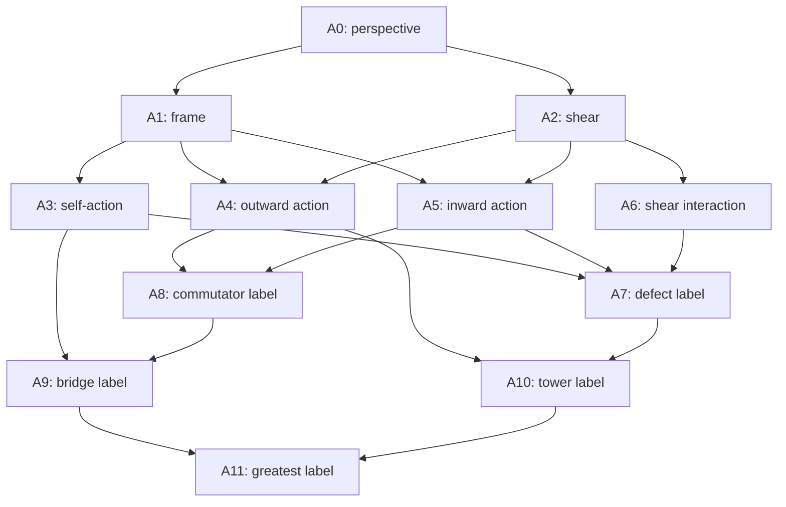

# Reductive frames, nilpotent shears, and the twelve-node causal order

## Intake and source authority

Task: epistemically compile `Pasted text(20261127-161124).txt` into native
Lean 4 / Mathlib. The original intake is preserved in
`docs/intake/20261127_reductive_shear.txt`. The implementation starts from
upstream `main` at `fe24e350b08fdea04f74c0748ef9fd9417c47529`.
The unchanged pins are Lean `v4.34.1` and Mathlib
`d13f23b723b8a846827a245b89c10fc7d3f11612`.
The intake SHA-256 is
`893ad55177d609d9460a3cc4bebef491af1103ab1a462b6c22aa7d380ea61355`.

The twelve labels specify a finite dependency diagram. Its edges are input
data, not proved implications between the philosophical, analytic, or physical
interpretations attached to those labels. Algebraic theorems below use a
separate associative-ring carrier. No multiplication, subtraction, exponential,
semidirect product, or operator interpretation is silently assigned to a poset
node.

## Extracted labels and their mathematical boundary

The following correspondence records the supplied vocabulary. Only the finite
order is assigned to `Node`; the last column identifies the separate algebraic
content or the missing construction needed to interpret that vocabulary.

| Node | Extracted role | Mathematical content or boundary |
|---|---|---|
| A0 | Choice of perspective | Bottom of the stipulated order; no state-selection theorem |
| A1 | Reductive frame | An idempotent `p` is a separate ring element, not this label |
| A2 | Nilpotent shear | Square-zero `n` and the existing unit `1+n` are separate algebraic data |
| A3 | Frame acting on itself | Idempotence is an explicit hypothesis on `p` |
| A4 | Frame acting on shear | An upper elementary shear is a concrete model, not an identification of the node |
| A5 | Shear acting on frame | An opposite elementary shear gives ordered, noncommuting products |
| A6 | Shear interacting with shear | Two actual unipotent matrices need not commute; braid and modular interpretations require more data |
| A7 | Idempotency obstruction | The polynomial `defect x = x*x-x`; nonzero and nilpotent conclusions require hypotheses |
| A8 | Commutator | The intake names an additive commutator; the group roundtrip is computed separately. No join of A4 and A5 exists in the stipulated order |
| A9 | Covariant bridge | Join of A3 and A8 as order labels; a connection and compatibility laws are not constructed |
| A10 | Recursive tower | Join of A4 and A7 as order labels; no homotopical limit is constructed |
| A11 | Final synthesis | Unique greatest label and join of A9 and A10 |

The four additional order statements are `aporia_predecessors_isLUB`,
`bridge_predecessors_isLUB`, `tower_predecessors_isLUB`, and
`final_pair_isLUB`. Their operands are finite sets of labels. None supplies
the algebraic operation suggested by the corresponding prose.

### Exact stipulated cover diagram



An arrow here denotes an input cover, certified as `CovBy` in the constructed
order. It does not denote a proved implication between the interpretations of
its endpoints. The declaration audit separately records actual dependencies
of Lean statements and proofs.

## Ground-truth contract

| Claim | Carrier and exact target | Disposition |
|---|---|---|
| Twelve-node causal diagram | Native `PartialOrder`, nineteen exact `CovBy` pairs, transitive-closure equivalence, bottom and top | Kernel-verified finite order |
| Height proves acyclicity | Strict order implies strict increase of the displayed natural-valued height | Kernel-verified |
| A cover grading exists | Every cover raises a rank by one | Rejected stronger interpretation: saturated bottom-to-top chains have lengths four and five; the intake already acknowledges height-skipping covers |
| Primitive pair has no join | `¬ ∃ x, IsLUB {A1,A2} x` | Confirms the intake's finite-order non-lattice claim |
| Interpreting the commutator node as a join A8 | `IsLUB {A4,A5} A8` | Rejected: A8 and A10 are incomparable minimal upper bounds |
| Final synthesis | `IsLUB {A9,A10} A11`; A11 is the unique greatest node | Kernel-verified within the stipulated order |
| Nilpotent perturbation always breaks idempotency | `P²=P`, `N²=0`, `N≠0` imply `δ(P+N)≠0` | Rejected by an explicit matrix counterexample |
| Exact square-zero criterion | `δ(P+N)=0 ↔ PN+NP=N`, assuming `P²=P`, `N²=0` | Kernel-verified in every associative ring |
| Resonant nilpotent defect | Additionally `PN=NP`: `δ(P+N)=(P+P−1)N`, its square vanishes, and its vanishing is equivalent to `N=0` | Conditional theorem with explicit hypotheses |
| Unipotent shear is algebraically irreversible | `1+N`, with `N²=0`, has inverse `1−N` | Rejected by the existing native `Units` construction; no assertion about physical irreversibility |
| Opposite-shear group roundtrip | Compute `V⁻¹U⁻¹VU` with native elementary units and retain all coefficient orderings | Kernel-verified over arbitrary coefficient rings |
| Roundtrip is necessarily unipotent | For real parameters one, the loop has trace three and its difference from identity is not nilpotent | Rejected by a checked finite counterexample |
| Nilpotent perturbation has nilpotent defect | A square-zero 2×2 matrix can give `δ(P+N)=1` | Rejected by a checked finite counterexample |
| Associative commutator fails Jacobi off-shell | Native associative commutator satisfies Jacobi | Rejected without a separately defined projected/nonassociative bracket |
| No finite stage can have zero defect | Order exclusion `A7≤x → ¬x≤A3` is valid; it does not imply a claim about an operator defect | Unsupported interpretation |
| Exact finite correction | `newtonPeirceStep (P+N)=P` under `P²=P`, `N²=0`, and `PN=NP` | Conditional theorem in every associative ring; one polynomial step |
| Infinite strict ascent of these nodes | A finite partial order has no infinite strictly increasing sequence | Rejected on this carrier |
| Semidirect/homotopical recurrence | Requires typed groups, an action, connecting maps, and a stated universal property | Open construction debt |
| Logarithmic monodromy, modular flow, global holonomy | Requires a connection, transport/monodromy representation, or modular-algebra hypotheses and a compatibility map | Open construction debt |
| General nilpotent exponential is always linear | The positive results here use `N²=0` and the algebraic unit `1+N`; no analytic exponential is introduced | The intake's general `N^r=0` hypothesis does not supply a square-zero bound |
| Noncommutativity alone determines modular flow | A state, its modular data, and relevant analytic assumptions must be supplied | Open construction debt; no state is defined by the finite graph |
| Levi splittings form a unipotent torsor | A torsor needs a specified action together with freeness and transitivity | Not established by a normalization or conjugacy claim alone |
| Opposite graded pieces generate all of the reductive part | Requires a specified Lie algebra and an exact bracket-generation statement | Source-located real `sl₂` example exists; no universal equality is asserted |

## Exact algebraic synthesis

For an arbitrary associative ring, set `δ(x) = x*x-x`. With `p*p=p`,

```text
δ(p+n) = n*n + (p*n + n*p - n).
```

Consequently, under `n*n=0`, the exact idempotence condition is
`p*n+n*p=n`. If `Commute p n` is also supplied, the reflection
`s=p+p-1` satisfies `s*s=1`, and the added owner theorems establish

```text
δ(p+n) = s*n,
δ(p+n)*δ(p+n) = 0,
δ(p+n)=0 ↔ n=0.
```

The existing Newton–Peirce polynomial has the exact finite correction

```text
newtonPeirceStep (p+n) = p
```

under these same three hypotheses. This is a polynomial identity over every
associative ring; it introduces neither division nor an analytic limit.

Two complete 2×2 countermodels separate the hypotheses. For
`p=diag(1,0)` and `n=E₁₂`, the perturbation is nonzero and square-zero over
every nontrivial coefficient ring, yet `p+n` is idempotent. With the same `p`
and `n=[[1,1],[-1,-1]]`, `n*n=0` but `δ(p+n)=1`; the defect is not nilpotent
over a nontrivial coefficient ring. Both are native matrix constructions.

For actual elementary units `U=1+aE₁₂` and `V=1+bE₂₁`, the complete ordered
roundtrip over an arbitrary coefficient ring is

```text
V⁻¹ U⁻¹ V U = [[1-a*b, -(a*b*a)],
               [b*a*b, 1+b*a+b*a*b*a]].
```

It equals identity exactly when both `a*b=0` and `b*a=0`. For commutative
coefficients its determinant is one and its trace is `2+(a*b)^2`. Over the
reals, `a*b≠0` implies that the difference from identity is not nilpotent.
At `a=b=1` this is `[[0,-1],[1,3]]`. The word order is the one in the intake.

## Existing owners and reuse

- `Core.IdempotencyDefect`: the polynomial `defect x = x*x-x` and
  `defect_eq_zero_iff`.
- `Core.PeirceDefect`: exact expansion at an idempotent, tangent criterion,
  one-sided zero-defect directions, and coupled-corner defect. Add the missing
  square-zero/resonance criteria here.
- `Core.PeirceGrading`: native reflection of an idempotent and its square.
- `Core.ParabolicShearRelations.shearUnit`: actual ambient unit with inverse
  `1-x`, rather than an assumed inverse.
- `Algebra.ElementaryMatrixOperators`: `elementaryUnit`, `upperRoot`,
  `lowerRoot`, square-zero entries, inverse and additive laws. The concrete
  roundtrip consumes this owner without redefining elementary transformations.
- `Core.IdempotentGraphGrassmannian.idempotencyDefect_conj`: existing
  conjugation covariance; no duplicate generic conjugation API is needed.
- `Core.IdempotentDefectIteration`: existing Newton–Peirce polynomial
  `3*x*x-2*x*x*x` and its square-zero-defect correction theorem. Add the exact
  evaluation on a commuting square-zero perturbation to this owner.
- `OperatorAlgebra.PeirceSpine.WilsonPlaquette` and `WilsonPlaquetteCriteria`:
  existing general Peirce plaquette expansions and exact truncation criteria.
  The new elementary-matrix calculation is a finite coordinate result, not a
  replacement for this operator construction.
- `Canonical.SL2FiveGradingExample.comm_e_f` and `lie_e_f`: source-located
  real 2×2 / `sl₂` root-commutator examples. They are not duplicated and are
  outside this task's selected compilation closure. A statement about this
  specified Lie algebra is not a statement about every reductive component.
- Existing `SolveEtCoagulaPeirceAporiaPoset` and
  `QuantumContext.CanonicalArchetypeCausalPoset` have different node/edge data;
  no identification with the new input graph is asserted.

## Validation and infrastructure repair

All compiler calls were serialized using the repository build lock. The exact
selected source closure was checked on the pinned compiler, with a transitive
declaration-axiom audit and independent placeholder and semantic checks.
Candidate generation, read-only mathematical review, and independent execution
acceptance were separate roles. Superseded checks were not counted as acceptance.

The upstream isolated checker contains an incomplete `subprocess.check_output`
call in its baseline comparison. This task closes that call and makes the
baseline exclusion use the requested owner list. The latter ensures custom
owners are checked as owners while their imported dependencies must match the
selected baseline. Neither change relaxes a proof or validation condition.

### Final disposition

`[accepted_limited_scope]` — independent QA returned
`ACCEPTED_WITH_LIMITED_SCOPE` for the complete selected source closure and all
declarations owned by the four mathematical modules. The 53 added named
theorems are `[kernel_verified]` at their stated hypotheses and carriers.
The independent semantic review returned `PASS` on the accepted source.

The fresh independent check compiled 17 repository modules without incremental
reuse. Its 13 non-owner dependencies match the baseline revision byte for byte.
It audited all 173 owner declarations, including existing and generated ones:
119 theorems, 40 definitions, one inductive type, twelve constructors, and one
recursor. The actual transitive axiom union is exactly `propext`,
`Classical.choice`, and `Quot.sound`. There are no unsafe, partial, or
custom-axiom owner declarations. No audited declaration depends on an axiom
outside that whitelist.

All four owner logs and the declaration-audit diagnostic stream are free of
warnings; warnings were treated as errors for those checks. One unchanged
baseline dependency, `Core.PeirceDecomposition`, emitted an
`unnecessarySeqFocus` style warning at line 192. It was preserved and reported.

Strict refutation screening and semantic-vacuity checks passed on all four
owners with zero findings. The entire staged Lean proof gate passed. Gate 4
static review passed with its explicit `KERNEL_UNVERIFIED` label; kernel
evidence comes from the separate completed compiler run and declaration audit.

This result covers the selected 17-module source closure and all declarations
owned by the four selected mathematical modules. It is not a whole-repository
or umbrella-target build, and does not audit every declaration in imported
modules. The analytic, geometric, modular, and homotopical construction debts
listed above remain open.

### Owner coverage and checksums

| Module | Added named theorems | Audited declarations | Source SHA-256 |
|---|---:|---:|---|
| `InfoGeometry.Core.PeirceDefect` | 7 | 25 | `6bc45649031d66133af16da4bae9df84f5de74394474bfc2402515517200e9fc` |
| `InfoGeometry.Core.IdempotentDefectIteration` | 1 | 22 | `750c649cf6d87faf5dbc90903056b6de21624404428813641c692389187a89ac` |
| `InfoGeometry.Canonical.ReductiveShearCausalPoset` | 28 | 100 | `62155bcfcc0c1b90b5173932ac8d511ef455633ec96c2dadb25f61502635afb0` |
| `InfoGeometry.Algebra.ElementaryShearRoundtrip` | 17 | 26 | `102971501a82544678688cbcb0eb5c22984b1fbf29cc3bbcf30fd3d7735c511e` |

The source checksums above identify the accepted mathematical content. The
following evidence checksums record the observed run; they are not a digital
signature or a substitute for recompiling the source.

- `result.json`: `48378d903bbfbe6e3a0edd31922174afd3cc08893fbf47e20099189e8d32b2fa`
- `declaration-audit.jsonl`: `f4887572d106d0004bdbe415f17c55576ef17ed1216141c16efd84a97bfe24aa`
- `qa-acceptance.json`: `15ea436d31f4619e3e20e241a4f86ffde1cb1f81e4f16bd06230d0ab386f05f4`

### Exact independent compiler command

Run from the repository root in the recorded environment:

```bash
python tools/quality/check_operator_geometry.py \
  --repo /workspace/scratch/f884dd457982/info-geometry-lean \
  --mathlib /workspace/scratch/73cf601a9798/vpd-runtime/mathlib \
  --lean /workspace/scratch/73cf601a9798/vpd-runtime/lean-4.34.1-linux/bin/lean \
  --work-dir /workspace/scratch/f884dd457982/check-independent-final \
  --owner InfoGeometry.Core.PeirceDefect \
  --owner InfoGeometry.Core.IdempotentDefectIteration \
  --owner InfoGeometry.Canonical.ReductiveShearCausalPoset \
  --owner InfoGeometry.Algebra.ElementaryShearRoundtrip \
  --base-ref fe24e350b08fdea04f74c0748ef9fd9417c47529 \
  --owner-warnings-as-errors \
  --audit \
  --audit-source /workspace/scratch/f884dd457982/info-geometry-lean/tools/quality/ReductiveShearDeclarationAudit.lean
```

All four static commands below exited zero. Their full file arguments preserve
the measured scope; the Gate 4 invocation is explicitly static.

```bash
python tools/infra/opengauss_cli.py refute lean/InfoGeometry/Core/PeirceDefect.lean lean/InfoGeometry/Core/IdempotentDefectIteration.lean lean/InfoGeometry/Canonical/ReductiveShearCausalPoset.lean lean/InfoGeometry/Algebra/ElementaryShearRoundtrip.lean --strict --json
python tools/quality/semantic_vacuity_gate.py lean/InfoGeometry/Core/PeirceDefect.lean lean/InfoGeometry/Core/IdempotentDefectIteration.lean lean/InfoGeometry/Canonical/ReductiveShearCausalPoset.lean lean/InfoGeometry/Algebra/ElementaryShearRoundtrip.lean --fail-on warning --json-out /workspace/scratch/f884dd457982/qa-static-final/semantic-vacuity.json
python tools/quality/proof_proxy_staged_gate.py
python tools/infra/opengauss_cli.py review lean/InfoGeometry/Core/PeirceDefect.lean lean/InfoGeometry/Core/IdempotentDefectIteration.lean lean/InfoGeometry/Canonical/ReductiveShearCausalPoset.lean lean/InfoGeometry/Algebra/ElementaryShearRoundtrip.lean --gate GATE_4 --json
```

### New named theorem inventory

The blocks below use the enclosing Lean namespace indicated in each heading.

#### `InfoGeometry.Core.PeirceDefect`

```text
defect_add_square_zero_eq_zero_iff
isIdempotentElem_add_square_zero_iff
defect_add_square_zero_of_commute
defect_add_square_zero_mul_self_of_commute
defect_add_square_zero_eq_zero_iff_of_commute
tangent_square_zero_eq_zero_of_commute
add_eq_shear_conjugate_of_support
```

#### `InfoGeometry.Core.IdempotentGraphGrassmannian`

```text
newtonPeirceStep_add_commuting_square_zero
```

#### `InfoGeometry.Canonical.ReductiveShearCausalPoset`

```text
lowerIdeal_injective
le_iff_mem_lowerIdeal
card_nodes
card_coverEdges
edge_iff_covBy
transGen_edge_iff_lt
reflTransGen_edge_iff_le
card_strict_comparisons
card_comparisons
height_strictMono
height_le_five
transGen_edge_height_lt
transGen_edge_irrefl
transGen_edge_asymm
no_cover_grading
no_lub_primitives
no_lub_opposite_operations
primitive_labels_incomparable
opposite_operations_incomparable
final_branches_incomparable
aporia_predecessors_isLUB
bridge_predecessors_isLUB
tower_predecessors_isLUB
final_pair_isLUB
greatest_iff_eq_a11
no_return_below_a3
no_infinite_strict_ascent
monotone_eventually_constant
```

#### `InfoGeometry.Algebra.ElementaryShearRoundtrip`

```text
coe_roundtrip
roundtrip_eq_one_iff
opposite_elementaryUnits_not_commute
exists_noncommuting_unipotents
upperRoot_mul_lowerRoot_idempotent
projector_add_upperRoot_idempotent
upperRoot_ne_zero
upperRoot_mul_self
exists_nonzero_square_zero_preserving_idempotence
exists_square_zero_with_identity_defect
exists_square_zero_with_nonnilpotent_defect
det_roundtrip
trace_roundtrip
det_roundtrip_sub_one
exists_real_noncommuting_unipotents
roundtrip_sub_one_not_nilpotent
roundtrip_one_one
```
