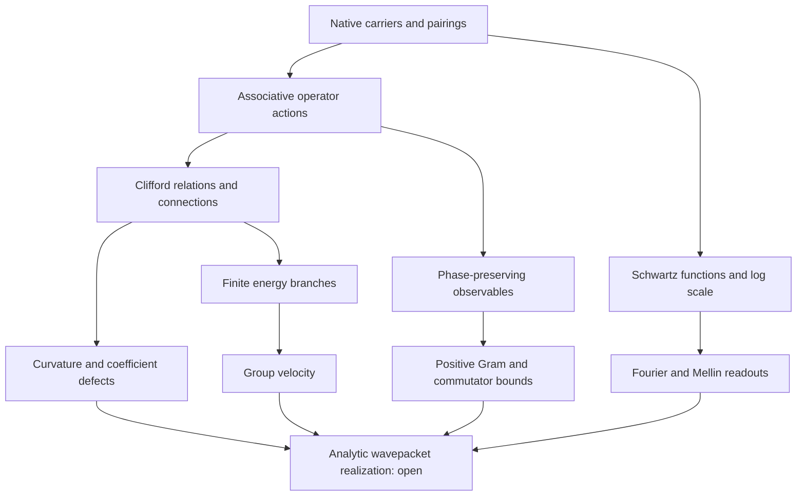

# Fourier, Dirac, phase, scale, and uncertainty: native theorem contract

## Provenance and acceptance scope

This contract compiles the [raw user intake](FOURIER_DIRAC_PHASE_SCALE_INTAKE.md)
against main `08c34e03f610b452e03422037949196dc7d92d6d`. The earlier Krein/octonion
PR369 is independent. The new modules use owners already present on main.
The environment remains Lean `v4.34.1`, Mathlib
`d13f23b723b8a846827a245b89c10fc7d3f11612`; no dependency pins change.

An owner name is navigation, not evidence of its physical interpretation.
The source inventory below distinguishes an actual construction, a theorem
under explicit hypotheses, and a supplied interface. Kernel checks of the
new source closure and source review of other owners are different scopes.

## Canonical primitives extracted from the stream

| Primitive | Native carrier or operation | Required distinction |
|---|---|---|
| Translation and its dual | Schwartz functions, Fourier characters, native Fourier transform | Position/frequency duality is linear harmonic analysis. |
| Positive scale and its dual | Positive half-line, log pullback, Mellin integral | The measure and real part of the Mellin exponent determine the Hilbert realization. |
| Potential and its dual | Convex potential, differential, Legendre transform | This is nonlinear potential duality, not the Fourier integral. |
| Clifford symbol | Native associative endomorphism algebra or Clifford algebra | Anticommutation controls the principal square; it does not supply a differential domain. |
| Connection and compatibility | `D + LinearMap.mulLeft R a`; native Leibniz maps | The commutator with a Clifford coefficient is its adjoint covariant derivative. |
| Internal phase | Real `DoubledSpace E` and `complex_i` | This is a square-minus-one isometry on a positive Hilbert carrier. |
| Fluctuation and information | Centered observable vectors, positive Gram form, SLD matrix Fisher form | A Lorentz signature tensor is not a positive covariance/Fisher form. |
| Alternative composition | Native Zorn vector matrices, regular left operators | Linear regular action is faithful; binary multiplicativity fails. |
| Rotor versus boost generator | Ordered endomorphism products, square laws, metric adjoint | Similarity preserves square laws; multiplying anticommuting generators can change them. |
| State evolution and dispersion | Finite Dirac symbol and an energy branch | A fiberwise symbol identity does not construct wavepacket propagation. |

The dependency order is mathematical, not a claim that every node is already
implemented as one functor or one universal object:

## Existing source-backed inventory

Paths below are relative to `lean/InfoGeometry/`. These are bounded source
reviews at the stated revision, not a fresh whole-repository certificate.

| Owner / declarations | Constructed or proved content | Boundary relevant to the intake |
|---|---|---|
| `Analysis/CliffordWaveletNativeL2.lean`: `integral_normSq_fourier`, `norm_fourier_toL2_eq`, `fourier_lineDeriv_eq_frequencyMultiplication` | Vector-valued Schwartz Plancherel and the derivative/frequency correspondence; integration by parts for noncommutative coefficient rings | Does not construct the requested full relativistic wavepacket evolution. |
| `Analysis/LaplaceFourierComparison.lean`: `verticalLineTransform_eq_fourier`, `bromwich_inversion_on_vertical_line`, `mellin_logPullback_eq_laplaceTransform`, `mellin_unique_on_positive_axis` | Damped Fourier/Laplace comparison, explicit inversion hypotheses, and Mellin/log-pullback readout | Its opening docstring understates the later inversion results; theorem bodies are authoritative. |
| `Analysis/MellinWaveletScaleShapeBridge.lean` | Scale/shape reconstruction from admissibility and an encode/decode inverse | Admissibility is the reconstruction left-inverse law itself; the adapter supplies another inverse law. No integral construction or Calderón condition establishes them here. |
| `Geometry/BinaryLegendreEntropyFlow.lean` | Native Bernoulli Legendre curve, metric pullback twice the scalar Fisher form, vanishing symplectic pullback and entropy relaxation | A statistical potential example, not a Fourier or Penrose transform. |
| `Dynamics/RapiditySpace.lean`: `rapidity_additive_composition`, `log_coordinate_rapidity_shift` | Rapidity addition and translations on exponential/log coordinates | Does not identify Lorentz boosts with isotropic Weyl gauge transformations. |
| `Canonical/AmariBinarySimplexBridge.lean`: `logistic_eq_half_add_tanh_half`, `logit_logistic` | Explicit logistic–tanh correspondence and inverse logit; setting the parameter to twice rapidity gives the desired probability polarization | These are real coordinate identities; they do not construct a relativistic statistical model. |
| `Canonical/RealRindlerProjectiveLogBridge.lean`: `projectiveNullRatio_rindler_boost`, `log_rindlerProjectiveNullRatio_boost`, `realProjectiveDilation_rindler` | Concrete Rindler embedding intertwines the boost with dilation of the positive null ratio and translation of its logarithm | Finite 1+1-dimensional coordinate intertwining, with positive radius; not isotropic Weyl rescaling. |
| `HodgeCohomology/HodgeDirac.lean` | Adjoint pair, nilpotency, `(d + δ)^2 = dδ + δd`, positive energy and kernel identities | Total real linear maps with explicit hypotheses; geometric differential domains are separate. |
| `HodgeCohomology/FiniteHarmonicRepresentative.lean` | Unique finite-dimensional closed and coclosed cohomology representative | Finite-dimensional Hodge result, not a global analytic elliptic theorem. |
| `HodgeCohomology/KreinHodgeDiracBounded.lean` and `HodgeCohomology/KreinHodgeObstruction.lean` | Krein adjoint factorization, signed energy, and an explicit square-zero obstruction | Positive energy/kernel conclusions need additional fundamental-symmetry compatibility. |
| `OperatorAlgebra/CliffordDirac/Defect.lean` and `OperatorAlgebra/CliffordDirac/Operators.lean` | Ordered Dirac square with mixed coefficient commutators; actual inner-derivation models | The geometric scalar-curvature term `Scal/4` is not constructed. |
| `Geometry/AssociativeGaugeConnection.lean` | Fundamental/adjoint connections, inhomogeneous gauge law, curvature covariance and Bianchi identities | Total algebraic linear maps; a spatial differential realization needs its own domain and calculus. |
| `Physics/DiracRestChiralTwoSectorBridge.lean` | Native 4-by-4 Hamiltonian square `H(p)^2 = (c²p² + m²c⁴)I` and velocity/commutator identities | A momentum-fiber matrix theorem. |
| `Physics/FourVectorDiracReadout.lean` | Both directions between algebraic mass shell and a nonzero kernel spinor | Finite symbol, not existence of PDE solutions. |
| `QuantumGeometry/Projective/QGT.lean`: `berryCurvature_skewAdjoint_commutator`, `lie_rep_uncertainty_bound` | Normalized complex-Hilbert horizontal Gram tensor, actual skew-adjoint commutator expectation and uncertainty for a supplied skew-adjoint Lie representation | An existing complex bounded-generator endpoint; it does not construct or integrate a particular representation. The new theorem targets the native real doubled carrier. |
| `Canonical/OperatorialUncertainty.lean` | Positive real doubled-carrier Bessel bound and phase-linear channel inequalities | The previous API did not identify its phase term with the actual observable commutator. |
| `Quantum/QuantumCramerRaoBound.lean`: `quantum_cramer_rao_bound` | Real finite-matrix SLD bound with `rho = Rᵀ R`, self-adjointness and explicit trace hypotheses | Genuine noncommutative matrix inequality; trace-one normalization and a differentiable density family are not constructed. No universal spacetime Fisher tensor is asserted. |
| `Physics/QuantumRetrodictionInformationGeometry.lean`: `directional_qcrb` | Directional SLD combination and directional information bound | Retains an extra trace-symmetry hypothesis. |
| `Canonical/CEBKMOnsagerGibbsNOperatorFamily.lean` | Real coefficient pullback of centered BKM covariance, positivity and double-sum aggregation | An existing n-observable covariance result; a spacetime statistical model remains separate. |
| `Algebra/ZornLeftCAR.lean` | Faithful linear regular action, square/anticommutator identities and Clifford lift | `leftMultiplication_not_multiplicative` and `gamma_operator_product_ne` prevent false octonion algebra embeddings. |
| `Algebra/ZornLeftMajorana.lean`, `Algebra/ZornLeftParity.lean`, `Algebra/ZornLeftGrading.lean` | Native positive/negative operator modes, exact parity action, common grading and anticommutation | Prescribed mode flips depend on the mode. |
| `Lie/SplitOctonionCircularOperatorReadout.lean` | `conjAlgEquiv` transporting the associative endomorphism algebra to circular coordinates | A coordinate conjugation does not change the multiplication or square law. |
| `Lie/SplitOctonionCircularHyperbolicFlowMultiplicativityBoundary.lean` | Uniform circular norm-preserving hyperbolic flow is not multiplicative when its parameter is nonzero | Norm isometry alone is insufficient for an octonion automorphism. |
| `Canonical/ZornCliffordRepresentation.lean` | Universal Clifford representation and genuine spin group action on doubled Zorn data | Sixteen-component carrier, distinct from regular action on eight components. |
| `Algebra/CliffordIdealSpinor.lean` | Native left/right ideals, corner pairing and ordered dyadic covariance | Minimality and irreducibility of these ideals are not proved by ideal closure alone. |

Several names need particular care. `Canonical/InformationalLichnerowicz`
proves a transport-Hessian identity, not the geometric spin formula.
`Clifford/HestenesDirac.DiracHestenesConservationPacket` contains current
conservation as a field. `Canonical/SplitOctonionDerivationSpinorLiftBridge`
requires a supplied spinor lift with compatibility fields.
`Physics/LorentzChiralCuntzBridge.spinLorentzAction` is `X ↦ g X g⁻¹`
on complex matrices, not the Hermitian Minkowski action `X ↦ g X g†`.
`RealChiralLorentzRepresentation` duplicates the same representation on two
sheets; this does not establish inequivalent Weyl chiralities.
The super-Poincaré presentation supplies its displayed supercharge relation
as a field. None of those interfaces by itself constructs emergent spacetime.

## New exact contracts

### 1. Covariant Clifford coefficients

Owner: `Geometry/CliffordConnectionCompatibility.lean`.

Use the existing regular module of an arbitrary associative coefficient ring
`A`, with scalar ring `R`, central compatible scalar action, and genuine
Leibniz maps `D,E : Module.End R A`. Write

\[
X=D+L_a,\quad Y=E+L_b,\quad F=D(b)-E(a)+ab-ba.
\]

The new endpoints are

\[
[X,L_g]=L_{Dg+[a,g]},\qquad
[X,L_g]=0\iff Dg+[a,g]=0,\qquad
[X,Y]=[D,E]+L_F.
\]

For `g*g = h*h = 1` and `g*h + h*g = 0`, the square of `Q=L_g X+L_h Y`
retains the base defect `L_(gh)[D,E]`, ordered curvature `L_((gh)F)`, and
all four mixed defects. Compatibility removes exactly those four terms;
commuting base derivatives remove exactly the base defect. Curvature remains.
The file does not assume that all coefficients commute or that the connection
is flat. Its two Clifford directions have square `+1`; it does not silently
specialize a Lorentzian metric or assert geometric scalar curvature.

### 2. Native internal phase and observable uncertainty

Owners: `Krein/InternalPhaseGram.lean`,
`Krein/PhaseLinearObservableCommutator.lean`,
`Canonical/PhaseObservableUncertainty.lean`.

The carrier is `DoubledSpace E = WithLp 2 (E × E)` with its positive real
Hilbert pairing. The existing phase operator is `I = complex_i`.
Let `A,B : DoubledEnd E` be Hilbert-self-adjoint and commute with `I`.
For arbitrary real shifts `a,b`, let

\[
u=A\psi-a\psi,\qquad v=B\psi-b\psi.
\]

The ordered operator identity at the state is

\[
2\langle Iu,v\rangle=\langle I\psi,(AB-BA)\psi\rangle.
\]

The native Bessel argument then gives

\[
\langle u,v\rangle^2+
\frac14\langle I\psi,[A,B]\psi\rangle^2
\le \|u\|^2\|v\|^2.
\]

Dropping the covariance square gives Robertson's bound. This is not obtained
by assuming a Cramér–Rao inequality, a canonical commutator, or mutual
commutativity of the observables. No normalization is required for this
homogeneous arbitrary-shift inequality. With `⟪ψ,ψ⟫ = 1` and the actual mean,
a separate theorem identifies the centered squared norm with
`⟪ψ,A²ψ⟫ - ⟪ψ,Aψ⟫²`.

For arbitrary finite coefficient families the core also proves

\[
[\sum_i r_i A_i,\sum_j s_j B_j]
=\sum_{i,j}r_i s_j[A_i,B_j].
\]

This is the native index-mixing law for the ordered commutator tensor. It does
not assert that a choice of four observables is a spacetime four-vector.

The Bessel proof is extracted from `Canonical/OperatorialUncertainty` into
`Krein/InternalPhaseGram`, and the old theorem names and attributes are kept
as forwards. There is one Bessel argument. The low route avoids the old
195-owner canonical closure and its external `Architect` import.

A source-level nonvacuity witness is provided by real Pauli matrices
`diag(1,-1)` and `[[0,1],[1,0]]`, each lifted diagonally to `E ⊕ E` with
`E=ℝ²`. They commute with `I` while not commuting with one another. At
`ψ=(e₁,e₂)/sqrt(2)`, their means vanish, both variances are one, and the
phase commutator expectation is two. This explains a nonzero saturating case;
it is not represented as a separately kernel-checked example theorem here.

### 3. What a common split-octonion grading can and cannot do

Owner: `Algebra/ZornCommonFlipBoundary.lean`.

For the existing native three-mode families `A_i=leftMajoranaPlus(e_i)`
and `B_i=leftMajoranaMinus(e_i)`, the file proves

\[
TA_i=B_i\iff T=B_iA_i.
\]

The real operators `B_i A_i` are different for distinct modes, as witnessed
by their actual action on the native upper basis vector `U_i`. Thus one `T`
cannot perform all three prescribed flips. Independently, the existing
common grading `G=L_(diag(1,-1))` satisfies

\[
(GA_i)^2=-1.
\]

Both statements are needed: new negative-square composite operators exist,
but they are not all the prescribed `B_i`. The proof uses operator composition
throughout. It does not reassociate octonion products, claim a unique
basis-independent fourth structure, or confuse multiplication with similarity.

### 4. Finite Dirac velocity and the actual derivative of energy

Owner: `Physics/DiracGroupVelocityBridge.lean`.

This uses the existing full `4 × 4` complex matrix Hamiltonian, velocity
observable, energy involution, and projectors. For either nonzero `E` with
`E² = c²p² + m²c⁴`, it derives

\[
P_+(c\alpha_1)P_+=\frac{c^2p}{E}P_+,\qquad
P_-(c\alpha_1)P_-=-\frac{c^2p}{E}P_-.
\]

The projectors are the native energy-sign projectors. They are not identified
with a separately chosen chirality. The proof uses the zero diagonal corners
of the owned trembling residual, with matrix order preserved.

For `E_+(p)=sqrt(c²p²+m²c⁴)` and a strictly positive radicand at `p`, genuine
`HasDerivAt` theorems compute

\[
E_+'(p)=\frac{c^2p}{E_+(p)},\qquad
(-E_+)'(p)=-\frac{c^2p}{E_+(p)}.
\]

The final theorem identifies each compressed velocity with the corresponding
`deriv` expression. The gap condition avoids the zero-energy crossing; no
differentiability claim is made at a massless cusp. This is a momentum-fiber
algebra/calculus result, not a construction of Fourier evolution or a
wavepacket spreading estimate.

## Transform and physical interpretation boundaries

With the convention `Ff(ξ)=∫exp(-2π i ξu)f(u)du`, positive scale `x=exp(u)`
turns a Haar-measure Mellin transform into a Fourier transform in `u`:

\[
\int_0^\infty f(x)x^{-2\pi i\xi}\,\frac{dx}{x}
=\int_{\mathbb R}f(e^u)e^{-2\pi i\xi u}\,du.
\]

For the native convention `mellin f s = ∫x^(s-1)f(x)dx`, this is the line
`Re(s)=0`. The unitary log pullback from `L²(dx)` instead includes
`exp(u/2)` and therefore uses `Re(s)=1/2`. The measure and normalization
must be part of any proposed implementation. With the displayed positive-log
pullback the parameter is `s = σ - 2π i ξ`. The existing whole-line Laplace
comparison instead uses `t = exp(-u)` and `g(-log t)`, so its Fourier readout
has `s = σ + 2π i ξ` and damping `exp(-σu)`.

A Lorentz boost in null coordinates has opposite weights
`x⁺ ↦ exp(r)x⁺`, `x⁻ ↦ exp(-r)x⁻` (up to active/passive convention).
It is not an isotropic Weyl rescaling. Explicit maps already exist in the
Rindler and binary-simplex owners:

\[
\operatorname{logistic}(2r)=\frac{1+\tanh r}{2},\qquad
q(A(r)x)=e^{2r}q(x),\qquad
\log q(A(r)x)=\log q(x)+2r.
\]

Here the second and third statements use the positive Rindler null ratio.
The source also separates the symmetric log coordinate `log(radius)` from
the antisymmetric coordinate `time`. These concrete compatibilities relate
the selected coordinates; they do not identify all their geometric actions. Translation and dilation are
not generally commuting actions; a complete nonabelian group decomposition
cannot be supplied just by scalar characters.

Legendre duality concerns convex potentials and their gradients. Penrose
transforms require the relevant incidence correspondence, cohomology and
field-equation construction. Neither follows from an existing Fourier or
Mellin integral identity.

The positive Hodge identity concerns `d+δ` and its Laplacian. A spin Dirac
square on a curved metric connection requires the extra geometric data of a
Weitzenböck/Lichnerowicz theorem. A Lorentzian wave operator is hyperbolic;
calling Dirac its square root does not mean the positive spectral square
root of a nonnegative Hilbert operator.

For finite observable families, covariance and commutator forms transform
by coefficient congruence. Positivity of covariance is retained under any
real index change. It does not identify that covariance with the indefinite
Minkowski metric. A spacetime Cramér–Rao theorem needs a statistical model,
its derivative and measure, and a positive Fisher form. Unbounded position,
momentum, time or differential operators additionally need a constructed
common domain; the bounded operator theorems here do not provide it.

## Search and validation record

The requested declaration-DAG search was attempted read-only. Local DAG
indexes were absent and the configured Arango endpoint
`http://127.0.0.1:8530` refused the connection. No index refresh or database
mutation was used. Navigation therefore used exact owner/import/declaration
searches and bounded consumer reviews. The diagram above is a dependency
explanation, not a freshly certified global declaration DAG.

The new owners have independent source reviews. Source review found correct
commutator orientations, explicit compatibility conditions, and nonvacuous
noncommutative models. The first pinned CI kernel run compiled the connection
bridge and the extracted Gram owner. It reported elaboration errors in the
Zorn coordinate calculation, phase-operator notation and finite-sum expansion,
and scalar derivative imports; the uncertainty consumer was consequently
blocked. Those proof scripts have been repaired without weakening their
statements. A fresh complete focused kernel run, native axiom collection and
source gates are pending at this checkpoint.

The CI checkout now fetches the exact public revision without traversing
unrelated, incompletely configured external submodules. The verification
helper and existing gates are unchanged. The local root pre-push check is
also queued behind the repository's shared build lock.

The existing canonical forwarding owner's full import closure still reaches
`Architect`; success of the small new closure will not certify that larger
owner or the root Lake package. Final command results must be recorded here
before claiming a checked implementation.
