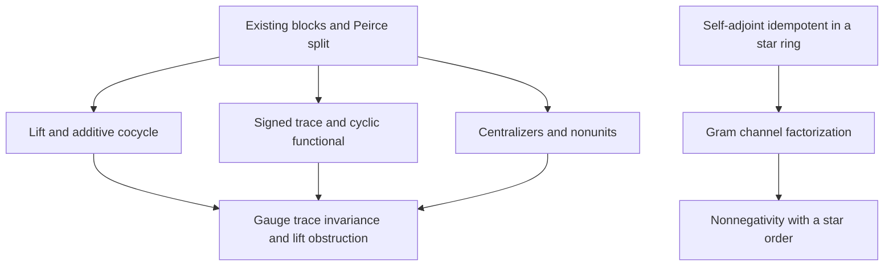

# Freed-inspired graded operator algebra: theorem contract

## Source and carrier

Source date: 2026-11-12. The intake is the user's mathematical proposal
`FreedGeometricIndexAndAnomalies`, preserved with its original claims and
proposed Lean proofs in [the intake record](FREED_GRADED_OPERATOR_INTAKE.md).
Only transport escaping and indentation entities are normalized there. The
underlying Dan Freed transcript was not supplied; this work does not certify
the proposal's historical attributions.

Implementation base: upstream `main`,
`a392af178af1fe2bcba2ba39eb405700c6ee103c`.

The coefficient carrier is an arbitrary unital associative ring `A`. The
matrix carrier is Mathlib's `Matrix (Fin 2) (Fin 2) A`, with ordered matrix
multiplication. Only the outer block index has size two: `A` need not be
commutative or finite-dimensional. The ring-level cut and polynomial results
also hold directly in any ambient ring `B`. Star statements add `StarRing`;
ordered positivity adds `PartialOrder` and `StarOrderedRing` on the ambient
ring. No scalar, diagonal-coefficient, or coefficient-commutation restriction
is used to obtain the unconditional results.

Native entry point:

```lean
import InfoGeometry.Canonical.FreedOperatorAlgebra
```

`InfoGeometry.Canonical.All` imports that entry point. Compilation of the
focused source closure is distinct from compilation of the full umbrella.

## Existing owners reused

| Owner | Reused interface | Change or role |
|---|---|---|
| `InfoGeometry.Algebra.SupermatrixKoszul` | `evenBlock`, `oddBlock`, `parityBlock`, four ordered multiplication formulas | Weaken four unnecessary `CommSemiring` hypotheses to `Semiring`; preserve all formulas and names. |
| `InfoGeometry.OperatorAlgebra.PeirceSpine.Basic` | `comm`, `anticomm`, `evenGrade`, `oddGrade` | Reuse the existing arbitrary-ring vocabulary and projections. |
| `InfoGeometry.OperatorAlgebra.PeirceSpine.GradedTraceMoments` | `cyclic_product_positive_power` | Derive signed-trace cancellation of every positive even power of an odd block. |
| `InfoGeometry.OperatorAlgebra.FiniteMatrixNoncommutativeWitness` | `matrix_units_noncommute_of_nontrivial` | Explicit imported witness for the full `M₂(A)` carrier, used by the staged proof-integrity gate. |
| Native Mathlib matrix/trace/star APIs | `Matrix.trace`, conjugate transpose, `Commute`, `IsUnit`, `Units`, monoid homomorphisms | Use native carriers and structures throughout. |
| `Mathlib.Algebra.Order.Star.Basic` | `StarOrderedRing`, `mul_star_self_nonneg` | Derive actual channel nonnegativity from the proved Gram factorization. |

The bounded source search also inspected
`Canonical.ChernSimonsTransgressionKernel` and
`Canonical.GradedConnectionBianchiBridge`, which have genuine exterior
differentials and degree hypotheses. The new universal cubic identity does
not replace either owner or claim an unproved identification with them.

## Claim ledger

### 1. Odd lift, additive cocycle, and gauge covariance

Owner: `InfoGeometry.Algebra.FreedAdditiveCocycle`.

With `x=(a,b)` and `y=(c,d)`, define

\[
W(a,b)=1+\operatorname{oddBlock}(a,b),\qquad
C(x,y)=\operatorname{evenBlock}(ad,bc).
\]

The implementation proves the ordered product formula, normalization,
biadditivity, and the additive group 2-cocycle law

\[
C(x,y)+C(x+y,z)=C(x,y+z)+C(y,z).
\]

This is a cocycle for the additive group `A × A` with trivial action on the
additive matrix group. It is not presented as a Hochschild cocycle: no algebra
bimodule Hochschild differential is constructed by that equation.

`operatorLift_mul_sub_defect` proves cancellation of one specified product
defect. It does not assert a global trivialization. Indeed,
`productDefect_not_additive_coboundary` proves, under `Nontrivial A`, that
there is no function `f : A × A → Matrix (Fin 2) (Fin 2) A` satisfying

\[
C(x,y)=f(x)+f(y)-f(x+y)\quad\text{for all }x,y.
\]

The proof uses symmetry of every such coboundary and the unequal values
`C((1,0),(0,1))=evenBlock 1 0` and
`C((0,1),(1,0))=evenBlock 0 1`. Thus the source's global Green--Schwarz
cancellation interpretation cannot be concluded from its subtraction
identity. This negative theorem concerns this specific additive cocycle,
not Green--Schwarz mechanisms in other mathematical models.

`diagonalGaugeHom` constructs the native homomorphism

\[
A^\times\times A^\times\longrightarrow M_2(A)^\times,
\qquad (u,v)\longmapsto\operatorname{diag}(u,v).
\]

Its conjugation acts on parameters as
`(a,b) ↦ (u*a*v⁻¹, v*b*u⁻¹)` and intertwines both `W` and `C`.
The balanced specialization `v=u⁻¹` recovers the source's formulas, preserving
the order of every coefficient. It is a pointwise conjugation identity; the
assignment `u ↦ diag(u,u⁻¹)` is not asserted to be a group homomorphism for
noncommuting units. No Mellin transform, renormalization flow, or 't Hooft
anomaly-matching theorem is constructed.

The canonical synthesis also proves `operatorLift_one_one_not_isUnit`, so
the entire lift family cannot be regarded as a representation by invertible
operators over a nontrivial coefficient ring.

### 2. Coefficient-valued signed trace and cyclic cancellation

Owner: `InfoGeometry.OperatorAlgebra.FreedGradedCalculus`.

`superTrace` is an additive map taking `M` to `M 0 0 - M 1 1`, and is proved
equal to `Matrix.trace (parityBlock * M)`. Equal additive diagonal shifts
cancel; their ordinary trace contribution is `delta + delta`.

The exact obstruction to graded cyclicity is retained:

\[
\operatorname{Str}\{\operatorname{oddBlock}(b,c),
\operatorname{oddBlock}(e,f)\}=[b,f]+[e,c].
\]

In particular, universal vanishing for elementary opposite odd blocks is
proved equivalent to commutativity of every pair of coefficients. This
prevents a raw `A`-valued diagonal difference from silently acquiring the
cyclic properties of an ordinary scalar trace.

For an additive map `tau : A →+ G`, with `G` an additive commutative group,
and explicit cyclicity `tau(a*b)=tau(b*a)`, the implementation proves
vanishing on even commutators and odd anticommutators, as well as

\[
\tau\!\left(\operatorname{Str}
\big(\operatorname{oddBlock}(b,c)^{2(k+1)}\big)\right)=0
\quad(k\in\mathbb N).
\]

The positive-power result reuses the existing cyclic moment theorem; it
does not assume `b*c=c*b`. The canonical synthesis proves invariance of
`tau ∘ superTrace` under the two-unit diagonal gauge on arbitrary matrices.

No kernel, cokernel, Fredholm family, determinant bundle, or analytic index
is defined by the common-shift identity. Those geometric interpretations
remain outside this theorem contract.

### 3. Block squares and the universal cubic identity

Owner: `InfoGeometry.OperatorAlgebra.FreedGradedCalculus`.

The even and odd Peirce projections of `(evenBlock a d + oddBlock b c)^2`
are computed with all ordered mixed products intact. Associativity gives
`[X,X*X]=0` in an arbitrary ring.

The source's cubic formula is retained exactly as
`cubic_curvature_identity`:

\[
\{D,\Phi D+D\Phi+D^3\}-[[D,\Phi],D]+2\Phi^2
=2(\Phi+D^2)^2.
\]

No parity, differential, trace, or commutation hypothesis is needed for
this polynomial identity. A separate corollary eliminates the remainder
under the explicitly stated `Commute D Phi` assumption.

A Quillen superconnection has odd total degree in a graded algebra involving
exterior forms; internal matrix parity alone does not supply the exterior
differential or its Koszul multiplication. The source's ordinary matrix
square is therefore not promoted to a differential-geometric superconnection
or Chern--Simons transgression theorem.

### 4. Full centralizers and genuine nonunit obstructions

Owner: `InfoGeometry.OperatorAlgebra.FreedDefectChannels`.

The implementation proves full characterizations, rather than only selected
commuting examples:

\[
[P_+,H]=0\iff H_{01}=0\ \land\ H_{10}=0,
\]

\[
[\Sigma,H]=0\iff H_{00}=H_{11}\ \land\ H_{01}=H_{10}.
\]

Here `P₊=evenBlock 1 0` and `Σ=oddBlock 1 1`. The same swap centralizer is
proved for `1+Σ` and `1-Σ`. Their mutual annihilation and scaled-idempotence
laws hold over any ring; all four nonunit conclusions for the two Peirce
projectors and the two Walsh elements include `Nontrivial A`.

If `(2 : A)=0`, the Walsh elements coincide and their square vanishes. They
are not described as normalized projectors. No categorical fusion structure,
topological-defect realization, or Kramers--Wannier duality is inferred from
these ring relations.

### 5. Cut composition, Gram factorization, and actual positivity

Owner: `InfoGeometry.OperatorAlgebra.FreedDefectChannels`.

For any ring element `p`, distributivity alone gives

\[
XpY+X(1-p)Y=XY.
\]

For a self-adjoint idempotent in any star ring, the stronger channel theorem is

\[
ZpZ^*=(Zp)(Zp)^*,
\qquad
ZZ^*=(Zp)(Zp)^*+(Z(1-p))(Z(1-p))^*.
\]

These specialize to the two matrix Peirce channels, using conjugate transpose
as the matrix star. Self-adjointness is proved separately.

The theorem `cut_channel_nonneg` additionally assumes `PartialOrder B` and
`StarOrderedRing B`, and concludes `0 ≤ Z*p*star Z`. The order is on the
ambient operator ring: an order on matrix entries is not substituted for an
operator-positive order. A bare star ring has no positivity assertion.
No bordism category, field-theory functor, or reflection-positive state
space is constructed by this channel factorization.

## Dependency order

The cocycle is not a logical predecessor of the trace or cut definitions.
The shared block/Peirce infrastructure supports independent branches; the
canonical entry point combines their proved consequences.



The universal cubic identity is independent of this branching: it uses only
associative ring operations. The matrix channel theorems instantiate the
generic Gram theorem using the already proved Peirce projector relations.

## Verification and limits

The dependency pins are unchanged: Lean `4.34.1` and Mathlib
`d13f23b723b8a846827a245b89c10fc7d3f11612`.

The maintained source-closure checker is invoked with all five target owners:

```bash
python3 tools/quality/check_clifford_dirac.py \
  --mathlib-root /path/to/pinned/mathlib \
  --output /path/to/freed-report \
  --target InfoGeometry.Algebra.SupermatrixKoszul \
  --target InfoGeometry.Algebra.FreedAdditiveCocycle \
  --target InfoGeometry.OperatorAlgebra.FreedGradedCalculus \
  --target InfoGeometry.OperatorAlgebra.FreedDefectChannels \
  --target InfoGeometry.Canonical.FreedOperatorAlgebra
```

It verifies exact source hashes, compiles the full repository import closure
from copied source, and traverses the axiom dependencies of every declaration
owned by each selected target. The only permitted foundational axioms are
`propext`, `Classical.choice`, and `Quot.sound`. The dedicated CI workflow also
requires zero compiler warnings in the five target owners and strict
placeholder checks. The semantic scanner reports its heuristic warnings and
fails on error-severity findings; the stricter warning-threshold run and
individual review of its findings are retained in the verification record.

The independent acceptance result and exact coverage are recorded in
[the verification report](verification/FREED_GRADED_OPERATOR_VERIFICATION.md).
The report distinguishes focused kernel acceptance, imported warnings,
static scans, and the root integration gate. A successful focused check
does not certify all historical repository files or the full canonical
umbrella.

## Primary mathematical references

These references clarify the scope of the named geometric theories; they are
not substitutes for Lean proofs of the algebraic theorems above.

- J.-M. Bismut, *Localization Formulas, Superconnections, and the Index Theorem
  for Families*, Commun. Math. Phys. 103 (1986), 127–166, especially §3(a),
  pp. 151–152: [author-hosted paper](https://www.imo.universite-paris-saclay.fr/~jean-michel.bismut/Bismut/1986b.pdf).
- D. S. Freed and M. J. Hopkins, *Reflection positivity and invertible
  topological phases*: [arXiv:1604.06527](https://arxiv.org/abs/1604.06527).
