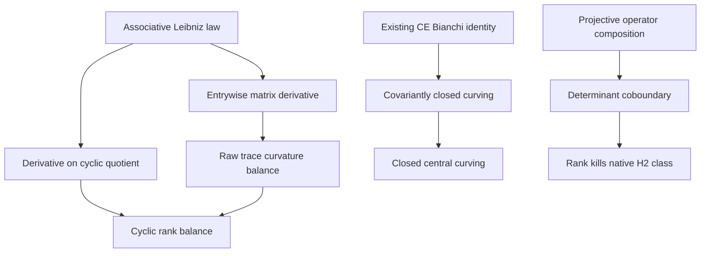

# Projective rank torsion and noncommutative curvature

## Intake and scope

This change rewrites the submitted `CordovaFreedTelemanTorsionAnomalies` stream
on top of the current owner modules. The full input is preserved in
[`handover/injections/gapped-torsion-anomalies-20261112.txt`](../handover/injections/gapped-torsion-anomalies-20261112.txt).
Only CRLF line endings were normalized to LF. The original 26,273-byte upload
has SHA256 `229ddfc36901481c73785140b8df4f92057bd3eb840ca197f15146fd89eb383c`;
the tracked 25,865-byte text has SHA256
`40e7d0313745891c73d167621a174b5e4b40672b32a190ef830fa2edd933ab99`.

The motivating source is Córdova, Freed, and Teleman,
[Gapped theories have torsion anomalies, arXiv:2408.15148v1](https://arxiv.org/html/2408.15148v1).
The paper proves special cases using field theories evaluated in families.
Its flat-gerbe and finite-rank twisted-bundle argument uses global geometric
and integral cohomological data. The local algebra below does not construct
those objects. The rank theorem here instead concerns an actual native
group-cohomology class of a finite-dimensional projective representation.

## Exact theorem contracts

| Owner added | Reused carrier and operations | New implication |
|---|---|---|
| `Cocycle/TransitionDefect` | Arbitrary native group, `MulAut.conj` | Ordered transition defects satisfy the conjugated tetrahedral identity and transform by conjugation under frame changes |
| `Geometry/TwistedCurvatureTransport` | `AssociativeGaugeConnection` curvature and affine gauge potential over a noncommutative ring | Corrected curvature is gauge covariant; central shifts add their derivative curl, which is subtracted from the curving |
| `Algebra/CyclicMatrixDifferential` | Native `LinearMap.mapMatrix`, `Matrix.trace`, existing `CyclicMatrixCurvature` quotient | Leibniz lifts entrywise; derivatives descend to the linear commutator quotient; raw and cyclic rank-balance identities retain their exact scopes |
| `Canonical/ProjectiveRankTorsion` | Existing `ProjectiveRepresentation`, native `groupCohomology.H2` | The inverse determinant cochain trivializes the rank power of the scalar multiplier; the rank annihilates its cohomology class |
| `OperatorAlgebra/CentralCurvingBianchi` | Existing native Chevalley–Eilenberg forms and proved operator Bianchi identity | `F + B = 0` implies covariant closedness of `B`; commutation with the connection values implies ordinary CE closedness |
| `Canonical/PolynomialCurvingObstruction` | Native endomorphisms of the whole polynomial module | Differentiation and multiplication by `X` have commutator `1`; the central curving `-1` cancels curvature but has no nonzero natural annihilator in characteristic zero |
| `Algebra/OrthogonalCommutatorExample` | Actual `Matrix (Fin 4) (Fin 4) ℤ` products, transpose, determinant and `orderOf` | The submitted commutator has exact order four and is noncentral; a second determinant-one orthogonal pair has commutator order three |

The coefficient ring remains noncommutative in the differential and matrix
results. The projective representation theorem uses a scalar field `K`, but
its linear automorphisms need not commute. No arbitrary-ring determinant or
cohomology group is substituted for those explicit structures.

## Determinant and native cohomology

The existing convention is

\[
P(gh)=\alpha(g,h)P(g)P(h).
\]

Writing `r = Module.finrank K V`, determinant multiplicativity gives

\[
\det P(gh)=\alpha(g,h)^r\det P(g)\det P(h).
\]

For the trivial action on `Kˣ`, set `c(g) = (det P(g))⁻¹`. Then

\[
\delta c(g,h)=c(h)c(gh)^{-1}c(g)=\alpha(g,h)^r.
\]

`multiplier_pow_finrank_isMulCoboundary₂` supplies that explicit cochain.
`finrank_nsmul_multiplierClass_eq_zero` transfers it through the existing
native `H2π`, and `multiplierClass_addOrderOf_dvd_finrank` proves divisibility.
The finite-order corollary requires positive rank. Rank zero gives only
`0 • [α] = 0`. The result does not assert that each multiplier value is itself
an `r`th root of unity.

## Raw trace, cyclic quotient, and central curving

For arbitrary noncommutative coefficients the raw trace identity is

\[
\operatorname{tr}F=D\operatorname{tr}Y-E\operatorname{tr}X+
\operatorname{tr}(XY-YX).
\]

The commutator term is removed only in the existing linear quotient by the
span of commutators. It is a module quotient, not a quotient ring. The law
`D[a,b] = [Da,b] + [a,Db]` supplies the kernel condition for native
`Submodule.liftQ`; descent is proved rather than assumed. Corrected flatness
then produces the corresponding rank-balance equality in that quotient.
Neither equality by itself constructs an integral cohomology class or proves
torsion in the original coefficient algebra.

For the CE forms, the derivation Lie directions may be nonabelian. The actual
Bianchi theorem and additivity give `DΓ B = 0` from `FΓ + B = 0`. The ordinary
derivative additionally contains the connection–curving commutators.
`central_curving_closed_of_twisted_flat` removes them under the stated
relative centrality hypothesis.

## Counterexamples and rejected interpretations

On `Module.End K (Polynomial K)`, `[∂, L_X] = 1` is proved as an equality of
operators acting on every polynomial. For zero coefficient derivatives this
is curvature `1`; the central curving `-1` cancels it. In characteristic zero,
evaluation at the constant polynomial `1` proves `n • (-1) ≠ 0` whenever
`n ≠ 0`. Yet the cyclic class of `1` and of `-1` vanishes. This explicitly
blocks the proposed inference from local corrected flatness or cyclic
vanishing to coefficient-valued torsion. It is consistent with the separate
finite-dimensional projective representation theorem.

The signed-transposition example shows that even the exact order of a
finite orthogonal matrix commutator need not divide the matrix dimension.
A noncentral group-valued transition defect is not an ordinary scalar
projective multiplier. No theorem here identifies operator order with a
physical spectral gap or asserts symmetry-enforced gaplessness.

## Proven dependency order

The group transition calculation is an independent branch. No theorem turns
an arbitrary transition assignment into a global gerbe connection.

## Verification and publication

The dedicated `projective-rank-curvature.yml` workflow reads the repository's
exact Lean/Mathlib pins, compiles the complete repository source closure for
the seven targets, audits every owned declaration's axioms, and binds its
report to source hashes. It also runs the placeholder, OpenGauss and semantic
screens with explicit scope checks. Dependencies and toolchain are unchanged.

The PR records the newly observed local outcomes. Historical compile claims
and the lost original commits are not used as verification of this rewrite.
The repository-wide Lake gate is reported separately from the target closure.
