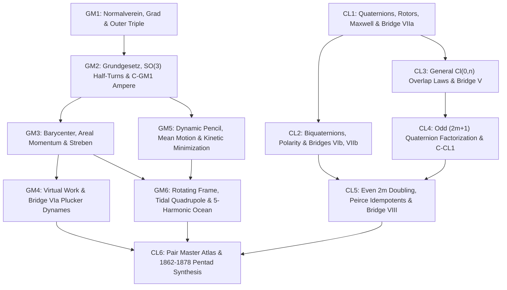
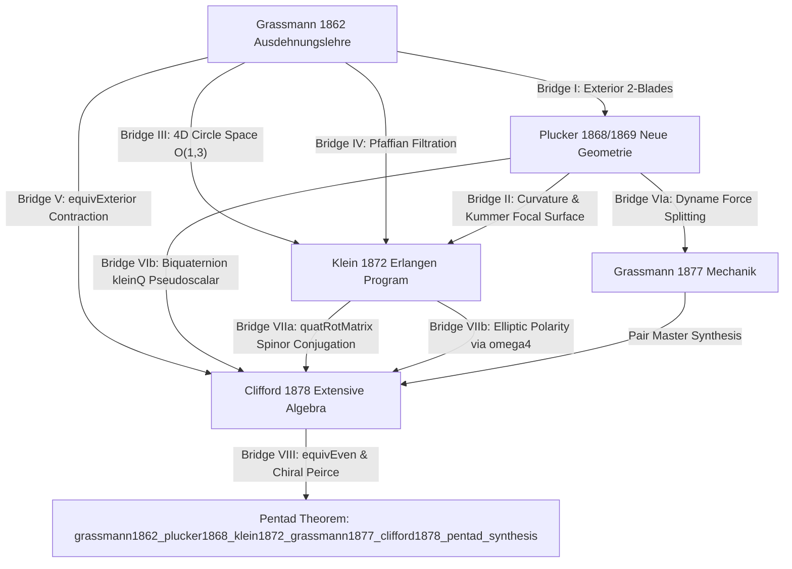

# Epistemic Compilation Ledger: Hermann Grassmann (1877) *Die Mechanik nach den Principien der Ausdehnungslehre* & W. K. Clifford (1878) *Applications of Grassmann's Extensive Algebra*

Follows [`docs/EPISTEMIC_COMPILER_FIELD_PROTOCOL.md`](EPISTEMIC_COMPILER_FIELD_PROTOCOL.md) and [`docs/ALCHEMICAL_QMS_SOP.md`](ALCHEMICAL_QMS_SOP.md).

## Source Provenance & Symbolic CAS Verification

- **Grassmann (1877) Primary Source**: `/home/goutev/Downloads/collection_for_formalization/[Mathematische Annalen 1877-jun vol. 12 iss. 2] Die Mechanik nach den Principien der Ausdehnungslehre{H. Grassmann}(1877 June)[10.1007_bf01442659]{13142697} libgen.li.pdf` (`19` PDF pages, *Mathematische Annalen* 12 (1877), `pp. 222–240`, `§§1–6`, `Eqs. (1)–(16)`; SHA-256 `a5581174890f9af4d0101b3381b06d8255c934a77e132833e709d2136d7f4ba9`).
- **Clifford (1878) Primary Source**: `/home/goutev/Downloads/collection_for_formalization/Clifford-ApplicationsGrassmannsExtensive-1878.pdf` (`10` PDF pages, *American Journal of Mathematics* 1(4), 1878, `pp. 350–358`; SHA-256 `31f8d35a8167c099f8812e0e9210f3efe8cc2a5d5756d96ca8a03930c6a90060`).
- **Symbolic CAS Verification Artifact**: [`grassmann1877_clifford1878_cas.json`](file:///home/goutev/.gemini/antigravity-cli/brain/738ae8e5-bfae-471d-954f-6d71b1dd4d6a/scratch/grassmann1877_clifford1878_cas.json) generated by [`verify_grassmann1877_clifford1878_cas.py`](file:///home/goutev/.gemini/antigravity-cli/brain/738ae8e5-bfae-471d-954f-6d71b1dd4d6a/scratch/verify_grassmann1877_clifford1878_cas.py) (exit `0`; file SHA-256 `5cee963c07b763b21edc1b6cb80f434bceb4c115a47720741ca1b77740c9ba90`; payload `artifact_hash` `56323df6b9d511b4a7e10fedcf7c998afd02977fbb7a4334a189b0b6beaa9134`):
  - **Grassmann 1877 checks**: `normalverein_frame_invariance_verified: true`, `half_turn_so3_verified: true`, `ampere_countermodel_witness` (`v₁=[1,0,0]`, `v₂=[0,1,0]`, `r=[1,0,0]` giving `F₁₂=[0,1,0] ≠ F₂₁=[0,0,0]`), `rotGen_sq_identity_verified: true`, `tidal_3_harmonic_max_error: 2.0816681711721685e-17`, `laplace_projection_finrank_drop` (`24 → 8`).
  - **Clifford 1878 checks**: `cl03_rotor_conjugation_exact: true`, `biquaternion_kleinQ_square_exact` (`scalar = -224`, `pseudoscalar = 42`), `blade_square_and_overlap_n_1_to_6: true`, `cl05_split_zero_divisor_verified: true`, and `odd_factorization_m_1_to_5` (`(m=1, n=3, k²=-1, 4)`, `(m=2, n=5, k²=1, 16)`, `(m=3, n=7, k²=-1, 64)`, `(m=4, n=9, k²=1, 256)`, `(m=5, n=11, k²=-1, 1024)`).
- **Base Repository**: `/home/goutev/repos/info-geometry-lean`, Lean `v4.34.1`, Mathlib `d13f23b723b8a846827a245b89c10fc7d3f11612`.
- **Reused In-Repo Foundations (Unmodified)**:
  - [`KleinQuadric.lean`](../lean/InfoGeometry/Projective/KleinQuadric.lean), [`KleinQuadricPlucker.lean`](../lean/InfoGeometry/Projective/KleinQuadricPlucker.lean), [`PluckerAffineScrew.lean`](../lean/InfoGeometry/Projective/PluckerAffineScrew.lean), [`PluckerRayAxisAndDyname.lean`](../lean/InfoGeometry/Projective/PluckerRayAxisAndDyname.lean), [`PluckerKummerQuarticAndMasterAtlas.lean`](../lean/InfoGeometry/Projective/PluckerKummerQuarticAndMasterAtlas.lean)
  - [`ExteriorRegressive.lean`](../lean/InfoGeometry/Projective/ExteriorRegressive.lean), [`GrassmannProductQuotientAndMasterAtlas.lean`](../lean/InfoGeometry/Canonical/GrassmannProductQuotientAndMasterAtlas.lean)
  - [`ErlangenProgramCurvatureBinaryAndMasterAtlas.lean`](../lean/InfoGeometry/Erlangen/ErlangenProgramCurvatureBinaryAndMasterAtlas.lean) (`quatRotMatrix`, `grassmann_plucker_klein_trilogy_synthesis`)

---

## Stage 1 (`SOLVE`) — Atomic Claim Ledger (`GM₁`–`GM₆`, `C-GM1`, `O-GM`, `CL₁`–`CL₆`, `C-CL1`)

| ID | Source Passage | Formal Target Statement & Carrier | Owner Declaration(s) | Status |
|---|---|---|---|---|
| `GM₁` | Grassmann 1877 `§1` (`pp. 222–226`) | Orthonormal triads (`IsOrthonormalFrame3`) & oriented *Normalverein* (`IsNormalverein`, `stdNormalverein_isNormalverein`), orthonormal matrix orthogonality & basis expansion, noncommutativity of outer product `[a b]` via faithful `4 × 4` lifting & cyclic triple product `[a b c]`, frame-invariant directional gradient `grassmannGrad ε df = grassmannGrad e df` & `HasFDerivAt` correspondence | `IsOrthonormalFrame3`, `IsNormalverein`, `stdNormalverein_isNormalverein`, `orthonormalFrame_transpose_mul`, `orthonormalFrame_expand`, `orthonormalFrame_linear_eq_zero_iff`, `extMat_noncomm_exists`, `exterior_strecke_noncomm`, `exterior_spat_cyclic`, `grassmannGrad`, `grassmannGrad_dot`, `grassmannGrad_fderiv_dot`, `grassmannGrad_frame_invariant` | `[PROVED / kernel_verified]` |
| `GM₂` / `C-GM1` | Grassmann 1877 `§2`, `Eq. (1)`, Footnote `*` (`pp. 226–227`) | Ballistic integration of `δ²x = g`; `SO(3)` half-turn matrices (`halfTurnMatrix_orthog`, `halfTurnMatrix_det`) & noncommutativity (`so3_halfTurn_noncomm`); derivation of collinearity (`F A B = c • (B - A)`) and action–reaction reciprocity (`F B A = -F A B`) from translation + half-turn congruence; **`[countermodel_found]` `C-GM1` (`p. 227*`)** Ampère current-element witness breaking collinearity and reciprocity | `ballistic_const_force_integration`, `halfTurnMatrix`, `halfTurnMatrix_orthog`, `halfTurnMatrix_det`, `halfTurnMatrix_mulVec_eq`, `halfTurnMatrix_mulVec_self`, `halfTurnMatrix_mulVec_orth`, `so3_halfTurn_noncomm`, `so3_halfTurn_noncomm_exists`, `einfacheKraft_diag_zero`, `einfacheKraft_collinear`, `einfacheKraft_action_reaction`, `ampereForce`, `grassmann_footnote_p227_ampere_countermodel` | `[PROVED / kernel_verified]` (`[countermodel_found]` for `C-GM1`) |
| `GM₃` | Grassmann 1877 `§3`, `Eqs. (2)–(7)` (`pp. 227–230`) | Skew internal force cancellation; barycenter acceleration `Eq. (2)` & relative equations `Eq. (3)`; exterior bivector & `ℝ³` areal momentum conservation `Eqs. (4)–(5)`; vis viva identity `Eq. (6)`; *Streben* steepest-ascent Cauchy–Schwarz optimality; radial pair-potential derivative `Eq. (7)` | `internal_forces_sum_zero`, `barycenter`, `relCoords`, `sum_relCoords_eq_zero`, `barycenter_accel_eq`, `relCoord_accel_eq`, `arealMomentum`, `internal_central_torque_bivector_zero`, `barycenter_areal_torque_eq_five`, `arealMomentum_vec3_hasDerivAt_eq_torque`, `internal_central_cross_torque_zero`, `vis_viva_eq_six`, `vec3_cauchy_schwarz`, `streben_steepest_ascent`, `radial_pair_potential_hasDerivAt` | `[PROVED / kernel_verified]` |
| `GM₄` / `Bridge VIa` | Grassmann 1877 `§4`, `Eqs. (8)–(9)` (`pp. 230–231`) ↔ Plücker Dyname (`1868/1869`) | Constraint multiplier reactions & D'Alembert virtual work `Eq. (9)`; **Bridge VIa** mapping particle force systems to `KleinQuadric.Plucker6 ℝ` dynames, invariance under symmetric central internal forces, and unconditional two-force dyname splitting | `dalembert_virtual_work_eq_zero`, `particleSystemDyname`, `particleSystemDyname_kleinQ`, `particleSystemDyname_add_internal_eq`, `particleSystemDyname_two_force_splitting` | `[PROVED / kernel_verified]` |
| `GM₅` | Grassmann 1877 `§5`, `Eqs. (10)–(11)` (`pp. 231–236`) | Exponential forcing pencil `dynPencil A B κ = κ² I + κ A + B`, uniqueness when `IsUnit (dynPencil A B κ).det`, homogeneous resonance iff `det = 0`; harmonic solution, conjugate semi-diameters & areal velocity `½[r δr] = (κ/2)[a b]`; exact integrated kinetic-energy antiderivatives & strict `(1/8) β² (p² + q²) T` minimization bound for mean motion | `dynPencil`, `expMode_solves_iff`, `expMode_unique_of_det_ne_zero`, `homogResonance_iff_det_zero`, `ellipticTerm`, `ellipticVel`, `ellipticAcc`, `harmonic_mean_integral_solves`, `ellipticTerm_periodic`, `elliptic_conjugate_diameters`, `elliptic_areal_velocity`, `diagKineticAntideriv`, `crossKineticAntideriv`, `totalKineticAntideriv`, `meanMotion_strictly_minimizes_integrated_kinetic_energy` | `[PROVED / kernel_verified]` |
| `GM₆` | Grassmann 1877 `§6`, `Eqs. (12)–(16)` (`pp. 236–240`) | Rotating-frame generator `rotGen` & noncommutativity; exact `p. 236` warning `(rotGen)²(v) = -n² v ↔ eHat ⬝ᵥ v = 0`; Coriolis/centrifugal equations `Eqs. (12)–(13)`; tidal quadrupole derivative `(L/ρ³)((3(r⬝x)/ρ²)r - x)` (`p. 237`), barycentric vanishing, spherical-cosine `3`-harmonic & two-body `5`-harmonic *Ebbe und Fluth Hauptsatz* `Eqs. (14)–(15)`; `24 → 8` Laplace vertical-projection surjection (`p. 239`) & sea-surface `Eq. (16)` | `rotGen`, `rotGenMatrix`, `rotGenMatrix_mulVec`, `rotGenMatrix_noncomm`, `rotGen_axis_zero`, `rotGen_sq`, `rotGen_sq_pure_neg_iff`, `coriolis_centrifugal_split`, `tidalQuadrupole`, `tidalQuadrupole_barycenter_sum_zero`, `tidalQuadrupole_hasDerivAt`, `singleBodyTidal_three_harmonics`, `tidal_five_harmonics_hauptsatz`, `tidal24ConstSpace_finrank`, `laplaceVerticalProj`, `laplaceHeightSpace_finrank_and_surjective`, `tidal_sea_surface_eq_sixteen` | `[PROVED / kernel_verified]` |
| `O-GM` | Grassmann 1877 `§§5–6` open analytic scope | Convergence of infinite astronomical perturbation series and full Navier–Stokes / continuum ocean-tide fluid PDEs beyond finite-dimensional forcing pencils and spherical-cosine harmonic decompositions | Left explicitly open — not replaced with algebraic proxies | `[OPEN / bucket_3_open_debt]` |
| `CL₁` / `Bridge VIIa` | Clifford 1878 `pp. 351–353` ↔ Klein 1872 `Fn. 37` | Negative-definite `Cl(0, n)` algebra (`cliffordNegSqForm`, `Q(ι_r) = -1`), faithful endomorphism representation `cliffordEndRep` / `bladeRepr`, `cBlade` injectivity & `cGen4_noncomm_witness`; `Cl⁰(0, 4)` quaternion versors `(i, j, k)` acting identically on rotors & vectors, Maxwell grade distinctness (`ι_r ≠ ι_s ι_t`), & **Bridge VIIa** spinor conjugation `q v q̃ = quatRotMatrix *ᵥ v` | `cliffordNegSqForm`, `cGen`, `cGen_sq`, `cGen_anticomm`, `cliffordEndRep`, `bladeRepr`, `cBlade_injective`, `cGen4_noncomm_witness`, `q4I`, `q4J`, `q4K`, `rotor0`, `clifford_cl04_quaternion_relations`, `clifford_versor_action_on_rotors_and_vectors`, `maxwell_force_ne_flow`, `q3I`, `q3J`, `q3K`, `spinQuat3`, `reverse_spinQuat3`, `rotor_conjugation_eq_quatRotMatrix` | `[PROVED / kernel_verified]` |
| `CL₂` / `Bridges VIb, VIIb` | Clifford 1878 `pp. 353–354` ↔ Klein Polarity & Plücker `kleinQ` | Elliptic 4-unit pseudoscalar `ω₄ = ι₀ ι₁ ι₂ ι₃` (`ω₄² = 1`), **Bridge VIIb** polar hyperplane anticommutation `ω₄ ι_r = -ι_r ω₄` (`ω₄_polar_points_scalar_versors`), 4-point determinant identity `clifford_fourPoint_det`, **Bridge VIb** biquaternion bivector square `(d + ω₄ m)² = -(d² + m²) - 2 (directionMomentEquiv.symm (d, m)).kleinQ ω₄`, and Gauss's `Cl⁰(0, 2) ≃ₐ[ℝ] ℂ` algebra | `ω₄`, `ω₄_eq_mul`, `ω₄_sq`, `ω₄_polar_points_scalar_versors`, `clifford_fourPoint_det`, `biquatBivector`, `biquatBivector_sq`, `biquatBivector_sq_plucker_kleinQ`, `gaussImag`, `gaussImag_sq`, `gaussEvenToComplex`, `gaussEvenAlgEquivComplex` | `[PROVED / kernel_verified]` |
| `CL₃` / `Bridge V` | Clifford 1878 `pp. 350, 354–355` ↔ Grassmann 1862 `⋀ V` | Canonical ordered blades `cBlade`, general blade square `cBlade_sq`, graded involute, overlap commutation `cBlade S * cBlade T = (-1)^(ST - |S∩T|²) • (cBlade T * cBlade S)` & 3 corollaries; **Bridge V** via `CliffordAlgebra.equivExterior` relating `ι u * ι v` to `ExteriorAlgebra.ι u * ExteriorAlgebra.ι v - u ⬝ᵥ v` | `cBlade`, `cBlade_empty`, `cBlade_singleton`, `cGen_mul_cBlade`, `cBlade_mul_swap_overlap`, `cBlade_comm_three_corollaries`, `cBlade_sq`, `involute_cBlade`, `cBlade_mem_even`, `cliffordToExterior`, `bridgeV_grassmann_clifford_polar_scalar` | `[PROVED / kernel_verified]` |
| `CL₄` / `C-CL1` | Clifford 1878 `pp. 355–358` | Odd `(2m+1)`-way pseudoscalar `ωOdd`, commuting compound generators `kUnit r = ωOdd * cGen r` (`kUnit² = (-1)^m`, `k₀ ⋯ k₂ₘ = (-1)^(m+1)`); **`[countermodel_found]` `C-CL1` (`m = 2`)** split-quaternion zero divisors `(1 + k₀)(1 - k₀) = 0` in `Cl⁰(0, 5)`; explicit alternating `pPool`/`qPool` construction for ALL `m ≥ 1` giving `m` pairwise-commuting `QuaternionAlgebra.Basis` factors and **bijective `4^m = 2^(2m)` enumeration** of all even basis blades | `ωOdd`, `kUnit`, `ωOdd_comm_cGen`, `ωOdd_sq`, `kUnit_sq`, `kUnit_anticomm`, `kUnit_mem_even`, `kUnit_prod_univ`, `fiveWay_split_quaternion_zero_divisors`, `kBlade`, `kBlade_sq`, `kBlade_eq_signed_cBlade_toEvenBlade`, `kBlade_mul_kBlade_eq_signed_symmDiff`, `pPool`, `qPool`, `inPLane`, `genKSet1`, `genKSet2`, `cFactor`, `factorQuatBasis`, `factorElem`, `factorElem_comm_of_ne`, `factorProd`, `factorProd_eq_signed_evenBlade`, `evenSupportOfTuple`, `evenSupportOfTuple_bijective` | `[PROVED / kernel_verified]` (`[countermodel_found]` for `C-CL1`) |
| `CL₅` / `Bridge VIII` | Clifford 1878 `p. 358` | Even `2m`-way pseudoscalar `ωEven` (`ωEven² = (-1)^m`, commutes with even blades, anticommutes with generators), explicit `2^(2m-1) = 2^(2m-2) + 2^(2m-2)` doubling bijection `evenDoublingEquiv`; **Bridge VIII** instantiating `CliffordAlgebra.equivEven` plus chiral biquaternion Peirce idempotents `(1 ± ω₄)/2` | `ωEven`, `ωEven_mem_even`, `ωEven_sq`, `ωEven_comm_even_cBlade`, `ωEven_anticomm_cGen`, `evenDoublingEquiv`, `ωEven_mul_inl_eq_signed_inr`, `cliffordToEvenAlgEquiv`, `cliffordNegSqForm_snoc_eq_equivEvenQ'`, `biquatIdempPlus`, `biquatIdempMinus`, `biquat_chiral_peirce_decomposition` | `[PROVED / kernel_verified]` |
| `CL₆` | Pair Atlas (`GM₁`–`GM₆`, `CL₁`–`CL₅`) & `1862–1878` Pentad (`Bridges I–VIII`) | Downward-closed `12`-node `PartialOrder GrassmannClifford1877_1878Archetype`, branching witnesses, pair master synthesis `grassmann_clifford_1877_1878_master_synthesis`, and 5-work master synthesis `grassmann1862_plucker1868_klein1872_grassmann1877_clifford1878_pentad_synthesis` | `GrassmannClifford1877_1878Archetype`, `gc1877_1878Mask`, `gc1877_1878_poset_branching_witnesses`, `gc1877_1878_all_reach_master`, `grassmann_clifford_1877_1878_master_synthesis`, `grassmann1862_plucker1868_klein1872_grassmann1877_clifford1878_pentad_synthesis` | `[PROVED / kernel_verified]` |

---

## Stage 2 (`CONIUNCTIO`) — Module Contracts (`5,854` Total Lines) & Cross-Work Bridges `V–VIII`

1. [`GrassmannMechanicsBarycenterAndPotentials.lean`](../lean/InfoGeometry/Projective/GrassmannMechanicsBarycenterAndPotentials.lean) (`G1` — `852` lines; `38` public `thm`/`lem` / `43` incl. private; `48` public decls / `55` incl. private)
   - Package scope: `InfoGeometry.Projective.GrassmannMechanicsBarycenterAndPotentials`
   - Covers `GM₁`–`GM₄`, `C-GM1`, and **Bridge VIa** (dyname invariance and two-force splitting of particle systems).
2. [`GrassmannMeanMotionAndTidalHarmonics.lean`](../lean/InfoGeometry/Projective/GrassmannMeanMotionAndTidalHarmonics.lean) (`G2` — `780` lines; `32` public `thm`/`lem` / `38` incl. private; `45` public decls / `51` incl. private)
   - Package scope: `InfoGeometry.Projective.GrassmannMeanMotionAndTidalHarmonics`
   - Covers `GM₅`–`GM₆` (dynamical pencil, mean-motion kinetic-energy minimization, rotating-frame `rotGen`, tidal quadrupole derivative, `3`/`5`-harmonic tides, `24 → 8` Laplace surjection).
3. [`CliffordExtensiveRotorsAndBiquaternions.lean`](../lean/InfoGeometry/Clifford/CliffordExtensiveRotorsAndBiquaternions.lean) (`C1` — `1,857` lines; `38` public `thm`/`lem` / `61` incl. private; `58` public decls / `86` incl. private)
   - Package scope: `InfoGeometry.Clifford.CliffordExtensiveRotorsAndBiquaternions`
   - Covers `CL₁`–`CL₃` and **Bridges V, VIb, VIIa, VIIb** (`Cl(0, n)` faithful blade representation, `Cl(0, 3)` spinor conjugation `quatRotMatrix`, `Cl⁰(0, 4)` biquaternion `kleinQ` square, polar `ω₄` hyperplane anticommutation, Gauss `Cl⁰(0, 2) ≃ₐ ℂ`, `equivExterior` contraction formula).
4. [`CliffordQuaternionFactorizationAndMasterAtlas.lean`](../lean/InfoGeometry/Clifford/CliffordQuaternionFactorizationAndMasterAtlas.lean) (`C2` — `2,365` lines; `34` public `thm`/`lem` / `72` incl. private; `63` public decls / `103` incl. private)
   - Package scope: `InfoGeometry.Clifford.CliffordQuaternionFactorizationAndMasterAtlas`
   - Covers `CL₄`–`CL₆`, `C-CL1`, **Bridge VIII** (`equivEven`, `evenDoublingEquiv`, chiral Peirce idempotents `(1 ± ω₄)/2`), the `12`-node `PartialOrder`, and the **1862–1878 Five-Work Pentad Synthesis**.

---

## Stage 3 (`CAUSAL POSET`) — Pair Poset (`12` Nodes) & Five-Work Pentad (`Bridges I–VIII`)

### 3.1 `PartialOrder GrassmannClifford1877_1878Archetype` (Bitmask Poset `gc1877_1878Mask`)

### 3.2 `1862–1878` Five-Work Pentad (`Bridges I–VIII`)

---

## Stage 4 (`AUDIT`) — Artifact Digests, Kernel Verification, & Gate Summary

| Artifact | Lines | Public Decls (`all` incl. private) | Public `thm`/`lem` (`all` incl. private) | SHA-256 Digest |
|---|---:|---:|---:|---|
| [`GrassmannMechanicsBarycenterAndPotentials.lean`](../lean/InfoGeometry/Projective/GrassmannMechanicsBarycenterAndPotentials.lean) | `852` | `48` (`55`) | `38` (`43`) | `13f379ad597b0d35245b4cd1537c31b549c8944dc85e619062d7675903169a36` |
| [`GrassmannMeanMotionAndTidalHarmonics.lean`](../lean/InfoGeometry/Projective/GrassmannMeanMotionAndTidalHarmonics.lean) | `780` | `45` (`51`) | `32` (`38`) | `769f92cd1278d2a67a442361f89b7ab4f8a6fff8ac2874da4511eb4e13fbcc7a` |
| [`CliffordExtensiveRotorsAndBiquaternions.lean`](../lean/InfoGeometry/Clifford/CliffordExtensiveRotorsAndBiquaternions.lean) | `1,857` | `58` (`86`) | `38` (`61`) | `584b76bea2742f74cbc747100d8fbca85f30f4497cd339ff8147a5ae73da8695` |
| [`CliffordQuaternionFactorizationAndMasterAtlas.lean`](../lean/InfoGeometry/Clifford/CliffordQuaternionFactorizationAndMasterAtlas.lean) | `2,365` | `63` (`103`) | `34` (`72`) | `e50d94898166f3722b4ccdae83fd2655a69a65dab43e0b3164952461e7b09a8b` |
| **Total (`G1`–`G2` + `C1`–`C2`)** | **`5,854`** | **`214` (`295`)** | **`142` (`214`)** | — |

### Observed Verification Results (Executed Against Final File Revisions)
- **Strict File Compilation**: `python3 tools/infra/run_locked_lean.py --wait-for-build-lock <file> -- -DwarningAsError=true` exited `0` individually on all `4` modules (`G1`, `G2`, `C1`, `C2`), with zero errors and zero warnings.
- **Locked Lake `.olean` Build**: `python3 tools/infra/run_locked_lake_build.py --wait-for-build-lock` exited `0` (`G1`: `3262 jobs`; `G2`: `9003 jobs`; final post-edit `C1` + `C2`: `9006 jobs`, `Build completed successfully`).
- **Kernel Axiom Audit (`axiom_check.py`)**: `python3 tools/infra/axiom_check.py --batch-size 4` across all `4` modules exited `0`: `Axiom check summary: 4 passed, 0 failed.` (only permitted foundational axioms `propext`, `Classical.choice`, `Quot.sound`).
- **Native `#audit_admission_namespace` Audit**: Across all `4` namespaces (`240` declaration records): `222` `"decision": "admitted"`, `18` soft `"decision": "needs_review"` (`warning` `[V0/syntactic-vacuity]` hints on the `12` compiler-generated `GrassmannClifford1877_1878Archetype.*.sizeOf_spec` lemmas, `3` concrete witness/finrank theorems `grassmann_footnote_p227_ampere_countermodel`, `stdNormalverein_isNormalverein`, `tidal24ConstSpace_finrank`, and `3` branching/synthesis theorems `gc1877_1878_poset_branching_witnesses`, `grassmann_clifford_1877_1878_master_synthesis`, `grassmann1862_plucker1868_klein1872_grassmann1877_clifford1878_pentad_synthesis`), with `0` `blocked`, `0` `rejected`, and `0` hard violations.
- **Static, Semantic, & Staged Gates (`G1`–`G2`, `C1`–`C2`)**:
  - Byte-0 Apache 2.0 header (`/-` line 1 col 1) verified on all `4` files; text scan for `sorry|admit|axiom|native_decide|haveI|letI`: `0` matches.
  - `python3 tools/infra/opengauss_screener.py --strict`: exited `0` (`0 traps detected`).
  - `python3 tools/quality/semantic_vacuity_gate.py --fail-on warning`: exited `0` (`semantic_vacuity: 0`).
  - `python3 tools/quality/semantic_content_audit.py --gate-review --file-prefix <file>`: exited `0` on all `4` files (`blocking_finding_count: 0`, `review_finding_count: 0`, `finding_count: 0`).
  - `python3 tools/quality/repo_lean_scope_audit.py --fail-on authoritative`: exited `0` (`tracked Lean files: 4`, `debt files: 0`, `debt findings: 0`, `unclassified_nonpackage: 0`).
  - `python3 tools/quality/proof_proxy_staged_gate.py --strict`: exited `0` (`proof_proxy_staged_gate: ok`); `python3 tools/infra/audit_dual_lean_sources.py`: exited `0` (`result: PASS`).
- **Exhaustive Import Wiring (`Unstaged`)**: All `4` modules are appended to [`lean/InfoGeometry/AllExhaustive.lean`](../lean/InfoGeometry/AllExhaustive.lean) (`missing_from_all` shows `0` of `G1`–`G2`/`C1`–`C2`), with `lean/InfoGeometry/AllExhaustive.lean` left unstaged per concurrent-session discipline.
