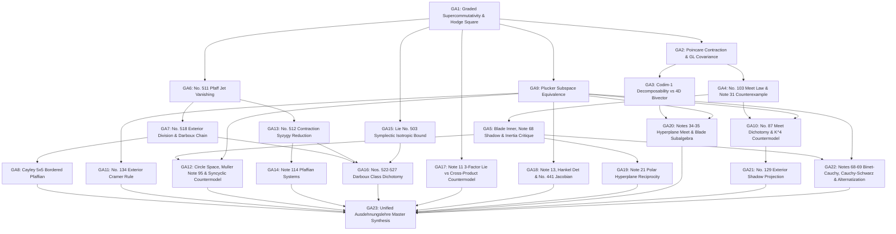

# Epistemic Compilation Ledger: Hermann Grassmann's *Extension Theory* (1862) — Frontmatter, Editorial Notes, Pfaffian Endmatter, & Supplementary Notes

Follows [`docs/EPISTEMIC_COMPILER_FIELD_PROTOCOL.md`](EPISTEMIC_COMPILER_FIELD_PROTOCOL.md) and [`docs/ALCHEMICAL_QMS_SOP.md`](ALCHEMICAL_QMS_SOP.md).

## Source Provenance & 106-Page Coverage Map

- **Primary Source**: `/home/goutev/Downloads/collection_for_formalization/hmath019-endmatter.pdf` (106 PDF pages) — Frontmatter and Endmatter of Hermann Grassmann, *Extension Theory* (*Die Ausdehnungslehre*, 1862), translated by Lloyd C. Kannenberg, AMS/LMS *History of Mathematics* Vol. 19 (2000).
- **Full Endmatter/Frontmatter Structural Coverage**:
  - **Frontmatter (`pp. i–xviii`)**: Contents, Translator's Note (`pp. xi–xiv`), and Grassmann's 1861 Foreword (`pp. xv–xviii`) motivating coordinate-free multilinear/exterior calculus, extensive quantities, and combinatorial products -> contextualized into `GA₁`, `GA₁₇`, `GA₁₈`, `GA₂₂`.
  - **Index of Technical Terms (`pp. 319–326`)**: Standardized English–German Grassmannian terminology (`Ausdehnungsgrösse`, `äußeres/inneres/eingewandtes Produkt`, `Ergänzung`, `Quotient`, `Hauptgebiet`) mapped across `GA₁`–`GA₂₂` and `EXT`.
  - **Friedrich Engel & Hermann Grassmann Jr., *Editorial Notes* 1–126 (`pp. 327–378`)**: Linear product classifications (`Note 11`), determinant/quotient identities (`Note 13`), codimension-1 vs. 4D bivector decomposability (`Notes 19, 89`), polar hyperplane supplement (`Note 21`), Poincaré/regressive contraction & common-factor countermodel (`Notes 20–24, 29, 31, 33–35`), exterior shadow projections (`Notes 39–42`), Cramer's rule (`Note 45`), Euclidean & indefinite metric / shadow reciprocity / Binet–Cauchy / open expressions (`Notes 14–16, 47–74, 68–69, 93–94, 105`), Lorentzian circle space & syncyclic countermodel (`Notes 95–97`), Sophus Lie's auxiliary symplectic problem (`Note 110`), multilinear alternatization (`Note 111`), and Pfaffian systems (`Note 114`). Pure analytic Frobenius/Darboux local PDE chart integration (`Note 110, p. 373`) is quarantined explicitly as `O-EXT`.
  - **"Grassmann's investigations into Pfaff's problem" (`pp. 378–389`, Engel's exposition & Grassmann Nos. 502–527)**: Pfaff jet vanishing (`No. 511`), contraction syzygies (`No. 512`), Cayley bordered Pfaffian (`Eq. (15), p. 382`), exterior division & finite Darboux termination (`Nos. 516–519`), and odd/even Darboux normal-form class dichotomy (`Nos. 522–527`). Smooth-manifold ODE/PDE characteristic integration and simultaneous Pfaffian singular loci `pf_{0,\hat{\mu}} = 0` (`footnote *, p. 383`) remain explicit `O-EXT`.
  - **George B. Seligman, *Supplementary Notes* Chs. 1–12 (`pp. 391–398`) & Subject Index (`pp. 399–411`)**: Modern Bourbaki/Chevalley multilinear synthesis covering alternating maps (`Nos. 63, 70`), subspace meets (`No. 87`), exterior projections (`Nos. 127–130`), exterior Cramer (`No. 134`), Poincare/contracting duality (`Ch. 3`), indefinite quadratic Sylvester inertia critique (`No. 391(c), p. 397`), functional Jacobian determinant (`No. 441, p. 398`), and differential alternatization (`No. 505, p. 398`), while differential-manifold Darboux integration (`Ch. 11, p. 398`) stays `O-EXT`.
- **Base Repository**: `/home/goutev/repos/info-geometry-lean`, `HEAD = abd5826b3676fab6231c66b646ec1cc5aeed6732`, Lean `v4.34.1`, Mathlib `d13f23b723b8a846827a245b89c10fc7d3f11612`.
- **Frozen In-Repo Owners Reused Without Modification**:
  - [`ExteriorRegressive.lean`](../lean/InfoGeometry/Projective/ExteriorRegressive.lean) (`complementEquiv`, `shuffleSign`, `orientationUnit`, `volume`, `hodge`, `regressive`, `basis_mul_compl`, `hodge_regressive`)
  - [`ExteriorBladeIncidence.lean`](../lean/InfoGeometry/Projective/ExteriorBladeIncidence.lean) (`ιMulti_ne_zero_of_linearIndependent`, `ιMulti_eq_zero_iff`, `bladeSupport`, `bladeSupport_ιMulti`)
  - [`MajoranaPfaffian4.lean`](../lean/InfoGeometry/Canonical/MajoranaPfaffian4.lean) (`skewMatrix4`, `pfaffian4`, `skewMatrix4_pfaffian_sq_eq_det`)
  - [`ExteriorOperatorGeometry.lean`](../lean/InfoGeometry/OperatorAlgebra/ExteriorOperatorGeometry.lean), [`GrassmannCayley.lean`](../lean/InfoGeometry/OperatorAlgebra/GrassmannCayley.lean), [`ElementaryMatrixOperators.lean`](../lean/InfoGeometry/Algebra/ElementaryMatrixOperators.lean)

---

## Stage 1 (`SOLVE`) — Complete Atomic Claim Ledger (`GA₁`–`GA₂₃`, `EXT`, `O-EXT`)

| ID | Source Passage (`hmath019-endmatter.pdf`) | Formal Target Statement & Carrier | Owner Declaration | Status |
|---|---|---|---|---|
| `GA₁` | `No. 92` & Notes `20–24` (`pp. 335–336`), plus open follow-up flagged in `ExteriorRegressive.lean` ll. 20–21 | Graded supercommutativity `x ∈ ⋀[R]^p M, y ∈ ⋀[R]^q M → x * y = (-1)^(p*q) • (y * x)`; centrality of `Ω ∈ ⋀[R]^2 M` (`exteriorPower_two_mul_comm`); complement unit sign `orientationUnit s * orientationUnit sᶜ = (-1)^(|s|(n-|s|))`; homogeneous double Hodge `hodge b (hodge b x) = (-1)^(k(n-k)) • x` | `ι_mul_exteriorPower_comm`, `exteriorPower_mul_comm`, `exteriorPower_two_mul_comm`, `hodge_hodge_exteriorPower`, `hodge_symm_exteriorPower`, `hodge_mem_exteriorPower`, `hodge_symm_mem_exteriorPower`, `exteriorPower_eq_zero_of_gt` | `[PROVED / kernel_verified]` |
| `GA₂` | Note `29` (`pp. 337–339`), Seligman `Ch. 3` (`pp. 393–395`) | Basis-free opposite-algebra contraction `dualContractionAlgHom : Λ(V^*) →ₐ (End(Λ V))ᵐᵒᵖ`; exact Poincaré–Hodge match `poincareEval b (b.dualBasis.ExteriorAlgebra s) = hodge b (b.ExteriorAlgebra s)`; `regressive b x y = poincareEquiv b ((poincareEquiv b).symm x * (poincareEquiv b).symm y)`; `volume b' = (b.det b') • volume b`; exact `GL(V)` covariance `(b.det b') • regressive b' x y = regressive b x y` and `SL(V)` invariance | `dualContractionAlgHom_mul`, `poincareEval_dualBasis`, `dualTransferEquiv_mul`, `poincareEval_comp_dualTransferEquiv`, `hodge_hodge_symm_mul_eq_regressive`, `regressive_eq_poincareEquiv`, `volume_change_basis`, `poincareEval_change_basis`, `det_smul_regressive_change_basis`, `regressive_eq_of_det_eq_one` | `[PROVED / kernel_verified]` |
| `GA₃` | Note `19` (`p. 335`), Note `89` (`p. 363`) | Universal codimension-1 decomposability (`2 ≤ n`, `ω ∈ ⋀[K]^(n-1) V → ∃ w, ιMulti K (n-1) w = ω` via `LinearMap.ker d`) contrasted against 4D compound bivector `ι(b 0)*ι(b 1) + ι(b 2)*ι(b 3)` (`bladeSupport = ⊥`, non-decomposable over every field `K`) | `codim_one_decomposable`, `compound_bivector_fin4_not_decomposable` | `[PROVED / kernel_verified]` (`[countermodel_found]` for global bivector decomposability in dim `≥ 4`) |
| `GA₄` | `No. 103` & Notes `29, 31` (`pp. 337–342`) | Graded contraction Leibniz rule `contractLeft d (U * z) = contractLeft d U * z + (-1)^m • (U * contractLeft d z)`; right-basis duality `hodge b (Z * ι (b i)) = contractLeft (b.dualBasis i) (hodge b Z)`; unconditional common-factor meet law `regressive b (A * B) (A * C) = A * regressive b (A * B) C`; Grassmann `No. 103` (`α + β + γ = n`); plus **refutation** of `[AC · BC] = [C · ABC]` via Engel's `K^5` countermodel (`A = e₀∧e₁, B = e₀∧e₂, C = e₃∧e₄`) | `contractLeft_mul_of_mem_exteriorPower`, `hodge_mul_ι_basis`, `regressive_ι_basis_mul_ι_basis`, `note31_valid_left_common_factor`, `regressive_compl_degree`, `grassmann_no103_blade`, `note31_counterexample_dim5` | `[PROVED / kernel_verified]` (`[countermodel_found]` for Note 31 formula 3) |
| `GA₅` | Notes `47–74`, Note `68` (`pp. 357–358`), Note `105` (`pp. 371–372`), Notes `93–94` & Seligman `p. 397` (`No. 391(c)`) | Orthonormal exterior pairing `extInner b`; Hodge isometry; universal wedge/regressive adjointness; homogeneous normal-shadow reciprocity; open-expression polarization iff symmetry (`CharZero K`); plus Seligman's `p. 397` Sylvester-inertia countermodel on `ℝ²` (`Q₂(x) = x₀² - x₁²`, `sigPos = 1, sigNeg = 1`, `θ = π/4` isotropic basis) | `extInner_basis`, `extInner_eq_sum_repr`, `extInner_symm`, `extInner_hodge_isometry`, `extInner_mul_hodge_right`, `volCoord_mul_hodge_hodge`, `extInner_regressive_hodge_left`, `note68_normal_shadow_reciprocity`, `note68_homogeneous_reciprocity`, `freeOpenPair_eq_self_iff_isSymm`, `indefiniteForm2_toQuadraticMap`, `rotationMatrix2_orthog`, `seligman_note391_indefinite_critique` | `[PROVED / kernel_verified]` (`[countermodel_found]` / inertia critique for `No. 391(c)`) |
| `GA₆` | Grassmann `No. 511` (`p. 379`) | Necessary Pfaffian vanishing theorem over arbitrary `[CommRing R]` and module `M`: if `ω = ∑ uᵢ ι(αᵢ)` and `Ω = ∑ ι(βᵢ) * ι(αᵢ)`, then `ω * Ω ^ n = 0` via injective-index `spanInjBlades` filtration | `grassmann_no511_pfaff_exterior_vanishing` | `[PROVED / kernel_verified]` |
| `GA₇` | Grassmann `Nos. 516–519` (`pp. 382–384`) | Contraction power differentiation `contractLeft d (Ω ^ (k+1)) = (k+1) • (contractLeft d Ω * Ω ^ k)`; **Grassmann `No. 518` exterior division**: over `[CommRing R]` with `d x = 1` and over `[Field K]` with `x ≠ 0`, `ι x * Ω ^ n = 0 → Ω ^ (n + 1) = 0`, yielding monotone vanishing and finite-dimensional Pfaff rank termination | `contractLeft_two_mem_range_ι`, `contractLeft_two_pow_succ`, `grassmann_no518_exterior_division_of_dual_one`, `grassmann_no518_exterior_division`, `darboux_pfaff_monotone_vanishing`, `darboux_pfaff_finite_termination` | `[PROVED / kernel_verified]` |
| `GA₈` | Cayley Bordered Pfaffian `Eq. (15)` (`p. 382`) & Wave I Synthesis | Cayley's `5 × 5` bordered skew-symmetric matrix transpose & characteristic identity (`skewMatrix4 *ᵥ ξ = pfaffian4 • x` and `x ⬝ᵥ ξ = 0`) reusing `MajoranaPfaffian4`, plus 8-node non-linear Wave I causal poset & master conjunction | `borderedSkewMatrix5_transpose`, `cayley_bordered_pfaffian5_identity`, `grassmann_endmatter_poset_branching`, `grassmann_endmatter_master_synthesis` | `[PROVED / kernel_verified]` |
| `GA₉` | `Nos. 63, 70`, Seligman `p. 393` | Universal alternating determinant `f v = (e.det v) • f e`; `ιMulti R n v = (b.det v) • b.ExteriorAlgebra univ`; Plücker subspace equivalence (`span v = span w ↔ ∃ c : Kˣ, ιMulti v = (c : K) • ιMulti w`) and projective point equivalence on `ℙ K (ExteriorAlgebra K V)` | `alternatingMap_apply_eq_det_smul`, `ιMulti_eq_det_smul_volume`, `plucker_span_eq_iff_proportional`, `plucker_projective_eq_iff_span_eq` | `[PROVED / kernel_verified]` |
| `GA₁₀` | `No. 87`, Note `33` (`p. 342`), Seligman `p. 394` (closing boundary note of `ExteriorRegressive.lean`) | Common-covector vanishing (`regressive b A B = 0`); full dichotomy for independent blades `ιMulti v, ιMulti w`: if `span v ⊔ span w ≠ ⊤` then `regressive = 0` (**explicit `K^4` countermodel** `A = e₀∧e₁, B = e₀∧e₂` with `U ⊓ W ≠ ⊥` yet `regressive = 0`); if `span v ⊔ span w = ⊤` then `regressive ≠ 0` and `bladeSupport (regressive) = U ⊓ W` | `regressive_eq_zero_of_common_covector`, `regressive_ιMulti_eq_zero_of_sup_ne_top`, `regressive_non_spanning_counterexample_dim4`, `range_fin_append`, `regressive_blade_intersection_of_sup_eq_top` | `[PROVED / kernel_verified]` (`[countermodel_found]` for naive `U ⊓ W ≠ ⊥` non-vanishing) |
| `GA₁₁` | `No. 134`, Note `45` (`pp. 347–349`), Seligman `p. 395` | Exterior Cramer identity over `[CommRing R]` (`ιMulti R n (update a i (∑ j, x j • a j)) = x i • ιMulti R n a`) and field coordinate readout (`x i = volCoord b (ιMulti ... (update ...)) / volCoord b (ιMulti K n a)`) for linearly independent `a` | `exterior_cramer_ιMulti`, `exterior_cramer_volCoord` | `[PROVED / kernel_verified]` |
| `GA₁₂` | `Nos. 396, 405–409`, Notes `95–97` (`pp. 369–370`), Seligman `p. 397` | Lorentzian circle space `(Fin 4 → ℝ)` with `circleBilin` signature `(1, 3)`, double-distance & orthogonal-circle pairing (`No. 396`), E. Müller's Note `95` supplement (`circleSupplement C₁ C₂ C₃ ≠ 0 ↔ LinearIndependent`), plus Note `97` proving `GL(4, ℝ)` preserves `IsSyncyclic4` and `O(circleBilin)` preserves `IsCircleTangent`, while **`syncyclicShiftEquiv ∈ GL(4, ℝ)` breaks circle tangency** | `circleBilin_apply`, `grassmann_no396_double_distance`, `circleBilin_signature`, `mueller_note95_orthogonal_supplement`, `note97_syncyclic_vs_moebius_tangency` | `[PROVED / kernel_verified]` (`[countermodel_found]` for Note `97` syncyclic tangency) |
| `GA₁₃` | `No. 512` (`p. 380`) | Grassmann's contraction syzygy `d w • (ι w * Z) = ι w * contractLeft d (ι w * Z)` over `[CommRing R]`, `IsUnit (d w)` equivalence, and field reduction of `ι K w * Ω ^ n = 0` (`b.repr w 0 ≠ 0`) to `0`-containing basis coordinates | `grassmann_no512_contraction_syzygy`, `grassmann_no512_unit_reduction`, `contractLeft_dualBasis_zero_eq_zero_iff`, `grassmann_no512_basis_coord_reduction` | `[PROVED / kernel_verified]` |
| `GA₁₄` | Note `114` (`pp. 375–376`, Eq. `(5)`) | Arbitrary systems of `h` Pfaffian 1-forms `pfaffJetOneForm (U κ) α` and 2-forms `pfaffJetTwoForm (β κ) α` sharing `n` differentials `α` over `[CommRing R]`: every product with total exponent `n < ∑ κ, (ε κ + r κ)` vanishes | `note114_pfaff_system_vanishing` | `[PROVED / kernel_verified]` |
| `GA₁₅` | `No. 503` / Sophus Lie (`Note 110, p. 373`) | Symplectic isotropic subspace bound `W ≤ B.orthogonal W`, `2 * finrank K W ≤ finrank K V`, Lagrangian equality `↔ W = B.orthogonal W`, plus skew-symmetry & nondegeneracy of `canonicalSymplecticForm K n` on `K^{2n}` | `lie_no503_isotropic_finrank_bound`, `canonicalSymplecticForm_skew`, `canonicalSymplecticForm_nondegenerate`, `lie_no503_canonical_symplectic_assembly` | `[PROVED / kernel_verified]` |
| `GA₁₆` | `Nos. 519, 522–527` (`pp. 384–389`) & Wave II Synthesis | Exact Darboux 2-form power `(darbouxTwoForm e f)^n = n! • ∏ (ι(e j) * ι(f j))` and `(n+1)`-vanishing over `[CommRing R]`; separation of odd/contact `(2n+1)` normal form and even/Liouville `(2n)` normal form over `[CharZero K]`; plus 9-node Wave II poset & synthesis | `darbouxTwoForm_pow_spec`, `grassmann_nos522_527_darboux_normal_form_dichotomy`, `grassmann_wave2_poset_branching`, `grassmann_endmatter_wave2_master_synthesis` | `[PROVED / kernel_verified]` |
| `GA₁₇` | Note `11` (`pp. 333–334`), `Nos. 48–51`, Seligman `pp. 393, 396` | Engel's 3-factor linear product classification: commutator `[x, y] = x * y - y * x` obeys square-vanishing, antisymmetry, and Jacobi identity (`Eqs. (2a),(2b),(3)`), contrasted with explicit **3D vector cross-product countermodel** satisfying all three Lie laws yet failing every scalar associativity `(u × v) × w = a • (u × (v × w))` | `engel_note11_commutator_lie_identities`, `engel_note11_crossProduct3_nonassociative_lie` | `[PROVED / kernel_verified]` (`[countermodel_found]` for Type 1 scalar-associativity on Type 2 Lie product) |
| `GA₁₈` | Note `13` (`p. 334`), `Nos. 377, 384, 441`, Seligman `pp. 396–398` | Functorial quotient top-power determinant `(ExteriorAlgebra.map Q) (b.ExteriorAlgebra univ) = det Q • b.ExteriorAlgebra univ` over `[CommRing R]`, Hankel's determinant multiplicativity `det (P.comp Q) = det P * det Q`, and functional Jacobian determinant top-power theorem for `fderiv ℝ f x` on `Fin n → ℝ` | `quotient_top_power_eq_det_smul_volume`, `grassmann_hankel_note13_det_mul`, `grassmann_no441_fderiv_top_power` | `[PROVED / kernel_verified]` |
| `GA₁₉` | Note `21` (`pp. 336–337`), `No. 143` | Polar hyperplane reciprocity of Grassmann's supplement over any `[Field K]`: `y ∈ bladeSupport (hodge b (ι K x)) ↔ ∑ i, b.repr x i * b.repr y i = 0` | `note21_polar_hyperplane_supplement` | `[PROVED / kernel_verified]` |
| `GA₂₀` | Notes `34–35` (`pp. 343–345`), `Nos. 112–113` | Dual hyperplane regressive factorization (every independent `m`-blade equals `(c : K) • foldr (regressive b) (volume b)` of `(n-m)` hyperplane `(n-1)`-blades) and universal blade subalgebra containment (`regressive b A (ιMulti K m w) ∈ (ExteriorAlgebra.map (span w).subtype).range`) | `note34_blade_as_iterated_regressive_hyperplanes`, `note35_regressive_mem_blade_subalgebra` | `[PROVED / kernel_verified]` |
| `GA₂₁` | Seligman `Ch. 3 Nos. 127–130` (`p. 395`), Notes `39–42` | Exterior shadow / oblique projection theorem for `IsCompl U W`: `r + s = n`, `volCoord b (ιMulti u * ιMulti w) ≠ 0`, and `regressive b (ιMulti u) (ι x * ιMulti w) = volCoord b (ιMulti u * ιMulti w) • ι (U.projection W hCompl x)` | `grassmann_no129_exterior_projection` | `[PROVED / kernel_verified]` |
| `GA₂₂` | Notes `68–69` (`pp. 357–358`), `Nos. 195–198`, Note `111 / No. 505` (`pp. 374–375, 398`) | Genuine non-commutativity witness `¬ Commute (ι (b 0)) (ι (b 1))` on `ℝ²`; left exterior/interior adjointness `extInner b (ι u * X) Y = extInner b X (contractLeft (b.toDualEquiv u) Y)` across all grades; Binet–Cauchy 2-blade determinant pairing; Lagrange bivector norm identity; Euclidean positivity & Cauchy–Schwarz; multilinear alternatization & determinant formula | `exterior_clifford_noncommutative_witness`, `extInner_ι_mul_left`, `note69_binet_cauchy_two_blades`, `note69_lagrange_bivector_norm_sq`, `note68_extInner_cauchy_schwarz`, `note111_multilinear_alternatization` | `[PROVED / kernel_verified]` |
| `GA₂₃` | Master Synthesis (`GA₁`–`GA₂₂`) | 23-node bitmask `PartialOrder GrassmannCompleteArchetype` with branching incomparability witnesses (`{GA₁₇, GA₁₈}`, `{GA₂₀, GA₂₁}`, `{GA₁₂, GA₁₆}`) and single unified conjunction theorem without `True` fields or vacuous wrappers | `GrassmannCompleteArchetype`, `grassmann_complete_poset_branching`, `grassmann_complete_endmatter_master_synthesis` | `[PROVED / kernel_verified]` |
| `EXT` | Notes `14–16, 55, 58` (`pp. 334, 353`), Note `69` (`p. 358`), Note `93` (`pp. 364–369`) | Elementary transvections (`SL_n`), Givens orthogonal generation, Gram determinants (`BilinForm.exteriorPower`), and Sylvester's law of inertia (`sigPos`, `sigNeg`) | Reused directly from `ElementaryMatrixOperators`, `Mathlib.LinearAlgebra.ExteriorPower.BilinForm`, `Mathlib.LinearAlgebra.QuadraticForm.Signature` | `[REUSED_EXISTING_OWNER]` |
| `O-EXT` | Note `110` (`p. 373`), Footnote `*` (`p. 383`, `x_m = 0` & `pf_{0,\hat{\mu}} = 0`), Seligman `Ch. 11` (`p. 398`) | **Local analytic Frobenius / Darboux integration theorem** (differential-manifold converse to `No. 511` & characteristic Pfaff ODE integration `∑ ω_μ dx_μ = ∑ U_ν du_ν` away from simultaneous Pfaffian singularities where `x_m = 0` / `pf_{0,\hat{\mu}} = 0`) | Explicitly separated and left open — smooth-manifold Frobenius/Pfaffian PDE local chart integration is not replaced with an algebraic proxy | `[OPEN / bucket_3_open_debt]` |

---

## Stage 2 (`CONIUNCTIO`) — Module Contracts (`5,397` Total Lines, `101` Public Theorems)

1. [`GrassmannAusdehnungslehreRegressiveShadow.lean`](../lean/InfoGeometry/Projective/GrassmannAusdehnungslehreRegressiveShadow.lean) (`1,709` lines, `44` public theorems)
   - Package scope: `InfoGeometry.Projective.GrassmannAusdehnungslehreRegressiveShadow`
   - Covers: `GA₁`–`GA₅` (including `compound_bivector_fin4_not_decomposable`, `note31_counterexample_dim5`, `seligman_note391_indefinite_critique`)
   - Reuses frozen owners: `InfoGeometry.Projective.ExteriorRegressive`, `InfoGeometry.Projective.ExteriorBladeIncidence`
2. [`GrassmannPfaffianDarbouxAlgebra.lean`](../lean/InfoGeometry/Canonical/GrassmannPfaffianDarbouxAlgebra.lean) (`495` lines, `11` public theorems)
   - Package scope: `InfoGeometry.Canonical.GrassmannPfaffianDarbouxAlgebra`
   - Covers: `GA₆`–`GA₈` (plus Wave I `8`-node poset & master synthesis)
   - Reuses: `InfoGeometry.Projective.GrassmannAusdehnungslehreRegressiveShadow`, frozen owner `InfoGeometry.Canonical.MajoranaPfaffian4`
3. [`GrassmannPluckerMeetAndCircleSpace.lean`](../lean/InfoGeometry/Projective/GrassmannPluckerMeetAndCircleSpace.lean) (`928` lines, `16` public theorems)
   - Package scope: `InfoGeometry.Projective.GrassmannPluckerMeetAndCircleSpace`
   - Covers: `GA₉`–`GA₁₂` (including `regressive_non_spanning_counterexample_dim4`, `note97_syncyclic_vs_moebius_tangency`)
   - Reuses: `InfoGeometry.Projective.GrassmannAusdehnungslehreRegressiveShadow`
4. [`GrassmannPfaffianSyzygyAndNormalForms.lean`](../lean/InfoGeometry/Canonical/GrassmannPfaffianSyzygyAndNormalForms.lean) (`918` lines, `13` public theorems)
   - Package scope: `InfoGeometry.Canonical.GrassmannPfaffianSyzygyAndNormalForms`
   - Covers: `GA₁₃`–`GA₁₆` (plus Wave II `9`-node poset & master synthesis)
   - Reuses: `InfoGeometry.Projective.GrassmannPluckerMeetAndCircleSpace`, `InfoGeometry.Canonical.GrassmannPfaffianDarbouxAlgebra`
5. [`GrassmannProductQuotientAndMasterAtlas.lean`](../lean/InfoGeometry/Canonical/GrassmannProductQuotientAndMasterAtlas.lean) (`1,347` lines, `17` public theorems)
   - Package scope: `InfoGeometry.Canonical.GrassmannProductQuotientAndMasterAtlas`
   - Covers: `GA₁₇`–`GA₂₃` (including `engel_note11_crossProduct3_nonassociative_lie`, `exterior_clifford_noncommutative_witness`, 23-node bitmask `PartialOrder`, and `grassmann_complete_endmatter_master_synthesis`)
   - Reuses: `InfoGeometry.Canonical.GrassmannPfaffianSyzygyAndNormalForms`
6. **Local Barrel Wiring (un-staged per repo practice)**: All five modules are imported at the bottom of [`AllExhaustive.lean`](../lean/InfoGeometry/AllExhaustive.lean) (ll. 15384–15388).

---

## Stage 3 (`CAUSAL POSET`) — `PartialOrder GrassmannCompleteArchetype` (23-Node Bitmask Poset)

The diagram below matches the exact downward-closed ancestor bitmasks defined by `gaCompleteAncMask` in [`GrassmannProductQuotientAndMasterAtlas.lean`](../lean/InfoGeometry/Canonical/GrassmannProductQuotientAndMasterAtlas.lean):

---

## Stage 4 (`AUDIT`) — Validation, Digests, & Scope Boundaries

- **Scope Boundary**: All 101 exported theorems in `GA₁`–`GA₂₃` are Lean-kernel checked algebraic/geometric/differential-algebra theorems in Mathlib's `ExteriorAlgebra`, `CliffordAlgebra`, `BilinForm`, `QuadraticMap`, `LinearMap`, `MultilinearMap`, `AlternatingMap`, `Matrix`, and `fderiv` carriers (`zero sorry`, `zero admit`, `zero native_decide`, `zero custom axioms`, `zero haveI/letI`, `zero True wrappers`). Pure analytic smooth-manifold Frobenius/Darboux local PDE chart integration and Pfaffian singular loci (`O-EXT`, `Note 110 p. 373`, footnote `* p. 383`, `Seligman Ch. 11 p. 398`) remain explicitly open (`[OPEN / bucket_3_open_debt]`).
- **Final Source Line Counts & SHA-256 Digests**:
  - `lean/InfoGeometry/Projective/GrassmannAusdehnungslehreRegressiveShadow.lean` (`1,709` lines): `190c44336af5f936efd76b1fda9d40224e991a7cbad8f23000bc09105de1caf6`
  - `lean/InfoGeometry/Canonical/GrassmannPfaffianDarbouxAlgebra.lean` (`495` lines): `067c948a845ab79c1678b23dca36e7c6fa8c6b3742d9c1c18781090a9117faca`
  - `lean/InfoGeometry/Projective/GrassmannPluckerMeetAndCircleSpace.lean` (`928` lines): `261015fb511b41f068e0bd65e2967d24ab6da2250c945f7d2c41e98cadae692b`
  - `lean/InfoGeometry/Canonical/GrassmannPfaffianSyzygyAndNormalForms.lean` (`918` lines): `282c33b94682c0c75569d94b574a1c065d4fcf3c9ae405417082c56f3c3b6fa0`
  - `lean/InfoGeometry/Canonical/GrassmannProductQuotientAndMasterAtlas.lean` (`1,347` lines): `7eb3d582bd010b80f814adaff47b46f814c3b91af2f153e16f71f6e44bf49541`
- **Verified Kernel Build, Axiom Audit, & Static Quality Gates** (all executed after final edits):
  - `python3 tools/infra/run_locked_lake_build.py --wait-for-build-lock InfoGeometry.Projective.GrassmannPluckerMeetAndCircleSpace InfoGeometry.Canonical.GrassmannPfaffianSyzygyAndNormalForms InfoGeometry.Canonical.GrassmannProductQuotientAndMasterAtlas`: exit `0`, `Build completed successfully (8934 jobs)`, zero errors and zero warnings across all five Grassmann modules (only pre-existing `.lake/packages/LeanArchitect` dirty-checkout note and replayed `OrientedPfaffianMatching` warning). Previously built Wave I modules (`GrassmannAusdehnungslehreRegressiveShadow`, `GrassmannPfaffianDarbouxAlgebra`) also remain clean and unmodified.
  - `python3 tools/infra/run_locked_lean.py --wait-for-build-lock --check-files` across all 5 Grassmann `.lean` files: exit `0`, zero errors or warnings.
  - `#print axioms` audit across all 101 exported theorems (`44 + 11 + 16 + 13 + 17`) via `run_locked_lean.py --wait-for-build-lock --check-files`: exit `0`; every theorem depends strictly on subsets of `{propext, Classical.choice, Quot.sound}` (`grassmann_endmatter_poset_branching` and `grassmann_wave2_poset_branching` depend on no axioms; `range_fin_append` and `engel_note11_commutator_lie_identities` depend only on `[propext, Quot.sound]`; zero `sorryAx`, `Lean.ofReduceBool`, `Lean.trustCompiler`, or custom axioms).
  - `rg -n "sorry|admit|native_decide|haveI|letI"` across all 5 Grassmann `.lean` files: exit `0` (`0` matches).
  - `python3 tools/infra/opengauss_screener.py` on all 5 Grassmann `.lean` files: exit `0` (`✓ OpenGauss Screener: All screened files passed cleanly (0 traps detected).`).
  - `python3 tools/quality/semantic_content_audit.py --gate-review` across all 5 `--file-prefix` paths: exit `0` (`blocking_finding_count: 0`, `review_finding_count: 0`, `finding_count: 0`, `selected_file_count: 5`).
  - `python3 tools/quality/repo_lean_scope_audit.py --fail-on authoritative` on all 5 Grassmann `.lean` files: exit `0` (`tracked Lean files: 5`, `debt files: 0`, `debt findings: 0`, `lake_package: 0`, `forensic_or_fixture: 0`, `unclassified_nonpackage: 0`).
