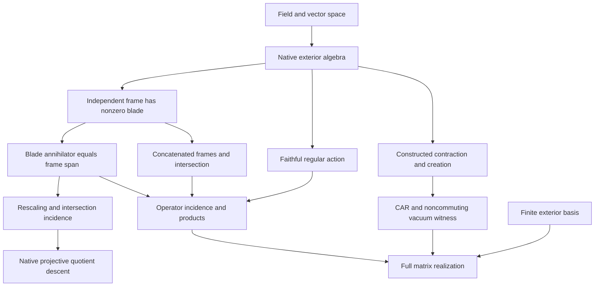
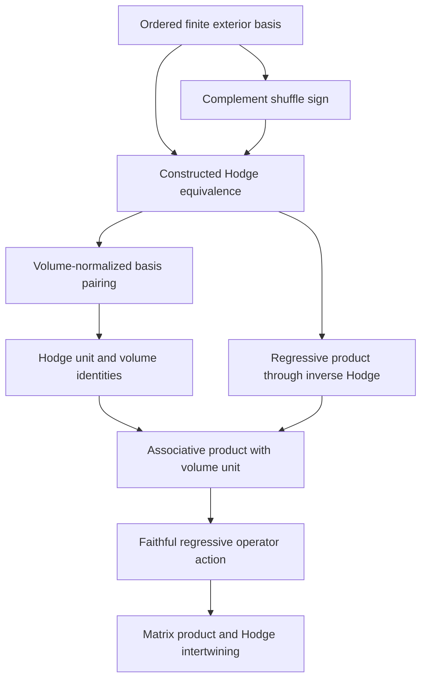

# Grassmann–Cayley geometry through faithful exterior operators

## Ground-truth theorem contract

Source: Laurent Fuchs and Laurent Théry, *A Formalization of Grassmann-Cayley
Algebra in Coq and Its Application to Theorem Proving in Projective Geometry*,
HAL hal-00657901, uploaded PDF. Page numbers below include the HAL cover.
The current task requests native Lean 4/Mathlib proofs in noncommutative
operator algebra, with mathematical dependencies made explicit.

Base repository revision: `b143075bbf27e75860a1011e04423a0f227b7c41`.
Toolchain: Lean `4.34.1`; Mathlib
`d13f23b723b8a846827a245b89c10fc7d3f11612`.

### Carrier and conventions

- `K` is a field, `V` an arbitrary `K`-vector space.
- The exterior carrier is native `ExteriorAlgebra K V`, with native `ι`,
  `ιMulti`, multiplication, linear dependence and submodule lattice.
- Operators are native `Module.End K (ExteriorAlgebra K V)`; multiplication
  is composition, with the right factor acting first.
- Reuse `CanonicalNormalOrdering.create` and `.annih`, defined by native
  exterior left multiplication and `CliffordAlgebra.contractLeft`.
- The regular map is native `Algebra.lmul`. Finite matrix transport is the
  native algebra equivalence `LinearMap.toMatrixAlgEquiv b.ExteriorAlgebra`.
  It represents every endomorphism, with no diagonal or commutation hypothesis.
- A nondegenerate blade comes from an explicitly linearly independent finite
  frame. Zero exterior elements are not projective points.

### Source-confirmed reuse

`Canonical.DecomposableBivector.exteriorPower_ιMulti_ne_zero_of_linearIndependent`
proves nonvanishing for arbitrary finite linearly independent frames, over any
field. `Canonical.CanonicalNormalOrdering.annih_create_anticomm` proves the
genuine operator CAR from the constructed operators. Its vacuum lemmas provide
an explicit noncommutativity witness. Existing
`Projective.ExteriorKleinTwoPlaneEquiv.mem_frameSpan_iff_leftWedge_eq_zero`
is the real four-dimensional, two-plane predecessor of the arbitrary-rank
incidence statement here. The established projective Klein quotient and its
incidence owners are retained.

Two similarly named files are not suitable contraction owners:
`Canonical.ExteriorContractionOperatorBridge.contractionOp` is defined as zero,
and `Canonical.ExteriorContractionCARBridge.contraction2` is a scalar alternating
coefficient. This observation is local to those definitions; genuine CAR owners
already exist elsewhere in the repository.

### Target statements

1. An arbitrary finite exterior product vanishes iff its frame is dependent.
2. For an independent frame `v`, `ι x * ιMulti v = 0` iff
   `x ∈ Submodule.span K (Set.range v)`.
3. The native kernel of `x ↦ ι x * ω` recovers that subspace, is invariant
   under nonzero rescaling, descends to native `Projectivization`, and represents
   intersection by simultaneous kernels. On a projective independent blade the
   descended map evaluates to its actual frame span.
4. Faithful left multiplication transfers incidence to composition of actual
   operators. Frame operators are nonzero exactly for independent frames. Two
   individually independent frames have zero blade/operator product exactly
   when their spans have nontrivial intersection.
5. The native full matrix algebra equivalence preserves and reflects those
   identities and the existing CAR relations.
6. If `φ(v) ≠ 0`, annihilation and creation do not commute. This is proved by
   applying their two ordered products to the vacuum, in every characteristic.
7. A chosen finite basis constructs Hodge duality through signed complementary
   basis blades. Equal-degree basis pairing is the Kronecker pairing times
   the nonzero volume blade. The sign is that of the actual shuffle permutation.
8. The inverse Hodge map constructs associative, bilinear regressive
   multiplication with volume as its unit. Its regular operator and matrix
   representations are faithful, and Hodge explicitly intertwines them
   with exterior left multiplication.

These are algebraic statements, not analytic, topological, or physical claims.
The matrix realization requires a finite basis; the incidence theorem does not
require finite ambient dimension. Basis-dependent constructions are explicitly noncomputable. The projective
support map is defined on all nonzero exterior rays; its frame-span
interpretation is proved on independent decomposable blades. No classification
of all rays as Grassmannian points is claimed.

### Logical dependency order

The arrows are mathematical proof prerequisites. Their reflexive transitive
closure is the dependency partial order; no physical causal claim is imposed.

The regressive branch uses the same full exterior carrier:

### Source specification audit

The paper's printed formulas require checking before transcription. On PDF
p.13 a concurrency expression begins with a repeated point, and the eliminated
Pappus expression repeats an intersection. Both repetitions would produce
automatic zero wedges. The p.11 recursion displays also have component/index
problems. On p.17, the last bracket of `split3b_v2` repeats a primed point;
the intended final factor uses the first two distinct primed points. These
are observations about the PDF, not claims about the archived Coq code.

The source's use of all vectors as point representatives does not enforce
nonzero projective points. The new incidence contract makes nondegenerate
frames explicit, and records that zero blades have the whole ambient space
as their annihilator. This prevents the zero-blade case from silently
representing a genuine projective object.

### Scope boundary

The native submodule intersection is an intrinsic geometric meet. The
volume-dependent regressive product is separately constructed using the actual
signed-complement Hodge equivalence. Its interpretation as every nonzero blade
intersection, the homogeneous Hodge-square sign, and the full Pappus/Desargues
elimination procedures require further proofs. They are not inferred merely
from CAR, kernel incidence, or associativity of the transported product.

## Verification

Pending source compilation and independent semantic/axiom audit.
The eventual verification scope is the complete source import closure of the
new modules against the exact Mathlib pin, not the unrelated root Lake package.
