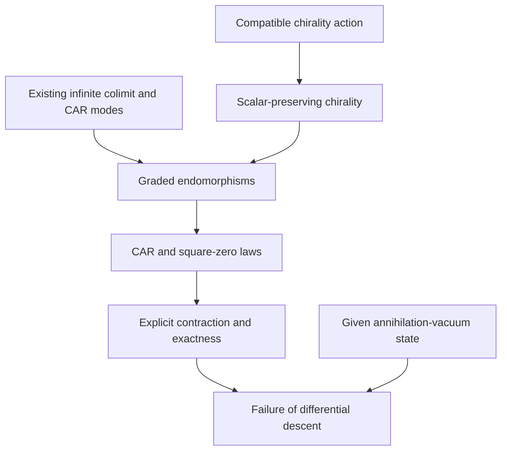

# Graded CAR endomorphisms of the infinite Clifford colimit

## Contribution and source

This contribution starts on the existing infinite algebraic carrier
`Cl11TensorTowerLimit.Limit`. It constructs a scalar-preserving global chirality,
a countable CAR family of real-linear endomorphisms, and an explicit contracting
homotopy. It also supplies a proof script for a precise obstruction to descending
the differential to the existing annihilation-vacuum GNS quotient.

The intake was `Pasted text(20261111-133500).txt`, SHA-256
`0f232707387d8dd1ce8b8f8f70696e276d072168c71dbeed9e00d59937153af4`.
Source comparison and this branch start at upstream
`c143c264bc18bbf41d692be4e270b5b7f7405702`.

**Draft verification status:** the new declarations have complete proof scripts;
native compilation and axiom output are pending. Independent source review and
static results are recorded in the PR at their observed scope. The maintained
cache/build lane was occupied during authoring. The axiom companion requests
checks; those requests are not themselves successful audit output.

New owners:

- [GradedAdjointHomotopy.lean][homotopy]: a reusable native endomorphism theorem
  and exactness consequences over arbitrary associative algebras.
- [Cl11ChiralityGradedCAR.lean][concrete]: the actual infinite-carrier
  construction and its GNS descent obstruction.
- [Cl11ChiralityGradedCARAudit.lean][audit]: requests for all public declarations
  in both owners.

## 1. The infinite carrier is already constructed

The existing matrix stages are presentations of the algebraic colimit

\[
B=\varinjlim_n M_{2^n}(\mathbb R),\qquad a\longmapsto a\otimes I_2.
\]

[Cl11ColimitDimension.lean][dimension] proves that this actual `Limit` is not
finite-dimensional, using faithful stage inclusions and unbounded stage
dimensions. [Cl11StarAlgebraFiltration.lean][filtration] supplies the strictly
growing stage images, their supremum, and common-stage representation of every
finite collection of algebraic elements. None of the new endomorphisms changes
that carrier or imposes a fixed matrix dimension.

The direct-limit quotient identifies representatives that agree in a common
later stage. A cofinal tail of the diagram presents the same ring, with its
star operation preserved, as proved by [Cl11MatrixTowerTailShift.lean][tail]. An intersection of tensor-tail
subalgebras or a quotient by an ideal is a different construction and needs its
own maps and laws.

## 2. Global chirality becomes a real algebra equivalence

[Cl11ChiralityTransport.lean][chirality] already proves that conjugation by the
stage chirality elements is compatible with the bonding maps. These actions
descend to an involutive ring homomorphism

\[
\theta:B\longrightarrow B.
\]

The finite chirality elements themselves do not form the corresponding
compatible element sequence. The compatible actions suffice to define this
global operator. That observation alone does not prove that the resulting
automorphism has no inner implementer; no outerness theorem is added here.

The new theorem `limitChiralityConj_algebraMap` proves that the existing map
fixes the real scalar embedding. Its proof uses the stage readback, centrality
of real scalars, and the square-one stage chirality law. The definition
`chirality : Limit ≃ₐ[ℝ] Limit` then bundles this map with its existing
self-inverse and the newly proved scalar law.

The countable creation and annihilation modes are reused from
[Cl11TensorTowerInfiniteCAR.lean][modes]. Their oddness is transported from the
actual Jordan–Wigner representatives:

\[
\theta(u_i)=-u_i,\qquad\theta(v_i)=-v_i.
\]

Thus the grading and coefficient operators live on the same already infinite
algebra. Real-linearity is proved through scalar preservation, not inferred
solely from the ring-homomorphism type.

## 3. The homotopy uses an ordered left action

For a general associative `R`-algebra `A`, the existing
[IntrinsicGradedAdjoint.lean][adjoint] defines

\[
d_Q=L_Q-R_Q\theta,\qquad d_Q(x)=Qx-\theta(x)Q
\]

as a native `Module.End R A`. If `θ(S)=-S`, direct ordered multiplication gives

\[
\begin{aligned}
d_Q(Sx)+S\,d_Q(x)
&=QSx-\theta(S)\theta(x)Q+SQx-S\theta(x)Q\\
&=(QS+SQ)x.
\end{aligned}
\]

The generic new theorem is therefore

\[
\boxed{d_Q L_S+L_S d_Q=L_{QS+SQ}.}
\]

Only oddness of `S` is needed for this identity. Involutivity of `θ` and oddness
of `Q` enter separately through the existing square formula

\[
d_Q^2=L_{Q^2}-R_{Q^2}.
\]

For `Q²=0` and `QS+SQ=1`, the actual homotopy `h=L_S` satisfies

\[
d_Q^2=0,\qquad d_Qh+hd_Q=I.
\]

The distinction between `L_S` and `d_S` is essential. The existing mixed
graded-adjoint theorem gives

\[
d_Qd_S+d_Sd_Q=L_{QS+SQ}-R_{QS+SQ}.
\]

For a CAR pair its value is zero. Replacing the left homotopy with the second
graded adjoint would destroy the contraction identity.

## 4. A countable CAR family in the endomorphism algebra

On the concrete infinite `B`, define

\[
d_i(x)=u_i x-\theta(x)u_i,\qquad h_i(x)=v_i x.
\]

These are actual elements of `Module.End ℝ Limit`. The new owner derives

\[
\boxed{
d_i d_j+d_j d_i=0,\qquad
h_i h_j+h_j h_i=0,\qquad
d_i h_j+h_j d_i=\delta_{ij}I.
}
\]

The existing countable CAR relations supply the coefficient identities. The
new generic mixed theorem supplies the third operator identity; the existing
graded mixed-curvature theorem supplies the first. Associativity and ordinary
left multiplication supply the second. `endomorphismCAR` packages these proved
relations in the existing `CARAlgebra` interface. No universal CAR-algebra
representation theorem or analytic closure is asserted by that packaging.

The source separately proves `d_i²=0` and `h_i²=0` by transporting the actual
square-zero Jordan–Wigner laws. It does not infer square-zero from
`2*d_i²=0` in an arbitrary ring.

Every cycle has an explicit primitive:

\[
d_i x=0\quad\Longrightarrow\quad d_i(v_i x)=x.
\]

Consequently the native submodules satisfy

\[
\boxed{\ker d_i=\operatorname{range}d_i.}
\]

In particular, `d_i(1)=0` and `d_i(v_i)=1`. The unit is a cycle and is exact.
This is a full algebraic contraction. It retains no nonzero cohomology class
to identify with a physical vacuum.

The repository already has dimension-independent two-periodic contractibility
and cohomology machinery in [FiniteParityContractible.lean][contractible]; its
finite-rank conclusions introduce finite-dimensional hypotheses later. The new
owner uses native kernel/range equality and does not create another cohomology
quotient package.

## 5. The annihilation-vacuum quotient obstructs descent

The existing [InfiniteCARColimit.lean][abstract-car] defines a `SouriauState`
through a positive normalized real algebraic state with the annihilation law

\[
\varphi(v_i^*v_i)=0.
\]

Its existing quotient theorem gives `[v_i]=[0]` in that state's actual algebraic
GNS quotient. State normalization gives `[1]≠[0]`: if the two classes were equal,
their difference would have zero quadratic state value, contradicting
`φ(1)=1`. The state and equivalence relation are those in
[AlgebraicGNSState.lean][state] and [GNSBridge.lean][gns].

Suppose a function `D` on this quotient intertwined the new differential on
all representatives:

\[
D([x])=[d_i x].
\]

Then

\[
[1]=[d_i(v_i)]=D([v_i])=D([0])=[d_i(0)]=[0],
\]

which contradicts normalization. The theorem
`differential_not_descend_souriau` formalizes this conclusion for the existing
`SouriauState countableCAR` and its existing quotient. It excludes even an
arbitrary function with that representative rule, before any questions of
linearity, continuity, or norm bounds arise.

This is an obstruction for this particular differential and quotient. It does
not make the normalized state or the CAR algebra inconsistent. The existing
GNS null-space result provides left-ideal stability. The twisted right-action
term in `d_i` requires additional compatibility, and here the displayed
calculation shows that compatibility fails for the annihilation-vacuum rule.

## 6. Dependency order

The diagram records dependencies of the source statements. The state is a
given hypothesis for the obstruction theorem; this PR does not construct it.
All new proof scripts retain the draft verification status stated above.



## 7. Analytic continuation of the program

The source review found actual analytic constructions that remain useful:

| Existing owner | Available content | Required identification for this proposal |
|---|---|---|
| [BoundedHomotopyCoercivity][coercivity] | Dimension-independent coercivity from bounded `d,h,P`, `dh+hd=I-P`, and a bound on `‖h‖` | Actual bounded representatives and the intended residual projection |
| [RealFockCompletedSameModeCAR][fock] | Actual completed real Fock CAR operators and their genuine Hilbert adjoints; adjacent owners prove norm bounds | Its carrier is a completed exterior-Fock direct limit, not definitionally this matrix-tower algebra or its GNS quotient |
| [CompletedGNSCovariance][covariance] | A unitary on Mathlib's completed complex C*-GNS spaces for a state-compatible star-algebra equivalence | A particular invariant state, compatible global grading, and identification with the chosen real carrier |
| [TracialGNSRightMultiplication][right-action] | An actual bounded right action on a complex C*-GNS space for a tracial positive functional | The same represented carrier and the required state assumptions |
| [FilteredCompatibleOperatorColimit][bounded-colimit] | Completion of coherent stage operators with a common bound | Intertwining and uniform bounds for the selected operators |

A bounded Hilbert realization of `dh+hd=I` has zero Hodge kernel: if both
`dx=0` and `d* x=0`, taking the inner product with the homotopy identity forces
`‖x‖²=0`. The existing completed same-mode Fock CAR pair similarly has Hodge
operator exactly `I`. Neither observation supplies a nonzero zero-energy
vacuum for the proposed physical Hamiltonian.

To continue toward a physical gap, the next construction must use a
differential/module action that respects its chosen state quotient and retains
the required vacuum projection. It then needs bounded homotopy control or the
appropriate unbounded closed-form formulation, plus comparison with the actual
physical energy form. Increasing matrix sizes or invoking completion alone
does not supply those compatibility and quantitative statements.

## Verification entry point

The existing focused project reads the real repository sources and retains
Lean `v4.34.1` and Mathlib `d13f23b723b8a846827a245b89c10fc7d3f11612`.
When the shared lane is available and its pinned cache is ready:

```bash
PATH=/home/agent/.elan/bin:$PATH \
  python3 verification/language-symmetry/check.py build \
  InfoGeometry.Clifford.Cl11ChiralityGradedCARAudit
```

A successful result would certify the declared algebraic and quotient scope.
It would not by itself construct a bounded realization or establish a
Yang–Mills mass gap.

[homotopy]: ../lean/InfoGeometry/OperatorAlgebra/GradedAdjointHomotopy.lean
[concrete]: ../lean/InfoGeometry/Clifford/Cl11ChiralityGradedCAR.lean
[audit]: ../lean/InfoGeometry/Clifford/Cl11ChiralityGradedCARAudit.lean
[dimension]: ../lean/InfoGeometry/Clifford/Cl11ColimitDimension.lean
[filtration]: ../lean/InfoGeometry/Clifford/Cl11StarAlgebraFiltration.lean
[tail]: ../lean/InfoGeometry/Canonical/Cl11MatrixTowerTailShift.lean
[chirality]: ../lean/InfoGeometry/Clifford/Cl11ChiralityTransport.lean
[modes]: ../lean/InfoGeometry/Canonical/Cl11TensorTowerInfiniteCAR.lean
[adjoint]: ../lean/InfoGeometry/OperatorAlgebra/IntrinsicGradedAdjoint.lean
[abstract-car]: ../lean/InfoGeometry/Canonical/InfiniteCARColimit.lean
[state]: ../lean/InfoGeometry/Prequantum/AlgebraicGNSState.lean
[gns]: ../lean/InfoGeometry/Prequantum/GNSBridge.lean
[contractible]: ../lean/InfoGeometry/OperatorAlgebra/FiniteParityContractible.lean
[coercivity]: ../lean/InfoGeometry/OperatorAlgebra/BoundedHomotopyCoercivity.lean
[fock]: ../lean/InfoGeometry/Clifford/RealFockCompletedSameModeCAR.lean
[covariance]: ../lean/InfoGeometry/OperatorAlgebra/CompletedGNSCovariance.lean
[right-action]: ../lean/InfoGeometry/OperatorAlgebra/TracialGNSRightMultiplication.lean
[bounded-colimit]: ../lean/InfoGeometry/Canonical/FilteredCompatibleOperatorColimit.lean
