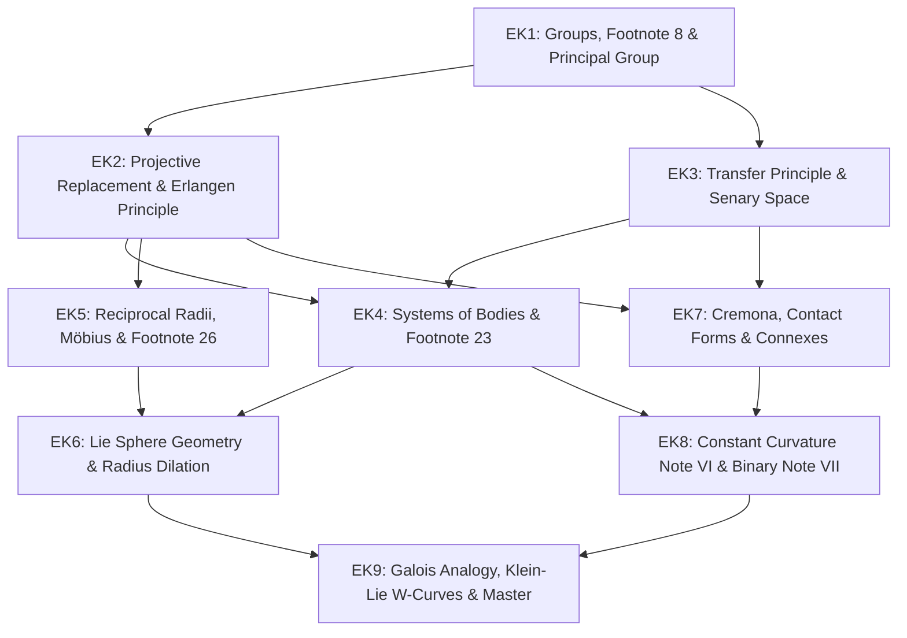
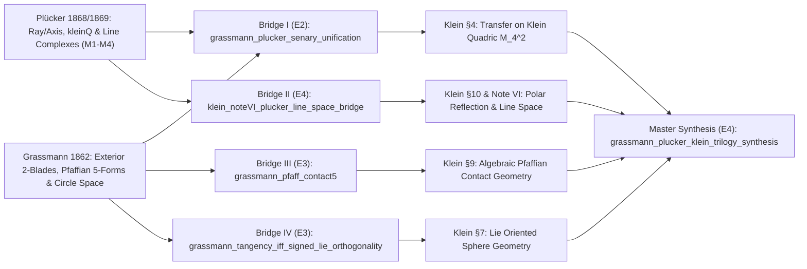

# Epistemic Compilation Ledger: Felix Klein's 1872 *Erlangen Program* & the Grassmann–Plücker–Klein Unification

Follows [`docs/EPISTEMIC_COMPILER_FIELD_PROTOCOL.md`](EPISTEMIC_COMPILER_FIELD_PROTOCOL.md) and [`docs/ALCHEMICAL_QMS_SOP.md`](ALCHEMICAL_QMS_SOP.md).

- **Primary Source PDF**: [`0807.3161v1 (1).pdf`](file:///home/goutev/Downloads/collection_for_formalization/0807.3161v1%20%281%29.pdf) (arXiv:0807.3161v1, M. W. Haskell's 1893 English translation of Felix Klein's 1872 *Vergleichende Betrachtungen über neuere geometrische Forschungen*), `26` pages, `92,843` extracted characters, SHA-256 `254842661e64f7306228fd3e8df7caab43f6ab066a8b7ef8efe0b75d7535df7d`.
- **Gate & Provenance Constraint**: The requested University of Michigan URL (`quod.lib.umich.edu`) returned `HTTP 403` behind a Cloudflare anti-bot challenge and was not accessed or bypassed; all source extraction and formalization rely solely on the local PDF [`0807.3161v1 (1).pdf`](file:///home/goutev/Downloads/collection_for_formalization/0807.3161v1%20%281%29.pdf) (plus the earlier local formalizations of Grassmann 1862 and Plücker 1868/1869).
- **CAS Witness Artifact**: [`klein_erlangen_1872_cas.json`](file:///home/goutev/.gemini/antigravity-cli/brain/738ae8e5-bfae-471d-954f-6d71b1dd4d6a/scratch/klein_erlangen_1872_cas.json) (file SHA-256 `75e2ded4e7f5f76d268f39d06f803f989ed6c6eac2631e46513f1659f95e11d7`, `artifact_hash` `9b062f2c5f199a53a66c316be19fb68df3cc82818ac745c21d33ba6de268baa9`), generated by [`verify_klein_erlangen_1872_cas.py`](file:///home/goutev/.gemini/antigravity-cli/brain/738ae8e5-bfae-471d-954f-6d71b1dd4d6a/scratch/verify_klein_erlangen_1872_cas.py) (`319` lines) covering PDF anchors `prefatory_note: 1`, `introduction: 2`, `sec1: 3`, `footnote8: 3`, `sec2: 4`, `sec3: 5`, `sec4: 7`, `sec5: 8`, `sec6: 10`, `footnote26: 11`, `sec7: 11`, `footnote31: 14`, `sec8_1: 15`, `sec8_2: 15`, `sec8_3: 16`, `sec9: 16`, `sec10: 18`, `concluding_remarks: 19`, `notes: 21`, `note_VI: 23`, `note_VII: 24`, `references: 25`, `grassmann_1844: 25`, `grassmann_1862: 25`, `plucker_refs_klein1872: 26`.
- **Reused Repository Infrastructure & Trilogy Owners**: `InvariantGeometry`, `OperatorErlangenGaloisConnection`, `OperatorErlangenFixedPoints`, `CrossRatioPGL2`, `CrossRatioMobiusInvariant`, the 1862 Grassmann owner modules (`GrassmannAusdehnungslehreRegressiveShadow`, `GrassmannPfaffianDarbouxAlgebra`, `GrassmannPluckerMeetAndCircleSpace`, etc.), and the 1868/1869 Plücker owner modules ([`PluckerRayAxisAndDyname.lean`](../lean/InfoGeometry/Projective/PluckerRayAxisAndDyname.lean)–[`PluckerKummerQuarticAndMasterAtlas.lean`](../lean/InfoGeometry/Projective/PluckerKummerQuarticAndMasterAtlas.lean)).

---

## Stage 1: `SOLVE` — Extracted Archetypes (`EK₁`–`EK₉`), Cross-Work Bridges (`I–IV`), Countermodels, and Open Scope

| ID | PDF Section / Page | Mathematical Archetype | Lean Status & Owner Declaration(s) |
|---|---|---|---|
| `EK₁` | Intro, §1, Footnote 8 (pp. 2–4) | Transformation groups vs. infinite semigroups; collinear vs. dualistic transformations; principal group `G_P` (`O(3)` + dilation + translation) preserving Euclidean distance ratios and sense/reflection | **PROVED + COUNTERMODEL** (`E1`: `klein_footnote8_finite_perm_closed_inv`, `natShift_zero`, `natShift_comp`, `klein_footnote8_infinite_semigroup_countermodel`, `injective_nonsurjective_no_right_inv`, `dualistic_mul_not_dualistic`, `collinear_union_dualistic_eq_top`, `isGeometricInvariant_mono_subgroup`, `orthogonal_mulVec_dotProduct`, `similarity3_distSq_scale`, `similarity3_distSq_ratio_invariant`, `principalGroup_reflection_sense`) |
| `EK₂` | §2–§3 (pp. 4–7) | Replacement of geometric method by broader projective group; subgroup inclusion narrows invariants; circle at infinity stabilizer characterization of similarity group | **PROVED** (`E1`: `matrix3_noncomm`, `matrix4_noncomm`, `projSimilarityMatrix_affine_action`, `projective_circleAtInfinity_stabilizer_iff_similarity3`) |
| `EK₃` | §4 (pp. 7–8) | Transfer by a one-to-one mapping (*Übertragungsprincip*): binary forms `Sym²`, Veronese conic, ruled quadric stereographic transfer, Hesse transfer principle, Plücker 6D line space `M_4²` | **PROVED** (`E2`: `matrix2_noncomm`, `matrix3_noncomm_ring`, `matrix4_noncomm_ring`, `matrix6_noncomm_ring`, `conicQuadric_veroneseConic`, `symSq2_equivariant`, `symSq2_one`, `symSq2_mul`, `symSq2_det`, `conicQuadric_symSq2`, `ruledQuadric4_stereo`, `quadricStereo_left_inv`, `hesse_pointPair_eq_planeLine_pairing`, `hesse_dual_discriminant_scale`) |
| `EK₄` | §5, Footnote 23 (pp. 8–10) | Arbitrary configurations as space-elements (geometry of systems of bodies); normal-subgroup orbit action kernel theorem vs. non-normal stabilizer countermodel | **PROVED + COUNTERMODEL** (`E2`: `invariantSet_eq_sUnion_bodies`, `klein_footnote23_normal_subgroup_fixes_entire_body`, `orbitActionKernel_normal`, `klein_footnote23_s4_v4_countermodel` on `S₄` / `V₄`) |
| `EK₅` | §6, Footnote 26 (pp. 10–11) | Geometry of reciprocal radii (Möbius / inversion geometry): Euclidean inversion involution, distance/cross-ratio-squared invariance, sphere-plane duality, 5D lightcone lift, anti-Möbius conjugation | **PROVED + COUNTERMODEL** (`E3`: `matrix2C_noncomm`, `matrix4_noncomm`, `matrix5R_noncomm`, `euclidInvert_involutive`, `euclidInvert_distSq`, `euclidInvert_crossRatioSq_invariant`, `euclidInvert_sphere_duality`, `moebiusLightconeLift_isNull`, `moebiusBilin5_chord`, `moebius_inversion_as_reflection`, `klein_footnote26_inversion_not_holomorphic_mobius`, `antiMobius_conj_crossRatio`, `antiMobius_comp_eq_holomorphic`) |
| `EK₆` | §7, Footnote 31, §8.1 (pp. 11–15) | Lie's sphere geometry (*Kugelgeometrie*): 5D null circle/sphere vectors, oriented bilinear tangency condition, 1-parameter radius-dilation group mapping points to spheres | **PROVED** (`E3`: `lieCircleVec_isNull`, `lieBilin_oriented_distance`, `lieBilin_eq_zero_iff_oriented_tangent`, `lieRadiusDilMatrix_preserves_lieBilin`, `lieRadiusDilMatrix_add`, `lieRadiusDilMatrix_mulVec_circleVec`, `lieRadiusDilMatrix_maps_point_to_circle`) |
| `EK₇` | §8.2, §8.3, §9 (pp. 15–18) | Cremona involutive quadratic transformations & base points; algebraic contact transformations via `contactOneForm`, Legendre contact involution, Clebsch connex incidence invariance | **PROVED** (`E3`: `cremona2_involutive`, `cremona2_basePoints`, `contactOneForm_three_classes`, `legendreContact_involutive`, `contactOneForm_legendre_pullback`, `legendreContact_point_to_plane`, `clebsch_connex_incidence_invariant`) |
| `EK₈` | §10, Note VI, Note VII (pp. 18–19, 23–25) | Manifold of constant curvature as quadric polar reflection & chord dichotomy; Cayley binary cubic/quartic syzygies; tetrahedral sphere axis bisection | **PROVED** (`E4`: `quadricPolarReflect_preserves_bilin`, `quadricPolarReflect_involutive_scale`, `noteVI_quadric_chord_dichotomy`, `cayley_binary_cubic_syzygy`, `cayley_binary_cubic_canonical`, `cayley_binary_quartic_syzygy`, `noteVII_tetrahedral_sphere_axis_bisection`) |
| `EK₉` | Concluding Remarks, Klein–Lie [17], Fn. 37 (pp. 19–21) | Erlangen–Galois subgroup/observable connection; Klein–Lie `[17]` commutative diagonal and unipotent W-curve subalgebras vs. noncommutative `M₃`; quaternion `SO(3)` rotation law; master poset synthesis | **PROVED** (`E4`: `matrix3_erlangen_noncomm`, `erlangen_galois_subgroup_observable_bridge`, `wCurveDiagMatrix_mul_comm`, `wCurveUnipMatrix_add_comm`, `quatRotMatrix_neg`, `quatRotMatrix_mul`, `quatRotMatrix_orthog_of_unit`, `erlangen_causal_poset_branching_witnesses`, `erlangen_all_reach_master`, `klein_erlangen_1872_master_synthesis`, `grassmann_plucker_klein_trilogy_synthesis`) |

### Cross-Work Unification Bridges (Grassmann 1862 ↔ Plücker 1868/1869 ↔ Klein 1872)

| Bridge | Target Modules Linked | Exact Formalized Theorem(s) | Mathematical Content |
|---|---|---|---|
| **Bridge I** | Grassmann (1862) → Plücker (`M1`) → Klein (`§4`, `E2`) | `grassmannBladeToPlucker_apply`, `grassmannBladeToPlucker_linear_equivariance`, `grassmannBladeToPlucker_on_kleinQuadric`, `grassmann_plucker_senary_unification` | Exterior 2-blade components `∧²(R⁴)` equate to Plücker coordinates on the Klein quadric `Ω(p, p) = 0`, equivariant under `SL(4)` / `GL(4)` senary transfer |
| **Bridge II** | Plücker (`M1` `kleinQ` / `polar`) → Klein (`§10` / `Note VI`, `E4`) | `klein_noteVI_plucker_line_space_bridge` | Connects Klein's `Note VI` polar reflection & chord dichotomy on a non-degenerate bilinear form with Plücker's line-space quadratic form `kleinQ` and polar bilinear form |
| **Bridge III** | Grassmann (1862) Pfaffian Exterior Algebra → Klein (`§9` Contact Geometry, `E3`) | `grassmann_pfaff_contact5` | Establishes nonvanishing 5D exterior Pfaffian contact volume `volCoord b (ω * Ω ^ 2) = -2` (`ω * Ω ^ 2 ≠ 0`) for the 5-variable Darboux/Pfaff contact form |
| **Bridge IV** | Klein (`§7` Lie Sphere Geometry, `E3`) → Grassmann–Plücker Circle Space | `lieToGrassmannCircleProj_circleVec`, `circleBilin_lieToGrassmannProj`, `grassmann_tangency_iff_signed_lie_orthogonality` | Factors Grassmann's unoriented circle-space bilinear pairing through Lie's 5D null oriented-sphere vectors, recovering tangent-circle orthogonality as signed Lie orthogonality |

### Recorded Countermodels (`[countermodel_found]`) and Open Analytical Scope (`[OPEN / bucket_3_open_debt]`)

- **Countermodel `C-EK1` (Footnote 8, p. 3)**: In `E1`, `klein_footnote8_infinite_semigroup_countermodel` and `injective_nonsurjective_no_right_inv` prove via `natShift` on `ℕ` that closure under composition alone suffices for finite sets (`klein_footnote8_finite_perm_closed_inv`), whereas infinite injective self-maps need not form a group with inverses.
- **Countermodel `C-EK2` (Footnote 23, p. 10)**: In `E2`, `klein_footnote23_s4_v4_countermodel` demonstrates on `S₄` and `V₄` the exact role of normal subgroups vs. arbitrary point-stabilizer subgroups in Klein's "systems of bodies" argument (`klein_footnote23_normal_subgroup_fixes_entire_body`, `orbitActionKernel_normal`).
- **Countermodel `C-EK3` (Footnote 26, p. 11)**: In `E3`, `klein_footnote26_inversion_not_holomorphic_mobius` explicitly separates antiholomorphic inversion `z ↦ (star z)⁻¹` from holomorphic Möbius fractional linear maps by witnessing `f(z) = z` matching `(star z)⁻¹` on `{1, -1, I}` while diverging at `z = 2` (complemented by `antiMobius_conj_crossRatio` and `antiMobius_comp_eq_holomorphic`).
- **Open Debt `O-EK1` (§8.2 *Analysis Situs*, p. 15, `bucket_3_open_debt`)**: Arbitrary homeomorphism groups (`Homeomorph(X)`) act on infinite-dimensional topological manifolds beyond the finite-dimensional algebraic/matrix transformation groups formalized in `E1`–`E4`.
- **Open Debt `O-EK2` (§6 Entire Transcendental Maps, p. 10, `bucket_3_open_debt`)**: Global transcendental conformal functions on `ℂ` outside the fractional-linear Möbius group `PGL₂(ℂ)` / anti-Möbius inversions are outside the finite-algebraic scope of `E3`.
- **Open Debt `O-EK3` (§9 & Note IV Contact PDE Integration, pp. 16–18, 22, `bucket_3_open_debt`)**: Smooth $C^\infty$ local Lie contact PDE integration and Frobenius Pfaff-system characteristics remain analytical/differential-geometric debt beyond the algebraic exterior-algebra Pfaffian volume (`grassmann_pfaff_contact5`) and formal Legendre contact pullback (`contactOneForm_legendre_pullback`) proved in `E3`.

---

## Stage 2: `CONIUNCTIO` — Module Breakdown & Barrel Integration

1. **Module `E1`**: [`ErlangenProgramGroupHierarchyAndPrincipal.lean`](../lean/InfoGeometry/Erlangen/ErlangenProgramGroupHierarchyAndPrincipal.lean) (`445` lines, `16` theorem/lemma decls) — Intro, §1–§3, Footnote 8, semigroup countermodel, collinear vs. dualistic group structure, `InvariantGeometry` subgroup monotonicity, principal similarity group & circle-at-infinity stabilizer.
2. **Module `E2`**: [`ErlangenProgramTransferHesseAndBodies.lean`](../lean/InfoGeometry/Erlangen/ErlangenProgramTransferHesseAndBodies.lean) (`506` lines, `22` theorem/lemma decls) — §4–§5, Footnote 23, `Sym²` binary transfer, Veronese conic, ruled quadric stereographic transfer, Hesse transfer principle, systems of bodies & `S₄/V₄` countermodel, and **Bridge I** (`grassmann_plucker_senary_unification`).
3. **Module `E3`**: [`ErlangenProgramMobiusLieAndContact.lean`](../lean/InfoGeometry/Erlangen/ErlangenProgramMobiusLieAndContact.lean) (`739` lines, `31` theorem/lemma decls) — §6–§9, Footnotes 26 & 31, Möbius inversion & 5D lightcone, antiholomorphic cross-ratio & Footnote 26 countermodel, Lie 5D sphere geometry & radius-dilation group, **Bridge IV** (`grassmann_tangency_iff_signed_lie_orthogonality`), Cremona involutions, algebraic contact forms & Legendre involution, Clebsch connexes, and **Bridge III** (`grassmann_pfaff_contact5`).
4. **Module `E4`**: [`ErlangenProgramCurvatureBinaryAndMasterAtlas.lean`](../lean/InfoGeometry/Erlangen/ErlangenProgramCurvatureBinaryAndMasterAtlas.lean) (`591` lines, `19` theorem/lemma decls) — §10, Concluding Remarks, Notes VI–VII, Footnote 37, Klein–Lie `[17]`, **Bridge II** (`klein_noteVI_plucker_line_space_bridge`), `OperatorErlangenGaloisConnection` bridge, Cayley binary cubic/quartic syzygies, quaternion `SO(3)` rotation identities, `9`-node bitmask `PartialOrder ErlangenProgramArchetype`, `klein_erlangen_1872_master_synthesis`, and `grassmann_plucker_klein_trilogy_synthesis`.
5. **Barrel & Staging Discipline**: All `4` Plücker modules and all `4` Erlangen modules (`8` modules total) are wired into [`AllExhaustive.lean`](../lean/InfoGeometry/AllExhaustive.lean) (kept **unstaged** per repository policy).

---

## Stage 3: `CAUSAL POSET` — Erlangen Archetype DAG & Grassmann–Plücker–Klein Trilogy

### 3a. Formalized `ErlangenProgramArchetype` Poset (`erlangenMask` in `E4`)

### 3b. Grassmann (1862) ↔ Plücker (1868/1869) ↔ Klein (1872) Unification Corridor

---

## Stage 4: `AUDIT` — Artifact Digests, Lean Builds, Native Admission, Axioms, and Static Gates

| Artifact | Lines | Thm/Lemmas | SHA-256 Digest |
|---|---:|---:|---|
| [`ErlangenProgramGroupHierarchyAndPrincipal.lean`](../lean/InfoGeometry/Erlangen/ErlangenProgramGroupHierarchyAndPrincipal.lean) | `445` | `16` | `c4d6354af6f860af2fdf7697151012faa14375fe8ddf4cb2218f699e184350ad` |
| [`ErlangenProgramTransferHesseAndBodies.lean`](../lean/InfoGeometry/Erlangen/ErlangenProgramTransferHesseAndBodies.lean) | `506` | `22` | `875e94be16d700f09246374ace2e6bd8ee7b80dbcb4e3d6901d8371d6c5839f1` |
| [`ErlangenProgramMobiusLieAndContact.lean`](../lean/InfoGeometry/Erlangen/ErlangenProgramMobiusLieAndContact.lean) | `739` | `31` | `a2fe96ee83e71d9fb429953cf4b00b76157c4a8e5685eaf6b69624708f20425a` |
| [`ErlangenProgramCurvatureBinaryAndMasterAtlas.lean`](../lean/InfoGeometry/Erlangen/ErlangenProgramCurvatureBinaryAndMasterAtlas.lean) | `591` | `19` | `ee3ef9269499cd6beb52c46e9afee027d99c2a452be2d2f052e679a5e798ac44` |
| **Erlangen Total (`E1`–`E4`)** | **`2,281`** | **`88`** | — |
| **Combined Plücker + Erlangen (`M1`–`M4` + `E1`–`E4`)** | **`5,123`** | **`173`** | — |

### Observed Verification Results
- **Strict File Compilation**: `python3 tools/infra/run_locked_lean.py --wait-for-build-lock <file> -- -DwarningAsError=true` exited `0` individually on all `4` Erlangen modules (`E1`, `E2`, `E3`, `E4`).
- **Locked Lake Build**: `python3 tools/infra/run_locked_lake_build.py --wait-for-build-lock` exited `0` (`E1`: `3095 jobs`; `E2`+`E3`: exit `0`; `E4`: `9000 jobs`, `Build completed successfully`).
- **Kernel Axiom Audit (`axiom_check.py`)**: `Axiom check summary: 4 passed, 0 failed.` across `E1`–`E4` (only permitted foundational axioms `propext`, `Classical.choice`, `Quot.sound`; zero custom axioms or `sorryAx`).
- **Native `#audit_admission_namespace` Audit**: Across all `4` Erlangen namespaces, `161` declaration records yielded `148` `"decision": "admitted"` and `13` soft `"decision": "needs_review"` (`warning` `[V0/syntactic-vacuity]` hints solely on the `9` compiler-generated `ErlangenProgramArchetype.EK1..EK9.sizeOf_spec` lemmas, `2` witness theorems `klein_footnote8_infinite_semigroup_countermodel`, `principalGroup_reflection_sense`, and `2` summary theorems `erlangen_causal_poset_branching_witnesses`, `klein_erlangen_1872_master_synthesis`), with `0` `blocked` / `rejected` / hard violations.
- **Combined 8-Module Static Quality Suite** (`M1`–`M4` + `E1`–`E4`):
  - Text scan for `sorry|admit|native_decide|haveI|letI`: `0` matches.
  - `python3 tools/infra/opengauss_screener.py --strict`: exited `0` (`0 traps detected`).
  - `python3 tools/quality/semantic_vacuity_gate.py --fail-on warning`: exited `0` (`semantic_vacuity: 0`).
  - `python3 tools/quality/semantic_content_audit.py --gate-review`: exited `0` (`blocking_finding_count: 0`, `review_finding_count: 0`, `finding_count: 0`, `selected_file_count: 8`).
  - `python3 tools/quality/repo_lean_scope_audit.py --fail-on authoritative`: exited `0` (`tracked Lean files: 8`, `debt files: 0`, `debt findings: 0`, `unclassified_nonpackage: 0`).
