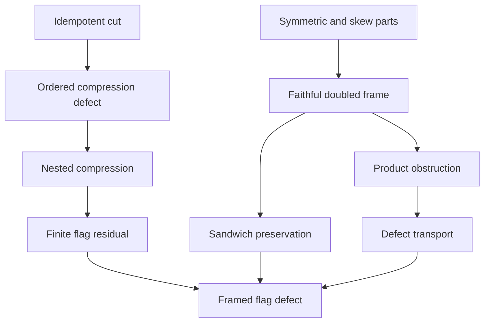

# Chiral transpose lift and nested compression defects

## Provenance and scope

The intake is `Pasted text(20261104-122735).txt`, supplied on 2026-11-04,
together with a request to formalize its noncommutative relational structure.
This task starts from repository revision
`3d7eb6d9b0af5636ab12b3d0b91b82740507e49e`.

The intake SHA-256 is
`f17caae447ac6093d234063bbcdad83e046d312543dadad7f56daa3f9eb88774`.

The carrier is the full real matrix algebra `Matrix n n ℝ` for an arbitrary
finite index type `n`, and its doubled algebra on `n ⊕ n`. No normality,
commutation, triangularity, positivity, or idempotence is assumed of the input.
Products act on column vectors from right to left. The compression identities
are more general: their carrier is an arbitrary associative `Ring A`.

## Reused owners

- `Core/PeirceDecomposition`: the complementary cut and four routed corners.
- `Core/PeirceCoupledCorners` and `Core/PeirceQuadraticFrame`: independent
  opposite corners, their sum/difference, and ordered round-trip products.
- `Core/PeirceDefect`: the exact idempotency defect of a tangent perturbation.
- `Core/DefectIteration`: finite iteration and the antitone chain of generated
  native subalgebras.
- `Core/PeirceCompressionDefect`: ordered multiplication/compression defects,
  extended here to the idempotency defect and finite nested compression flags.
- `Krein/LaggedCoincidenceDiracOperator`: `reversiblePart`, `circulatingPart`,
  their transpose and reconstruction laws, the doubled grading and swap,
  and the square of the symmetric Dirac lift.

The existing `Physics/OperatorRPABlock.rpa_square` already gives the generic
signed-block square with its commutator term. The new bridge uses the native
real `fromBlocks` carrier and the existing lagged Dirac square; it does not
introduce a second arbitrary-ring RPA API.

## Established interfaces

Write `S = reversiblePart A`, `K = circulatingPart A`,
`L(A) = [[S,K],[K,S]]`, `J = diag(I,-I)` and
`H = [[I,I],[I,-I]]`. The exact frame change is `F(X) = (1/2) H X H`.

1. `F` is an involutive, multiplicative change of coordinates, and
   `F(L(A)) = diag(A,Aᵀ)`.
2. `J L(A)ᵀ J = L(A)`, while `J L(A)` is symmetric.
3. `F(J L(A)) = [[0,Aᵀ],[A,0]]`, hence its squared frame is
   `diag(Aᵀ A,A Aᵀ)`.
4. `F(L(A)L(B)-L(AB)) = diag(0,(BA-AB)ᵀ)`. Thus the lift is
   multiplicative on a pair exactly when that pair commutes.
5. Squares, the polynomial `δ(X)=X²-X`, and every finite iterate of `δ`
   are transported exactly, despite the preceding product obstruction.
6. The swap eigenspace projectors are complementary idempotents and are
   individually null for `J`. The grading eigenspace projectors are a
   separate construction.
7. `L(P A P) = L(P)L(A)L(P)` for arbitrary `P,A`. This sandwich compatibility
   joins the real matrix representation to the finite compression formula.

The main new declarations are in
[`ChiralTransposeLift.lean`](../lean/InfoGeometry/Krein/ChiralTransposeLift.lean).
The general compression extension is in
[`PeirceCompressionDefect.lean`](../lean/InfoGeometry/Core/PeirceCompressionDefect.lean).

## 1. The cut and the four ordered corners

Let `p*p=p` and `q=1-p`. Then `q*q=q`, `p*q=q*p=0`, and `p+q=1`.
For an arbitrary operator `T`, define

\[
a=pTp,\qquad b=pTq,\qquad c=qTp,\qquad d=qTq.
\]

The existing Peirce owner reconstructs `T=a+b+c+d` and proves the complete
corner multiplication table. With the column-vector convention, `b` maps the
`q` sector into the `p` sector, whereas `c` maps the `p` sector into the `q`
sector. The original intake reverses those directional labels.

The multiplication law keeps all four routes:

\[
T^2=(a^2+bc)+(ab+bd)+(ca+dc)+(cb+d^2).
\]

In particular, the two return products are `bc` and `cb`. They act in
different corners and are not identified.

## 2. The paired operator quartet

For independent `u` in `pAq` and `v` in `qAp`, put

\[
\Phi=u+v,\quad \Xi=u-v,\quad V=uv+vu,\quad \Sigma=uv-vu.
\]

The existing `PeirceCoupledCorners` and `PeirceQuadraticFrame` owners prove

\[
\Phi^2=V,\quad \Xi^2=-V,\quad
\Xi\Phi=\Sigma=-\Phi\Xi,\quad \Sigma^2=V^2.
\]

They also prove that `V` commutes with the two inputs and the other members
of the quartet. This is a derived centralizer property of these particular
operators, not an assumption that the ambient algebra is commutative.
The operator `V` remains operator-valued; it is not replaced with a scalar
identity or assumed to be invertible.

The existing tangent-defect theorem gives

\[
\delta(p+\Phi)=V,\qquad \delta(X)=X^2-X.
\]

## 3. Exact compression defects and finite refinement

The new lower-owner interface `defect_compression` derives

\[
\delta(pTp)=p\delta(T)p-pT(1-p)Tp
\]

from the existing `compression_mul_defect`. An equivalent one-cut identity
already existed in the downstream `OperatorAlgebra/PeirceDefectBridge` owner;
this lower-owner interface avoids importing that downstream layer and
introducing an import cycle.

For nested idempotents `p,q`, the two nesting hypotheses are explicit:

\[
p^2=p,\quad q^2=q,\quad qp=pq=q.
\]

The new `defect_nested_compression` proves

\[
\boxed{\delta(qTq)=q\delta(pTp)q-qT(p-q)Tq.}
\]

Its proof applies the one-cut result to `q` and `pTp`, then uses
`q(pTp)q=qTq` and `p(1-q)p=p-q`. It never commutes `T` with a projection.

For a finite flag `p_0,...,p_k` satisfying idempotence and both adjacent
absorption laws, `defect_compression_flag` proves

\[
\boxed{
\delta(p_kTp_k)=p_k\delta(p_0Tp_0)p_k
-\sum_{i<k}p_kT(p_i-p_{i+1})Tp_k.
}
\]

The proof derives endpoint absorption by induction and telescopes
`sum (p_i-p_{i+1})=p_0-p_k`. All hypotheses are bounded by the chosen finite
endpoint. Repeated projections and `k=0` are allowed. There is no claim of
strict descent, convergence, positivity of individual corrections, or an
infinite-dimensional limit.

This refinement formula differs from repeatedly applying `delta` to one
fixed operator. For the latter orbit, the existing
`DefectIteration.adjoin_iterate_antitone` proves that its generated
subalgebras do not increase. Polynomial defect iteration alone does not
create independent tensor directions.

## 4. The real matrix lift and its frame

For an arbitrary real matrix `A`, the reused owners define

\[
S=\tfrac12(A+A^\top),\qquad K=\tfrac12(A-A^\top).
\]

Thus `Sᵀ=S`, `Kᵀ=-K`, `S+K=A`, and `S-K=Aᵀ`. Define

\[
L(A)=\begin{pmatrix}S&K\\K&S\end{pmatrix},\qquad
J=\begin{pmatrix}I&0\\0&-I\end{pmatrix},\qquad
C=\begin{pmatrix}0&I\\I&0\end{pmatrix}.
\]

The new theorem `lift_kreinSelfAdjoint` proves `J L(A)ᵀ J=L(A)`.
Its contraction `E=J L(A)` is symmetric:

\[
E=\begin{pmatrix}S&K\\-K&-S\end{pmatrix},\qquad E^\top=E.
\]

The exact frame uses no square roots:

\[
H=\begin{pmatrix}I&I\\I&-I\end{pmatrix},\quad
H^2=2I,\quad \mathcal F(X)=\tfrac12 H X H.
\]

The code proves that `F` is multiplicative and involutive, then establishes

\[
\mathcal F(L(A))=\operatorname{diag}(A,A^\top),\qquad
\mathcal F(J)=C,
\]

\[
\mathcal F(E)=\begin{pmatrix}0&A^\top\\A&0\end{pmatrix},\qquad
\boxed{\mathcal F(E^2)=\operatorname{diag}(A^\top A,AA^\top).}
\]

The last result uses the existing `laggedCoincidenceDirac_square` theorem.
Before changing coordinates the square is instead

\[
E^2=\begin{pmatrix}D&Q\\Q&D\end{pmatrix},\quad
D=S^2-K^2,\quad Q=SK-KS.
\]

The associated Gramian difference is

\[
A^\top A-AA^\top=2(SK-KS).
\]

## 5. The exact obstruction to product preservation

The lift is injective and preserves Jordan products, but is generally not
multiplicative. Its precise error is

\[
\boxed{
\mathcal F(L(A)L(B)-L(AB))
=\operatorname{diag}\bigl(0,(BA-AB)^\top\bigr).
}
\]

This follows by multiplying `diag(A,Aᵀ)` and `diag(B,Bᵀ)` in their given
order, then subtracting `diag(AB,(AB)ᵀ)`. Consequently,

\[
L(A)L(B)=L(AB)\quad\Longleftrightarrow\quad AB=BA.
\]

The transpose leg is order-reversing. Nevertheless, the following exact
identities survive:

\[
L(AB+BA)=L(A)L(B)+L(B)L(A),
\]

\[
L(PAP)=L(P)L(A)L(P),\quad
\delta(L(A))=L(\delta(A)),\quad
\delta^{\circ k}(L(A))=L(\delta^{\circ k}(A)).
\]

The sandwich result needs no idempotence or commutation hypothesis on `P`.
The defect transport implies `L(A)` is idempotent exactly when `A` is.
Doubling transports this obstruction faithfully; it does not remove it.

## 6. Null projectors and linear structural compatibility

The new projectors are the swap eigenspace projectors

\[
\Pi_\pm=\tfrac12(I\pm C).
\]

The owner proves their idempotence, symmetry, complementarity, and

\[
\Pi_\pm^\top J\Pi_\pm=0,\qquad
\Pi_+^\top J\Pi_-=\tfrac12(J+CJ).
\]

With `epsilon=CJ`, this is the plus sign. The intake assigns it the sign
belonging to the reverse cross-pairing. The cross-pairing identity is valid
also for an empty index type; a nonzero-pairing claim additionally needs a
nonempty index type.

The structural compatibility theorems also prove

\[
C^\top JC=-J,\qquad (CJ)^2=-I,\qquad (CJ)^\top=-CJ.
\]

These are finite linear identities. They are not a formalization of a smooth
para-Kähler manifold or a physical causal cone.

## 7. The combined structural theorem

For the finite idempotent flag, define the explicitly computed residual

\[
R_k=p_k\delta(p_0Ap_0)p_k
-\sum_{i<k}p_kA(p_i-p_{i+1})Ap_k.
\]

The new `framed_compression_flag_defect` proves

\[
\boxed{
\mathcal F\!\left(
\delta\bigl(L(p_k)L(A)L(p_k)\bigr)
\right)
=\begin{pmatrix}R_k&0\\0&R_k^\top\end{pmatrix}.
}
\]

Its proof chain is explicit: sandwich preservation, defect preservation,
the frame identity, then the finite compression theorem. The residual is
derived from the ordered mechanics. It is not an input field assuming the
desired conclusion.



These arrows represent mathematical construction and theorem dependencies.
They do not assert time evolution. In Lean, `lift_square` uses
`lift_mul_eq_iff`, which uses `frame_product_defect`; `defect_lift` then uses
`lift_square` and `lift_sub`. The final synthesis uses the exact four
declarations stated above, rather than an independently assigned stage rank.

## Adjacent claims excluded from theorem scope

Krein self-adjointness is not positive Hilbert self-adjointness. The matrix
identities do not derive causality, a transformer cache interpretation,
Kramers–Kronig relations, a Gibbs state, a tensor-product purification,
exceptional points, a para-Kähler manifold, or Bott periodicity.
The operation `δ` detects idempotence, and does not detect spectral
diagonalizability. Its finite orbit stays in the algebra generated by its
input. A growing tensor tower needs separate embeddings and compatibility
proofs; no such tower is inferred from defect recursion here.

## Source corrections and boundaries

| Intake assertion | Precise disposition |
|---|---|
| The square of `J L(A)` is already block diagonal | False in the original frame; `contraction_square` retains `SK-KS`, and `frame_contraction_square` gives the correct diagonal form. |
| With `epsilon=CJ`, `J L(A)=J tensor S + epsilon tensor K` | The sign is minus. The block expression in `contraction_blocks` fixes the convention unambiguously. |
| The first null cross-pairing is `(J-epsilon)/2` | Its sign is plus; `null_cross_pairing` proves the ordered formula. |
| Doubling preserves arbitrary operator composition | It preserves a pair's product exactly when that pair commutes; the full error is an operator commutator. |
| Nonzero `X²-X` detects exceptional points | It detects failure of idempotence. No spectral diagonalizability implication is proved or assumed. |
| Repeated defects automatically grow a Clifford tower | The fixed-input defect orbit stays in its generated algebra. Tensor enlargement needs separately constructed embeddings. |
| The doubled direct sum supplies a thermal purification | A tensor-product state, normalization, and partial-trace theorem are additional constructions. |
| Every causal matrix imposes a Hilbert-transform lock on `S,K` | No such analytic hypothesis is needed or derived by this finite algebra. |
| Every block squeeze is a Krein isometry | A Krein-skew-adjoint generator ensures that its entire exponential flow is Krein isometric. A symmetric block parameter is sufficient in the displayed family. This analytic extension is outside this change. |

## Validation record

The changed owners and their audit modules were compiled with Lean 4.34.1
and the pinned Mathlib revision
`d13f23b723b8a846827a245b89c10fc7d3f11612`, using the repository's serialized
file-check wrapper. No dependency pins or Lake configuration were changed.

The regression audit proves that a noncommuting pair of matrix units fails
product preservation and that the directed-edge witness has a retained
off-diagonal square entry of exactly `-1/2`.

An independent semantic review passed for all four Lean files, including
the sandwich and finite-flag synthesis. The printed principal theorem axioms
are limited to `propext`, `Classical.choice`, and `Quot.sound`; the two local
ring compression identities use only `propext`.

Final independent QA accepted the checked finite algebraic scope, with the
following observed results:

| Check | Result |
|---|---|
| Imported repository source closure | 14 modules recompiled from this checkout; all exit codes 0. |
| Changed Lean source | Four task files; zero compiler warnings. |
| Existing dependency warnings | 17 existing linter warnings in the unchanged `LaggedCoincidenceDiracOperator`; no warnings attributed to the new files. |
| New theorem axiom audit | All 51 new theorems inspected: 45 lift lemmas, three noncommutative regression theorems, and three compression lemmas. Only the standard foundations above occur. |
| Proof-placeholder scan | Zero findings in the four task Lean files. |
| Staged proof gate | `python3 tools/quality/proof_proxy_staged_gate.py`: exit 0. |
| Maintained semantic-vacuity gate | Exit 0; zero errors. Seven lexical warnings identify short algebraic/rewrite lemmas; independent inspection found no vacuous proposition. |
| Regex vacuity linter | Exit 0. One heuristic category matched three multiline tactic proofs; inspection confirmed parameter use and nontrivial conclusions. |
| Root-package targeted Lake build | Exit 1 at package initialization: missing `external_refs/homotopy-hypothesis-lean4`. The root Mathlib cache is also unpopulated; isolated checks used the exact pinned, populated Mathlib workspace. |

The file checks used this supported wrapper shape, with each source and output
substituted in dependency order:

```bash
python3 tools/infra/run_locked_lean.py \
  --lake /workspace/scratch/e5b2bf2848d3/verification-runtime/lake-isolated \
  lean/InfoGeometry/Krein/ChiralTransposeLift.lean \
  -o .lake/build/lib/lean/InfoGeometry/Krein/ChiralTransposeLift.olean
```

The separate root-package command was:

```bash
python3 tools/infra/run_locked_lake_build.py --wait-for-build-lock \
  InfoGeometry.Krein.ChiralTransposeLift \
  InfoGeometry.Core.PeirceCompressionDefect
```

The second command did not pass. The successful file checks are not a claim
that this root-package build or every tracked repository module is green.
Dependencies, gates, and toolchain pins were not changed to bypass the failure.

The independently audited Lean source fingerprints are:

| File | SHA-256 |
|---|---|
| `Krein/ChiralTransposeLift.lean` | `b5f7de54b4745f736d66ee881dade387a49cc1e6a3fe5e86fff1037f6e2e7d2a` |
| `Krein/ChiralTransposeLiftAudit.lean` | `e4e5649482d503c00889bdd33fd51723096f1998942a080b90095477fbd1ccf3` |
| `Core/PeirceCompressionDefect.lean` | `61757dfada1e65cdfc4d731b8b92f7a2d38912152e28c1f427ee15e1e6fc04f4` |
| `Core/PeirceCompressionDefectAudit.lean` | `c20968e6f001ab4813cec9e9e8c99f34e64e6765f50179a6f64cb87300fc88ad` |
