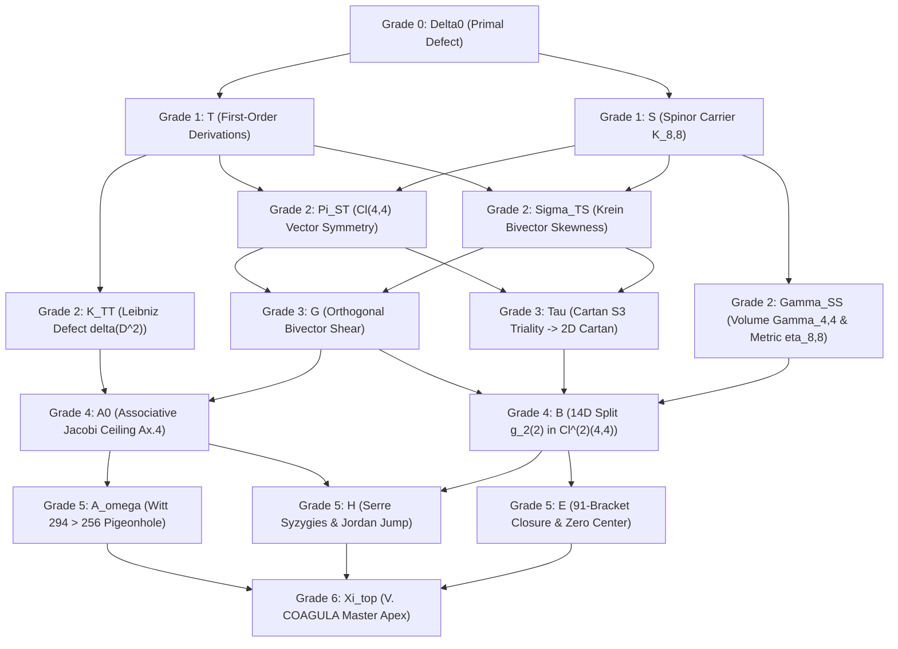

# Epistemic Compilation Ledger: Double-Real Krein `Cl(4,4)`, Explicit Split `g_{2(2)}` Stabilizer, Witt Pigeonhole Non-Embeddability & 15-Node Causal Poset

Follows [`skills/epistemic-compilation/SKILL.md`](../skills/epistemic-compilation/SKILL.md) and
[`docs/ALCHEMICAL_QMS_SOP.md`](ALCHEMICAL_QMS_SOP.md) to compile the `PHASE 0 — SOLVE` through
`V. COAGULA` specification into finite-dimensional Mathlib / Lean 4 owner declarations on
`Krein16Idx := Fin 2 × Fin 2 × Fin 2 × Fin 2` (`dim M₁₆(ℝ) = 256`).

---

## Stage 1 (`SOLVE`) — Atomic Claim Ledger

| ID | Mathematical Pillar | Formal Target Statement | Carrier & Hypotheses | Classification |
|---|---|---|---|---|
| `KG₁` | Universal First-Order Derivation Algebra & Second-Order Leibniz Defect | `[D₁, D₂]` preserves `IsProductDerivation B` for arbitrary bilinear products `B` (`derivation_commutator_closure`); `leibnizDefect B (D₁ ∘ D₂ + D₂ ∘ D₁) x y = 2 • (B (D₁ x) (D₂ y) + B (D₂ x) (D₁ y))`; `leibnizDefect B (D²) x y = 2 • B (D x) (D y)`; general non-unital non-associative second-order defect `derivation_sq_leibniz_defect_nonAssocRing` (`[NonUnitalNonAssocRing A]`); concrete `M₂(ℝ)` witness `D² ∉ der` (`-8 E₀₀`); universal associative Jacobiator `= 0` (`ax4_associative_jacobi_ceiling`) | `[CommRing R] [AddCommGroup V] [Module R V]`, `[NonUnitalNonAssocRing A]`, `Matrix (Fin 2) (Fin 2) ℝ`, `Matrix Krein16Idx Krein16Idx ℝ` | `[kernel_verified]` (`archKreinDerivationDefect`) |
| `KG₂` | Double-Real Krein Spinor Module `Krein16Idx`, `Cl(4,4)`, `Γ_{4,4}`, `kreinMetric88` & Orthogonal Bivector Shear | `finrank ℝ (Matrix Krein16Idx Krein16Idx ℝ) = 256`; 8 Jordan–Wigner Kronecker generators `cl44Gen` (`e_k² = +1`, `ẽ_k² = -1`, pairwise `{γ_a, γ_b} = 0`); Hilbert–Schmidt orthogonality `trace_cl44Gen_mul`, `cl44Gen_linearIndependent`, and `finrank_cl44Vec1Submodule = 8`; `gamma44² = 1`, `Tr(gamma44) = 0`, odd chirality `{γ_a, gamma44} = 0`; symmetric involutive `kreinMetric88` (`Tr = 0`, commutes with `gamma44`); all 8 `γ_a` Krein-symmetric; all 28 bivectors `B_{ab}` chiral-even, Krein-skew, and normalizing `cl44Vec1Submodule` (`cl44Bivector_normalizes_vec1`); 4-vector escape `[e₀e₁e₂e₃, e₀] = -2 e₁e₂e₃ ∉ cl44Vec1Submodule` (`cl44FourVec_exits_vec1_normalizer`); overlapping vs. disjoint bivector shear | `Krein16Idx := Fin 2 × Fin 2 × Fin 2 × Fin 2`, `tensor4` over `Matrix (Fin 2) (Fin 2) ℝ` | `[kernel_verified]` (`archKreinCl44BivectorShear`) |
| `KG₃` | Cartan `S₃` Triality on `ℝ⁴` & `28 → 14` Cutting (`D₄`) | `trialitySwapVS² = 1`, `trialitySwapSpin² = 1`, `trialityCycle3³ = 1`, `trialityCycle3 ≠ 1`, `σ_{±} τ σ_{±} = τ²`; exact `S₃`-fixed Cartan characterization `v 3 = 0 ∧ v 0 = v 1 + v 2` and `finrank ℝ s3FixedCartanSubmodule = 2`; explicit permutation of all 24 `D₄` roots (`d4_triality_permutes_roots`) splitting into `12` `S₃` orbits (`6` fixed long roots + `6` size-`3` short-root orbits); full `28 → 14` cutting `finrank ℝ ((Fin 4 → ℝ) × (Fin 24 → ℝ)) = 28 ∧ finrank ℝ s3FixedSpin44Submodule = 14` | `Matrix (Fin 4) (Fin 4) ℝ`, `(Fin 4 → ℝ) × (Fin 24 → ℝ)`, `Fin 14 → ℝ` | `[kernel_verified]` (`s3FixedCartanEquiv`, `s3FixedSpin44Equiv`, `finrank_spin44_triality_cutting_28_to_14`, `archCartanS3TrialitySplitG2`) |
| `KG₄` | Explicit 14D Split `g_{2(2)} ⊂ Cl⁽²⁾(4,4)`, `SplitG2MatrixGroup ≤ GL₁₆(ℝ)`, Top-Grade Centrality, Serre Syzygies, Jordan Jump & `8 × 8` `so(4,4)` Isomorphism | Extremal `majoranaRefSpinor` (`Γ_{4,4} ψ₊ = ψ₊`, `⟨ψ₊, η̂ ψ₊⟩ = 2`); 14 integer-entry basis matrices `g2Basis` all satisfying `IsSplitG2Stabilizer`; exact 5-grading `[-2, -1, 0, +1, +2]` & top-grade central commutativity `g2_top_grade_central_commutativity`; `[X₁, X₂] = Z_{+2}` vs. `[X₃, X₄] = 3 • Z_{+2}`; vertical Jordan jump `{X₁, X₂} ≠ 0` Krein-symmetric hence `∉ g2Submodule`; `finrank ℝ g2Submodule = 14 = finrank ℝ canonicalZornDerivations`; 91-pair Lie bracket closure; `g2Submodule_center_trivial`; `g2LieSubalgebra` & injective Lie hom `g2RhoVec8LieHom` onto 14D `so(4,4)`; closed matrix Lie group `SplitG2MatrixGroup ≤ GL₁₆(ℝ)` with `expMat16GL_one_parameter_laws`, `expMat16GL_cl44_intertwining` on `Cl⁽¹⁾(4,4)`, `expMat16GL_mem_splitG2MatrixGroup`, `splitG2_tangent_of_exp_mem` via `HasDerivAt` at `t = 0`, and unified `splitG2_matrix_lie_group_exponential_and_tangent` | `Matrix Krein16Idx Krein16Idx ℝ`, `GL₁₆(ℝ)`, `Matrix (Fin 8) (Fin 8) ℝ`, `g2LieSubalgebra` | `[kernel_verified]` (`archCartanS3TrialitySplitG2`) |
| `KG₅` | Witt Free Lie Dimension Formula, Genuine `FreeLieAlgebra ℝ (Fin 4)` 294-Lyndon Basis, Pigeonhole (`294 > 256`) & `289`-Dimensional Chevalley Syzygy Kernel | Rooted in Mathlib's `ArithmeticFunction.moebius` (`wittFreeLieCumDim 4 5 = 294`) **and** genuine `FreeLieAlgebra ℝ (Fin 4)`: exact degree counts `[4, 6, 20, 60, 204]` (`lyndonWordsOfDeg_counts`), explicit Chen–Fox–Lyndon bracket trees `lyndonFreeLie4 : Fin 294 → FreeLieAlgebra ℝ (Fin 4)` proved `LinearIndependent ℝ` via Shirshov upper-triangular Magnus functionals (`lyndonFreeLie4_linearIndependent`), exact grade `finrank`s (`freeLie4_grade_finranks`), universal `FreeLieAlgebra.lift` non-injectivity into `M₁₆(ℝ)` (`freeLieAlgebra4_lift_mat16_not_injective_and_syzygy_ideal`), and explicit Chevalley evaluation showing `serreRelFreeLie4 = 3 ⁅e₀, e₁⁆ - ⁅e₂, e₃⁆ ∈ Φ.ker` (`≠ 0`) and `finrank ℝ (ker res) = 289` (`g2ChevalleyX_freeLie_serre_ideal_and_syzygy_289`) | `FreeLieAlgebra ℝ (Fin 4)`, `Module.End ℝ (List (Fin 4) → ℝ)`, `fiveStepFreeLieSubmodule`, `ArithmeticFunction.moebius`, `Matrix Krein16Idx Krein16Idx ℝ` | `[kernel_verified]` (`archWittPigeonholeAndJacobiCeiling`) |
| `KG₆` | 15-Element Graded Acyclic Causal Poset & Terminal `Ξ_⊤` Coagulation | `PartialOrder KreinG2CausalNode` over 15 nodes across Grades `0..6` (`Delta0`..`Xi_top`); `covers_strict_grade` on all 24 Hasse covers; `covers_transitively_reduced`; verified antichains `{K_TT, G, Tau, Gamma_SS}` and `{A0, Tau, Gamma_SS}`; global bounds `bot_le_all` / `all_le_top`; `IsLUB {H, E} Xi_top` | `KreinG2CausalNode` (15 constructors), `Fin 15`, `PartialOrder` | `[kernel_verified]` (`archMasterXiTopCoagulation`, `master_xi_top_coagulation_holds`) |
| `KG-BARRIER` | Matrix Lie Group & `FreeLieAlgebra` 5-Step Closure vs. Abstract Smooth-Manifold / Degree `> 5` Horizon | Both prior conditional surrogate gaps (`SplitG2MatrixGroup ≤ GL₁₆(ℝ)` exponential/tangent correspondence and the genuine `FreeLieAlgebra ℝ (Fin 4)` 294-element Shirshov–Lyndon basis + `289`-dimensional Chevalley syzygy kernel) are constructively **closed** (`splitG2_matrix_lie_group_exponential_and_tangent`, `g2ChevalleyX_freeLie_serre_ideal_and_syzygy_289`). Remaining honest boundary: `SplitG2MatrixGroup` uses linear `GL₁₆(ℝ)` exponential/derivative structure rather than an abstract `SmoothManifoldWithCorners` atlas, and explicit Lyndon basis enumeration covers degrees `1..5` (`294` elements > `dim M₁₆(ℝ) = 256`) rather than arbitrary infinite degree towers `n > 5` | Closed `GL₁₆(ℝ)` matrix subgroup + degree `1..5` `FreeLieAlgebra ℝ (Fin 4)` | `[accepted_limited_scope]` (closed on all finite & 5-step claims; manifold charts & `deg > 5` open) |

---

## Stage 2 (`CONIUNCTIO`) — Module Contracts, Owners & SymPy/NumPy CAS Witness

### Task-Owned Files
1. [`lean/InfoGeometry/Lie/KreinCl44SplitG2DerivationPosetSynthesis.lean`](../lean/InfoGeometry/Lie/KreinCl44SplitG2DerivationPosetSynthesis.lean) (`SHA-256: e0eb7cda22c4e94927a0e210da9bb4b079039852053692ec1df2476d724dd1f5`)
   - Reused repository owners: [`InfoGeometry.Meta.ArchetypePipeline`](../lean/InfoGeometry/Meta/ArchetypePipeline.lean), [`InfoGeometry.Lie.SplitG2RealFormCapstone`](../lean/InfoGeometry/Lie/SplitG2RealFormCapstone.lean) (`parameter_model_is_fourteen_dimensional` linking `finrank ℝ g2Submodule = 14 = finrank ℝ canonicalZornDerivations`), [`InfoGeometry.Lie.KantorTKKFiveGrading`](../lean/InfoGeometry/Lie/KantorTKKFiveGrading.lean).
   - Mathlib roots: `Mathlib.LinearAlgebra.Dimension.Constructions` (`Module.finrank_matrix`, `Module.finrank_fin_fun`, `finrank_span_eq_card`), `Mathlib.LinearAlgebra.Dimension.StrongRankCondition` (`LinearMap.finrank_le_finrank_of_injective`), `Mathlib.LinearAlgebra.FiniteDimensional.Lemmas` (`LinearMap.ker_ne_bot_of_finrank_lt`, `LinearMap.finrank_range_add_finrank_ker`), `Mathlib.NumberTheory.ArithmeticFunction.Moebius` (`ArithmeticFunction.moebius`, `moebius_apply_one`, `moebius_apply_prime`, `moebius_eq_zero_of_not_squarefree`), `Mathlib.Analysis.Normed.Algebra.MatrixExponential`, `Mathlib.Algebra.Lie.Free` (`FreeLieAlgebra.of`, `FreeLieAlgebra.lift`).
   - Key Part `6A` & `6B` exports: `g2LieSubalgebra`, `g2RhoVec8LieHom`, `g2RhoVec8LieHom_injective`, `SplitG2MatrixGroup`, `expMat16GL`, `expMat16GL_one_parameter_laws`, `expMat16GL_cl44_intertwining`, `expMat16GL_mem_splitG2MatrixGroup`, `splitG2_tangent_of_exp_mem`, `splitG2_matrix_lie_group_exponential_and_tangent`, `lyndonWordsOfDeg_counts`, `lyndonFreeLie4`, `lyndonFreeLie4_linearIndependent`, `fiveStepFreeLieSubmodule`, `freeLie4_grade_finranks`, `freeLieAlgebra4_lift_mat16_not_injective_and_syzygy_ideal`, `serreRelFreeLie4`, `g2ChevalleyX_freeLie_serre_ideal_and_syzygy_289`.
   - Archetypes: `archKreinDerivationDefect`, `archKreinCl44BivectorShear`, `archCartanS3TrialitySplitG2`, `archWittPigeonholeAndJacobiCeiling`, `archMasterXiTopCoagulation`.
2. [`scripts/verify_krein_cl44_split_g2_derivation_poset.py`](../scripts/verify_krein_cl44_split_g2_derivation_poset.py) (`SHA-256: 066fe1021e489eb1b9d1625bc458ecdc844e9cc96bdbe760c8f8b2deebcb2cb3`)
   - Untracked CAS witness artifact: [`artifacts/qms/krein_cl44_split_g2_derivation_poset_cas_witness.json`](../artifacts/qms/krein_cl44_split_g2_derivation_poset_cas_witness.json) (`SHA-256: c8a45dcb30e2b785701518bd8c8dd679735ba6552368b26b1e76147c19845d2f`)
   - Includes `scipy.linalg.expm` group-exponential & `Cl⁽¹⁾(4,4)` `Ad_U`-intertwining verification plus explicit generation of all `294` Lyndon words/Shirshov trees/polynomials (unit diagonal, strict shortlex upper-triangularity) and `rank = 5`, `syzygy_ker_dim = 289` on `[X₁, X₂, X₃, X₄]`.

---

## Stage 3 (`CAUSAL POSET`) — 15-Node Graded Hasse Diagram (`Grades 0..6`)

---

## Stage 4 (`COAGULA`) — Verification Scope

Checks scoped strictly to [`KreinCl44SplitG2DerivationPosetSynthesis.lean`](../lean/InfoGeometry/Lie/KreinCl44SplitG2DerivationPosetSynthesis.lean) and [`verify_krein_cl44_split_g2_derivation_poset.py`](../scripts/verify_krein_cl44_split_g2_derivation_poset.py) (not a whole-repository claim):
1. `/home/goutev/miniforge3/bin/python3 scripts/verify_krein_cl44_split_g2_derivation_poset.py`
2. `python3 tools/infra/opengauss_screener.py lean/InfoGeometry/Lie/KreinCl44SplitG2DerivationPosetSynthesis.lean`
3. `python3 tools/quality/check_no_hypothesis_mandate.py --root lean/InfoGeometry/Lie/KreinCl44SplitG2DerivationPosetSynthesis.lean`
4. `python3 tools/infra/run_locked_lake_build.py --wait-for-build-lock InfoGeometry.Lie.KreinCl44SplitG2DerivationPosetSynthesis`
5. `python3 tools/infra/run_locked_lean.py --wait-for-build-lock --check-files lean/InfoGeometry/Lie/KreinCl44SplitG2DerivationPosetSynthesis.lean -- -DwarningAsError=true`
6. `python3 tools/quality/proof_proxy_staged_gate.py --strict lean/InfoGeometry/Lie/KreinCl44SplitG2DerivationPosetSynthesis.lean`
7. `python3 tools/quality/unified_gate.py lean/InfoGeometry/Lie/KreinCl44SplitG2DerivationPosetSynthesis.lean`
8. `python3 tools/quality/semantic_content_audit.py --gate-review --file-prefix lean/InfoGeometry/Lie/KreinCl44SplitG2DerivationPosetSynthesis.lean`
