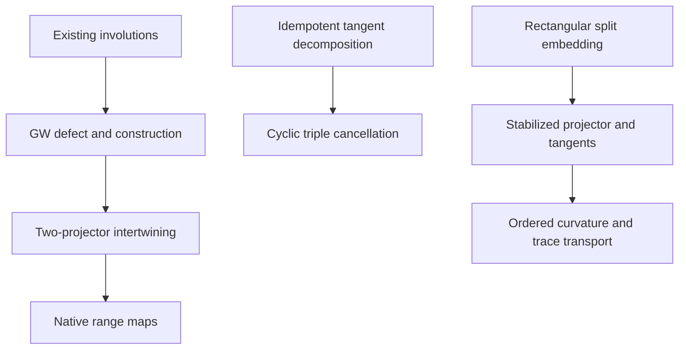

# Lattice chiral projectors: source contract and owner map

## Intake and provenance

The requested upstream work follows the user's link to Nathaniel Craig's
[A step toward defining the Standard Model on a lattice](https://openai.com/index/step-toward-defining-the-standard-model/)
(15 November 2026), read on 17 November 2026. The mathematical source is
[A gauge-invariant measure for lattice chiral fermions, arXiv:2610.09093v1](https://arxiv.org/html/2610.09093v1)
(6 October 2026), especially equations (4)–(7), Lemma 5.1, and the stabilized
projector in equation (72).

This is a repository integration of finite algebra used in that construction.
It is not a claim to have first proved or first formalized these identities.
The source already supplies a substantial separate Lean project:
[mathematical companion and Lean formalization, version DOI](https://doi.org/10.5281/zenodo.23196062).
Its [verification report](https://arxiv.org/src/2610.09093v1/anc/lean-verification-report.pdf)
reports compilation of sixteen modules, an axiom check, and a kernel replay.
Those are the archive's recorded results, not checks rerun by this PR.

Source inspection covered the article, the paper's relevant passages, the
archive README and revision note, the exported `Formalization.lean` statements,
the dependency manifests, and selected supporting declarations. The inspected
`paper-supplement.zip` has SHA-256
`761e06c05348d5984bf5e7064f5604113999b3cb56e5451856b4e44c071b9b89`.
The external project uses Lean `v4.35.0-rc2` and Mathlib
`07b28b3a5d5b2c39c8b9f9377d0c3fcacb720e17`. This repository keeps Lean
`v4.34.1` and Mathlib `d13f23b723b8a846827a245b89c10fc7d3f11612`.
No external project or dependency update is imported.

The archive separates successful proof checks from an unsuccessful original
Comparator reference check involving generated proof names and a reference
placeholder body. The present source review does not replay either workflow
or independently certify the entire external proof graph. In particular,
`Companion.measure_exists` is an existence theorem assembled from concrete
construction declarations; its statement does not merely assume a finished
measure-current package. Our smaller PR should not mischaracterize that work
as only conditional finite algebra.

## Claim ledger

| ID | Source mechanism | Precise local target | Input hypotheses | Disposition |
| --- | --- | --- | --- | --- |
| GW1 | Paper (4)–(5) | Exact GW defect and modified-chirality square defect | Associative real algebra; original involution | New local owner |
| GW2 | Paper (3)–(7) | Construct normalized Dirac operator from two involutions; derive GW and two-projector intertwining | Two existing `ChiralInvolution` values | New local owner, reuses projectors |
| GW3 | Hermiticity of modified chirality | Gamma-Hermiticity and star-fixed modified chirality | Explicit star-self-adjointness hypotheses | Conditional algebraic theorem |
| TR1 | Lemma 5.1 off-diagonal trace cancellation | A cyclic additive functional annihilates one tangent and an ordered triple of tangents | Idempotent, three tangent equations, cyclic functional | New generic extension of existing corner cancellation |
| ST1 | Equation (72) stabilization | Lift a projector through a rectangular split embedding and add an orthogonal complement projector | `V * U = 1`, complement idempotence and annihilation | New local owner |
| ST2 | Curvature comparison behind (74) | Ordered lifted commutator and compressed curvature; equal finite traces | Same split-embedding laws, with hypotheses minimized per theorem | New local owner |
| AN1 | Gapped spectral sign | Construct `sign(H_W[U])` from a lattice Wilson kernel | Lattice, Hermiticity, gap, functional calculus | Outside this PR |
| AN2 | Refinement measure current | Smooth projector families, transgression, determinant phase, convergence and locality | Actual refinement maps, quantitative estimates, analytic transport | Outside this PR |
| PH1 | Full physical theory | Reflection positivity and an interacting continuum Standard Model | Additional physical and analytic constructions | Not a conclusion of this PR |

The blog explicitly calls the construction a candidate lattice definition and
leaves finite-spacing reflection positivity under investigation. A statement
about a finite lattice regulator is not by itself a continuum existence theorem.

## Bounded repository search

Searches at base `08c34e03f610b452e03422037949196dc7d92d6d` and the existing
Fourier–Dirac checkout covered the canonical Lean tree, its source mirror,
`proofs`, and `lib`. Queries included Ginsparg–Wilson, overlap/Neuberger/Wilson
fermions, modified chirality, involutions, chiral projector intertwining,
idempotent tangents, cyclic traces, Kato generators, determinant lines,
rectangular stabilization, refinement, admissibility, and locality. Candidate
bodies, imports, primitive hypotheses and consumers were read. The current
open-PR title/head inventory was also inspected; no overlapping lattice-chiral
PR appeared in that bounded inventory. This is not an exhaustive absence claim
over unpublished branches. Optional declaration-graph indexes were not used as
proof evidence.

| Existing owner | Actual reusable result | Relevant boundary |
| --- | --- | --- |
| `OperatorAlgebra/ChiralProjectorFromInvolution.lean` | `ChiralInvolution`, constructed `Pleft/Pright`, idempotence, orthogonality and complementarity | Its two projectors belong to one supplied involution |
| `CliffordWeyl/ChiralIdeals.lean` | Ordinary chirality swapping and ideal mapping | Assumes anticommutation with one chirality; GW uses two distinct chiralities |
| `Core/IdempotentTangent.lean` | Tangency iff diagonal corners vanish; off-diagonal decomposition; canonical commutator generator | No differentiable projector family or Kato ODE construction |
| `OperatorAlgebra/NoncommutativeGradedTrace.lean` | `IsCyclic` and directed-corner cancellation | Does not itself provide the three-tangent bridge |
| `OperatorAlgebra/PeirceCompressionCurvature.lean` | Ordered curvature, two-factor parity and unital-ring-hom naturality | A rectangular corner lift is generally not unital |
| `OperatorAlgebra/PeirceProjectedConnection.lean` | Native range submodule and projected inner-derivation connection | Algebraic connection; not lattice refinement or determinant-line transport |
| `Canonical/QuasilatticeDirac.lean` and `KK/QuasilatticeIndexInvariance.lean` | Actual conjugation evolution and kernel/range transport | Supplied operator and intertwining data; not a Wilson overlap construction |
| `Volume/DeterminantBundle.lean` | Explicit real scalar model with absolute determinant action | Not the complex chiral determinant phase bundle |
| `LatticeGauge/FinitePlaquette.lean` and `FiniteGibbsModel.lean` | Group-valued plaquette covariance and finite Gibbs data | No overlap Dirac kernel or refinement measure current |

The external archive already contains the following counterparts. Our changes
adapt the useful finite algebra to repository owners and broader coefficients
where appropriate; they do not copy its analytic construction.

| External declaration | Source module | Local contribution |
| --- | --- | --- |
| `Companion.overlapGinspargWilsonValidation` | `Formalization/C03.lean` | Exact defect/converse, existing-projector integration and native range maps |
| `Companion.projectorOffDiagonalOddTraceValidation` | `Formalization/C03.lean` | Arbitrary associative ring and cyclic additive functional, without division by two |
| `Companion.isometricEmbedding_curvature_trace` | `Formalization/C02.lean` | Explicit rectangular split embedding over a commutative scalar ring |
| `Companion.isometricExtension_product` | `Formalization/C01.lean` | Reusable nonunital lift laws and projector stabilization |

The separate `yang-mills-group/OpenAI-YM-20261028` repository and the local
Yang–Mills assessment documents concern earlier work. They are not the source
project for Craig's chiral lattice paper.

## Contract A: Ginsparg–Wilson and two chiral projectors

Carrier: `Op` with `[Ring Op] [Algebra ℝ Op]`. Multiplication is the given
associative product; for `Module.End ℝ V` it is composition. Let
`gamma : ChiralInvolution Op`, with `gamma.chi * gamma.chi = 1`.

Define

\[
F_\gamma(D)=\gamma D+D\gamma-D\gamma D,
\qquad \widehat\gamma=\gamma(1-D).
\]

The identities are

\[
D\widehat\gamma+\gamma D=F_\gamma(D),\qquad
\widehat\gamma^2=1-\gamma F_\gamma(D),\qquad
\widehat\gamma^2=1\iff F_\gamma(D)=0.
\]

For a second existing involution `epsilon`, construct `D = 1 - gamma * epsilon`.
Then `widehat gamma = epsilon` and GW follows from the two involution laws;
GW is not stored as an assumed field. The existing half-projectors give

\[
D\widehat P_+=P_-D,\qquad D\widehat P_-=P_+D.
\]

The native endomorphism specialization proves `Set.MapsTo` between the actual
linear-map ranges. With a star operation and both involutions star fixed,
`star D = gamma * D * gamma`. This algebraic identity does not identify a
Krein adjoint with a positive Hilbert adjoint or establish Born positivity.

Here `D` is dimensionless: `D = a D_phys`. The paper's convention
`a D_phys = 1 + gamma * sign(H_W)` corresponds to `epsilon = -sign(H_W)`.
The sign operator is an input interpretation, not constructed by this module.

Target: `InfoGeometry.OperatorAlgebra.GinspargWilson`.

## Contract B: cyclic tangent cancellation

Carrier: an arbitrary associative ring `A`; target an additive commutative
group `S`; `tau : A →+ S` satisfying the existing `IsCyclic tau` predicate.
Let `p * p = p` and let each of `x`, `y`, `z` satisfy `p*x + x*p = x`.

The existing off-diagonal decomposition and directed-corner theorem give
`tau x = 0`. An exact ordered defect expansion shows `x*y*z` is another
tangent, hence

\[
\tau(xyz)=0,\qquad \tau\bigl(x(yz-zy)\bigr)=0.
\]

No division by two, positivity, star operation, or diagonalization is needed.
The native matrix specialization uses `Matrix.trace` over any `CommRing R`.
This does not yet define a differential form or prove its analytic closure.

Target: `InfoGeometry.OperatorAlgebra.PeirceTangentTrace`.

## Contract C: rectangular stabilization

Carrier: finite matrices over `CommRing R`, with independent coarse and fine
index types. Let `U` be fine-by-coarse and `V` coarse-by-fine with `V*U=1`.
Define the generally nonunital lift

\[
L(A)=UAV,\qquad Q=L(P)+E.
\]

The complement hypotheses are `E*E=E`, `E*U=0`, and `V*E=0`.
From them and `P*P=P`, derive `Q*Q=Q`. A coarse tangent lifts to a tangent
at `Q`. The ordered multiplication law `L(A)*L(B)=L(A*B)` gives

\[
Q[L(A),L(B)]Q=L(P[A,B]P).
\]

Rectangular cyclicity gives `trace (L(A)) = trace A`, hence equality of the
compressed curvature traces. For an isometry, take `V = U†` once the actual
adjoint and isometry hypotheses are available. We do not package the lift as
a unital `RingHom`: `L(1)=UV` need not be the fine identity.

This is a fixed-embedding statement. Differentiating a gauge-dependent `U`
introduces additional terms; they are not discharged by this finite identity.
Complement determinant factors and their return phases also need their own
proofs.

Target: `InfoGeometry.OperatorAlgebra.RectangularProjectorStabilization`.

## Actual dependency order

There is no claimed proof edge from these finite nodes to spectral gaps,
summability, global holonomy, reflection positivity, or a continuum theory.
The review record states which of these local Lean targets were actually
compiled and audited.

## Acceptance surface

Use the maintained `tools/quality/check_clifford_dirac.py` with the three
explicit targets, the unchanged pinned Lean/Mathlib environment, and native
axiom auditing enabled. The selected owner modules must have zero compiler
warnings. Check strict placeholders, semantic vacuity, the staged proof gate,
and the tracked pre-push hook separately. Record any blocked checks as blocked.

The source-closure check includes every repository import of the selected
owners. It is not a root Lake build, whole-repository validation, or a replay
of the external Standard Model formalization. No `sorry`, `admit`, custom
axiom, `native_decide`, or proof-checking bypass is permitted.
