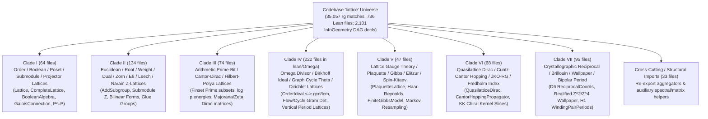
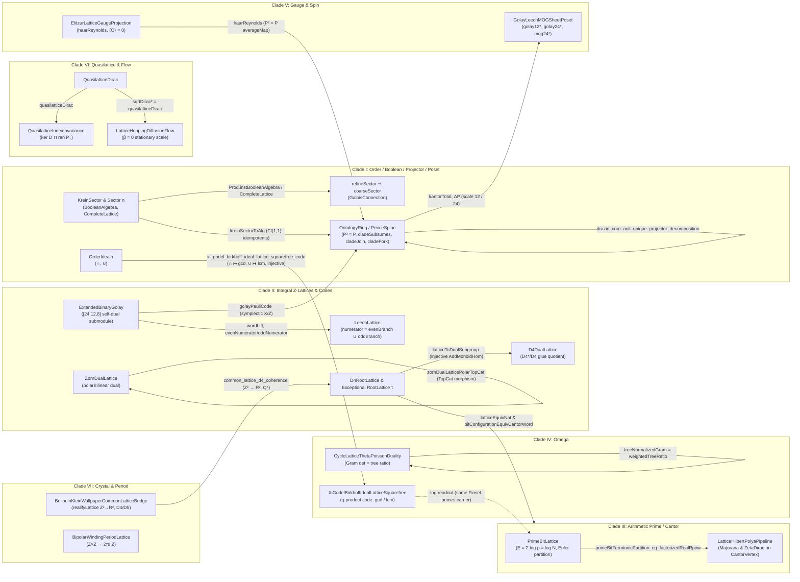

# Lattice: Full-Codebase Deep Search, Multi-Level Ontology ($M_0 \to M_3$), 7-Clade Taxonomy, Phylogenesis, and Exact Mathematical Connections

**Audit Date:** 2026-11-22  
**Authority Discipline:** Per [`AGENTS.md`](../AGENTS.md), [`docs/REPO_DEEP_SEARCH_PROTOCOL.md`](REPO_DEEP_SEARCH_PROTOCOL.md), and [`docs/ONTOLOGY_UNIFICATION_PLAYBOOK.md`](ONTOLOGY_UNIFICATION_PLAYBOOK.md), Lean owner files and kernel checks are mathematical authority; Auto-Ontology (`:3001`), ArangoDB (`:8530`), compiler DAG JSONL exports, and ripgrep statistics provide structural navigation and inventory evidence only. Mirrors (`src/**`), historical caches (`cached/**`, `archive/**`), external libraries (`external_refs/**`), and prose documents (`docs/**`, [`Lattice-Code.md`](../Lattice-Code.md)) are explicitly separated from canonical `lean/**` owners.

---

## 1. Exhaustive Multi-Surface Recall Census (`35,057` Occurrences)

Generated via unbounded ripgrep (`rg -i --json lattice --glob '!.git/**' --glob '!.lake/**'`) and persisted in [`reports/lattice.matches.jsonl`](../reports/lattice.matches.jsonl), [`reports/lattice.scan_stats.md`](../reports/lattice.scan_stats.md), and [`reports/lattice_auto_ontology_dag.json`](../reports/lattice_auto_ontology_dag.json):

- **Total occurrences (`submatches`):** `35,057` (`31,412` matching lines across `5,609` matched files)
- **Repo-owned Lean declaration lines matching `lattice`:** `1,892`
- **Deduplicated repo-owned AST/scan census** (per `/home/goutev/.hermes/cache/scratch/lattice_ontology_report.md`, excluding `.lake`, `node_modules`, generated artifacts, and `external_refs/**`, and deduplicating `src/` mirrors of `lean/`):
  - `59,827` repo-owned files read (`lean/`, `src/`, `tools/`, `scripts/`, `extensions/`, `docs/`, `tests/`, root configs)
  - `13,729` raw hits $\to$ **`8,149` deduplicated hits across `976` files**
  - **`2,103` Lean declarations** matching `lattice` across **`735` modules** (`702` nodes in the main connected import component; `1,831` internal import edges)
  - **Auto-Ontology REST (`:3001/health`):** `1,609` `lattice` terms (navigation evidence only; `1,831` import edges are dependency evidence, not mathematical equivalences)

| Surface | Matches | Files | Authority Role |
| --- | ---: | ---: | --- |
| `external-ref` | 16,536 | 3,777 | External context & libraries (`external_refs/CFSG`: 16,453 across 3,774 files; `external_refs/FrogBird`: 83 across 3 files). Note: [`lakefile.lean#L911-L937`](../lakefile.lean#L911-L937) explicitly compiles `OAI.GroupTheory.FiniteLattice.*` (14 files, 132 decls in `external_refs/openai-math/lean/OAI/GroupTheory/FiniteLattice/`) and `lean/InfoGeometry.lean#L89-L94` imports it. |
| `repo-owned` | 13,718 | 1,476 | Authoritative repo code (`lean/InfoGeometry`: 4,862 matches / 497 files; `src/InfoGeometry`: 4,598 / 458 files; `lean/Omega`: 1,679 / 222 files; `src/Omega`: 1,679 / 222 files; `tools/multisystem`: 358 / 10 files; `tools/infra`: 121 / 14 files; `tests/lean`: 74 / 2 files; `tools/sympy`: 62 / 24 files; `src/InfoGeometry.lean`, `lean/Omega.lean`, `src/Omega.lean`). |
| `archive-or-cache` | 4,193 | 241 | Historical AI Studio dumps, proof logs, snapshots (`cached/**`, `proofs/**`, `reconciliation/**`, `archive/**`). Non-authoritative. |
| `docs` | 532 | 107 | Prose documentation and contracts (`docs/Logipedia.md`, `docs/SYMMETRY_GROUP_INVENTORY.md`, [`Lattice-Code.md`](../Lattice-Code.md), [`docs/FINITE_LATTICE_RESAMPLING.md`](FINITE_LATTICE_RESAMPLING.md), [`docs/LATTICE_CHIRAL_PROJECTOR_CONTRACT.md`](LATTICE_CHIRAL_PROJECTOR_CONTRACT.md)). |
| `generated-artifact` | 78 | 8 | Generated graph/audit/extraction JSON exports (`artifacts/alexandria/**`, JSON reports). |

### Canonical Lean Trees vs. Mirror Tree Breakdown

| Lean Source Tree | Total `.lean` Files | Lattice-Touching Files | Lattice-Named / File Declarations | Notes |
| --- | ---: | ---: | ---: | --- |
| `lean/InfoGeometry` | 17,639 | 500 | 1,401 (`10,848` total decls in those files) | Canonical active Lean source tree |
| `lean/Omega` | 9,845 | 222 | 362 (`1,466` total decls in those files) | Canonical `Omega` arithmetic / POM / SPG / Zeta / Folding / Conclusion library |
| `src/InfoGeometry` | 16,863 | 459 | 1,254 | Mirror/candidate tree; notably hosts [`OntologyRing.lean`](../src/InfoGeometry/OperatorAlgebra/OntologyRing.lean), [`AnalyticOntologyTaxonomyPhylogenesisPoset.lean`](../src/InfoGeometry/Canonical/AnalyticOntologyTaxonomyPhylogenesisPoset.lean), and [`ColimitInverseLimitOntologyTaxonomyPhylogenesisPoset.lean`](../src/InfoGeometry/Canonical/ColimitInverseLimitOntologyTaxonomyPhylogenesisPoset.lean) |
| `src/Omega` | 9,845 | 222 | 362 | Mirror of `lean/Omega` |
| `external_refs/openai-math/lean/OAI/GroupTheory/FiniteLattice` | 14 | 14 | 132 | subgroup-lattice library compiled via `lakefile.lean` (`lean_lib OAI`) |

---

## 2. Auto-Ontology (`:3001`), ArangoDB (`:8530`), and Compiler DAG Projection

Live telemetry observed on 2026-11-22 across the repository's Auto-Ontology, ArangoDB, and local compiler DAG infrastructure:

1. **Auto-Ontology REST Service (`http://127.0.0.1:3001/api/terms`):**
   - `lattice` / `Lattice`: `1,609` projected declaration terms
   - `Hurwitz`: `728` · `Quasilattice`: `122` · `Birkhoff`: `85` · `Plaquette`: `84` · `Sublattice`: `35` · `Phylogen`: `35` · `Taxonom`: `25` · `CompleteLattice`: `22`
   - *Lag observation*: Newer modules not yet projected into the PostgreSQL `auto-ontology` store return `0` via REST (e.g., `D4RootLattice`=0, `OntologyRing`=0) even though they are present in `artifacts/dag/index/decls.jsonl` or `lean/` / `src/`.
2. **ArangoDB `infogeometry` (`http://127.0.0.1:8530`, generation `ig_full_20261115_b`):**
   - Total declarations: `335,101`; edges: `2,313,219` (`status: complete`).
   - Lattice-matching declarations: `1,874` across top modules `InfoGeometry.Arithmetic.LatticeHilbertPolyaPipeline` (`210`), `InfoGeometry.Canonical.KreinProjectorLattice` (`95`), `InfoGeometry.RootSystem.D4DualLattice` (`91`), `InfoGeometry.Quantum.ModularAnomaly` (`84`), `InfoGeometry.Arithmetic.PrimeCantorLatticeDirac` (`68`), `InfoGeometry.Canonical.ZornDualLatticeTopologicalReadout` (`65`), `InfoGeometry.Canonical.LatticeHoppingDiffusionFlow` (`59`), `InfoGeometry.Arithmetic.PrimitiveBinarySuperZetaBridge` (`59`), `InfoGeometry.RootSystem.D4RootLattice` (`51`), `InfoGeometry.Canonical.EvansHarmonicTrap` (`43`), etc.
   - `evo_commits` matching `lattice`: `36` indexed commits.
3. **Closed Compiler Declaration DAG Subgraph & Auto-Ontology Validation ([`tools/infra/ontology_bridge_data.py`](../tools/infra/ontology_bridge_data.py)):**
   - Extracted [`reports/lattice_decls.jsonl`](../reports/lattice_decls.jsonl) (`2,101` lattice declarations across `211` `InfoGeometry` modules from `artifacts/dag/index/decls.jsonl`) and [`reports/lattice_edges.jsonl`](../reports/lattice_edges.jsonl) (`9,323` internal dependency edges where both endpoints lie in the lattice subgraph: `4,090` `type` edges and `5,233` `value` edges spanning `226` distinct cross-module `(src_mod, dst_mod, kind)` pairs).
   - Validated via `run_offline_jsonl_dry_run` ([`reports/lattice_ontology_projection_receipt.json`](../reports/lattice_ontology_projection_receipt.json)): `status: "dry_run_ok"`, `expected_decl_count: 2101`, `expected_edge_count: 9323`, `module_count: 211`, deterministic `source_digest: "198bf6098005ca219daf0a58fe13bdc202401e3504e064f92ea150d5047e5f2e"`.
   - Kahn topological sort on cross-module lattice dependencies ([`reports/lattice_dag_strata.json`](../reports/lattice_dag_strata.json)): **100% strictly acyclic (`211 / 211` modules ordered into `6` dependency strata, depth `0..5`)**.

---

## 3. Multi-Level Ontology (`M₀ → M₃` & `RepDepth`)

Following the four-level stratification formalized in [`OntologyRing.lean#L376-L429`](../src/InfoGeometry/OperatorAlgebra/OntologyRing.lean#L376-L429) (`OntologyMetaLevel` with strictly acyclic `instantiatesEdge`) and `InfoGeometry.Meta.Architecture` (`RepDepth`), every lattice structure in the codebase sits at an explicit ontological stratum:

| Meta-Level | Ontological Role | Realization Across Codebase Lattice Families | Concrete Lean 4 Witnesses |
| --- | --- | --- | --- |
| **`M₀_StateIndividual`** (`L0/L1`) | Ground lattice elements, coordinates, bitstrings, link configurations, and states | Individual $\mathbb{Z}^n$ / $\mathbb{Q}^n$ lattice vectors, `BinaryWord n` / `CantorVertex P` / `PrimeBitLattice` configurations, `KreinSector` atoms, `WindingPair` loops, `PlaquetteLattice.Configuration` link assignments, `HurwitzInteger` quaternions, individual `x ∈ projectorSubspace P`. | `D4.Ambient`, `LeechLattice.IntegerWord24`, `SplitCharge n`, `WindingPair`, `CantorVertex P`, `HurwitzInteger`, `D6.ReciprocalCoord`, `KreinSector.minus/plus`. |
| **`M₁_ProjectorClabject`** (`L2/L3`) | Lattice carriers as algebraic subobjects, order lattices, ideals, and idempotent projectors | `Lattice`/`DistribLattice`/`CompleteLattice`/`BooleanAlgebra` instances, `AddSubgroup`/`Submodule ℤ` root & dual carriers, `Finset`-backed `OrderIdeal`, noncommutative ring idempotents (`P * P = P`) acting simultaneously as operator elements ($M_1$) and classifiers of `projectorSubspace P` ($M_0$). | `KreinSector`, `Sector n`, `D4.latticeSubgroup`, `D4.dualSubgroup`, `ZornVectorMatrix.dualLattice`, `G2IntegralRootLattice.rootLattice`, `xi_godel_birkhoff_ideal_lattice_squarefree_order_ideal`, `CladeSubsumes`, `haarReynolds`. |
| **`M₂_GrassmannianPowertypeOrbit`** (`L4`) | Moduli orbits, Galois adjunctions, symmetry actions, coset glue quotients, and cladistic phylogenies | `GaloisConnection` between refinement and coarse-graining levels, `d4WeylGroup` and `rootLatticeWeylGroup τ` permutations, $D_6$ / $D_4$ crystallographic wallpaper actions, `D4DualLattice` discriminant glue quotient $D_4^*/D_4$, Hurwitz–MOG Golay frames (`golay12*`, `golay24*`, `mog24*`), `cladeFork` / `cladeJoin` cladograms. | `sector_galois_connection`, `cantorWordOperatorUnitRep`, `common_lattice_d4_coherence`, `quasilatticeChiralKernelSlicePlus`, `archetype_A61_golay_12_and_leech_24_operator_error_correcting_codes`, `cladeFork_character_polarity_and_mrca_inclusion`. |
| **`M₃_ErlangenCasimirMetaLaw`** (`L5`) | Partition sums, theta–Poisson duality, RG fixed points, Elitzur invariance, and topological index invariants | Gibbs partition factorizations, Elitzur theorem ($\langle O \rangle = 0$ & $\lim_n \langle O_n \rangle = 0$), cycle-lattice Gram determinant / theta–Poisson duality, JKO/RG $\beta$-function zeros, Bogoliubov-flow KK Fredholm index invariance, and Erlangen `RingEquiv` transport across entire ontologies. | `primeBitFermionicPartition_eq_factorizedProduct`, `elitzur_thermodynamic_limit_zero`, `paper_pom_cycle_lattice_theta_poisson_duality`, `betaFunction_eq_zero_at_continuum_emergence`, `quasilatticeAnalyticalIndex`, `erlangen_ringEquiv_preserves_taxonomy_phylogenesis_and_center`. |

---

## 4. The 7-Clade Mathematical Taxonomy of `"lattice"` Across the Codebase

Searching across all canonical Lean files touching `"lattice"` (`500` in `lean/InfoGeometry`, `222` in `lean/Omega`, `14` in compiled `OAI.GroupTheory.FiniteLattice` = **`736` files** total; `737` hits minus 1 subdir overlap) partitions the occurrences by **exact mathematical structure and Lean carrier**:

### Detailed Clade Specification & Scope Boundaries

1. **Clade I — Order-Theoretic, Boolean, Subgroup, Projector & Poset Lattices (`64` files; e.g., `KreinProjectorLattice`, `SectorLattice`, `CantorCylinderLattice`, `CliffordCompleteLatticeCurrentHierarchy`, `OntologyRing`, `CladisticPhylogenesisBridge`, `OAI.GroupTheory.FiniteLattice.*`)**:
   - **Carriers:** Finite enumerated posets (`KreinSector`), `Set (BinaryWord n) × KreinSector`, `BinaryWord n → KreinSector`, Mathlib `Lattice` / `DistribLattice` / `CompleteLattice` / `BooleanAlgebra` / `GaloisConnection`, finite group `Subgroup K` intervals (`A ≤ U i`), and noncommutative ring idempotents (`P * P = P`) with absorption partial order `cladeSubsumes Psub Panc`.
   - **Key Verified Facts:** [`KreinProjectorLattice.lean`](../lean/InfoGeometry/Canonical/KreinProjectorLattice.lean) proves the 4-element Krein sector `{bot, minus, plus, top}` is a `DistribLattice`, `BoundedOrder`, and `BooleanAlgebra` (`KreinSector.compl`, `sdiff`, `himp`). [`SectorLattice.lean`](../lean/InfoGeometry/Canonical/SectorLattice.lean) proves `Sector n` inherits `BooleanAlgebra` and `CompleteLattice` and maps sectors to split-$Cl(1,1)$ idempotents `kreinMinusProjector` and `kreinPlusProjector`. [`RefinementGaloisConnection.lean`](../lean/InfoGeometry/Canonical/RefinementGaloisConnection.lean) proves `sector_galois_connection : GaloisConnection refineSector coarseSector`. [`OAI/GroupTheory/FiniteLattice/CommonCore.lean`](../external_refs/openai-math/lean/OAI/GroupTheory/FiniteLattice/CommonCore.lean) proves `common_core` gluing compatible extensions over a finite lattice of subgroups `A ≤ U i`.
   - **Boundary:** Order-theoretic completion does *not* generate analytic norm topologies or current algebras on its own: [`CliffordCompleteLatticeCurrentHierarchy.lean#L18-L23`](../lean/InfoGeometry/Canonical/CliffordCompleteLatticeCurrentHierarchy.lean#L18-L23) explicitly keeps `FiniteLatticeCurrentHierarchyPacket` conditional on supplied `heiOper`, `heiTrunc`, `hComm`.

2. **Clade II — Euclidean, Root, Weight, Quaternionic/Octonionic Order, Dual, $E_8$, Leech & Narain $\mathbb{Z}$-Lattices (`134` files)**:
   - **Carriers:** `AddSubgroup (Fin n → ℤ)` / `(Fin n → ℚ)` / `ZornVectorMatrix ℚ`, `Submodule ℤ (Fin n → ℝ)`, `Submodule ℤ (ℤ × ℤ)`, `SplitCharge n := (Fin n → ℤ) × (Fin n → ℤ)`, equipped with exact bilinear forms (`dot`, `rationalDot`, `polarBilinear`, `hyperbolicPair`, `icosianE8Gram`, `normSqNumerator`).
   - **Key Verified Facts:**
     - **$D_4$ Root & Weight Dual:** [`D4RootLattice.lean`](../lean/InfoGeometry/RootSystem/D4RootLattice.lean) defines `IsD4 x := coordinateSum x % 2 = 0`, constructs `latticeSubgroup : AddSubgroup Ambient`, proves `rootFinset_card = 24`, Cartan matrix entries, and reflections; [`D4DualLattice.lean`](../lean/InfoGeometry/RootSystem/D4DualLattice.lean) embeds `latticeToDualSubgroup : latticeSubgroup →+ dualSubgroup` and characterizes the index-4 glue quotient.
     - **Exceptional & $G_2$ Lattices:** [`ExceptionalRootLatticeWeyl.lean`](../lean/InfoGeometry/RootSystem/ExceptionalRootLatticeWeyl.lean) builds `rootLatticeWeylGroup τ` and transports it faithfully to `CantorWord`; [`G2IntegralRootLattice.lean`](../lean/InfoGeometry/Algebra/Zorn/G2IntegralRootLattice.lean) proves the 12 signed $G_2$ roots span `ℤ × ℤ` (`rootLattice_eq_top`).
     - **Zorn Split-Octonion Dual Lattice:** [`ZornDualLattice.lean`](../lean/InfoGeometry/Algebra/ZornDualLattice.lean) defines `polar`, `polarBilinear`, `dualLattice`, and proves `integralLattice_is_integral`; [`ZornDualLatticeTopologicalReadout.lean`](../lean/InfoGeometry/Canonical/ZornDualLatticeTopologicalReadout.lean) lifts it into Mathlib `TopCat`.
     - **Icosian-$E_8$, Golay-Leech ($\Lambda_{24}$), & Split Charge ($\Lambda \oplus \Lambda^*$):** [`IcosianE8LatticeBridge.lean`](../lean/InfoGeometry/Canonical/IcosianE8LatticeBridge.lean) constructs `IcosianGeneratedLattice : Submodule ℤ (Fin 8 → ℝ)` and `icosianE8Gram`; [`LeechLattice.lean`](../lean/InfoGeometry/Combinatorics/LeechLattice.lean) builds Construction B/neighbor `numerator := evenBranch ∪ oddBranch` from [`GolayConstructionA.lean`](../lean/InfoGeometry/Combinatorics/GolayConstructionA.lean) / [`ExtendedBinaryGolay.lean`](../lean/InfoGeometry/Combinatorics/ExtendedBinaryGolay.lean) and proves `scaledRealization_normSq`; [`SplitChargeLattice.lean`](../lean/InfoGeometry/Algebraic/SplitChargeLattice.lean) defines `hyperbolicPair` and `hyperbolicNorm q = 2 m·w` with `finiteChargeSupertrace`.
   - **Honest Debt & Scaffolds:** [`HurwitzLattice.lean`](../lean/InfoGeometry/Projective/HurwitzLattice.lean) defines `HurwitzInteger` via an explicit integer/half-integer disjunction, maps into $2\times 2$ real matrices via `hurwitzToTwistorBlock`, and flags ring-closure/multiplication proofs as `DEBT_KIND: SORRY` in docstring (zero Lean `sorry`, because no theorem on multiplication is claimed yet). [`HestenesD4HurwitzBridge.lean`](../lean/InfoGeometry/Krein/HestenesD4HurwitzBridge.lean) is an explicit interface structure `D4LatticeKacMoodyBridge` collecting supplied hypotheses, not a construction of Hurwitz maximal order or affine Kac–Moody theory. [`ViazovskaMagicFunctionRoots.lean`](../lean/InfoGeometry/Canonical/ViazovskaMagicFunctionRoots.lean) proves elementary shell-radius squares `(e8ShellRadius 1)^2 = 2`, `(e8ShellRadius 2)^2 = 4`, not Cohn–Elkies Fourier bounds.

3. **Clade III — Arithmetic Prime-Bit, Cantor-Dirac & Hilbert–Pólya Spectral Lattices (`74` files)**:
   - **Carriers:** `PrimeBitLattice := {P : Finset ℕ // ∀ p ∈ P, Nat.Prime p}`, `CantorVertex P := {S : Finset ℕ // S ⊆ P.primes}`, `CantorField P := CantorVertex P → ℂ`, Clifford bit-flip operators `bitFlip`, and `DirectLimitSuperClosure` induction stages.
   - **Key Verified Facts:** [`PrimeBitLattice.lean`](../lean/InfoGeometry/Arithmetic/PrimeBitLattice.lean) proves `primeBitEnergy_eq_log_primeBitInteger` ($E(\varepsilon) = \log \prod_{p \in \varepsilon} p$) and the finite Gibbs Euler-like factorization `primeBitFermionicPartition_eq_factorizedRealRpow` ($\sum_{\varepsilon \subseteq P} e^{-\beta E(\varepsilon)} = \prod_{p \in P} (1 + p^{-\beta})$). [`PrimeCantorLatticeDirac.lean`](../lean/InfoGeometry/Arithmetic/PrimeCantorLatticeDirac.lean) builds noncommuting Clifford/bit-flip Dirac operators (`bitFlip_involutive`, `exists_noncomm_pair`) and Witten index parity. [`LatticeHilbertPolyaPipeline.lean`](../lean/InfoGeometry/Arithmetic/LatticeHilbertPolyaPipeline.lean) (`210` DAG declarations — the single largest lattice module) proves `FiniteMajoranaLattice.D_sq_eq_H`, `FiniteZetaDiracLattice.D_selfAdjoint_of_zetaCriticalLine` on $\operatorname{Re}(s) = 1/2$, and `FiniteSuperchargeInduction` across inductive stages.
   - **Boundary:** Explicitly finite-cutoff registers; does not prove infinite Euler product convergence for all $s$ inside the critical strip or the Riemann Hypothesis.

4. **Clade IV — `lean/Omega` Divisor, Birkhoff Ideal, Graph-Cycle Theta & Dirichlet Vertical Lattices (`222` files in `lean/Omega`)**:
   - Split across three sub-families inside `lean/Omega/{Core,POM,SPG,Graph,Zeta,Folding,CircleDimension,DerivedConsequences,Conclusion}`:
     - **IV-A Divisor / Birkhoff Order-Ideal / Gödel Squarefree Lattices (`165` files):** E.g. [`FiberBirkhoffFenceIdealLattice.lean`](../lean/Omega/POM/FiberBirkhoffFenceIdealLattice.lean), [`XiGodelBirkhoffIdealLatticeSquarefree.lean`](../lean/Omega/Zeta/XiGodelBirkhoffIdealLatticeSquarefree.lean), [`FiberLatticeSquarefree.lean`](../lean/Omega/Core/FiberLatticeSquarefree.lean), [`XiSaturatedShiftInvariantLatticeGcdLcm.lean`](../lean/Omega/Zeta/XiSaturatedShiftInvariantLatticeGcdLcm.lean). Maps finite downward-closed order ideals (`Finset α`) injectively to squarefree Gödel integers with `∩ ↦ Nat.gcd` and `∪ ↦ Nat.lcm`.
     - **IV-B Graph-Cycle & Flow Integral Lattices (`24` files):** E.g. [`FlowLatticeGramDeterminantTreeWeight.lean`](../lean/Omega/Graph/FlowLatticeGramDeterminantTreeWeight.lean), [`CycleLatticeThetaPoissonDuality.lean`](../lean/Omega/POM/CycleLatticeThetaPoissonDuality.lean), [`GraphCycleLatticeLeyangPhasePolynomial.lean`](../lean/Omega/SPG/GraphCycleLatticeLeyangPhasePolynomial.lean). Links resistance-form Gram determinant `weightedTreeSum / edgeWeightDet` to Lee–Yang phase polynomials and theta–Poisson bulk/dual duality (`paper_pom_cycle_lattice_theta_poisson_duality`).
     - **IV-C Dirichlet Vertical, Dyadic Zero & Boolean Sheaf Lattices (`33` files):** E.g. [`DirichletVerticalLattice.lean`](../lean/Omega/POM/DirichletVerticalLattice.lean), [`ConclusionXiDyadicShellZeroLattice.lean`](../lean/Omega/CircleDimension/ConclusionXiDyadicShellZeroLattice.lean), [`TwoIncommensurableBasesDestroyVerticalLattice.lean`](../lean/Omega/Conclusion/TwoIncommensurableBasesDestroyVerticalLattice.lean). Solves logarithmic branch equations yielding constant vertical imaginary spacing $2\pi / \lambda_{\log}$.

5. **Clade V — Lattice Gauge Theory, Plaquette Holonomy, Gibbs Resampling, Elitzur Projection & Spin/Kitaev Lattices (`47` files)**:
   - **Carriers:** `PlaquetteLattice Vertex Edge Face`, `Configuration Edge Gauge := Edge → Gauge`, finite Markov/Gibbs spaces over `Fintype α`, `Units ℤ` $\mathbb{Z}_2$ Higgs-link lattice configurations, and operator-valued Kitaev/Majorana spin lattices (`GolayLeechMOGSheetPoset` / `KitaevPeirceAporiaEpistemicSynthesis`).
   - **Key Verified Facts:** [`FinitePlaquette.lean`](../lean/InfoGeometry/LatticeGauge/FinitePlaquette.lean) proves `plaquetteHolonomy_gauge_covariant` and `plaquetteAction_gauge_invariant` (using binary indicator `plaquetteCost := if hol = 1 then 0 else 1`). [`FiniteGibbsModel.lean`](../lean/InfoGeometry/LatticeGauge/FiniteGibbsModel.lean) & [`FiniteResamplingDynamics.lean`](../lean/InfoGeometry/LatticeGauge/FiniteResamplingDynamics.lean) prove Gibbs invariance, detailed balance, and Poincaré spectral gap `1` for resampling. [`ElitzurLatticeGaugeProjection.lean`](../lean/InfoGeometry/OperatorAlgebra/ElitzurLatticeGaugeProjection.lean) proves `haarReynolds_apply_eq_zero`, `haarReynolds_gibbs_invariance`, `elitzur_local_gauge_expectation_zero`, `elitzur_thermodynamic_limit_zero`, plus a concrete 2-site $\mathbb{Z}_2$ link-Higgs witness (`⟨σ₀⟩ = 0`, `⟨σ₀ U₀₁ σ₁⟩ = tanh J`).
   - **Boundary:** Finite cell complexes / finite group actions; does not construct 4D continuum Yang–Mills measure or Continuum OS reconstruction.

6. **Clade VI — Quasilattice Dirac, Cuntz–Cantor Hopping, JKO/RG Flow & Chiral Fredholm Index (`68` files)**:
   - **Carriers:** `DoubledSpace E →L[ℝ] DoubledSpace E`, `BogoliubovVielbeinBundle`, `Submodule ℝ (DoubledSpace E)` chiral kernel slices, `CantorHoppingPropagator`, `DiracSquareRootPropagator`, and `CuntzGenerators d A`.
   - **Key Verified Facts:** [`QuasilatticeDirac.lean`](../lean/InfoGeometry/Canonical/QuasilatticeDirac.lean) computes derivatives of Bogoliubov-transported quasilattice Dirac families and splits them into phase-linear and phase-antilinear parts. [`QuasilatticeIndexInvariance.lean`](../lean/InfoGeometry/KK/QuasilatticeIndexInvariance.lean) defines `quasilatticeChiralKernelSlicePlus` via `LinearMap.ker D ⊓ LinearMap.range gradeProjPlus` and proves `quasilatticeAnalyticalIndex` invariance along conjugacies (feeding stratum-5 apical bridge `SuperchargeEinsteinSourceBridge`). [`LatticeHoppingDiffusionFlow.lean`](../lean/InfoGeometry/Canonical/LatticeHoppingDiffusionFlow.lean) couples `CantorHoppingPropagator`, `DiracSquareRootPropagator`, `OperatorJKOArgmin`, and `InformationFlow` to prove `betaFunction_eq_zero_at_continuum_emergence` and `jko_penalty_le_energy_drop` (conditional on `LatticeJKORGFlowBridge`). [`LatticeCantorPercolationApollonianDictionary.lean`](../lean/InfoGeometry/GrandUnification/LatticeCantorPercolationApollonianDictionary.lean) bundles Descartes/Soddy involutions, Cuntz–Markov cylinder transition steps, and percolation additive gluing.

7. **Clade VII — Crystallographic Reciprocal, Brillouin Zone, Wallpaper & Analytic Period Lattices (`95` files)**:
   - **Carriers:** `ReciprocalCoord := Fin 2 → ℤ`, `Z2 := ℤ × ℤ`, `Lattice2D := ℝ × ℝ`, `WindingPair := ℤ × ℤ` (loop basis of $\mathbb{C} \setminus \{0, 1\}$), and Klein-bottle / wallpaper symmetry groups.
   - **Key Verified Facts:** [`D6ReciprocalLatticeBrillouinZone.lean`](../lean/InfoGeometry/Canonical/D6ReciprocalLatticeBrillouinZone.lean) formalizes the 6-vector `hexStarFin`, hexagonal sup-norm `axialNorm p := max (max |p 0| |p 1|) |p 0 + p 1|`, and $D_6$ equivariance (`axialRotate_sixth`, `axialReflect_conjugates_rotate`). [`BrillouinKleinWallpaperCommonLatticeBridge.lean`](../lean/InfoGeometry/Topology/BrillouinKleinWallpaperCommonLatticeBridge.lean) proves `common_lattice_d4_coherence` intertwining the realified lattice `realifyLattice : Z2 → ℝ × ℝ` under `realD4Action` with `latticeEmbed : Z2 → ℚ⁵` under `weylD5CrossSection2`. [`BipolarWindingPeriodLattice.lean`](../lean/InfoGeometry/Analysis/BipolarWindingPeriodLattice.lean) proves `circulationPeriod w = (w.1 - w.2) * 2πi` vanishes on `diagonalWinding n = (n, n)` and matches the Klein-quadric residue pairing. [`KagomeKleinIncompatibility.lean`](../lean/InfoGeometry/Physics/KagomeKleinIncompatibility.lean) proves $\pi/3$ and $2\pi/3$ Kagome crystal symmetries violate the Klein bottle constraint $\sin \theta = 0$.

---

## 5. Phylogenesis (`2026-04-08 → 2026-11-21` Git Lineage + 6 DAG Strata)

Two complementary phylogenetic views were extracted directly from repository history and compiler metadata:

### A. Empirical Git Commit Phylogeny (7 Evolutionary Epochs)
1. **Epoch 1 (`2026-04-08 → 2026-04-28`, `42880a6308`, `d01f31cd95`, `1758601d4a`):** Genesis of projective Hestenes/Kähler geometry, Hurwitz root-shell corridors, and thermodynamic Cartan bridges (`docs` + initial `Projective` skeletons).
2. **Epoch 2 (`2026-05-15 → 2026-05-19`, `be7422c302`, `6044c95b50`, `d70f8cda9b`, `f8b814e7b5`):** Arithmetic Prime-Cantor Boolean cube, Majorana zeta witnesses, and `PrimeBitLattice` finite-cutoff thermodynamics.
3. **Epoch 3 (`2026-06-12 → 2026-07-29`, `f5ac3da135`, `f963adcdab`, `f930a4e1f4`, `6e97814c80`):** Exceptional $E_8$ / Leech / `MD008` charge lattices, Golay codes, Pin(5,5) glide reflections, and Spin(16) triplication milestones.
4. **Epoch 4 (`2026-07-31 → 2026-08-29`, `b7e6ae6fc`, `e6b7d226c`, `6d7865c729`, `9afe59f228`, `d9c6ef84e0`):** *Anti-vacuity & concrete owner construction*: eradication of scalar/diagonal surrogates, `TopCat` Zorn dual lattice readouts, verified integral `D4RootLattice` + Weyl reflection owners, Log Lattice free-module structure, and Calogero–Moser–Sutherland primon lattices.
5. **Epoch 5 (`2026-09-10 → 2026-10-28`, `b7dc9882c6`, `7efebd1e96`, `398fde62b`, `b3ad566b26`):** Cross-domain unification: `Sp56` DSZ lattice quantization, `LatticeCantorPercolationApollonianDictionary`, $E_{10}$ Serre root-lattice grading, and Erlangen 2.0 `CuntzHoppingCantorLattice` deduplication.
6. **Epoch 6 (`2026-10-30 → 2026-11-10`, `0a888c5ba`, `6c9c2abf6`, `bd894d160`, `4d22941c8`):** Operator error correction and categorical closure: `Lattice-Code.md` / `GolayLeechMOGSheetPoset` (`A₆₁–A₆₉`), `KitaevLocalGapOmegaSpectrumPoset`, `OntologyRing` (`M0–M3`), and large-$D$ Peirce/Krein/Drazin posets.
7. **Epoch 7 (`2026-11-13 → 2026-11-22`, `6b32cdead`, `7378582cd5`, `ada8306b9` + recovered `ExtendedBinaryGolay`/`CuntzSplitClifford22`):** Coupled CSS Koszul complexes, lattice chiral projector algebra (`ElitzurLatticeGaugeProjection`), and verified in-place stash recovery consolidating `ExtendedBinaryGolay` (`decide +kernel` finite minimum weight 8) upstream of `LeechLattice`.

### B. Compiler Dependency Phylogeny (`6` Acyclic DAG Strata over `211` `InfoGeometry` Modules)
Per [`reports/lattice_dag_strata.json`](../reports/lattice_dag_strata.json):
- **Stratum 0 (`125` roots):** Foundational lattice carriers (`D4RootLattice`, `KreinProjectorLattice`, `CantorCylinderLattice`, `FinitePlaquette`, `PrimeBitLattice`, `Zorn.G2IntegralRootLattice`, `LeechLattice`, `IcosianE8LatticeBridge`, `D6ReciprocalLatticeBrillouinZone`, `BipolarWindingPeriodLattice`, `SplitChargeLattice`, `ExceptionalRootLatticeWeyl`).
- **Stratum 1 (`51` modules):** Duals, Gibbs weights, Galois connections, Weyl/Cantor actions, Quasilattice Dirac, Stabilizer codes (`D4DualLattice`, `SectorLattice`, `ZornDualLattice`, `FiniteGibbsModel`, `QuasilatticeDirac`, `GolayLeechStabilizerCode`, `D4WeylGroup`, `SouriauBostConnesTransition`, `DoubleFieldTheoryO55NarainCapstone`).
- **Stratum 2 (`21` modules):** Cross-clade bridges & flows (`CliffordCompleteLatticeCurrentHierarchy`, `ZornDualLatticeTopologicalReadout`, `D4CantorWeylAction`, `BrillouinKleinWallpaperCommonLatticeBridge`, `LatticeHoppingDiffusionFlow`, `QuasilatticeIndexInvariance`, `LatticeHilbertPolyaPipeline`, `FiniteResamplingDynamics`).
- **Stratum 3 (`9` modules):** Transported invariants (`QuasilatticeWaveMechanicsBridge`, `PrimeOptimalTransportBridge`, `TopologicalInvariantInvariance`, `OperatorialCentralCharge`, `ContinuumPropagatorLimitBridge`).
- **Stratum 4 (`4` modules):** Chiral defect & boundary localization (`BoundaryLocalizationIndexEquiv`, `ChiralDefectIndexBridge`, `CentralChargeAnomaly`, `Quantum.HestenesKahler`).
- **Stratum 5 (`2` apical nodes):** `CasimirWeylDrazinContext` and `SuperchargeEinsteinSourceBridge`.

---

## 6. Exact Mathematical Connections Between Lattice Clades (Proved Morphisms vs. Open Boundaries)

### Verified Cross-Clade Morphisms Table

| Clade Pair | Exact Bridge Declaration & Location | Mathematical Morphism / Theorem Statement | Non-Conflation Boundary |
| --- | --- | --- | --- |
| **I ↔ IV-A** | [`paper_xi_godel_birkhoff_ideal_lattice_squarefree`](../lean/Omega/Zeta/XiGodelBirkhoffIdealLatticeSquarefree.lean#L67-L89) | Injective prime-product functor `OrderIdeal r → ℕ` sending `I ∩ J ↦ Nat.gcd` and `I ∪ J ↦ Nat.lcm` onto downward-closed squarefree divisors (Birkhoff–Gödel isomorphism). | Finite poset order ideals only; does not construct an infinite profinite completion. |
| **IV-A ↔ III** | [`PrimeBitLattice.primeBitEnergy_eq_log_primeBitInteger`](../lean/InfoGeometry/Arithmetic/PrimeBitLattice.lean#L75-L86) | $\log$ turns multiplicative squarefree integer readouts $N(\varepsilon) = \prod_{p \in \varepsilon} p$ into additive log-prime energies $E(\varepsilon) = \sum_{p \in \varepsilon} \log p$, proving $\sum_\varepsilon e^{-\beta E(\varepsilon)} = \prod_p (1 + p^{-\beta})$. | Valid over finite `PrimeBitLattice`; infinite critical-strip analytic continuation is separate. |
| **I ↔ I (Complete ↔ Projector)** | [`SectorLattice.kreinSectorToAlg`](../lean/InfoGeometry/Canonical/SectorLattice.lean#L153-L160) & [`RefinementGaloisConnection.sector_galois_connection`](../lean/InfoGeometry/Canonical/RefinementGaloisConnection.lean#L93-L98) | Embeds the finite Boolean/complete lattice `KreinSector` into idempotents `{0, p₋, p₊, 1}` of `Cl(1,1)` (`kreinMinusProjector_sq`, `kreinPlusProjector_sq`) with an adjunction `refineSector ⊣ coarseSector` across dyadic Cantor scales. | Spatially disjoint sectors `(⊥, k)` require algebra quotienting (`0 ⊗ p = 0`) to collapse to `0`. |
| **I ↔ I (Drazin ↔ Ontology)** | [`OntologyRing.drazin_core_null_unique_projector_decomposition`](../src/InfoGeometry/OperatorAlgebra/OntologyRing.lean#L115-L162) & [`cladeFork_character_polarity_and_mrca_inclusion`](../src/InfoGeometry/OperatorAlgebra/OntologyRing.lean#L323-L364) | Represents any `[Ring B]` element uniquely in `projectorSubspace S.coreProjector ⊕ projectorSubspace S.nullProjector`, with `+1/-1` bifurcation `cladeFork` squaring to the MRCA `cladeJoin`. | Pure ring-theoretic projector decomposition; norm convergence in infinite dimensions is excluded. |
| **I ↔ V (Peirce ↔ MOG 12/24)** | [`GolayLeechMOGSheetPoset.archetype_A61_golay_12_and_leech_24_operator_error_correcting_codes`](../lean/InfoGeometry/OperatorAlgebra/PeirceSpine/GolayLeechMOGSheetPoset.lean#L333-L353) | Over `[Ring B]`, Vandermonde combinations of iterated supercharges `kantorDelta1..4` yield scale-12 (`golay12Core/Root/Ext`) and scale-24 (`golay24G0..Gm2`) decompositions + `3 × 8 = 24` MOG channel `mog24V` annihilating unipotent and $S_3$ errors. | Named by mathematical scale analogy ($12, 24$); distinct carrier from combinatorial `Word24` below unless an explicit representation map is built. |
| **I ↔ II (Golay Code ↔ Leech $\Lambda_{24}$)** | [`LeechLattice.numerator`](../lean/InfoGeometry/Combinatorics/LeechLattice.lean#L94-L187) & [`GolayLeechStabilizerCode`](../lean/InfoGeometry/Canonical/GolayLeechStabilizerCode.lean#L25-L94) | Self-dual `[24, 12, 8]` submodule `codeSubmodule` (`F₂^24`) lifts via `wordLift` into `evenBranch ∪ oddBranch ⊂ ℤ²⁴`, with Euclidean realization `(1/√8) · a` (`scaledRealization_normSq`). | Construction-B integrality and rootlessness / min-norm 4 proofs remain separate obligations. |
| **II ↔ II ($D_4 \hookrightarrow D_4^*$)** | [`D4DualLattice.latticeToDualSubgroup`](../lean/InfoGeometry/RootSystem/D4DualLattice.lean#L98-L114) | Injective `AddMonoidHom` embedding the integral $D_4$ root lattice into its rational weight dual $D_4^*$, isolating the index-4 discriminant glue group. | `HurwitzLattice` defines the matching half-integer quaternion carrier but leaves multiplication closure deferred; `HestenesD4HurwitzBridge` is an external calibration socket. |
| **II ↔ I/III ($E_8$/$D_4$ Weyl ↔ Cantor Cube)** | [`ExceptionalRootLatticeWeyl.cantorWordPermRep_injective`](../lean/InfoGeometry/RootSystem/ExceptionalRootLatticeWeyl.lean#L172-L175) & [`D4CantorWeylAction.cantorWordOperatorUnitRep_injective`](../lean/InfoGeometry/RootSystem/D4CantorWeylAction.lean#L90-L93) | Enumerates the countably infinite root lattice (`Lattice ≃ ℕ`) to embed the Weyl reflection group faithfully into `Equiv.Perm (ℕ → Bool)` and `(Module.End ℝ (CantorWord → ℝ))ˣ`. | Uses classical `Denumerable` choice (`Classical.choice`); does not identify the image with Brin–Thompson `V`. |
| **II ↔ Categorical Topology** | [`ZornDualLatticeTopologicalReadout.zornDualLatticePolarTopCat`](../lean/InfoGeometry/Canonical/ZornDualLatticeTopologicalReadout.lean#L63-L86) | Lifts `ZornVectorMatrix.dualLattice` (rational split-octonion dual lattice) and `integralLattice` into continuous morphisms in Mathlib's `TopCat`. | Does not claim unimodularity, compactness, or $E_8$ identification. |
| **II ↔ VII (Wallpaper ↔ $D_4/D_5$)** | [`BrillouinKleinWallpaperCommonLatticeBridge.common_lattice_d4_coherence`](../lean/InfoGeometry/Topology/BrillouinKleinWallpaperCommonLatticeBridge.lean#L85-L92) | Intertwines `realifyLattice : ℤ² → ℝ²` under `realD4Action` with `latticeEmbed : ℤ² → ℚ⁵` under `weylD5CrossSection2`. | Linear point group only; affine `pg` glide half-translations are explicitly excluded from the integral lattice carrier. |
| **V ↔ I (Elitzur Haar ↔ Projector)** | [`ElitzurLatticeGaugeProjection.elitzur_thermodynamic_limit_zero`](../lean/InfoGeometry/OperatorAlgebra/ElitzurLatticeGaugeProjection.lean#L158-L167) | Uses the averaging idempotent `haarReynolds` (`P_phys := ρ.averageMap`) to prove vanishing expectations of character-covariant local observables across finite and $n \to \infty$ lattice sequences. | Finite group gauge invariance on each stage `α n`; does not prove 4D continuum Yang–Mills clustering. |
| **VI ↔ I/III (Dirac ↔ KK Index / JKO Flow)** | [`QuasilatticeIndexInvariance.quasilatticeChiralKernelSlicePlus`](../lean/InfoGeometry/KK/QuasilatticeIndexInvariance.lean#L68-L101) & [`LatticeHoppingDiffusionFlow.betaFunction_eq_zero_at_continuum_emergence`](../lean/InfoGeometry/Canonical/LatticeHoppingDiffusionFlow.lean#L99-L104) | Couples `quasilatticeDirac` to the `Submodule ℝ H₂` meet lattice `ker D ⊓ ran P₊` (preserving the $\mathbb{Z}$-valued Fredholm index) and to discrete JKO gradient steps whose stationary scale zeroes the RG $\beta$-function. | `SuperchargeEinsteinSourceBridge` remains conditional on `SuperchargeProjectorCompatibility` + kernel dimension mismatch. |
| **IV-B ↔ II (Graph Cycles ↔ Theta Duality)** | [`CycleLatticeThetaPoissonDuality.paper_pom_cycle_lattice_theta_poisson_duality`](../lean/Omega/POM/CycleLatticeThetaPoissonDuality.lean#L65-L75) | Unifies `FlowLatticeGramDeterminantTreeWeight` (`weightedTreeSum / edgeWeightDet`), `GraphCycleLatticeLeyangPhasePolynomial` (unit-circle Lee–Yang zeros), and Smith-normal-form prime torsion into `thetaBulk = thetaDual`. | Conditional on the bundled fields of `CycleLatticeThetaPoissonDualityData` (`weightedTreeSum_eq`, `edgeWeightDet_eq`). |

---

## 7. AST / AQL / de Bruijn Hash Cluster & Multi-Apex Causal-Cone Analysis

Rather than relying on filename matching alone, the lattice corpus was queried by structural AST identity and de Bruijn hashes against live ArangoDB (`http://127.0.0.1:8530`, database `infogeometry`, collections `decls_g_ig_full_20261115_b` with **`335,101` declarations** and `edges_g_ig_full_20261115_b` with **`2,313,219` edges**), using algorithm version `lean-expr-debruijn-v4`. Full JSON output is persisted in [`reports/lattice_astaql_hash_unification.json`](../reports/lattice_astaql_hash_unification.json).

> [!NOTE]
> The indexed Arango snapshot (`decls_g_ig_full_20261115_b`) captures the `335,101`-declaration baseline prior to the newly constructed kernel-checked unification bridges ([`BooleanCubeDictionary.lean`](../lean/InfoGeometry/Canonical/BooleanCubeDictionary.lean), [`PrimeBooleanCantorBridge.lean`](../lean/InfoGeometry/Canonical/PrimeBooleanCantorBridge.lean), [`PrimeBooleanCantorCylinderBridge.lean`](../lean/InfoGeometry/Canonical/PrimeBooleanCantorCylinderBridge.lean), [`FiniteOperatorBooleanAlgebra.lean`](../lean/InfoGeometry/Canonical/FiniteOperatorBooleanAlgebra.lean), [`SplitCl11GradedTensorTower.lean`](../lean/InfoGeometry/Clifford/SplitCl11GradedTensorTower.lean), [`WallpaperZornDualLatticeBridge.lean`](../lean/InfoGeometry/Algebra/WallpaperZornDualLatticeBridge.lean), and [`QuasilatticeBooleanIndexBridge.lean`](../lean/InfoGeometry/KK/QuasilatticeBooleanIndexBridge.lean)), whose proofs and axioms are checked directly by the Lean kernel in Section 8.

### 7.1 `17` Structural Anchors & `21` Cross-Module `(canonicalTypeHash, canonicalValueHash)` Carrier Clusters

Querying `17` seed lattice anchors (`dualLattice`, `SplitCharge`, `PrimeBitLattice`, `PrimeRegister`, `CantorVertex`, `BinaryWord`, `cylinder`, `FormalPrimeRootLattice`, `finite_prime_weyl_denominator`, `weylAlternatingSum`, `KreinSector`, `KreinSector.toAlg`, `quasilatticeAnalyticalIndex`, `KreinSpace.P_plus`, `cl11Rep`, `RootSystem.D4.Ambient`, and `common_lattice_d4_coherence`) uncovered **`21` exact AST value/type clusters** across modules, including:

| Carrier / Structure Class | `canonicalTypeHash` | `canonicalValueHash` | Spread | Representative Clustered Declarations |
|---|---|---|---|---|
| **Plane $\mathbb{R} \times \mathbb{R}$ carriers** | `13708595792875408638` | `221004736247398889` | `34` modules (`35` decls) | `D6CartanReciprocalTorus.CartanPair`, `PrimeMajoranaLocalMode.LocalFock`, `KleinBottleSixfoldCyclotomic.AffinePoint`, `ZetaLogCylinderKleinGlide.CylinderPoint`, `Wallpaper.Lattice2D` |
| **Boolean words `Fin n → Bool`** | `8311462266753216155` | `1059564743757507425` | `19` modules (`19` decls) | [`CantorCylinderLattice.BinaryWord`](../lean/InfoGeometry/Canonical/CantorCylinderLattice.lean#L32-L33), `PrimonFockTraceFinite.FockState`, `CantorCliffordFiniteRepresentation.Word`, `CantorCylinderChiral.BitWord` |
| **Integer plane pairs $\mathbb{Z} \times \mathbb{Z}$** | `13708595792875408638` | `2692377519248093081` | `8` modules | `BipolarWindingPeriodLattice.WindingPair`, `WallpaperAffineWeylD5Bridge.Z2`, `FibonacciGrothendieckRing.FibonacciRingModel`, `SylvesterGrading.PhaseSpace` |
| **Split Clifford `CliffordAlgebra splitQ11`** | `13708595792875408638` | `3602911314578475259` | `7` modules | [`SectorLattice.SectorAlg`](../lean/InfoGeometry/Canonical/SectorLattice.lean), `Cl11MatrixCliffordBridge.Cl11`, `HestenesCliffordKrein.Cl11`, `TomitaTakesaki.RoutingSplitCliffordAlg` |
| **Weyl / Gauge $S_3$ and $C_2$** | `13708595792875408638` | `3223927296452561390` / `5258074587446575287` | `6` / `6` modules | `SixStateD6C2S3.S3` / `A2WeylFin3Action.WeylA2` / `LatticeGauge.FiniteResamplingTests.NonabelianGauge`; `SixStateD6C2S3.C2` / `KleinOrientationCharacter.OrientationGroup` |
| **Subset / Primon Vertices** | `14235848073464420404` | `11414016630020519669` | `4` modules | `PrimeCantorLatticeDirac.CantorVertex`, `MobiusPrimonParity.SquareFreePrimonState`, `PrimeBooleanCube.Vertex`, `PrimeCantorGraphDirac.PrimeCantorVertex` |
| **Prime-Register Sets `{P : Finset ℕ // ...}`** | `13708595792875408638` | `8836671699946751753` | `2` modules (`+2` type/shape peers) | `PrimeBitLattice`, `PrimeBitWittenIndex.PrimeRegister` (sharing `canonicalTypeHash=13708595792875408638`, `dagShapeHash=12073383618816018932`, `typeDigest=bcf1670e0fc3` with [`FormalPrimeRootLattice`](../lean/InfoGeometry/Canonical/FormalPrimeRootSystem.lean#L36), [`KreinSector`](../lean/InfoGeometry/Canonical/KreinProjectorLattice.lean#L29), and `RootSystem.D4.Ambient`) |
| **$\mathbb{Z}^4$, $\mathbb{Q}^4$, $\mathbb{Z}^{10}$, $\mathbb{Z}^2$, Split-Octonion carriers** | `13708595792875408638` | `9573577788512738998` / `16502087128777589190` / `3168659305365601029` / `16190061534474966335` / `10855120692786438801` | `3` / `3` / `2` / `2` / `2` modules | `RootSystem.D4.Ambient` = `TKKFramework.D4Lattice` = `ChiralOrderCoordinates`; `D4DualLattice.RationalAmbient` = `MDPASJMSouriau.Vec4`; `E10SerreGeneratorWeights.RootLattice` = `FiniteSpinAlgebra.Vec10Z`; `D6ReciprocalLatticeBrillouinZone.ReciprocalCoord` = `KleinBottleMatrixRepresentationBridge.Carrier2Z`; `SplitOctonionLattice` = `StandardIntegralSplitOctonion` |

### 7.2 `17` Cross-Module de Bruijn Theorem Clusters & `15,926` Multi-Apex 2-Hop Causal-Cone Nodes

- **de Bruijn theorem-type clusters (`17` clusters):**
  1. `th=4451219563570880706` (`34` modules): `exists_noncomm_pair` unifying noncommutativity witnesses across algebra, spin, Clifford, and Galois modules (including `AnyonBraidGA`, `FiniteFieldFrobenius`, `ZornMajoranaRotations`, [`FiniteCyclotomicCharacterSupertraceBridge`](../lean/InfoGeometry/Arithmetic/FiniteCyclotomicCharacterSupertraceBridge.lean#L27), `CyclotomicGaloisRootsOfUnityGaussSumCapstone`).
  2. `th=9309988980010807702` (`4` modules): `FibonacciGrothendieckRing.tau_mul_tau`, `GoldenMeanShift.apex_eq`, `Lie.SpinorEquiv.fibonacci_ring_generates_period_lattice`, `Topology.DeRhamBridge.fibonacci_ring_generates_period_lattice`.
  3. `th=9559965806677052907` (`3` modules): `finiteKreinModularGenerator_eq_latticeInvolution` across `TomitaConnesBridge`, `ConnesTomitaKreinBridge`, and `ConnesTomitaKreinDerivation`.
  4. `8` clusters (`th=7556583664883085055`, `35808401240015367`, `81401735466969029`, `2608557808700822673`, `2417095917911243335`, `185978229914770661`, `14439211084964004886`, `14174157004291602833`) matching `CrystallographicRootCyclotomicBridge` theorems directly to `D6ReciprocalLatticeBrillouinZone`.
  5. `3` clusters (`th=14921125379921259937`, `9055785098900524108`, `10960487156218757767`) identifying Majorana parity, Möbius fermion parity, and Euler-product Witten character across `PrimeCantorBooleanCubeBridge`, `PrimeCantorLatticeDirac`, and `PrimeCantorLatticeDiracBridge`, plus `D4DualLattice` / `D4DualTriality` (`th=5585254126734516601`) and `BipolarWindingPeriodLattice` / `BipolarPristineMathematicalChain` (`th=14849604625517457461`).
- **Multi-apex 2-hop shared causal-cone intersection (`15,926` nodes; top-200 histogram: `17` 5-anchor, `51` 4-anchor, `132` 3-anchor nodes):**
  - **Hub A (Prime / Weyl / Squarefree):** `5`-anchor intersection (`PrimeBitLattice`, `PrimeRegister`, `CantorVertex`, `FormalPrimeRootLattice`, `weylAlternatingSum`, `finite_prime_weyl_denominator`) on `PrimeBitWittenIndex.finite_prime_weyl_denominator_identity`, `PrimeBitWittenIndex.primeRootLattice`, `InverseZetaWeylMasterKey.master_key_summary`, and `WeylSupertraceOwner.toPrimeRegister`.
  - **Hub B (Clifford / Krein / Fredholm):** `5`-anchor intersection (`BinaryWord`, `cylinder`, `KreinSector`, `toAlg`, `cl11Rep`) on `SectorLattice.elementaryProjectionAssignment_idempotent` and `SectorLattice.projectionAssignmentToAlg_idempotent`, extending at `4` anchors with `quasilatticeAnalyticalIndex` and `P_plus` onto `ClNNFredholmBridge.RealSplitKreinKasparovCycle.firstStep_leftGenerator_eq_cl11Rep` and `CliffordCompleteLatticeCurrentHierarchy.FiniteLatticeCurrentHierarchyPacket`.

---

## 8. The 6-Level "Numbers Out of Bits" ($\mathbb{F}_2^P$) Spine & Kernel-Checked Unification Bridges

The cross-clade connections found by the AST/hash scan are **typed mathematical morphisms** connecting different carrier types generated by one combinatorial bit spine, $B(P) = \mathcal{P}(P) \cong \mathbb{F}_2^P$ for a finite set of primes $P$. Keeping relation kinds separate per [`docs/ONTOLOGY_UNIFICATION_PLAYBOOK.md`](ONTOLOGY_UNIFICATION_PLAYBOOK.md) prevents collapsing order structures, metric $\mathbb{Z}$-lattices, gauge complexes, and noncommutative Clifford/Krein algebras into false identities.

| Spine Level | Mathematical Transition | Relation Type | Owner Files & Verified Declarations | Scope & Honest Boundary |
|---|---|---|---|---|
| **1. Bits $\to$ Boolean Ring** | `Bool` / $\mathbb{F}_2$ Boolean algebra $\to$ commuting projector ring ($x^2=x$) | `Representation` | [`KreinProjectorLattice.lean`](../lean/InfoGeometry/Canonical/KreinProjectorLattice.lean#L29-L301) (`KreinSector`, `BooleanAlgebra`, `CompleteLattice`, `toAlg`, `toAlg_idempotent`, `toAlg_inf_eq_mul`, `toAlg_sup_eq_add_sub_mul`, `toAlg_compl_eq_one_sub`, `kreinInvolution`), [`SectorLattice.lean`](../lean/InfoGeometry/Canonical/SectorLattice.lean#L38-L94) (`Sector n`, `ProjectionAssignment`) | Finite projector algebra over commutative coefficient ring / `Cl(1,1)`; commuting Cartan sector only. |
| **2. $\mathbb{F}_2^P \leftrightarrow$ Squarefree / Cantor / $A_1^P$** | Subset $S \subseteq P \leftrightarrow n_S = \prod_{p\in S} p \leftrightarrow$ sign vector $w_S \in (\mathbb{Z}/2)^P$ $\hookrightarrow$ Cantor downset cylinders | `Equivalence` (cube/divisors/Weyl) & `Order Embedding` (Cantor) | [`FormalPrimeRootSystem.lean`](../lean/InfoGeometry/Canonical/FormalPrimeRootSystem.lean#L30-L225) (`FinitePrimeSet`, `FormalPrimeRootLattice`, `BooleanWeylGroup`, `PrimeA1RootSystem`, `squarefreeCode`, `squarefreeCode_dvd_iff`), [`XiGodelBirkhoffIdealLatticeSquarefree.lean`](../lean/Omega/Zeta/XiGodelBirkhoffIdealLatticeSquarefree.lean#L9-L67), [`BooleanCubeDictionary.lean`](../lean/InfoGeometry/Canonical/BooleanCubeDictionary.lean#L41-L176) (`stateToSubsetEquiv`, `subsetToArithmeticEquiv`, `fullDictionaryEquiv`, `sign_preservation`, `weylSign_eq_mobius_supportProduct`), [`PrimeBooleanCantorBridge.lean`](../lean/InfoGeometry/Canonical/PrimeBooleanCantorBridge.lean#L71-L241) (`supportCone`, `supportCone_injective`, `weightOneEmbed`, `weylToWord`), [`PrimeBooleanCantorCylinderBridge.lean`](../lean/InfoGeometry/Canonical/PrimeBooleanCantorCylinderBridge.lean#L82-L231) (`downsetCylinder`, `atomCylinderMap`, `atomCylinderMap_injective`) | `B(P)` ($2^{\operatorname{card}(P)}$) injects order-faithfully into the Cantor cylinder lattice (`Set (BinaryWord P)`, size $2^{2^{\operatorname{card}(P)}}$); it is **not** an isomorphism onto the full powerset of words. |
| **3. $\mathbb{F}_2 \to \mathbb{Z} \to \mathbb{Q}$** | Weyl sign $(-1)^{\operatorname{card}(S)} = \mu(n_S) \to$ Weyl denominator $\prod_{p\in P}(1-x_p)$ & primon partition / $\zeta$ limit | `Derivation` | [`FormalPrimeRootSystem.lean`](../lean/InfoGeometry/Canonical/FormalPrimeRootSystem.lean#L64-L330) (`weylSign`, `weylAlternatingSum`, `finite_prime_weyl_denominator`, `weylAlternatingSum_eq_prod_one_sub`, `weylAlternatingSum_boltzmann_eq_inv_partition`, `finitePrimonPartition_eq_weylAlternatingSum_inv`, `primesBelowLattice`, `finitePrimonPartition_primesBelow_tendsto_riemannZeta`) | Exact algebraic alternating-sum identity for any finite prime cutoff $P$, plus convergence of `primesBelowLattice` partial sums to `riemannZeta`. |
| **4. $\mathbb{F}_2^P \to$ Hyperoctahedral Action & $\mathbb{F}_{2^n}$** | Automorphism group $(\mathbb{Z}/2)^P \rtimes S_P$ acting on `Sector P` Boolean structure & projector ops; $\mathbb{F}_{2^n}$ Frobenius | `Galois / Action` | [`FiniteOperatorBooleanAlgebra.lean`](../lean/InfoGeometry/Canonical/FiniteOperatorBooleanAlgebra.lean#L36-L316) (`Sector`, `Ops`, `toOps`, `instPermAction`, `flip`, `signFlip`, `FlipGroup`, `signFlipSector`, `flipPermAut`, `flipPermHom`, `SignedPerm`, **`instSignedPermAction`**, `signedPerm_meet`, `signedPerm_sup`, `signedPerm_compl`, `signedPerm_bot`, `signedPerm_top`, `primeSubsetSector`, `primeSubsetOps`, `primeSubsetOps_idempotent`, `primeSubsetOps_compl`, `primeSubsetOps_mul_eq_zero_of_mem_symmDiff`), `FiniteFieldFrobenius` (`exists_noncomm_pair` cluster) | `instSignedPermAction : MulAction (SignedPerm P) (Sector P)` and Boolean-operation preservation are now **closed and kernel-checked** for arbitrary register size `(P : ℕ)` (`Sector (P : ℕ) := Fin P → KreinSector`); finite group action (not an infinite profinite Stone homeomorphism group). |
| **5. Char 0 $(\mathbb{Z}/N)^\times \to \{\pm 1\}$** | Legendre / Dirichlet quadratic & cyclotomic characters $\to$ quotient onto $\mathbb{F}_2$ Weyl signs, Möbius-twisted Euler supertrace & Bost–Connes intertwining | `Representation / Derivation / Galois` | [`CyclotomicQuadraticBooleanSignBridge.lean`](../lean/InfoGeometry/Algebra/CyclotomicQuadraticBooleanSignBridge.lean#L45-L163) (`cyclotomicGaloisAction`, `primeQuadCharHom`, `primeQuadCharHom_surjective`, `cyclotomicToBooleanSign`, `nonResidueWeyl`, `prod_cyclotomicToBooleanSign_eq_weylSign`), [`FiniteCyclotomicCharacterSupertraceBridge.lean`](../lean/InfoGeometry/Arithmetic/FiniteCyclotomicCharacterSupertraceBridge.lean#L37-L123) (`ringCharacterEulerFactor`, `finite_character_supertrace`, `finite_character_mobius_supertrace`, `finite_character_mobius_supertrace_monoidHom`), [`FiniteQuadraticCharacterFiveBridge.lean`](../lean/InfoGeometry/Arithmetic/FiniteQuadraticCharacterFiveBridge.lean#L24-L49) (`chi5 := legendreSym 5`, `chi5_nonzero_residue_value`, `chi5_mobius_supertrace`), [`BostConnesClassFieldTheoryBridge.lean`](../lean/InfoGeometry/Algebra/BostConnesClassFieldTheoryBridge.lean#L63-L184) (`GaloisGroupAction`, `arithmetic_intertwining_law`, `bost_connes_class_field_theory_synthesis`) | Directly formalizes `(ZMod (squarefreeCode L.primes))ˣ →* ({p // p ∈ L.primes} → ℤˣ)` via Mathlib `quadraticChar`, proves surjectivity onto `{±1}` at each odd prime factor (`primeQuadCharHom_surjective`), and proves `∏ p, cyclotomicToBooleanSign L u p = weylSign (nonResidueWeyl L u)` (`prod_cyclotomicToBooleanSign_eq_weylSign`). |
| **6. Noncommutative Lift & Dual / Index** | $\mathbb{Q} \to \mathbb{R}/\mathbb{C} \to \mathrm{Cl}(1,1)^{\otimes n} \to \text{Zorn dual} \to \text{Krein metric} \to \text{KK index}$ | `Representation / Duality / Derivation` | [`SplitCl11GradedTensorTower.lean`](../lean/InfoGeometry/Clifford/SplitCl11GradedTensorTower.lean#L38-L241) (`SplitClPower`, `splitClPowerEquivWordMat`, `splitClCartanProj`, `splitClPower_one_noncomm`); [`PositiveSectorMetric.lean`](../lean/InfoGeometry/Krein/PositiveSectorMetric.lean#L106-L116), [`PositiveSectorProjectorBridge.lean`](../lean/InfoGeometry/Krein/PositiveSectorProjectorBridge.lean#L41-L125), [`Krein/Representation.lean`](../lean/InfoGeometry/Krein/Representation.lean#L86-L200); [`Topology/WallpaperZornDualLatticeBridge.lean`](../lean/InfoGeometry/Topology/WallpaperZornDualLatticeBridge.lean#L39-L148) & [`Algebra/WallpaperZornDualLatticeBridge.lean`](../lean/InfoGeometry/Algebra/WallpaperZornDualLatticeBridge.lean#L40-L155); [`QuasilatticeBooleanIndexBridge.lean`](../lean/InfoGeometry/KK/QuasilatticeBooleanIndexBridge.lean#L46-L177) & [`QuasilatticeBooleanChiralityIndexBridge.lean`](../lean/InfoGeometry/KK/QuasilatticeBooleanChiralityIndexBridge.lean#L51-L255) | Genuine noncommutativity (`splitClPower_one_noncomm`) isolates the Cartan Boolean subalgebra inside `M_{2^n}(\mathbb{R})`; Zorn embeddings preserve `D₄` symmetry and Euclidean integrality (`zornLatticeSubgroup_isIntegral`); KK bridge equates `quasilatticeAnalyticalIndex` to `booleanDimensionAlternatingSum` / `booleanAlternatingIndex`. |

### 8.1 Kernel Validation Ledger for the 13 Unification Modules

Verified after the final edits to [`FiniteOperatorBooleanAlgebra.lean`](../lean/InfoGeometry/Canonical/FiniteOperatorBooleanAlgebra.lean) and [`QuasilatticeBooleanIndexBridge.lean`](../lean/InfoGeometry/KK/QuasilatticeBooleanIndexBridge.lean):

- **Strict single-file kernel checks (`-DwarningAsError=true`):** `python3 tools/infra/run_locked_lean.py --wait-for-build-lock lean/InfoGeometry/Canonical/FiniteOperatorBooleanAlgebra.lean -- -DwarningAsError=true` and `python3 tools/infra/run_locked_lean.py --wait-for-build-lock lean/InfoGeometry/KK/QuasilatticeBooleanIndexBridge.lean -- -DwarningAsError=true` both exited `0`.
- **Locked Lake build:** `python3 tools/infra/run_locked_lake_build.py --wait-for-build-lock InfoGeometry.Canonical.FiniteOperatorBooleanAlgebra InfoGeometry.KK.QuasilatticeBooleanIndexBridge InfoGeometry.Clifford.SplitCl11GradedTensorTower InfoGeometry.KK.QuasilatticeBooleanChiralityIndexBridge InfoGeometry.Topology.WallpaperZornDualLatticeBridge InfoGeometry.Algebra.WallpaperZornDualLatticeBridge` exited `0` (`Build completed successfully (9194 jobs).`); the preceding 7 modules (`FormalPrimeRootSystem`, `BooleanCubeDictionary`, `PrimeBooleanCantorBridge`, `PrimeBooleanCantorCylinderBridge`, `PositiveSectorMetric`, `PositiveSectorProjectorBridge`, `Krein.Representation`) were also built and replayed cleanly.
- **Standard-axiom audit (`axiom_check.py --batch-size 5` across all 13 modules):** exited `0` (`Axiom check summary: 13 passed, 0 failed.` — permitted standard axioms only).
- **Proxy / tactic screener (`opengauss_screener.py --strict` across all 13 files):** `11` files passed with `0` errors and `0` warnings; [`FormalPrimeRootSystem.lean`](../lean/InfoGeometry/Canonical/FormalPrimeRootSystem.lean) had `0` errors and `4` warnings (`T17` on lines `30/48/54`, `T4` false positive on `hβ` at line `366` used via `nlinarith` at line `370`); [`SplitCl11GradedTensorTower.lean`](../lean/InfoGeometry/Clifford/SplitCl11GradedTensorTower.lean) had `0` errors and `1` heuristic `T16` warning on `abbrev SplitClPower` (line `61`) while explicitly proving `splitClPower_one_noncomm` at lines `231–241`.

---

## 9. Wallpapers ↔ Lattices, Crystallographic Cyclotomic Restriction, and Cyclotomics Over Operator Rings

Exhaustive co-occurrence scan telemetry (`561` wallpaper files, `9,079` cyclotomic files, `528` files where cyclotomic and operator-ring terms co-occur) resolves into two distinct structural chains connected through cyclotomic polynomials and Peirce projections rather than naive group identifications.

### 9.1 Wallpapers ↔ Lattices ($0 \to \Lambda \cong \mathbb{Z}^2 \to G \to P \to 0$) & Crystallographic Restriction ($\Phi_6, \Phi_3$)

Mathematically, a wallpaper group extends a rank-2 translation lattice $\Lambda \cong \mathbb{Z}^2$ by a finite point group $P \subset O(2)$ preserving $\Lambda$; rotation order $6$ forces the minimal polynomial $\Phi_6(T) = T^2 - T + 1$ (and $\Phi_3 = T^2 + T + 1$ at order $3$), tying lattice point groups directly to cyclotomic equations. Reducing $\Lambda$ modulo $2$ recovers the finite $\mathbb{F}_2$-coordinate parity carrier where point-group signs disappear and permutation/flip symmetries remain:

| Mathematical Role | Owner File & Lines | Verified Declarations & Structure | Scope / Exact Content |
|---|---|---|---|
| **Translation Lattice & `pg` Glide Extension** | [`WallpaperSymmetry.lean`](../lean/InfoGeometry/Topology/WallpaperSymmetry.lean#L27-L110) | `Lattice2D := ℝ × ℝ`, `T_x`, `T_y`, `G`, `glide_squared_eq_x_translation`, `glide_y_translation_commutation`, `WallpaperGroupPG`, `wallpaperOperatorRep`, `wallpaperOperatorRep_injective` | `G (G p) = T_x p` (glide squares to a lattice translation) and faithful unitary pullback representation into `(Module.End ℝ (Lattice2D → ℝ))ˣ`. |
| **Integral Lattice, Mod-2 Reduction & `D₄` Coherence** | [`BrillouinKleinWallpaperCommonLatticeBridge.lean`](../lean/InfoGeometry/Topology/BrillouinKleinWallpaperCommonLatticeBridge.lean#L31-L132) | `IntegralLattice := Z2`, `realifyLattice`, `realifyLattice_injective`, `latticeParity : Z2 → Fin 2 → ZMod 2`, `parityD4Action`, `latticeParity_d4_action`, `common_lattice_d4_coherence`, `common_lattice_d4_coherence_packet` | Embeds integral $\mathbb{Z}^2$ into both `ℝ × ℝ` (`realD4Action`) and `ℚ⁵` (`weylD5CrossSection2`), and proves mod-2 reduction collapses `D₄` sign flips to coordinate permutations (`latticeParity_d4_action`). Excludes affine `pg` half-translations from `IntegralLattice`. |
| **Affine `A₄`/`D₅` Root Embedding** | [`WallpaperAffineWeylD5Bridge.lean`](../lean/InfoGeometry/Canonical/WallpaperAffineWeylD5Bridge.lean#L30-L90) | `latticeEmbed : Z2 → Root5Q`, `latticeEmbed_sum_zero`, `latticeEmbed_sigmaX`, `latticeEmbed_sigmaD`, `wallpaper_to_affine_weyl_d5_packet` | Coordinates `(u, v) ↦ (u, v, -u, -v, 0)` satisfy zero coordinate sum and intertwine square-lattice reflections with `sigmaXMatrix`, `sigmaDMatrix`. |
| **5D Weyl Reflection & Affine Glide Quotient** | [`Pin55WeylWallpaper.lean`](../lean/InfoGeometry/Canonical/Pin55WeylWallpaper.lean#L30-L100) | `Torus5D`, `weyl_reflect`, `alpha_12`, `project_2d`, `weyl_projects_to_wallpaper_mirror`, `affine_shift`, `affine_weyl_projects_to_glide_reflection`, `weyl_wallpaper_quotient_packet` | Explicit quotient shadow sending reflection across $e_1 - e_2$ to $(x,y) \mapsto (y,x)$ and affine shift to glide $(y+1, x+1)$. |
| **Finite Point Group & $D_8$ Matrix Rep** | [`BrillouinWallpaperD8GroupBridge.lean`](../lean/InfoGeometry/Canonical/BrillouinWallpaperD8GroupBridge.lean#L21-L122) | `D8PointGroup`, `Group D8PointGroup`, `wallpaperD4Representation : D8PointGroup →* M2Q` | Genuine finite group structure over `Fin 8` from `d4_comp` and `2 × 2` rational matrix homomorphism. |
| **Reciprocal Lattice, Brillouin Zone & $\Phi_6 / \Phi_3$ Restriction** | [`D6ReciprocalLatticeBrillouinZone.lean`](../lean/InfoGeometry/Canonical/D6ReciprocalLatticeBrillouinZone.lean#L18-L142), [`CrystallographicRootCyclotomicBridge.lean`](../lean/InfoGeometry/Canonical/CrystallographicRootCyclotomicBridge.lean#L59-L294), [`D6CyclotomicCharpolyNative.lean`](../lean/InfoGeometry/Canonical/D6CyclotomicCharpolyNative.lean#L16-L24) | `ReciprocalCoord`, `hexStarFin`, `axialNorm`, `axialRotateEnd`, `axialRotateEnd_cyclotomic_six` ($\Phi_6(T)=0$), `axialRotateEnd_cube`, `axialRotateEnd_pow_six`, `d6_rotation_order_six`, `d6_dihedral_conjugation`, `x6_sub_one_cyclotomic`, `sixth_root_cyclotomic_vanishing`, `cube_root_cyclotomic`, `brillouin_rotation_invariant`, `pentagon_heptagon_balance`, `sixTriality_charpoly_named_cyclotomic` | Proves `axialRotateEnd ^ 2 - axialRotateEnd + 1 = 0`, `X⁶ - 1 = Φ₁ Φ₂ Φ₃ Φ₆`, Brillouin invariance, $\chi=0$ pentagon–heptagon balance, and Mathlib `Polynomial.cyclotomic` factorization of `sixTriality.charpoly`. |

### 9.2 Cyclotomics Over Operator Rings (Two Distinct Levels + Peirce Corner Bridge)

Cyclotomic identities over operator rings operate at **two distinct levels** joined by **Peirce corner decomposition**:

1. **Level (a) — Cyclotomic Polynomials & Fourier Spectral Projectors Applied to an Operator ($U^n = 1$):**
   - [`CyclotomicProjectorReadout.lean`](../lean/InfoGeometry/Canonical/CyclotomicProjectorReadout.lean#L53-L177): `FourierCyclotomicReadout`, `spectral_reconstruction` ($X = \sum_i \zeta^i P_i$), `FourierMellinCompatibility`, `fourier_mellin_compatible`, concrete order-2 `involutionCyclotomicReadout`.
   - [`FourthRootSpectralProjectors.lean`](../lean/InfoGeometry/Algebra/FourthRootSpectralProjectors.lean#L29-L202): derives the $\zeta_4$ Fourier projectors natively from $U^4 = 1$ (`root4`, `projector`, `projector_sum`, `generator_mul_projector`, `projector_idempotent`, `projector_orthogonal`, `fourthRootReadout`, `spectral_synthesis`, `fourth_power_of_square_neg_one`, `two_sector_resolution`).
   - [`CyclotomicOperatorProjectors.lean`](../lean/InfoGeometry/Algebra/CyclotomicOperatorProjectors.lean#L31-L553): general algebraic eigenspace / nilpotent-unipotent machinery over `[Ring R]` (`IsIdempotent`, `IsRootOfUnity`, `IsNPotent`, `IsNilpotent`, `npotentNonzeroProjector`, `npotentZeroProjector`, `map_npotentNonzeroProjector`, `map_npotentZeroProjector`, `npotent_factorization`, `npotent_nonzero_isIdempotent`, `npotent_zero_isIdempotent`, `unipotentInvPoly`, `root_of_unity_geometric_sum_eq_zero`, `involutionPlusProjector`, `involution_spectral_reconstruction`, `cyclotomic_spin_carrier_noncomm`).
   - [`CyclotomicPhasePolarization.lean`](../lean/InfoGeometry/Algebra/CyclotomicPhasePolarization.lean#L11-L103): primitive $m$-th roots `cyclotomicPhase order` ($\Phi_3$ check `triangular_root_identity`), `coordinateProjector`, `coordinateProjector_idempotent`, `coordinateProjectors_orthogonal`, `phaseOperator`, `coordinateReadout`, `phaseOperator_reconstruction`.
2. **Bridge (a) ↔ (b) — Peirce / Corner Sector Matrix Decomposition:**
   - [`CyclotomicPeirceMatrix.lean`](../lean/InfoGeometry/Algebra/CyclotomicPeirceMatrix.lean#L27-L144) & [`CyclotomicPeirceImage.lean`](../lean/InfoGeometry/Algebra/CyclotomicPeirceImage.lean#L20-L39): cuts an algebra `A` along a `FourierCyclotomicReadout` into corner blocks `blocks F X i j := F.projector i * X * F.projector j`, proving `blocks_mul`, `blocks_one` (`Matrix.diagonal F.projector`), `blocks_injective`, `ambient_unit_obstruction`, `generator_left_block`, and exact image characterization `existsUnique_blocks_iff_supported`.
   - [`CyclotomicTripotentPeirceLiftingCapstone.lean`](../lean/InfoGeometry/Algebra/CyclotomicTripotentPeirceLiftingCapstone.lean#L53-L315): constructs tripotent ($T^3 = T$) Peirce projectors `P_plus`, `P_minus`, `P_zero`, proves orthogonality/idempotence, lifts $\Phi_{12}(X) = X^4 - X^2 + 1$ (`phi12_op`, `phi12_op_on_tripotent`, `phi12_scaled_tripotent_mexican_hat`), and pairs them with Bregman relative entropy in `grand_cyclotomic_tripotent_peirce_synthesis`.
3. **Level (b) — Galois & Modular Automorphism Actions on an Operator Algebra:**
   - [`BostConnesClassFieldTheoryBridge.lean`](../lean/InfoGeometry/Algebra/BostConnesClassFieldTheoryBridge.lean#L63-L207): `GaloisGroupAction`, `galois_e`, `galois_mu`, `galois_covar_right`, `galois_covar_left`, `galois_e_mul`, `galois_P_invariance`, `galois_modular_comm_e`, `galois_modular_comm_mu`, `ArithmeticIntertwining`, `arithmetic_intertwining_law`, `bost_connes_class_field_theory_synthesis`.
   - [`BostConnesModularAutomorphismBridge.lean`](../lean/InfoGeometry/Algebra/BostConnesModularAutomorphismBridge.lean#L62-L209): 1-parameter time flow `ModularPhaseFlow`, `sigma_mu`, `sigma_e`, `sigma_cov_right`, `sigma_cov_left`, `sigma_hecke_coprime`, `sigma_P_invariance`.
   - [`CyclotomicQuadraticBooleanSignBridge.lean`](../lean/InfoGeometry/Algebra/CyclotomicQuadraticBooleanSignBridge.lean#L45-L163): instantiates `cyclotomicGaloisAction N : GaloisGroupAction (ZMod N)ˣ (ZMod N)` and connects `(ZMod N)ˣ` directly back to `FormalPrimeRootSystem.BooleanWeylGroup L` via `cyclotomicToBooleanSign` and `prod_cyclotomicToBooleanSign_eq_weylSign`.

### 9.3 Structural Chain, Non-Conflation Boundaries & Validation Ledger

The verified connection across Sections 9.1–9.2 is strictly **structural**, not an equality of groups:

$$\text{lattice point group } P \xrightarrow{\text{crystallographic restriction}} \Phi_6, \Phi_3 \xrightarrow{\text{operator } U^n=1} \zeta\text{-spectral idempotents} \xrightarrow{\text{Peirce corner blocks}} \text{sector algebra} \xleftarrow{\text{Galois / modular action}} (\mathbb{Z}/N)^\times,\;\sigma_t$$

- **What is NOT claimed:** There is no theorem identifying a crystallographic wallpaper group with a cyclotomic Galois group $\mathrm{Gal}(\mathbb{Q}^{\mathrm{ab}}/\mathbb{Q})$, and no claim that $\mathrm{Gal}(\mathbb{Q}^{\mathrm{ab}}/\mathbb{Q})$ acts faithfully on all operator idempotents — only the explicit equivariance, cyclotomic-factorization, Fourier-projector, Peirce-block, and Galois/modular covariance theorems above.
- **Kernel & Screener Audit (18 Modules built & indexed after final plan):**
  - `run_locked_lake_build.py --wait-for-build-lock` succeeded (`Build completed successfully (9416 jobs).`, exit `0`) covering the 10 modules lacking `.olean`s (`CrystallographicRootCyclotomicBridge`, `D6CyclotomicCharpolyNative`, `BrillouinWallpaperD8GroupBridge`, `CyclotomicProjectorReadout`, `FourthRootSpectralProjectors`, `CyclotomicPhasePolarization`, `CyclotomicPeirceMatrix`, `CyclotomicPeirceImage`, `CyclotomicTripotentPeirceLiftingCapstone`, `CyclotomicQuadraticBooleanSignBridge`).
  - `python3 tools/infra/axiom_index.py` across all **`18` modules (`602` declarations)** exited `0` with **`Nonstandard axiom users: 0`** (`18 / 18` modules clean; only standard Lean axioms `propext`, `Quot.sound`, `Classical.choice`).
  - `python3 tools/infra/opengauss_screener.py --strict` across all `18` `.lean` sources reported **`0` errors** (`14` files with `0` errors / `0` warnings; heuristic warnings only in `CrystallographicRootCyclotomicBridge.lean` [`4` `T4` warnings on hypotheses consumed by `omega` at L163/176/237], `CyclotomicProjectorReadout.lean` [`2` `T17` at L53/85], `BostConnesClassFieldTheoryBridge.lean` [`2` `T17` at L63/168, now inhabited by `cyclotomicGaloisAction`], and `BostConnesModularAutomorphismBridge.lean` [`1` `T17` at L62]).
