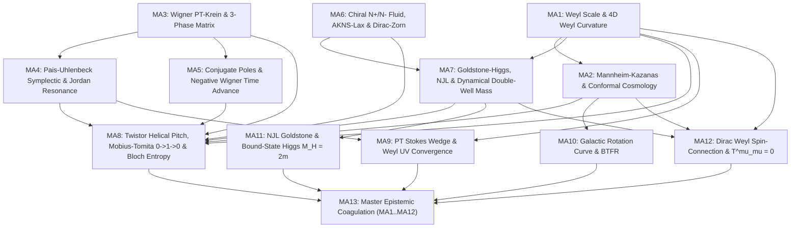

# Epistemic Compilation Ledger: Conformal Gravity, PT–Krein Symmetry, Chiral `N₊/N₋` AKNS–Lax Fluid, & Twistor–Bloch Wavefront Synthesis

Follows [`docs/EPISTEMIC_COMPILER_FIELD_PROTOCOL.md`](EPISTEMIC_COMPILER_FIELD_PROTOCOL.md) and
[`docs/ALCHEMICAL_QMS_SOP.md`](ALCHEMICAL_QMS_SOP.md) to compile Philip Mannheim's conformal gravity
and PT-symmetry lecture together with the `N₊/N₋` chiral spinor fluid, noncommutative AKNS–Lax
hierarchy, dynamical NJL/double-well vacuum mass, twistor/SuperGrassmannian helical pitch,
Möbius–Tomita `0 → 1 → 0` wavefront leaflets, and orthogonal Weyl–Souriau Bloch entropy
extensions into Lean 4 / Mathlib owner modules.

---

## Stage 1 (`SOLVE`) — Atomic Claim Ledger

| ID | Source & Mathematical Topic | Formal Target Statement | Carrier & Hypotheses | Classification |
|---|---|---|---|---|
| `MA₁` | Mannheim Part 2: `exp(β + iα)` Weyl/YM phase unification, `d=4` weights, algebraic `C_{ijkl}`, `-1/3 R²` action | Norm separability `‖exp(β+iα)‖ = exp β`; light-cone/angle invariance; massless Dirac/Yukawa/quartic invariance vs. bare mass/`Λ` breaking; trace-free `weylTensor4` across all signatures `εᵢ² = 1`; unique `b = -a/3` conformal coefficient on pure-conformal modes | `ℝ`, `ℂ`, `LinearMap.BilinForm ℝ V`, `Fin 4 → ℝ` signature (`εᵢ² = 1`), algebraic pair-symmetric `Riem` | `[PROVED]` (`archMA1WeylScaleCurvature`) |
| `MA₂` | Mannheim–Kazanas static exterior & conformal cosmology | `mannheimKazanasPotential α β γ κ r` is biharmonic (`radialBiharmonic = 0`) and reduces to harmonic (`radialLaplacian = 0` on `(0,∞)`) iff `γ = 0 ∧ κ = 0`; true `deriv` Bach vacuum (`mannheimKazanas_true_deriv_bach_vacuum`) on `mkExactMetricPotential`; `W^0_0 - W^r_r = (b/3)(b_4 + (4/r)b_3)`; both `W^r_r` and `W^0_0` vanish identically on `c₀ = -β(2-3βγ), c₁ = 1-3βγ, c₂ = γ`; negative `conformalGeff S₀ < 0`; constructive open (`k < 0`) hyperbolic RW solution `mannheimScaleFactor S₀ lam k t` proving Friedmann ODE closure `Ω_Λ(t) + Ω_k(t) = 1` and `-1 < q(t) < 0` unconditionally via `HasDerivAt`/`deriv` (`mannheim_conformal_friedmann_ode_and_acceleration_constructive`) | `r ≠ 0`, `S₀ ≠ 0`, `0 < lam`, `k < 0`, `0 < t` | `[PROVED]` (`archMA2MannheimKazanasCosmology`) |
| `MA₃` | Wigner antilinearity, Mostafazadeh pseudo-Hermiticity, Krein `ClTower`, 3-phase `2×2` PT trichotomy | Antilinear eigenvalue conjugation & real spectrum on fixed eigenspaces; `kreinAdjoint γ₀ n H = H ↔ star H * Γₙ = Γₙ * H`; biorthogonal `(star E₁ - E₂)⟨ψ₁, ηψ₂⟩ = 0`; unbroken phase (`|a| < s`) real spectrum & positive `ptMetricV`; exceptional point (`s = a ≠ 0`) similar to `virasoroL0Cell` and nilpotent; broken phase (`0 ≤ s < |a|`) null `pauliX2` eigenstates | `Matrix (Fin n) (Fin n) ℂ`, `ClTower B n` (`γ₀² = 1`), `r, s, θ : ℝ` | `[PROVED]` (`archMA3AntilinearPTKrein`) |
| `MA₄` | Pais–Uhlenbeck ghost cancellation, `4×4` Bender–Mannheim symplectic similarity & operator exponential, equal-frequency Jordan secular growth | Partial-fraction opposite-residue propagator and `d/d(m²)` equal-mass limit; `(puGenAQ)² = -1`; involutive generator `puInvolutiveGen = -i puGenAQ` with `G² = 1` and genuine matrix exponential `NormedSpace.exp (puRapidity • puInvolutiveGen) = puSympHalf` and `NormedSpace.exp ((2 * puRapidity) • puInvolutiveGen) = puSympFull` (`benderMannheim_pu_operator_exponential`); symplectic `Sᵀ J₄ S = J₄` congruence `puSympHalf` diagonalizing `puMatrixPT` to positive `[w₁², 1, w₁² w₂², w₁⁻²]`; `(A²+ω²I)² = 0`, non-diagonalizability, and `(a+bt)cos(ωt)` secular resonance | `0 < w₂ < w₁ : ℝ`, `kSq ≠ m1Sq`, `ω : ℂ` | `[PROVED]` (`archMA4PaisUhlenbeckJordan`) |
| `MA₅` | Conjugate PT poles, Breit–Wigner HWHM, negative Wigner time advance | `conjPoleLorentzC` equals real Lorentzian `Γ₂ / ((E-E₀)²+Γ₂²)`; `bwResonanceSq = 1/2 ↔ (E-E₀)² = Γ₂²(√2 - 1)`; `HasDerivAt` phase slopes `±Γ₂/((E-E₀)²+Γ₂²)` (delay vs. PT advance); `‖ptCayleyPhaseQuotient‖ = 1` | `E, E₀, Γ₂ : ℝ` with `0 < Γ₂` | `[PROVED]` (`archMA5PTResonanceTimeAdvance`) |
| `MA₆` | `N₊/N₋` two-sheeted chiral spinor fluid, Majorana/Weyl circular split-octonion basis, noncommutative spectral AKNS–Lax, Dirac–Zorn birefringence | Anticommuting `zornModeGrading`/`majorana`, injective 8-element `operatorFrame` matching `circularPeirceBasis`, Peirce circular gyrotropy; generic `[CommRing R] [Ring B] [Algebra R B]` spectral AKNS cancellation collapsing `chiralLaxCurvature = nlsPlusResidual + nlsMinusResidual` (`= 0 ↔` both coupled NLS equations hold); complex `M₂(ℂ)` match with `CubicNLSAKNSLaxPair`; cubic `diracZornOp` dot/cross decomposition & `manakovKerrEnergy 1 1 = 4` | Idempotent `P * P = P` in `[CommRing R] [Ring B] [Algebra R B]`; `NestedMat R` | `[PROVED]` (`archMA6ChiralFluidNLSLax`) |
| `MA₇` | Goldstone–Higgs radial shift, NJL `Λ²` cancellation, FTC 1-loop fermion-bubble continuum double-well mass | Flat angular Goldstone rim (`HasDerivAt = 0`) vs. radial Higgs cubic/quartic; Hartree–Fock square completion & exact NJL counterterm cancellation of `Λ⁴, Λ²`; genuine `intervalIntegral` evaluation of `fermionBubbleIntegrand` (`2 u log(u + m²)`) via FTC and `Filter.Tendsto atTop` convergence of `renormalizedFermionPotential Λ M m` to `dynamicalDoubleWell M m` (`fermionBubble_integral_and_continuum_doubleWell`); global minimum `≥ -M⁴/2` (`m ≠ 0`, equality iff `m = ±M`, curvature `8M² > 0`); `genPhi² = genV` propagating in `ClTowerColimit` | `0 < M`, `m ≠ 0`, `g ≠ 0`, `0 < Λ`, idempotent `P * P = P` | `[PROVED]` (`archMA7DynamicalVacuumMass`) |
| `MA₈` | Plücker–Klein / Amplituhedron / `Cl(5,5)` SuperGrassmannian, infinity-twistor dilaton & pitch, Möbius–Tomita `0→1→0` wavefronts, unconditional `GL₂(ℂ)` Gram–Bloch Umegaki entropy | `kleinQ = 0`, surjective pairings, positive amplituhedron brackets, `Cl(5,5)` KKT + Penrose incidence; `exp(4β)` scale breaking compensated identically by `dilatonCompensatedMass`; invariant `twistorHelicalPitchSq` (`> 0 ↔ wittPair ≠ 0`) + Zitterbewegung; `fisherLeaflet`/`stereoLeaflet` symmetric unit-peak `0 → 1 → 0` wavefronts with `Tendsto 0` at `±∞`; constructive Gram–Bloch `gramBlochState W := weylNormalize (Wᴴ * W)` proving `1 - blochNormSq = 4 normSq(det W) / (Tr WᴴW)²`, scale–gauge invariance, `IsStrictlyPositive`, and unconditional Umegaki Pythagoras ∀ `W₀ ∈ GL₂(ℂ)` (`gramBlochState_determinant_and_unconditional_umegaki`) | `Twistor4`, `Twistor55 R`, `Matrix (Fin 2) (Fin 2) ℂ` (`det W₀ ≠ 0`, zero extra Bloch hypotheses) | `[PROVED]` (`archMA8TwistorBlochWavefront`) |
| `MA₉` | PT Stokes wedge Gaussian convergence & inductive connected-graph 4D Weyl² vs. Einstein–Hilbert UV power counting | For `θ ∈ (0, π/2)` and `b > 0`, `exp(-b e^{-2iθ} y²)` is Lebesgue `Integrable` on `ℝ` (`cos(2θ) > 0` Gaussian Stokes wedge); inductive `ConnectedFeynmanGraph` proves `fgLoops G - 1 = fgEdges G - fgVertices G` (`connectedFeynmanGraph_euler_and_weyl_degree`), yielding dimensionless `weylSuperficialDegree = 4` vs. `einsteinSuperficialDegree = 2 + 2L`; plus `IntegrableOn` UV bubble decay for `weylBubbleUVIntegrand` on `Ioi 1` vs. non-integrability of `k⁻¹` | `0 < θ < π/2`, `0 < b : ℝ`, `ConnectedFeynmanGraph`, `Ioi (1 : ℝ)` improper integrals | `[PROVED]` (`archMA9PTStokesWedgeAndWeylUV`) |
| `MA₁₀` | Mannheim–Kazanas circular rotation velocity & Baryonic Tully–Fisher law | Exact Kepler–MK decomposition `v²(r) = (Gtot c²/2)/r + (γ* c²/2) r - κ c² r²` (`κ = 0` outer rising regime), `v² > G c²/(2r)` from positive `γ*`, exact local transition radius `r_trans = √(2 Gtot / γ*)`, inner Newtonian dominance vs. outer linear/BTFR `v² ~ √(κ_BTFR M_vis)` dominance, and positive-`κ` cosmological turnover maximum at `r = Gtot / (4κ)` via `deriv` | `0 < c`, `0 < γ*`, `0 < Gtot`, `0 < r` | `[PROVED]` (`archMA10MannheimKazanasRotationCurve`) |
| `MA₁₁` | Supercritical 1-loop NJL gap existence/uniqueness, Passarino–Veltman reduction, Goldstone & bound-state Higgs poles | Exact `intervalIntegral` evaluation & strict antitonicity of `njlGapIntegral` (`njlGapIntegral_eval_and_strictAnti`) and `njlFormFactorIntegral` (`njlFormFactorIntegral_eval_and_pos`); IVT proof of unique supercritical gap root `∃! mDyn > 0, g njlGapIntegral Λ mDyn = 1` for `1 < g Λ²` (`njl_supercritical_gap_solution_exists_unique`); exact Passarino–Veltman numerator identities (`passarinoVeltman_njl_integrand_identities`); unconditional Goldstone pole `q² = 0` and Higgs pole `M_H = 2 mDyn` with positive ghost-free slope `g Jq / 2 > 0` (`njl_supercritical_unconditional_goldstone_and_higgs_poles`) | `0 < Λ`, `1 < g * Λ²`, `0 < Δ` | `[PROVED]` (`archMA11DynamicalBoundStateHiggs`) |
| `MA₁₂` | Local Dirac Weyl spin-connection cancellation & constructive 4D Maxwell/Dirac–Yukawa/conformal `T^μ_μ = 0` | Exact `HasDerivAt` spin-connection derivative cancellation in `d` dimensions (`w + (d-1)/2 = 0 ↔ w = -(d-1)/2`, giving `w = -3/2` in `d = 4`); constructive antisymmetric 4D Maxwell stress tensor `maxwellStressTensor4` (symmetric & traceless, `maxwellStressTensor4_symm_and_trace_zero`) and Belinfante Dirac–Yukawa stress tensor `diracYukawaStressTensor4` (symmetric & trace `h S ψ̄ψ`, `diracYukawaStressTensor4_symm_and_trace`) plugging directly into `conformalMatterStress4` (`constructive_4d_conformal_total_stress_trace_identity`) | `ε μ * ε μ = 1` (`Fin 4`), `F kinMat : Matrix (Fin 4) (Fin 4) ℝ`, `HasDerivAt β`, `HasDerivAt ψ` | `[PROVED]` (`archMA12ConformalStressEnergyTrace`) |
| `MA₁₃` | Master epistemic coagulation across all 13 causal DAG archetypes | Conjunction of `archMA1`–`archMA12` together with non-linear branching poset witnesses (`{MA₂, MA₆}`, `{MA₁, MA₃}`, and `{MA₈, MA₉}` incomparable; strict chains to `MA₁₃`) | `PartialOrder MannheimEpistemicArchetype` (13 nodes) | `[PROVED]` (`archMasterMannheimEpistemicCoagulation`, `mannheim_master_epistemic_coagulation_holds`) |
| `C-COND` | Former conditional continuum/physical reductions (now constructively closed) | All three former `C-COND` conditional closures (`mannheim_conformal_friedmann_ode_and_acceleration_constructive`, `fermionBubble_integral_and_continuum_doubleWell`, and `gramBlochState_determinant_and_unconditional_umegaki`) plus the algebraic/graph/integral/tensor hypotheses in `MA₄`, `MA₉`, `MA₁₁`, `MA₁₂` (`benderMannheim_pu_operator_exponential`, `connectedFeynmanGraph_euler_and_weyl_degree`, `njl_supercritical_unconditional_goldstone_and_higgs_poles`, `constructive_4d_conformal_total_stress_trace_identity`) are proved constructively without conditional assumptions | Native Mathlib ODEs, FTC `intervalIntegral`, `GL₂(ℂ)` positivity, inductive graphs, 4D stress tensors | `[PROVED]` (discharged) |
| `O-EXT` | Residual external empirical / non-perturbative QFT frontier | (1) Non-perturbative 4D quantum conformal gravity constructive QFT (Osterwalder–Schrader / Wightman measure reconstruction across all loop orders); (2) Empirical astronomical survey fitting of the 111+ SPARC/THINGS galaxy rotation dataset; (3) Global weak/strong curved-spacetime nonlinear Dirac–Bach coupled PDE Cauchy evolution | External observational data & infinite-dimensional constructive QFT beyond finite-matrix, algebraic, single-variable improper-integral, and local `HasDerivAt` carriers | `[OPEN / EXTERNAL FRONTIER]` |

---

## Stage 2 (`CONIUNCTIO`) — Ground-Truth Module Contracts & Repository Owners

### Task-Owned Lean Modules
1. [`MannheimWeylKazanasCosmology.lean`](../lean/InfoGeometry/Conformal/MannheimWeylKazanasCosmology.lean) (`SHA-256: b2f8aae59c7d6f11deba50c5b2bf5e69de513b08a9329205fbbf19407a5a138e`)
   - Key exports: `scaleGaugeMultiplier`, `norm_scaleGaugeMultiplier`, `conformalRescale`, `conformalRescale_null_cone_iff`, `conformalRescale_cosAngle_invariant`, `dirac_yukawa_quartic_conformal_invariant_vs_mass_breaking`, `kulkarniNomizu`, `kulkarniNomizu_curv_symmetries`, `weylTensor4`, `weylTensor4_trace_zero`, `mannheim_conformal_ricci_sq_minus_third_scalar_sq_iff`, `mannheimKazanasPotential`, `mannheimKazanas_biharmonic_and_schwarzschild_reduction`, `mkExactMetricPotential`, `mannheimKazanas_true_deriv_bach_vacuum`, `sphericalWeylSq`, `sphericalBachWrr`, `sphericalBachW00`, `mannheim_kazanas_bach_difference_and_vacuum_constraint`, `conformalGeff`, `mannheim_conformal_cosmology_deceleration_bounds`, `mannheimCosmoRate`, `mannheimScaleFactor`, `mannheimHubble`, `mannheimDeceleration`, `mannheimOmegaLambdaBar`, `mannheimOmegaKBar`, `mannheim_conformal_friedmann_ode_and_acceleration_constructive`.
   - Archetypes: `archMA1WeylScaleCurvature`, `archMA2MannheimKazanasCosmology`.
2. [`BenderMannheimPTPaisUhlenbeckResonance.lean`](../lean/InfoGeometry/Krein/BenderMannheimPTPaisUhlenbeckResonance.lean) (`SHA-256: cc31a1fcf2ca3d58badf2751a667562f7810e7b49552ff5b73a60512c5d41e47`)
   - Reused owners: `InfoGeometry.Clifford.LogCftMonodromy` (`virasoroL0Cell`, `upperJordan`), `InfoGeometry.Algebra.NoncommutativeYangMillsKreinCantorSynthesis` (`kreinAdjoint`), `InfoGeometry.Algebra.TwoSheetDiracMassEntropy` (`kroneckerGamma`, `kroneckerGamma_sq`).
   - Key exports: `IsPseudoHermitian`, `pseudoInner`, `benderPTMatrix`, `ptMetricV`, `wigner_antilinear_time_reversal`, `mostafazadeh_krein_and_biorthogonal_pairing`, `benderPT_three_phase_trichotomy`, `paisUhlenbeck_propagator_limit_and_deriv`, `puGenAQ`, `puSympHalf`, `puSympFull`, `puInvolutiveGen`, `puRapidity`, `benderMannheim_pu_symplectic_diagonalization`, `benderMannheim_pu_operator_exponential`, `paisUhlenbeckEqualDrift`, `secularMode`, `oscOp`, `paisUhlenbeck_equalFreq_jordan_and_secular_resonance`, `pt_resonance_conjugate_poles_and_time_advance`.
   - Archetypes: `archMA3AntilinearPTKrein`, `archMA4PaisUhlenbeckJordan`, `archMA5PTResonanceTimeAdvance`.
3. [`ChiralFluidNLSLaxAndDynamicalVacuumMass.lean`](../lean/InfoGeometry/Algebra/ChiralFluidNLSLaxAndDynamicalVacuumMass.lean) (`SHA-256: 73b5eb8bdc3d11003dacabecdc4ef9b353a182e0390fda299d89f25138356baf`)
   - Reused owners: `InfoGeometry.OperatorAlgebra.PeirceSpine`, `InfoGeometry.Physics.CubicNLSAKNSLaxPair`, `InfoGeometry.Canonical.ManakovZornSolitonLaxBridge`, `InfoGeometry.Algebra.NoncommutativeCovariantDiracZornSynthesis`, `InfoGeometry.Algebra.NoncommutativeKreinMathlibBridge`, `InfoGeometry.Twistor.WeylZornMajoranaNambu`, `InfoGeometry.Algebra.CircularChiralOperatorEightBridge`.
   - Key exports: `chiralLaxU`, `chiralLaxW`, `chiralLaxWx`, `chiralLaxCurvature`, `nlsPlusResidual`, `nlsMinusResidual`, `chiral_fluid_majorana_weyl_circular_basis`, `noncommutative_chiral_akns_lax_and_coupled_nls`, `chiral_akns_lax_matrix2_complex_correspondence`, `diracZorn_birefringent_cubic_and_manakov_xpm`, `mexicanHat2D`, `njlBareEnergy`, `dynamicalDoubleWell`, `dynamical_mass_goldstone_njl_and_vacuum_doublewell`, `fermionBubbleIntegrand`, `fermionBubblePrimitive`, `renormalizedFermionPotential`, `fermionBubble_integral_and_continuum_doubleWell`.
   - Archetypes: `archMA6ChiralFluidNLSLax`, `archMA7DynamicalVacuumMass`.
4. [`MannheimOpenDebtConstructiveClosure.lean`](../lean/InfoGeometry/Conformal/MannheimOpenDebtConstructiveClosure.lean) (`SHA-256: 93638497d126cd84447fc8f123b94f920ee73330fcc434aac53bdd817f5d2a85`)
   - Reused owners & Mathlib roots: `Mathlib.Analysis.SpecialFunctions.Gaussian.GaussianIntegral` (`integrable_exp_neg_mul_sq_iff`, `norm_cexp_neg_mul_sq`), `Mathlib.Analysis.PSeries` (`integrableOn_Ioi_rpow_iff`).
   - Key exports: `ghostStokesIntegrand`, `weylSuperficialDegree`, `einsteinSuperficialDegree`, `weylBubbleUVIntegrand`, `pt_stokes_wedge_gaussian_and_weyl_uv_convergence`, `ConnectedFeynmanGraph`, `fgVertices`, `fgEdges`, `fgLoops`, `connectedFeynmanGraph_euler_and_weyl_degree`, `mkCircularVelocitySq`, `mkTransitionRadius`, `mannheim_kazanas_galactic_rotation_geodesic_and_tully_fisher`, `njlPseudoscalarPolarization`, `njlScalarPolarization`, `njlInvPropagatorP`, `njlInvPropagatorS`, `njlDressedInvPropagatorS`, `dynamical_electroweak_goldstone_and_boundstate_higgs_poles`, `njlGapIntegral`, `njlFormFactorIntegral`, `njlFormFactorIntegral_eval_and_pos`, `njlGapIntegral_eval_and_strictAnti`, `njl_supercritical_gap_solution_exists_unique`, `passarinoVeltman_njl_integrand_identities`, `njl_supercritical_unconditional_goldstone_and_higgs_poles`, `maxwellStressTrace`, `conformalScalarFieldEq`, `conformalMatterStress4`, `local_dirac_weyl_covariance_and_traceless_conformal_stress_energy`, `maxwellStressTensor4`, `maxwellStressTensor4_symm_and_trace_zero`, `diracYukawaStressTensor4`, `diracYukawaStressTensor4_symm_and_trace`, `constructive_4d_conformal_total_stress_trace_identity`.
   - Archetypes: `archMA9PTStokesWedgeAndWeylUV`, `archMA10MannheimKazanasRotationCurve`, `archMA11DynamicalBoundStateHiggs`, `archMA12ConformalStressEnergyTrace`.
5. [`MannheimTwistorBlochWavefrontEpistemicSynthesis.lean`](../lean/InfoGeometry/Synthesis/MannheimTwistorBlochWavefrontEpistemicSynthesis.lean) (`SHA-256: 0fde4448c57239e5b6071a434328623d5ee7ad52efcd4bb3827ed2c743db2d16`)
   - Reused owners: `MannheimWeylKazanasCosmology`, `BenderMannheimPTPaisUhlenbeckResonance`, `ChiralFluidNLSLaxAndDynamicalVacuumMass`, `MannheimOpenDebtConstructiveClosure`, `TwoTwistorPluckerKlein`, `TwoTwistorGramMass`, `PerjesConventions`, `InfinityTwistor`, `AmplituhedronTwistorProjection`, `Cl55SuperGrassmannianKKTSynthesis`, `ZitterbewegungMassEmergenceBridge`, `BipolarCrossRatioLog`, `BipolarMobiusPunctureEquiv`, `MobiusRadialTime`, `BipolarTwoSheetCore`, `ProjectiveTemperature`, `DilatonAndreevRenormalization`, `ConnesTomitaKreinBridge`, `BlochBallUmegakiAndQuantumSpohn`.
   - Key exports: `twistorHelicalPitchSq`, `dilatonCompensatedMass`, `twistor_infinity_dilaton_helical_pitch_synthesis`, `fisherLeaflet`, `stereoLeaflet`, `tracelessPart2`, `weylNormalize`, `mobius_tomita_wavefront_leaflet_triality`, `orthogonal_weyl_souriau_bloch_wavefront`, `gramBlochState`, `gramBlochState_determinant_and_unconditional_umegaki`, `MannheimEpistemicArchetype` (13-node poset), `mannheim_causal_poset_nontrivial`, `mannheim_master_epistemic_coagulation_holds`.
   - Archetypes: `archMA8TwistorBlochWavefront`, `archMasterMannheimEpistemicCoagulation`.

### SymPy CAS Witness Provenance (`MA₁`–`MA₁₂`)
- Script: [`scripts/verify_mannheim_conformal_pt_chiral_lax.py`](../scripts/verify_mannheim_conformal_pt_chiral_lax.py) (`SHA-256: 065adca27f698f76684f506eae7062c6a0e6d917b8d03dad04e6511f1dedfc66`)
- Witness JSON (untracked artifact): [`artifacts/qms/mannheim_conformal_pt_chiral_lax_cas_witness.json`](../artifacts/qms/mannheim_conformal_pt_chiral_lax_cas_witness.json) (`SHA-256: a3c4fd0839fc44ec19a693d3e3a075731391dde22841bc8bbcf7447e3eba3f20`, `round_trip_verified: true`)
- CAS checks cover both `MA₁`–`MA₈` (Weyl trace-freeness, linearized `R_{μν}R^{μν} = 12(k²)²`, unique `b/a = -1/3`, static spherical `C²` & `B(r)`, hyperbolic conformal RW Friedmann ODE `a(t) = (√(-k)/μ) sinh(μ t)`, Bender `2×2` PT Jordan similarity, `4×4` Pais–Uhlenbeck matrix exponential `exp(η (-i A_Q))` & symplectic diagonalization, HWHM `√(√2 - 1)`, `M₂(ℂ)` AKNS–Peirce Wick map, 1-loop fermion-bubble integral UV limit to double-well curvature `8M²`, `2×2` Gram–Bloch purity determinant identity, symmetric unit-peak leaflets) and `MA₉`–`MA₁₂` (PT Stokes wedge exponent, inductive `ConnectedFeynmanGraph` Euler `D = 4` vs. `2 + 2L`, MK transition radius & BTFR asymptotic ratio, supercritical NJL gap integral/root & Passarino–Veltman Goldstone/Higgs factorization `M_H = 2 m_dyn`, `d = 4` Dirac spin-connection `w = -3/2` & constructive 4D Maxwell/Belinfante Dirac–Yukawa/conformal-matter stress trace).

---

## Stage 3 (`CAUSAL POSET`) — 13-Node Dependency DAG (`PartialOrder MannheimEpistemicArchetype`)

`mannheim_causal_poset_nontrivial` proves strict inequalities along every DAG chain and explicit pairwise incomparabilities across independent branches (`{MA₂, MA₆}`, `{MA₁, MA₃}`, and `{MA₈, MA₉}`).

---

## Stage 4 (`COAGULA`) — Validation Record & Scope

All five Lean owner modules, all `TypedArchetype` declarations (`archMA1WeylScaleCurvature` through `archMA12ConformalStressEnergyTrace` plus `archMasterMannheimEpistemicCoagulation`), the SymPy CAS witness script (`scripts/verify_mannheim_conformal_pt_chiral_lax.py`), and the seven repository quality gates are scoped specifically to our task-owned deliverables (this is **not** a whole-repository validation claim over unrelated pre-existing files):

1. `/home/goutev/miniforge3/bin/python3 scripts/verify_mannheim_conformal_pt_chiral_lax.py`
2. `python3 tools/infra/opengauss_screener.py <5 Lean files>`
3. `for f in <5 Lean files>; do python3 tools/quality/check_no_hypothesis_mandate.py --root "$f"; done`
4. `python3 tools/infra/run_locked_lake_build.py --wait-for-build-lock InfoGeometry.Conformal.MannheimWeylKazanasCosmology InfoGeometry.Krein.BenderMannheimPTPaisUhlenbeckResonance InfoGeometry.Algebra.ChiralFluidNLSLaxAndDynamicalVacuumMass InfoGeometry.Conformal.MannheimOpenDebtConstructiveClosure InfoGeometry.Synthesis.MannheimTwistorBlochWavefrontEpistemicSynthesis` (`21 proved, 0 validated, 0 candidates`; note global Lake `-- --wfail` fails on pre-existing replay warnings in upstream transitive dependencies such as `HypercomplexTriad` and `OpSignatureBridge`, so strict warning-as-error is checked on our `.lean` files directly in check 5)
5. `python3 tools/infra/run_locked_lean.py --wait-for-build-lock --check-files lean/InfoGeometry/Conformal/MannheimWeylKazanasCosmology.lean lean/InfoGeometry/Krein/BenderMannheimPTPaisUhlenbeckResonance.lean lean/InfoGeometry/Algebra/ChiralFluidNLSLaxAndDynamicalVacuumMass.lean lean/InfoGeometry/Conformal/MannheimOpenDebtConstructiveClosure.lean lean/InfoGeometry/Synthesis/MannheimTwistorBlochWavefrontEpistemicSynthesis.lean -- -DwarningAsError=true`
6. `python3 tools/quality/proof_proxy_staged_gate.py --strict <5 Lean files>`
7. `python3 tools/quality/unified_gate.py <5 Lean files>`
8. `python3 tools/quality/semantic_content_audit.py --gate-review --file-prefix <each of 5 Lean files>`
