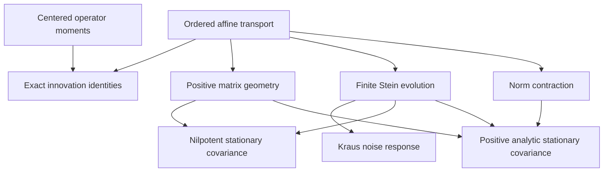

# Noncommutative covariance closure

## Entry point and theorem contract

```lean
import InfoGeometry.OperatorAlgebra.NoncommutativeCovarianceClosure
```

This addition extracts an exact operator-algebra problem from
[the motivating article](https://mcbal.github.io/post/a-large-d-closure-for-asymmetric-kinetic-vector-spin-systems/).
The article motivates covariance and directed-lag recurrences through a
large-dimension gain approximation. Here the transition and innovation
covariance are full operators. The formalization proves their exact algebra,
positive matrix geometry, finite evolution, and stationary behavior under
explicit sufficient hypotheses. It does not formalize the article's
dimension-dependent approximation argument.

The implementation extends repository revision
`3d7eb6d9b0af5636ab12b3d0b91b82740507e49e`, with unchanged Lean
`v4.34.1` and Mathlib `d13f23b723b8a846827a245b89c10fc7d3f11612`.

| Layer | Actual carrier and hypotheses | Mathematical output |
|---|---|---|
| Algebraic transport | Associative `Ring A`, `StarRing A` | Ordered affine covariance identities |
| Centered samples | Finite sample set, real algebra, compatible star where used | Operator-valued means and cross covariances |
| Positive geometry | Arbitrary finite full matrices over `RCLike` | Native `Matrix.PosSemidef`, congruence, block positivity |
| Finite evolution | Arbitrary star ring; nilpotence only for finite stabilization | Ordered Stein sum, uniqueness and exact stabilization |
| Complete positivity | Full finite complex matrices; every finite auxiliary index type | Positive Choi matrix and matrix amplifications |
| Analytic contraction | Submultiplicative ring norm, isometric star, `‖T‖ < 1`; completeness for existence | Unique fixed point, convergence, explicit error bound |
| Positive stationary matrix | Native `Matrix.Norms.L2Operator`, `Q.PosSemidef` | Positive Banach fixed point and global convergence |

No theorem assumes that the transition, initial covariance, noise covariance,
gain, or mixing operator commute. Matrix dimensions are arbitrary in the
general results. The concrete `Fin 2` examples are witnesses for the general
theorems, not replacements for their carriers.

## 1. Centered operator moments

For a finite ensemble, define

\[
\mu_w(X)=\sum_\omega w_\omega X_\omega,\qquad
X^\circ_\omega=X_\omega-\mu_w(X),\qquad
\Gamma_w(X,Y)=\sum_\omega w_\omega X^\circ_\omega(Y^\circ_\omega)^*.
\]

These definitions retain the full operator. Real weights act through the
native real-algebra structure. Normalization `∑ ω, w ω = 1` is required for
the centered-mean and offset-invariance results. Nonnegativity of the weights
is required for positive matrix covariance, but not for purely algebraic
linearity identities.

Under normalized weights, `FiniteOperatorCovariance.lean` proves the first
identity below. The adjoint symmetry in the second identity does not require
normalization:

\[
\Gamma_w(X,Y)=\mu_w(XY^*)-\mu_w(X)\mu_w(Y)^*,
\qquad \Gamma_w(X,Y)^*=\Gamma_w(Y,X),
\]

and the two-sided affine transport law

\[
\Gamma_w(TX+B,SY+D)=T\Gamma_w(X,Y)S^*.
\]

For `Y = T X + E`, set `C = Γ(X,X)`, `Q = Γ(E,E)`, and
`K = Γ(X,E)`. The exact identities are

\[
\Gamma(Y,Y)=TCT^*+Q+TK+K^*T^*,\qquad
\Gamma(Y,X)=TC+K^*.
\]

The zero-cross-covariance corollaries explicitly assume `K = 0`. This is a
sufficient closure condition; there is no assertion that every innovation
has it or that it is equivalent to independence.

The separate rectangular Gram identities in `CovarianceTransport.lean`
apply to arbitrary `X E : Matrix n m 𝕜`. They do not infer probabilistic
centering from a Gram factor.

## 2. Ordered transport and positive geometry

The common operator is

\[
\Phi_{T,Q}(C)=TCT^*+Q.
\]

`covarianceStep_comp` proves chronological composition with later
transitions multiplying on the left:

\[
\Phi_{T_2,Q_2}(\Phi_{T_1,Q_1}(C))
=\Phi_{T_2T_1,\,T_2Q_1T_2^*+Q_2}(C).
\]

`gain_mixing_order_defect` records the full defect of exchanging the
factors of a transition. With `[G,J] = GJ - JG`,

\[
\Phi_{GJ,Q}(C)-\Phi_{JG,Q}(C)
=[G,J]C(GJ)^*+(JG)C[G,J]^*.
\]

A nonzero commutator alone does not force this residual to be nonzero.
The concrete matrix example separately proves that exchanging its factors
does change the covariance update.

The positive-matrix results prove:

- `C ⪰ 0` and `Q ⪰ 0` imply `Φ(C) ⪰ 0`;
- `(D - C).PosSemidef` implies `(Φ(D) - Φ(C)).PosSemidef`;
- the joint covariance block is positive:

\[
\begin{pmatrix} C & CT^* \\ TC & TCT^*+Q \end{pmatrix}\succeq0.
\]

The block proof is a sum of two native matrix congruences. The off-diagonal
lag `TC` need not be Hermitian; the example proves a concrete failure.

Conjugation by an isometry `U`, with `star U * U = 1`, intertwines the affine update
when `T`, `Q`, and `C` are conjugated together. For positive definite precision
inputs `A` and `R`, the covariance `T A⁻¹ T* + R⁻¹` is identified with the
inverse of the existing `PositiveCoarseGraining.coarsePrecision`. The
Woodbury/Schur proof is reused from its established owner.

## 3. Finite dynamics and the existing Stein inverse

`CovarianceDynamics.lean` reuses
`InfoGeometry.Canonical.FiniteSteinInverse.finiteStein` and proves

\[
\Phi_{T,Q}^{\,k}(C_0)
=T^kC_0(T^k)^*+\sum_{j=0}^{k-1}T^jQ(T^j)^*.
\]

Consequently,

\[
\Phi^k(C)-\Phi^k(D)=T^k(C-D)(T^k)^*.
\]

Every finite iterate and every accumulated-noise sum is positive for positive
matrix inputs. Loewner comparison is preserved at every finite time.

Under the explicit hypothesis `T ^ k = 0`, the finite Stein sum

\[
S=\sum_{j=0}^{k-1}T^jQ(T^j)^*
\]

is a fixed point, is the unique fixed point among all operators, and is
reached by every initial operator after `k` updates and at every later
time. For matrices, positive `Q` makes `S` positive. These are finite
identities, not a passage to an infinite limit.

## 4. Complete positivity of accumulated noise

`CovarianceKraus.lean` defines a native complex linear map using the existing
Kraus family `j ↦ T ^ j.val`, for `j : Fin k`. Its action is exactly

\[
Q\longmapsto\sum_{j<k}T^jQ(T^j)^*.
\]

The existing Choi and Kraus-amplification results prove that its Choi matrix
is positive and that it preserves positive matrices after every finite
matrix amplification. This is complete positivity of the linear noise
response. The affine map with fixed nonzero `Q` is not described as linear.

## 5. Actual analytic convergence

`CovarianceContraction.lean` proves

\[
\|\Phi(C)-\Phi(D)\|\leq\|T\|^2\|C-D\|.
\]

For `‖T‖ < 1`, Mathlib's `ContractingWith` constructs the unique stationary
operator in a complete normed star ring. Every initial operator converges
to it, with the explicit estimate

\[
\|\Phi^k(C)-S\|
\leq\frac{\|C-\Phi(C)\|(\|T\|^2)^k}{1-\|T\|^2}.
\]

`CovarianceStationary.lean` specializes this to full finite complex matrices
using Mathlib's `Matrix.Norms.L2Operator` scope. Positivity of the constructed
fixed point follows from the positive iterates starting at zero and
`Matrix.posSemidef_is_closed.mem_of_tendsto`. Thus positive innovation and
strict operator contraction give a unique positive stationary covariance.
No nilpotence hypothesis is used for these analytic theorems.

The norm is the native Euclidean operator norm, not an unspecified matrix
norm. The result uses a sufficient norm bound; it does not claim the more
general spectral-radius criterion or convergence for varying transitions.

## 6. Noncommutativity witnesses

`CovarianceExamples.lean` uses full matrices over `ℂ`:

\[
J=\begin{pmatrix}1&1\\0&1\end{pmatrix},\quad
G=\begin{pmatrix}1&0\\1&1\end{pmatrix},\quad
Q=JJ^*=\begin{pmatrix}2&1\\1&1\end{pmatrix},\quad
N=\begin{pmatrix}0&1\\0&0\end{pmatrix}.
\]

Kernel-checked statements include `JG ≠ GJ`,
`Φ_(GJ,Q)(Q) ≠ Φ_(JG,Q)(Q)`, `NQ ≠ QN`, and failure of Hermiticity of
`NQ`. Since `N² = 0`, every initial full matrix reaches
`!![3, 1; 1, 1]` after two updates. The example consumes the general
finite-stabilization theorem.

## 7. Dependency partial order

The following is a conceptual view of established mathematical dependencies:



The authoritative declaration-level relation comes from Lean, not the
diagram. `CovarianceDeclarationAudit.lean` enumerates every declaration in
the seven mathematical modules and their import-only entry point. It reads
constant dependencies from each checked type and proof/definition value,
and collects transitive axiom dependencies.

The existing `operator_geometry_dependency_order.py` computes a topological
order and transitive reduction from those records. Its order is
`a ≤ b` exactly when `a = b` or the checked declaration `b` transitively
depends on `a`, restricted to the selected owners. A cycle, unresolved
dependency, duplicate record, or mismatched count rejects the extraction.
This records the dependencies of these proofs; it does not claim that the
proof organization is mathematically unique or that a physical causal
structure has been reconstructed.

## 8. Verification and reproduction

Use the repository's pinned environment and an existing pinned Mathlib
checkout. The maintained checker snapshots all selected repository sources,
checks dependency pins and compiler version, serializes compilation with
the shared build lock, and checks source/tool hashes again before success.

```bash
owners=(
  CovarianceTransport FiniteOperatorCovariance CovarianceDynamics
  CovarianceKraus CovarianceContraction CovarianceStationary
  CovarianceExamples NoncommutativeCovarianceClosure
)
owner_args=()
for module in "${owners[@]}"; do
  owner_args+=(--owner "InfoGeometry.OperatorAlgebra.$module")
done
python3 tools/quality/check_operator_geometry.py \
  --mathlib /path/to/pinned-mathlib \
  --work-dir /path/to/covariance-check \
  --base-ref 3d7eb6d9b0af5636ab12b3d0b91b82740507e49e \
  "${owner_args[@]}" \
  --audit --audit-source tools/quality/CovarianceDeclarationAudit.lean \
  --owner-warnings-as-errors
python3 tools/quality/operator_geometry_dependency_order.py \
  /path/to/covariance-check/declaration-audit.jsonl \
  /path/to/covariance-check/dependency-order.json
```

The native audit permits only `propext`, `Classical.choice`, and `Quot.sound`,
and rejects unsafe/partial declarations and additional axioms. The checker
binds the audit's reported module set to the requested owners and validates
the declaration records and counts. The import-only entry point is explicitly
reported as empty; all seven mathematical owners must contain declarations.
Warnings are errors for the selected owners and audit. Inherited warnings
in unchanged dependency sources are outside that stricter warning policy.

The recorded outputs are the
[verification record](verification/noncommutative_covariance_verification.json),
[declaration dependency order](verification/noncommutative_covariance_dependencies.json),
and [strict semantic-warning report](verification/noncommutative_covariance_semantic_warnings.json).
The dependency order contains 114 checked constants, including 79 named
source theorems, with 212 direct edges, 140 Hasse edges, and seven layers.
The semantic heuristic reports 14 short-proof warnings and zero errors.
Independent review accepted their actual algebraic content; the strict
warning-policy exit code of 1 remains part of the evidence. Thirteen of the
flagged lemmas have owned consumers; the remaining lemma is an explicitly
named compatibility identity with the existing singleton Kraus owner.

This container's native Lean run used an executable-path compatibility
helper: only `readlink` of `/proc/<own-pid>/exe` was redirected to
`/proc/self/exe`; all other calls were forwarded unchanged. The Lean release
binary and kernel were unchanged. This addresses the container's process-ID
layout; a normal pinned Lean installation uses the commands above directly.

The selected closure does not need the unrelated root-package path
dependencies. In this environment, the root preflight reports missing
`HomotopyHypothesis` and `Atlas` path dependencies and an uninitialized
`GIFT` gitlink. A successful selected-closure check must not be reported as
a passing root-package build or push gate.

## Remaining mathematical boundary

The proved exact recurrence assumes a fixed transition and an explicitly
vanishing centered cross covariance where closure is used. The following
would require additional mathematical work: conditional-expectation
identification of innovations in a specified stochastic process; deriving a
state-dependent gain from a nonlinear response; concentration as dimension
grows; quantitative closure-error rates; and stability for time-varying or
state-dependent transitions. None is inserted as an unexplained axiom or
claimed as a consequence of the exact operator identities.
