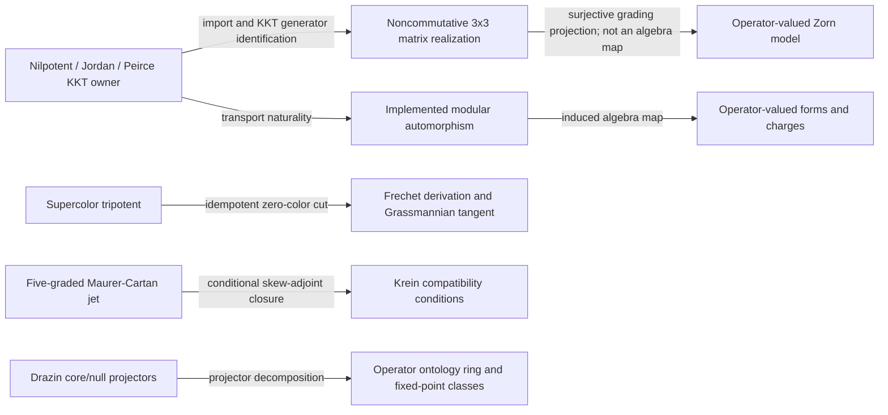

# Repository Ontology Unification Playbook

Use this playbook when connecting mathematical lanes, reconciling duplicate
declarations, or building a causal view across the Lean repository. It describes
the graph tools as they exist in this checkout; it does not certify any
mathematical interpretation or claim that an external index is current.

## The topology to build

Treat the repository ontology as a **typed, multi-relational graph** with a
directed acyclic dependency projection, not as one untyped DAG. The existing
compiler graph has declaration vertices and `type` / `value` dependency edges.
Other useful relations include `proof`, `equivalence`, `representation`,
`analogy`, and `conjectural_bridge` (the `edge_kind` metadata vocabulary).
These relations have different meanings and must remain distinguishable.

The dependency / derivation projection can be topologically sorted. An
equivalence is usually symmetric and can form a cycle; a representation map can
have a useful direction without being a proof dependency. Keep these in the
typed graph and exclude them from a DAG ordering unless an explicit orientation
and theorem justify it. Do not orient edges merely to make a picture acyclic.

The result is a unified ontology with multiple views:

1. **Declaration DAG:** what Lean types and proof values actually depend on.
2. **Lane map:** owner modules grouped by mathematical carrier and topic.
3. **Bridge graph:** explicit maps and theorems connecting lanes, with relation
   kind and provenance.
4. **Duplicate-candidate groups:** structurally similar declarations awaiting
   source review; these are not automatically quotiented or merged.

Keep two senses of “ontology” separate. The repository knowledge graph is a
meta-level model of Lean declarations and their evidence-backed relations. A
formal theory such as `InfoGeometry.OperatorAlgebra.OntologyRing` is an
object-level mathematical development. A graph node for a Lean declaration
does not become the mathematical object that declaration describes; connect
the levels with explicit provenance and, when mathematically meaningful, a
proved representation or interpretation map.

## Current graph surfaces

| Surface | Contents | Authority |
|---|---|---|
| Lean owner source and kernel | Carriers, operations, hypotheses, theorem statements and proofs | Mathematical truth |
| Compiler declaration graph in Arango `infogeometry` | `decls`, `edges`, structural fingerprints, `type` / `value` edges | Navigation and dependency evidence |
| Auto-Ontology REST (`:3001`) | Searchable terms and relationships projected from Arango | Navigation; may lag the source graph |
| Auto-Ontology frontend (`:3000`) and MCP (`:3003/mcp`) | Login/OAuth UI and MCP query tools | Query interfaces; MCP requires sign-in |
| Other graph lanes (InfoTree, LeanTrail, Hodge, GraphRAG, literature) | Different carriers, event grains, and semantics | Do not merge without an explicit projection/map |

The Auto-Ontology API is not the source of proof truth. A `401` from MCP without
a session is expected. A `200` with zero matches means that particular query
matched no terms; it does not establish that the store is empty. Check a broad
namespace total and a known exact declaration separately.

For a declaration-to-declaration dependency path, use
`tools/infra/query_unification_path.py` with an explicit complete generation
and exact fully qualified names:

```bash
python3 tools/infra/query_unification_path.py \
  --generation-id <generation-id> \
  --source <fully-qualified-declaration> \
  --target <fully-qualified-declaration>
```

The command validates the generation receipt and endpoint integrity before
querying. Unique case-insensitive substrings are accepted, but ambiguous
selectors fail and ask for an exact name. The returned path records each
dependency edge's stored `from`, `to`, and `type`/`value` kind. It reports no
path explicitly when the declarations are disconnected in that generation.
This is a query of the compiler dependency projection; it does not manufacture
a bridge between mathematical lanes. Add a bridge relation only when its
owner source establishes the relevant map or theorem, as described above.

## Source-backed lane connections (bounded audit, 2026-11-05)

The current Lean owners already connect several branches. Record the actual
relation each owner proves; a common story or shared vocabulary is not itself
an edge in the theory graph.



| Lane connection | Source evidence | Exact scope and boundary |
|---|---|---|
| Nilpotent KKT to matrix realization | `MatrixThreeSheetKKTRealization` imports `KantorKoecherTitsFiveGradedClosurePoset`; its `Matrix (Fin 3) (Fin 3) B` carrier is over arbitrary `[Ring B] [StarRing B]`. | The three-sheet matrix has five Peirce grades and a genuine third diagonal/transverse corner. `K_plus2_eq_two_kantorGp2` in the KKT owner identifies the regular-nilpotent Jordan-associator generator with twice the established Peirce/Kantor generator under its stated nilpotence and regularity hypotheses. |
| Matrix KKT to Zorn grading | `MatrixThreeSheetZornGradingBridge` imports both the matrix realization and `Canonical.AlbertCayleyDickson`; it proves `matrix3ToOpZorn_surjective`, `matrix3ToOpZorn_euler_intertwining`, and component/bracket compatibility lemmas. | The map forgets the independent `(2,2)` matrix entry. The owner explicitly does **not** claim preservation of associative products or an algebra isomorphism. Some neutral-to-odd bracket compatibilities require diagonal equalities. |
| KKT to modular transport | `Canonical.ModularFlowOperatorForms` imports the KKT owner and proves `modularOperatorMap_transports_K_plus2`. | The carrier is a represented complex C*-algebra with a supplied unitary implementer. The theorem proves covariance under that implemented algebra map; it does not construct a general Tomita generator or assert that arbitrary observables are fixed. |
| Modular action on forms/charges | The same owner uses the existing operator exterior-algebra and Noether-flow owners; `modularTransport_wedge`, `modularTransportKillingField_equivariant`, and the central-observable fixed-point results give concrete transport laws. | Covariance is general; pointwise invariance needs a fixed-point or centrality hypothesis. A Cartan/Casimir label alone supplies no centrality proof. |
| Supercolor to Grassmannian and operator forms | `Synthesis.SupercolorFrechetGrassmannianBridge` imports the supercolor tripotent, Fréchet operator derivations, tripotent Peirce projectors, Grassmannian Cartan tower, and operator exterior algebra. It proves zero-cut idempotency, tangent/odd-grade identities, and equivariance of an operator-valued two-form. | This is a real-algebra Fréchet algebra carrier `A` with values in the same possibly noncommutative `A`; it does not identify the form with a Krein curvature or a Maurer-Cartan bracket. Completeness is omitted for the algebraic tangent results. |
| Maurer-Cartan jet to Krein compatibility | `Krein.MaurerCartanKreinCompatibility` imports the five-graded jet owner and `KreinSpace`; `mcKreinCurvatureTower_skew` follows from the `jetKreCompatible` fields. | This is conditional closure of the listed curvature sums. The structure fields provide skew-adjointness assumptions; the file does not construct those entries from a connection or prove a Maurer-Cartan equation. |
| Real scalars to operator coefficients | `Krein.ScalarToOperatorLift` defines `r ↦ r • id` in `H →L[ℝ] H` and proves ring, centrality, and real Krein-pairing laws. | This embeds real scalars centrally in this bounded-operator carrier. It does not show every observable or every Cartan generator is scalar or central. Its self-adjoint scalar jet lift does not by itself furnish the separate skew-adjoint fields required by `jetKreCompatible`. |
| Drazin split to ontology taxonomy | `OperatorAlgebra.OntologyRing` imports `Algebraic.OperatorSurgery`, Peirce taxonomy/compiler bridges, and `OperatorErlangenFixedPoints`; `drazin_core_null_unique_projector_decomposition` proves a unique decomposition into core/null projector fixed-point classes. | The theorem uses the Drazin structure's idempotence, orthogonality, and partition-of-unity fields. It formalizes a conditional representation of the Drazin split inside the operator ring. |
| Drazin synthesis owner unification (resolved, 2026-11-05) | `Canonical.DrazinEpistemicSolveEtCoagula` is the single deduplicated synthesis owner (imported by `Canonical.All` and `Epistemology.CoagulatedArchetypeSynthesis`); the redundant unreferenced duplicate `OperatorAlgebra.PeirceSpine.DrazinSpeciesUnifiedPoset` was removed. | `DrazinEpistemicSolveEtCoagula` unifies the three indexed Drazin predicates (`QuantumContext`, `Singular`, `Canonical`) and delegates directly to existing owners (`DrazinExistenceBridge`, `GradedDMPTransport`, `DrazinPeirceParity`, `DrazinJordanChevalleyBridge`, `DrazinSpectralFittingBridge`, `DrazinMPCartan`, `DrazinMoorePenrosePartition`, `GradedDMPResolution`, `GradedDMPDependencyOrder`, `MoorePenroseDrazinObstruction`, `MoorePenroseDrazinCriterion`, `DrazinShellCascade`, `RectangularPeirceDrazin`, `OntologyRing`, `EpistemicCompilerPeirceBridge`, and `CyclotomicGaloisNilpotentSylvesterSynthesis`). Published as Arango generation `drazin_epistemic_20261105_a` (6,740 declarations, 45,068 edges) and projected into Auto-Ontology PostgreSQL. |
| Epistemic operator spine to shared Peirce core | `Synthesis.EpistemicOperatorPoset` imports `PeirceSpine.Basic`; `comm_eq_peirceSpine_comm` and related aliases reuse the core operations. | Its `stageRank` proves an eight-stage total rank order for that declared stage type. That order is not automatically the global declaration dependency DAG and does not wire the independent modular, Krein, or matrix owners by itself. |

The table is an owner/import/theorem audit, not a fresh build certificate. A
current formal bridge is established only when its exact declaration is in the
owner source and its validation status is recorded separately. The clearest
remaining integration boundary in this sample is between the conditional
Maurer-Cartan/Krein jet and the concrete matrix/KKT connection data: the owners
currently expose different carriers and assumptions, and no identification is
claimed here.

### Observed state (2026-11-05)

The canonical workstation deployment is host-native: Auto-Ontology PostgreSQL
`auto-ontology-postgres` on host port `5433`, API `:3001`, ingestion `:3002`,
frontend/OAuth `:3000`, MCP `:3003`, and the loopback model bridge
`127.0.0.1:58051/v1` forwarding to vLLM on `:18765`. The repo launcher
`bash tools/infra/start_auto_ontology_services.sh` completed and confirmed the
model and ingestion endpoints; the MCP resource metadata returned HTTP 200.
An unauthenticated request to `/mcp` is expected to return 401. The verified
Postgres row counts were 306,557 `term` rows and 2,086,037 `term__term` rows;
the REST query `query=InfoGeometry&limit=1` returned 306,557. These are
time-specific counts, not freshness certificates.

The reference submodule's Compose stack is a separate deployment using an
empty database on host port `5432`; it must not run alongside the host-native
services. The operations script stops conflicting Compose app containers.
Do not infer that the populated workstation store is the Compose database.

Despite matching global term and edge counts, searches for the current source
owner `InfoGeometry.OperatorAlgebra.PeirceSpine.KantorCornerAnomaly` and its
`upper_anomaly_reference_*` declarations returned no Arango or REST matches.
Equal counts do **not** establish snapshot freshness. Treat the global
declaration projection as stale for owners outside verified generations. See
[`AUTO_ONTOLOGY_AGENT_OPERATIONS.md`](AUTO_ONTOLOGY_AGENT_OPERATIONS.md) for
startup, host-vs-Compose distinctions, and service health probes.

In a later exact-name REST check on the same live API, the older
`InfoGeometry.Canonical.AlbertCayleyDickson.SplitQuaternion.eulerFiveGrading_eigen_derivation_and_kkt_polynomial`
was present (one term, with 720 related relationships), while
`matrix3ToOpZorn_euler_intertwining`,
`supercolor_zeroCut_frechet_derivative_tangent`,
`ontology_taxonomy_phylogenesis_multilevel_master_synthesis`, and
`modularOperatorMap_transports_K_plus2` each returned zero matches. This
confirms that the service indexes an older KKT lane but does not yet expose
these current bridge declarations; it is not evidence that the source bridges
are absent.

A separate, non-authoritative scoped snapshot was generated on 2026-11-05 for
the Drazin/projector-taxonomy bridge. Its root is
`InfoGeometry.OperatorAlgebra.OntologyRing`, namespace filter `InfoGeometry`,
with 5,552 declarations and 38,876 retained typed dependency edges. The
snapshot is under the ignored `artifacts/dag/ontology-core-null/` directory;
its `index/meta.json` records source and OLean hashes. The exact source edge
from `OntologyRing.drazin_core_null_unique_projector_decomposition` to
`Algebraic.DrazinSurgery.core_idempotent`, `null_idempotent`,
`core_null_orthogonal`, and `partition_of_unity` is present in that snapshot.
This validates the scoped source graph only; it does not refresh the full DAG
or the Auto-Ontology PostgreSQL projection. The focused refresh command was:

```bash
python3 tools/infra/refresh_decl_graph.py \
  --import-root InfoGeometry.OperatorAlgebra.OntologyRing \
  --build-target InfoGeometry.OperatorAlgebra.OntologyRing \
  --namespace InfoGeometry \
  --index-dir artifacts/dag/ontology-core-null/index \
  --graph-out artifacts/dag/ontology-core-null/full_graph.json \
  --structure-out artifacts/dag/ontology-core-null/structural-topology.json
```

### Scoped duplicate-candidate review (2026-11-05)

The same 5,552-declaration snapshot contains 4,072 source `def`/`theorem`
records with both canonical type and value fingerprints. Exact paired
fingerprint grouping produced 27 candidate groups (54 declarations). Source
inspection separated four duplicate carrier aliases from generated recursor
families; the other recursor-like pairs are not deletion candidates based on
hashes alone.

| Candidate aliases | Canonical owner | Source disposition |
|---|---|---|
| `Algebra.FiniteSpin.Mat2R`, `Algebra.HypercomplexTriad.Mat2` | `Algebra.FiniteSpin.Mat2R` | Same `Matrix (Fin 2) (Fin 2) ℝ` carrier; five other owner files use the public alias. `HypercomplexTriad.Mat2` now points to the canonical abbreviation, preserving those users while adding an explicit dependency. |
| `Algebra.FiniteSpin.Mat2Z`, `Core.IdempotentGraphReflectionOrder.WitnessMatrix` | `Algebra.FiniteSpin.Mat2Z` | Same `Matrix (Fin 2) (Fin 2) ℤ` carrier; witness alias is local to its owner and can be removed during a validated owner edit. |
| `Algebra.FiniteSpin.Mat3Z`, `Canonical.OperatorMatrix3Z` | `Algebra.FiniteSpin.Mat3Z` | Same `Matrix (Fin 3) (Fin 3) ℤ` carrier; operator alias is local to its owner and can be removed during a validated owner edit. |
| `Canonical.FiniteFibonacciAnyonBraiding.FibonacciBraidWord`, `Canonical.FiniteMajoranaBraiding.BraidWord` | No cross-domain canonical alias yet | Both are `List ℕ`, but the domain-specific names are public API; retain them as named views unless consumers can migrate without obscuring meaning. |

This is a candidate audit, not a completed source deduplication. The first
alias has multiple external consumers; removing it requires coordinated edits
and owner builds. The two local matrix aliases are low-risk consolidation
targets. Hash grouping is scoped to this snapshot and does not establish
repository-wide duplication or freshness.

The live Auto-Ontology REST projection was checked against four of these
source names on 2026-11-05. It returned one exact term for `FiniteSpin.Mat2R`
and `HypercomplexTriad.Mat2`, but zero for `WitnessMatrix` and
`OperatorMatrix3Z`. This per-owner sentinel mismatch confirms the projection
does not yet cover even this scoped candidate set; do not infer freshness from
the previously observed global row counts.

The default local DAG index was also queried on 2026-11-05 for the canonical
`Mat3Z` alias and `operatorMatrixUnit13`. Its declaration file was last
modified on 2026-10-30, exact lexical search returned no rows, and the broader
attention search returned generic finite-spin/operator declarations instead
of either requested name. The local preflight therefore is not a freshness or
exact-name authority for this checkout; use exact source search until the
documented refresh pipeline completes.

After the source consolidation of `Core.IdempotentGraphReflectionOrder` and
`Canonical.ThreeColorOperatorCrossCommutator`, a live REST check on 2026-11-05
found all three canonical `FiniteSpin.Mat2R`, `Mat2Z`, and `Mat3Z` terms.
Earlier notes also claimed dependency responses from `/api/terms/relationships`.
Those claims are unverified: the inspected upstream has no such dependency route,
and no matching deployment revision or raw response has been retained here.
They cannot establish edge freshness. A bounded REST search does
not establish whether the source Arango graph is fresh; refresh and verify that
graph before using it to rebuild the downstream projection.

A source-bound, file-based declaration snapshot was then generated at
`artifacts/dag/matrix-carrier-unification/` from import roots
`InfoGeometry.Core.IdempotentGraphReflectionOrder`,
`InfoGeometry.Canonical.ThreeColorOperatorCrossCommutator`, and
`InfoGeometry.Algebra.HypercomplexTriad`, filtered to namespace `InfoGeometry`.
The exporter recorded 286 declarations and 1,357 typed dependency edges; it
reported 11,488 dropped edges to declarations outside the namespace filter.
Its `meta.json` records the source and OLean hashes for this snapshot. Exact
retained edges include:

| Source declaration | Edge | Canonical destination |
|---|---|---|
| `HypercomplexTriad.Mat2` | `value` | `FiniteSpin.Mat2R` |
| `IdempotentGraphReflectionOrder.witnessP` | `type` | `FiniteSpin.Mat2Z` |
| `Canonical.operatorMatrixUnit12` (module `Canonical.ThreeColorOperatorCrossCommutator`) | `type` | `FiniteSpin.Mat3Z` |

This verifies these three owner-to-carrier edges in the freshly exported,
filtered declaration graph. It is not a complete repository DAG and does not
recover the dropped Mathlib/external endpoints. The default index remains a
separate, older projection.

### Immutable generation and scoped Auto-Ontology projection (2026-11-05)

The three-owner snapshot was published to Arango as immutable generation
`matrix_carrier_20261105_a` with build fingerprint
`source-534d8dd311ab30e20f8bac0f36a32a6c7c63b8af6962eebbf_olean-0182a8c4bb67696258041dd18ede3aba1d20fb874883a6cbf2ffeaa0c8712395`.
Its generation record reports status `complete`, 286 declarations, 1,357
emitted and valid edges, and zero removed orphans. Read-only AQL checks
confirmed the three carrier edges above in the generation collections.

The 286 terms were upserted into the populated Auto-Ontology Postgres store
using `--decl-collection decls_g_matrix_carrier_20261105_a`. Then 1,357
relationship rows were submitted using that generation's matching edge and
declaration collections; the importer reported zero missing source or
destination endpoints. REST exact-name checks returned updated source paths
for all three owner sentinels. The earlier claim of exact `type` relationships
through REST is unverified against the inspected upstream; validate those edges
through the selected Arango generation instead.

This is a scoped additive projection. The term query total remained 306,503,
and the relationship importer uses `ON CONFLICT DO NOTHING`, so its “imported”
count is attempted rows, not proof that every row was newly inserted. Existing
stale edges are not deleted. The generation also excludes 11,488 dependency
edges whose endpoints were outside the retained namespace/declaration set.
Do not describe the global ontology as refreshed or complete from this import.

## Agent workflow

### 1. Freeze the checkout and define the question

From the checkout root, inspect `git status --short --branch`, current commit,
remotes, and untracked files. Preserve staged and unstaged work. Read
`AGENTS.md`, `docs/CANONICAL_AGENT_PIPELINE.md`, and
`docs/REPO_DEEP_SEARCH_PROTOCOL.md`. For a Lean theorem or owner change, also
use the epistemic-compilation and theorem-contract workflows.

Write down the exact conceptual claim, carrier, operations, hypotheses, and
requested connection. Separate theorem claims from analogies and physical or
philosophical interpretation.

### 2. Discover lanes from source, then query indexes

Search source across declarations, namespaces, imports, consumers, and
alternate formulations. Use Auto-Ontology term-name substring searches to find
candidate owner locations. Use generation-selected Arango AQL for immediate
dependencies, graph-native paths, fingerprints,
and multi-apex intersections. Record the search scope and timestamp.

Useful read-only probes:

```bash
curl -fsS 'http://127.0.0.1:3001/api/terms?query=InfoGeometry&limit=1'
curl -fsS 'http://127.0.0.1:3001/api/terms?query=Krein&limit=10'
python3 tools/infra/arango_causal_memory.py --database infogeometry query \
  "FOR e IN edges_g_${GENERATION_ID} FILTER e.dst == @name LIMIT 20 RETURN e" \
  --bind-vars '{"name":"FULL.LEAN.NAME"}'
```

Follow `docs/ASTAQLHASH-HOWTO.md` for multi-apex cones and hash queries. Graph
search is candidate discovery, not evidence of semantic equivalence.

### 3. Build a lane and bridge ledger

For each candidate, record:

| Field | Required content |
|---|---|
| Lane / owner | Exact module and declaration names |
| Carrier | Actual type, operations, instances, and relevant hypotheses |
| Source claim | Exact Lean type, not its docstring paraphrase |
| Relation proposed | `proof`, `equivalence`, `representation`, `analogy`, or `conjectural_bridge` |
| Evidence | Source declarations, dependency path, and freshness scope |
| Missing delta | Smallest map or theorem not yet present |
| Disposition | Reuse, prove bridge, retain as distinct, or open debt |

Use `proof` only for an actual theorem dependency. Use `equivalence` only when
both directions are proved. A `representation` edge needs a named map and
compatibility statement. Similar names, shared hashes, the same narrative, or
graph proximity justify at most a candidate/analogy edge.

### 4. Audit duplicate candidates before consolidation

Use `canonicalTypeHash`, `canonicalValueHash`, and `dagShapeHash` only to find
candidates. For each candidate pair, compare source types, universes, carriers,
assumptions, proof bodies, imports, and consumers. A repeated proof body may be
an appropriate reuse opportunity, but do not delete or alias an owner solely
from a hash match. Preserve different carriers, hypotheses, and API roles.

The root-to-leaf topology tool now groups duplicate candidates by the triple
`(algorithmVersion, typeFingerprint, valueFingerprint)`. It keeps the current
closed-term SHA-256 digest family separate from the legacy structural
fingerprint family, and rejects open current digests. Its report includes all
three fields; matching values alone no longer form a candidate group. The
read-only integration regression is:

```bash
ONTOLOGY_LIVE_TEST=1 PYTHONPATH=src python3 -m unittest discover \
  -s tests -p test_ontology_duplicate_candidates_live.py -v
```

Run it in the configured ontology Python environment with its graph
dependencies available. It submits bound fixture records to AQL and writes no
collections. Passing this regression validates grouping semantics, not the
mathematical equivalence of any repository declarations.

When merging proof paths, place a substantive theorem in the existing owner
that owns its carrier. Update consumers only after the replacement theorem
proves the needed interface. An umbrella synthesis may depend on those
theorems; it must not merely package assumptions or rename a conjecture.

### Default online source-DAG refresh

For an ontology-unification task that needs a refreshed source graph, the
agent default is a full, immutable Arango streaming generation from
`InfoGeometry.All` filtered to `InfoGeometry`. The no-flag
`refresh_decl_graph.py` command writes local JSONL/topology artifacts; it does
not update Arango. Streaming without explicit generation options now computes
a content-bound generation ID under the shared build lock. The legacy
`--replace-live` mode truncates `decls` and `edges`; it is not the routine
refresh path.

Follow the fingerprinted command and generation validation in
[`ASTAQLHASH-HOWTO.md`](ASTAQLHASH-HOWTO.md#default-agent-workflow-online-immutable-arango-generation).
Query the completed generation using its exact ID; the current causal-cone
reader accepts `--generation-id`. Keep this source-DAG refresh distinct from
the later Auto-Ontology PostgreSQL projection import. A complete Arango
generation does not prove that the downstream term and relationship store is
current.

### 5. Check freshness before relying on an ontology view

Compare source owner presence against both Arango and Auto-Ontology. Check
generation/source metadata where available, and use known changed declarations
as freshness sentinels. A matching global term count is insufficient: one
declaration can replace another while preserving the count. If the exact owner
is absent, label the projection stale/partial and continue from source, or
refresh only through the authorized pipeline in `docs/ARANGO_DAG_REFRESH_METHODOLOGY.md`.

### 6. Load or refresh Auto-Ontology only after preflight

The repo bridge scripts are:

- `tools/infra/arango_to_ontology.py`: upserts catalog/module/term data from
  Arango declarations into PostgreSQL; `--decl-collection` selects a source
  snapshot, including an immutable generation.
- `tools/infra/arango_to_ontology_relationships.py`: maps Arango edges to
  `term__term` rows. Pair `--edge-collection` with its matching
  `--decl-collection`; endpoint names resolve through that snapshot's
  declaration keys and then through `term.imported_id`. This emits one
  relationship per source edge instead of multiplying edges across duplicate
  term-name matches.

Inspect the current scripts and environment before every write. They use
Arango credentials from `configs/local/hive_arango.env` and PostgreSQL
credentials from the Auto-Ontology `.env`; never print those values. Use the
current Compose host mapping from `docker compose ps` / `.env`, not a memorized
port. The term bridge upserts in batches and can leave a partial import after a
failure. The relationship bridge uses `ON CONFLICT DO NOTHING` and does not
remove stale edges; it is not a full replacement/refresh operation. Its current
endpoint resolution uses the paired snapshot's declaration keys and imported
term IDs. It does not remove stale edges; use generation-aware reconciliation
before treating an import as a full replacement. Do not run `--drop-existing` against the authoritative
Arango graph as part of ontology import.

If fresh source declarations are missing, first establish whether the source
Arango graph itself is current. Do not copy a stale source graph into a fresh
Auto-Ontology store and call the result current. Record counts before and after
each authorized write, then verify representative terms, source locations,
module links, and relationship edges through REST.

### 7. Formalize the missing bridge, if required

Use native Mathlib structures in the current owner layer. State maps and
compatibility laws explicitly. Add only substantive lemmas/theorems with full
proofs. Run the narrow locked Lean check, relevant module build, proof screens,
and kernel/axiom audit required by the repository policy. Graph edges do not
replace Lean proofs.

## Completion evidence

Report separate evidence for:

1. source search scope and owner ledger;
2. source/graph freshness sentinels and graph counts;
3. import commands and before/after term/edge counts, if any writes occurred;
4. dedup candidates reviewed, retained, or consolidated and why;
5. each actual bridge theorem and its Lean validation scope;
6. unresolved representation, freshness, or database discrepancies.

Do not describe the whole theory as fused until the relevant owners have
source-backed bridge declarations, dependency edges have the correct typed
meaning, and all claimed Lean bridges pass the required kernel checks.

## Dikin / BKM / barrier lane ledger (bounded source review, 2026-11-05)

The Dikin family is not one metric yet. Keep the following carriers and edge
semantics distinct while using the proved operator results as the spine:

```mermaid
flowchart LR
  BKMQ[Finite operator BKM Dikin quadratic]
  COVS[Centered covariance of skew commutator]
  COVR[Centered covariance of self-adjoint rotation]
  GH[Gibbs log-partition Hessian]
  ONS[Operator-valued Onsager BKM form]
  COMM[Self-adjoint rotated commutator i[X,Y]]
  HGEN[Generic barrier Hessian and Dikin seminorm]
  LOGDET[Finite matrix negative-logdet Hessian]
  TUBE[Two-coordinate tube-domain formula]
  ORBITCORE[Canonical inverse-square orbit coefficient and ellipsoid]
  BLAHUT[Blahut orbit owner]
  CARTAN[Cartan-Dickson owner]
  JET[Scalar modular Bregman jet]
  BKMQ -->|commutator energy theorem| COVS
  COMM -->|Hessian direction| GH
  COMM -->|centered BKM form| COVR
  COVR -->|centered-Hessian identity| GH
  BKMQ -->|subtract squared Gibbs mean| GH
  GH -->|centered statistic readout| ONS
  HGEN -->|conditional Hessian-preserving transport| LOGDET
  ORBITCORE -->|shared definition| BLAHUT
  ORBITCORE -->|shared definition| CARTAN
```

| Lane | Owner and carrier | Established relation | Boundary / disposition |
|---|---|---|---|
| BKM Dikin | `Canonical.DikinFiniteOrbitColimit`; self-adjoint elements of `FiniteOperatorAlgebra n` | `bkmDikinQuadratic_nonneg`, strict positivity off zero, and zero iff the tangent is zero | Genuine noncommutative finite-operator quadratic. It is the uncentered real BKM form. |
| Commutator energy | `Canonical.BKMCommutatorDikin`; self-adjoint finite operators `X,Y` | `bkmDikinQuadratic_selfAdjointCommutator_eq_centeredBKM` identifies the Dikin energy of `i[X,Y]` with the centered BKM energy of `[X,Y]` | The skew commutator and its self-adjoint rotation are distinct arguments. Real centering kills the expectation of the skew-adjoint commutator; it need not kill the expectation of `i[X,Y]`. |
| Gibbs Hessian and Onsager forms | `Canonical.NoncommutativeGibbsBKMHessianBridge`; finite operator Gibbs state and `Op1Form ℝ V (Operator n)` | `secondFDeriv_logPartition_apply_eq_centeredBKM` identifies the real second derivative with centered BKM covariance; `secondFDeriv_logPartition_eq_bkmOnsagerForm_centered` gives the centered-statistic readout in the existing operator-valued Onsager form | Requires self-adjointness and positive partition. The new `secondFDeriv_logPartition_selfAdjointCommutator_eq_bkmDikin_sub_expectation_sq` in `BKMCommutatorDikin` connects this Hessian to the Dikin quadratic with the exact squared-expectation correction. It does not assert uncentered equality. |
| Generic Hessian norm | `Canonical.HestenesKreinSelfConcordantBarrierColimit`; normed real spaces | `hessianCompatible_dikinNorm_eq` and ellipsoid transport follow from a supplied equality of the full Hessian bilinear forms | This is a transport principle, not a construction of a Hessian or a map from every Dikin lane. |
| Matrix log-det barrier | `Canonical.OperatorLogDetDikinGeometry`; complex finite matrices | `hessianMap_negLogDet` and `second_deriv_eq_hessianMap` identify its ordered matrix Hessian with an actual second line derivative; positivity is proved on strictly positive bases and self-adjoint directions | No general identification with the Gibbs BKM form is established. Keep as a separate operator-Hessian lane until a map and theorem relate the potentials. |
| Tube domain | `SymmetricDomains.DikinMetriplectic`; `TubeCoordinate` with positive real `y₁,y₂` | Defines the two-coordinate quadratic `(v₁/y₁)²+(v₂/y₂)²` and proves coordinate confinement | Coordinate model only; no representation map to the finite operator carrier is present in this audit. |
| Orbit inverse-square | `Geometry.DikinOrbitCore` is the shared owner; public APIs remain in `Quantum.DikinBlahutOrbits` and `Canonical.CartanDicksonColimitRH` | Both local coefficients delegate to `DikinOrbitCore.coefficient`; both ellipsoids delegate to `DikinOrbitCore.ellipsoid`; `Canonical.DikinOrbitUnification.blahut_ellipsoid_iff_cartan` proves their equivalence | Duplicate formula consolidated while retaining the two domain APIs and confinement results. The underlying coordinate is still `ℝ`; positivity is supplied by confinement hypotheses, not by the carrier. This scalar lane does not replace BKM geometry. |
| Core / Moore–Penrose | `External.Auto.DikinGoutevTonevBridge` and `External.Auto.KreinMoorePenrose`; carrier `Fin 3 → ℝ` with a two-coordinate quadratic | The external bridge proves the quadratic ignores its harmonic coordinate in this explicit three-coordinate model | A finite coordinate realization, not an operator-BKM theorem or a general representation of the operator carrier. |
| Modular jet | `External.Auto.AmariChentsovFierzTorsion`; `ModularBregmanJet` contains real coefficients | Defines a scalar quadratic jet `(J.dikinMetric / 2) ε²` plus a cubic term | No map from this scalar jet to the operator-valued Gibbs Hessian or the finite BKM tangent is established. |

## Cross-clade Yang–Mills bridge (source audit, 2026-11-05)

The worktree contains `Canonical.QuantumYangMillsCrossCladeBridges`, which
imports existing owners from the derivation-gauge, Peirce-defect, orbit-Gramian,
Drazin/BRST, and split-octonion lanes. Its three typed bridge groups are:

| Bridge | Exact declarations | Carrier and proved boundary |
|---|---|---|
| Derivation gauge ↔ Peirce/orbit | `innerDerivative_eq_peirceGradingDeriv_and_orbitCommutator`, `peirceCovariantDeriv_eq_innerDerivative_sum`, `peirceFundamentalConnection_leibniz`, `peirceFundamentalConnection_sq_apply`, `orbitMassMode_eq_genV` | Associative algebra `A` over a commutative base `R`; the first identifications are definitional. The connection is a right-module operator and its square is explicitly expanded. The orbit/Peirce quadratic identification retains the theorem's self-adjointness and idempotence hypotheses. |
| Drazin ↔ BRST cohomology | `brstFaddeevPopovLaplacian_comm_brst`, `drazinBRSTHomotopy_anticomm_eq_projection`, `drazin_regular_component_exact_on_physical_state`, `brstCohomology_decomposes_via_complementary_drazin_projection` | `Module.End R M`; assumes `q.comp q = 0` and an explicit `IsDrazinInverse` witness. It proves a quotient-class decomposition; it does not construct a Drazin inverse or a pairing/Krein structure. Pairing statements list their needed laws as hypotheses. |
| Split-octonion coordinate carriers | `splitOctonionFaradayToGGEquiv`, `splitOctonionFaradayToSWEquiv`, their `_hom` laws, and `faraday_monopole_baryon_associator_seiberg_witten_bridge` | Coordinate equivalences preserve the explicitly listed operations and identities. The `Equiv` declarations alone are not algebra equivalences; the owners' nonassociative operations remain distinct structures, and the proved identities do not assert physical duality. |

The source graph has direct import edges from the bridge module to each listed
owner. The bridge is an additive synthesis layer, not a replacement for those
owners. Keep these import/dependency edges separate from the mathematical
identifications stated by its theorems. The scoped validation completed on
2026-11-05: `run_locked_lake_build.py --wait-for-build-lock
InfoGeometry.Canonical.QuantumYangMillsCrossCladeBridges` exited 0;
`opengauss_screener.py --strict` found zero traps; `opengauss_cli.py certify
--verify-kernel` passed the kernel and generated axiom audit for 36 declarations;
and `proof_proxy_staged_gate.py` returned `ok`. The Lake build emitted warnings
in dependencies and repository packages, so this is a successful target build,
not a warning-free repository build. This validates the named module and its
selected dependency closure only.

An independent read-only QMS review completed on the same date and found no
proof holes or vacuous wrappers in the three bridge groups. It confirmed the
limits above and additionally noted that this module does not itself provide a
concrete matrix/operator realization, identify the derivation with an exterior
differential, construct a Drazin inverse, or package the split-octonion
coordinate maps as general algebra equivalences. Those remain separate bridge
targets if the larger synthesis requires them.

The local Auto-Ontology API was reachable during the same review. Its broad
`InfoGeometry` term query returned 311,542 terms and the semantic-compilation
status was `running: false`, with no recorded last success. Exact term searches
for `innerDerivative_eq_peirceGradingDeriv_and_orbitCommutator`,
`brstCohomology_decomposes_via_complementary_drazin_projection`, and
`faraday_monopole_baryon_associator_seiberg_witten_bridge` each returned zero;
a lexical `JordanAssoc` search returned 52 terms. This establishes API
reachability and these query results only. It does not prove that the live
projection is empty, current, or complete, and no database refresh was
performed.

## Epistemic compiler archetype mapping (source reuse audit, 2026-11-05)

The latest “solve et coagula” intake is already represented across existing
owners. The appropriate result is a typed relation map, not another bundled
theorem that repeats assumptions:

| Archetype | Existing source owner | Actual formal content |
|---|---|---|
| Binary cut and fourfold anatomy | `OperatorAlgebra.PeirceSpine.Basic`: `invS`, `conePlus`, `coneMinus`, `peirce11`, `peirce00`, `evenGrade`, `oddGrade`; `ChiralLorentzTwistorCartanUncertaintyPoset.archetype_CL1_primordial_chiral_cut_and_fourfold_peirce_anatomy` | For an idempotent `P` in a unital noncommutative ring, the theorem proves the four-corner decomposition, grading involution, square-zero same-side cones, and their commutator weights. The complement `1-P` is part of this owner’s construction. |
| Opposing chiral blocks and shared/tension operators | `Basic.genPhi`, `genJ`, `genV`, `genSig`; `ChiralLorentzTwistorCartanUncertaintyPoset.archetype_CL2_chiral_dual_real_lorentz_representation` and `hestenes_krein_real_doubled_geometric_algebra_and_krein_adjoint` | Defines sums/differences and Jordan/Lie products of the two corners. Two-mode bracket and corner-splitting equations are algebraic identities over the same ring. They do not by themselves construct a Lie group representation or a metric space. |
| Aporia and uncertainty | `ChiralLorentzTwistorCartanUncertaintyPoset.archetype_CL6_uncertainty_as_creator_of_metric_and_spin_curvature`; `EpistemicCompilerPeirceBridge.epistemic_aporia_defect_laws` | Proves exact idempotency-defect and corner relations, including vanishing equivalences under the declared hypotheses. No state, expectation, variance, or analytic uncertainty bound is present in these ring identities. |
| Cartan and higher-grade closure | `ChiralLorentzTwistorCartanUncertaintyPoset.archetype_CL7_elie_cartan_torsion_and_spin_connection_gravity`, `archetype_CL8_higher_grade_uncertainty_anomaly_in_symmetry_closure`, `translation_commutator_eq_upper_uncertainty_anomaly`, plus `KantorCornerAnomaly` | Proves named algebraic commutator/anticommutator and Kantor-corner identities. Preserve the exact ordering and readouts in the owner: an intake that swaps the commutator and anticommutator consequences is not equivalent. |
| Recursive aporia tower | `MetriplecticCausalPlabicKreinYangianPoset.metaAporiaIter` and `metaAporiaIter_quartic_goldenRatio_and_idempotent` | Recursively iterates `A ↦ A²-A`, proves complement symmetry and annihilation for idempotents, and gives the degree-four factorization. Its input is a ring element; no convergence or analytic limit is claimed. |
| Causal order and synthesis | `Epistemology.CoagulatedArchetypeSynthesis.reflexiveCompilerRank`, `reflexive_compiler_strict_causal_chain`, and `partXI_reflexive_epistemic_compiler_self_application_synthesis`; the Chiral owner also has `causalEdge_acyclic` | A rank-lifted partial order and strict finite chain prove acyclicity of the declared stage order. A rank order is distinct from the compiler dependency DAG; theorem imports provide the latter. |

These formal objects retain the operator-ring carrier rather than replacing it
with diagonal or scalar test cases. The source audit does not establish that
the generic ring identities define a Grassmannian manifold, supermanifold,
Tomita modular flow, or topological/analytic completion. Such edges require
separate structures and maps. The Chiral owner was separately checked on
2026-11-05: the locked target build completed 9,314 jobs with exit 0; strict
OpenGauss screening found zero traps; kernel/axiom certification passed for
79 declarations; and the staged proof gate returned `ok`. The build replayed
dependency warnings; this is not a warning-free full-repository build.

The proved causal subgraphs added in source are:

```text
SelfAdjointOperator n × SelfAdjointOperator n
  → selfAdjointCommutator := i[X,Y]
  → centeredBKMRealCovariance([X,Y],[X,Y])
  → Gibbs log-partition Hessian(i[X,Y], i[X,Y])

Canonical inverse-square orbit coefficient and ellipsoid
  → Blahut-orbit metric/ellipsoid API
  → Cartan-Dickson metric/ellipsoid API
```

The final edge uses
`Hess = bkmDikinQuadratic(i[X,Y]) - E(i[X,Y])²`; the squared expectation is
the scalar-gauge centering defect, not a disposable remainder. The owner was
checked with `run_locked_lean.py`, a targeted locked Lake build, and OpenGauss
kernel/axiom certification on 2026-11-05. The declaration graph and
Auto-Ontology projection were not refreshed as part of that owner check.
