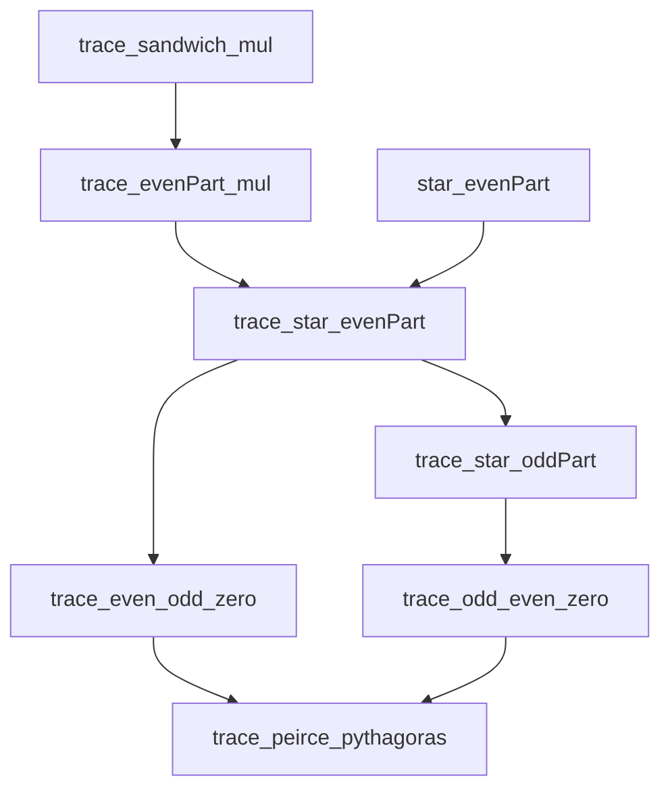

# Operator archetypes: theorem contract

## Input and scope

Source: the user attachment `Pasted text(20261027-142754).txt`, received
2026-10-27. Its five proposed layers are associative star algebra, inner
derivations, idempotent geometry, cyclic trace, and unitary/Kraus maps.
Input SHA-256: `394a0535524248e2c0c5e94f9e225d414d72d21448c269d14e5c426f7f34ddb9`.
The implementation works on full `Matrix n n ℂ` for arbitrary finite `n`.
Operators are not assumed diagonal, scalar, or pairwise commuting.

Baseline: `nickgou-nuke/info-geometry-lean`, `main`,
`b143075bbf27e75860a1011e04423a0f227b7c41`.
Toolchain and dependencies remain at the repository pins: Lean 4.34.1 and
Mathlib `d13f23b723b8a846827a245b89c10fc7d3f11612`.

## Grounded owners

* `Core.IdempotentCartan`: `evenPart`, `oddPart`, `projection_laws`,
  `multiplication_rules`, `odd_eq_double_commutator`, `odd_zero_iff_commute`.
  These are ring-polynomial operations, already defined over any ring.
* `Core.PeirceTangent`: the equation `p*x + x*p = x`, its commutator
  reconstruction, and self-adjoint tangent/skew-adjoint generator equivalence.
* `Quantum.ChoiCompletePositivity`: `Choi.krausMap V`, a native complex-linear
  map with value `∑ i, V i * X * star (V i)`.
* `Modular.Choi`: `krausChannel` is definitionally that same map.
* `Quantum.KrausAmplificationCP`: `amplification` on arbitrary finite ancillary
  index `r`, and `amplification_krausChannel_posSemidef`.
* Native Mathlib: `Matrix`, `IsStarProjection`, `unitary`,
  `Unitary.conjStarAlgAut`, `LinearMap`, the associative Lie bracket,
  `Matrix.PosSemidef`, and cyclic trace.

No replacement definitions for commutators, orthogonal projections, unitaries,
Kraus maps, or amplification are introduced. The canonical checkout contains
other agents' staged boundary-duality work; it is neither modified nor imported.

## Attachment coverage and native dependencies

| Mathematical content | Owner or implementation |
| --- | --- |
| Associative commutator and adjoint representation | Native `Ring.lie_def`, `LieRing.ofAssociativeRing`, `LieAlgebra.ad`; the associative instance is activated locally, as in Mathlib's matrix Lie module. |
| Lie/Jordan product splitting, star compatibility, associative Leibniz, unrestricted nested commutator | `MatrixOperatorIdentities` proves the displayed formulas on arbitrary `Matrix n n ℂ`, without introducing an anticommutator definition. |
| Hermitian/skew-Hermitian splitting | Native `selfAdjointPart`, `skewAdjointPart`, and `StarModule.decomposeProdAdjoint`; the scalar ring is **ℝ**, so this is a real-linear decomposition. |
| Jacobi and the adjoint action | Native `lie_jacobi` and `LieAlgebra.ad`, specialized explicitly to matrices. |
| Complement of a projection | Native `IsStarProjection.one_sub`. |
| Hermitian compression | Native `IsSelfAdjoint.conjugate_self`, exposed with its stronger hypothesis that neither factor needs to be idempotent. |
| Sandwich annihilation and expanded projection double commutator | `MatrixOperatorIdentities.projection_sandwich_lie_zero` and `projection_double_lie`. |
| Peirce splitting and tangent equation | Existing `Core.IdempotentCartan` and `Core.PeirceTangent`, bundled and connected in `PeirceTraceGeometry`. |
| Cyclic trace, trace of a bracket, and the two adjoint conventions | Native `Matrix.trace_mul_comm`, `Matrix.trace_mul_cycle`, and `MatrixTraceGeometry`. |
| Unitary preservation of Lie and symmetric products | The multiplication and addition laws of native `Unitary.conjStarAlgAut`, exposed in `MatrixOperatorIdentities`. |
| General Kraus adjoint compatibility and trace preservation | `PeirceKrausGeometry.star_krausMap` and `trace_krausMap_of_complete`, using the existing `Choi.krausMap`. |
| Complete positivity at every finite ancillary size | Existing `Quantum.KrausAmplificationCP`, transported to the Peirce channel. |

The associative Leibniz formula is a theorem about the native Lie action on
matrix multiplication. It is not packaged as Mathlib's `Derivation`: that
structure at this pin requires a commutative source semiring, which would not
represent the requested full matrix algebra.

## New claims

1. Supply the missing native matrix identities listed above and state the
   different bilinear trace and sesquilinear Hilbert--Schmidt
   adjoint identities for the native matrix Lie bracket.
2. Bundle the existing Peirce operations into native complex-linear maps.
3. Derive their trace-pairing self-adjointness, orthogonal images, and exact
   Pythagorean trace identity when `p` is a native star projection.
4. Derive the operator-valued Kadison defect
   `E (star A * A) - star (E A) * E A = star (O A) * O A`, its positivity,
   and equality exactly when `Commute p A`.
5. Identify `E` with the existing Kraus map on `p, 1-p`; transport the
   existing all-size amplification positivity theorem. Prove unitality,
   trace preservation, the bimodule property, and covariance under the
   native unitary star-algebra automorphism. For arbitrary finite Kraus
   families, prove adjoint preservation and trace preservation under the
   completeness relation, without commutation assumptions.
6. Prove concrete nondiagonal noncommuting matrix examples, including failure
   of positivity of `O` and failure of multiplicativity of a complete Kraus map.

## Semantic corrections

The dependency relation is a branching proof dependency order, not an asserted
unique chain and not a homotopy. It is extracted from constants occurring
in the checked declarations' types and values.

At the conceptual level, multiplication and adjoint support the Lie/symmetric
products, projections, and unitary/Kraus constructions. Cyclic trace is an
additional input to trace duality. Projection identities and trace duality
meet in Peirce orthogonality and the exact positive defect. The Kraus formula
and the projection laws meet in the pinching-channel identification. Neither
unitary conjugation nor a general Kraus map requires first constructing the
Peirce tangent projector. The generated dependency JSON records the chosen
proofs' actual constant dependencies, restricted to the five added owners;
it does not claim that every listed dependency is mathematically necessary.

`Tr(A B)` and `Tr(star A * B)` are different pairings. For the first,
`ad H` is skew; for the second its adjoint is `ad (star H)`.
The Peirce odd part is a tangent-equation projector. No curvature, manifold,
connection, adiabatic theorem, or physical dynamical law is asserted.
Finite complete positivity is positivity at every finite matrix amplification;
it is already supplied by the existing owner, not inferred from trace alone.
The pinching channel's block-diagonal range need not be commutative; the
arbitrary input matrices still inhabit the full noncommutative algebra.

## Verification contract

Compile the full selected repository-source import closure against unchanged
pins, sequentially under `/tmp/info-geometry-build.lock`. Inspect every
declaration owned by the new modules, including generated declarations and
transitive axioms; allow only `propext`, `Classical.choice`, and `Quot.sound`.
Run the repository proof-proxy and semantic-vacuity gates and independent
mathematical and acceptance reviews. Do not claim a whole-repository build
from a scoped source-closure check.

## Verified result

The [scoped workflow run](https://github.com/nickgou-nuke/info-geometry-lean/actions/runs/40540543586)
passed on source commit `7b89abbf5da29b28423ae5d5c11525519c8325df`, tested as
merge `2fdf6146d9b084cfb35ef9031711ce55cf1b854d` into the baseline above.
The final evidence publication changes documentation and JSON only; the five
Lean modules and verification tools retain the checked bytes.

| Check | Result |
| --- | --- |
| Fresh, nonincremental source compilation | **PASS**, all 27 selected repository modules; 22 unchanged imports match the exact baseline Git blobs. |
| Pinned environment | **PASS**, Lean 4.34.1, the documented Mathlib revision, and all 8 Mathlib package pins. |
| Named source declarations | 67 theorems and 6 definitions across 5 modules. |
| Complete owner audit | **PASS**, 100 declarations including generated helpers: 91 theorem-kind declarations and 9 definitions. No owned axioms, unsafe declarations, or partial declarations. |
| Transitive axiom audit | **PASS**, only `propext`, `Classical.choice`, and `Quot.sound`; no `sorryAx` or additional axiom. |
| Dependency extraction | **PASS**, 100 nodes, 136 direct edges, 77 Hasse edges, 6 topological layers; the graph was recomputed byte-for-byte from the returned raw audit. |
| Proof-proxy staged gate | **PASS** on the final staged source. |
| Semantic-vacuity gate | **PASS** at the error threshold: 0 errors and 4 reviewed warnings for explicit native-operation bridge lemmas. |
| Placeholder scan and staged whitespace | **PASS**. |
| Provenance | **PASS**: artifact bytes, all source copies, staged blobs, baseline dependencies, and executed verification-tool hashes match. |
| Independent agent review | **ACCEPTED**: a non-author acceptance reviewer independently checked GitHub metadata, all source/artifact bindings, declarations, axioms, graph, and diagnostics; no blocking finding remains. |

The complete [dependency order](OPERATOR_ARCHETYPES_DEPENDENCIES.json) records
all direct constant references, the restricted dependency relation, the
transitive reduction, and the topological layers. The
[verification record](OPERATOR_ARCHETYPES_VERIFICATION.json) includes source
hashes, package pins, gate commands/results, and diagnostic dispositions.
The [workflow artifact](https://github.com/nickgou-nuke/info-geometry-lean/actions/runs/40540543586/artifacts/12750872063)
contains the raw declaration audit, the full source snapshot, and compiler logs.

Artifact ZIP SHA-256:
`ee3bc2d5f91534f43a6dff8cc3ce0a282e6509c6230545f988968fd54ea569a6`.
Raw declaration audit SHA-256:
`ab91e61f0270b6fb6858b2f66da2efa7688b2bf82243c615e328617a40391e61`.
Dependency JSON SHA-256:
`12ff0a9cfb81c24941324b2aebd9090411918a8c53bc13ae07b131e90fdc7a03`.

### A checked subgraph of the dependency order

Each arrow below is an actual Hasse edge among the checked declarations.
Other branches and generated declarations remain in the complete JSON.

### Diagnostics retained

The four semantic-vacuity warnings concern `star_lie`, `ad_apply`,
`conjStarAlgAut_lie`, and `conjStarAlgAut_anticommutator`. Their short proofs
expose the intended native operations; they are not weakened replacement
claims. The independent mathematical review accepted these statements.

The compiler also reports unused section assumptions in
`adjoint_decomposition`, `star_anticommutator`, and
`compression_isSelfAdjoint`. These are nonblocking generality/style warnings.
Unchanged imported modules emit existing deprecation and unused-argument
warnings. No claim of a warning-free compilation is made.

### Whole-repository CI boundary

The scoped result does not turn the other workflows green. Their observed
failures occur in unchanged baseline configuration or prechecks:

| Workflow | Observed blocker |
| --- | --- |
| [CI](https://github.com/nickgou-nuke/info-geometry-lean/actions/runs/40540543473) | Missing Atlas path package and uninitialized GIFT gitlink/configuration; project compilation was skipped. |
| [Post-Build Quality Gate](https://github.com/nickgou-nuke/info-geometry-lean/actions/runs/40540543367) | Lake stopped at the missing Atlas package; the quality gate did not run. |
| [Sorry Gate](https://github.com/nickgou-nuke/info-geometry-lean/actions/runs/40538289768) | `lake` was absent; the build and later debt audit did not run. |
| [Closure Debt](https://github.com/nickgou-nuke/info-geometry-lean/actions/runs/40538289567) | `pytest` was absent; later audit/build steps did not run. |
| [Lean style](https://github.com/nickgou-nuke/info-geometry-lean/actions/runs/40538289804) | Baseline case collision between `PellisFineStructure.lean` and `PellisfineStructure.lean`; later lint steps did not run. |
| [Docs](https://github.com/nickgou-nuke/info-geometry-lean/actions/runs/40538289797) | Pages-site API returned 404; later builds did not run. |
| [Reviewed PR Integration](https://github.com/nickgou-nuke/info-geometry-lean/actions/runs/40538290007) | Recursive checkout used the baseline submodule URL `/home/goutev/repos/pure_math_lib`, unavailable on the runner. |

The last five diagnostic runs are from predecessor source commit `e40b4a9`;
the first two are from the passing scoped source head. Exact baseline sources
and the PR diff were checked when attributing these blockers. No existing
workflow, dependency pin, submodule URL, or conflicting Physics file is changed
by this implementation. The skipped whole-repository checks are not reported
as passed.
