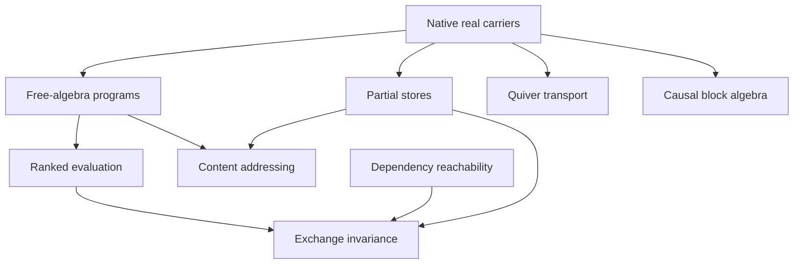

# Real operator programs and causal exchange

## Ground-truth theorem contract

The intake names blockchain, peer exchange, Unison, lambda calculus, dependency
DAGs, and compiler InfoTrees. The formal target is their algebraic intersection:
operator-program substitution, compatible partial-store merge, ranked dependency
evaluation, ordered path transport, and causal block-matrix support. All operator coefficients are
arbitrary real square matrices. Multiplication order is retained throughout.

The inspected source baseline was `512b663213a834c42e4fa7c25b9133e88a85c78a`.
The publication base is `5560d7a7aaf65a4eba2a747973c39a4ed4f198e8`; its
intervening changes leave the inspected owners and dependency pins unchanged.

| Intake concept | Exact formal object | Intended theorem scope |
| --- | --- | --- |
| Program substitution | `FreeAlgebra ℝ α` and its native algebra-homomorphism lift | Substitution composition, evaluation compatibility, locality on generated subalgebras |
| Peer data exchange | Key-indexed partial stores with native `Option` payloads | Extension order, merge associativity/idempotence, commutativity exactly under overlap agreement |
| Content addressing | An explicit address function on stored programs | Local collision assumptions on observed programs, address validity under merge, operator lookups retained under extension |
| Ordered execution | Arbitrary real matrix products | Exact adjacent-swap commutator residual; unordered merge cannot represent arbitrary noncommuting execution multiplicatively |
| Dependency DAG | Native reflexive/transitive reachability and a strictly decreasing dependency rank | Antisymmetry, a native partial order, and dependency-closed domains as lower sets |
| Recursive evaluation | `WellFounded.fix` on internal keys, with a separate type of external matrix generators | Existence, uniqueness on closed stores, fallback independence, and preservation under exchange |
| Operator transport | Native `Quiver.Path` with explicit real matrix edge labels | Concatenation law, endpoint gauge covariance, and transformed path defects |
| Causal geometry | `Subalgebra ℝ (Matrix V V (Matrix n n ℝ))` supported on `i ≤ j` | Closure under ordered block multiplication and compression defects |

The finite coefficient dimensions, supplied dependency relation and rank, address function,
overlap compatibility, and any local collision condition are explicit inputs.
The construction does not assume matrix generators commute. Store domains may
be infinite; the matrix coefficient dimension is finite. The causal block
algebra additionally requires a finite vertex type. The evaluator uses native
noncomputable `WellFounded.fix` over real matrices; it does not compare programs
for equality, and no executable distributed runtime is asserted.

## Canonical theorem stream

The package entry point is
`InfoGeometry.Canonical.OperatorContentNetwork`. Its algebraic carriers are
`Program α = FreeAlgebra ℝ α` and `Operator n = Matrix n n ℝ`.

### Substitution and execution

`substitution_comp` and `substitution_assoc_apply` prove simultaneous algebraic
substitution by the free algebra's universal property.
`evaluation_substitution` proves compatibility with matrix evaluation.
`evaluation_locality` extends generator agreement to its native adjoined
subalgebra; this is the support lemma used by recursive evaluation.

`execution_adjacent_swap_defect` retains the exact residual of changing event
order. For arbitrary matrix contexts, the underlying identity is

\[
PABQ-PBAQ=P(AB-BA)Q.
\]

`unit_context_commutator_ne_zero_iff` proves that invertible surrounding
contexts detect precisely noncommutation of the exchanged matrices. Neither
event matrix is required to be invertible.

### Causal order and closed knowledge

`Dependency.Reachable deps d k` is the native reflexive/transitive closure of
`d ∈ deps k`. A supplied `rank : κ → ℕ` strictly increases from each dependency
to its consumer. `reachable_antisymm` proves antisymmetry and
`dependencyOrder` packages the result as a native `PartialOrder κ` without
installing a global instance. Immediate dependency closure is equivalent to
native `IsLowerSet` for this order.

`PeerStore.Extends S T` means that every entry of `S` occurs unchanged in `T`.
`extensionOrder` is its native partial order. `merge_comm_iff` proves that the
two left-biased merge orders agree exactly when every overlapping entry agrees.
Merge is associative and idempotent, and a compatible merge is the least common
extension. `compatible_iff_common_extension` also proves the converse: stores
admit a common extension exactly when they are compatible.

### Content addressing

For a supplied `address : Program α → κ`, `Addressed address S` states that
every resident program occupies its declared key. For addressed stores,
`compatible_iff_address_injOn` proves

\[
\operatorname{Compatible}(S,T)
\iff
\operatorname{InjOn}(\operatorname{address},
  \operatorname{payloads}(S)\cup\operatorname{payloads}(T)).
\]

The condition concerns the actual exchanged payloads. The converse is proved
using the partial-function property of the merged store; it is not a global
hash assumption. `collision_changes_merge_read` proves that colliding programs
with distinct matrix evaluations make opposite merge orders observably
different, even though each singleton store is correctly addressed.

`multiplicative_merge_forces_commute` and
`multiplicative_merge_forces_idempotent` expose the obstruction to identifying
data merge with operator multiplication. Multiplicatively interpreting both
compatible exchange orders forces commuting images; interpreting self-merge
multiplicatively forces idempotent images.

### Actual evaluation and exchange invariance

Stored programs use generators `κ ⊕ ι`: internal references are `Sum.inl`, while
`Sum.inr` supplies arbitrary external real matrices through a fixed environment
`ν : ι → Operator n`. This permits noncommuting inputs even at rank-minimal nodes.
`exists_store_with_noncommuting_results` explicitly constructs a store retaining
any supplied noncommuting pair at two distinct keys, for every fallback map.

`RankedDAG.resolve` is constructed with native well-founded recursion. It uses
an explicitly supplied arbitrary fallback matrix at absent or non-decreasing
references. Declared generator support and strict dependency rank prove
`resolve_satisfies`: those guards do not alter any stored program's equation.
This existence theorem does not require dependency closure.

Dependency closure is required for `satisfies_unique_on_store` and
`resolve_fallback_independent`. `resolve_extension` then preserves every old
computed matrix when entries are retained; the larger store may use a different
valid rank and dependency assignment. `PeerStore.resolve_merge_converges`
specializes these results to compatible closed peers. It fixes the same external
inputs, allows different fallback maps, and proves equality on every retained
key after either exchange order.

### Operator geometry

`pathTransport` multiplies arbitrary matrix edge labels along native
`Quiver.Path`. Products use a left-to-right word convention, equivalently row
action. `pathTransport_comp` proves the concatenation law. For vertex units,
`pathTransport_gaugeLabel` and `pathDefect_gaugeLabel` prove endpoint covariance:

\[
T_{G\cdot L}(p)=G_aT_L(p)G_b^{-1},\qquad
\Delta_{G\cdot L}(p,q)=G_a\Delta_L(p,q)G_b^{-1}.
\]

Zero and nonzero parallel-path defects are invariant under this action.
Potential-induced labels have endpoint-dependent transport and trivial loop
transport. Forward composition on column vectors would use the reversed
multiplication convention.

`causalSubalgebra` is the native real subalgebra of
`Matrix V V (Matrix n n ℝ)` supported on `i ≤ j`. Multiplication closure follows
from transitivity of the vertex order. `causalBlock_evaluation_surjective`
proves that every allowed block, including each strict causal block, can carry
any real matrix. For a finite key type, the order can be instantiated with
`Dependency.dependencyOrder`.
Outer transposition is asserted only to reverse support, not to reverse products
of noncommutative matrix-valued blocks.

Compression acts on the ambient block algebra with an arbitrary idempotent `P`,
without a diagonal or self-adjoint restriction. It is not asserted to preserve
causal support for an arbitrary `P`. The existing Peirce owner supplies the exact defect

\[
P(AB)P-(PAP)(PBP)=PA(1-P)BP.
\]

`compress_mul_eq_iff` characterizes multiplicativity by vanishing of this
transfer term, and `compress_mul_ne_of_transfer_ne` supplies the obstruction.

## Proof dependency order

The source import graph orders the formal archetypes by actual prerequisites.
The reachability poset above is a separate, kernel-checked object on program keys.

## Inspected repository owners

- `DAG.ContentAddressable.declContentKey` and `sameExpr_sameKey` identify a
  deterministic digest of declaration type/value data. The theorem's direction
  is equality of input expressions implies equality of keys.
- `DAG.TermDigest.compute` and `digestWithLctx` implement the versioned
  `lean-expr-debruijn-v4` encoding. Constants retain names and universe levels.
- `Canonical.LambdaCausalNetNegativeGrammarBridge.LambdaTerm` owns de Bruijn
  variables, abstraction, application, binder lifting, and binder-removing
  substitution. `LambdaBetaStep.beta` uses that substitution directly.
  The file `lean/DAG/LambdaReduction.lean` adds the distinct relation
  `LambdaTerm.BetaStep.redex` with an additional shift convention.
  This package makes no identification of the two relations.
- `Canonical.InfoTreeGaugeHomotopy.CompilerInfoPath` owns actual elaborator
  parent-child paths. Its supplied telemetry is distinct from kernel proof
  evidence. The new generic path algebra does not replace this carrier or
  assert an unproved embedding of it.
- `Causal.ProofDAGRepresentation.CausalRepresentation` has a different,
  fixed complex coefficient carrier. No equivalence to the new real block
  algebra is claimed.
- `Core.PeirceCompressionDefect.compression_mul_defect` owns the generic ring
  identity. `OperatorContentNetwork.compress_mul_defect` specializes this existing proof
  to full real matrix-valued blocks.

Native mathlib `FreeAlgebra`, `AlgHom`, `Algebra.adjoin`, `Option`,
`PartialOrder`, `Subalgebra`, `Matrix`, and `Quiver.Path` supply the structures.
The new statements concern algebraic substitution without binders; they are
not a semantics of arbitrary untyped lambda terms.

## Boundaries

The mathematical results do not establish collision resistance of SHA-256 or
SHA3, Byzantine consensus, finality, network delivery, correctness of Unison's
compiler, or correctness of Lean InfoTree extraction. A content key remains
an address with an explicitly stated local equality condition. Kernel checking
establishes the exact Lean theorem, not semantic claims about external systems.

## Validation

The toolchain is the repository's pinned Lean `v4.34.1`, with mathlib revision
`d13f23b723b8a846827a245b89c10fc7d3f11612`. Dependency pins are unchanged.
The test target `OperatorContentNetworkAxiomAudit` imports the complete package,
requires representative declaration sentinels, and recursively checks the axiom
dependencies of every package declaration, including generated private ones.
Its allowed set is exactly `propext`, `Classical.choice`, and `Quot.sound`.

All nine component modules, the package umbrella, and the audit passed the
Lean kernel with `-DwarningAsError=true`. There are **126 explicitly named
theorems**. The transitive audit checked **191 declarations**, including **151
theorem constants** after compiler-generated declarations, and passed with
only the allowed standard axioms. The unchanged generic Peirce owner was also
compiled from source for this check.

The repository's `tools/quality/proof_proxy_staged_gate.py` and
`git diff --cached --check` passed. Checks used the pinned compiler and mathlib
in a separate build overlay, leaving dependency sources and pins unchanged.
This is targeted package verification, not a claim that the repository's entire
default build or the broad `Canonical.All` import graph has been compiled.
