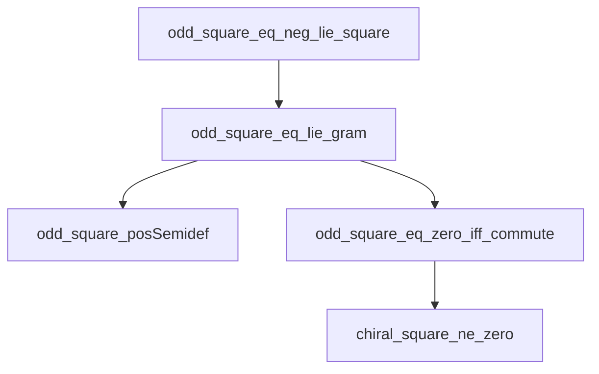

# Operator extensions XIV–XVIII: theorem contract

## Intake and scope

Source: `Pasted text(20261028-090911).txt`, SHA256
`4fa5dca9a0bb2db995d899881603d3204b1fc707b5b9b39e6bdbcd5bfde29378`.
The original uploaded text is preserved. The implementation base is PR #232,
commit `423762cd7128ada367735aeb2452f4c53bf192c7`.

The carrier is the full algebra `Matrix n n ℂ` for arbitrary finite `n`.
The native associative Lie bracket is `⁅A,B⁆ = A * B - B * A`.
The star is conjugate transpose; products retain their order. No simultaneous
diagonalization, scalar-matrix restriction, or pairwise commutation of arbitrary
inputs is assumed. Invertibility, idempotence, and self-adjointness are explicit
native hypotheses, or are proved where the input implies them.

This is a finite algebraic extension. It makes no physical, manifold, spectral
limit, point-at-infinity, or differential-equation existence claim.

## Owner map and checked additions

### XIV–XV: Peirce corners and chiral square geometry

Existing owners:

- `Core.PeirceDecomposition.component10 p A = p*A*(1-p)` and
  `component01 p A = (1-p)*A*p`; same-direction products vanish for idempotent p.
- `Core.IdempotentCartan.oddPart`, `evenPart`, and `reflection`; theorems
  `corners_square_zero`, `projection_laws`, `multiplication_rules`,
  `conjugation_on_parts`, `reflection_mul_odd`, `odd_zero_iff_commute`.
- `OperatorAlgebra.MatrixOperatorIdentities.star_lie_of_isSelfAdjoint` and
  `OperatorAlgebra.PeirceTraceGeometry.star_oddPart` from the accepted base.
- `Core.PeirceMatrixTracePairing` and `Core.PeirceMatrixPerfectPairing` already
  own the opposite-corner trace duality; no new corner carrier is needed.

New theorems prove native bracket root laws, corner trace isotropy and adjoint
exchange, the cross-square formula, and the exact identities for
`M = oddPart p A`, `J = ⁅p,A⁆`:

```
M*M = -(J*J)                         (p idempotent)
M*M = star J * J                     (p star projection, A self-adjoint)
(M*M).PosSemidef
M*M = 0 ↔ Commute p A
Commute p (M*M)
```

Native Mathlib positivity and faithfulness come from
`Matrix.posSemidef_conjTranspose_mul_self` and
`Matrix.conjTranspose_mul_self_eq_zero`.
The correct positivity conclusion is semidefiniteness. Nonzero cross terms
require noncommutation. Bilinear trace isotropy is not Hilbert–Schmidt nullness.

### XVI: native inner Maurer–Cartan one-cochain

`Canonical.FiniteFrameMaurerCartanPolarSplit.leftMaurerCartan G dG` already
means `G⁻¹*dG` for native `Matrix.GeneralLinearGroup n ℂ`, and
`leftMaurerCartan_mul` proves its product cocycle.

The new one-cochain is a native complex-linear map
`ω_G(H) = G⁻¹*⁅H,G⁆ = G⁻¹*H*G-H`, constructed using the native conjugation
algebra equivalence. Its results include reconstruction, inverse differentiation,
the product cocycle, trace zero, and full Chevalley–Eilenberg flatness:

```
⁅A,ω_G(B)⁆ - ⁅B,ω_G(A)⁆ - ω_G(⁅A,B⁆) + ⁅ω_G(A),ω_G(B)⁆ = 0.
```

The differential is native `LieModule.Cohomology.d₁₂`. The existing
`OperatorAlgebra.DerivationDifferentialForms` has a faithful-action carrier;
the adjoint action of all matrices has a scalar kernel, so no false faithful
instance is introduced. The direction-bracket term is essential.

### XVII: centralizer conservation and quadratic invariance

Use native `Subalgebra.centralizer ℂ (Set.range H)` and its multiplication,
addition and subtraction closure. Do not recreate the commutant.
The previous trace integration-by-parts theorem and native trace duality give
weighted conservation. Existing `Canonical.FiniteMatrixGibbsCentralizer`
already owns the arbitrary weighted-trace/centralizer equivalence.

The quadratic criterion proves: if `⁅K,H i⁆ = ∑ j, c i j • H j` and
`c i j = -c j i`, then `Commute K (∑ i, H i * H i)` by finite-sum
cancellation. This does not assume the generators commute and does not store
the conclusion in a structure field. The quadratic element is distinguished
from the double-commutator superoperator:

```
∑ i, ⁅H i,⁅H i,X⁆⁆ = C*X + X*C - 2 • (∑ i, H i*X*H i).
```

Centrality is relative to the named generator family unless that family is
proved to generate the entire matrix algebra.
`trace_star_sum_double_lie` is the full two-input Hilbert–Schmidt
integration-by-parts identity. It does not assert an additional kernel
classification or construct a bundled positive superoperator.

### XVIII: native Cayley domain and transformation

Use native `Invertible`, `IsUnit`, `Units`, and `unitary`, rather than the
attachment's duplicate inverse-pair structures. The algebraic unitarity proof
already exists in `OperatorAlgebra.IndividuatedCayley` and can be specialized
internally with all resolvent fields constructed from native inverse laws.

For `U(X) = (1-X)*(1+X)⁻¹`, the forward domain is `IsUnit (1+X)`.
Parity inversion additionally requires `IsUnit (1-X)`. The results include
the two resolvent identities, commutation with X, parity inversion, and the
ordered inner-derivative formula:

```
⁅H,U(X)⁆ = -2 • ((1+X)⁻¹ * ⁅H,X⁆ * (1+X)⁻¹).
```

`cayley_units_inv` also proves `U(G⁻¹) = -U(G)` for a native matrix unit G
with invertible `1+G`; it derives admissibility of the inverse input.
`cayley_sub_cayley` proves the genuinely two-input resolvent identity
`U(X)-U(Y) = -2 • ((1+X)⁻¹*(X-Y)*(1+Y)⁻¹)` under the two denominator
hypotheses, with no assumption that X and Y commute.

Every skew-adjoint complex matrix is admissible: the Gram matrix
`1 + star X * X = (1-X)*(1+X)` is positive definite. Derive both unit
denominators, then prove the native unitary membership of the Cayley transform.
The finite value `U(0)=1` and the resolvent identities do not define a point at
infinity. Under the forward domain, `-1` is excluded from the finite Cayley
image over a nonempty complex matrix algebra.

## Noncommuting witnesses

Use explicit nondiagonal 3×3 star projections
`P = (1/9) * [[1,2,2],[2,4,4],[2,4,4]]` and
`Q = (1/9) * [[4,2,4],[2,1,2],[4,2,4]]`.
Certify noncommutation in Lean. Their odd square has a nonzero off-diagonal
entry and a nontrivial kernel: it is nonzero and positive semidefinite, yet
not positive definite. These are witnesses to the general operator theorems,
not substitutes for them.

`MatrixCasimirExamples` supplies a separate three-generator Hermitian family
whose members are all nondiagonal and have nonzero brackets. Its exact skew
coefficient action instantiates the general quadratic-invariance theorem.
The quadratic sum lies in their family centralizer and has entry
`C 0 1 = -32/27`, so it is neither diagonal nor a scalar matrix.

## Dependency order and acceptance

Dependencies were extracted from constants in kernel-checked declaration
types and values, including generated declarations. The resulting finite DAG,
its reachability order and its Hasse reduction describe these selected proofs.
No analogy is inserted as an edge. In particular, no edge from Peirce
nilpotency to Maurer–Cartan flatness, or from Casimir invariance to Cayley
inversion, is assumed.

Acceptance requires fresh compilation of the selected complete repository
source closure at the pinned Lean/Mathlib versions; a transitive axiom audit;
placeholder, semantic-vacuity and proof-proxy checks; and independent semantic
and verification reviews. Only standard foundational axioms `propext`,
`Classical.choice`, and `Quot.sound` are allowed. The results below and the
linked source, audit, and provenance records supply that evidence.

## Checked result

The [fresh scoped workflow](https://github.com/nickgou-nuke/info-geometry-lean/actions/runs/40668253864)
passed for source head `2fa32236f9eaf8285e068f60b4a0cb56d15a883f`, tested as merge
`d5ba9edd19fb6dc9104208d377a4ad338ad32ce1` into the base stated above.
The evidence publication adds documentation and JSON only; mathematical source
and verification tools retain the exact checked bytes.

| New mathematical owner | Named theorems | Definitions |
| --- | ---: | ---: |
| `PeirceChiralGeometry` | 18 | 0 |
| `MatrixMaurerCartan` | 15 | 1 |
| `MatrixConservation` | 11 | 0 |
| `MatrixCayleyGeometry` | 18 | 1 |
| `OperatorExtensionExamples` | 16 | 3 |
| `MatrixCasimirExamples` | 13 | 3 |
| **New total** | **91** | **8** |

Together with the five unchanged owners from PR #232, the source contains
158 named theorems and 14 definitions. Generated declarations are counted
separately by the complete kernel audit.

| Check | Result |
| --- | --- |
| Fresh source compilation | **PASS**: all 36 repository modules in the selected import closure, without incremental reuse. |
| Baseline preservation | **PASS**: all 25 non-owner imports match the baseline Git blobs; all five earlier mathematical owners are unchanged. |
| Pinned environment | **PASS**: Lean 4.34.1, Mathlib `d13f23b723b8a846827a245b89c10fc7d3f11612`, and all eight pinned Mathlib packages. |
| Complete owner audit | **PASS**: 277 declarations across all eleven owners, including generated helpers; 251 theorem-kind declarations and 26 definitions. |
| Transitive axiom audit | **PASS**: only `propext`, `Classical.choice`, and `Quot.sound`; no owned axioms, unsafe or partial declarations, or `sorryAx`. |
| Dependency order | **PASS**: 277 nodes, 536 direct edges, 267 Hasse edges, seven layers. Recomputed byte-for-byte from the raw checked audit. |
| Proof-proxy gate | **PASS** on the exact staged candidate against the PR base. |
| Semantic-vacuity gate | **PASS** at the error threshold: all six files read, zero errors, three independently reviewed warnings. |
| Placeholder and whitespace checks | **PASS**; all eleven staged candidate blobs match the accepted source head. |
| Compiler diagnostics | **Zero warnings in the six new mathematical modules**; 41 nonblocking warnings in seven unchanged files. |
| Independent mathematical review | **PASS**, including a final review of every repair against the initial candidate; no statement was weakened. |
| Independent verification acceptance | **ACCEPTED**: a non-author reviewer independently checked remote metadata, the artifact, source/tool bindings, all declaration coverage, graph reachability, and diagnostics. |

The [verification record](OPERATOR_EXTENSIONS_VERIFICATION.json) records source
hashes, dependency pins, executed-tool hashes, declaration coverage, gate
results, warning dispositions, and independent verification acceptance.
The [workflow artifact](https://github.com/nickgou-nuke/info-geometry-lean/actions/runs/40668253864/artifacts/12806813390)
contains the raw declaration audit, full source snapshot, and compiler logs.

| Evidence | SHA256 |
| --- | --- |
| Downloaded artifact ZIP | `e271f77090e76a4c6af02b5e0a694457a7747ac3b817ebff79e08b3d243d8dcc` |
| Raw declaration audit | `e525b1142f959642fe509acade3f52ecce67b8767cb7f2259cedb3bfc5edc4f3` |
| Dependency-order JSON | `e244dab8ba099a30991e5744a7a3f418c6788efabf0c3866ae53b678989c6f85` |

### The extracted partial order

The [complete dependency order](OPERATOR_EXTENSIONS_DEPENDENCIES.json) records
every audited declaration, all direct constant references, the selected-owner
dependency relation, its Hasse reduction, and topological layers of sizes
`124, 35, 60, 30, 16, 10, 2`.

The following is an actual Hasse subgraph of the checked declarations:



Other certified cover relations include:

| Dependency | Dependent theorem |
| --- | --- |
| `maurerCartan_bracket_transport` | `maurerCartan_equation` |
| `maurerCartan_equation` | `maurerCartan_differential` |
| `lie_units_inv` | `lie_cayley` |
| `lie_cayley` | `commute_cayley_iff` |
| `skew_quadratic_sum_eq_zero` | `commute_quadratic_sum` |
| `commute_quadratic_sum` | `quadratic_sum_mem_centralizer` |
| `quadratic_sum_mem_centralizer` | `MatrixCasimirExamples.C_mem_centralizer` |
| `cayley_of_square_zero` | `cayley_component10` |

These relations order the actual proofs. Parallel branches remain parallel;
the numbering XIV–XVIII does not create additional dependency edges.

### Diagnostic dispositions

The three semantic warnings are the gate's lexical `trivial_surface` category:

- `cayley_zero` is the exact normalization of the native matrix expression at zero.
- `trace_sum_lie_zero` is the universal finite-family consequence of trace linearity
  and cyclic commutator trace, without a commutation hypothesis on either family.
- `maurerCartan_apply_conj` is the definitional bridge from the native conjugation
  linear map to its matrix formula. The cocycle and flatness results are separate proofs.

Independent review accepted all three. No conclusion is supplied as a hypothesis,
no proposition is replaced by `True`, and no warning is suppressed.

The 41 compiler warnings are confined to unchanged files: `MatrixOperatorIdentities`
(3), `MoorePenrose` (14), `JordanPeirceDecomposition` (2), `JordanAssociator` (7),
`ChoiCompletePositivity` (9), `KrausAmplificationCP` (5), and
`FiniteFrameMaurerCartanPolarSplit` (1). They concern deprecated APIs/imports,
unused section assumptions or simplifier arguments, and tactic-style suggestions.

### Whole-repository CI boundary

The scoped proof result is independent of these observed setup failures on the
same source head:

| Workflow | Observed blocker |
| --- | --- |
| [Sorry Gate](https://github.com/nickgou-nuke/info-geometry-lean/actions/runs/40668253932) | `lake` is absent from the runner; the build does not start and the repository debt audit is skipped. |
| [Build thesis, blueprint, and docs](https://github.com/nickgou-nuke/info-geometry-lean/actions/runs/40668253914) | GitHub Pages configuration returns HTTP 404; subsequent compilation and documentation steps are skipped. |

Those unchanged workflows are not reported as passing. The accepted result is
the exact selected source closure, its full owned-declaration audit, and the
recorded static and independent reviews.
