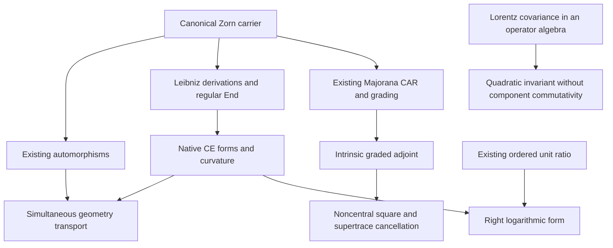

# Operator gauge connections: source-grounded theorem contract

Status: independent semantic review accepted; native author checks pass;
independent execution disposition **ACCEPTED_WITH_LIMITED_SCOPE**.
The candidate sections preserve the original formalization targets.

## Intake and provenance

User instruction, 2026-10-27, continuing PR #240 at
`e6b4ff6c0e7e9e24e55e6a3f9e3dfc43e834e62a`:

> beware we have done the nonassociative split-octonions automorphisms already and splitoctonions lifted to operators carry much of the gauge fileds naturally the anomalies are genrators of the higher grades and anomalies genrate the curvature maurer cartan real forms for operators we lifted the standard scalar fields to noncommutaitve OPERATIOR ALGEBRAS A the trace the sueprtrace berezinaian all invariants char poly and casimirs operators noncommutative ring relaces the satndadr nonabelian yangmills formalzied in codebase the drunken professor confabulated hazy raw mix-up entangled ideas extract the stream of pure mathematical consciousness from these random thought ignore the physics prose translate the physics concepts into the math equivalents regenerate a stream of canonical math in native mathlib in lean4 with genuine lemmas and theorems with full proofs extract the archetypes in the raw stream order them properly in a causal poset and synthesize the canonical mathematical code in native mathlib in lean4 with genuine lemmas and theorems with full proofs only do not use scalar diagonal or commuting toys stay withing non-commutative matrix operator algebra and geometry deepearch for other yang and mills orrurences in the repo what is there hiding in hindside lets connect the lanes nd complement codebase and the majoranas superchiral charges and the poincare grouop and susy and the central chanrge what was there yet ot be revealed and conencted the drunken professor confabulated hazy raw mix-up entangled ideas extract the stream of pure mathematical consciousness from these random thought ignore the physics prose translate the physics concepts into the math equivalents regenerate a stream of canonical math in native mathlib in lean4 with genuine lemmas and theorems with full proofs extract the archetypes in the raw stream order them properly in a causal poset and synthesize the canonical mathematical code in native mathlib in lean4 with genuine lemmas and theorems with full proofs only do not use scalar diagonal or commuting toys stay withing non-commutative matrix operator algebra and geometry engage the opengauss protocol and the epistemic-compiler skill

The controlling workflow is `skills/epistemic-compilation/SKILL.md`, the
OpenGauss section of `docs/CANONICAL_AGENT_PIPELINE.md`, and
`docs/CODEX_AGENT_SWARM_PROTOCOL.md`. The optional plugin reference directory
named in those documents is absent in this checkout; the maintained repository
CLI and protocol adaptation are present. Its missing Python `jsonschema`
dependency was installed in a temporary task directory, without changing
project pins. OpenGauss discovery produced a versioned navigation receipt.
Graph evidence is navigation only; availability and freshness are recorded
separately and do not replace source inspection.

## Existing owners and exact distinctions

The owner search uses filename/content searches, exact declaration/consumer
searches, the maintained context preflight and OpenGauss discovery, followed by
reading the actual carriers, operations, hypotheses and proof bodies.

| Mathematical object | Existing owner | Source-confirmed content |
| --- | --- | --- |
| Nonassociative split-octonions | `Algebra/ZornVectorMatrix`, `Canonical/SplitOctonionAutomorphism` | Actual product, associator and multiplication-preserving linear automorphisms |
| Regular operators | `Algebra/ZornLeftMultiplicationDefect` | Left multiplication has an associator defect; it is not a multiplicative embedding |
| Derivation conjugation | `Algebra/Zorn/G2ZornDerivationRootRepresentation` | `conjugateCanonicalDerivation` is an existing native Lie equivalence |
| Operator derivation geometry | `Lie/CanonicalZornOperatorDerivationLane`, `OperatorAlgebra/CanonicalZornDerivationDifferentialForms` | Faithful derivation action on `Module.End`, CE differential, Bianchi and canonical Maurer–Cartan form |
| Noncommutative Zorn coefficients | `Canonical/OperatorZornFourPotentialGauge`, `Canonical/OperatorZornGaugeCovariance` | Background coefficient curvature, associator corrections, sourced Bianchi and coefficient gauge covariance |
| Majorana operators | `Algebra/ZornLeftMajorana`, `Algebra/ZornLeftMajoranaCovariance` | Genuine split-Clifford operators on the full Zorn module, CAR and grading anticommutation |
| Existing parity | `Algebraic/SplitSuperGeometry`, `Algebra/CuntzSuperalgebra` | Actual involutive algebra automorphisms; finite operator supertrace and quotient parity |
| Graded square identities | `Canonical/ChiralSuperderivationColimit` | Existing externally parity-tagged square and mixed-supercharge identities |
| Operator Berezinian | `Canonical/AlbertCayleyDickson` | Ordered unit ratio `u * Δ⁻¹`, its inverse, quasideterminants and ordered elimination |
| Operator anomaly readout | `Canonical/AlbertCayleyDickson` | Operator-valued Zorn trace retains a commutator residue; cyclic scalar readouts can discard it |
| Lorentz quadratic invariant | `Physics/PoincarePauliLubanskiCovarianceBridge` | At intake, the covariance theorem required commuting vector components; this extension removes that assumption |
| Poincaré actions | `Algebra/CuntzLorentzPoincarePresentation`, `Physics/ChiralPoincareSemidirect` | Actual group/action carriers exist; their supersymmetry compatibility must be proved separately |

The lexical Yang–Mills inventory is distinct from Yang–Baxter and Lee–Yang
occurrences. An existing annihilating polynomial of a grading operator is not
automatically its determinant-defined characteristic polynomial. An
operator-valued Berezinian ratio is not assumed multiplicative or pointwise
invariant. Centrality in the symmetry-generated algebra is distinguished from
centrality in the whole coefficient algebra.

## Candidate A: simultaneous transport of native differential geometry

Carrier: existing native `OneForm K`, `TwoForm K`, a native Lie equivalence of
derivation directions, and an algebra equivalence of coefficient algebras.
The required primitive compatibility is intertwining the actual derivation
actions. The target is naturality of the differential and curvature.

For the existing split-octonion automorphism `φ`, use the existing
`σφ = conjugateCanonicalDerivation φ` and conjugation `Cφ` on the full
endomorphism algebra. Prove their compatibility and then

`(φ ⋅ Γ)(D) = Cφ (Γ (σφ⁻¹ D))`,

`F(φ ⋅ Γ)(σφ D, σφ E) = Cφ (FΓ(D,E))`.

The canonical Maurer–Cartan form `D ↦ -D` should be fixed by this action.
This changes both base directions and coefficients, unlike the fixed-base
unit gauge action in PR #240. Reuse the existing Lie equivalence rather than
constructing a parallel automorphism API.

## Candidate B: intrinsic graded operator curvature

Carrier: an arbitrary associative unital `R`-algebra `A`, a native algebra
equivalence `θ : A ≃ₐ[R] A` with `θ² = id`, and an actual odd element
`θ(Q) = -Q`. Define the linear endomorphism

`δQ(X) = Q*X - θ(X)*Q`.

Prove its twisted Leibniz identity, parity anticommutation, exact square
`δQ²(X) = Q²*X - X*Q²`, mixed-charge identity, transport by algebra
equivalences, and the exact centrality criterion for square-zero action.
No external Boolean tag substitutes for actual parity membership.

Instantiate the grading on `A = Module.End R (ZornVectorMatrix R)` using the
existing Zorn grading involution and native conjugation. Use the existing
Majorana operators. A non-flat target is `Q = a + a*b*c`, where `a,b,c` are
the three positive Majorana basis operators. Their existing CAR should yield
`Q² = 2*(b*c)` and `[Q²,b] = -4*c ≠ 0` over the reals. This witnesses an
actual higher odd product generating noncentral even operator curvature.

Any supertrace conclusion must use a stated cyclic trace on an actual
finite-dimensional endomorphism carrier; it must not erase the operator
curvature or silently apply a finite trace to an infinite-dimensional carrier.

## Candidate C: ordered Berezinian and logarithmic derivative

Reuse `AlbertCayleyDickson.SplitQuaternion.opNoncommBerezinian u Δ = u*Δ⁻¹` and its existing
inverse. Prove simultaneous conjugation covariance and the exact ordered
multiplicativity defect

`B(u₁u₂,Δ₁Δ₂) - B(u₁,Δ₁)*B(u₂,Δ₂) = u₁*[B(u₂,Δ₂),Δ₁⁻¹]`.

For the native derivation action, let `ηg(D) = ρD(g)*g⁻¹`. Prove
`η(uΔ⁻¹) = ηu - Ad(uΔ⁻¹)(ηΔ)` and the right Maurer–Cartan sign
`dη - η∧η = 0`. The existing pure gauge form is `-η`, satisfying
`dΓ + Γ∧Γ = 0`. It is not identified with a non-flat anomaly connection.

## Candidate D: noncommuting Lorentz quadratic invariance

Reuse the existing `IsLorentzVector M V` and `minkowskiSq V`, over arbitrary
`[Ring A] [Algebra ℝ A]`. Prove

`bracket (minkowskiSq V) (M μ ν) = 0`

from the covariance law alone. Do not assume pairwise commutation of the four
components of `V`. The squared-commutator expansion retains both multiplication
orders, which cancel after metric contraction. Derived Casimir statements
must state exactly which generators commute with the invariant.

## Dependency order and acceptance boundary

The proof order is: existing nonassociative carriers and automorphisms;
their associative regular operators and derivation actions; native cochains
and intrinsic parity; transported curvature and graded square identities;
Majorana higher-product witnesses and ordered-unit logarithmic derivatives;
invariant scalar readouts with explicit hypotheses.

Candidate arrows become accepted dependency edges only after their Lean
declarations compile and their actual imported premises are audited. Source
generation, semantic audit/refutation, and execution-based acceptance are
separate agent roles. Builds and tests are serial under the shared lock.
No dependency pins or acceptance-gate policies may be weakened to pass.

No universal Lie bracket on the nonassociative split-octonion elements, full
super-Poincaré representation, analytic quantum theory, spectral mass gap,
unproved determinant over a noncommutative coefficient ring, or universal
grading preservation is part of this contract.


## Source search and connections retained

The reproducible lexical search was
`rg -l -i 'yang.?mills|yangmills|yang_mills' lean --glob '*.lean'`:
60 Lean files at this task's starting revision. This inventory includes
import aggregators and historical/experimental modules; a textual hit is not
a theorem-status certificate. Separate owner/consumer searches covered
`Majorana`, `Poincare`, `supercharge`, `central`, `Berezinian`, `trace`,
`associator`, `MaurerCartan`, and the exact declarations in the table above.

The existing lanes supply distinct facts:

- `Canonical/GradedConnectionBianchiBridge` works with the actual exterior
  differential, square-zero differential law and graded Leibniz rule.
- `Canonical/OperatorZornFourPotentialGauge` retains background coefficient
  curvature and both ordered associator terms. The Bianchi expression includes
  the six-term Akivis alternation. `OperatorZornGaugeCovariance` proves its
  coefficient-ring transport, rather than replacing it with associative End
  multiplication.
- `Algebra/ZornLeftMultiplicationDefect` records
  `[L_x,L_y] = L_[x,y] - 2 A(x,y)`; the associator correction is necessary.
  `ZornLeftCAR.leftMultiplication_not_multiplicative` and
  `ZornPeirceMixedAssociator.associator_not_filippov` rule out two tempting
  automatic identifications.
- `Canonical/ChiralSuperderivationColimit` already has square and mixed-charge
  identities with external parity tags. The new `IntrinsicGradedAdjoint` uses
  an actual algebra involution and proves the parity compatibility itself.
- `Algebra/CuntzSupergradedSUSY` has the actual odd charge `S + S†`; its even
  square is not thereby proved central. The existing central-extension
  owners retain their explicit centrality hypotheses.
- `Canonical/AlbertCayleyDickson` contains ordered Schur/quasideterminant
  elimination, an operator-valued trace commutator residue, a grading
  annihilating polynomial, and full-matrix supertrace cancellation. These
  readouts have different hypotheses and are not interchangeable invariants.
- `Physics/ChiralPoincareSemidirect` and
  `Algebra/CuntzLorentzPoincarePresentation` contain genuine group/action
  carriers. This extension strengthens the quadratic-invariant covariance
  theorem, but does not assert that these separate actions already satisfy a
  complete super-Poincaré representation theorem.

In particular, `Physics.NCG.OperatorZornMatrix A` is a nonassociative product
with noncommutative coefficients, while `Physics.OperatorZornMatrix A` is an
associative matrix construction. `Canonical.OperatorCoefficientZornExtension`
uses yet another ordered placement of coefficients. The native CE construction
here acts on `Module.End ℝ CZ`. No identification between these different
products is introduced.

## Owner relocations and compatibility

Five small primitive owners are extracted so their mathematical consumers do
not import unrelated classification, basis, elimination or DAG applications.
The historical owners import the extracted files and keep the original public
qualified names:

| Lower owner | Original importing owner | Preserved content |
| --- | --- | --- |
| `Canonical/SplitOctonionAutomorphismCore` | `Canonical/SplitOctonionAutomorphism` | Existing product-preserving automorphism subgroup |
| `Algebra/Zorn/SplitOctonionDerivationConjugation` | `Algebra/Zorn/G2ZornDerivationRootRepresentation` | Existing native/canonical derivation conjugation |
| `Lie/CanonicalZornRegularOperators` | `Lie/SplitOctonionEllCircularPeirceBasis` | Existing left/right regular operators |
| `Lie/CanonicalZornRegularDerivation` | `Lie/SplitOctonionChiralOperatorSupergrading` | Existing `[D,L_x]=L_(Dx)` |
| `Canonical/OperatorBerezinianCore` | `Canonical/AlbertCayleyDickson` | Existing ordered ratio and inverse definitions |

The regular operators retain the same function and carrier; their linearity
proofs use already proved canonical/vector bridge laws. The operator lane's
faithfulness proof uses the same Leibniz identity and evaluates at the actual
Zorn unit, replacing a repeated coordinate expansion by the existing unit law.
No center-classification assumption is added.

Narrow imports are accompanied by direct tactic imports in the identified
consumers `Algebra/Zorn/OffDiagonalDerivation`, `Algebra/ZornLeftParity`, and
`Algebra/ZornLeftMajorana`. `Meta/Architecture` loses only an unused
`FiniteSpinAlgebra` import; its metadata and audit logic are unchanged.

## Native supertrace consumer

The new native theorem
`InfoGeometry.LinearAlgebra.TraceAnticommutation.linearMap_trace_mul_zero_of_anticommute`
generalizes the historical real-field cyclic-trace argument to every
characteristic-zero field and a finite-dimensional module. The historical
`Canonical/DAGCellDoubledExterior3Bridge` owner is unchanged. Applying the
generalized theorem at the real field to `(ΓQ,Q)`, the new consumer proves

`LinearMap.trace ℝ V (Γ * (Q * Q)) = 0`

from `Γ*Q + Q*Γ = 0` on a finite-dimensional real module. For the actual Zorn
module, finite dimensionality is derived using the existing canonical/vector
linear equivalence and the existing coordinate equivalence to
`ℝ × ℝ × (Fin 3 → ℝ) × (Fin 3 → ℝ)`. Coordinates witness dimension; the
operators and trace remain on the full Zorn module.

The same concrete theorem retains all four facts simultaneously:

`tr(ΓQ²)=0`, `Q²≠0`, `Q²` is not central, and `δQ²≠0`.

Thus a vanishing scalar supertrace does not erase the nonzero operator
curvature.

## Proof prerequisite order

The following is a source dependency diagram. Its reachability order records
prerequisites; it is not an additional physical causality assertion or a newly
introduced Lean poset carrier.



## Static protocol findings and limits

The maintained OpenGauss `refute --strict` screen passes all newly generated
bridge sources. The existing `PoincareRepresentation` record produces T17:
this file does not construct a nondegenerate inhabitant of the record. This is
retained as an explicit conditional interface, not bypassed by a zero model.
Its `W_comm` field is removed because covariance suffices for the quadratic
invariant and repository consumer search found no remaining use of that field.
The record still does not define `W` from `P` and `M` or supply all Lorentz
bracket/group-action laws. No full representation-construction claim is made.

The optional `skills/lean-dag-wire-refactor/SKILL.md` path referenced in AGENTS
is absent from the available skill/workspace search. The source-preserving
moves follow the controlling repository pipeline, independent semantic review,
and native selected-closure verification instead. The requested epistemic
compilation skill and maintained OpenGauss CLI are available and used.


## Implementation inventory and verification

Nine new mathematical owners contain 65 theorem declarations (including the
private ordered-CAR helper and generalized native trace theorem), nine
definitions and three abbreviations. The existing
`lorentz_vector_sq_comm_M` is strengthened, and its historical record loses the
unused `W_comm` hypothesis. Five lower owners relocate existing primitives;
their copied results are not counted as new mathematics.

The full mathematical selected closure consists of 38 owners, with two further
Lean/DAG infrastructure modules compiled as dependencies. The unchanged
canonical `tools/quality/reviewed_audit_source.py::audit_source` generates
`tests/OperatorGaugeConnectionsAxiomAudit.lean`; the only formatting additions
are the required copyright header and line wrapping of the target array.
The audit selects actual owning modules, so the original namespaces of moved
declarations do not exclude them from the check.

The author run checks 1,677 declarations, including private/compiler-generated
declarations and imported axiom dependencies. Its complete axiom footprint is
`propext`, `Classical.choice`, and `Quot.sound`. It rejects all selected unsafe
or partial declarations and every other axiom. All nine new mathematical owners
and the generated audit compile without warnings.

The initial complete audit identified the legacy compiler-generated runtime
helper `nsmulZorn._unsafe_rec` in the Zorn additive instance. The private
natural-scaling definition now uses the native expression
`Nat.rec zero (fun _ Y => add Y X) n`, with exactly the same zero and successor
equations. The order of addition, additive instance, scalar multiplication
and nonassociative product are preserved. The unchanged strict audit passes
after this source repair; no gate policy or axiom allowlist was modified.

Pinned toolchain:

- Lean 4.34.1, commit `5045d0056413266e57c625dcd7c365b10e377c52`.
- Mathlib commit `d13f23b723b8a846827a245b89c10fc7d3f11612`.

In a checkout with the pinned path packages initialized, the six apexes are:

```text
InfoGeometry.OperatorAlgebra.CanonicalZornAutomorphismDifferentialForms
InfoGeometry.OperatorAlgebra.ZornMajoranaSupertrace
InfoGeometry.OperatorAlgebra.DerivationGaugeNaturality
InfoGeometry.Canonical.OperatorBerezinianDifferential
InfoGeometry.Physics.PoincarePauliLubanskiCovarianceBridge
InfoGeometry.Algebra.Zorn.OffDiagonalDerivation
```

Build these modules, then run
`lake env lean tests/OperatorGaugeConnectionsAxiomAudit.lean`.
This session uses the pinned native compiler with explicit object paths and
import-topological ordering under the shared build lock because the normal
Lake setup has unresolved Atlas/GIFT path packages. The independent replay
and final gate results are recorded below.

## Independent execution acceptance

The nonauthoring QA role independently compiled all 40 selected repository
modules into fresh object outputs. After the final trace-helper generalization,
it independently rebuilt that helper and its supertrace consumer in a separate
QA output tree and reran the unchanged complete canonical audit. Its repository
imports came only from its own independently compiled objects; no author-built
repository objects were used.

The final audit covers **1,677 declarations across 38 mathematical owners**,
including **25 private declarations** and generated declarations, and checks
their transitive axiom dependencies. The exact axiom union is
`[propext, Classical.choice, Quot.sound]`. No selected unsafe, partial or
disallowed-axiom declaration remains. All **14 new owners** (nine mathematical
extensions and five primitive relocations) and the audit are warning-free;
seven existing owners retain 43 linter warnings.

| Final check | Result |
| --- | --- |
| Staged whitespace | Pass across the entire staged diff |
| Canonical staged proof gate | Pass across all 37 staged Lean files and their active-index imports |
| Closure-debt scan | 46 files, zero gaps, no read failures |
| OpenGauss strict screen/refute | 14 files pass, one T17 warning, zero errors; overall strict exit 1 |
| Scoped final Gate 4 | Trace helper and supertrace consumer pass; Poincaré interface retains its caveat |
| Semantic-vacuity gate | Exit 0; 46 files, zero errors, 382 heuristic warnings |
| Legacy vacuity heuristic | 15 files, zero findings |

The automated Gate 4 reports explicitly say `kernel_checked: false`; they are
static preflights. The independent native compilation and full-declaration
audit are the separate proof evidence. Of the semantic-vacuity warnings, 373
match baseline records. The nine new warnings concern ordinary evaluation,
inverse-readback or primitive-transport lemmas; independent inspection found
no replacement of a headline proof by its assumed conclusion.

An initial attempted trace relocation made the historical
`Canonical/DAGCellDoubledExterior3Bridge` owner part of the staged change and
exposed its preexisting T16 witness-screen finding. That owner was restored
exactly to HEAD, including its original public trace theorem. The new trace
helper instead proves the field-generalized result in its own namespace.
This final change does not claim to repair the historical DAG owner's screen.
The final staged gate passes without any checker or policy change.

The five modified historical reexport owners retain broad closures that were
source/API-reviewed but **not independently rebuilt in full**:
`G2ZornDerivationRootRepresentation`, `AlbertCayleyDickson`,
`SplitOctonionAutomorphism`, `SplitOctonionChiralOperatorSupergrading`, and
`SplitOctonionEllCircularPeirceBasis`. The selected lower mathematical owners
are compiled and audited. This acceptance does not certify a repository-wide
Lake build. The normal-Lake preflight still reports Atlas missing/untracked
and GIFT missing/uninitialized; their configuration and dependency pins are
unchanged.

Final SHA-256 bindings:

```text
46-source/index snapshot:
299c27cc179a35791bfb5f95911e01e8d3c30ade524c2b5c4c66a190aec36d11

41 compiled sources, including the audit:
75e765034208b6c5d911e89406a1894b35b8a415637ee217d623695964e9b1b9

Full-declaration audit log:
bd1e5d36512cf739a375499a1b1c0722fd7caae5382430f686526b8151e40b35

Independent acceptance receipt:
cbfc620e79da7990b297bbea528a494b98a50c2a94dbb5281a07b031e9adb685
```

All final Lean sources matched their staged bytes and stayed unchanged during
the accepted replay. The shared build lock was released before publication.
