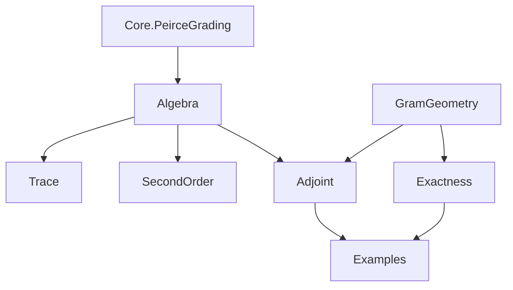

# Peirce coupling: ground-truth theorem contract

## Frozen intake and authority

Input 1: `Pasted text(20261028-104322).txt`, SHA-256
`fc76f3c1295af250a9aac658b305d0860fc9726fa581ccdd30c735e808bea659`.
Input 2: `Pasted text (2)(20261028-104341).txt`, SHA-256
`5a4f6b652586a71d405b6543bb7e24152d2a284705f5a3a7a35481f454dd4e7f`.
Both complete attachments are retained in the task. Their claims of prior
verification are intake assertions, not compiler evidence.

Base: `cb7482d86eadb42f2ab9c2f6f624d67b7bfe7ce4`.
Lean: `leanprover/lean4:v4.34.1`.
Mathlib: `d13f23b723b8a846827a245b89c10fc7d3f11612`.
The previous Clifford Dirac PR #252 is separate and unchanged.

## Exact mathematical carrier and conventions

The algebraic branch uses an arbitrary associative `Ring A`, an idempotent
`IsIdempotentElem p`, the existing `PeirceDecomposition.component10 p a` and
`component01 p b`, and the existing `PeirceGrading.reflection p = 2*p-1`.
Write U and V for these two independently chosen corners, E=U+V,
J=U*V+V*U, and K=⁅U,V⁆. These are abbreviations in this contract, not new
replacement commutator or corner structures. The Lean bracket is native.

The adjoint branch uses full `Matrix n n ℂ`, native conjugate transpose,
`Matrix.PosSemidef`, `Matrix.PosDef`, `Matrix.mulVecLin`, and native kernels.
For arbitrary N, H=N*Nᴴ+Nᴴ*N is the sum of two actual Gram operators.
Gram positivity and the common-kernel/PosDef criteria are unconditional in N;
the Dirac square and exactness criteria additionally require N*N=0.
No operator-commutativity assumption, scalar carrier, diagonal carrier, or assumed
result packet is introduced. The projection specialization requires
`IsStarProjection P`; its adjoint reverse corner uses B=Aᴴ.

## Atomic dispositions

| Input claim | Disposition and exact scope |
| --- | --- |
| Each directed corner is square-zero | Existing Peirce routing owner, valid for arbitrary idempotents. |
| E²=J and both quadratic terms are even | Locally provable from corner support and existing grading. No universal nonzero conclusion follows. |
| K=S*J and J=S*K | Missing two-input support-product bridge; no star structure or characteristic restriction is needed. |
| J=0 iff K=0 | Follows from the two reflection identities. It is not a spectral-gap theorem. |
| Reflection flips E and fixes J,K | Existing parity owner plus the two-input corner support formulas. |
| Corner compressions have the stated signs | Supported products U*V and V*U lie in opposite diagonal corners. |
| Trace cancellation and weighted trace | Native cyclic trace gives trace K=0 and trace(S*K)=trace J=2*trace(U*V). No extra factor two is asserted. |
| Positivity for arbitrary A,B | False. A genuine adjoint coupling and an orthogonal projection are sufficient hypotheses for the Gram theorem. |
| Strict positivity from a nonzero square | False. Native PosDef is equivalent to a trivial common kernel of N and Nᴴ, not merely N≠0. |
| J=0 iff [P,A]=0 for arbitrary A with B=Aᴴ | Not asserted: J sees only A's upper corner; A must be self-adjoint for that stronger equivalence. |
| Even algebra is Cartan/commutative | Not asserted. It is the full centralizer of the idempotent and is generally noncommutative. |
| Physical mass, spin, attraction, Yang–Mills gap, spontaneous symmetry breaking | Interpretation debt. Only the explicit operator, positivity, and kernel statements are targets. |

## Existing owners and search scope

The main source owners inspected include:

- `Core.PeirceDecomposition`: native existing component10/component01,
  orthogonality, complete corner-routing table, corner absorption.
- `Core.PeirceGrading`: reflection, its square, conjugation/parity,
  complementary ranges, odd multiplication and corner square-zero laws.
- `Core.PeirceMatrixTracePairing`: opposite-corner trace transport and
  nondegeneracy; `Core.PeirceMatrixPerfectPairing` owns the full duality API.
- `Core.PeirceTangent`: first-order idempotent tangent and skewadjoint-generator
  results; those are not duplicated here.
- `Krein.FiniteDiracGramSquare`: rectangular block operators, Gram squares,
  Hermitian/positive-semidefinite results and traces.
- `Singular.SquareZeroMoorePenrose.metricDirac_sq`: the abstract square-zero
  adjoint-sum identity. Its native carrier is a star ring; no inverse premise
  is needed for that particular declaration.
- `Canonical.HodgeKreinSuperLaplacian`: polynomial projectors under a cubic law;
  it does not supply the unrestricted metric common-kernel criterion.
- `Canonical.HodgeGreenProjectorConstruction`: conditional Green/Drazin
  projector geometry, distinct from the direct Gram-kernel theorem here.

Open PRs #249, #250, #251, #253 and #254 were inspected as additional candidates.
They already overlap substantially on one-input Peirce and Gram calculus.
#251 includes a nonzero positive-semidefinite singular example. This work does
not claim that counterexample phenomenon is new. The exact arbitrary-two-input
reflection conversion and the intrinsic full-matrix common-kernel/PosDef
criterion were not located in the inspected owners. No unmerged PR is a
required dependency. A failing candidate is not accepted as an owner.

## Smallest new theorem targets

1. Opposite support products determine the two-input reflection conversion,
   zero equivalence, parity and signed corner compressions. Reuse existing
   corner, reflection, and trace APIs.
2. For every full complex matrix N, H is PSD and
   H*ᵥv=0 iff N*ᵥv=0 and Nᴴ*ᵥv=0. Expose the native kernel intersection.
3. H is PosDef iff that common kernel is zero; derive the unit/injective
   equivalents for H. Under N²=0, connect the metric Dirac operator N+Nᴴ by its
   common kernel and invertibility criterion. Its actual Peirce specialization
   also has an explicit square identity derived from the existing corner algebra;
   the general abstract square identity remains with its existing owner.
4. Specialize the result to a genuine orthogonal Peirce corner and its adjoint;
   positivity is concluded only under these hypotheses.
5. Full complex matrix witnesses use a nondiagonal projection and genuinely
   noncommuting corner/adjoint operators. Exhibit a nonzero PSD but singular
   square and the negative-square countermodel B=-Aᴴ. Entry calculations verify
   the full operator statements; entries do not replace the carrier.
6. For square-zero N, absence of a common kernel is equivalent to exactness
   `range N.toEuclideanLin = ker N.toEuclideanLin`. Derive the native finite
   dimensional consequence `card n = 2 * finrank ℂ (range N.toEuclideanLin)`.
7. The signed product K determines the second-order idempotent coefficient:
   `p*Z + Z*p - Z = -E*E` iff `Z+K` is tangent. It is the unique even such
   coefficient. The canonical generator V-U has bracket with E equal to -2K.
   These are algebraic second variations; no differentiable orbit is asserted.

## Mathematical dependency order

- Idempotent orthogonality -> corner support -> square-zero and even products.
- Support actions + existing reflection -> J/K conversion -> zero equivalence.
- Support compression + cyclic trace -> signed sector traces and weighted trace.
- Actual conjugate transpose -> Gram PSD -> common-kernel criterion -> PosDef
  and invertibility criteria. This branch does not require nilpotency.
- Square-zero + native Gram-kernel theorem -> metric Dirac/kernel and unit bridge.
- Square-zero + orthogonal range/kernel decomposition -> exactness criterion.
- Tangency + signed compressions -> second-order idempotent equation and its
  unique even solution. This branch is independent of positivity.
- Orthogonal Peirce corner -> actual adjoint specialization.
- Explicit matrices -> noncommutativity, singularity, and failure of
  unconditional positivity. These are consequences checked in the full algebra.

## Acceptance contract

### Source-backed causal poset

The prerequisite order is the reflexive transitive closure of the following
acyclic direct-import graph. The two initial branches are independent; their
join is the actual adjoint specialization. This diagram records source
dependencies, not a claim of an elaborated constant-dependency export.

Selected declaration edges refine the module order:

- Support actions -> `reflection_mul_jordan` -> `reflection_mul_lie` ->
  `jordan_eq_zero_iff_lie_eq_zero`. The reverse algebraic equality does not
  create a reverse proof dependency.
- Support actions -> `lie_second_order_boundary` -> `second_order_iff`
  -> `even_second_order_iff`, using the existing complementary even/odd ranges.
- Native Gram kernel lemmas -> `gramSum_mulVec_eq_zero_iff` -> `gramSum_ker`
  and `gramSum_posDef_iff` -> the native kernel/injectivity/unit criteria.
- `squareZero_sum_mulVec_eq_zero_iff` -> `squareZero_sum_ker` ->
  `gramSum_posDef_iff_sum_isUnit`.
- Orthogonal range/kernel geometry + square-zero range inclusion ->
  `squareZero_ker_inf_eq_bot_iff_exact` -> `gramSum_posDef_iff_exact` ->
  `card_eq_two_mul_rank_of_gramSum_posDef` -> `even_card_of_gramSum_posDef`.
- `adjoint_reverse_corner` + `opposite_sum_sq` -> `adjoint_coupling_sq`;
  the Gram and zero-equivalence results then give
  `adjoint_corners_commute_iff`.

The common-kernel proof uses the native PSD lemmas locally; it does not refer
to the separately exposed `gramSum_posSemidef`. The Peirce-specific kernel
proof in `Adjoint` uses its self-adjoint sum directly and does not import
`Exactness`. A semantic specialization is therefore not silently presented
as an implementation dependency.

### Required verification

Root generates/integrates. A separate mathematical auditor checks hypotheses,
source fidelity and nonvacuity. A nonauthoring acceptance reviewer reconciles
source, kernel and axiom evidence. Subagents may author only new sandbox files.
All builds/tests are serialized with `/tmp/info-geometry-build.lock`; dependency
sources, toolchain pins and existing cache contents are preserved.

Acceptance requires the exact source closure to compile at the frozen pins,
zero new-module warnings, every owned declaration audited transitively with
only propext/Classical.choice/Quot.sound, no unsafe/partial declarations,
zero placeholder/vacuity findings, and a passing staged proof-integrity gate.
Reports bind final source hashes, compiler pins and evidence hashes and state
any repository-wide setup limitations separately from the checked scope.
