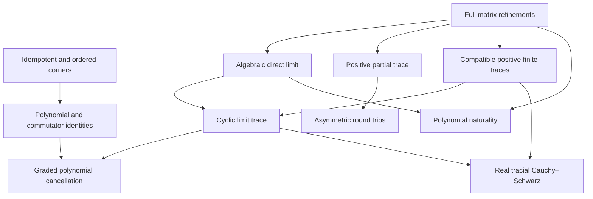

# Peirce polynomial calculus and the algebraic matrix colimit

## Intake and provenance

Source: the user's 2026-11-06 mathematical draft, beginning “Phase I: The
Fundamental Binary Cut” and ending with a request for native Mathlib/Lean 4
formalization. The following excerpts identify the mathematical targets:

- `N₊ = P X (1-P)`, `N₊² = 0`, and the proposed unconditional `N₊ ≠ 0`;
- `F(c I + N₊) = F(c) I + F'(c) N₊`;
- `F(P + N₊) = F(P) + D_P F(N₊)`;
- `A_n → A_(n+1)`, `X ↦ X ⊗ I₂`, and the common-stage quotient relation;
- `E_n ∘ iota_n = id` but `iota_n ∘ E_n ≠ id`;
- a compatible normalized trace, graded positive-power cancellation, and a
  proposed Cramér–Rao/commutator correction;
- the narrative identifications “the colimit is the continuum”, “no actual
  infinity”, and replacement of all analytic limits by algebraic identities.

The last group is interpretation, not a Lean theorem target. No attribution to
Jaynes, conclusion about the consistency of analysis, or physical field equation
is inferred from the algebraic statements.

Base checkout: `3d7eb6d9b0af5636ab12b3d0b91b82740507e49e`.
Dependency pins remain those in `lean-toolchain` and `lake-manifest.json`.

## Canonical extraction

The binary cut is an idempotent `P` and its complement `Q = 1 - P` in an
associative ring. The order of the two off-diagonal corners matters:
`N₊ = P A Q` and `N₋ = Q C P`. Their individual squares vanish, but their
oppositely ordered products need not vanish or agree. The existing Peirce
owners define

```text
Phi = N₊ + N₋       J = N₊ - N₋
V   = N₊N₋ + N₋N₊  Sigma = N₊N₋ - N₋N₊.
```

| Relational component | Mathematical object | Required proof obligation |
|---|---|---|
| Internal structure | The four additive corners `PBP`, `PBQ`, `QBP`, `QBQ` | Idempotence, complementary annihilation, and ordered multiplication laws |
| Outward transport | The actual unital algebra embedding `X ↦ X ⊗ I₂` | Preservation of operations and injectivity |
| Inward transport | The normalized partial trace `stageRestrict` | Linearity, positivity, bimodule laws, and a left inverse to the embedding |
| Common carrier | The existing native algebraic `DirectLimit` | Compatible stage maps, common finite representatives, and universal lifting |

The round trip is asymmetric: restriction after embedding is the identity,
while embedding after restriction is an idempotent linear map with a nonzero
kernel. The concrete discarded mode is `I ⊗ e₁₂`; restriction kills this
mode but sends its adjoint square to `I / 2`. These statements specify the
information loss without an entropy interpretation.

There is also an exact algebraic measure of failure of idempotence. For
`Phi = genPhi P A C`, the existing theorem
`PureNonCommutativeOperatorSpine.goldenTransfer_idempotencyDefect` in
`Algebra/PeirceOmegaTransfer.lean` proves

```text
(P + Phi) * (P + Phi) - (P + Phi) = V.
```

This is an operator-valued defect, not a contradiction in the axioms. The
formalization separately proves the actual obstruction in the proposed
stage-zero construction: a coherent real idempotent family starting at
`Mat₁` is the zero family or the unit family.

## Existing owners and actual carriers

| Owner | Source-backed construction or theorem |
|---|---|
| `Clifford/Cl11TensorTower.lean` | Full real matrix stages on recursive binary indices; injective unital algebra maps `X ↦ X ⊗ I₂`, preserving star |
| `Algebra/DirectLimitSuperClosureLemmas.lean` | Iterated ring homomorphisms, native Mathlib `DirectLimit`, canonical maps, injectivity and universal lifting |
| `Clifford/Cl11TensorTowerLimit.lean` | Existing real algebraic matrix direct limit, real algebra structure, induced star ring, finite-stage maps |
| `Canonical/RealStarColimitUniversal.lean` | Faithful stage inclusions, universal star algebra lift, and `limit_not_finite`, proving the actual limit is infinite dimensional over the reals |
| `Canonical/Cl11WittOccupationParityFactorization.lean` and `Canonical/Cl11CARFockColimitBridge.lean` | The explicit stage-one occupation projector and its transport to the native matrix ring limit; idempotence follows from the existing `RealCARPair.creation_annihilation_idempotent` theorem |
| `Canonical/Cl11CompatibleLocalStateNet.lean` | `stageRestrict`: the diagonal-block average, its left-inverse, star, unit and normalized-trace laws |
| `Canonical/Cl11CARPeirceMassCoercivityBridge.lean` | `normalizedTraceLimit : Limit →ₗ[ℝ] ℝ`, descended from the finite traces |
| `Canonical/TensorExactCurvatureTrace.lean` | Cyclicity, positivity and faithfulness of that actual colimit trace |
| `OperatorAlgebra/PeirceSpine/GradedTraceMoments.lean` | Characteristic-free commutator factorization of all positive graded metric moments; cyclic additive trace cancellation |

Searches covered the repository's Algebra, Clifford, Canonical,
OperatorAlgebra and Prequantum owners, alternate polynomial/trace/expectation
formulations, their imports and consumers, and the pinned Mathlib polynomial,
nilpotent, direct-limit and matrix APIs. This is a bounded owner search, not a
certificate of every historical file.

## Precise contracts for additions

1. **Noncommutative polynomial calculus.** Over a commutative coefficient ring
   `R`, retain an arbitrary associative `R`-algebra `A`. For commuting `x,N`
   with `N²=0`, prove the exact native `Polynomial.aeval` derivative formula.
   Specialize only the base point to a central scalar, not the ambient algebra.
   For an idempotent `P` and a corner direction satisfying `PN=N`, `NP=0`,
   derive the separate exact divided-difference formula with coefficient
   `F(1)-F(0)`. Use Mathlib's finite nilpotent exponential when stating an
   exponential result. Transport an explicit nonzero square-zero seed from
   stage one along the actual bonding maps, proving coherence, nonzeroness,
   nilpotency and polynomial representative independence at every stage.
2. **Concrete conditional expectation.** Extend the existing `stageRestrict`,
   proving its bimodule and positivity properties. Construct a nonzero
   last-factor matrix unit killed by restriction, and compute the surviving
   restriction of its adjoint square. Prove the reverse composition is not
   the identity and the restriction is not multiplicative.
3. **Polynomial trace on the existing colimit.** Reuse the existing carrier,
   maps and trace. Show that the graded trace of `F(V)` depends only on the
   constant coefficient, and prove the real trace Cauchy–Schwarz bound under
   the actual positive trace. Preserve finite-stage and polynomial naturality.

No replacement direct limit, diagonal surrogate, assumed conclusion field,
or new axiom is permitted. New declarations must be checked with the pinned
compiler and their axiom dependencies inspected.

### New owners

Paths in this table are relative to `lean/InfoGeometry/`.

| Owner | Main declarations |
|---|---|
| `OperatorAlgebra/SquareZeroPolynomial.lean` | `aeval_add_of_commute_sq_zero`, `aeval_scalar_add_sq_zero`, `aeval_peirce_shear`, `cube_add_sq_zero`, `nilpotent_exp_eq_one_add` |
| `OperatorAlgebra/PeirceSpine/PolynomialTrace.lean` | `cyclic_grading_aeval` for an arbitrary linear cyclic trace |
| `Canonical/Cl11ConditionalExpectation.lean` | `stageRestrict_bimodule`, `stageRestrict_posSemidef`, `stageRestrict_fineCreation_gram`, `stageExpectation_ne_id`, `stageRestrict_not_multiplicative` |
| `Canonical/TensorPolynomialTrace.lean` | `normalizedTraceLimit_unique`, `normalizedTraceLimit_grading_aeval`, `normalizedTraceLimit_cauchy_schwarz` |
| `Canonical/TensorNilpotentCalculus.lean` | `ofStage_aeval`, `fineCreation_limit_polynomial`, the coherent `creationTail` family, `coherent_idempotent_family_trivial`, `witt_cubic_residual_ne_zero` |

## Corrected boundaries

- A Peirce corner can vanish. Nonzero square-zero operators require witnesses.
- `N²=0` alone does not remove terms such as `NAN` at a noncommuting base point.
  With `A=e₂₁`, `N=e₁₂`, the cubic expansion has a nonzero `NAN` term.
- A coherent projection starting at real stage zero (`Mat₁`) is scalar and is
  therefore `0` or `1`. Nontrivial coherent Peirce geometry must be seeded at
  a positive stage, as the repository's matrix witnesses already are.
- Coherence of `P_n` alone does not imply coherence of operators built from
  independently chosen `X_n`. Naturality compares the transported inputs.
- A normalized partial trace and chiral pinching are distinct maps. The latter
  retains both diagonal blocks; the former averages them.
- A coherent additive/linear trace descends by an additive/linear universal
  property. It is generally not a ring homomorphism. Raw unnormalized traces
  double under the tensor embedding.
- Graded moment cancellation follows from an actual commutator identity and
  cyclicity; it does not prove a topological Gauss–Bonnet/index theorem.
- A real positive trace yields a real Cauchy–Schwarz inequality. A nontrivial
  symplectic correction needs additional specified structure; a tracial
  commutator readout itself is zero. A statistical Cramér–Rao theorem needs a
  statistical model and estimator/score hypotheses.
- Self-adjointness of the input is needed when interpreting the Peirce square
  as a positive Gram operator. Arbitrary ring elements do not have positivity.
- The algebraic direct limit has finite representatives, but this does not
  identify it with a norm completion, a von Neumann algebra, or spacetime.
  It remains an infinite type and may use Mathlib's classical foundations.
- Finite-dimensional real matrix stages are not finite sets: the coefficient
  field is still `ℝ`. Polynomial identities make no claim that all real
  entries or all analytic functions are computable.

## Dependency order

The two primitive branches are independent: ring/idempotent algebra gives
Peirce and polynomial identities; a directed system gives its algebraic
colimit. Homomorphism naturality joins them. A compatible linear trace then
descends, and cyclicity yields graded moment cancellation. Positivity gives
Cauchy–Schwarz. Conditional expectation is a separate strengthened branch,
not a prerequisite for existence of the direct limit.



These are mathematical proof dependencies. The graph does not assert that
every sentence about a finite stage automatically transfers: nonzeroness
uses injectivity, trace descent uses compatibility, and the inequality uses
the finite positive trace and a common finite representative.

## Verification record

### Accepted statement scope

`[kernel_verified]` The five new owners contain 41 theorem declarations and
3 definitions. Each owner compiled with the pinned compiler, and an independent
QA pass recompiled all five from the same frozen sources. Their mathematical
scope is `[accepted_limited_scope]`: polynomial identities, finite nilpotent
exponential, positive matrix restriction, and transport through the existing
algebraic matrix colimit.

`[countermodel_found]` The noncommuting cubic residual and the stage-zero
idempotent obstruction are proved in `TensorNilpotentCalculus`. The broader
analytic, statistical, topological and physical identifications listed under
"Corrected boundaries" remain `[bucket_3_open_debt]`; the code does not add
axioms asserting them.

### Environment and compiler results

- Base: `3d7eb6d9b0af5636ab12b3d0b91b82740507e49e`.
- Lean: `4.34.1`, compiler commit
  `5045d0056413266e57c625dcd7c365b10e377c52`.
- Mathlib: `d13f23b723b8a846827a245b89c10fc7d3f11612`.
- Canonical selected source-closure checker: **PASS**, 249 project modules.
  Unchanged dependency artifacts were reused only after source, compiler,
  package-pin and completed-reference-receipt checks. Every new owner was
  compiled; none was accepted by seeding its checked marker.
- Independent QA: **PASS**, all five new owners recompiled into an isolated
  import root. Its 244 unchanged project dependencies were matched to the Git
  base, source snapshots and recorded artifacts. The new-owner artifacts were
  excluded from the dependency copy and rebuilt independently.
- Native declaration audit: **PASS**, 56 declarations,
  including compiler-generated declarations belonging to the five modules.
  The observed foundational axiom union is
  `[propext, Classical.choice, Quot.sound]`. No other axiom, unsafe or
  partial declaration was accepted. New-owner compiler warnings: **0**.

The selected-closure receipt SHA-256 is
`5ccbf3c8176f8ead5a6b549645b403002b05690f833b422af88a782c0cb31c0d`.
The independent QA receipt SHA-256 is
`1e4a726d60f750d02f88723f9986a173cd39b6833b0d5febf393d533c7df94f2`.
These receipts describe modular checks with verified unchanged dependency
artifacts; they do not certify a fresh compilation of every repository module.

| Audited owner | Native declaration count |
|---|---:|
| `OperatorAlgebra.SquareZeroPolynomial` | 16 |
| `OperatorAlgebra.PeirceSpine.PolynomialTrace` | 1 |
| `Canonical.Cl11ConditionalExpectation` | 19 |
| `Canonical.TensorPolynomialTrace` | 6 |
| `Canonical.TensorNilpotentCalculus` | 14 |

### Source and semantic checks

An independent semantic reviewer read all five owners and both documentation
changes against the base: **PASS**, with no remaining mismatch between the
stated contracts, hypotheses, carriers, proofs and documentation.

The strict OpenGauss screener and refutation gate passed. The source-only
`GATE_4` review passed as source preflight; its result is separate from the
compiler and native axiom audit above. The selected semantic-content audit
reported zero findings. The semantic-vacuity heuristic reported no errors and
two reviewed notices for the computation lemmas `stageExpectation_apply` and
`normalizedTraceLimit_ofStage`, both intentionally proved by `rfl`.
The staged proof gate and working/staged whitespace checks passed.

A separate whole-`lean` semantic-content scan found no blocking findings.
Tracked-scope and quarantine audits passed at their lexical classification
scope. Those scans do not constitute Lean compilation of the full repository.

| Lean source (relative to `lean/InfoGeometry/`) | SHA-256 |
|---|---|
| `OperatorAlgebra/SquareZeroPolynomial.lean` | `5b0c14ddc0a72ae60ac421784664c8293e63a4a2dae95cbade7721ebec71d667` |
| `OperatorAlgebra/PeirceSpine/PolynomialTrace.lean` | `e8e39fe487b9b3635a215909d3c3bf56aa9794a07b9b68eb31864a9c877afc4d` |
| `Canonical/Cl11ConditionalExpectation.lean` | `a10d814d3f573d97afc5819483105039dc07e22a70a6fc896aaadf6829ba7a7c` |
| `Canonical/TensorPolynomialTrace.lean` | `708dac3f5af7a24ac7c386386312dd2f2f4d273ce0c2e453ddaa199036523fe3` |
| `Canonical/TensorNilpotentCalculus.lean` | `fb7ca4af16cbbd688832344badea63950bcfb86fda19d421981d8b17b892ec97` |

### Reproduction and integration status

The selected source-closure command, using the pinned compiler and an exact
pinned Mathlib checkout, is:

```bash
python3 tools/quality/check_operator_geometry.py \
  --repo "$PWD" \
  --mathlib "$PWD/.lake/packages/mathlib" \
  --work-dir /tmp/peirce-nilpotent-colimit-check \
  --target InfoGeometry.Canonical.TensorPolynomialTrace \
  --target InfoGeometry.Canonical.Cl11ConditionalExpectation \
  --target InfoGeometry.OperatorAlgebra.SquareZeroPolynomial \
  --target InfoGeometry.Canonical.TensorNilpotentCalculus
```

Development retries used `--incremental` against the same recorded work
directory. Independent QA then rebuilt all five owners, generated its native
all-declaration audit with the unchanged
`tools/quality/reviewed_audit_source.py::audit_source`, and validated its exact
completion markers with `parse_audit_output`.

The normal repository build command was also attempted:

```bash
python3 tools/infra/run_locked_lake_build.py --wait-for-build-lock \
  InfoGeometry.Canonical.TensorNilpotentCalculus
```

It exited **1** before target compilation with
`GIFT: configuration file not found` at
`external_refs/gift-framework-core/lakefile.lean`.
The tracked GIFT gitlink is
`e6f3c3ac2140c2324fb2ae029c32233e73aa5e92`; no substitute revision or stub was
introduced. The exact-pin local Homotopy and Atlas checkouts and genuine
Mathlib dependency caches were restored without modifying tracked dependency
configuration. This resolves those observed local setup gaps, but does not
establish a reproducible upstream build.

[The upstream baseline CI job](https://github.com/nickgou-nuke/info-geometry-lean/actions/runs/41792374274/job/126448515258)
also records path-dependency failures at the same base revision. The normal
Lake integration and required publication gate remain unpassed. The five-owner
compiler and axiom results above are independent of that package-loading
failure. All repository gates and dependency pins remain unchanged.
