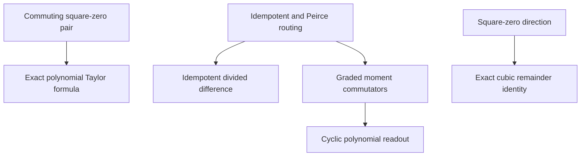
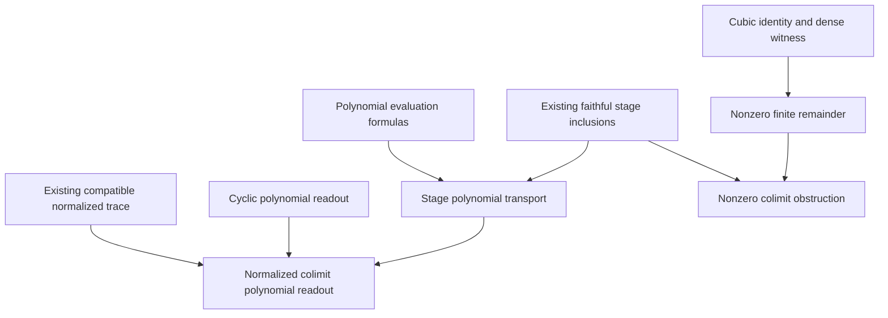

# Peirce polynomial calculus and algebraic colimit traces

## Intake and theorem contract

Source: the user attachment `Pasted text(2).txt`, headed “The Jaynesian Binary
Cut”, received on 2026-11-06. The original attachment is retained unchanged.
Implementation baseline: `3d7eb6d9b0af5636ab12b3d0b91b82740507e49e`.
Attachment SHA-256:
`2f3cf8e883b15b3d63f5052388d1fc105d3045f5e816bf6269d77616fc350ded`.

The intended carrier is an arbitrary associative, possibly noncommutative
`R`-algebra `B`, with `R` a commutative ring. Polynomial evaluation uses native
`Polynomial.aeval`; the formal polynomial derivative uses
`Polynomial.derivative`. The concrete colimit is the existing
`InfoGeometry.Clifford.Cl11TensorTowerLimit.Limit`, with its existing faithful
full-matrix stage maps, real algebra action, and normalized trace.

### Existing owners

| Owner | Reused content |
| --- | --- |
| `OperatorAlgebra/PeirceSpine/Basic.lean` | `conePlus`, `coneMinus`, `invS`, `genV`, and the exact corner routing laws |
| `OperatorAlgebra/PeirceSpine/GradedTraceMoments.lean` | Graded positive-power commutator factorization and cyclic trace cancellation |
| `Clifford/Cl11TensorTowerLimit.lean` | The actual algebraic direct-limit carrier and canonical stage maps |
| `Clifford/Cl11StarAlgebraColimit.lean` | `ofStageStarAlgHom`, faithful inclusions, and the universal star-algebra map |
| `Canonical/Cl11CARPeirceMassCoercivityBridge.lean` | `normalizedTraceLimit`, descended from the compatible normalized matrix traces |
| `Canonical/TensorExactCurvatureTrace.lean` | Cyclicity and faithfulness of that existing trace |

### New implications

1. If `N * N = 0`, evaluate any scalar-coefficient polynomial exactly at
   `algebraMap R B c + N` using its value and formal derivative at `c`.
2. Evaluate a polynomial at an idempotent from its scalar values at zero and
   one. Apply this to `P + conePlus P A` and `P + coneMinus P A`; the increment
   coefficient is `f(1) - f(0)`.
3. State the exact cubic remainder at an unrestricted noncommuting base.
   Square-zero of `N` alone leaves the term `N * X * N`.
4. Upgrade the existing finite-sum graded-moment cancellation to native
   polynomial evaluation, including the constant coefficient.
5. Apply the new polynomial results to the existing algebraic tensor colimit,
   and prove their compatibility with its actual stage maps and trace.

No ambient commutativity, operator diagonalization, positivity, topology,
completion, or analytic functional calculus is assumed in the algebraic
results. No conclusion is supplied as a field in a new witness structure.

## Claim corrections and scope

| Intake claim | Correct mathematical scope |
| --- | --- |
| Every Peirce corner is nonzero | Corners are square-zero; nonvanishing requires a separate hypothesis or witness |
| Square-zero gives arbitrary first-order Taylor truncation | A central scalar base permits the formal derivative formula; a Peirce idempotent base has a different exact coefficient; arbitrary bases can have a nonzero cubic remainder |
| A coherent nontrivial projector begins at matrix stage zero | Stage zero is scalar; a noncentral projector must begin at a positive stage or a cofinal tail |
| All finite-stage theorems transfer automatically | Equations transfer through the stated maps; nonvanishing needs injectivity and analytic claims need their own constructions |
| The algebraic colimit eliminates infinity or replaces the continuum | The existing quotient is an algebraic direct limit; this does not assert a topological completion or a foundational replacement |
| Unnormalized supertraces are scale invariant | Matrix trace doubles under tensoring with the two-dimensional identity; the compatible cocone here is normalized |
| Pinching is the tensor coarse-graining retraction | Peirce pinching and normalized partial trace have different codomains and different actions |
| Graded trace cancellation is a Gauss–Bonnet theorem | It is an exact tracial algebra identity, without a characteristic-class or topological index identification |
| Positivity or Cramér–Rao follows from ring identities | Such conclusions need a positive star structure and a separately specified analytic or statistical model |

## Theorem inventory and dependency order

| Module | New public theorems | Role |
| --- | ---: | --- |
| `Algebra/NilpotentPolynomial.lean` | 3 | Commuting-pair, zero-base, and central-scalar polynomial formulas in a noncommutative ambient algebra |
| `OperatorAlgebra/PeirceSpine/PolynomialCalculus.lean` | 8 | Idempotent evaluation, both Peirce increments, the cubic obstruction, and cyclic polynomial readouts |
| `Canonical/PeircePolynomialColimit.lean` | 9 | Actual stage transport, nonzero reflection, scalar-stage obstruction, and normalized graded trace compatibility |
| `Examples/PeircePolynomialWitness.lean` | 3 | Dense finite and colimit counterexamples to the overstrong derivative formulas |

The polynomial evaluation theorems and graded trace theorem are separate
branches. The former use polynomial induction or the commutative subalgebra
of an explicitly commuting pair. The latter uses the existing commutator
factorization of positive metric powers. Both branches meet only after the
actual stage inclusion and compatible trace are supplied.



The stage inclusions and compatible trace are existing infrastructure,
independent of the new polynomial identities. The concrete nonzero remainder
also requires the existing dense matrix witness.



The concrete counterexamples reuse the existing dense real stage-two matrices
`RealMatrixModeWitness.p` and `RealMatrixModeWitness.x`. Their source-proved
relations are `x*x = 0`, `x*star x = p`, `p*x = x`, and every entry of `x` is
nonzero. Thus `x * star x * x = x` supplies the exact nonzero cubic remainder;
no scalar or diagonal model substitutes for the operator claim.

## Verification environment and package prerequisites

The checks use the repository's unchanged pins:

- Lean 4.34.1, compiler commit
  `5045d0056413266e57c625dcd7c365b10e377c52`.
- Mathlib `d13f23b723b8a846827a245b89c10fc7d3f11612`, with its recorded
  dependency revisions and clean tracked sources.

The root Lake package has a separate setup limitation. The maintained
read-only preflight, `python3 tools/infra/ci_bootstrap.py paths --root .`,
reports missing configurations for `HomotopyHypothesis`, `Atlas`, and `GIFT`.
The first two paths have no tracked dependency source; GIFT has an
uninitialized recorded gitlink. `InfoGeometryCore` is available as tracked
source. A root Lake build attempt stopped at the missing HomotopyHypothesis
configuration before compiling the target.

The [maintained setup guide](GETTING_STARTED.md) and
[verification bootstrap repair](MAIN_VERIFICATION_REPAIR_20261023.md) require
recorded dependency provenance. This task does not substitute an upstream
HEAD, a guessed revision, or an empty package. The selected closure uses only
the actual repository imports and the pinned Mathlib environment; its result
is distinct from a root-package build or permission to bypass a push gate.

## Validation status

| Check | Result and scope |
| --- | --- |
| Exact selected source closure | PASS: 248 repository modules, including the four new owners |
| Unchanged dependency comparison | PASS: all 244 existing dependency sources match the baseline commit by SHA-256 |
| Independent strict compilation | PASS: all four new owners compile with `-DwarningAsError=true`, without diagnostics |
| Independent mathematical source review | PASS: all 23 statements, their hypotheses, actual carriers, witnesses, and dependency order |
| Complete owned-declaration axiom audit | PASS: all 32 owned declarations, including generated auxiliaries, and all 23 public theorem checks |
| Root Lake package | Blocked by the path-dependency prerequisites described above |

Existing dependency warnings were retained during the selected-closure build;
the four new owners pass the separate strict check. The independent replay
uses its own copied dependency artifacts and freshly compiles each new owner.
The audit found only `propext`, `Classical.choice`, and `Quot.sound` as
transitive axiom dependencies, with no unsafe or partial owned declarations.
Its per-owner counts are 5, 15, 9, and 3 in the inventory order. The four
strict compiler logs are empty, and the reviewed source hashes match both
the selected closure and the independent replay. All 244 copied dependency
artifact hashes remained unchanged during the independent check.

The selected closure was checked from the repository root with the maintained
checker, preserving the existing trace dependency as the first target so the
incremental pass can reuse its already verified prefix:

```sh
python3 tools/quality/check_operator_geometry.py \
  --repo /workspace/scratch/7bd0f218459c/info-geometry-lean \
  --mathlib /workspace/scratch/2e3cbf77ee2a/runtime/mathlib \
  --work-dir /workspace/scratch/7bd0f218459c/verification/colimit \
  --target InfoGeometry.Canonical.TensorExactCurvatureTrace \
  --target InfoGeometry.Examples.PeircePolynomialWitness \
  --incremental
```

The paths above identify the executed check; another checkout should use its
own paths with the same pinned toolchain and dependency revisions. The native
declaration audit is generated by the maintained
`tools.quality.reviewed_audit_source.audit_source` for exactly the four module
names in the inventory, and its output is reconciled with
`parse_audit_output`. It examines owned declarations, including any private or
generated declarations, rather than a hand-selected list of public names.

The final source review is bound to these four hashes:

| Owner | SHA-256 |
| --- | --- |
| `Algebra/NilpotentPolynomial.lean` | `620f2b58a4e6106739ff7e42ced5e062b951b87488d7a8dca004d203ba46984b` |
| `OperatorAlgebra/PeirceSpine/PolynomialCalculus.lean` | `b366ba31dbd3346e971588cf1232dd1a66df28036899be55eea94d777d597d10` |
| `Canonical/PeircePolynomialColimit.lean` | `d019ca287b76a286366f30325cf04998df7382ab9ee88b0df5e7b84a6f3083bb` |
| `Examples/PeircePolynomialWitness.lean` | `c74c4b7287f4f52193d9d3429ab3c3e98bbeb7ddbfb29cdaf319fcf5977a7b71` |
