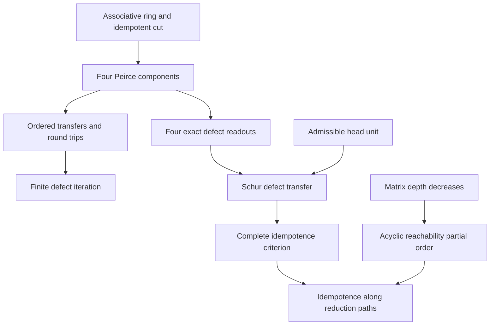

# Peirce decomposition, exact defect transport, and finite Schur descent

## Result and theorem contract

The formal synthesis starts with an arbitrary associative unital ring, an
idempotent cut, and ordered multiplication. Its main new result is an exact
formula transporting the quadratic idempotency defect through a Schur
complement. This yields a complete block-idempotence criterion, a specialization
to native Mathlib corner rings, and a partial order generated by admissible
finite matrix reductions.

The interpretive names in the source stream label mathematical roles. They do
not add axioms about consciousness, attention architectures, physical time, or
topological phases. In particular, the partial order does not supply the ring
identities: those follow from the ring laws and the explicitly stated cut and
pivot hypotheses. The declaration dependency graph records that logical order.

- Base revision: `3d7eb6d9b0af5636ab12b3d0b91b82740507e49e`.
- Lean: `4.34.1`.
- Mathlib: `d13f23b723b8a846827a245b89c10fc7d3f11612`.
- Intake SHA-256: `1a040722653b8e9019939cb82b3d5aa8e8fc6b24e518230b198eb575871abc03`.
- Carrier: arbitrary `[Ring A]`, including full matrix and endomorphism rings.
- Defect owner: `InfoGeometry.Core.IdempotencyDefect.defect`, defined by
  `defect x = x * x - x`. No replacement defect definition is introduced.
- Focused entry point: `InfoGeometry.OperatorAlgebra.PeirceSchurSynthesis`.

## 1. The binary cut and its four components

Let `p * p = p` and put `q = 1 - p`. Then

\[
p^2=p,\qquad q^2=q,\qquad pq=qp=0,\qquad p+q=1.
\]

For an operator `x`, define

\[
h=pxp,\qquad b=pxq,\qquad c=qxp,\qquad t=qxq.
\]

The Peirce decomposition is `x = h + b + c + t`. The four components have
different source and target sectors; their order cannot be erased.

| Interpretive role | Exact component | Relational content |
| --- | --- | --- |
| Internal self-consistency | `h = p*x*p` | Action within the selected sector |
| Outward projection | `c = q*x*p` | Transfer from the selected sector to its complement |
| Inward intrusion | `b = p*x*q` | Transfer from the complement to the selected sector |
| Unexamined ground | `t = q*x*q` | Action within the complementary sector |

The word “projection” in the source is informal for the mixed components:
`b` and `c` are square-zero transfers, not idempotent projectors. Their
square-zero law follows specifically from the intervening product `q*p = 0`
or `p*q = 0`; it is not a law of arbitrary directed or triangular operators.
Algebraic orthogonality here does not require an inner product or positivity.

The generic matrix owner also imports the existing
`FiniteMatrixNoncommutativeWitness` theorem over nontrivial coefficient rings;
the defect laws themselves require no nontriviality hypothesis.

The existing owners `Core.PeirceDecomposition` and `PeirceSpine.Basic` already
provide the cut, support, decomposition, and nilpotence laws. The extension
reuses those owners.

## 2. The opposing transfers and their round trips

Set

\[
V=bc+cb,\qquad \Sigma=bc-cb,\qquad
\Phi=b+c,\qquad J_{\mathrm{odd}}=b-c,\qquad s=p-q.
\]

These respectively encode the sum of round trips, their directional
difference, the combined transfer, the signed transfer, and the sector
involution. The established noncommutative table includes

\[
\begin{aligned}
\Phi^2&=V,& J_{\mathrm{odd}}^2&=-V,\\
J_{\mathrm{odd}}\Phi&=\Sigma,&
\Phi J_{\mathrm{odd}}&=-\Sigma,\\
\Sigma&=sV,& \Sigma^2&=V^2.
\end{aligned}
\]

Its owner file is `PeirceSpine/Tetraktys.lean`, with theorem
`InfoGeometry.OperatorAlgebra.PeirceSpine.archetype_A3_nilpotent_cones_and_tetraktys_table`.
The repository name `genJ` denotes `b-c`; it must not be confused with the
source stream's symbol `J` for a parity involution.

The round trip `bc` acts in the selected sector, whereas `cb` acts in the
complement. Their sum need not equal `1`. The stronger normalized relations
`bc = p` and `cb = q` supply CAR completeness and the familiar hyperbolic
Clifford seed. They are additional conditions, not consequences of an
arbitrary Peirce cut.

## 3. Exact aporia: the four defect readouts

For a native two-by-two matrix over the coefficient ring, write

\[
M=\begin{pmatrix}a&b\\c&d\end{pmatrix},\qquad
\delta(M)=M^2-M=\begin{pmatrix}F&G\\H&K\end{pmatrix}.
\]

The four obstructions are

\[
\begin{aligned}
F&=a^2+bc-a,&G&=ab+bd-b,\\
H&=ca+dc-c,&K&=cb+d^2-d.
\end{aligned}
\]

`SchurIdempotencyDefect.defect_block` proves this identity over any ring;
`block_isIdempotentElem_iff` proves that all four vanish exactly when `M` is
idempotent. The ambient versions `defect_11`, `defect_10`, `defect_01`, and
`defect_00` in `PeirceSpine.SchurDefect` identify the same expressions with
the actual four corners of `defect x`.

The upper diagonal includes `bc`; the lower diagonal includes `cb`. Replacing
both with a commuting scalar product would discard the distinction on which
the calculation depends.

## 4. Master local synthesis: exact Schur defect transfer

Assume that the selected head has a two-sided inverse `r` in the coefficient
ring:

\[
ar=ra=1,\qquad S=d-crb.
\]

The central proved identity is

\[
\boxed{\delta(S)=K-Hrb-crG+crFrb.}
\]

The order of every factor is fixed. The upper and lower mixed equations also
factor exactly:

\[
G=bS+Frb,\qquad H=Sc+crF.
\]

Consequently,

\[
\boxed{M^2=M\quad\Longleftrightarrow\quad
F=0\ \land\ bS=0\ \land\ Sc=0\ \land\ S^2=S.}
\]

The forward direction transports all four zero defects into the tail and
its two couplings. Conversely, the head condition and the two coupling
conditions recover `G=H=0`; the exact transfer identity then recovers `K=0`.
Tail idempotence alone is insufficient for the converse.

The Lean owners are `schur_defect`, `upper_defect_eq`, `lower_defect_eq`,
and `block_isIdempotentElem_iff_schur`. The weaker theorem
`schur_defect_of_coupling_inverse` only requires `a*(r*b)=b` and
`r*(a*b)=b`, which is useful for an ambient corner.

There is also an exact matrix readout:

\[
\delta(S)=\left[
\begin{pmatrix}1&0\\-cr&1\end{pmatrix}
\delta(M)
\begin{pmatrix}1&-rb\\0&1\end{pmatrix}
\right]_{22}.
\]

This is a two-sided elimination and compression formula, not an assertion
that the two defects are conjugate.

### The native corner distinction

For `h = p*x*p` in the proper corner `pAp`, the identity of the corner is
`p`. Its inverse equations are therefore `h*r = r*h = p`. Requiring an
ambient inverse against `1` would exclude every proper cut.

`PeirceSpine.SchurDefect.tail_defect` proves the ambient transfer formula
under these correct equations. The theorem
`tail_isIdempotentElem_of_cornerUnit` accepts a genuine unit
`u : hp.Cornerˣ` in Mathlib's native `IsIdempotentElem.Corner` and derives
idempotence of the complementary tail. The support theorems prove that this
tail lies in the complementary corner.

## 5. Recursive descent and the proved partial order

Define the native matrix stages by

\[
A_0=A,\qquad A_{n+1}=M_2(A_n).
\]

A node is a dependent pair `(n, x)` with `x : A_n`. A step requires an
actual unit equal to the selected head and maps

\[
(n+1,M)\longrightarrow(n,\operatorname{Schur}(M)).
\]

The inductive `Step` relation stores the unit and the head equation. It
does not store output idempotence. That conclusion is derived from the
preceding Schur theorem.

Reflexive transitive reachability defines a native `PartialOrder` on nodes.
Its orientation is ancestor less than or equal to descendant, while the
numeric depth decreases. Every nonempty reduction path strictly lowers
depth. This proves antisymmetry, absence of a nonempty cycle, and absence
of an infinite sequence of reductions. The well-founded relation is
`Function.swap Step`, consistent with that orientation.

The global preservation theorem is

\[
x\leadsto^{*}y\ \land\ x^2=x\quad\Longrightarrow\quad y^2=y.
\]

If a path reaches depth zero, `terminal_idempotent` proves idempotence of
its endpoint in the original coefficient ring `A`. A missing unit pivot
can stop a path at positive depth. Even at depth zero, `A` can remain a
full noncommutative matrix ring.

The conceptual dependencies can be displayed as follows. This diagram is
a mathematical overview; the audit tool exports actual declaration edges
from Lean separately.



## 6. Three different recursive constructions

| Construction | Operation | Proved conclusion and hypotheses |
| --- | --- | --- |
| Defect iteration | `x ↦ x*x-x` within a fixed ring | Existing `PeirceSpine.DefectTower` proves finite corner splitting and support laws; termination at zero is not asserted. |
| Jordan–Wigner successor | Enlarge a finite real matrix carrier | Existing `Canonical.MajoranaUHFJordanWignerInduction` derives the new CAR and old/new anticommutation from an involutive parity and explicit oddness hypotheses. |
| Schur descent | Reduce a native matrix stage using a unit head | The new extension proves exact defect transfer, idempotence preservation, and acyclicity of admissible reductions. |

No theorem in the extension identifies these constructions, identifies the
new stages with a Clifford or K-theoretic tower, or proves that enlargement
repairs an arbitrary idempotency defect.

## 7. Concrete noncommuting witnesses and corrections

All six new example theorems use finite integer matrices; computational
checks use kernel-reduced `decide`.

1. A block idempotent has coefficient blocks `a=r=I`, `b=E12`, `c=E11`,
   and `d=b`. Here `bc=0`, `cb=b≠0`, the ordered correction is nonzero,
   and the tail is zero. The coefficients genuinely fail to commute.
2. The same matrix defines an actual `Step.reduce` to zero. Its strict
   order and terminal idempotence follow from the general descent results.
3. Different nonzero, noncommuting couplings have zero Schur correction.
   Individual nonvanishing does not imply nonvanishing of the ordered product.
4. The swap matrix is invertible although its selected head is zero.
5. The strict lower shift on three coordinates has `L²≠0` and `L³=0`.
   Strict triangularity alone does not imply square-zero behavior.
6. The noncentral matrix `X = [[2,2],[0,0]]` satisfies
   `defect^[n] X = X ≠ 0` for every natural `n`. Thus recursive defect
   iteration is not a general repair algorithm.

The source's further assignments of AI/BDI classes, universal topological
invariants, Spin preservation of a specified form, transformer behavior,
and advanced or retarded physical propagation need separate mathematical
data and connecting theorems. They are not conclusions of this extension.
Likewise, additive polarization and multiplicative parity are different
operators; they must not be identified merely because both involve the
same two-sector seed.

## 8. Source inventory

| Owner | Contents |
| --- | --- |
| `OperatorAlgebra/SchurIdempotencyDefect.lean` | Eleven theorems: block defect, exact transport, full criterion, preservation, and naturality; imports the existing generic matrix-unit witness. |
| `OperatorAlgebra/PeirceSpine/SchurDefect.lean` | One tail definition and eleven theorems, including native corner-unit specialization. |
| `OperatorAlgebra/DyadicSchurDescent.lean` | Native stages, unit-pivot steps, partial order, fifteen descent and preservation theorems. |
| `OperatorAlgebra/SchurDefectExamples.lean` | Six concrete theorems establishing noncommuting content, a genuine reduction, and scope boundaries. |
| `OperatorAlgebra/PeirceSchurSynthesis.lean` | Focused import entry point joining the reused and new owners. |
| `artifacts/qms/2026-11-04-peirce-schur/PeirceSchurDeclarationAudit.lean` | Audits every declaration owned by the four new mathematical modules, including generated declarations; exports direct proof/type dependencies. |

`OperatorAlgebra/All.lean` imports the focused entry point. Existing owners
retain their definitions and theorem names.

## 9. Verification scope

The focused entry point and all 20 repository-owned modules in its import
closure were re-elaborated from source under the shared build lock. The five
new modules passed with warnings treated as errors. The unchanged
`PeirceSpine/Supercharge.lean` emitted four existing tactic-linter messages
at two source positions. The unchanged
`FiniteMatrixNoncommutativeWitness.lean` emitted one existing `simpa`
style warning. The rest of the closure emitted no warnings.

The four mathematical owners contain 43 explicit theorems and 51 explicit
declarations in total. The native environment audit covered all 77 owned
declarations, including 26 generated declarations. Every declaration passed
the unsafe, partial, and local-axiom checks. Transitive axiom collection
reported only `propext`, `Classical.choice`, and `Quot.sound`. In particular,
the audit found no `sorryAx` or added proof axiom. The stage carrier and its
ring instance use explicit native `Nat.rec` to avoid unnecessary
equation-compiler execution auxiliaries.

The exported raw declaration graph has 77 nodes and 180 internal edges.
Its sole cyclic strongly connected component is Lean's native `Step` inductive
type together with its constructor `Step.reduce`: the type metadata names
the constructor, whose result type names `Step`. The raw edges are retained.
Treating that one primitive inductive block atomically gives a 76-node,
171-edge dependency DAG. No theorem cycle or arbitrary recursive definition
is contracted. This graph check is separate from the Lean theorem proving
that actual Schur reductions have no nonempty cycle.

The source vacuity scan had one heuristic warning on `no_cycle (x)`, claiming
that the parameter was unused. Direct inspection resolves it: the proof
uses `x.1` in `lt_irrefl x.1` and obtains the strict inequality from
`transGen_depth_lt h`. The concrete `Step.reduce` witness additionally
demonstrates that the reduction relation is inhabited. Independent read-only
mathematical review accepted the theorem statements and their scope.

The verification bundle contains the native audit source, raw declaration
records, raw and grouped dependency graphs, final source hashes, exact
file-check commands, and their logs. These generated artifacts are not
package imports. File checks used the unchanged pinned Mathlib project;
they do not substitute for a root-package Lake build.

The root-package check is blocked by its missing configured dependency
directory `external_refs/homotopy-hypothesis-lean4`. The full
`OperatorAlgebra.All` aggregation and whole repository are therefore not
certified by this result. Dependency pins and publication gates were left
unchanged.

For a checkout with the configured dependencies initialized, and with the
bundled audit source present, the maintained validation commands are:

```bash
python3 tools/infra/run_locked_lake_build.py --wait-for-build-lock InfoGeometry.OperatorAlgebra.PeirceSchurSynthesis
python3 tools/infra/run_locked_lean.py artifacts/qms/2026-11-04-peirce-schur/PeirceSchurDeclarationAudit.lean
```

All Lean validation must continue to use the repository's shared build lock.
