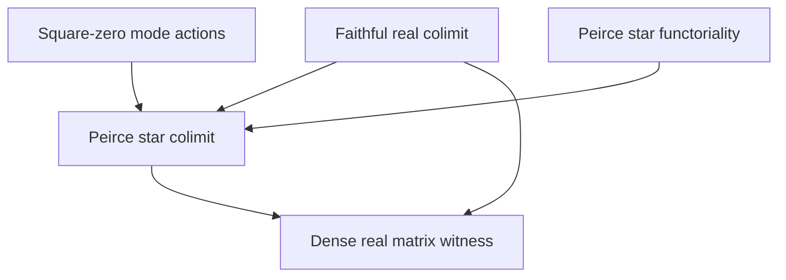

# Square-zero modes and faithful star colimits

This development extracts the associative algebra, Peirce geometry, and
star-preserving direct-limit statements from the supplied Archetype LII note.
The input has SHA-256
`ed173d8b5378504778890883f318dae17a7c3cc9cbd17573668338d93375c1c4`.

## Mathematical scope

Let `A` be an arbitrary associative ring and let `u * u = v * v = 0`.
Write, as expressions in the original ring,

\[
E=u+v,\qquad J=u-v,\qquad M=uv+vu,\qquad S=[u,v].
\]

The action table uses native `LieAlgebra.ad` and `Module.End`:

| Endomorphism | `M` | `E` | `J` | `S` |
|---|---|---|---|---|
| `-ad(E)^2` | `0` | `0` | `-4 M J` | `-4 M S` |
| `ad(J)^2` | `0` | `-4 M E` | `0` | `-4 M S` |
| `-(ad(u)ad(v) + ad(v)ad(u))` | `0` | `-2 M E` | `-2 M J` | `-4 M S` |

Every occurrence of `M` is the full ring element acting on the left.
Its commutation with the two generators follows from the square-zero
equations. Ambient centrality, invertibility, nonzero modes, and numerical
spectral values are not premises or consequences of this table. The native
endomorphism polarization identity holds on the whole algebra without even
the square-zero hypotheses.

For an idempotent `p`, the existing Peirce expressions are
`component10 p a = p * a * (1-p)` and
`component01 p b = (1-p) * b * p`. The existing reflection is `2*p-1`.
The reflected star reverses products; it is involutive when `p` is a
self-adjoint idempotent. In that case its signed pairing with a forward
corner equals `x * star x + star x * x`. This is an algebraic Gram identity
in an arbitrary star ring, without an order or a positivity assertion.
For the existing full real matrix stages with ordinary transpose star,
`stage_gram_posSemidef` separately proves native `Matrix.PosSemidef` for
every Gram weight. It supplies no order on the algebraic colimit.

The real finite-stage and limit carriers are the existing
`Cl11TensorTower.MatStage` and `Cl11TensorTowerLimit.Limit`. Their bonding
maps are the existing `A ↦ A ⊗ I₂` maps. Faithfulness is derived from their
actual injectivity. The existing `directLimitLift` is star-preserving
exactly when its stage maps preserve star, and is injective exactly when
its stage maps are injective. `liftStarAlgHom` packages this same universal
map as a native real `StarAlgHom`, with evaluation and uniqueness theorems.
The theorem `limit_not_finite` establishes algebraic infinite dimensionality:
a hypothetical finite dimension would bound every faithfully embedded full
matrix stage, contradicting their dimensions `(2^n)^2`. This proves no
normed or topological completion.

## Source owners

| Module under `InfoGeometry` | Content |
|---|---|
| `OperatorAlgebra.SquareZeroModeActions` | Conserved operator coefficient, complete action table, and whole-algebra polarization |
| `Core.PeirceStarFunctoriality` | Inner-derivation naturality, reflected anti-involution, and ordered Gram transport |
| `Canonical.RealStarColimitUniversal` | Faithful stage inclusions, infinite algebraic dimension, and the universal star algebra map |
| `Canonical.PeirceStarColimit` | Finite real-matrix semidefiniteness, actual corner specialization, refinement, and universal readback |
| `Examples.RealMatrixModeWitness` | Dense full real matrix witnesses and their faithful limit images |

`InfoGeometry.All` imports the two downstream modules, exposing the entire
development. `PeirceStarColimitAudit` is registered in the existing
`InfoGeometryTestSuite` Lake library.

## Full matrix witness

At the existing stage of `4 × 4` real matrices, use the sign vectors

\[
u=(1,1,1,1),\quad v=(1,-1,1,-1),\quad w=(1,1,-1,-1).
\]

The source defines the matrices by their two binary tensor indices,
equivalently `p = u uᵀ / 4`, `x = u vᵀ / 4`, `k = w wᵀ / 4`, and
`z = u wᵀ / 4`. It proves their ordered matrix products entry by entry.
Both `x` and `k` have every entry nonzero. The matrices are elements of
the full matrix algebra; no diagonal subalgebra is substituted.

The principal consequences are

\[
x^2=0,\quad [x,x^*]\ne0,\quad k\ne0,\quad
xk=kx=x^*k=kx^*=0,
\]
\[
Mk=kM=0,\qquad Mz=z\ne0,\qquad zM=0,
\quad M=xx^*+x^*x.
\]

Thus this weight is noncentral and is not a unit. It is positive semidefinite
and is not positive definite in the native real matrix sense. The same nonzero `k`
is in the kernel of all three native endomorphisms. The algebraic
nonvanishing, noncommutation, annihilator, nonunit, and common-kernel
statements are transported to the actual real colimit using its faithful
stage inclusion. Semidefiniteness and failure of positive definiteness
remain statements about the finite real matrix stage.

## Dependency partial order and verification

`tests/PeirceStarColimitAudit.lean` enumerates declarations by their actual
Lean owner module, including private and generated declarations. It requires
proof/definition values, rejects unsafe/partial declarations and local
axioms, and checks transitive axioms against `propext`, `Classical.choice`,
and `Quot.sound`. It records constant references from both types and values,
retaining external references as well as references within the five owners.

The existing `tools/quality/operator_geometry_dependency_order.py` consumes
that checked JSONL and derives direct edges, topological layers, and the
transitive reduction. Its partial order is
`a ≤ b` iff `a = b` or the chosen checked declaration of `b` transitively
depends on `a`. It records dependencies of these proofs, rather than a claim
of unique mathematical necessity.

With the repository's declared dependencies available, the native routes are:

```bash
python3 tools/infra/run_locked_lake_build.py --wait-for-build-lock \
  InfoGeometry.Canonical.PeirceStarColimit InfoGeometry.Examples.RealMatrixModeWitness
python3 tools/infra/run_locked_lean.py --wait-for-build-lock \
  tests/PeirceStarColimitAudit.lean
python3 tools/quality/operator_geometry_dependency_order.py \
  DECLARATION_AUDIT_JSONL DEPENDENCY_ORDER_JSON
bash scripts/quality/post_build_gate.sh --full
```

The source-closure check and the repository-wide publication gate are
separate obligations. The exact validation record and declaration graph
accompany this document.

## Checked result

The five mathematical modules passed Lean **4.34.1**, compiler commit
`5045d0056413266e57c625dcd7c365b10e377c52`, with warnings treated as errors
and zero warnings in those five modules. The complete repository import
closure contains **20 modules**. Mathlib remained pinned to
`d13f23b723b8a846827a245b89c10fc7d3f11612`; no dependency pin was changed.
This was an exact-source closure check, separate from the root Lake build.

The native audit passed for **146 owned declarations**: 141 theorem
declarations and five definitions. The source contains **116 authored
public theorems**, one private helper theorem, and five definitions; the
remaining 24 theorem declarations are generated helpers. Every owned
declaration has its required body, and the only transitive axioms are
`propext`, `Classical.choice`, and `Quot.sound`.

The checked reference graph has **275 direct edges**, **174 Hasse edges**,
and **six topological layers**. Its audit JSONL has SHA-256
`aeda4b05b23bf9c095de3f840bb7e125290799db888db083ad306eaabf7a5ed1`.
The following graph is the projection of actual cross-module declaration
edges onto the five source owners:



## Repository-wide gate

The required locked `InfoGeometry.All` build was attempted after the passing
source-closure and declaration checks. Lake checked out the declared Mathlib
and LeanCopilot revisions, then exited with code **1** because the declared
`external_refs/atlas-lean` package directory is absent. This is a package
resolution failure, before elaborating the root target.

The declared GIFT path is also absent in this checkout; its recorded gitlink
is `e6f3c3ac2140c2324fb2ae029c32233e73aa5e92`. The recorded root run stopped
at Atlas and therefore does not establish any later GIFT build result.
Atlas's inspected path-dependency metadata does not specify a reproducible
upstream revision. These dependency declarations were not replaced or
weakened. The root build and publication gate remain blocked pending their
proper restoration.
