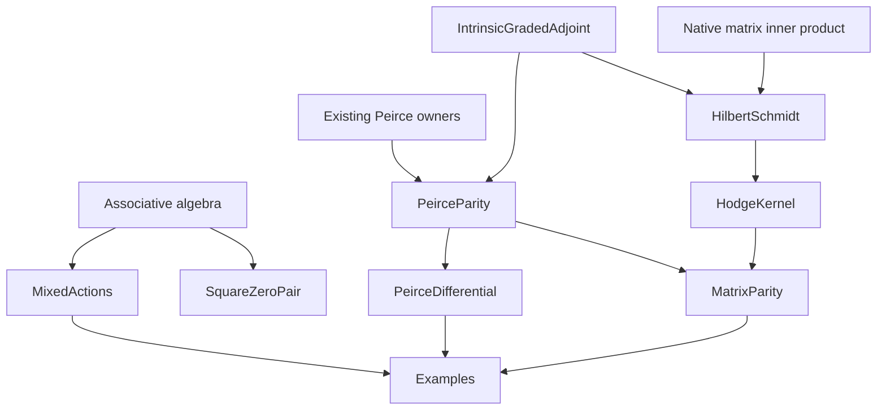

# Peirce superoperators: frozen mathematical contract

## Intake and authority

The four complete source attachments are preserved in the task. Claims in those
attachments that a script was verified are not compiler evidence.

| Input | SHA-256 |
| --- | --- |
| Pasted text(20261028-121012).txt | `70a02c2bfae6f92aa8a21c60738777361541a52ec546ad8770474ffda75323af` |
| Pasted text (2)(20261028-121129).txt | `da48160c8e6e84b3ba8696a97520282e8b4fd8e604346d215f8ea03d37602180` |
| Pasted text (3)(20261028-121252).txt | `9accca3218bb34d7bbc033e6c0c6ed17ad9718b526cd2e2d835c139d9974c308` |
| Pasted text (4)(5).txt | `c9ea1b3660df958f1492aa1bb7aa48a1a59abb84439546bd958ba1180cfe8c85` |

Remote main base: `cb7482d86eadb42f2ab9c2f6f624d67b7bfe7ce4`.
Lean: `leanprover/lean4:v4.34.1`.
Mathlib: `d13f23b723b8a846827a245b89c10fc7d3f11612`.
The isolated checkout is a local source snapshot; its synthetic local history
will not be published. Published changes must use the actual remote base.

## Carriers and conventions

The algebraic branch uses arbitrary associative `Ring A`; its linear actions
use native `Module.End R A` with `[CommRing R] [Algebra R A]`. The
operator algebra A is not assumed commutative; the scalar base R is commutative.
Native `LieAlgebra.ad` and the existing
`JordanMultiplicationClosure.jordanLeft` own the Lie and unnormalized Jordan
actions. Brackets use the native associative-ring Lie instance.

For square-zero U,V write E=U+V, C=U-V, H=UV+VU, K=UV-VU. These are local
expressions, not new result packets or replacement algebra structures.

An idempotent p supplies the existing Peirce even/odd ranges and reflection
S=2p-1. The existing actual ring equivalence `IdempotentCartan.reflectionConj`
is upgraded to the appropriate scalar-algebra equivalence, with scalar
compatibility proved. The intrinsic graded action is the existing canonical
endomorphism `gradedAdjoint θ N`, namely NX-θ(X)N.

The metric branch stays on full `Matrix n n ℂ`. It uses Mathlib's native
matrix norm and inner-product constructions at weight 1, giving
inner(X,Y)=trace(Y*Xᴴ)=trace(Xᴴ*Y), and native `LinearMap.adjoint`.
No diagonal subalgebra, scalar model, or assumed adjoint relation replaces
this full operator space.
Here H_N=NNᴴ+NᴴN is defined for every complex matrix N, independently of the
square-zero pair in the algebraic branch. The metric energy and kernel results
do not require N²=0. Identifying the Jordan action of H_N with the graded
action's actual adjoint anticommutator additionally requires actual oddness
and orthogonal, star-compatible involutive parity.

## Atomic dispositions and corrected targets

| Source claim | Mathematical disposition |
| --- | --- |
| Idempotency gives complementary corners and square-zero directed corners | Existing main Peirce owners; reuse. |
| Ordinary ad_N squared and Jordan_N squared vanish when N²=0 | False: they are -2NXN and +2NXN. Their mixed compositions vanish. Prove both formulas and a full-matrix countermodel. |
| Mixed sums equal ad_(UV+VU) | Valid in every associative ring; no nilpotency or projection premise is needed. |
| ad_U J_V - ad_V J_U = J_[U,V] | False: the exact defect is 2(UXV-VXU). The true operator commutator ad_U J_V-J_V ad_U is already owned. |
| Pure Lie/Jordan sums separate Jordan weighting from symmetric sandwiches | Valid division-free identities; expose native endomorphism equalities. |
| Trace(UXV+VXU)=trace((UV+VU)X) | Valid for every X with cyclic trace; no evenness assumption is needed. |
| The two-sided expression is automatically a quantum channel | Not asserted. Adjoint pairing gives positivity preservation; normalization and trace preservation need their own hypotheses. |
| The graded action squares to zero | Conditional on actual parity and a central charge square; square-zero charge is a sufficient condition. Reuse the generic canonical owner and prove actual Peirce specialization. |
| Substituting Nᴴ gives the Hilbert-Schmidt adjoint of the graded action | False. With orthogonal parity and θ(N)=-N, the actual adjoint has a plus sign: L_(Nᴴ)+R_(Nᴴ)θ. |
| The mixed graded anticommutator is a positive Hodge Laplacian | False in general. It is ad_H. The actual adjoint anticommutator is the Jordan action X↦HX+XH. |
| The actual matrix Hodge action is positive and its kernel is harmonic | Prove the native adjoint identity, positive energy, and exact kernel criterion; distinguish it from the graded commutant. |
| ad_p³=ad_p and the first two derivatives exchange | Existing Peirce reconstruction owns the pointwise content; PR259 owns the bundled cubic. Do not duplicate that API. |
| Opposite squares and anticommutation are conservation criteria in an inner two-cycle | Valid from the native Leibniz rule, with the two-cycle hypotheses explicit. |
| The K-action exchanges E,C with weights 2H and its square has weight 4H² | Valid for arbitrary square-zero U,V; no reflexive inverse or scalar normalization is required. |
| This is periodic motion, a scalar frequency, a Clifford classification, or a physical field equation | Not asserted. The plus/plus algebraic cycle alone has none of these meanings. |

## Read source owners and reuse decisions

- `Core.PeirceDecomposition`: existing four corners, idempotent orthogonality,
  and multiplication routing.
- `Core.PeirceGrading`: native complementary linear projections, range
  membership, multiplication parity, `conjugation`, `odd_reconstruction`,
  `corners_sq_zero`, and unitary reflection under `IsStarProjection`.
- `Core.IdempotentCartan.reflectionConj`: actual ring equivalence SXS;
  `conjugation_on_parts` supplies the sign action.
- `Core.JordanAssociatorRing`: `commutator_operator_commutator`,
  `commutator_symm_operator`, `symm_operator_commutator`, and cyclic trace laws.
- `Core.JordanMultiplicationClosure.jordanLeft`: the native unnormalized
  Jordan endomorphism, including its commutator law.
- `Canonical.ChiralSuperderivationColimit`: Bool-tagged alternating
  composition already has the correct inner-curvature identity. Its parity
  tag alone does not prove homogeneous membership.
- `Core.DiracPeirceSuperalgebra` explicitly separates repeated Jordan action
  from parity-alternating differentiation. Its inverse-normalized hypotheses
  are not hypotheses on the general square-zero pair here.
- `Canonical.FiveStreamMasterIntertwiner`: normalized two-cycle theorems
  assume UVU=U and VUV=V; the operator-weighted general pair is broader.
- `Canonical.ChiralApollonianCylinderBridge` already owns
  `ChiralApollonian.susy_conservation` and its two component lemmas for arbitrary
  square-zero U,V. This owner is unchanged; those conservation statements are
  not introduced again under another public API.
- Mathlib `Analysis.Matrix.Order`: `toMatrixNormedAddCommGroup` and
  `toMatrixInnerProductSpace` provide the actual full-matrix metric.
- Mathlib `Analysis.InnerProductSpace.Adjoint`: native adjoints and their
  defining inner-product identity.

### Existing unmerged canonical owner

PR240 at `dbf21915b23c6f78305ec57a3d12b21c24ed1104` already owns the generic
`OperatorAlgebra.IntrinsicGradedAdjoint` construction, square, mixed curvature,
parity, Leibniz and transport laws. Its standalone Mathlib-only file is reused
byte-for-byte at the same canonical path and namespace, rather than recreated
under another API. Original Git blob: `db521f5f3abea64d05888b8f75a19959e77388f8`.
Its contents are not counted as new mathematical results of this extraction.

PR259 supplies separate Lie-Jordan dual transports, bundled Peirce resolution
and the ad_p cubic. PR258 supplies full matrix Gram/exactness geometry.
PR244 supplies ordinary Dirichlet/GNS operator geometry. Their names and
verification claims do not establish the graded Hilbert-Schmidt adjoint
formula. The new target is the source-confirmed gap between the actual Peirce
grading, its graded action, and the native metric adjoint.

### Concurrent alternate formalization

During implementation, PR260 appeared and was read at
`b62ec37224a52ffb9d1ddb585d99ced9d259bce5`. It covers several of the same
ordinary composition and weighted-cycle identities. Those shared algebraic
formulas are concurrent formalizations of standard identities and are not
claimed here as a newly discovered ownership gap or new mathematics.

Its algebraic composition owner and PR250's `LieJordanEndomorphisms` are two
standalone files. Reuse is feasible through identifications of their
`lieOp`, `jordanOp`, and `sandwichOp` with the canonical operators. This PR
retains native `LieAlgebra.ad`, main's existing `jordanLeft`, and native
left/right multiplication composition to keep the public API on the chosen
owners. It also retains PR240's original graded construction.

PR260's inspected metric owner uses a full real-matrix trace pairing and its
`twistedInner`/`twistedCoInner` actions. The distinct scope here is the actual
native complex-matrix inner product, `LinearMap.adjoint` equality and
`LinearMap.IsPositive`, generic star/trace-compatible parity, four Gram-square
energies and exact four-annihilator/two-sided Gram kernels. Actual Peirce
submodule restrictions and the three-space countermodels connect this metric
scope to the existing grading. No claim is made about PR260's final proof or
review status, and its branch is left unchanged.

The context preflight found no local declaration-graph/index artifacts. Source
search and actual import/declaration inspection supply the prerequisite map;
no graph freshness or formal causal-poset carrier is claimed.

## Causal prerequisite order

1. Existing associative Lie/Jordan actions -> composition and sandwich
   identities -> exact false-identity defects and ordinary square laws.
2. Square-zero pair -> E/C opposite squares and anticommutation -> conservation
   and the operator-weighted K-action -> iterated K-action.
3. Existing idempotent reflection equivalence + actual Peirce ranges -> scalar
   compatibility and parity routing -> specialized intrinsic graded action.
4. Actual oddness + square-zero charge -> zero composite and native
   range-to-kernel/short-complex construction.
5. Orthogonal reflection + actual odd charge + native full-matrix Hilbert-Schmidt metric -> actual
   adjoint formula -> Jordan Hodge action -> positive energy and kernel geometry.
6. Explicit noncommuting full matrices -> nonvacuity and countermodels for
   ordinary nilpotence, the missing mixed-difference term, and the wrong adjoint.

These are proof prerequisites, not physical causation. Reverse algebraic
equalities do not create reverse proof dependencies.

### Concrete owner map

| Owner | Mathematical interface |
| --- | --- |
| `MixedActions` | Native Lie/Jordan composition equalities, exact sandwich defects, ordinary square formulas and cyclic trace. |
| `SquareZeroPair` | Opposite squares, anticommutation, operator-weighted first and second commutator actions, and conditional conservation criteria. |
| `PeirceParity` | Scalar-compatible upgrade of the existing reflection equivalence; involutivity, actual range signs and star compatibility. |
| `PeirceDifferential` | Parity routing on existing submodules, zero composite, range contained in kernel, and two native `ShortComplex (ModuleCat ℤ)` objects. |
| `HilbertSchmidt` | Native matrix inner product, multiplication adjoints, actual graded adjoint, Jordan Hodge identity and positivity. |
| `HodgeKernel` | Four-term and two-term energy identities; exact annihilator, harmonic and two-sided Gram kernel equalities. |
| `MatrixParity` | Trace preservation and metric specialization for an actual orthogonal Peirce projection. |
| `Examples` | Full noncommuting complex matrices distinguishing ordinary squares, the mixed defect, graded commutants, centralizers and the true Hodge kernel. |
| `IntrinsicGradedAdjoint` | Existing canonical generic owner reused byte-for-byte; audited with the new owners. |

The diagram is a source prerequisite map. In particular, the nilpotency
hypothesis used in `PeirceDifferential` is not an input to the metric energy
or kernel owners. The import-only umbrella connects these branches without
adding declarations. The aggregate `OperatorAlgebra.All` receives one import;
the scoped checker does not claim to compile every unrelated aggregate import.

## Acceptance and role separation

Root integrates and proves. The mathematical auditor does not author source.
The acceptance reviewer reconciles final code, compiler output and hashes
without authoring the result. A delegated generation agent may write only new
sandbox files; root reviews and integrates them.

Required evidence: the exact repository source closure at the frozen pins;
zero new-module warnings; every owned declaration audited transitively by
module ownership; only propext/Classical.choice/Quot.sound; no unsafe/partial
owned declarations; zero hard placeholder findings and zero blocking semantic
findings in newly authored sources; explicit review of the soft placeholder
and unchanged canonical-owner heuristic findings below; an unchanged passing staged
proof-integrity gate; and final source/evidence hash reconciliation.
Builds and tests are serialized under the shared build lock. Static source
scans use their maintained entry points after the process precheck.

The scoped native check is not a claim of a complete repository Lake build.
No dependency source, toolchain pin, axiom allowlist or gate threshold changes
are authorized by this theorem task.

### Reviewed canonical-owner heuristic findings

The full semantic-vacuity scan reports four `trivial_surface` warnings in the
byte-identical reused `IntrinsicGradedAdjoint` owner: `gradedAdjoint_apply`,
`transportParity_apply`, `transportParity_odd`, and
`map_gradedAdjoint_of_intertwines`. Independent source review confirms that
these are definitional application or genuine equivalence-transport lemmas;
none assumes its conclusion or supplies a surrogate carrier. Their short
proofs are kept intact. Acceptance requires zero blocking semantic findings in
newly authored owners and zero unreviewed findings overall.

The strict placeholder scanner also reports two nonblocking `skeletal-proof`
signals: `Examples.identity_joint_graded_kernel` and the reused
`IntrinsicGradedAdjoint.transportParity_odd`. Independent source review
confirms the first is a valid unit-preservation readout and the second is the
valid oddness transport described above. Both scans have zero hard findings;
their two soft findings are retained and explicitly reviewed. A successful
strict scan is not described as zero total heuristic findings.

CI retains the full finding report and uses the maintained `--fail-prefix`
option to block warnings in every newly authored owner and the changed
aggregate. The scoped verifier requires the reused file's exact original
SHA-256 `77610dd9f8583cb5ebae047f65a4351ef4bbdaabab387d64d0efd861d7c5316c`,
so this reviewed boundary cannot silently apply to a modified file. The
native compiler, complete axiom audit, strict placeholder scan, and unchanged
staged proof-integrity gate continue to cover that canonical owner.
