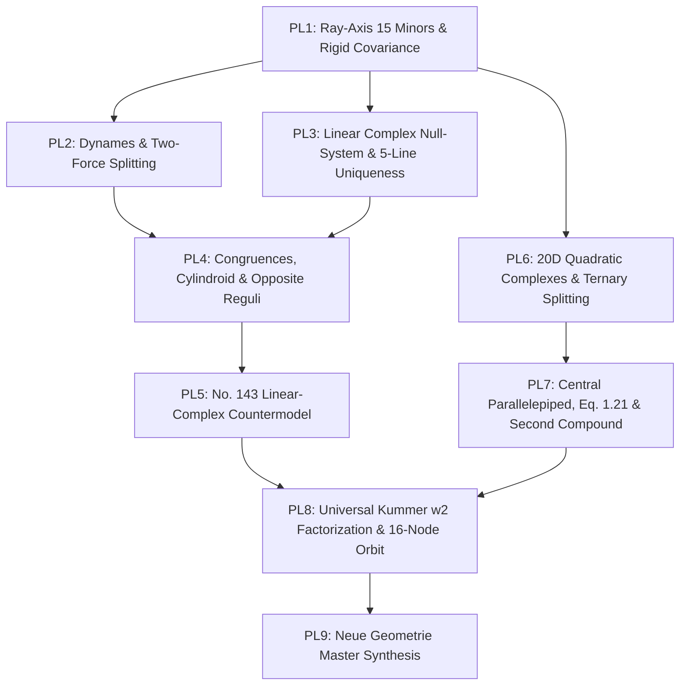

# Epistemic Compilation Ledger: Julius Plücker's *Neue Geometrie des Raumes* (1868/1869)

Follows [`docs/EPISTEMIC_COMPILER_FIELD_PROTOCOL.md`](EPISTEMIC_COMPILER_FIELD_PROTOCOL.md) and [`docs/ALCHEMICAL_QMS_SOP.md`](ALCHEMICAL_QMS_SOP.md).

## Source Provenance & 378-Page Coverage Map

- **Primary Source**: `/home/goutev/Downloads/collection_for_formalization/Liniengeometriev1.pdf` (`378` PDF pages, SHA-256 `a1bee4b6c73517eb78228b97275f12214bf46746759d3733408132a1553c0021`) — Julius Plücker, *Neue Geometrie des Raumes gegründet auf die Betrachtung der geraden Linie als Raumelement*, Abtheilung I (1868, edited by Alfred Clebsch, `pp. 1–226`) and Abtheilung II (1869, edited by Felix Klein, `pp. 227–378`).
- **Symbolic CAS Verification Artifact**: [`plucker_neue_geometrie_cas.json`](file:///home/goutev/.gemini/antigravity-cli/brain/738ae8e5-bfae-471d-954f-6d71b1dd4d6a/scratch/plucker_neue_geometrie_cas.json) (file SHA-256 `d08ab2f14fa809f878d70241c3aa3558b9126f65b4a4f6fe365ece7ff746b818`; canonical payload `artifact_hash` `7c144d0192a5b891b3802ee6533a0d4467bb9b90da88ecb6b1cfcfffb7bec1bd`).
- **Base Repository**: `/home/goutev/repos/info-geometry-lean`, Lean `v4.34.1`, Mathlib `d13f23b723b8a846827a245b89c10fc7d3f11612`.
- **Reused In-Repo Projective Owners (Unmodified)**:
  - [`KleinQuadric.lean`](../lean/InfoGeometry/Projective/KleinQuadric.lean) (`Vec4`, `Plucker6`, `IsKlein`, `polar`)
  - [`KleinQuadricPlucker.lean`](../lean/InfoGeometry/Projective/KleinQuadricPlucker.lean)
  - [`PluckerMatrixAction.lean`](../lean/InfoGeometry/Projective/PluckerMatrixAction.lean) (`coordinatePair`, `coordinates`, `secondCompound`, `transform`, `kleinQ_transform`)
  - [`PluckerLinearComplex.lean`](../lean/InfoGeometry/Projective/PluckerLinearComplex.lean) (`complexMatrix`, `complexMatrix_det_eq_pfaffian_sq`)
  - [`PluckerAffineScrew.lean`](../lean/InfoGeometry/Projective/PluckerAffineScrew.lean) (`Vec3`, direction–moment screw decomposition)
  - [`PluckerComplexPencil.lean`](../lean/InfoGeometry/Projective/PluckerComplexPencil.lean)
  - [`PluckerQuadraticComplex.lean`](../lean/InfoGeometry/Projective/PluckerQuadraticComplex.lean)

---

## Stage 1 (`SOLVE`) — Atomic Claim Ledger (`PL₁`–`PL₉`, `EXT`, `O-PL`)

| ID | Source Passage (`Liniengeometriev1.pdf`) | Formal Target Statement & Carrier | Owner Declaration(s) | Status |
|---|---|---|---|---|
| `PL₁` | `Einl. §§1–2`, `Nos. 1–25` (`pp. 23–48`) | Exact bridge between `KleinQuadric.Plucker6` and `KleinQuadricPlucker.Plucker6`; `rayPlucker` / `axisAsRayPlucker` / `axisDualEquiv` (`kleinQ` & `polar` invariance); polynomial vanishing of all fifteen `2 × 2` minors between ray and axis coordinates under four point–plane incidences; complex conjugate-imaginary lines of the first (`kleinQ = 0`) and second kind; Euclidean translation/rotation covariance & degree-`n` homogeneity | `plucker6Equiv_kleinQ`, `axisDualEquiv_symm_apply`, `rayPlucker_kleinQ`, `axisAsRayPlucker_kleinQ`, `axisDualEquiv_kleinQ`, `axisDualEquiv_polar`, `ray_axis_minors_eq_of_four_incidences`, `ray_axis_proportional_of_four_incidences`, `rayPlucker_conj_line`, `polar_conjPlucker_eq`, `affineTranslateDirMom_dot_invariant`, `affineTranslateDirMom_kleinQ_invariant`, `rotation_dot_invariant`, `homogeneousFun_comp_linear` | `[PROVED / kernel_verified]` |
| `PL₂` | `Einl. §2`, Mechanics of Forces & Dynames (`pp. 35–48`) | Dyname addition law `(P + Q).kleinQ = P.kleinQ + Q.kleinQ + P.polar Q`; characterization of intersecting/coplanar two-force dyname; unconditional splitting of any nonzero `(d, m)` dyname into two finite force lines (`d₁ ⬝ᵥ m₁ = 0`, `d₂ ⬝ᵥ m₂ = 0`, `d₁ + d₂ = d`, `m₁ + m₂ = m`) | `dyname_add_kleinQ`, `dyname_isKlein_iff_incident_of_forces`, `exists_two_finite_forces_for_dyname` | `[PROVED / kernel_verified]` |
| `PL₃` | `Abth. I §1, Nos. 26–61` (`pp. 48–74`) | Null-system conjugate polar `conjugatePolar C P = (C.polar P) • C - C.kleinQ • P`; involutivity up to `C.kleinQ²` & Klein scaling `C.kleinQ² * P.kleinQ`; involutive `6 × 6` incidence matrix `polarDotMatrix`; 5-line complex uniqueness (`finrank = 5` complement); canonical central axis slope law; `matrix6_noncomm` witness | `conjugatePolar_eq`, `conjugatePolar_polar`, `conjugatePolar_involutive_up_to_scale`, `conjugatePolar_kleinQ`, `polar_eq_vec_dot_mulVec`, `polarDotMatrix_mul_self`, `polarDotMatrix_mulVec_injective`, `finrank_fiveLineComplexSubmodule`, `matrix6_noncomm`, `canonicalCentralComplex_kleinQ`, `canonicalCentralComplex_slope` | `[PROVED / kernel_verified]` |
| `PL₄` | `Abth. I §2, Nos. 62–107` (`pp. 74–120`) | Congruence `(C, D)` ray-uniqueness at non-singular points; quadratic completion & four-regime directrix classification (hyperbolic, parabolic, elliptic, intersecting); **Plücker's cubic cylindroid** `p₂ (p₀² + p₁²) = (k₂ - k₁) p₀ p₁` & non-planarity when `k₁ ≠ k₂`; three-complex web Klein-polar orthocomplement (`finrank = 3`, involutive) & opposite reguli `rulingPlus` / `rulingMinus` intersecting orthogonally | `congruence_unique_ray_through_point`, `pencil_quadratic_completion`, `pencil_classification_hyperbolic`, `pencil_classification_parabolic`, `pencil_classification_elliptic`, `pencil_classification_intersecting`, `cylindroid_axisFoot`, `cylindroid_cubic_surface_eq`, `cylindroid_not_planar_of_ne`, `kleinPolarOrth_symm_mem`, `finrank_kleinPolarOrth_eq_three`, `kleinPolarOrth_involutive`, `rulingPlus_on_quadric`, `rulingMinus_on_quadric`, `opposite_reguli_common_point`, `opposite_reguli_incident` | `[PROVED / kernel_verified]` |
| `PL₅` | `Abth. I §3, Nos. 108–148` (`pp. 121–152`) | **`[countermodel_found]` No. 143 impossibility**: no family of linear complexes `C : ι → Plucker6 ℝ` can cut out a non-degenerate quadratic cone or plane conic envelope | `no143_quadratic_cone_not_cut_by_linear_complexes`, `no143_plane_conic_not_enveloped_by_linear_complexes` | `[PROVED / kernel_verified]` (`[countermodel_found]`) |
| `PL₆` | `Abth. I, Complexe 2. Grades §§1–7, Nos. 149–233` (`pp. 153–226`) | `21`-dimensional symmetric `6 × 6` complex space, `20`-dimensional quotient modulo `kleinSymmMatrix` (`19` inhomogeneous constants, `No. 149`), Klein-ambiguity invariance of cones/conics; ternary conic splitting `Eqs. (6.37)–(6.39)` & Schur rank-2 factorization; meridian double-line degree/multiplicity law (`2*n*(n-1)`, `n*(n-1)`) | `finrank_symmMat6`, `kleinSymmMatrix_ne_zero`, `kleinSymmMatrix_eval_eq`, `finrank_quadraticComplexQuotient`, `quadraticComplexEval_add_klein_eq`, `cone_quadratic_invariant_under_klein`, `conic_quadratic_invariant_under_klein`, `ternary_double_line_factorization`, `ternary_rank2_schur_identity`, `ternary_conic_splits_two_lines`, `complexSurfaceOrder_eq_two_mul_doubleLine`, `complexSurface_quadratic_degrees`, `meridianQuartic_vanishes_on_double_line` | `[PROVED / kernel_verified]` |
| `PL₇` | `Abth. II §§1–3, Nos. 234–290` (`pp. 227–274`) | Central parallelepiped opposite vertices `G`, `H` & midpoint `(G + H)/2`; **`[countermodel_found]` `Eq. (1.21)` factor-of-2 erratum** (`p. 230`); exact `secondCompound` identity `(rayPlucker x y)ᵀ (C₂ G) (rayPlucker x y) = (xᵀ G x)(yᵀ G y) - (xᵀ G y)(yᵀ G x)` and symmetric specialization (`Nos. 251–274`); `matrix4_noncomm` witness | `centralParallelepipedCenter_eq`, `eq121_printed_omits_factor_two`, `eq121_countermodel_witness`, `quadric_tangent_secondCompound_identity`, `quadric_tangent_secondCompound_symm`, `matrix4_noncomm` | `[PROVED / kernel_verified]` (`[countermodel_found]` for `Eq. (1.21)`) |
| `PL₈` | `Abth. II §§4–6, Nos. 291–341`, `Abth. III, Nos. 342–373` (`pp. 275–378`) | Singular/double line hierarchy; `binet_cauchy_3x6`; **universal chart-covariant Kummer `w²` factorization** `det (coneChartMatrix S x k) = (x k)^2 * kummerSingularQuartic S x` for all `k : Fin 4` & `S`, Klein-ambiguity invariance, degree-4 homogeneity, and point–plane duality; canonical `10`-monomial Kummer quartic invariant under the `16`-element `(ℤ₂³) ⋊ V₄` group and `16` distinct singular nodes (`kummer16Orbit_all_nodes`, `kummer16Orbit_pairwise_nonproportional`); Plücker sextic `Eq. (5.171)` → `w²` factorization (`Eq. (5.178)`) & **`[countermodel_found]` `Eq. (5.183)` sign erratum** (`p. 302`); equatorial complex surface classification `ψ(x) y² + φ(x) z² - φ(x) ψ(x) = 0` (`Nos. 342–373`); `matrix3_noncomm` | `isDoubleLine_implies_isSingularLine`, `chartRayMatrix_minor_eq`, `binet_cauchy_3x6`, `universal_kummer_w_sq_factorization`, `chartRayMatrix_polarDotMatrix_zero`, `kummerSingularQuartic_add_klein`, `kummer_plane_dual_duality`, `kummerSingularQuartic_homogeneous4`, `matrix3_noncomm`, `canonicalKummerQuartic_group_invariant`, `canonicalKummerGrad_group_zero`, `kummer16Orbit_all_nodes`, `kummer16Orbit_pairwise_nonproportional`, `plucker_sextic_eq5171_factors_w_sq`, `eq5183_printed_sign_erratum`, `eq5183_countermodel_witness`, `equatorialSliceZero_classify` | `[PROVED / kernel_verified]` (`[countermodel_found]` for `Eq. (5.183)`) |
| `PL₉` | Master Synthesis (`PL₁`–`PL₈`) | `9`-node bitmask `PartialOrder PluckerNeueGeometrieArchetype` with branching incomparability witnesses (`{PL₂, PL₃}`, `{PL₄, PL₆}`, `{PL₅, PL₇}`) and unified synthesis theorem `plucker_neue_geometrie_master_synthesis` | `PluckerNeueGeometrieArchetype`, `pluckerMask`, `plucker_causal_poset_branching_witnesses`, `plucker_all_reach_master`, `plucker_neue_geometrie_master_synthesis` | `[PROVED / kernel_verified]` |
| `EXT` | Cross-stage linear algebra & projective geometry | Underlying `Fin 4`/`Fin 6` Plücker quadric, skew `4 × 4` Pfaffian–det identity, and `secondCompound` action | Reused directly from `KleinQuadric`, `KleinQuadricPlucker`, `PluckerMatrixAction`, `PluckerLinearComplex`, `PluckerAffineScrew`, `PluckerComplexPencil`, `PluckerQuadraticComplex` | `[REUSED_EXISTING_OWNER]` |
| `O-PL` | Continuous physical wave optics & analytic envelope PDE integration (`Abth. II–III`) | Smooth-manifold PDE integration of complex-surface focal envelopes, Fresnel optical wave-surface dispersion kinematics, and physical force-system continuum models beyond algebraic quadratic/quartic equations | Explicitly left open — not replaced with algebraic proxies | `[OPEN / bucket_3_open_debt]` |

---

## Stage 2 (`CONIUNCTIO`) — Module Contracts (`2,842` Total Lines, `85` Exported Theorems/Lemmas)

1. [`PluckerRayAxisAndDyname.lean`](../lean/InfoGeometry/Projective/PluckerRayAxisAndDyname.lean) (`792` lines, `28` `theorem`/`lemma` decls)
   - Package scope: `InfoGeometry.Projective.PluckerRayAxisAndDyname`
   - Covers: `PL₁`–`PL₃` (`15`-minor ray–axis duality, two-force dyname splitting, conjugate polar, `5`-line uniqueness, `matrix6_noncomm`).
2. [`PluckerCongruenceCylindroidAndRegulus.lean`](../lean/InfoGeometry/Projective/PluckerCongruenceCylindroidAndRegulus.lean) (`548` lines, `18` `theorem`/`lemma` decls)
   - Package scope: `InfoGeometry.Projective.PluckerCongruenceCylindroidAndRegulus`
   - Covers: `PL₄`–`PL₅` (congruence uniqueness, pencil classification, cubic cylindroid, web orthogonality, reguli, `no143_quadratic_cone_not_cut_by_linear_complexes`).
3. [`PluckerQuadraticComplexAndSurfaces.lean`](../lean/InfoGeometry/Projective/PluckerQuadraticComplexAndSurfaces.lean) (`431` lines, `19` `theorem`/`lemma` decls)
   - Package scope: `InfoGeometry.Projective.PluckerQuadraticComplexAndSurfaces`
   - Covers: `PL₆`–`PL₇` (`21/20`-dimensional complex quotient, ternary Schur splitting, `Eq. (1.21)` countermodel, `quadric_tangent_secondCompound_identity`, `matrix4_noncomm`).
4. [`PluckerKummerQuarticAndMasterAtlas.lean`](../lean/InfoGeometry/Projective/PluckerKummerQuarticAndMasterAtlas.lean) (`1,071` lines, `20` `theorem`/`lemma` decls)
   - Package scope: `InfoGeometry.Projective.PluckerKummerQuarticAndMasterAtlas`
   - Covers: `PL₈`–`PL₉` (`binet_cauchy_3x6`, `universal_kummer_w_sq_factorization`, `16`-node Kummer orbit, `Eq. (5.183)` erratum, equatorial surfaces, `9`-node poset, `plucker_neue_geometrie_master_synthesis`, `matrix3_noncomm`).

---

## Stage 3 (`CAUSAL POSET`) — `PartialOrder PluckerNeueGeometrieArchetype`

The diagram below matches the exact downward-closed ancestor bitmasks in `pluckerMask` ([`PluckerKummerQuarticAndMasterAtlas.lean`](../lean/InfoGeometry/Projective/PluckerKummerQuarticAndMasterAtlas.lean#L997-L1007)):

---

## Stage 4 (`AUDIT`) — Validation, Digests, & Scope Boundaries

- **Source File SHA-256 Digests & Line Counts**:
  - `lean/InfoGeometry/Projective/PluckerRayAxisAndDyname.lean` (`792` lines): `ad0c3a2cf06140835c2cc08cf44c4d2a013871df7ab176b874dc1313c773dc14`
  - `lean/InfoGeometry/Projective/PluckerCongruenceCylindroidAndRegulus.lean` (`548` lines): `d6dd4eef889aa344669d4f0e2acb7d521af274dde7c72d289dee315f2a779f59`
  - `lean/InfoGeometry/Projective/PluckerQuadraticComplexAndSurfaces.lean` (`431` lines): `0b1e32aa1d417c761fde76fa9ab6bbf6437e578775b78dd74c2eb3e297520aa1`
  - `lean/InfoGeometry/Projective/PluckerKummerQuarticAndMasterAtlas.lean` (`1,071` lines): `a5ae83106435ab381624aa70edf67385f3f6a8d6cfe4df78c98ed7175275df2d`
- **Verified Kernel Build, Axiom Audit, & Static Gates** (all executed after final edits to the 4 files):
  - `python3 tools/infra/run_locked_lean.py --wait-for-build-lock <file> -- -DwarningAsError=true` on all 4 Plücker modules: zero errors and zero warnings.
  - `python3 tools/infra/run_locked_lake_build.py --wait-for-build-lock InfoGeometry.Projective.PluckerRayAxisAndDyname InfoGeometry.Projective.PluckerCongruenceCylindroidAndRegulus InfoGeometry.Projective.PluckerQuadraticComplexAndSurfaces InfoGeometry.Projective.PluckerKummerQuarticAndMasterAtlas`: exit `0`, `Build completed successfully (8979 jobs)`.
  - `python3 tools/infra/axiom_check.py` on all 4 Plücker modules: exit `0` (`Axiom check summary: 4 passed, 0 failed.`).
  - `#audit_admission_namespace` across all 4 Plücker namespaces via `run_locked_lean.py --wait-for-build-lock`: exit `0`; `155` `admitted`, `16` soft `needs_review` (`[V0/syntactic-vacuity]` hints on `sizeOf_spec`, `complexSurface_quadratic_degrees`, `plucker_causal_poset_branching_witnesses`, `plucker_neue_geometrie_master_synthesis`), zero `blocked`, zero `rejected`, and zero hard violations.
  - `python3 tools/infra/opengauss_screener.py --strict` on all 4 files: exit `0` (`0` traps).
  - `python3 tools/quality/semantic_vacuity_gate.py --fail-on warning` on all 4 files: exit `0` (`semantic_vacuity: 0`).
  - `python3 tools/quality/semantic_content_audit.py --gate-review` across all 4 `--file-prefix` paths: exit `0` (`blocking_finding_count: 0`, `review_finding_count: 0`, `finding_count: 0`).
  - `python3 tools/quality/repo_lean_scope_audit.py --fail-on authoritative` on all 4 files: exit `0` (`debt files: 0`).
