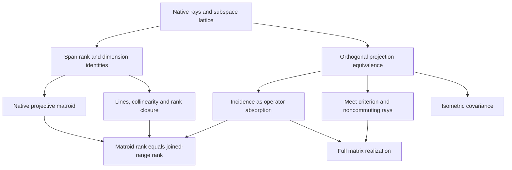

# Projective operator incidence: theorem contract

## Provenance and scope

Input: David Braun, Nicolas Magaud, Pascal Schreck, *Two Cryptomorphic
Formalizations of Projective Incidence Geometry*, HAL-01887000, uploaded PDF,
23 pages. The intended mathematical input is the incidence/rank dictionary,
the rank inequalities, closure, and nondegenerate point/line constructions.

Upstream inspected: `nickgou-nuke/info-geometry-lean`,
`b143075bbf27e75860a1011e04423a0f227b7c41`.
Toolchain: Lean `v4.34.1`; mathlib
`d13f23b723b8a846827a245b89c10fc7d3f11612`.

This development constructs the representable geometry of a finite-dimensional
inner-product space inside its full operator algebra. It does not claim the
paper's abstract cryptomorphism for arbitrary incidence structures.

## Actual carriers and conventions

- Points: native `Projectivization K V`, with its existing quotient and
  `Projectivization.submodule`.
- Linear/projective rank: `Module.finrank K` of the span of the point subspaces.
- Matroid: native `Matroid (Projectivization K V)`, constructed by
  `IndepMatroid.ofBddAugment` from independence of representatives. The native
  `Matroid.eRk` equals the dimension of the span for arbitrary point sets,
  including infinite sets in the finite-dimensional ambient space.
- Lines: submodules of vector-space dimension exactly two.
- Operator carrier: the full noncommutative algebra `E →L[𝕜] E`, with
  `𝕜` real or complex and ordinary composition as multiplication.
- Matrix carrier: the full native algebra `Matrix n n ℂ`. An arbitrary
  orthonormal basis supplies `LinearMap.toMatrixOrthonormal`; the continuous
  operator representation is proved both injective and surjective.
- Projection carrier: native subtype of operators satisfying
  `IsStarProjection`, i.e. self-adjoint idempotents.
- Geometry-to-operator map: `Submodule.starProjection`; inverse: operator range.
- Incidence: inclusion of subspaces, equivalent to absorption under operator
  multiplication. No global commutativity hypothesis is imposed.
- Finite-dimensional hypotheses are explicit wherever natural-number rank is
  used. Projective plane means vector dimension three; projective three-space
  means vector dimension four.

The supplied inner product determines orthogonality and the canonical
self-adjoint projectors. The projective matroid alone does not determine that
inner product or the multiplication of arbitrary operators.

## Source-confirmed owners and exact interfaces

Existing repository owners inspected:

- `OperatorAlgebra/ComplexBoundedOperators/OrthogonalProjection.lean` exposes
  `Submodule.starProjection` and proves its range, kernel, fixed-point,
  idempotence, and orthogonal-complement identities.
- `OperatorAlgebra/ComplexBoundedOperators/AdjointProjection.lean` exposes
  `IsStarProjection` for those operators.
- `Canonical/RealStageProjectionMurrayVonNeumann.lean` uses
  `LinearMap.IsStarProjection.ext` to identify projections by their ranges;
  its rank classification concerns Murray-von Neumann equivalence, which is
  distinct from incidence of specific subspaces.
- `Projective/ExteriorKleinTwoPlaneIncidence.lean` proves real two-plane
  incidence equivalent to a vanishing exterior product. This is a separate
  geometric representation, not a generic point/rank interface.

Native mathlib interfaces reused directly to keep imports narrow:

- `Projectivization.equivSubmodule : Projectivization K V ≃
  {H : Submodule K V // Module.finrank K H = 1}`.
- `Projectivization.finrank_submodule`, `submodule_injective`, `mk''`, and
  `submodule_mk''`.
- `Submodule.range_starProjection`, `starProjection_eq_self_iff`, and
  `starProjection_comp_starProjection_of_le`.
- `ContinuousLinearMap.IsStarProjection.ext_iff`: star projections are equal
  exactly when their ranges are equal.
- `Submodule.finrank_sup_add_finrank_inf_eq`: the dimension modular identity.
- `IndepMatroid.ofBddAugment`, `Projectivization.independent_iff`, and
  `Matroid.IsBasis'.eRk_eq_encard`: the native matroid and its rank interface.
- `LinearMap.toMatrixOrthonormal` and `Matrix.rank_eq_finrank_range_toLin`:
  the full matrix star-algebra representation and its rank interface.

The source-confirmed gap addressed here is the reusable connection from native
projective points and their rank geometry to arbitrary orthogonal-projection
operators, including the failure of multiplication to represent intersection
without commutativity.

## Theorem dependency poset

1. Native subspaces and orthogonal projections give inverse carrier maps.
2. Subspace inclusion is equivalent to operator absorption in both orders.
3. Projection multiplication represents intersection precisely in the
   commuting case; the ambient algebra and projection family remain general.
4. Finite joins of point subspaces give rank normalization, monotonicity,
   subcardinality, and submodularity.
5. Rank-preserving insertion is equivalent to incidence with the existing span.
6. Distinct points generate a unique dimension-two line; ambient dimension
   controls whether two lines must intersect.
7. Isometric conjugation preserves the operator and geometric constructions.
8. A proved noncommutativity result witnesses the limits of replacing meets
   by products.
9. Linear independence and finite-dimensional augmentation construct the native
   projective matroid. Its extended natural-number rank agrees with both the
   geometric rank and the dimension of joined projection ranges.
10. The native orthonormal-basis equivalence transports these operators to the
    full matrix algebra, preserving incidence, rank, and the exact commutation
    criterion for intersection. Every complex ambient dimension at least two
    admits distinct noncommuting rank-one Hermitian idempotent matrices.

The dependency relation has independent branches; it is not a forced linear
sequence. The geometric order itself is Mathlib's existing complete lattice
`Submodule K V`.

This is a dependency order of mathematical statements. It is not an assertion
of physical causation or a new theory of causality.

## Source map

Import `InfoGeometry.Projective.OperatorIncidence` for the complete development.
Each theorem-bearing module can also be imported independently.

| Module | Principal content |
| --- | --- |
| `IncidenceRank` | Span rank, rank axioms, closure, native collinearity, unique lines, line intersections |
| `IncidenceNondegeneracy` | Geometric witness separation, third points, repeated-point line existence, skew lines in vector dimension four |
| `IncidenceMatroid` | Native projective matroid, augmentation, finite rank, arbitrary-set rank equals span dimension |
| `ProjectionIncidence` | Two-sided subspace/projection and point/rank-one-projection equivalences; absorption; meet/product criterion |
| `ProjectionRankGeometry` | Native matroid rank equals joined-range dimension; collinearity and line intersections as operator equations |
| `ProjectionCovariance` | Isometric conjugation of projections, ranges, incidence, commutators, and joined-range rank |
| `ProjectionNoncommutativity` | Ray projections commute exactly for equal or orthogonal rays; noncommuting witnesses in every complex dimension at least two |
| `ProjectionMatrixGeometry` | Full matrix representation, matrix/range rank equality, matrix incidence and meet criterion, noncommuting rank-one matrix witnesses |

## Specification checks

- Do not measure the rank of a family of projective points by the vector-space
  span of their projection MATRICES. Use the span of their ranges.
- Do not identify arbitrary idempotents from their ranges. Self-adjointness is
  essential for this carrier equivalence.
- Do not assume distinct vectors define distinct projective points.
- Do not assert uniqueness of a line for repeated points.
- Do not assert arbitrary lines intersect in higher-dimensional projective space.
- Do not use arbitrary invertible conjugation to preserve orthogonal
  projections; isometric/unitary conjugation preserves the adjoint.
- The printed four-point rank upper bound in Table 14 is already implied by
  subcardinality. It cannot establish exact projective dimension three.

## Verification boundary

All new theorem-bearing source must be compiled with the pinned Lean/mathlib,
under the shared build lock, and audited for placeholders and nonfoundational
axioms. Compilation establishes the exact Lean statements. An independent
semantic review must also check the source-to-statement correspondence.

The environment uses a source snapshot of the inspected upstream files and
reads the already available pinned mathlib cache. No dependency revision or
upstream manifest is changed. Full-repository build status is separate from
the checked new import closure.

The dedicated `Projective operator incidence` workflow compiles all nine new
modules sequentially using that exact pin. It then enumerates every declaration
owned by those modules in Lean's imported environment and applies
`Lean.collectAxioms`. The only permitted axioms are `propext`,
`Classical.choice`, and `Quot.sound`; unsafe and partial declarations are
rejected. The workflow publishes the source snapshot, source hashes, compiler
logs, and declaration audit together as verification evidence.
