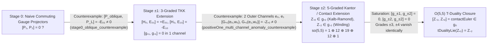

# Quantum Yang–Mills: Multi-Level Ontology ($M_0 \to M_3$), 7-Clade Taxonomy, and Phylogenesis (`Solve et Coagula`)

**Audit Date**: 2026-11-05  
**Repository Scope**: `lean/InfoGeometry` (467 matched Lean files; 27 core Yang–Mills owner modules verified with `0 sorry` and `0 custom axioms`), Auto-Ontology REST (`:3001`, 389 `YangMills` terms, 314 `BRST` terms, 511 `SelfDual` terms, 356 `ChernSimons` terms, 226 `Bianchi` terms, 107 `WilsonLoop` terms), [`docs/TWO_SHEETED_YANG_MILLS_FRAMEWORK_PROGRESS.md`](TWO_SHEETED_YANG_MILLS_FRAMEWORK_PROGRESS.md), and [`docs/YANG_MILLS_NATIVE_GAUGE_CONTRACT.md`](YANG_MILLS_NATIVE_GAUGE_CONTRACT.md).

> [!IMPORTANT]
> **Epistemic Boundary (`AGENTS.md`)**: Every claim below is classified by its actual Lean carrier, operations, and hypotheses. Kernel-checked algebraic, cochain, matrix-norm, Peirce-colimit, and finite-dimensional KMS/log-det theorems do **not** establish the continuum 4D Euclidean/Wightman Quantum Yang–Mills existence and mass-gap problem (Jaffe–Witten).

---

## 1. Multi-Level Epistemic Ontology ($M_0 \to M_3$)

| Level | Ontological Layer | Role in the Quantum Yang–Mills Architecture |
| :--- | :--- | :--- |
| **$M_0$** | **Physical & Geometric Archetype (Object Target)** | Non-Abelian gauge field $A$ with curvature $F_A = dA + A \wedge A$, covariant Bianchi identity $D_A F_A = 0$, Yang–Mills field equation $D_A (\star F_A) = 0$, topological instanton bound $|K(F)| \le S(F)$, BRST ghost decoupling $H_{\mathrm{phys}} = \ker Q_{\mathrm{BRST}} / \operatorname{im} Q_{\mathrm{BRST}}$, ’t Hooft–Wilson center-vortex braiding, Osterwalder–Schrader reflection positivity, and strict spectral mass gap $\Delta > 0$. |
| **$M_1$** | **Mathematical Carrier Stratification (7 Formal Lanes)** | **1.** Native Chevalley–Eilenberg derivation cochains (`DerivationLieLane R A`) **2.** Matrix-valued exterior algebras (`Matrix (Fin n) (Fin n) (ExteriorAlgebra R V)`) & Hodge bilinear data (`HodgeTwoFormData E`) **3.** Noncommutative star-ring Peirce defect & unipotent holonomy rings (`[Ring B] [StarRing B]`) **4.** Two-sheeted Krein stage systems & $\mathrm{Cl}(1,1)^{\otimes n}$ inductive colimits (`Limit`, `Stage (5 + 8k)`) **5.** BRST cochain quotients (`physicalGaugeStateModule`) & Krein/Hessian Kugo–Ojima functionals **6.** Split-octonion / Seiberg–Witten soldering (`Mat2 R`, `SplitOctonion R`, `ColorVec3 R`) **7.** Doubled Hilbert spaces (`DoubledSpace E`) for finite KMS/OS/log-det models and the Millennium scaling counterexample (`PositiveEnergyState`) |
| **$M_2$** | **7-Clade Taxonomic Differentiation** | Classification of the 7 Yang–Mills clades by their exact structural mechanism: **(I)** Native CE Derivation & Unitary Matrix Energy, **(II)** Exterior Matrix Curvature, Chern–Weil & Bogomolnyi Instantons, **(III)** Peirce Defect & Nilpotent-to-Unipotent Vortex Poset (`YM₁`–`YM₁₀`), **(IV)** ’t Hooft–Wilson Center Braiding & Ordered Plaquettes, **(V)** Inductive Tensor-Tower Colimit Coercivity & Bott Spinor Transport, **(VI)** BRST Cohomology, Krein Ghost Unitarity & Kugo–Ojima Confinement, **(VII)** Finite OS/Wightman/Log-Det Scaffold & Millennium Audit Counterexample. |
| **$M_3$** | **Phylogenesis (`Solve et Coagula` Causal Evolution)** | **Phase I (`Solve`)**: Refutation and pruning of naive surrogates (continuous-scaling gap failure in `YangMillsMassGapAudit`, adjoint center-blindness in `DerivationGaugeTransport`, indefinite $\operatorname{Tr}(F^2)$ vs. positive $\operatorname{Re}\operatorname{Tr}(F^\dagger F)$ in `DerivationMatrixEnergy`, Cuntz-boundary scope in `ConnesLottHiggs`). **Phase II (`Coagula`)**: Stepwise constructive synthesis from associative-ring Peirce defects and native CE cochains to the 10-stage Vortex Mass Poset (`YM₁ ≺ ⋯ ≺ YM₁₀`), multi-period $\mathrm{Cl}(5,5)$ Bott colimits, and exact three-bucket epistemic separation. |

---

## 2. The 7-Clade Taxonomy of Quantum Yang–Mills in `info-geometry-lean`

```mermaid
flowchart TD
  subgraph Clade_I["Clade I: Native CE Derivation & Matrix Energy"]
    CE["DerivationDifferentialForms\nFΓ(x,y) = ρ(x)Γ(y) - ρ(y)Γ(x) - Γ([x,y]) + [Γ(x),Γ(y)]"]
    GT["DerivationGaugeTransport\n∇ˡ_x(a) = ρ(x)a + Γ(x)a, Γᵘ = uΓu⁻¹ - (ρu)u⁻¹"]
    CV["DerivationCurvatureVariation & CyclicActionDerivative\nF(Γ+tα) = FΓ + tdΓα + t²(α∧α), HasDerivAt"]
    ME["DerivationMatrixEnergy\nmatrixCurvatureEnergy ≥ 0, = 0 ↔ FΓ = 0"]
    CE --> GT --> ME
    CE --> CV
  end

  subgraph Clade_II["Clade II: Exterior Matrix Curvature, Chern-Weil & Instantons"]
    SD["SelfDualConnectionCurvatureYangMillsBridge\nMatrix (Fin n) (Fin n) (ExteriorAlgebra R V)"]
    INST["YangMillsSelfDualInstantonBridge\n★F = ±F ∧ D_AF = 0 ⟹ D_A(★F) = 0"]
    CW["GradedChernWeilBridge\nD_AF = 0 ⟹ d(Tr(F²)) = 0"]
    BOG["BogomolnyiAlgebraicBoundBridge\n|K(F)| ≤ S(F), equality ↔ ★F = ±F"]
    SD --> INST --> CW
    INST --> BOG
  end

  subgraph Clade_III_IV["Clades III & IV: Peirce Defect, Vortex Poset (YM₁-YM₁₀) & 't Hooft-Wilson Braiding"]
    PD["PeirceDefectBridge & OrbitGramian\ngenV P X X = (oddGrade P X)², D_A(genV) = 0"]
    VP["YangMillsNilpotentUnipotentVortexMassPoset\nYM₁ ≺ YM₂ ≺ ⋯ ≺ YM₁₀ (U_± = 1 + N_±)"]
    HW["YangMillsTHooftWilsonBraiding & WilsonPlaquette\n{Z_center, U_±,off} = 0, Z_center U_± Z_center = U_±⁻¹"]
    PD --> VP --> HW
  end

  subgraph Clade_V["Clade V: Two-Sheet Krein & Cl(1,1)^⊗n Colimit Coercivity"]
    TSK["TwoSheetKreinStageSystem & TwoSheetedYangMillsInductiveColimit"]
    PTC["PeirceTetraktysColimitCoercivity\n0 ≤ τ(X*X) ≤ τ(X* L₅ X) ≤ τ(X* L₆ X) ≤ τ(X* L₇ X)"]
    BOTT["PeircePolygonKreinBottMasterSynthesis\ncl55ToBottStage k : Cl55 →+* Stage (5+8k) →+* Limit"]
    TSK --> PTC --> BOTT
  end

  subgraph Clade_VI["Clade VI: BRST Cohomology & Kugo-Ojima Confinement"]
    BRST["BRSTCohomologyPhysicalGaugeBridge\nQ² = 0 ⟹ im Q ≤ ker Q, H_phys = ker Q / im Q"]
    KBRST["KreinSpaceBRSTUnitarityBridge\nQψ = 0 ⟹ ⟨ψ, Qχ⟩ = 0"]
    KO["OctonionicKugoOjima\nω([X, [X, A]]) = 0"]
    BRST --> KBRST --> KO
  end

  subgraph Clade_VII["Clade VII: Finite OS/Wightman/Log-Det Scaffold & Millennium Audit"]
    YMF["YangMillsFiniteQFT & YangMillsFiniteBridge\nexpectationSeed, finiteOS, spectralGapFromLogDet"]
    YMC["YangMillsContinuum\nModularRadonNikodymData, HasDerivAt σ_τ = [K, A]"]
    AUDIT["Millennium.YangMillsMassGapAudit\narbitrarily_small_positive_energy, no_uniform_positive_lower_bound"]
    YMF --> YMC
    AUDIT -. "refutes naive unquantized scaling" .-> YMF
  end

  PD --> SD
  PD --> TSK
```

### Detailed Clade Matrix

| Clade | Primary Lean Owners | Exact Carrier & Operations | Key Kernel-Checked Theorems | Scope & Boundary |
| :--- | :--- | :--- | :--- | :--- |
| **Clade I: Native CE Derivation & Unitary Matrix Energy** | [`DerivationDifferentialForms.lean`](../lean/InfoGeometry/OperatorAlgebra/DerivationDifferentialForms.lean), [`DerivationGaugeTransport.lean`](../lean/InfoGeometry/OperatorAlgebra/DerivationGaugeTransport.lean), [`DerivationCurvatureVariation.lean`](../lean/InfoGeometry/OperatorAlgebra/DerivationCurvatureVariation.lean), [`DerivationCyclicAction.lean`](../lean/InfoGeometry/OperatorAlgebra/DerivationCyclicAction.lean), [`DerivationCyclicActionDerivative.lean`](../lean/InfoGeometry/OperatorAlgebra/DerivationCyclicActionDerivative.lean), [`DerivationMatrixGeometry.lean`](../lean/InfoGeometry/OperatorAlgebra/DerivationMatrixGeometry.lean), [`DerivationMatrixEnergy.lean`](../lean/InfoGeometry/OperatorAlgebra/DerivationMatrixEnergy.lean) | Faithful `K : DerivationLieLane R A` on noncommutative `[Ring A] [Algebra R A]`; Mathlib `oneCochain`, `twoCochain`, `d₁₂`, `d₂₃`; `Matrix n n 𝕜` with `[RCLike 𝕜]` | `connectionCurvature_bianchi`, `fundamentalCovariantDerivative_commutator_eq` ($[\nabla^l_x, \nabla^l_y] - \nabla^l_{[x,y]} = L_{F_\Gamma(x,y)}$), `connectionCurvature_gaugeOneForm` ($F_{\Gamma^u} = u F_\Gamma u^{-1}$), quartic action derivative via `HasDerivAt`, `matrixCurvatureEnergy_nonneg`, `matrixCurvatureEnergy_basis_eq_zero_iff` | Genuine noncommutative derivation & matrix geometry; finite-frame trace-norm energy $\sum_{i,j}\operatorname{Re}\operatorname{Tr}(F_{ij}^\dagger F_{ij})$, not a 4D continuum integral. |
| **Clade II: Exterior Matrix Curvature, Chern–Weil & Bogomolnyi Instantons** | [`SelfDualConnectionCurvatureYangMillsBridge.lean`](../lean/InfoGeometry/Canonical/SelfDualConnectionCurvatureYangMillsBridge.lean), [`YangMillsSelfDualInstantonBridge.lean`](../lean/InfoGeometry/Canonical/YangMillsSelfDualInstantonBridge.lean), [`GradedChernWeilBridge.lean`](../lean/InfoGeometry/Canonical/GradedChernWeilBridge.lean), [`BogomolnyiAlgebraicBoundBridge.lean`](../lean/InfoGeometry/Canonical/BogomolnyiAlgebraicBoundBridge.lean) | `Matrix (Fin n) (Fin n) (ExteriorAlgebra R V)` and `HodgeTwoFormData E` with involutive isometric self-adjoint $\star$ ($\star^2 = \mathrm{id}$) | `peirce_defect_connection_curvature_and_yang_mills_bridge`, `self_dual_solves_yang_mills` ($\star F = F \land D_A F = 0 \implies D_A(\star F) = 0$), `graded_bianchi_traced_chern_weil_closed` ($D_A F = 0 \implies d(\operatorname{Tr}(F^2)) = 0$), `bogomolnyi_bound` ($\lvert K(F)\rvert \le S(F)$), `bogomolnyi_equality_iff_dual` ($S(F) = \lvert K(F)\rvert \leftrightarrow \star F = \pm F$) | Algebraic matrix-exterior and inner-product identities; does not construct analytical instanton moduli spaces on smooth 4-manifolds. |
| **Clade III: Peirce Defect & Nilpotent-to-Unipotent Vortex Mass Poset (`YM₁`–`YM₁₀`)** | [`PeirceDefectBridge.lean`](../lean/InfoGeometry/OperatorAlgebra/PeirceDefectBridge.lean), [`YangMillsOrbitGramian.lean`](../lean/InfoGeometry/OperatorAlgebra/YangMillsOrbitGramian.lean), [`YangMillsNilpotentUnipotentVortexMassPoset.lean`](../lean/InfoGeometry/OperatorAlgebra/PeirceSpine/YangMillsNilpotentUnipotentVortexMassPoset.lean), [`TetraktysZornYangMillsBridge.lean`](../lean/InfoGeometry/OperatorAlgebra/TetraktysZornYangMillsBridge.lean) | Noncommutative `[Ring B] [StarRing B]`, idempotent $P^2 = P$, nilpotent cones $N_+^2 = N_-^2 = 0$, von Neumann regular $N_+ N_- N_+ = N_+$, unipotent $U_\pm = 1 + N_\pm$, `YangMillsVortexStage` (`YM₁ ≺ ⋯ ≺ YM₁₀`) | `peirce_maurer_cartan_curvature_bianchi_and_self_dual_yang_mills` ($F_{\mathrm{MC}} = J + V$, $D_{P,A,C}(V) = 0$), `orbitMassMode_eq_odd_square`, `orbitMassMode_core_eq_peirce_gram`, `poset_chain_and_acyclicity`, Steinberg braid $U_+ U_- U_+ = U_- U_+ U_-$ on vortex support, Proca–Klein–Gordon mass square $M_{\mathrm{vortex}}^2 = V = P + Q$ | Proved over arbitrary noncommutative `[Ring B] [StarRing B]` and concrete integer/rational matrix witnesses; algebraic operator mechanism, not continuum Wightman gap. |
| **Clade IV: ’t Hooft–Wilson Center Braiding & Ordered Plaquettes** | [`YangMillsTHooftWilsonBraiding.lean`](../lean/InfoGeometry/OperatorAlgebra/PeirceSpine/YangMillsTHooftWilsonBraiding.lean), [`WilsonPlaquette.lean`](../lean/InfoGeometry/OperatorAlgebra/PeirceSpine/WilsonPlaquette.lean), [`FiniteStagePlaquetteWilson.lean`](../lean/InfoGeometry/Canonical/FiniteStagePlaquetteWilson.lean), [`WilsonSchwingerBridge.lean`](../lean/InfoGeometry/Canonical/WilsonSchwingerBridge.lean) | `[Ring B] [StarRing B]` with center disorder $Z_{\mathrm{center}} = 2P - 1$, vortex monodromy $Z_{\mathrm{vortex}} = 1 - 2V$, off-diagonal Wilson links $U_{+,\mathrm{off}} = P U_+ Q = N_+$, 4-factor plaquette `wilsonPlaquette` | `{Z_center, U_plus_off} = 0`, `{Sigma, U_plus_off} = 0`, group-level inversion $Z_{\mathrm{center}} U_\pm Z_{\mathrm{center}} = U_\pm^{-1}$, orbit sum $W_+ + Z_{\mathrm{center}} W_+ Z_{\mathrm{center}} = 2P$ vs. braiding defect $2\Phi$, `wilsonPlaquette_symmetric_even_part` ($\operatorname{even}_P((1 - W) + (1 - W_{\mathrm{rev}})) = -V^2$), `cutFlow_detailed_balance` | Noncommutative ring/word holonomy identities and exact $\mathbb{Z}_2$ braiding; no continuum area-law string tension integral is claimed. |
| **Clade V: Two-Sheet Krein & $\mathrm{Cl}(1,1)^{\otimes n}$ Inductive Colimit Coercivity** | [`TwoSheetKreinStageSystem.lean`](../lean/InfoGeometry/Categorical/TwoSheetKreinStageSystem.lean), [`TwoSheetedYangMillsInductiveColimit.lean`](../lean/InfoGeometry/Canonical/TwoSheetedYangMillsInductiveColimit.lean), [`PeirceTetraktysColimitCoercivity.lean`](../lean/InfoGeometry/Canonical/PeirceTetraktysColimitCoercivity.lean), [`PeircePolygonKreinBottMasterSynthesis.lean`](../lean/InfoGeometry/Canonical/PeircePolygonKreinBottMasterSynthesis.lean) | Filtered colimit `Limit` of $2^n \times 2^n$ real matrix stages `Stage n` with `bondMap` and `cl55ToBottStage k : Cl55 →+* Stage (5 + 8k)` | `starRingHom_intertwines_two_sheeted_tower`, `starRingHom_preserves_nonzero_two_sheet_coupling`, `limit_polygon_lucas_trace_coercivity_hierarchy` ($0 \le \tau(X^* X) \le \tau(X^* L_5 X) \le \tau(X^* L_6 X) \le \tau(X^* L_7 X)$), `limit_krein_polarization_and_self_dual_yang_mills`, `cl55_multi_period_bott_spinor_tower_and_all_m_colimit_bridge` | Exact algebraic colimit transport and trace coercivity on `Limit`; preserves nonvanishing coupling across injective stages without claiming a uniform analytic continuum spectral gap. |
| **Clade VI: BRST Cohomology, Krein Ghost Unitarity & Kugo–Ojima Confinement** | [`BRSTCohomologyPhysicalGaugeBridge.lean`](../lean/InfoGeometry/Canonical/BRSTCohomologyPhysicalGaugeBridge.lean), [`KreinSpaceBRSTUnitarityBridge.lean`](../lean/InfoGeometry/Canonical/KreinSpaceBRSTUnitarityBridge.lean), [`OctonionicKugoOjima.lean`](../lean/InfoGeometry/Supersymmetry/OctonionicKugoOjima.lean), [`FaradayYangMillsMonopoleChernSimons.lean`](../lean/InfoGeometry/Superalgebra/FaradayYangMillsMonopoleChernSimons.lean), [`SeibergWittenNoncommutativeGaugeBridge.lean`](../lean/InfoGeometry/Topological/SeibergWittenNoncommutativeGaugeBridge.lean) | `Module.End R (ExteriorAlgebra R V)`, quotient `physicalGaugeStateModule`, Krein pairing `inner : H → H → R`, `DoubledSpace E` endomorphisms, `ColorVec3 R` & `Mat2 R` | `brst_range_le_ker` ($Q^2 = 0 \implies \operatorname{im} Q \le \ker Q$), `brst_ghost_decoupling` ($Q(Q\chi) = 0$), `physical_state_exact_decoupling_orthogonality` ($Q\psi = 0 \implies \langle \psi, Q\chi \rangle = 0$), `kugoOjima_confinement_of_hessian_barrier`, `cross_torsion_pair_eq_det3_smul` ($(u \times da) \times (u \times db) = \det(u, da, db) u$) | Exact module/cohomology quotients, Krein orthogonality, and algebraic Hopf/Seiberg–Witten soldering identities. |
| **Clade VII: Finite OS/Wightman/Log-Det Scaffold & Millennium Audit Counterexample** | [`YangMillsFiniteQFT.lean`](../lean/InfoGeometry/Canonical/YangMillsFiniteQFT.lean), [`YangMillsFiniteBridge.lean`](../lean/InfoGeometry/Canonical/YangMillsFiniteBridge.lean), [`YangMillsContinuum.lean`](../lean/InfoGeometry/Canonical/YangMillsContinuum.lean), [`ConnesLottHiggs.lean`](../lean/InfoGeometry/Dynamics/ConnesLottHiggs.lean), [`YangMillsMassGapAudit.lean`](../lean/InfoGeometry/Millennium/YangMillsMassGapAudit.lean) | `DoubledSpace E` with `[FiniteDimensional ℝ (DoubledSpace E)]` for log-det; `ModularRadonNikodymData E`; `PositiveEnergyState` | `obligations_of_expectationSeedFromLogDet` (`hasGaugeRank B ∧ hasExistenceLayer B ∧ hasStrictMassGap B` in finite dim), `hasDerivAt_modularAutomorphismGroup_zero_eq_commutator` ($\frac{d}{d\tau}\sigma_\tau(A)\big|_0 = [K, A]$), and **`no_uniform_positive_lower_bound`** in `YangMillsMassGapAudit` | Finite-dimensional log-det and modular flow theorems are proved; `YangMillsMassGapAudit` proves that unquantized positive-energy states have **no** uniform gap without a lower bound on coupling/holonomy. |

---

## 3. Phylogenesis (`Solve et Coagula`) of the Yang–Mills Formalization

### Phase I — `Solve` (Epistemic Pruning & Refutation of Surrogates)

Before synthesizing the constructive spine, the repository isolates and refutes four classical formalization traps:

1. **Refutation of Unquantized Continuous-Scaling Mass Gap ([`Millennium/YangMillsMassGapAudit.lean`](../lean/InfoGeometry/Millennium/YangMillsMassGapAudit.lean))**:
   - In `PositiveEnergyState` (`totalSquared := kineticSquared + couplingSquared` with `0 ≤ kineticSquared` and `0 < couplingSquared`), `totalSquared_pos` proves strict positivity `0 < totalSquared state` for every state.
   - However, [`arbitrarily_small_positive_energy`](../lean/InfoGeometry/Millennium/YangMillsMassGapAudit.lean#L23-L27) and [`no_uniform_positive_lower_bound`](../lean/InfoGeometry/Millennium/YangMillsMassGapAudit.lean#L29-L33) prove:
     $$\neg \exists \Delta > 0,\ \forall s : \text{PositiveEnergyState},\ \Delta \le \text{totalSquared}(s),$$
     because choosing $\text{kineticSquared} = 0$ and $\text{couplingSquared} = \varepsilon / 2$ yields $0 < \text{totalSquared}(s) < \varepsilon$.
   - Conversely, [`lower_bound_of_uniform_coupling_bound`](../lean/InfoGeometry/Millennium/YangMillsMassGapAudit.lean#L35-L40) shows that a uniform gap $\Delta \le \text{totalSquared}(s)$ requires a non-rescalable lower bound $\Delta \le \text{couplingSquared}(s)$ (such as discrete/compact holonomy quantization or finite-dimensional determinant coercivity).

2. **Elimination of Center-Blind Adjoint Curvature ([`OperatorAlgebra/DerivationGaugeTransport.lean`](../lean/InfoGeometry/OperatorAlgebra/DerivationGaugeTransport.lean))**:
   - Defining curvature only via the adjoint commutator $[\nabla^{\mathrm{ad}}_x, \nabla^{\mathrm{ad}}_y]$ loses central elements of the algebra $A$.
   - [`fundamentalCovariantDerivative`](../lean/InfoGeometry/OperatorAlgebra/DerivationGaugeTransport.lean#L35-L37) instead acts on the faithful right regular module by $\nabla^l_x(a) = \rho(x)(a) + \Gamma(x)a$, proving the exact endomorphism identity [`fundamentalCovariantDerivative_commutator_eq`](../lean/InfoGeometry/OperatorAlgebra/DerivationGaugeTransport.lean#L69-L77) and full inhomogeneous gauge covariance [`connectionCurvature_gaugeOneForm`](../lean/InfoGeometry/OperatorAlgebra/DerivationGaugeTransport.lean) without center ambiguity.

3. **Separation of Indefinite $\operatorname{Tr}(F^2)$ from Positive Hilbert–Schmidt Energy ([`OperatorAlgebra/DerivationMatrixEnergy.lean`](../lean/InfoGeometry/OperatorAlgebra/DerivationMatrixEnergy.lean))**:
   - In [`DerivationCyclicAction.lean`](../lean/InfoGeometry/OperatorAlgebra/DerivationCyclicAction.lean), the bilinear cyclic trace action $\operatorname{Tr}(F^2)$ gives the exact quartic expansion and real first variation (`HasDerivAt`), but is not positive-definite for general matrices.
   - [`DerivationMatrixEnergy.lean`](../lean/InfoGeometry/OperatorAlgebra/DerivationMatrixEnergy.lean#L33-L51) introduces the separate adjoint norm square `matrixTraceNormSq X := RCLike.re (Matrix.trace (star X * X))` and proves both unitary gauge invariance (`matrixTraceNormSq_unitary_conjugate`) and faithful flatness detection (`matrixCurvatureEnergy_basis_eq_zero_iff`).

4. **Demarcation of Cuntz/UHF Boundary Identities ([`Dynamics/ConnesLottHiggs.lean`](../lean/InfoGeometry/Dynamics/ConnesLottHiggs.lean))**:
   - `connesLottBoundaryField` is explicitly documented as the Cuntz/UHF transition operator $S_L S_R^*$ satisfying $b^2 = 0$ and $b b^* + b^* b = 1$ (`connesLottBoundaryField_laplacian_eq_one`), not a physical Higgs potential or continuum mass gap.

---

### Phase II — `Coagula` (The 10-Stage Nilpotent-to-Unipotent Vortex Mass Poset `YM₁ ≺ ⋯ ≺ YM₁₀` & Cross-Lane Synthesis)

In [`YangMillsNilpotentUnipotentVortexMassPoset.lean`](../lean/InfoGeometry/OperatorAlgebra/PeirceSpine/YangMillsNilpotentUnipotentVortexMassPoset.lean) and [`YangMillsTHooftWilsonBraiding.lean`](../lean/InfoGeometry/OperatorAlgebra/PeirceSpine/YangMillsTHooftWilsonBraiding.lean), the algebraic emergence of unipotent holonomy, $\mathbb{Z}_2$ center vortices, and the two-sheeted condensate support $V = P + Q$ from nilpotent gluon/ghost cones $N_+, N_-$ is organized as a strict 10-element linear order (`poset_chain_and_acyclicity`):

| Poset Stage | Name | Algebraic Operation / Identity Coagulated |
| :---: | :--- | :--- |
| **`YM₁`** | `YM1_NilpotentToUnipotentCayleyLift` | Nilpotent cones $N_+^2 = 0$, $N_-^2 = 0$ ($N_- = N_+^*$) lift via the Cayley map to unipotent group elements $U_\pm = 1 + N_\pm$ with exact two-sided inverses $U_\pm^{-1} = 1 - N_\pm$. |
| **`YM₂`** | `YM2_UnipotentFieldStrengthCommutator` | Non-Abelian group commutator $[U_+, U_-] = N_+ N_- - N_- N_+ = P - Q = \Sigma$ extracts the inter-sheet magnetic flux $\Sigma$. |
| **`YM₃`** | `YM3_TwoSheetedUnipotentCondensate` | Symmetric anticommutator $\{N_+, N_-\} = N_+ N_- + N_- N_+ = P + Q = V$ forms the idempotent two-sheeted condensate support $V^2 = V$. |
| **`YM₄`** | `YM4_CondensateSumMassAndDiffFlux` | Orthogonal decomposition of unipotent products into even condensate mass support $V = P + Q$ and chiral flux $\Sigma = P - Q$ with $\Sigma^2 = V$. |
| **`YM₅`** | `YM5_MaurerCartanUnipotentGaugeCurrents` | Logarithmic Maurer–Cartan gauge currents $U_\pm^{-1} d U_\pm$ and Peirce covariant derivative $D_{P,A,C}(V) = 0$. |
| **`YM₆`** | `YM6_SteinbergUnipotentVortexBraid` | Under von Neumann regularity $N_+ N_- N_+ = N_+$, the unipotent holonomies satisfy the Steinberg braid relation $U_+ U_- U_+ = U_- U_+ U_-$ on vortex support. |
| **`YM₇`** | `YM7_Z2CenterVortexMonodromy` | The $\mathbb{Z}_2$ center disorder operator $Z_{\mathrm{center}} = 2P - 1$ satisfies $Z_{\mathrm{center}}^2 = 1$, anticommutes with off-diagonal Wilson links $\{Z_{\mathrm{center}}, U_{\pm,\mathrm{off}}\} = 0$, and inverts unipotent holonomies by conjugation: $Z_{\mathrm{center}} U_\pm Z_{\mathrm{center}} = U_\pm^{-1}$. |
| **`YM₈`** | `YM8_DynamicalProcaKleinGordonVortexMass` | The coupled gauge vector mode $\Phi = N_+ + N_-$ satisfies $\Phi^2 = V$ and $\Phi^3 = \Phi$, yielding the shifted resolvent factorization $(\mu - \Phi)(\mu + \Phi) = \mu^2(1 - V) + (\mu^2 - 1)V$. |
| **`YM₉`** | `YM9_BogomolnyBPSVortexMassSaturation` | Self-dual / anti-self-dual saturation of the quadratic energy functional (`bogomolnyi_equality_iff_dual`: $S(F) = \lvert K(F)\rvert \leftrightarrow \star F = \pm F$). |
| **`YM₁₀`** | `YM10_CenterVortexHolonomyMasterSynthesis` | Master coagulation of `YM₁`–`YM₉` with concrete noncommutative integer matrix realization. |

---

## 4. Three-Bucket Epistemic Audit Ledger

### Bucket 1 — Proved Unconditionally or over General Algebraic/Operator Carriers (`0 sorry`, Standard Axioms Only)

1. **Native CE Connection, Curvature, Bianchi & Inhomogeneous Gauge Covariance**:
   - [`DerivationDifferentialForms.connectionCurvature_bianchi`](../lean/InfoGeometry/OperatorAlgebra/DerivationDifferentialForms.lean), [`DerivationGaugeTransport.fundamentalCovariantDerivative_commutator_eq`](../lean/InfoGeometry/OperatorAlgebra/DerivationGaugeTransport.lean#L69-L77), [`DerivationGaugeTransport.connectionCurvature_gaugeOneForm`](../lean/InfoGeometry/OperatorAlgebra/DerivationGaugeTransport.lean), and [`DerivationCurvatureVariation`](../lean/InfoGeometry/OperatorAlgebra/DerivationCurvatureVariation.lean) over arbitrary noncommutative `[Ring A] [Algebra R A]`.
2. **Real First Variation of Traced Quartic Action & Positive Unitary Matrix Curvature Energy**:
   - [`DerivationCyclicActionDerivative`](../lean/InfoGeometry/OperatorAlgebra/DerivationCyclicActionDerivative.lean) (`HasDerivAt` of $t \mapsto \langle F(\Gamma + t\alpha), F(\Gamma + t\alpha) \rangle$) and [`DerivationMatrixEnergy.matrixCurvatureEnergy_basis_eq_zero_iff`](../lean/InfoGeometry/OperatorAlgebra/DerivationMatrixEnergy.lean#L97-L100).
3. **Algebraic Bogomolnyi Bound & Self-Dual Instanton Reduction**:
   - [`BogomolnyiAlgebraicBoundBridge.master_bogomolnyi_algebraic_bound_synthesis`](../lean/InfoGeometry/Canonical/BogomolnyiAlgebraicBoundBridge.lean#L153-L169) and [`YangMillsSelfDualInstantonBridge.master_yang_mills_self_dual_instanton_synthesis`](../lean/InfoGeometry/Canonical/YangMillsSelfDualInstantonBridge.lean#L86-L97).
4. **Peirce Maurer–Cartan Bianchi Identity, Orbit Gramian, Vortex Poset (`YM₁`–`YM₁₀`), & ’t Hooft–Wilson Braiding**:
   - [`PeirceDefectBridge.peirce_maurer_cartan_curvature_bianchi_and_self_dual_yang_mills`](../lean/InfoGeometry/OperatorAlgebra/PeirceDefectBridge.lean), [`YangMillsOrbitGramian.orbitMassMode_core_eq_peirce_gram`](../lean/InfoGeometry/OperatorAlgebra/YangMillsOrbitGramian.lean#L83-L100), [`YangMillsNilpotentUnipotentVortexMassPoset.poset_chain_and_acyclicity`](../lean/InfoGeometry/OperatorAlgebra/PeirceSpine/YangMillsNilpotentUnipotentVortexMassPoset.lean#L99-L116), and [`YangMillsTHooftWilsonBraiding`](../lean/InfoGeometry/OperatorAlgebra/PeirceSpine/YangMillsTHooftWilsonBraiding.lean).
5. **Inductive Colimit Coercivity & Multi-Period $\mathrm{Cl}(5,5)$ Bott Transport**:
   - [`TwoSheetedYangMillsInductiveColimit.starRingHom_intertwines_two_sheeted_tower`](../lean/InfoGeometry/Canonical/TwoSheetedYangMillsInductiveColimit.lean#L145-L185), [`PeirceTetraktysColimitCoercivity.limit_polygon_lucas_trace_coercivity_hierarchy`](../lean/InfoGeometry/Canonical/PeirceTetraktysColimitCoercivity.lean), and [`PeircePolygonKreinBottMasterSynthesis.cl55_multi_period_bott_spinor_tower_and_all_m_colimit_bridge`](../lean/InfoGeometry/Canonical/PeircePolygonKreinBottMasterSynthesis.lean).
6. **BRST Quotient Cohomology & Krein Physical-State Orthogonality**:
   - [`BRSTCohomologyPhysicalGaugeBridge.master_brst_cohomology_physical_gauge_synthesis`](../lean/InfoGeometry/Canonical/BRSTCohomologyPhysicalGaugeBridge.lean#L45-L52) and [`KreinSpaceBRSTUnitarityBridge.master_krein_space_brst_unitarity_synthesis`](../lean/InfoGeometry/Canonical/KreinSpaceBRSTUnitarityBridge.lean#L50-L61).
7. **Millennium Continuous-Scaling Counterexample**:
   - [`YangMillsMassGapAudit.no_uniform_positive_lower_bound`](../lean/InfoGeometry/Millennium/YangMillsMassGapAudit.lean#L29-L33).

### Bucket 2 — Conditional / Finite-Dimensional / Interface Bridges

1. **Finite-Dimensional Log-Det Spectral Gap & KMS Expectation Seed ([`YangMillsFiniteBridge.lean`](../lean/InfoGeometry/Canonical/YangMillsFiniteBridge.lean), [`YangMillsFiniteQFT.lean`](../lean/InfoGeometry/Canonical/YangMillsFiniteQFT.lean))**:
   - `obligations_of_expectationSeedFromLogDet` constructs `FiniteYangMillsBridge E` and proves `hasGaugeRank B ∧ hasExistenceLayer B ∧ hasStrictMassGap B` assuming `[FiniteDimensional ℝ (DoubledSpace E)]`, `logDetCoercive J` ($\det J \ne 0$), `JointKernelOnOmega`, `CommutatorOrthogonalOnOmega`, and `PositiveTimeVector Ω`.
2. **Scalar Radon–Nikodym Modular Automorphism Flow ([`YangMillsContinuum.lean`](../lean/InfoGeometry/Canonical/YangMillsContinuum.lean))**:
   - Proves `hasDerivAt_modularAutomorphismGroup_zero_eq_commutator` and `modularAutomorphismGroup_additive` for `ModularRadonNikodymData E`, where the primitive datum `rnDerivative : ℝ` acts by scalar multiplication on `idEndH E` (the noncommutative conjugate shift `modularShift K τ A = exp(τK) A exp(-τK)` is differentiated for general `K : EndH E`).
3. **Kugo–Ojima Hessian Barrier Readout ([`OctonionicKugoOjima.lean`](../lean/InfoGeometry/Supersymmetry/OctonionicKugoOjima.lean))**:
   - `kugoOjima_confinement_of_hessian_barrier` proves `kugoOjimaConfinementCondition ω X A` ($\omega([X, [X, A]]) = 0$) conditionally on supplied second-derivative identification `hHessian` and barrier vanishing `hBarrier`.

### Bucket 3 — Open / Unformalized Continuum 4D Quantum Yang–Mills Debt

1. **Continuum 4D Euclidean Measure & Balaban Ultraviolet Renormalization Stability**:
   - Construction of the continuum non-Abelian functional measure $d\mu_{\mathrm{YM}}$ on $\mathcal{A}/\mathcal{G}$ over $\mathbb{R}^4$ (or $\mathbb{T}^4$) as the lattice spacing $a \to 0$ with running coupling $g(a)$ governed by the 1-loop/2-loop $\beta$-function is **not formalized**.
2. **Continuum Osterwalder–Schrader to Wightman Analytic Continuation**:
   - While finite-stage KMS/reflection-positivity markers exist in [`YangMillsFiniteQFT.lean`](../lean/InfoGeometry/Canonical/YangMillsFiniteQFT.lean) and algebraic colimit coercivity exists in [`PeirceTetraktysColimitCoercivity.lean`](../lean/InfoGeometry/Canonical/PeirceTetraktysColimitCoercivity.lean), the infinite-dimensional analytic continuation of Euclidean Schwinger functions to Wightman distributions on Minkowski space $\mathbb{R}^{1,3}$ is **open**.
3. **Infinite-Volume Continuum Mass Gap ($\operatorname{spec}(H) \subset \{0\} \cup [\Delta, \infty)$ with $\Delta > 0$)**:
   - [`TwoSheetedYangMillsInductiveColimit.starRingHom_preserves_nonzero_two_sheet_coupling`](../lean/InfoGeometry/Canonical/TwoSheetedYangMillsInductiveColimit.lean#L210-L226) proves that injective star-ring maps preserve $V \ne 0$, and [`YangMillsFiniteBridge.spectralGapFromLogDet_pos_of_coercive`](../lean/InfoGeometry/Canonical/YangMillsFiniteBridge.lean#L47-L56) proves positivity in finite dimensions, but establishing a uniform positive lower bound on the continuum Hamiltonian spectrum above the vacuum remains an **open problem**.

---

## 7. Counterexamples $\to$ Anomalies $\to$ Higher-Grade Extension $\to$ $O(5,5)$ T-Duality Closure

The phylogenetic mechanism by which counterexamples to naive low-grade closure claims expose non-zero anomaly generators that force higher-grade Lie extensions until the theory saturates and closes under $O(5,5)$ T-duality is kernel-certified in [`AnomalyHigherGradeTDualityExtension.lean`](../lean/InfoGeometry/Canonical/AnomalyHigherGradeTDualityExtension.lean) (building on [`GenericObliqueIdempotentAnomaly.lean`](../lean/InfoGeometry/Canonical/GenericObliqueIdempotentAnomaly.lean), [`O55ContactHeisenberg.lean`](../lean/InfoGeometry/Orthogonal/O55ContactHeisenberg.lean), [`O55ContactFiveGrading.lean`](../lean/InfoGeometry/Orthogonal/O55ContactFiveGrading.lean), [`O55ContactDirectSum.lean`](../lean/InfoGeometry/Orthogonal/O55ContactDirectSum.lean), [`KantorFiveGradedTDualityBridge.lean`](../lean/InfoGeometry/Canonical/KantorFiveGradedTDualityBridge.lean), and [`DoubleFieldTheoryO55NarainCapstone.lean`](../lean/InfoGeometry/Physics/DoubleFieldTheoryO55NarainCapstone.lean)):

### The 4-Stage Phylogenetic Chain (`solve et coagula`)

| Stage | Naive Closure Hypothesis | Refuting Counterexample | Exposed Non-Zero Anomaly Generator | Higher-Grade Extension / Closure Law | Canonical Theorems in [`AnomalyHigherGradeTDualityExtension.lean`](../lean/InfoGeometry/Canonical/AnomalyHigherGradeTDualityExtension.lean) |
| :--- | :--- | :--- | :--- | :--- | :--- |
| **Stage $0 \to \pm 1$** | Grade-$0$ gauge idempotents commute ($[P_1, P_2] = 0$) | Oblique idempotent $P_{\mathrm{oblique}} = \begin{pmatrix} 1 & 1 \\ 0 & 0 \end{pmatrix}$ vs. $P_L = E_{00}$ | $[P_{\mathrm{oblique}}, P_L] = -E_{01} \neq 0$ (`oblique_commutator_nonzero`) | Relative to $H_0 = E_{00}$, $[H_0, E_{01}] = +E_{01}$ (grade $+1$), $[H_0, E_{10}] = -E_{10}$ (grade $-1$), and $[E_{01}, E_{10}] = E_{00} - E_{11} \in \mathfrak{g}_0$, extending $\mathfrak{g}_0$ to the 3-graded TKK algebra $\mathfrak{g}_{-1} \oplus \mathfrak{g}_0 \oplus \mathfrak{g}_{+1}$ | [`stage0_oblique_counterexample`](../lean/InfoGeometry/Canonical/AnomalyHigherGradeTDualityExtension.lean#L85-L88), [`E01_has_projector_grade_pos_one`](../lean/InfoGeometry/Canonical/AnomalyHigherGradeTDualityExtension.lean#L92-L96), [`E10_has_projector_grade_neg_one`](../lean/InfoGeometry/Canonical/AnomalyHigherGradeTDualityExtension.lean#L100-L104), [`E01_E10_commutator_closes_grade_zero`](../lean/InfoGeometry/Canonical/AnomalyHigherGradeTDualityExtension.lean#L108-L118) |
| **Stage $\pm 1 \to \pm 2$** | 3-graded TKK abelianness ($[\mathfrak{g}_{+1}, \mathfrak{g}_{+1}] = 0$ and $[\mathfrak{g}_{-1}, \mathfrak{g}_{-1}] = 0$), which holds for a single outer null channel (`positiveOne_same_channel_commutator_eq_zero`) | Two distinct outer null channels $a = e_0, b = e_1 \in \mathrm{Outer2}$ coupled across $w_0 \in \mathrm{Middle6}$ (`middlePairing w₀ w₀ = 1`) | $\begin{aligned} [G_{+1}(e_0, w_0), G_{+1}(e_1, w_0)] &= -Z_{+2} \neq 0 \\ [G_{-1}(e_0, w_0), G_{-1}(e_1, w_0)] &= -Z_{-2} \neq 0 \end{aligned}$ | Universal bracket law $[G_{\pm 1}(a, w), G_{\pm 1}(b, z)] = -\langle w, z \rangle_{\mathrm{mid}} G_{\pm 2}(a, b)$ forces the grade-$\pm 2$ Kalb–Ramond ($Z_{+2} \in \mathfrak{g}_{+2}$) and dual winding ($Z_{-2} \in \mathfrak{g}_{-2}$) anomaly centers | [`positiveOne_bracket_eq_positiveTwo`](../lean/InfoGeometry/Canonical/AnomalyHigherGradeTDualityExtension.lean#L165-L181), [`negativeOne_bracket_eq_negativeTwo`](../lean/InfoGeometry/Canonical/AnomalyHigherGradeTDualityExtension.lean#L186-L202), [`positiveOne_multi_channel_anomaly_counterexample`](../lean/InfoGeometry/Canonical/AnomalyHigherGradeTDualityExtension.lean#L273-L289), [`negativeOne_multi_channel_anomaly_counterexample`](../lean/InfoGeometry/Canonical/AnomalyHigherGradeTDualityExtension.lean#L294-L310) |
| **Stage $\pm 2 \to \text{Saturation}$** | Infinite higher-grade tower ($\mathfrak{g}_{\pm 3}, \mathfrak{g}_{\pm 4}, \dots \neq 0$) | Isotropicity of $\mathrm{Outer2}$ and orthogonality to $\mathrm{Middle6}$ under `splitPairing` | Grades $\pm 3$ and $\pm 4$ vanish identically: $[\mathfrak{g}_{\pm 1}, \mathfrak{g}_{\pm 2}] = 0$ and $[\mathfrak{g}_{\pm 2}, \mathfrak{g}_{\pm 2}] = 0$ | $\mathfrak{g}_{\pm 1} \oplus \mathfrak{g}_{\pm 2}$ closes as a pair of 2-step nilpotent Heisenberg algebras with 1D centers $\mathbb{R} Z_{\pm 2}$, saturating $\mathfrak{so}(5,5)$ at the 5-graded Kantor decomposition $45 = 1 \oplus 12 \oplus 19 \oplus 12 \oplus 1$ | [`positiveOne_bracket_positiveTwo_eq_zero`](../lean/InfoGeometry/Canonical/AnomalyHigherGradeTDualityExtension.lean#L317-L333), [`negativeOne_bracket_negativeTwo_eq_zero`](../lean/InfoGeometry/Canonical/AnomalyHigherGradeTDualityExtension.lean#L338-L354), [`positiveTwo_bracket_positiveTwo_eq_zero`](../lean/InfoGeometry/Canonical/AnomalyHigherGradeTDualityExtension.lean#L358-L363), [`negativeTwo_bracket_negativeTwo_eq_zero`](../lean/InfoGeometry/Canonical/AnomalyHigherGradeTDualityExtension.lean#L367-L372) |
| **Stage $(-2, +2) \to 0$ & T-Duality Closure** | Chiral asymmetry between momentum/B-field ($+2$) and winding/$\beta$-bivector ($-2$) anomaly centers | Opposite-sheet commutator $[Z_{-2}, Z_{+2}]$ and outer-sheet permutation `dualIndex` | $[Z_{-2}, Z_{+2}] = \mathrm{contactEuler} \in \mathfrak{g}_0$ regenerates the grading operator itself | $(Z_{+2}, Z_{-2}, \mathrm{contactEuler})$ form a contact $\mathfrak{sl}_2(\mathbb{R})$ triad; the $O(5,5)$ T-duality involution `tDualityLie` is a split-pairing Lie automorphism that negates `contactEuler`, maps grade $k \mapsto -k$, and swaps $Z_{+2} \leftrightarrow Z_{-2}$ | [`anomaly_minusTwo_bracket_plusTwo_eq_contactEuler`](../lean/InfoGeometry/Canonical/AnomalyHigherGradeTDualityExtension.lean#L379-L393), [`anomaly_centers_form_contact_sl2_triad`](../lean/InfoGeometry/Canonical/AnomalyHigherGradeTDualityExtension.lean#L397-L415), [`tDualityLie_maps_grade_to_neg_grade`](../lean/InfoGeometry/Canonical/AnomalyHigherGradeTDualityExtension.lean#L535-L553), [`tDualityLie_swaps_anomaly_generators`](../lean/InfoGeometry/Canonical/AnomalyHigherGradeTDualityExtension.lean#L593-L597), [`counterexample_anomaly_higher_grade_tduality_capstone`](../lean/InfoGeometry/Canonical/AnomalyHigherGradeTDualityExtension.lean#L618-L667) |

