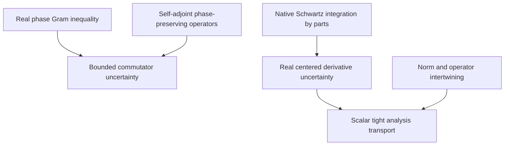

# Real Clifford uncertainty: analytic scope and theorem contract

## Purpose and source provenance

This development supplies a real Hilbert-space uncertainty API for the
Clifford-wavelet program. It preserves the distinction between the positive
Hilbert product, the indefinite Krein form, and the internal real phase.

The three real algebraic owners are restored unchanged from
[PR #372](https://github.com/nickgou-nuke/info-geometry-lean/pull/372),
commit `fd4a9f929a99b17adaeb6f8a3d2aa78141285324`:

- `Krein/InternalPhaseGram.lean`;
- `Krein/PhaseLinearObservableCommutator.lean`;
- `Canonical/PhaseObservableUncertainty.lean`.

The real position/derivative argument is recovered from the real section of
`Analysis/SchwartzUncertainty.lean` in
[PR #376](https://github.com/nickgou-nuke/info-geometry-lean/pull/376),
commit `b7dd98aec7549c9a83e20faa9bbe43e6b49afd49`.
Its new owner imports native Mathlib analysis directly. The centered skew-phase
extension and analysis-map transport are additional results.

The motivating reference is Eckhard Hitzer,
[Clifford (Geometric) Algebra Wavelet Transform](https://arxiv.org/abs/1306.1620).
Its scalar-admissibility equation (66) uses an unnormalized right-sided
Fourier transform and prints the coefficient `n Cψ (2π)^n / 4`.
The results below use explicitly stated real operator and L2 conventions.

## Algebraic contract

The carrier is `DoubledSpace E`, a positive real Hilbert space. Its existing
real operator `complex_i` acts by `(x, y) ↦ (-y, x)`; the identifier does
not denote a complex scalar.

The restored Gram owner proves

\[
\langle u,v\rangle^2+\langle Ku,v\rangle^2
\leq \|u\|^2\|v\|^2.
\]

For bounded self-adjoint real observables A and B commuting with K, the
commutator owner proves, for arbitrary real shifts a and b,

\[
2\langle K(A-a)f,(B-b)f\rangle
=\langle Kf,(AB-BA)f\rangle.
\]

The uncertainty owner combines these identities into the covariance-inclusive
Robertson-Schrödinger bound. Unit normalization is required only for the
separate second-moment interpretation of a centered squared norm as variance.
No canonical commutation relation, physical action scale, or indefinite
probability product is assumed.

## Real Schwartz analysis

Owner: `Analysis/RealSchwartzUncertainty.lean`.

The signal is `f : SchwartzMap ℝ H`, where H has a positive real inner
product. The actual operators on this common domain are:

- `SchwartzMap.smulLeftCLM H (fun x => x - a)`: centered position;
- `SchwartzMap.derivCLM ℝ H`: differentiation;
- `SchwartzMap.postcompCLM K`: pointwise lift of a real continuous linear
  coefficient operator K.

The product rule and native Schwartz integration by parts establish

\[
\langle (x-a)f,f'\rangle_{L^2}=-\tfrac12\|f\|_{L^2}^2.
\]

For skew K, pointwise skewness gives
\(\langle(x-a)f,Kf\rangle_{L^2}=0\). Therefore, for every real beta,

\[
\|f\|_{L^2}^2
\leq 2\|(x-a)f\|_{L^2}\|f'-\beta Kf\|_{L^2}.
\]

The squared form is also proved. The exact pairing is derived by integration;
it is not supplied as a hypothesis. Position and differentiation are operators
on Schwartz space; no boundedness claim about them on all of L2 is made.
Identifying the shifted derivative with centered momentum additionally requires
an isometric phase with K squared equal to minus the identity and an explicit
momentum scale.

## Conditional analysis-map transport

Owner: `Analysis/RealWaveletUncertaintyTransport.lean`.

The theorem accepts an actual real linear map

\[
W:\mathcal S(\mathbb R,H)\longrightarrow\mathcal S(\mathbb R,G),
\]

a positive scalar C, scalar tightness
\(\|Wf\|_2^2=C\|f\|_2^2\), and differentiation covariance
\(D(Wf)=W(Df)\). It proves

\[
C\|f\|_2^4\leq4\|(x-a)Wf\|_2^2\|Df\|_2^2.
\]

The centered theorem additionally takes coefficient phase operators KH and KG,
skewness of KG, and actual pointwise phase intertwining
\(K_G(Wf)=W(K_Hf)\). Its conclusion replaces Df by
\(Df-\beta K_Hf\).

These hypotheses express norm preservation and operator intertwining, rather
than an uncertainty inequality. The identity analysis map with C equal to one
is a concrete consistent instance, included as a non-exported example.

## Remaining analytic scope

This PR does not construct the all-scale Clifford integral transform over
SIM(n), its Haar measure, or its admissibility integral. In particular, it
does not infer Schwartz coefficient profiles from Schwartz input alone.
The all-scale transform may have slower translation tails.

To instantiate the transport theorem for a specific wavelet, supply its actual
analysis map and prove the required codomain regularity, scalar tightness,
derivative covariance, and phase intertwining. Alternatively extend the
integration-by-parts theorem to the appropriate weak-derivative and
finite-moment domain. A multivector admissibility constant cannot be substituted
for the positive real C without an additional reduction theorem.

The centered transport currently uses phase-preserving intertwining. The
phase-reversing parity variant, Fourier spectral identification, full
coefficient covariance refinement, and higher-dimensional summed-moment
specializations remain separate extensions.

## Proof dependencies

## Verification

Local focused verification passed on 2026-11-26 with Lean 4.34.1 and the
unchanged Mathlib pin. The exact source closure contains 13 repository modules;
the five selected owners contain 58 audited declarations. All five selected
owners compiled with zero warnings. The native audit found only propext,
Classical.choice and Quot.sound. Placeholder and semantic-vacuity checks found
zero issues. Source hashes and the explicit acceptance boundary are recorded in
[`artifacts/qms/real-wavelet-uncertainty-2026-11-26.json`](../artifacts/qms/real-wavelet-uncertainty-2026-11-26.json).

The five owners are exported transitively by two added imports in
`InfoGeometry.All`. The broad umbrella itself is outside the focused build.

The dedicated `real-wavelet-uncertainty.yml` workflow preserves the repository's
Lean and Mathlib pins. It uses the maintained
`tools/quality/check_clifford_dirac.py` verifier with all five owners as
explicit targets. This compiles their exact repository source closure under
the shared build lock and audits every declaration owned by the selected
modules.

The workflow also requires zero compiler warnings for each target, performs
placeholder and semantic-vacuity checks, and uploads the compiler logs,
generated native axiom audit, source hashes and verification report. Only the
foundational axioms propext, Classical.choice and Quot.sound are permitted.
PR cache access is restore-only.

This is focused source-closure verification. It is not a claim that every
tracked repository module or the full root Lake workspace has been built.
