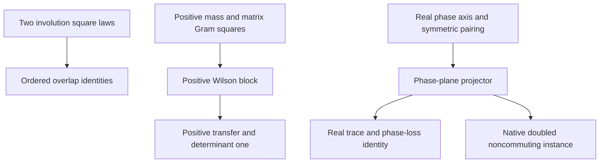

# Real overlap operators, transfer positivity, and phase rays

## Intake and scope

This contract records the translation of the user-supplied overlap-vacua note
into native Lean 4/mathlib statements. The original text is preserved byte for
byte at `intake/real-overlap-20261117/overlap-vacua-raw.txt`, with its original
filename, byte count, base revision, and SHA-256 in the adjacent manifest.

The development base is `08c34e03f610b452e03422037949196dc7d92d6d` in
`nickgou-nuke/info-geometry-lean`. The branch is independent of the BKM and
Krein-twin drafts. The separate Yang--Mills submission snapshot is unchanged.
Pinned Lean is `v4.34.1`; pinned Mathlib is
`d13f23b723b8a846827a245b89c10fc7d3f11612`.

**Status at source checkpoint:** complete proof candidates, independently
reviewed at their stated types; native compilation and all-declaration axiom
acceptance pending. The execution record is `REAL_OVERLAP_VALIDATION.md`.
Neither prose review nor a clean placeholder scan grants kernel acceptance.

The useful recurring structures in the note are an ordered block congruence,
an ordered product of two involutions, a phase-invariant projection, a pair of
real overlap coordinates, and the loss of phase when those coordinates are
replaced by their squared radius. Each has an actual carrier and theorem below.
The note's proposed total causal order, terminal physical theory, and anomaly
classification are not assumed.

## Existing owners inspected and reused

Search covered tracked `lean/` and `src/` paths at the base revision, including
owners not materialized in the sparse checkout. Searches included Narayanan,
Neuberger, overlap, Ginsparg--Wilson, transfer matrix, Wilson block, Schur,
involution, signum, Fock, Slater, ray, projector trace, Berry, and determinant
line, followed by actual declarations, imports, and relevant consumers.
This was a source search, not a fresh compiler-derived graph or Arango export.

| Owner | Actual surface | Reuse or boundary |
|---|---|---|
| `Algebra.BlockSchurFactorization` | Ordered block factorization over arbitrary coefficient rings; ordinary determinants only for commutative coefficients | Existing general Schur owner retained. The new positive congruence is a different finite real matrix statement, using native block operations rather than duplicating a generic Schur API. |
| `OperatorAlgebra.ChiralProjectorFromInvolution` | `ChiralInvolution`, its square law, and `Pleft`/`Pright` | Reused directly for the overlap chiral intertwiners. |
| `Krein.TomitaMatrixAtom` | Full real `M₂`, concrete diagonal `eps` and swapping `J`, both involutions | Reused for a closed noncommuting overlap witness. This `J` squares to `+1` and is distinct from the phase operator in the ray owner. |
| `Canonical.RealMirrorComplexStructure` | `IsRealComplexStructure` and `realComplexScalarAction` | Reused for the internal real phase axis and algebraic phase rotations. |
| `Canonical.RealComplexRotor` | `realRotorAction` | Reused for trigonometric phase invariance. |
| `Krein.DoubledSpace` | Actual doubled real carrier, `clockAxis`, and positive `doubledHilbertBilin` | Reused for the four-dimensional phase-projector instance. |
| `Core.PeirceCompressionDefect` | Two-idempotent compression and Davis/chordal identities | Related algebra; does not provide the new Ginsparg--Wilson residual. |
| `Quantum.InvolutionCore` | Endomorphism square laws and additional commuting/anticommuting hypotheses | Does not replace the arbitrary noncommuting overlap pair. |
| `NoncommutativeModularSignum` | Explicit two-point sign model | Does not construct the spectral sign of a general gapped Wilson Hamiltonian. |
| `Projective.Rays` | Quotient by real nonzero scalar multiplication, retaining a zero class | Does not supply a normalized internal-real phase ray. |
| `Projective.ProjectionIncidence`, `ProjectionMatrixGeometry` | Complex-carrier ray/projector constructions | Kept distinct from the requested real carrier and its trace normalization. |
| `Canonical.ZornPolarKetBra`, `Analysis.RankOneTrace` | Carrier-specific dyads and real rank-one trace | Useful neighboring constructions; neither is the phase-plane projector bridge. |
| `Clifford.FockSpaceCAR`, `FiniteRealFockMetric`, `FiniteRealFockAdjoint` | Actual exterior/CAR space, finite metric, and adjoint relation | No actual Slater-overlap determinant theorem was located in the documented search. No Fock determinant theorem is claimed here. |
| `Analysis.LieExponentialTraceDeterminant` | Determinant of an actual real matrix exponential | Does not construct a self-adjoint logarithm of the new transfer matrix. |
| `Quantum.TransferMatrixIntegrability`, `Canonical.TransferMatrixIntegrabilityCapstone` | Scalar phase models | Do not supply positivity of the full ordered block transfer operator. |

## A. Ordered involution pair

Owner: `lean/InfoGeometry/Algebra/OverlapInvolutionPair.lean`.

The core carrier is an arbitrary associative `Ring A`, without commutativity.
For supplied elements `gamma` and `epsilon`, define

\[
V=\gamma\epsilon,\qquad D=1+V.
\]

With only `gamma * gamma = 1`, `ginspargWilson_residual` gives

\[
D\gamma D-(\gamma D+D\gamma)
 =\gamma(\epsilon^2-1).
\]

Thus, with the first square law fixed, `ginspargWilson_iff` proves the exact
equivalence between the Ginsparg--Wilson equation and the second square law.
The converse uses the actual inverse `gamma`; it requires neither a domain nor
cancellation for arbitrary ring elements. The theorem includes zero modes of
`D`, with no inverse of `D` anywhere in its type.

With both involution laws, `gamma_mul_dirac_eq_dirac_mul_epsilon` proves
`gamma * D = D * epsilon`. With `StarRing A` and native `IsSelfAdjoint`
hypotheses on the two signs, the owner constructs an element of Mathlib's
native unitary group and derives

\[
D^*=\gamma D\gamma,\qquad
D^*D=DD^*=D+D^*.
\]

`dirac_isStarNormal` packages actual native normality. Self-adjointness is
strictly stronger: `dirac_isSelfAdjoint_iff_commute` proves that it is equivalent
to commutation of the supplied signs. The concrete real matrix pair reuses
the native `eps` and `J` from `TomitaMatrixAtom`; the products differ, so its
overlap operator is normal and not self-adjoint.

Over an algebra over `ℝ`, the existing half-projectors satisfy
`gamma.Pleft * D = D * epsilon.Pleft` and the analogous right identity.
The physical modified chirality has a sign:

\[
\widehat\gamma=\gamma(1-D)=-\epsilon.
\]

Consequently the positive projector of `epsilon` is the negative projector of
the modified chirality. The code does not identify these signs incorrectly.
The coefficient-one normalization agrees with the polynomial relation in [2].

**Unconstructed input:** no function `epsilon = sign(H)` of a Hamiltonian is
constructed. A supplied involution is not a proof of spectral calculus,
uniform gap, locality, gauge covariance, or lattice index properties.

## B. Positive full transfer matrix

Owner: `lean/InfoGeometry/Canonical/RealDomainWallTransfer.lean`.

The carrier is `Matrix (n ⊕ n) (n ⊕ n) ℝ`, for arbitrary finite `n`.
`B` and `C` are unrestricted real square matrices until positivity is invoked.
Conjugate transpose over this coefficient field is ordinary transpose.

\[
T(B,C)=
\begin{pmatrix}
B^{-1}&B^{-1}C\\
C^{\mathsf T}B^{-1}&C^{\mathsf T}B^{-1}C+B
\end{pmatrix},\qquad
U(C)=\begin{pmatrix}I&C\\0&I\end{pmatrix}.
\]

`transfer_eq_congruence` proves the exact ordered identity

\[
T=U^{\mathsf T}\operatorname{diag}(B^{-1},B)U.
\]

No proof step moves `C` through `B` or `B⁻¹`. The native matrix inverse is
total; the displayed factorization itself does not need its inverse law.
`B.PosDef` supplies genuine invertibility and positive definiteness of its
inverse when those facts are needed. `upperShear_mul_neg` and
`upperShear_neg_mul` exhibit an actual two-sided shear inverse. Strict
positivity of the block diagonal matrix is proved from its quadratic form.
Native congruence positivity and determinant multiplicativity then give

\[
B>0\implies T>0\quad\text{and}\quad\det T=1.
\]

The explicit pair `B = diag(2,3)` and the swapping matrix `C` does not commute,
and satisfies both conclusions. It witnesses the general theorem's genuine
operator scope; it does not restrict that theorem to diagonal inputs.

The Wilson construction uses a finite family of actual link matrices:

\[
W(c,U)=cI+\frac12\sum_i(I-U_i)^{\mathsf T}(I-U_i).
\]

The Gram sum is positive semidefinite for every family. Positive `c` gives
strict positivity of `W`. For each vector, the owner proves the lower bound

\[
x^{\mathsf T}W(c,U)x\ge c\,x^{\mathsf T}x.
\]

If `Uᵢᵀ Uᵢ = I`, `wilsonBlock_eq_hopping` identifies this construction with

\[
W(c,U)=(c+\#\iota)I-\frac12\sum_i(U_i+U_i^{\mathsf T}).
\]

This makes the relevant positivity assumption constructive at the finite
operator level. With four directions and `c = 1 ∓ m`, the coefficient becomes
`5 ∓ m`; positive mass parameters must be checked on their chosen side.
The block convention is the real-adjoint form of [1, equation (2.14)].

**Boundary:** a positive matrix admits further analytic constructions, but no
self-adjoint logarithm is constructed in this owner. In particular, it does
not infer a chosen Hamiltonian, its spectral sign, a ground-state projection,
or an infinite transfer-product limit from determinant one alone.

## C. Internal real phase and its projector

Owner: `lean/InfoGeometry/Canonical/RealPhaseRayProjector.lean`.

The carrier is a real vector space `V`, with a native symmetric bilinear form
`B` and a real endomorphism `J`. The precise hypotheses are

\[
J^2=-I,\qquad B(Jx,y)=-B(x,Jy),\qquad B(u,u)=1.
\]

Global positive definiteness of `B` is not assumed. These hypotheses make the
selected pair `u, Ju` orthonormal and span a positive real two-plane. Define

\[
Q_u(x)=B(u,x)u+B(Ju,x)Ju,
\qquad z(u,v)=(B(u,v),B(Ju,v))\in\mathbb R^2.
\]

The dyads use native `LinearMap.smulRight`. The owner proves actual
idempotence, the native bilinear adjoint-pair equation, commutation with `J`,
range exactly `span ℝ {u, Ju}`, and kernel exactly the simultaneous vanishing
of both pairings. Its quadratic readback is the sum of the two squares.

For the existing real scalar action `u ↦ a u + b Ju`, the full operator identity is

\[
Q_{au+bJu}=(a^2+b^2)Q_u.
\]

Thus unit phase rotations and the existing trigonometric rotor leave the
projector invariant. Both left and right overlap-pair transformation laws are
proved, with opposite relative phase signs.

In finite real dimension the trace is the native endomorphism trace:

\[
\operatorname{tr}_{\mathbb R}Q_u=2B(u,u),\qquad
\operatorname{tr}_{\mathbb R}(Q_uQ_v)
 =2\bigl(B(u,v)^2+B(Ju,v)^2\bigr).
\]

The factor **two** is mandatory: the projector onto one internal phase ray
has real rank two. A real rank-one dyad or a quotient by `ℝˣ` is a different
object. This trace identity does not require normalization of either vector;
normalization is needed for the projector interpretation.

The phase-loss witness is explicit: `Q_(Ju) = Q_u`, but `z(u,u) = (1,0)` and
`z(u,Ju) = (0,1)`, with `Ju ≠ u`. A projector or squared radius therefore cannot
recover the original phase coordinate. No topological obstruction is needed
for this pointwise statement.

### Native doubled instance

Owner: `lean/InfoGeometry/Canonical/RealPhaseRayProjectorDoubled.lean`.

The adapter reuses `DoubledSpace E`, its `clockAxis`, and its positive observer
pairing. On `E = EuclideanSpace ℝ (Fin 2)`, the complete real carrier has
dimension four. For `u = (e₀,0)` and `v = ((3/5)e₀+(4/5)e₁,0)`, the two
normalized phase projectors are distinct and do not commute. Their real trace
pairing is exactly `18/25`.

The observer pairing and the native indefinite Krein pairing are distinct.
This clock is skew for the positive observer pairing used here. For the
native Krein pairing it is self-adjoint and anti-isometric, so that particular
clock/Krein pair does not satisfy the generic skew hypothesis. The generic
theorem still permits an indefinite `B` whenever its actual hypotheses hold.

## Dependency order actually implemented

The three main branches are independent. The doubled adapter depends on the
generic phase owner. There is no formalized arrow from transfer positivity to
the supplied sign involution or from a phase-plane projector to an anomaly.

## Corrections and open implications from the input

The following conclusions are not silently promoted into assumptions or
theorem names. They are a claim audit, separate from the native proof status.

| Input claim or ambiguity | Correct boundary |
|---|---|
| An ordinary determinant for a rectangular chiral map | Ordinary scalar determinant requires a square endomorphism. A determinant line requires its own construction. Different named source/target representations do not by themselves mean unequal finite dimensions. |
| Squared Fock overlap equals a compressed projector determinant in arbitrary ranks | The usual Slater determinant formula requires equal particle number and a square overlap matrix. Unequal particle-number sectors are orthogonal, while the compression determinant can be nonzero for unequal occupied ranks. |
| A real ray has rank-one projector and trace equal to overlap modulus squared | With an internal real phase axis, the phase-invariant projector has real rank two and the trace factor above is two. |
| Taking a modulus alone proves parity restoration | It loses phase algebraically. A physical wall/antiwall interpretation needs the actual boundary-condition construction, as in [1]. |
| Two singular eigenvector charts prove no global smooth frame exists | Failure of those charts does not exclude every frame. A bundle invariant or transition/holonomy argument must be supplied. |
| Every projector pair has nonzero Berry curvature | Curvature requires a differentiable family and connection. Constant families provide an immediate counterexample to universal nonzero curvature. |
| A normalized overlap tangent split proves the Bardeen--Zumino polynomial | The split is a local kinematic identity at nonzero overlap. Field-theoretic current identification, locality, representation, dimension, and normalization remain additional work. |
| The two-dimensional anomaly coefficient is an exact unrestricted identity | [1, equations (3.67)--(3.73)] uses a specified perturbative computation and large-mass limit. It is not an all-groups, all-orders theorem here. |
| A closed `d log` form supplies a global single-valued action | `dz/z` is defined on the nonzero locus; it can have periods. A local logarithm and global exactness are different claims. |
| Nonzero Berry curvature implies no smooth nonvanishing section | Curvature of a chosen connection and topological nontriviality are distinct. Trivial bundles may carry curved connections. Flat bundles may have nontrivial holonomy. |
| Gap nonvanishing is the same as local plaquette admissibility | A pointwise gap condition is not the usual local gauge-field smoothness bound, and does not supply uniform locality estimates. See [3]. |
| Gap components are classified exactly by every integer index | Local constancy of an index does not prove that it separates components or realizes every integer. Finite dimension imposes range bounds. |
| Configuration space is connected for every gauge group | The product argument requires a connected gauge group; disconnected groups require separate analysis. |
| Gap walls and overlap zeros always have codimensions one and two | These dimension statements require suitable smoothness and transversality hypotheses. |
| Finite mass signatures alone prove an infinite Fredholm index | Infinite-dimensional Fredholm operators need domains, closedness and Fredholm hypotheses. For a finite square map the kernel/cokernel index is zero. |
| Matching insertion count makes a charged correlator nonzero | Matching count can be necessary, but matrix elements may still vanish. |
| The defect `-m²/(p²+m²)` disappears at fixed momentum as mass grows | It tends to `-1`. Already at `p=0`, it equals `-1` for every nonzero mass. The claimed decay is reversed. |
| Subtraction ambiguity and phase ambiguity were established as exactly equivalent | [1] motivates the relation but explicitly leaves that correspondence untraced. It is not imported as a theorem. |
| Anomaly cancellation automatically constructs a nonperturbative local measure for every compact group | [4] proves a nonperturbative abelian result; [5] proves an all-orders perturbative result for compact groups. Neither licenses the unrestricted claim in this intake. |
| A terminal join in an imposed poset proves physical uniqueness | It is an order-theoretic construction until actual carriers, maps, universality and analytic compatibility are constructed. |

Free-field eigenvector sign conventions also need to be derived from the actual
transfer matrix before importing formulas. This task does not port the note's
free-field spinor chart equations, its continuum defect formula, or a chosen
sign between transfer and physical Hamiltonians into unchecked Lean assumptions.

## Remaining mathematical work

1. Construct the required spectral sign from an actual self-adjoint gapped
   Hamiltonian, and prove its square and adjoint laws.
2. Construct the self-adjoint logarithm and normalized transfer-power limit
   with the needed spectral hypotheses and convergence topology.
3. Prove the equal-rank Slater overlap determinant in the existing finite real
   exterior/Fock carrier, including phase conventions.
4. Build the differentiable occupied-subspace and determinant-line family,
   then its connection, curvature, transition and holonomy laws.
5. Establish locality with uniform lattice hypotheses, and state separately
   the finite, thermodynamic, continuum and regulator limits.
6. Derive consistent/covariant current formulas and anomaly coefficients for
   a specified dimension, representation, action and regulator.

These are open implications, not omitted proofs inside the promoted sources.
No custom axioms, proof holes, conclusion-as-hypothesis wrappers, new dependency
pins, gate changes, or external scalar imaginary unit are introduced.

## Primary references checked

1. R. Narayanan and H. Neuberger, *Chiral Determinant as an Overlap of Two Vacua*,
   [hep-lat/9307006](https://arxiv.org/abs/hep-lat/9307006), especially sections
   2.2--2.5 and 3.6--3.7. Literature is contextual evidence, not Lean acceptance.
2. H. Neuberger, *More about exactly massless quarks on the lattice*,
   [hep-lat/9801031](https://arxiv.org/abs/hep-lat/9801031).
3. P. Hernández, K. Jansen and M. Lüscher, *Locality properties of Neuberger's
   lattice Dirac operator*, [hep-lat/9808010](https://arxiv.org/abs/hep-lat/9808010).
4. M. Lüscher, *Abelian chiral gauge theories on the lattice with exact gauge
   invariance*, [hep-lat/9811032](https://arxiv.org/abs/hep-lat/9811032).
5. M. Lüscher, *Lattice regularization of chiral gauge theories to all orders
   of perturbation theory*, [hep-lat/0006014](https://arxiv.org/abs/hep-lat/0006014).
