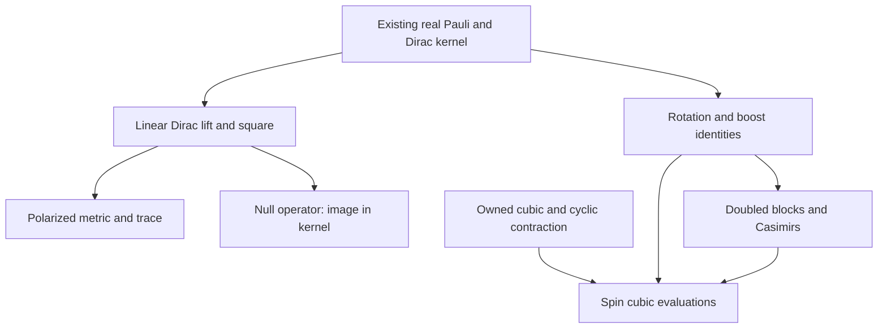

# Real spacetime, Dirac operators, and associative cubic contractions

**Status: Dirac and Nambu compilation passed; doubled repair and audits pending.**
The six Nambu and 27 Dirac public theorem declarations compiled successfully
at the hashes recorded below. The first doubled-module check reported proof
normalization and name-resolution errors. Its reviewed repair preserves all
21 public and three private theorem statements and still requires compilation.
The native declaration audit for this three-module extension has not run.
The earlier 52 named theorems have separate, completed exact-source validation.

## Input and scope

This continuation of PR #429 uses the attachment
`Pasted text(20261123-103149).txt`, SHA-256
`f5c622edd48076dcd82520cccfaaf6d6fee048a99ddb5b5195624fa5bd58eb9c`.
Its four Lean fences were preserved separately. The revised complete block
(attachment lines 517–925) has SHA-256
`ed5e8b4a74e5e7e66e3788ba5774210ec3f42a4daf3b4db1897313c64d6bd948`.
That block failed its single as-provided Lean check with eleven errors:
four pointwise-subtraction normalization failures, four heartbeat failures,
two unresolved block-splitting calculations, and one additive-reordering
failure. This diagnostic is separate from acceptance of the new source.

The implementation starts from the three existing PR owners, whose checked
source bytes remain unchanged: `RealPauliPfaffianKernel`,
`RealSpinorGramBridge`, and `FrameMetricDeterminant`. The local parent is
`b7c8c32d5310b8b61b04db445d9ceb9ae2a78d7c`; its published counterpart is
`5c204d9eb0fc2d7926bde316f97f7750582f512a`. Their identical tree is
`844300da41bfdbbfc0ae7f2480cb5838e4b527cb`.

The target is finite real matrix algebra and generic associative ring
identities. The following distinctions are part of the mathematical contract.

| Input claim | Exact disposition |
| --- | --- |
| A four-vector is a faithful Dirac matrix | Construct a native real `LinearMap` from `Fin 4 → ℝ` to real `4 × 4` matrices and prove injectivity. |
| The Jordan product gives the spacetime metric | Prove the polarized identity with the sign fixed by the existing Clifford square. |
| Null vectors produce isotropic operators | Prove square-zero and `range ≤ ker` for the actual spinor endomorphism; no unspecified spinor pairing is introduced. |
| Two chiral spin triples split the Lorentz algebra | Prove the displayed doubled block identities and bracket laws; a real Lie-algebra splitting is not among the conclusions. |
| The second doubled Casimir is positive `3/4` times the phase and cut | Correct its coefficient to negative `3/4` under the displayed generator conventions. |
| The alternating cubic contracts to spin | Reuse the existing associative alternator and derive the quadratic expression from explicit cyclic commutator relations. |
| Square-zero generates an isotropic right ideal | Give a real `2 × 2` trace-pairing counterexample; prove zero pairwise products on the smaller sandwich range and existing directed Peirce corner. |
| These finite blocks construct spacetime supersymmetry or a vacuum deformation | Keep these interpretations open; neither a physical translation action nor a differentiable vacuum field is constructed. |

## Reused source owners

The source search was bounded to relevant declarations, imports, instances,
and consumers in `lean/InfoGeometry` and pinned Mathlib. It does not assert a
fresh declaration-graph index or a classification of every repository file.

| Owner | Reused mathematical content |
| --- | --- |
| `Canonical.RealPauliPfaffianKernel` | The real Pauli matrix, signed Pfaffian, circular basis, real Dirac vector, its square and determinant, and Clifford-volume phase. |
| `Physics.LorentzBoostMinkowski` | `FourVector` and the existing `(+---)` Minkowski pairing, reached through an explicit coordinate adapter. |
| `Algebra.NoncommutativeZornNambuAssociator` | `Vec3`, `comm`, `nambu`, its six-term expansion and cyclic-commutator form over an arbitrary associative `Ring`. The coefficient ring is used here, not the separate nonassociative `ZornNC` carrier. |
| `Core.PeirceDecomposition` | Existing `peirce10` membership and zero-product routing for `p A (1-p)` when `p*p=p`. |
| `OperatorAlgebra.LieJordanBoundaryComposition` | Existing native `sandwichOp R a b : Module.End R A`, with value `a*x*b`. |
| Native Mathlib | `LinearMap`, `Module.End`, `Matrix.toLin'`, `LinearMap.range`, `LinearMap.ker`, the three-dimensional cross product, matrix blocks, trace, and finite sums. |

Related owner/consumer review included the complex four-vector Dirac
readout, universal Clifford Lorentz action, integer-coordinate Tetractys
Dirac formulas, complex chiral Casimirs, weighted Zorn spin contractions,
the native matrix Peirce ranges, and Lie/Jordan boundary dynamics. These
have distinct carriers or conventions. The additions connect the existing
real Pauli/Dirac endpoint without a second gamma-matrix family.

The repository already owns the inner commutator action as
`LieJordan.lieOp`; the theorem `LieJordan.lieOp_mul` in the
`PeirceBoundaryDynamics` module proves its ordered Leibniz identity.
Native `LinearMap.mulLeft` supports the regular right
module through opposite-ring scalars. These operators are reused as the
appropriate interfaces; no second unbundled `nambuDeriv` is introduced.

## The real Dirac and metric contracts

Write

$$
q(v)=t^2-x^2-y^2-z^2,\qquad
\eta(u,v)=u_0v_0-u_1v_1-u_2v_2-u_3v_3.
$$

The existing real phase is denoted by $\Omega$, with $\Omega^2=-I_4$.
The new lift packages the existing matrix $D(v)$ as a native real linear
map. Its exact identities are

$$
D(v)^2=-q(v)I_4,\qquad
D(u)D(v)+D(v)D(u)=-2\eta(u,v)I_4,
$$

$$
\operatorname{tr}(D(u)D(v))=-4\eta(u,v).
$$

The square identity is reused. Polarization follows from that identity and
linearity; the trace formula follows from polarization and cyclicity of
matrix trace. Four displayed entries establish injectivity. Thus the
null-or-zero condition is exactly square-zero of the Dirac matrix. Applying
`Matrix.toLin'` gives the precise operator conclusion

$$
q(v)=0\;\Longrightarrow\;
\operatorname{range}D(v)\subseteq\ker D(v).
$$

The domain four-vector and the spinor coordinate space both have real
dimension four here. Their roles are specified by the maps; equality of
their coordinate dimensions is not a physical identification.

This extends, rather than replaces, the earlier determinant distinctions:

$$
\operatorname{pf}(\Omega X(v))=q(v),\qquad
\det X(v)=\det D(v)=q(v)^2.
$$

The signed Pfaffian retains the causal sign. An arbitrary real `4 × 4`
determinant of these representatives does not. The special spinor column
matrix $W$ already constructed in `RealSpinorGramBridge` satisfies
$\det W=q(p(u)+p(v))\geq0$ because of its particular Gram factorization.
That result is restricted to the produced momenta.

## Lorentz generators and doubled blocks

For spatial coordinates $a\in\mathbb R^3$, let

$$
J(a)=-\tfrac12\Omega X(0,a),\qquad
K(a)=\tfrac12 X(0,a).
$$

The source proves skew-symmetry of $J$, symmetry of $K$, and all three
bracket laws using the native cross product:

$$
[J(a),J(b)]=J(a\times b),\quad
[J(a),K(b)]=K(a\times b),\quad
[K(a),K(b)]=-J(a\times b).
$$

For the three coordinate axes, the quadratic readouts are

$$
\sum_iJ_i^2=-\tfrac34 I_4,\quad
\sum_iK_i^2=\tfrac34 I_4,\quad
\sum_i(J_i^2-K_i^2)=-\tfrac32 I_4,\quad
\sum_iJ_iK_i=-\tfrac34\Omega.
$$

The rotational minus sign comes from the real skew-symmetric convention.
Replacing these by Hermitian complex generators would change that convention.
These Casimirs are quadratic readouts of the rotation/boost representation;
the momentum interval belongs to the separate four-vector quadratic form.

On the native block index `Fin 4 ⊕ Fin 4`, use

$$
\Gamma=\operatorname{diag}(I_4,-I_4),\quad
I_c=\operatorname{diag}(\Omega,\Omega),\quad
J_{\mathrm{tot}}=\operatorname{diag}(J,J),\quad
K_{\mathrm{tot}}=\operatorname{diag}(K,-K).
$$

The combinations $A=(J_{\mathrm{tot}}+I_cK_{\mathrm{tot}})/2$ and
$B=(J_{\mathrm{tot}}-I_cK_{\mathrm{tot}})/2$ are exactly
$\operatorname{diag}(0,J)$ and $\operatorname{diag}(J,0)$. Their cross-sector
products vanish, and the block-swap involution exchanges them. If
$P_-=\operatorname{diag}(0,I_4)$ and $P_+=\operatorname{diag}(I_4,0)$,
then their Casimirs are $-3P_-/4$ and $-3P_+/4$.

The doubled mixed readout has the corrected sign:

$$
\sum_iJ_{\mathrm{tot},i}K_{\mathrm{tot},i}
=-\tfrac34\Gamma I_c.
$$

These are two commuting block rotation triples in real `8 × 8` matrices.
No theorem identifies their real span with the real Lorentz algebra.
Complexification and its reality condition are additional structure; see
David Tong, [The Supersymmetry Algebra, section 2.1](https://davidtong.org/pdfs/teaching/supersymmetric-field-theory/susy2.pdf),
especially printed page 12. The displayed real phase has square minus one;
it is distinct from the doubled cut $\Gamma$, whose square is plus one.

## Associative alternation and the correct zero-product spaces

The owned operation is the associative six-term alternator

$$
T(a,b,c)=abc+bca+cab-acb-bac-cba.
$$

Two input swaps reverse its sign. Under the explicit cyclic relations
$[a,b]=c$, $[b,c]=a$, and $[c,a]=b$, its existing commutator expansion gives

$$
T(a,b,c)=a^2+b^2+c^2.
$$

This conditional contraction can be specialized to the constructed rotation
triples. It does not supply a Filippov fundamental identity or a
Nambu–Poisson structure.

For an idempotent $p$, the existing directed Peirce corner
$pA(1-p)$ has zero pairwise products. The new theorem derives the vanishing
of $T$ there from those owned routing laws. For $N^2=0$, the native submodule
`LinearMap.range (sandwichOp R N N)` also has zero pairwise products:

$$
(NaN)(NbN)=Na(N^2)bN=0.
$$

The larger right ideal $NA$ does not have this property. The formal real
`2 × 2` counterexample takes $N=E_{01}$ and $M=E_{10}$:

$$
N^2=0,\quad NM\ne MN,\quad NM=E_{00},\quad
\operatorname{tr}((NM)^2)=1.
$$

Thus even the explicitly specified trace pairing $(X,Y)\mapsto
\operatorname{tr}(XY)$ need not vanish on $NA$. A claim about a spinor
bilinear form would require that separate form and its compatibility laws.

## Frame volume remains a separate contract

The earlier frame module proves

$$
\det(E^TGE)=\det(E)^2\det G.
$$

This relates a frame determinant to its induced volume density. It does
not equate a general Jacobian determinant with $q(v)$. The block formula
for $\operatorname{diag}(-h^2,H)$ gives the longitudinal magnitude $|h|$
after taking the square root of the absolute determinant and imposing
$\det H=1$. It assumes orthogonality of that block decomposition. For a
four-dimensional tube, the transverse section is three-dimensional.
No differentiable vacuum-frame field, path-independent distance, or
spacetime translation representation is supplied by these finite identities.

## Proof dependencies

The arrows below record actual mathematical inputs to the new proofs.
They do not assert physical causal evolution or identify a conceptual analogy
with a map.



The frame determinant identities are an independent branch. Likewise, the
Peirce and sandwich zero-product results use their explicit idempotent or
square-zero hypotheses; they do not follow from a physical interpretation of
the spin blocks. The real `2 × 2` right-ideal counterexample is an independent
finite matrix witness.

## Acceptance record

The three new owners contain **54 public theorem declarations and three
private helper lemmas**. Their source and semantic reviews are complete.
The staged proof gate passed for the first Dirac/Nambu repair; the latest
doubled proof repair has a separate pending build/audit record.

The first canonical build found redundant `dsimp` steps in the two cubic
swap proofs, finite-index normalization gaps in injectivity, an explicit
linear-map application reduction needed in the square proof, and missing
`Pi.single_apply` reductions in the axis products. The repaired source
preserves every theorem statement. It also removes the compiler-reported
unused tactic arguments. No heartbeat settings or proof assumptions changed.

The repaired build completed on 2026-11-23 with exit code 1. It successfully
built `AssociativeNambuPeirceBridge` (169 seconds) and
`RealDiracLorentzBridge` (1227 seconds), then reported errors in the doubled
module (1059 seconds). Its command was:

```bash
python3 verification/real-matrix-split/check.py build \
  InfoGeometry.Canonical.RealDoubledSpinCasimirBridge
```

This target includes both prerequisite modules. The doubled diagnostics were
four Sum-index identity normalization sites, two distributed scalar half-sums,
and six Nambu axis steps with ambiguous imported names and unresolved basis
normalization. The reviewed repair adds the missing identity-entry reduction,
closes the scalar identities, and transports the already compiled
`rotationAxis_commutators` through the explicit lower/upper block embeddings.
It preserves all statements, definitions, imports, and signs; it introduces
no new assumptions or heartbeat settings.

A rebuild of the repaired doubled module is required. A native audit of all
owned declarations, plus explicit `#print axioms` checks for all 54 public
theorems, is prepared but has not run. The successful prerequisite compilations
are recorded separately from completed audit acceptance of the extension.

| Owner | Current source SHA-256 | Observed status |
| --- | --- | --- |
| `Algebra.AssociativeNambuPeirceBridge` | `7b1c1c2ecf032791385b24404a49221fe231bddbb73fa9de131ab89f46d7b315` | Compilation passed; audit pending |
| `Canonical.RealDiracLorentzBridge` | `c657b2436de64be1a29d18898cd83c95968c95eec0d95ac11adc5a8be5648d4f` | Compilation passed; audit pending |
| `Canonical.RealDoubledSpinCasimirBridge` | `dff8e072983612e8d6adf70f5413f2b875c398055f28edf22ac85cdb3079602c` | Reviewed repair; rebuild and audit pending |

The original 52 named theorems retain their previous exact-source evidence.
The raw attachment failure and the new candidate diagnostics are separate
from those accepted owners.

The pinned environment is Lean 4.34.1 with Mathlib
`d13f23b723b8a846827a245b89c10fc7d3f11612`. Validation uses the maintained
`verification/real-matrix-split/check.py` lane and the shared build lock.
The root pre-push dependency-resolution failure remains separately
disclosed in the PR. Draft publication through the connected GitHub app,
including bypass of that failed local hook, was explicitly authorized.
