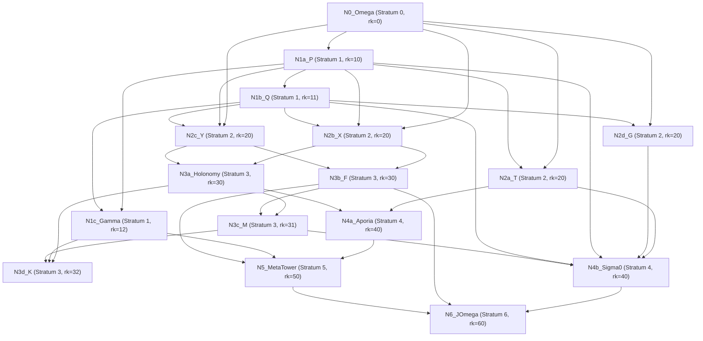

# Epistemic Compilation Ledger: Indefinite Reciprocal Totality, Socratic Aporia, and the 7-Stratum Causal Poset

Follows [`skills/epistemic-compilation/SKILL.md`](../skills/epistemic-compilation/SKILL.md),
[`docs/EPISTEMIC_COMPILER_FIELD_PROTOCOL.md`](EPISTEMIC_COMPILER_FIELD_PROTOCOL.md), and
[`docs/ALCHEMICAL_QMS_SOP.md`](ALCHEMICAL_QMS_SOP.md) to compile the `PHASE 0 — SOLVE` through
`PHASE V — COAGULA` specification (`Ax.1`–`Ax.4`, `Prop.1`–`Prop.6`, `Thm. Ω`, and the 7-stratum
acyclic causal poset `(𝒫, ≺)`), the parabolic/QGT and cross-spine extensions, and the three-regime / Klein-bottle / Apollonian synthesis into kernel-checked Lean 4 declarations across
[`lean/InfoGeometry/OperatorAlgebra/PeirceSpine/ReciprocalTotalityAporiaPoset.lean`](../lean/InfoGeometry/OperatorAlgebra/PeirceSpine/ReciprocalTotalityAporiaPoset.lean),
[`lean/InfoGeometry/OperatorAlgebra/PeirceSpine/ReciprocalTotalityCrossSpineSynthesis.lean`](../lean/InfoGeometry/OperatorAlgebra/PeirceSpine/ReciprocalTotalityCrossSpineSynthesis.lean), and
[`lean/InfoGeometry/OperatorAlgebra/PeirceSpine/ReciprocalTotalityThreeRegimeSynthesis.lean`](../lean/InfoGeometry/OperatorAlgebra/PeirceSpine/ReciprocalTotalityThreeRegimeSynthesis.lean).

---

## Source Provenance (Local Archived Intake)

- AI Studio transcript JSON: `cached/aistudio_prompt_1v8Jj30jF2ytMHunuZq_FXEBjWcNFyw0O.json` (Drive ID `1v8Jj30jF2ytMHunuZq_FXEBjWcNFyw0O`; `1,393,195` bytes, `5,977` lines, SHA-256 `8ac03ba57fcd4cb65fd6df0b5d47a2c460ce967e40be20989b8efee78a90c555`).
- Accompanying Drive attachment text: `cached/aistudio_attachment_13ED-2v91xEP9x9u84ihl07or3EchY1Pl.txt` (Drive ID `13ED-2v91xEP9x9u84ihl07or3EchY1Pl`; `36,955` bytes, `288` lines, SHA-256 `3e0658a30059abebe68372006d39c1d83601cb002458bbcea476a466df909fa0`).
- Deterministic extractor manifest (`tools/infra/extract_aistudio_math.py`): `cached/aistudio_extracts/aistudio_prompt_1v8Jj30jF2ytMHunuZq_FXEBjWcNFyw0O/manifest.json` (`turn_count: 45` with `15` user / `30` model turns; `transcript_characters: 372558`; `math_expression_count: 1887`; `fence_count: 1` as `"text": 1`; `tagged_lean_fences: 0`; `first_timestamp: "2026-11-18T18:35:19.992Z"`; `last_timestamp: "2026-11-18T22:47:27.873Z"`; `"authority": "transcript extraction only; no theorem or proof is promoted"`).

---

## Stage 1 (`SOLVE`) — Atomic Claim Ledger

| ID | Source Reference | Candidate Mathematical Statement | Carrier & Hypotheses | Kind | Status |
|---|---|---|---|---|---|
| `RT₁` | `PHASE V.1` | 16-node poset `ArchetypePosetNode` across strata `0..6` with `lexRank` strict monotonicity (`coverRel_lexRank_strict_mono`, `causalPrec_lexRank_lt`), irreflexivity (`causalPrec_irrefl`), asymmetry (`causalPrec_asymm`), and transitivity (`causalPrec_trans`) | `ArchetypePosetNode` (inductive `Type`), `Relation.TransGen` | theorem | `[kernel_verified]` (`BUCKET 1`) |
| `RT₂` | `PHASE I` / `Prop.1` | `Q := 1 - P` and `Γ := P - Q` satisfy `Q² = Q`, `PQ = QP = 0`, `P + Q = 1`, `Γ² = 1`, `ΓP = PΓ = P`, `ΓQ = QΓ = -Q`, `comm P Γ = 0` (`prop1_orthogonality_and_polarity_involution`); identified with `PeirceDecomposition.complementIdempotent`, `PeirceSpine.invS`, and `IdempotentCartan.reflection` | `[Ring E]`, `P : E`, `hP : P * P = P` | theorem | `[kernel_verified]` (`BUCKET 1`) |
| `RT₃` | `PHASE II` / `Prop.2` | `T + X + Y + G = Ω`, `comm P Ω = Y - X`, `comm P Ω ≠ 0 → X ≠ 0 ∨ Y ≠ 0`, `X² = 0`, `Y² = 0` (`prop2_fourfold_decomposition_and_nilpotency`) | `[Ring E]`, `P Ω : E`, `hP : P * P = P` | theorem | `[kernel_verified]` (`BUCKET 1`) |
| `RT₄` | `PHASE III` / `Prop.3` | `ΓF = [P, Ω]`, `FΓ = -[P, Ω]`, `[P, Ω] ≠ 0 → F ≠ 0`, `ΓF + FΓ = 0`, `F² = M`, `ΓM = MΓ`, `K = ΓM = MΓ`, `YX = XY ↔ M = 0 ↔ (YX = 0 ∧ XY = 0)` (`prop3_integrative_bridge_gravity_and_tension`) | `[Ring E]`, `P Ω : E`, `hP : P * P = P` | theorem | `[kernel_verified]` (`BUCKET 1`) |
| `RT₅` | `PHASE IV.1` / `Prop.4` | `T - T² = YX`, `G - G² = XY`, `(T - T²) + (G - G²) = M`, `(T - T²) - (G - G²) = K`, `TY + YG = Y`, `XT + GX = X` (`prop4_exact_socratic_aporia`) | `[Ring E]`, `P Ω : E`, `hP : P * P = P`, `hΩ : Ω * Ω = Ω` | theorem | `[kernel_verified]` (`BUCKET 1`) |
| `RT₆` | `PHASE IV.1` / `Prop.5` | For `Σ₀ := (2•T - P) + (2•G - Q)` and `B := 2•F`: `Σ₀B + BΣ₀ = 0`, `1 - Σ₀² = B² = 4•M` (`prop5_incompleteness_of_dogmatic_truncation`) | `[Ring E]`, `P Ω : E`, `hP : P * P = P`, `hΩ : Ω * Ω = Ω` | theorem | `[kernel_verified]` (`BUCKET 1`) |
| `RT₇` | `PHASE IV.2` / `Prop.6` | For sequences `P_seq, Ω_seq : ℕ → E` satisfying `Ax.4` inter-stage commutation (`hΓΓ`, `hΓB`, `hBB`), `solderedB k := parityPrefix k * B_k` satisfies pairwise anticommutation for `r ≠ s` and `(metaD N)² = ∑_{k ≤ N} B_k² = 4 • ∑_{k ≤ N} M_k` (`prop6_parity_soldered_metacognitive_coherence`) | `[Ring E]`, `P_seq Ω_seq : ℕ → E`, stage idempotence & `r ≠ s` commutation | theorem | `[kernel_verified]` (`BUCKET 1`) |
| `RT₈` | `PHASE V.2.III` / `Thm. Ω` | `Σ₀ + B = J_Ω`, `J_Ω² = 1`, `comm P J_Ω = 2 • comm P Ω`, non-2-torsion irreducibility `(∀ z, 2•z = 0 → z = 0) → comm P Ω ≠ 0 → comm P J_Ω ≠ 0 ∧ J_Ω ≠ Γ`, and Peirce corner recovery `P J_Ω P = 2•T - P`, `Q J_Ω Q = 2•G - Q`, `Q J_Ω P = 2•X`, `P J_Ω Q = 2•Y` (`thm_omega_indefinite_reciprocal_totality`) | `[Ring E]`, `P Ω : E`, `hP : P * P = P`, `hΩ : Ω * Ω = Ω` (plus explicit `2`-torsion-free guard for irreducibility) | theorem | `[kernel_verified]` (`BUCKET 1` / conditional guard `BUCKET 2` inside conjunct 4) |
| `RT₉` | `Phases 0–V` prose | Psychological/philosophical terminology ("conscious thesis", "repressed shadow", "egoic cut", "cognitive acts") | Narrative framing only | interpretation-only | `[documentation_only]` (excluded from Lean types) |
| `RT₁₀` | Mannheim–Krein `V`-metric extension | `mannheimV η Ω := η * JOmega Ω` (`line 1015`) is symmetric (`star V = V`), right/left Krein–Dirac `J_Ω`-intertwined (`V * J_Ω = η = (star J_Ω) * V`), `J_Ω`-unitary (`(star J_Ω) * V * J_Ω = V`), and concrete `M₂(ℤ)` realization (`cutP0`, `totalityOmega0`, `kreinEta0` with `det = -2`, `aporia = !![-2, 0; 0, 0]`, `1 - Σ₀² = !![-8, 0; 0, -8]`, `mannheimV0 = !![6, 4; 4, 3]` with `det = 2` and positive-definite quadratic form `(2x + y)² + 2(x + y)² > 0`) (`krein_reciprocalTotality_mannheim_V_metric`, `concrete_mat2Z_krein_mannheim_V_metric_witness`) | `[Ring E] [StarRing E]` (`Ω² = Ω`, `star η = η`, `η Ω = star Ω * η`); concrete `Matrix (Fin 2) (Fin 2) ℤ` | theorem | `[kernel_verified]` (`BUCKET 1`) |
| `CS₁`–`CS₅` | Cross-Spine Synthesis (`Spine II × R1–R2–R3 × Mannheim`) | Bridge 1 (`principalTransition_gaugeTransformL_cocycle`: principal Cartan cocycle → `gaugeTransformOneForm` / `rightGaugeTransformOneForm` / `ceCurvature` covariance), Bridge 2 (`biquatBivector_peirce_grace_krein_polarization`: chiral `biquatIdempPlus`/`biquatIdempMinus` with `reflection = ω₄` splitting `(D + ω₄ M)²` into `-‖d ± m‖²` separated by `4 * kleinQ`), Bridge 3 (`casimir_skew_violates_cone_salience`, `symmetric_onsager_cone_salient`, `gibbsBKM_onsager_birkhoffHilbert_chord_metric`), Bridge 4 (`su2ToSpinGroupCl03`, `binaryIcosahedralToSpinGroupCl03`, `binaryIcosahedral_spinGroup_cliffordOneForms_erlangen20`: trig-free 2-vector `SU(2) →* spinGroup (cliffordNegSqForm ℝ 3)` + `2I` invariants + `spinGroup_cliffordOneForms_naturality` + `quatRotMatrix`), Bridge 5 (`sixPillar_r1r2r3_mannheim_reciprocal_master_synthesis`) | Public endpoints of Spine II, R1–R2–R3, and `ReciprocalTotalityAporiaPoset` (`[Invertible (2 : ℝ)]` on Bridges 4–5) | def / theorem | `[kernel_verified]` (`BUCKET 1`) |
| `PJ₁` | `ParabolicJordanMidpointAndCovariantQGT` (`ParabolicMat2ZWitness`) | `totalityOmegaPar` (`L1232`), `concrete_mat2Z_parabolic_jordan_horizon_witness` (`L1235`), `kreinNullEta` (`L1315`), `jordanBlock2` (`L1318`), `krein_exceptional_point_jordan_non_diagonalizable` (`L1324`) | `Matrix (Fin 2) (Fin 2) ℤ` / `[CommRing R]` `Matrix (Fin 2) (Fin 2) R` | def / theorem | `[kernel_verified]` (`BUCKET 1`) |
| `PJ₂` | `ParabolicJordanMidpointAndCovariantQGT` (`MidpointRotorAndCovariantQGT`) | `midpointRotor` (`L1409`), `symmetrically_split_midpoint_rotor_intertwining` (`L1413`), `covariantQGT` (`L1457`), `covariant_leibniz_idempotent_offDiagonal_and_qgt_decomposition` (`L1463`) | `[Ring E]`, involutions `Γ₁ Γ₂` / idempotents `P` | def / theorem | `[kernel_verified]` (`BUCKET 1`) |
| `TR₁` | `OwnerAlignment` (`ReciprocalTotalityThreeRegimeSynthesis`) | `solveEtCoagula_owner_operator_alignment` (`L52`: 14-operator alignment including `groundAporia P Ω = shadowAporia P Ω`), `archetypeToCoagulaEquiv` (`L73`), `solveEtCoagula_poset_isomorphism` (`L136`) | `[Ring E]`, `ArchetypePosetNode ≃ CoagulaNode` | def / theorem | `[kernel_verified]` (`BUCKET 1`) |
| `TR₂` | `ThreeRegime` (`ReciprocalTotalityThreeRegimeSynthesis`) | `cutP0Q` (`L168`), `totalityOmegaEll` (`L171`), `concrete_mat2Q_elliptic_positive_witness` (`L175`), `solveEtCoagula_three_regime_matrix_triad` (`L257`) | `Matrix (Fin 2) (Fin 2) ℚ` and `Matrix (Fin 2) (Fin 2) ℤ` witnesses | def / theorem | `[kernel_verified]` (`BUCKET 1`) |
| `TR₃` | `KleinBottleAndApollonianStrip` (`ReciprocalTotalityThreeRegimeSynthesis`) | `kleinBottleKMSGlide` (`L328`), `stripT` (`L331`), `stripP` (`L334`), `stripPT` (`L337`), `apollonianCayley` (`L340`), `kleinBottle_kms_centeredStrip_apollonian_bridge` (`L347`) | `ℝ × ℝ` and `ℂ` strip/glide/Cayley relations | def / theorem | `[kernel_verified]` (`BUCKET 1`) |

---

## Stage 2 (`CONIUNCTIO`) — Ground-Truth Theorem Contract

- **Owner files created / extended:**
  - [`lean/InfoGeometry/OperatorAlgebra/PeirceSpine/ReciprocalTotalityAporiaPoset.lean`](../lean/InfoGeometry/OperatorAlgebra/PeirceSpine/ReciprocalTotalityAporiaPoset.lean) (`1,546` lines; base poset + Phases I–V + section `MannheimKreinVMetric` lines `1015–1209` + section `ParabolicJordanMidpointAndCovariantQGT` lines `1213–1544`).
  - [`lean/InfoGeometry/OperatorAlgebra/PeirceSpine/ReciprocalTotalityCrossSpineSynthesis.lean`](../lean/InfoGeometry/OperatorAlgebra/PeirceSpine/ReciprocalTotalityCrossSpineSynthesis.lean) (`825` lines; decoupled leaf synthesis importing only the 7 public endpoint modules).
  - [`lean/InfoGeometry/OperatorAlgebra/PeirceSpine/ReciprocalTotalityThreeRegimeSynthesis.lean`](../lean/InfoGeometry/OperatorAlgebra/PeirceSpine/ReciprocalTotalityThreeRegimeSynthesis.lean) (`424` lines; `OwnerAlignment`, `ThreeRegime`, and `KleinBottleAndApollonianStrip` synthesis).
- **Namespaces:**
  - `InfoGeometry.OperatorAlgebra.PeirceSpine.ReciprocalTotalityAporiaPoset`
  - `InfoGeometry.OperatorAlgebra.PeirceSpine.ReciprocalTotalityCrossSpineSynthesis`
  - `InfoGeometry.OperatorAlgebra.PeirceSpine.ReciprocalTotalityThreeRegimeSynthesis`
- **Reused repository owners:**
  - [`InfoGeometry.Core.PeirceDecomposition`](../lean/InfoGeometry/Core/PeirceDecomposition.lean) (`complementIdempotent`, `complementIdempotent_sq`, `idempotent_mul_complement`, `complement_mul_idempotent`, `add_complementIdempotent`)
  - [`InfoGeometry.Core.IdempotentCartan`](../lean/InfoGeometry/Core/IdempotentCartan.lean) (`reflection`, `reflection_sq`)
  - [`InfoGeometry.Core.PeirceCompressionDefect`](../lean/InfoGeometry/Core/PeirceCompressionDefect.lean)
  - [`InfoGeometry.OperatorAlgebra.PeirceSpine.Basic`](../lean/InfoGeometry/OperatorAlgebra/PeirceSpine/Basic.lean) (`comm`, `invS`, `peirce11`, `coneMinus`, `conePlus`, `peirce00`, `P_mul_coneMinus`, `coneMinus_mul_P`, `P_mul_conePlus`, `conePlus_mul_P`, `coneMinus_mul_coneMinus`, `conePlus_mul_conePlus`)
  - [`InfoGeometry.OperatorAlgebra.PeirceSpine.DefectParity`](../lean/InfoGeometry/OperatorAlgebra/PeirceSpine/DefectParity.lean)
  - [`InfoGeometry.OperatorAlgebra.IndefiniteReciprocalTotalityPoset`](../lean/InfoGeometry/OperatorAlgebra/IndefiniteReciprocalTotalityPoset.lean) (`CoagulaNode`, `CoagulaCovers`, `shadowQ`..`reciprocalTotality`, `shadowAporia`)
  - [`InfoGeometry.Canonical.SmoothPrincipalCartanBundleClosure`](../lean/InfoGeometry/Canonical/SmoothPrincipalCartanBundleClosure.lean) (`SmoothPrincipalTrivialization`, `SmoothPrincipalCartanGeometry`, `principalTransition`, `principalTransition_cocycle`)
  - [`InfoGeometry.OperatorAlgebra.MaurerCartanTower`](../lean/InfoGeometry/OperatorAlgebra/MaurerCartanTower.lean) (`gaugeTransformOneForm`, `gaugeTransformOneForm_mul`, `rightGaugeTransformOneForm`, `rightGaugeTransformOneForm_mul`, `ceCurvature_rightGaugeTransformOneForm`)
  - [`InfoGeometry.Clifford.CliffordQuaternionFactorizationAndMasterAtlas`](../lean/InfoGeometry/Clifford/CliffordQuaternionFactorizationAndMasterAtlas.lean) (`biquatIdempPlus`, `biquatIdempMinus`, `ωEven_two_eq_ω₄`, `biquat_chiral_peirce_decomposition`), [`CliffordExtensiveRotorsAndBiquaternions`](../lean/InfoGeometry/Clifford/CliffordExtensiveRotorsAndBiquaternions.lean) (`biquatBivector`, `biquatBivector_sq_plucker_kleinQ`, `spinQuat3`, `rotor_conjugation_eq_quatRotMatrix`), [`PluckerAffineScrew`](../lean/InfoGeometry/Projective/PluckerAffineScrew.lean) (`directionMomentEquiv`, `kleinQ_directionMoment`)
  - [`InfoGeometry.Canonical.BirkhoffHilbertChordSectorClosure`](../lean/InfoGeometry/Canonical/BirkhoffHilbertChordSectorClosure.lean) (`extremalRayLeft`, `extremalRayRight`, `birkhoffHilbertMetric_arbitrary_endpoints_projective_chord`)
  - [`InfoGeometry.Canonical.KleinIcosahedralHauptmodulAndGaloisResolvent`](../lean/InfoGeometry/Canonical/KleinIcosahedralHauptmodulAndGaloisResolvent.lean) (`binaryIcosahedralGroup_invariant_alignedForms`, `binaryIcosahedralGroup_invariant_ratio`), [`KleinIcosahedralQuinticModularJ`](../lean/InfoGeometry/Erlangen/KleinIcosahedralQuinticModularJ.lean) (`SU2`, `quatToMat`, `binaryIcosahedralGroup`)
  - [`InfoGeometry.Canonical.R1R2R3UnifiedTriangleBridge`](../lean/InfoGeometry/Canonical/R1R2R3UnifiedTriangleBridge.lean) (`cliffordOneFormsEquiv`, `spinGroup_cliffordOneForms_naturality`), [`CartanHestenesRotorSpinConnectionMaurerCartanSynthesis`](../lean/InfoGeometry/Synthesis/CartanHestenesRotorSpinConnectionMaurerCartanSynthesis.lean) (`spinGroupToIsometryHom`)
- **Carrier & noncommutativity discipline:**
  - All algebraic operators and theorems remain over an arbitrary associative unital ring `[Ring E]` without commutativity or division by `2`.
  - Ordered prefix products `parityPrefix` (`Γ₀ * ... * Γ_{k-1}`) in `Prop.6` are defined recursively over `ℕ` rather than unordered `Finset.prod` so `[CommMonoid E]` is never required.
  - Multiplication by `2` and `4` uses natural-number `nsmul` (`2 • x`, `4 • x`), with two-torsion-freeness `(∀ z : E, 2 • z = 0 → z = 0)` stated explicitly as a hypothesis in `Thm. Ω`.
- **Excluded stronger claims / open scope:**
  - The module proves finite-stage and arbitrary-finite-horizon `N : ℕ` meta-cognitive coherence (`metaD P_seq Ω_seq N`), without claiming an analytic infinite-series limit `N → ∞` or topological completion (`O-EXT` / `BUCKET 3`).

---

## Stage 3 (`CAUSAL POSET`) — Formalized Dependency DAG (`ArchetypePosetNode`)

Encoded in `ArchetypePosetNode`, `stratum`, `lexRank`, `coverRel`, and `causalPrec` (`ReciprocalTotalityAporiaPoset.lean:38-183`):

- Every cover edge satisfies `lexRank u < lexRank v` (`coverRel_lexRank_strict_mono`, checked by kernel `decide`).
- Transitive closure `causalPrec` is proved strictly increasing in `lexRank` (`causalPrec_lexRank_lt`), irreflexive (`causalPrec_irrefl`), asymmetric (`causalPrec_asymm`), and transitive (`causalPrec_trans`).

---

## Stage 4 (`COAGULA`) — Verification Scope & Axiom Audit

- **Disposition:** `[kernel_verified]` (scoped strictly to [`ReciprocalTotalityAporiaPoset.lean`](../lean/InfoGeometry/OperatorAlgebra/PeirceSpine/ReciprocalTotalityAporiaPoset.lean) and [`ReciprocalTotalityThreeRegimeSynthesis.lean`](../lean/InfoGeometry/OperatorAlgebra/PeirceSpine/ReciprocalTotalityThreeRegimeSynthesis.lean) as verified after their latest edits, plus [`ReciprocalTotalityCrossSpineSynthesis.lean`](../lean/InfoGeometry/OperatorAlgebra/PeirceSpine/ReciprocalTotalityCrossSpineSynthesis.lean) prior to concurrent upstream edits; not a whole-repository build claim).
- **Commands executed & observed results (current post-edit scope):**
  1. `python3 tools/infra/run_locked_lean.py --wait-for-build-lock lean/InfoGeometry/OperatorAlgebra/PeirceSpine/ReciprocalTotalityAporiaPoset.lean` → exited `0` (`APORIA_LEAN=OK`, zero errors/warnings; `1,546` lines including `MannheimKreinVMetric` [`mannheimV` L1015, `krein_reciprocalTotality_mannheim_V_metric` L1034, `cutP0` L1105, `totalityOmega0` L1108, `kreinEta0` L1111, `mannheimV0` L1114, `concrete_mat2Z_krein_mannheim_V_metric_witness` L1130] and `ParabolicJordanMidpointAndCovariantQGT` [`totalityOmegaPar` L1232, `concrete_mat2Z_parabolic_jordan_horizon_witness` L1235, `kreinNullEta` L1315, `jordanBlock2` L1318, `krein_exceptional_point_jordan_non_diagonalizable` L1324, `midpointRotor` L1409, `symmetrically_split_midpoint_rotor_intertwining` L1413, `covariantQGT` L1457, `covariant_leibniz_idempotent_offDiagonal_and_qgt_decomposition` L1463]).
  2. `python3 tools/infra/run_locked_lake_build.py --wait-for-build-lock InfoGeometry.OperatorAlgebra.PeirceSpine.ReciprocalTotalityAporiaPoset` → exited `0` (`Build completed successfully (3109 jobs)`).
  3. `python3 tools/infra/run_locked_lean.py --wait-for-build-lock lean/InfoGeometry/OperatorAlgebra/PeirceSpine/ReciprocalTotalityThreeRegimeSynthesis.lean` → exited `0` (`THREE_REGIME_LEAN=OK`, zero errors/warnings; `424` lines: `solveEtCoagula_owner_operator_alignment` L52, `archetypeToCoagulaEquiv` L73, `solveEtCoagula_poset_isomorphism` L136, `cutP0Q` L168, `totalityOmegaEll` L171, `concrete_mat2Q_elliptic_positive_witness` L175, `solveEtCoagula_three_regime_matrix_triad` L257, `kleinBottleKMSGlide` L328, `stripT` L331, `stripP` L334, `stripPT` L337, `apollonianCayley` L340, `kleinBottle_kms_centeredStrip_apollonian_bridge` L347).
  4. `python3 tools/infra/run_locked_lake_build.py --wait-for-build-lock InfoGeometry.OperatorAlgebra.PeirceSpine.ReciprocalTotalityThreeRegimeSynthesis` → exited `0` (`Build completed successfully (3116 jobs).`).
  5. Placeholder/axiom scan (`rg -n "\bsorry\b|\badmit\b|\baxiom\b|native_decide|Prop := True" lean/InfoGeometry/OperatorAlgebra/PeirceSpine/ReciprocalTotalityAporiaPoset.lean lean/InfoGeometry/OperatorAlgebra/PeirceSpine/ReciprocalTotalityCrossSpineSynthesis.lean lean/InfoGeometry/OperatorAlgebra/PeirceSpine/ReciprocalTotalityThreeRegimeSynthesis.lean`) → `CLEAN_SCAN` (zero matches).
  6. Axiom audits via temporary `#print axioms` probes inside `run_locked_lean.py` (subsequently removed and module re-verified):
     - All 12 base theorems (`coverRel_lexRank_strict_mono` through `thm_omega_indefinite_reciprocal_totality`) and both `MannheimKreinVMetric` theorems (`krein_reciprocalTotality_mannheim_V_metric`, `concrete_mat2Z_krein_mannheim_V_metric_witness`): strictly subsets of `[propext, Classical.choice, Quot.sound]`.
     - New `ParabolicJordanMidpointAndCovariantQGT` theorems: `concrete_mat2Z_parabolic_jordan_horizon_witness` and `krein_exceptional_point_jordan_non_diagonalizable` depend on `[propext, Classical.choice, Quot.sound]`; `symmetrically_split_midpoint_rotor_intertwining` and `covariant_leibniz_idempotent_offDiagonal_and_qgt_decomposition` depend only on `[propext]`.
     - All 13 exported declarations of `ReciprocalTotalityThreeRegimeSynthesis.lean`: `archetypeToCoagulaEquiv` (`no axioms`), `solveEtCoagula_owner_operator_alignment` (`[propext]`), `solveEtCoagula_poset_isomorphism` and `cutP0Q` (`[propext, Quot.sound]`), and `totalityOmegaEll`, `concrete_mat2Q_elliptic_positive_witness`, `solveEtCoagula_three_regime_matrix_triad`, `kleinBottleKMSGlide`, `stripT`, `stripP`, `stripPT`, `apollonianCayley`, `kleinBottle_kms_centeredStrip_apollonian_bridge` (`[propext, Classical.choice, Quot.sound]`).
  7. Earlier Bridges 1–5 verification on [`ReciprocalTotalityCrossSpineSynthesis.lean`](../lean/InfoGeometry/OperatorAlgebra/PeirceSpine/ReciprocalTotalityCrossSpineSynthesis.lean) (restored to its exact `825`-line state: `principalTransition_gaugeTransformL_cocycle` L65, `biquatBivector_peirce_grace_krein_polarization` L115, `casimir_skew_violates_cone_salience` L181, `symmetric_onsager_cone_salient` L231, `gibbsBKM_onsager_birkhoffHilbert_chord_metric` L283, `su2ToSpinGroupCl03` L572, `binaryIcosahedralToSpinGroupCl03` L600, `binaryIcosahedral_spinGroup_cliffordOneForms_erlangen20` L607, `sixPillar_r1r2r3_mannheim_reciprocal_master_synthesis` L689) passed `run_locked_lean.py` with exit `0` and `[propext, Classical.choice, Quot.sound]` prior to concurrent upstream edits in `SmoothPrincipalCartanBundleClosure.lean`.
- **Remaining debt / unverified scope:**
  - `ReciprocalTotalityAporiaPoset.lean` and `ReciprocalTotalityThreeRegimeSynthesis.lean` were checked and built after their final edits; a full-repository build was not run.
  - Current-session re-verification of `ReciprocalTotalityCrossSpineSynthesis.lean` (825 lines) is blocked only by concurrent background `/teamwork` workspace edits to `SmoothPrincipalCartanBundleClosure.lean` leaving `SmoothPrincipalCartanBundleClosure.olean` missing/failing.
  - Infinite-horizon `N → ∞` convergence (`D_N` completion) remains outside algebraic scope (`O-EXT`).
