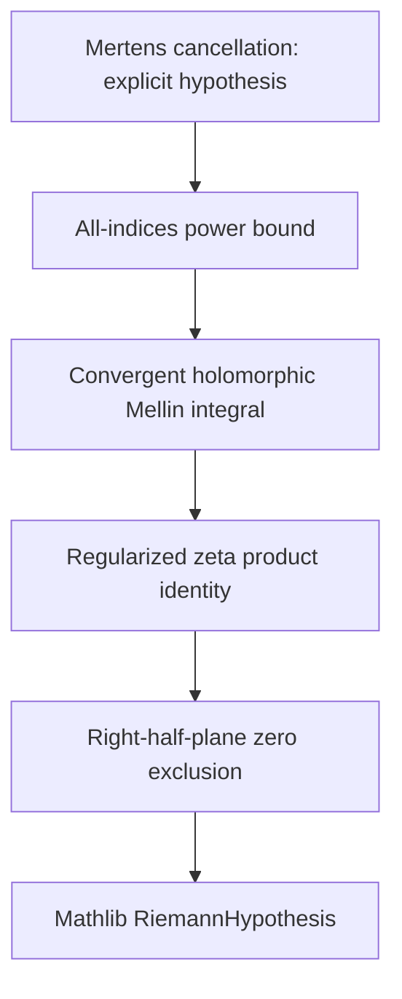

# Native RH routes: source audit and implementation

## Result and scope

The new arithmetic endpoint is a complete conditional Lean theorem:

```lean
riemannHypothesis_of_mertensSquareRootCancellation
    (hM : MobiusMertensRHEquivalence.MertensSquareRootCancellation) :
    _root_.RiemannHypothesis
```

It proves the analytic continuation and zero exclusion from the existing
arithmetic cancellation statement. It does not prove that statement, the
reverse implication, or unconditional RH. The premise is the actual estimate
on the summatory native Möbius coefficients, not an assumed zero-free region
or a replacement proposition named `RH`.

The branch also connects the existing finite Mangoldt sums to real cutoffs
and finite Mellin transforms, and specializes a quantitative real domain
residual estimate to the existing unbounded ℓ² operator. Every promoted result
has a native proof. The [contract](CENTERED_MANGOLDT_ROUTE_CONTRACT.md) records
the intake, exact hypotheses, provenance, and acceptance boundaries.

## 1. Search method and provenance

The implementation starts from upstream main
`586c14bc9fb94eb09b56f7dc850d9d5297269f91`, with the unchanged prerequisite
branches from #421 and #422 combined explicitly. The source search covered
definitions, theorem statements, imports, consumers, alternate `src` owners,
and the categorical infrastructure map. Searches included actual zeta/xi,
von Mangoldt, Möbius/Mertens, Mellin/Landau, real Hilbert domains, Krein
neutrality, finite Weil forms, and completed GNS constructions.

This is a bounded source audit. The checkout has declaration-DAG documentation
but no local generated declaration/edge graph; a fresh whole-repository graph
query is not claimed. Filenames, docstrings, proposed packets, and archived
transcripts were not treated as proofs of their interpretations.

The external `CocoSgt/riemann-hypothesis-lean` mirror was inspected at
`7cbf7a0c32fca1badf05931879a37c3f8a2b03b4`. The zeta-only Landau import closure
has 18 repository files and 2,338 source lines. Its mathematical contracts
provide a useful comparison, but its README reports no stated source license.
The new owners do not copy and relabel its proof bodies. They are implemented
directly against the upstream-pinned Mathlib APIs. The external full claimed
RH/GRH development has not been certified by this PR.

## 2. The completed conditional Möbius route

### Existing arithmetic data

`MobiusMertensRHEquivalence.mertensFunction N` is the integer sum of native
Möbius coefficients over `Finset.range (N + 1)`. The existing
`MertensSquareRootCancellation` proposition is exactly

\[
\forall\varepsilon>0,\qquad M(N)=O(N^{1/2+\varepsilon}).
\]

Under that cancellation hypothesis, the existing owner proves, for every
`r > 1/2`, an all-indices bound

\[
|M(N)|\le C(N+1)^r,\qquad C\ge0.
\]

The older file establishes ordered real-series convergence from such bounds;
its name alone does not establish the RH equivalence. The new owner supplies
the forward analytic implication.

### Actual integral and analytic continuation

`ActualRiemannZetaMobiusLSeriesBridge` already proves

\[
\frac1{\zeta(s)}=s\int_1^\infty M(\lfloor x\rfloor)x^{-s-1}\,dx
\qquad(\Re s>1).
\]

Its coefficient-sum identification is promoted from private to public with
the proof unchanged. The continuation owner reuses that theorem rather than
introducing another Mertens function or Möbius coefficient model.

Define the cutoff `f(x) = 1_(1,∞)(x) M(floor(x))` and
`F(s) = s * mellin f (-s)`. Native Mellin uses `x^(z-1)`, so this is exactly
the integral above. The proof establishes:

1. Local integrability of the actual step function, using the native finite
   coefficient-sum theorem and a measurable indicator.
2. The bound `f = O(x^r)` at infinity from `floor(x)+1 ≤ 2x` for `x > 1`.
3. Every power bound at zero, since the cutoff vanishes there.
4. `MellinConvergent f (-s)` and complex differentiability of `F` whenever
   `r < s.re`, using native Mellin differentiation.

For `0 ≤ r < 1`, native `riemannZeta₁` is an entire function satisfying
`riemannZeta₁(1) = 1` and `riemannZeta₁(s) = (s-1)ζ(s)` away from one.
The identity theorem on the connected open half-plane `r < s.re` extends

\[
\operatorname{riemannZeta}_1(s)F(s)=s-1
\]

from a neighborhood of `s = 2`. This formulation handles the pole explicitly.
It does not assume that unregularized zeta is holomorphic at one or identify
`F(1)` with the inverse of Mathlib's totalized zeta value there.

At `s ≠ 1`, a zeta zero would make the left side zero and force `s = 1`.
For each `Re s > 1/2`, choose
`1/2 < r < min(Re s,1)` and apply the existing cancellation growth theorem.
The native half-plane reduction from #422 then supplies RH.



The existing zeta/Möbius owner also proves that native unordered
`LSeriesSummable` fails for Möbius coefficients when `Re s ≤ 1`. The new proof
respects this: continuation below one uses the integral, not a false absolute
Dirichlet-series convergence assertion.

## 3. Mangoldt smoothing: new unconditional finite and local analysis

Write

\[
S_N=\sum_{0\le n\le N}\Lambda(n)(N/n-1),\qquad
G(x)=S(x)-x\log x+(1+\gamma)x.
\]

All coefficients, the Euler--Mascheroni constant, and the finite Chebyshev
sum are the existing native owners. The zero term vanishes because `Λ(0)=0`.
PR #421 already supplies

\[
S_{N+1}-S_N=A_N,\qquad
S_{N+2}-2S_{N+1}+S_N=\frac{\Lambda(N+1)}{N+1}.
\]

The new real cutoff sum uses `floor(x)` and agrees with `S_N` at every natural
cutoff. For `0 ≤ t ≤ 1`, it proves

\[
S(N+t)=(1-t)S_N+tS_{N+1},
\]

including `t=1`, where the newly admitted arithmetic term has zero kernel.
Consequently

\[
G(N+t)=(1-t)G(N)+tG(N+1)+E_N(t).
\]

Native convexity of `x log x`, together with convexity of
`x²/(2N)-x log x` on `x ≥ N > 0`, gives

\[
0\le E_N(t)\le\frac{t(1-t)}{2N}\le\frac1{8N}.
\]

For `α ≥ 0`, `C ≥ 0`, and `η ≤ 1`, an eventual integer bound
`ηG(N) ≤ C N^α` therefore yields the explicit real bound

\[
\eta G(x)\le\left(2^\alpha C+\frac18\right)x^\alpha
\qquad(x\ge\max(N_0,1)).
\]

The converse follows by evaluating at integer cutoffs. The epsilon-family
equivalence retains the same `η` outside the epsilon quantifier. In particular
both fixed signs are supported without turning a one-sided bound into an
absolute bound.

The centered second difference is

\[
\Delta^2G(N)=\frac{\Lambda(N+1)}{N+1}-\Delta^2(x\log x)(N).
\]

It is strictly negative whenever `N+1` is not a prime power. Thus uncentered
discrete convexity does not transfer to the centered statistic and cannot
by itself prove its square-root cancellation.

### Mellin kernel and finite arithmetic connection

For `a ≥ 1`, `Re s > 1`, the native kernel owner proves integrability and

\[
\int_1^\infty\max(x/a-1,0)x^{-s-1}\,dx
=\frac{a^{-s}}{s(s-1)}.
\]

The proof reduces the kernel to two improper complex powers on `x > a`.
Integrability is proved before subtracting their integrals.

The finite arithmetic consumer forms

\[
T_N(x)=\sum_{0\le n\le N}\Lambda(n)\max(x/n-1,0).
\]

It agrees with the actual real cutoff sum when `0 ≤ x` and `floor(x) ≤ N`.
Finite integration gives the corresponding finite Dirichlet polynomial over
`s(s-1)`, again with explicit integrability. No infinite series/integral
interchange follows merely by taking a large finite cutoff.

### Remaining Mangoldt analytic work

The infinite centered Mellin identity, its interchange justification, and the
one-sided Landau positivity argument remain separate obligations. The external
Landau source targets a conditional route from a fixed-sign centered bound;
this PR does not import that cone or claim to have proved that bound.
The complete conditional RH endpoint implemented here is the Möbius route
described above.

## 4. Real operators: exact quantitative endpoint and concrete reuse

For a real inner-product space, an actual submodule domain `D`, and
`K : D →ₗ[ℝ] H`, assume the domain skew-symmetry identity. At a vector `v`,
assume only `inner ℝ v (J v) = 0` for the real linear clock map `J`. Then

\[
\|Kv-bJv-av\|^2=\|Kv-bJv\|^2+a^2\|v\|^2,
\qquad
|a|\|v\|\le\|Kv-bJv-av\|.
\]

A nonzero exact mode has `a=0`; normalized approximate modes have residual at
least `|a|`. The proof uses native real inner products and norm definiteness.
It needs no boundedness, completeness, or domain invariance of `J`.

The concrete consumer applies this theorem to the existing
`K_max : D_max →ₗ[ℝ] H_lp`, using `K_max_skew_symmetric`, and proves
injectivity of every nonzero real shift on that same maximal domain.
The existing operator is genuinely unbounded; it is not replaced by a scalar
or finite-dimensional model.

The missing arithmetic theorem is still a construction of a suitable nonzero
domain mode from each relevant actual xi/zeta zero. None of the new operator
results assumes that construction in a packet and then calls the packet a
proof of it.

## 5. Other inspected routes and rejected shortcuts

| Existing source route | What the source supplies | Smallest missing or invalid step |
|---|---|---|
| `LatticeHilbertPolyaPipeline` | Self-adjoint eigenvalue reality; conditional zero-to-eigenvector statement | Construct the arithmetic spectral realization. A bounded operator cannot directly encode unbounded zero heights as unbounded eigenvalues. |
| `UnboundedHilbertResolventAndC0GroupWitness` | Actual real ℓ² domain, skew symmetry, resolvent inverse identities, group isometries | Arithmetic mode construction. The structure named `C0GroupGenerator` has no time-continuity or generator-derivative field, so its name is not a proof of those properties. |
| `Krein/PontryaginSpace` | Nonreal eigenvalues imply neutral vectors; concrete indefinite examples | Arithmetic modes must be nonneutral. Nonzero does not imply nonzero Krein norm. |
| Finite matrix/GNS/Cl11 colimits | Actual positive states, Hilbert completions, and represented Clifford actions | Identify the actual arithmetic Weil form and prove the required compatibility or analytic limit. |
| `HestenesKreinWeilCriterionColimit` | Conditional transport through supplied readout/kernel and criterion assumptions | Its final `RH : Prop` and criterion are parameters; the proof uses a finite stage and does not construct the arithmetic analytic limit. |
| `External/Auto/ZetaSpectralBridge` | Implication under global determinant/bridge assumptions | The joint global assumptions also place the trivial zero `s=-2` on the critical line. They cannot supply a realization of native zeta. |
| `Arithmetic/MajoranaPolyaHilbert/HilbertPolya` | A structure field called `selfAdjointOperator` and later scalar readouts | The field's type does not assert adjointness; an actual Hilbert operator and arithmetic realization are still needed. |
| Finite Weil/Mangoldt quadratic forms | Finite coefficient forms; symmetry from self-adjoint data | Symmetry is not positivity; missing arithmetic positivity and identification must be proved. |

The proper entire xi owner regularizes the endpoint values; the naive totalized
product `s(s-1) completedRiemannZeta(s)` is not a substitute for its global
zero statement. The arithmetic route above uses native zeta and its native
regularization directly.

## 6. Verification boundaries

The focused package is `verification/riemann-routes`. It reads canonical source
files and uses exactly the root Lean/Mathlib pins. The explicit public inventory,
fresh Lean axiom report, compilation, static screens, independent semantic
review, and independent QA are distinct checks and are recorded separately.

The full root build remains blocked during dependency resolution by the absent
configured path `external_refs/homotopy-hypothesis-lean4`. Focused success does
not certify root umbrella integration. Publication is a draft PR against
upstream main, with the prerequisite branches included explicitly.

The central unresolved mathematics is visible: Mertens or centered Mangoldt
cancellation, or an actual zero-to-domain-mode construction. The implemented
results reduce the remaining work without asserting those inputs as facts.
